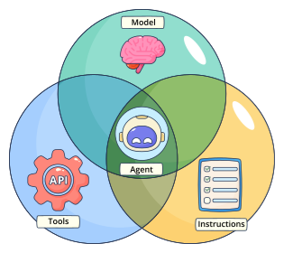
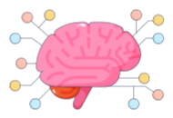

# Core_Agent_Components_in_AI_Architecture_for_Autonomous_Systems

Source: https://www.educative.io/courses/agentic-ai-systems/agent-architecture-core-agent-components

---

[Home](https://www.educative.io/)

[Courses](https://www.educative.io/search?tab=courses)

[Agentic System Design](https://www.educative.io/courses/agentic-ai-systems)

# Agent Architecture: Core Agent Components

Explore the fundamental components of AI agents: the model for decision-making, tools for external actions, and instructions to guide behavior. Understand how these parts interact to build adaptable, reliable, and scalable agentic systems capable of handling complex multi-step tasks across diverse environments.

We'll cover the following...

- [The model: Choosing the agent’s brain](https://www.educative.io/courses/agentic-ai-systems/agent-architecture-core-agent-components#The-model-Choosing-the-agents-brain)
- [The tools: Acting in the environment](https://www.educative.io/courses/agentic-ai-systems/agent-architecture-core-agent-components#The-tools-Acting-in-the-environment)
- [The instructions: Shaping agent behavior](https://www.educative.io/courses/agentic-ai-systems/agent-architecture-core-agent-components#The-instructions-Shaping-agent-behavior)
- [How do these components work together](https://www.educative.io/courses/agentic-ai-systems/agent-architecture-core-agent-components#How-do-these-components-work-together)
- [Quiz](https://www.educative.io/courses/agentic-ai-systems/agent-architecture-core-agent-components#Quiz)
- [Summary](https://www.educative.io/courses/agentic-ai-systems/agent-architecture-core-agent-components#Summary)

Agents are not black boxes. They are systems made from distinct, configurable components. These components are the fundamental building blocks for designing robust, and scalable agentic AI systems. At the center are three foundational elements:

Core components of an AI agent

- The **model**, which interprets inputs and reasons through decisions.
- The **tools**, which let the agent interact with external systems.
- The **instructions**, which guide how the agent behaves, communicates, and prioritizes goals.

By choosing and combining these elements thoughtfully, we can shape an agent to fit a specific task, domain, or environment. In this lesson, we will explore each component in depth. We’ll examine what role it plays, how to select or design it, and how it contributes to the overall system.

By the end of this lesson, you will be able to:

- Explain model selection factors.
- Describe how tools enable agent action.
- Recognize the role of instructions in agent behavior.
- Understand component interaction within an agent system.

## The model: Choosing the agent’s brain[#](https://www.educative.io/courses/agentic-ai-systems/agent-architecture-core-agent-components#The-model-Choosing-the-agents-brain)

The model sits at the center of the agent’s decision-making process. Given some input, such as a user prompt or an observed event, the model can understand what the user is asking or what the situation requires, decide what steps or actions should be taken to achieve a goal. It can choose how to proceed, either by taking a specific action, or by invoking another tool. In more advanced agents, the model may also evaluate whether its past decisions were successful.

The idea of a model evaluating its own decisions is a powerful technique often called **reflection or self-critique**. Advanced agents can be designed to critique their own plans or tool outputs, and then loop back to correct them. This makes them far more robust and adaptive. We’ll explore this technique in detail while exploring real-world agentic systems.

In most agents today, the role of a model is filled by LLMs. Large language models work well as agent brains because they are:

- **Flexible:** They can understand a wide variety of tasks expressed in natural language.
- **Compositional:** They can break tasks into subtasks and generate coherent, multi-step reasoning chains.
- **Adaptable:** They generalize well to new domains without retraining.

For example, when you give an agent the prompt:

> “Book me the earliest flight from Seattle to New York tomorrow morning and notify my assistant.”

The model interprets the request, determines that two subtasks are involved (flight booking and notification), and generates a plan to achieve both. This may include selecting tools, calling APIs, or composing messages.

The type and configuration of that model can vary widely. Our goal is not to always use the largest or most capable model. Instead, we aim to select a model that fits the task, responds efficiently, and works reliably in context. Here are the key factors we consider:

Factors to consider while choosing a large language model for reasoning in agentic systems

- **Task complexity:** Some tasks are straightforward, such as extracting values from text or generating summaries. For these, smaller models such as Mistral or Gemma may be sufficient. More complex tasks that require planning, judgment, or creativity tend to benefit from more capable models like GPT-6 or Claude Opus 4.1.
- **Latency:** In scenarios where users expect fast responses, such as live chats or interactive tools, we choose models that are optimized for low-latency performance. This helps maintain a smooth user experience.
- **Cost:** Running large models repeatedly can be expensive. When building agents that handle frequent requests, we consider cost per query, and may opt for more efficient models when possible. In some designs, we mix models by using smaller ones for routine steps and calling larger models only when needed.
- **Context length:** Agents that need to handle long conversations or documents require models that support extended context windows. Models like Claude 3 Sonnet and Gemini 1.5 are designed for these situations, and help the agent retain more relevant information.

By making thoughtful model choices, we ensure the agent stays responsive, affordable, and aligned with its purpose. The model is the brain. But even the smartest brain needs the right setup to perform well.

## The tools: Acting in the environment[#](https://www.educative.io/courses/agentic-ai-systems/agent-architecture-core-agent-components#The-tools-Acting-in-the-environment)

While the model allows an agent to think and plan, tools give it the power to act. In agentic systems, a tool is any external function, API, or environment that the agent can use to perform real-world tasks. Tools allow the agent to do more than generate text. They let it interact with systems, gather live data, and make meaningful changes in its environment.

Tools come in many forms, such as:

- APIs for fetching weather, sending emails, or creating calendar events.
- Web search for retrieving the latest information.
- Code execution environments for running logic or calculations.
- Databases for structured data storage and lookup.
- Device interfaces or robotic controls for physical world interactions.

Let’s say we ask our agent:

> “Check tomorrow’s weather and message me if it looks rainy.”

To complete this, the agent may:

- Call a weather API with the location and date.
- Parse the forecast and decide if rain is expected.
- Use a messaging API to send an alert.

Without tools, the agent can only simulate this task in text. With tools, it can carry out the request in full. Tools make the agent useful in practice. They allow it to access live data, complete actions, and integrate into real workflows.

## The instructions: Shaping agent behavior[#](https://www.educative.io/courses/agentic-ai-systems/agent-architecture-core-agent-components#The-instructions-Shaping-agent-behavior)

Even with a powerful model and a set of tools, an agent cannot operate effectively without clear instructions. Instructions serve as the guiding framework for what the agent should do, how it should behave, and which goals it should prioritize. It’s important to understand that instructions are primarily the directives and context we provide to the model to shape its behavior, rather than a separate, active runtime component like a tool. We can think of instructions as the bridge between raw capability and purposeful behavior. They shape the agent’s responses, influence its decisions, and define its boundaries.

Instructions come in many forms, depending on how the agent is implemented. These may include:

- A natural language prompt that sets the task.
- A system message that defines the agent’s role and personality.
- A set of examples that demonstrate how to handle different scenarios.
- Constraints, such as ethical boundaries or formatting rules.
- Task definitions, such as “summarize,” “extract entities,” or “use tool A if X is true.”

This process of carefully crafting instructions, through natural language prompts and system messages, is referred to as [prompt engineering](https://www.educative.io/courses/prompt-engineering-guide), a critical skill in designing effective LLM-powered agents.

For example, when we prompt a customer service agent with:

> “You are a helpful support assistant. Always respond politely, and escalate issues if the user sounds frustrated.”

We are not giving the agent a specific task to complete. Instead, we are shaping how it should interpret and respond to future inputs. These kinds of high-level instructions are essential for aligning the agent’s behavior with our goals.

Well-crafted instructions help us as they:

- **Align the agent’s output with user expectations:** By defining tone, role, and priorities, we make the agent’s behavior more predictable and useful.
- **Guide reasoning and tool use:** If we instruct the agent to solve a task step-by-step, it will reason differently than if we ask for a direct answer.
- **Control safety and constraints:** By including limitations or ethical boundaries, we reduce the chance of undesired or unsafe behavior.

We don’t need to hard-code every decision an agent might make. Instead, we provide well-crafted instructions that act as the agent’s compass.

## How do these components work together[#](https://www.educative.io/courses/agentic-ai-systems/agent-architecture-core-agent-components#How-do-these-components-work-together)

Models, tools, and instructions each play a distinct role, but they don’t function in isolation. In a complete agent system, these elements interact constantly to support decision-making and action.

How agent components work together

Here’s a simplified view of how they connect:

1. **Instructions set the stage:** They define the agent’s role, goals, and boundaries. This context shapes everything that follows.
2. **The model does the thinking:** Given input and instructions, the model interprets the situation, reasons through options, and decides how to proceed.
3. **Tools handle the doing:** If an action is required, such as retrieving data, sending a message, or triggering a process, the agent selects and invokes the right tool.

These steps may loop or repeat depending on the task, but the core pattern stays the same: guided reasoning (model), purposeful action (tools), and alignment through instructions. By designing each component carefully and ensuring they work together seamlessly, we give our agent the ability to act intelligently, adaptively, and safely across different situations.

**Why modular agent design?**  
Structuring agents around models, tools, and instructions is at the heart of agentic system design because it prioritizes flexibility, scalability, and maintainability. By adopting this modular approach, we can:

- Easily upgrade or swap out models as technology advances, without overhauling the entire system.
- Integrate new tools to extend agent capabilities, allowing for rapid expansion without redesigning the core agent.
- Adjust instructions to adapt agent behavior for new domains, user needs, or evolving requirements, maintaining agility.
- Improve testing and debugging by isolating issues to specific components, rather than searching through a monolithic system.
- Enable fault isolation, where a failure in one modular part is less likely to bring down the entire agent, increasing system resilience.
- Foster extensibility and flexible behaviors, making it easier to add new functionalities or reconfigure existing ones for diverse tasks.

This modularity enables us to build systems that are robust, adaptable, and easy to evolve as needs change, which is crucial for long-term deployment and success in dynamic AI environments. Furthermore, this foundational modularity is what enables more advanced agentic system design patterns, such as chaining, routing, and sophisticated multi-agent orchestration. We will explore these in subsequent lessons to build truly robust and production-ready systems.

Let’s walk through a familiar task: scheduling a meeting.

We tell our agent,

> “Set up a meeting with Sarah next week to discuss the roadmap.”

Here’s how an agent might accomplish this multi-step task, leveraging its core components:

1. **Perceive and plan:** The agent receives and parses the user’s instruction. It then formulates a plan to achieve the goal, identifying necessary sub-steps.

   1. **Components used:** Model (for understanding and planning), instructions (for guiding the task).
2. **Gather information:** The agent executes steps to check availability, such as querying your and Sarah’s calendar.

   1. **Components used:** Tools (e.g., Calendar API to access schedules).
3. **Execute action:** Based on the available slots, the agent formats and sends a meeting invitation.

   1. **Components used:** Tools (e.g., Email API to send the invite), model (for formatting the email content).
4. **Confirm completion:** If the invite is accepted, the agent confirms that the task is complete.

   1. **Components used:** Tools (e.g., Calendar API for invite status), model (for interpreting status and confirming).

This example illustrates the dynamic interplay between the agent’s reasoning (model), its ability to interact with external systems (tools), and the guidance provided by its initial setup (instructions) to complete a real-world task.

## Quiz[#](https://www.educative.io/courses/agentic-ai-systems/agent-architecture-core-agent-components#Quiz)

Technical Quiz

1.

You are designing a customer-facing AI agent for a multilingual e-commerce platform. The agent must:

- Answer user queries about product availability and shipping timelines.
- Provide responses in the user’s language.
- Prioritize a courteous tone.
- Minimize response time due to high traffic.
- Access a real-time product inventory system via API.

Which architectural decisions violate best practices for modular agent design and are most likely to cause maintainability issues as the system scales?

A.

Embedding hardcoded inventory information directly in the model prompt to avoid tool calls, and reduce latency.

B.

Using a small, fast model for language detection and a larger model for multilingual customer support.

C.

Implementing an API wrapper as a tool that interfaces with the live inventory system.

D.

Defining system instructions to enforce a courteous tone and guide the use of API tools.

---

1 / 1

## Summary[#](https://www.educative.io/courses/agentic-ai-systems/agent-architecture-core-agent-components#Summary)

In this lesson, we learned that every AI agent relies on three key components: a model for reasoning, tools for taking action, and instructions for guiding behavior. The model interprets input and generates plans. Tools enable the agent to interact with external systems. Instructions define the agent’s role, tone, and boundaries. We also explored how these parts come together.

Introduction to AI Agents

Agent Architecture: Components Interaction and Agent Memory

Ask

[The model: Choosing the agent’s brain](https://www.educative.io/courses/agentic-ai-systems/agent-architecture-core-agent-components#The-model-Choosing-the-agents-brain)

[The tools: Acting in the environment](https://www.educative.io/courses/agentic-ai-systems/agent-architecture-core-agent-components#The-tools-Acting-in-the-environment)

[The instructions: Shaping agent behavior](https://www.educative.io/courses/agentic-ai-systems/agent-architecture-core-agent-components#The-instructions-Shaping-agent-behavior)

[How do these components work together](https://www.educative.io/courses/agentic-ai-systems/agent-architecture-core-agent-components#How-do-these-components-work-together)

[Quiz](https://www.educative.io/courses/agentic-ai-systems/agent-architecture-core-agent-components#Quiz)

[Summary](https://www.educative.io/courses/agentic-ai-systems/agent-architecture-core-agent-components#Summary)