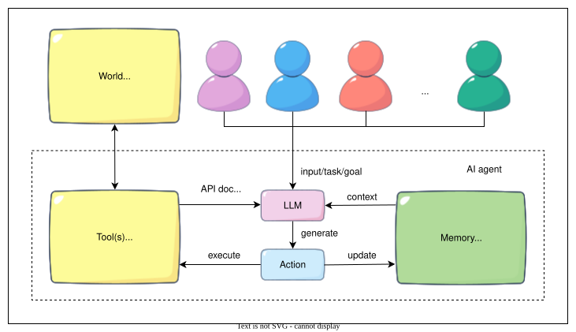

# Understanding_AI_Agent_Architecture_and_Memory_Systems

Source: https://www.educative.io/courses/agentic-ai-systems/agent-architecture-components-interaction-and-agent-memory

---

[Home](https://www.educative.io/)

[Courses](https://www.educative.io/search?tab=courses)

[Agentic System Design](https://www.educative.io/courses/agentic-ai-systems)

# Agent Architecture: Components Interaction and Agent Memory

Explore how AI agents integrate perception, reasoning, tools, and memory to operate intelligently over time. Understand the agent loop, environmental sensing, and memory types that enable coherent, context-aware behavior in complex, real-world tasks.

We'll cover the following...

- [The architecture blueprint](https://www.educative.io/courses/agentic-ai-systems/agent-architecture-components-interaction-and-agent-memory#The-architecture-blueprint)
- [Environmental sensing: Giving agents perception](https://www.educative.io/courses/agentic-ai-systems/agent-architecture-components-interaction-and-agent-memory#Environmental-sensing-Giving-agents-perception)
  - [Examples of perception in practice](https://www.educative.io/courses/agentic-ai-systems/agent-architecture-components-interaction-and-agent-memory#Examples-of-perception-in-practice)
  - [Where does perception happen in the agent workflow?](https://www.educative.io/courses/agentic-ai-systems/agent-architecture-components-interaction-and-agent-memory#Where-does-perception-happen-in-the-agent-workflow)
- [Memory systems: How agents remember and retrieve](https://www.educative.io/courses/agentic-ai-systems/agent-architecture-components-interaction-and-agent-memory#Memory-systems-How-agents-remember-and-retrieve)
  - [Different types of agent memory](https://www.educative.io/courses/agentic-ai-systems/agent-architecture-components-interaction-and-agent-memory#Different-types-of-agent-memory)
    - [Short-term memory](https://www.educative.io/courses/agentic-ai-systems/agent-architecture-components-interaction-and-agent-memory#Short-term-memory)
    - [Long-term memory](https://www.educative.io/courses/agentic-ai-systems/agent-architecture-components-interaction-and-agent-memory#Long-term-memory)
    - [External or knowledge memory](https://www.educative.io/courses/agentic-ai-systems/agent-architecture-components-interaction-and-agent-memory#External-or-knowledge-memory)
  - [How memory operates across the agent loop](https://www.educative.io/courses/agentic-ai-systems/agent-architecture-components-interaction-and-agent-memory#How-memory-operates-across-the-agent-loop)
- [Putting it all together: A complete agent loop](https://www.educative.io/courses/agentic-ai-systems/agent-architecture-components-interaction-and-agent-memory#Putting-it-all-together-A-complete-agent-loop)
- [Case study: Designing a context-aware customer support agent](https://www.educative.io/courses/agentic-ai-systems/agent-architecture-components-interaction-and-agent-memory#Case-study-Designing-a-context-aware-customer-support-agent)

In the previous lesson, we explored the three core components of an AI agent: the model that reasons, the tools that perform actions, and the instructions that guide behavior. But a functioning agent needs more than a reasoning engine and some tools. If we want agents to behave intelligently across time and context, they must also perceive their surroundings and remember what has happened.

In this lesson, we’ll expand our view from individual components to complete agent systems. We’ll explore how agents gather input through environmental sensing, how they maintain continuity with memory, and how these systems fit into the overall workflow that drives interaction over time.

By the end of this lesson, we will be able to:

- Identify how memory systems and perception extend basic agent functionality.
- Understand where memory and sensing occur in the agent’s reasoning loop.
- Explain how external data retrieval, such as with vector databases, supports long-term behavior.
- Recognize how real-world agents use these capabilities to respond adaptively and intelligently.

## The architecture blueprint[#](https://www.educative.io/courses/agentic-ai-systems/agent-architecture-components-interaction-and-agent-memory#The-architecture-blueprint)

We can think of the agent architecture as a control flow that connects four primary elements of functioning agents:

- **Input interface:** The agent receives information from the environment or a user. This can include text prompts, sensor data, API signals, or even multimodal inputs like audio or images.
- **Reasoning core (the model):** The language model interprets the input, plans the next steps, and determines which tools or actions to use. This step involves both logic and language understanding.
- **Tools and actions:** Based on its reasoning, the agent may call APIs, fetch documents, send responses, or trigger physical actions if it is connected to hardware.
- **Memory and context:** To maintain continuity, the agent may store or retrieve past information, such as conversational history, retrieved documents, or long-term user preferences.

This architecture directly builds on our previous lesson’s core components: the reasoning core is powered by the model and guided by the instructions (often through a system prompt). Meanwhile, the input interface and memory provide the necessary context for it to operate effectively and interact with the world.

While these four elements form the foundational control loop, advanced agentic systems often incorporate additional specialized or layered components for specific functions. These include robust safety layers or detailed monitoring interfaces. These build upon the core architecture to enable more sophisticated and reliable behaviors, which we will explore in later lessons.

The illustration below shows how these elements interact in an agentic system:

AI agent architecture diagram: LLM-based AI agent and their interaction

This system operates in a loop. The agent receives input, reasons, acts, observes the outcome, and continues. Each part reinforces the others. The reasoning depends on perception and memory. The actions influence future inputs. Memory connects all past steps with the present. By designing this control loop thoughtfully, we create agents that do not just respond, but learn from interaction, adapt to context, and behave consistently over time.

Understanding this continuous architectural loop is paramount for agentic system design. It represents a core principle, providing the essential blueprint for how intelligent agents function, learn, adapt, and evolve within dynamic environments.

## Environmental sensing: Giving agents perception[#](https://www.educative.io/courses/agentic-ai-systems/agent-architecture-components-interaction-and-agent-memory#Environmental-sensing-Giving-agents-perception)

For an agent to respond intelligently, it must first perceive what is happening around it. This ability to sense the environment is what makes an agent reactive, adaptable, and grounded in the real world.

In traditional AI systems, perception was often limited to structured inputs like form fields or fixed command lines. Today’s agents, however, must be able to interpret a variety of input types, including natural language, images, audio, and other data streams. This process is known as **environmental sensing**.

When we give agents the ability to observe their surroundings, we unlock several important capabilities:

- **Context awareness:** The agent can understand the situation it is operating in, such as a user’s previous commands, the contents of a document, or the current state of a device.
- **Multimodal interaction:** The agent can process and respond to different types of inputs, such as a question spoken aloud, an uploaded image, or a live data stream.
- **Dynamic reactivity:** Instead of waiting for static commands, the agent can monitor for changes in its environment and respond proactively.

### Examples of perception in practice[#](https://www.educative.io/courses/agentic-ai-systems/agent-architecture-components-interaction-and-agent-memory#Examples-of-perception-in-practice)

Agents that use environmental sensing are already appearing in a wide range of applications:

- A virtual assistant that uses a speech-to-text (STT) model to convert voice commands into text the agent can reason about, and reads text from a calendar.
- A customer support agent that uses a multimodal vision model or optical character recognition (OCR) to extract text and meaning from an uploaded screenshot to understand the issue.
- A factory monitoring agent that receives sensor readings and adjusts machine settings in real time.
- A document-based agent that reads PDFs or spreadsheets to answer user questions.

Each of these examples shows how perception expands the agent’s reach. It is not enough to reason and act. The agent must also observe.

### Where does perception happen in the agent workflow?[#](https://www.educative.io/courses/agentic-ai-systems/agent-architecture-components-interaction-and-agent-memory#Where-does-perception-happen-in-the-agent-workflow)

In a complete functioning agent system, perception happens at the very beginning of the loop. The agent collects information from its environment, and prepares it for reasoning.

This step often involves:

- Converting speech to text.
- Extracting text from an image using OCR.
- Parsing JSON from an API.
- Identifying intent from a natural language prompt.

Different models or tools may handle each of these tasks. Regardless of the source, the agent’s goal is always the same: to transform raw inputs into meaningful signals it can use to decide what to do next.

## Memory systems: How agents remember and retrieve[#](https://www.educative.io/courses/agentic-ai-systems/agent-architecture-components-interaction-and-agent-memory#Memory-systems-How-agents-remember-and-retrieve)

In order to behave intelligently across multiple steps, agents must be able to remember what has already happened. Without memory, every interaction feels disconnected. The agent cannot recall what the user asked earlier, what actions it has already taken, or what information it has retrieved.

Memory helps an agent:

- Stay coherent in multi-turn conversations.
- Avoid repeating questions or actions.
- Make decisions based on what it previously learned or observed.
- Maintain a sense of progress toward a goal.

For example, if a user asks an AI travel assistant to “book the same hotel as last time,” the agent needs memory to recall which hotel was booked before. Without that, the agent would ask again or give a generic answer.

This ability to refer back, build context, and learn from experience is what transforms an agent from a reactive tool into a goal-driven assistant.

### Different types of agent memory[#](https://www.educative.io/courses/agentic-ai-systems/agent-architecture-components-interaction-and-agent-memory#Different-types-of-agent-memory)

Just like humans rely on different kinds of memory to function, AI agents use multiple layers of memory to handle different tasks. These memory types vary in scope, purpose, and persistence.

Here are the three most common types:

An agent’s memory functions on multiple levels, beginning with short-term context for recent conversations, moving to long-term storage for learned experiences, and extending to vast external knowledge bases

#### Short-term memory[#](https://www.educative.io/courses/agentic-ai-systems/agent-architecture-components-interaction-and-agent-memory#Short-term-memory)

This type of memory holds recent context, typically within a single session or interaction. It allows the agent to keep track of what was just said or done.

For example, in a multi-turn conversation:

- The agent remembers what the user asked two messages ago.
- It tracks follow-up questions or clarifications.

Short-term memory is often implemented using in-session context windows or lightweight memory buffers.

#### Long-term memory[#](https://www.educative.io/courses/agentic-ai-systems/agent-architecture-components-interaction-and-agent-memory#Long-term-memory)

This memory persists across sessions. It stores important information that the agent might need to refer back to in the future.

Examples include:

- A user’s preferences or settings.
- Notes about past decisions or outcomes.
- Historical interactions or completed tasks.

Long-term memory may require explicit storage and retrieval mechanisms, often backed by databases.

#### External or knowledge memory[#](https://www.educative.io/courses/agentic-ai-systems/agent-architecture-components-interaction-and-agent-memory#External-or-knowledge-memory)

This refers to the agent’s ability to look up relevant information from outside sources, such as documents, knowledge bases, or APIs.

Rather than trying to “remember” everything directly, the agent can:

- Search a knowledge base.
- Retrieve matching documents.
- Pull facts from external systems.

This is where techniques like [retrieval-augmented generation (RAG)](https://www.educative.io/courses/rag-llm) and [vector databases](https://www.educative.io/courses/vector-database) come into play.

Each memory type plays an important role in helping the agent act consistently, answer intelligently, and scale to more complex tasks. While short-term memory is fleeting, both long-term and external knowledge memory require robust, persistent storage and efficient retrieval. For this, databases are crucial, with vector databases being particularly effective for storing and retrieving data based on semantic similarity. They achieve this by representing information as numerical embeddings, enabling agents to access contextually relevant information from vast knowledge bases. This can be done even without exact keyword matches. Crucially, the agent doesn’t load the entire knowledge base into its active memory. Instead, the vector database allows it to perform a highly efficient semantic search to retrieve only the most relevant snippets of information needed for the current task.

### How memory operates across the agent loop[#](https://www.educative.io/courses/agentic-ai-systems/agent-architecture-components-interaction-and-agent-memory#How-memory-operates-across-the-agent-loop)

Now that we’ve explored what memory is and how it works, let’s place it into the overall agent loop. Memory is not a single step. Instead, it supports the agent at multiple points in its reasoning cycle.

Memory supports an agent by being retrieved before reasoning, used during decision-making, and updated after an action is taken

Here’s how it plays out:

- **Before reasoning:** The agent retrieves relevant memories or external facts. This could include previous messages, stored preferences, or related documents. Retrieval happens before the agent decides what to do.
- **During decision-making:** The agent uses that memory as part of its context window. This helps it stay grounded, avoid repetition, and tailor its response to what it already knows.
- **After taking action:** The agent may store new information, such as the user’s latest input or the outcome of an API call. This becomes part of future memory and can be retrieved in later steps.

Whether the agent is answering questions, solving problems, or executing tasks, memory allows it to carry forward experience, adjust to changing inputs, and build long-term understanding over time.

This looping behavior of sensing, recalling, deciding, acting, and remembering enables agents to operate effectively in realistic and evolving environments.

## Putting it all together: A complete agent loop[#](https://www.educative.io/courses/agentic-ai-systems/agent-architecture-components-interaction-and-agent-memory#Putting-it-all-together-A-complete-agent-loop)

So far, we’ve explored the key components of an agent: perception, reasoning, memory, and action. But how do these elements work together in practice?

An agent’s complete process

Let’s walk through a full cycle of how an agent operates during a task:

1. **Perceive:** The agent begins by observing its environment. This could mean receiving a user message, reading a file, or detecting input from a sensor. The input is processed and converted into a form the agent can understand.
2. **Recall:** Next, the agent pulls in any relevant memories or background knowledge. It may retrieve past user interactions or look up related information from a vector database.
3. **Reason and plan:** With input and context in hand, the agent decides what to do. This may involve interpreting intent, breaking down the task into steps, or choosing tools to use.
4. **Act:** The agent then executes one or more actions. It might call an API, send a message, update a file, or take a physical step if it’s embodied in the real world.
5. **Store and learn:** After acting, the agent may store new information. This can include updated context, user feedback, or results from an external system. That new data becomes part of its memory for future tasks.

This loop repeats as the agent continues to process new input and respond intelligently. It is what makes the system feel coherent, adaptive, and capable of handling tasks over time.

## Case study: Designing a context-aware customer support agent[#](https://www.educative.io/courses/agentic-ai-systems/agent-architecture-components-interaction-and-agent-memory#Case-study-Designing-a-context-aware-customer-support-agent)

You’re leading the design of an AI-powered customer support agent for a subscription-based SaaS platform. The goal is to handle multi-turn conversations while remembering past interactions to provide more helpful and personalized responses.

The agent must:

- Respond to customer queries (e.g., billing, account issues).
- Maintain awareness of prior support tickets.
- Adapt behavior based on past user tone (e.g., frustration).
- Retrieve relevant knowledge base documents.
- Escalate issues to humans if patterns of dissatisfaction emerge.

You’ve implemented the core agent components: a capable LLM (model), support APIs (tools), and a detailed system prompt (instructions). However, in production you observe the following issues:

1. The agent repeats questions customers already answered earlier in the chat.
2. It fails to mention recent tickets the user submitted.
3. The agent occasionally provides generic answers, even though relevant FAQs exist.
4. When a user expresses anger repeatedly, the agent stays overly cheerful and doesn’t escalate.

AI Powered

Saved

2 attempts left

Reset

Based on the four production issues listed above, which primary element of the architecture blueprint (input interface, reasoning core, tools/actions, or memory/context) is failing to function correctly?

You have 2 attempts to answer.

Now let's zoom in on one of these issues and trace it through the agent loop.

AI Powered

Saved

2 attempts left

Reset

One specific user says, “I'm still having the same issue I reported yesterday.” Using the complete agent loop (Perceive → Recall → Reason → Act → Store), explain which specific step is responsible for bridging this gap between sessions, and what specific type of memory the agent needs to retrieve.

You have 2 attempts to answer.

Agent Architecture: Core Agent Components

Structuring Agent Behavior: Agent Orchestration Patterns

Ask

[The architecture blueprint](https://www.educative.io/courses/agentic-ai-systems/agent-architecture-components-interaction-and-agent-memory#The-architecture-blueprint)

[Environmental sensing: Giving agents perception](https://www.educative.io/courses/agentic-ai-systems/agent-architecture-components-interaction-and-agent-memory#Environmental-sensing-Giving-agents-perception)

[Examples of perception in practice](https://www.educative.io/courses/agentic-ai-systems/agent-architecture-components-interaction-and-agent-memory#Examples-of-perception-in-practice)

[Where does perception happen in the agent workflow?](https://www.educative.io/courses/agentic-ai-systems/agent-architecture-components-interaction-and-agent-memory#Where-does-perception-happen-in-the-agent-workflow)

[Memory systems: How agents remember and retrieve](https://www.educative.io/courses/agentic-ai-systems/agent-architecture-components-interaction-and-agent-memory#Memory-systems-How-agents-remember-and-retrieve)

[Different types of agent memory](https://www.educative.io/courses/agentic-ai-systems/agent-architecture-components-interaction-and-agent-memory#Different-types-of-agent-memory)

[Short-term memory](https://www.educative.io/courses/agentic-ai-systems/agent-architecture-components-interaction-and-agent-memory#Short-term-memory)

[Long-term memory](https://www.educative.io/courses/agentic-ai-systems/agent-architecture-components-interaction-and-agent-memory#Long-term-memory)

[External or knowledge memory](https://www.educative.io/courses/agentic-ai-systems/agent-architecture-components-interaction-and-agent-memory#External-or-knowledge-memory)

[How memory operates across the agent loop](https://www.educative.io/courses/agentic-ai-systems/agent-architecture-components-interaction-and-agent-memory#How-memory-operates-across-the-agent-loop)

[Putting it all together: A complete agent loop](https://www.educative.io/courses/agentic-ai-systems/agent-architecture-components-interaction-and-agent-memory#Putting-it-all-together-A-complete-agent-loop)

[Case study: Designing a context-aware customer support agent](https://www.educative.io/courses/agentic-ai-systems/agent-architecture-components-interaction-and-agent-memory#Case-study-Designing-a-context-aware-customer-support-agent)