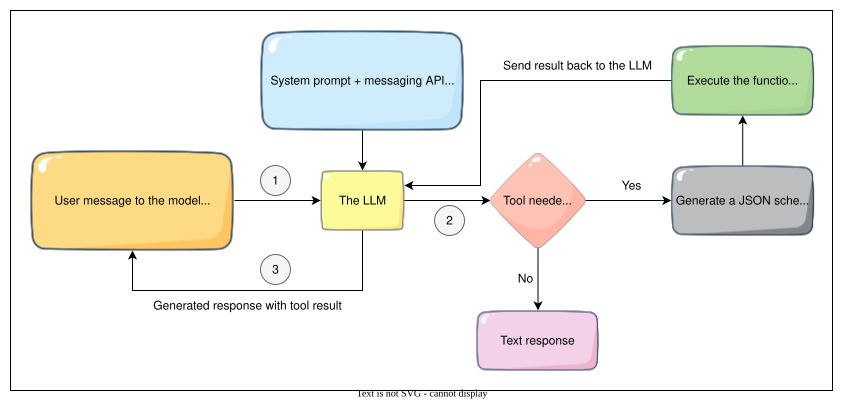

# Agent_Orchestration_Patterns_for_Structuring_AI_Agent_Behavior

Source: https://www.educative.io/courses/agentic-ai-systems/structuring-agent-behavior-agent-orchestration-patterns

---

[Home](https://www.educative.io/)

[Courses](https://www.educative.io/search?tab=courses)

[Agentic System Design](https://www.educative.io/courses/agentic-ai-systems)

# Structuring Agent Behavior: Agent Orchestration Patterns

Understand how AI agents orchestrate behavior using patterns such as tool calling loops, ReAct, and plan-and-execute. Learn to differentiate single-agent and multi-agent coordination models, selecting appropriate strategies for complex tasks. Explore orchestration frameworks like LangChain, AutoGen, and CrewAI to structure reliable, flexible agent workflows for advanced AI system design.

We'll cover the following...

- [Single-agent orchestration patterns](https://www.educative.io/courses/agentic-ai-systems/structuring-agent-behavior-agent-orchestration-patterns#Single-agent-orchestration-patterns)
  - [Tool calling loop](https://www.educative.io/courses/agentic-ai-systems/structuring-agent-behavior-agent-orchestration-patterns#Tool-calling-loop)
  - [ReAct (reasoning + acting)](https://www.educative.io/courses/agentic-ai-systems/structuring-agent-behavior-agent-orchestration-patterns#ReAct-reasoning--acting)
  - [Plan-and-execute](https://www.educative.io/courses/agentic-ai-systems/structuring-agent-behavior-agent-orchestration-patterns#Plan-and-execute)
- [Multi-agent coordination patterns](https://www.educative.io/courses/agentic-ai-systems/structuring-agent-behavior-agent-orchestration-patterns#Multi-agent-coordination-patterns)
  - [Manager-Worker pattern](https://www.educative.io/courses/agentic-ai-systems/structuring-agent-behavior-agent-orchestration-patterns#Manager-Worker-pattern)
  - [Decentralized handoff pattern](https://www.educative.io/courses/agentic-ai-systems/structuring-agent-behavior-agent-orchestration-patterns#Decentralized-handoff-pattern)
- [Choosing the right orchestration strategy](https://www.educative.io/courses/agentic-ai-systems/structuring-agent-behavior-agent-orchestration-patterns#Choosing-the-right-orchestration-strategy)
  - [Single agent vs. multi-agent: How to choose?](https://www.educative.io/courses/agentic-ai-systems/structuring-agent-behavior-agent-orchestration-patterns#Single-agent-vs-multi-agent-How-to-choose)
  - [Selecting an agent orchestration pattern](https://www.educative.io/courses/agentic-ai-systems/structuring-agent-behavior-agent-orchestration-patterns#Selecting-an-agent-orchestration-pattern)
- [Agent orchestration frameworks in practice](https://www.educative.io/courses/agentic-ai-systems/structuring-agent-behavior-agent-orchestration-patterns#Agent-orchestration-frameworks-in-practice)
  - [LangChain](https://www.educative.io/courses/agentic-ai-systems/structuring-agent-behavior-agent-orchestration-patterns#LangChain)
  - [AutoGen (Microsoft)](https://www.educative.io/courses/agentic-ai-systems/structuring-agent-behavior-agent-orchestration-patterns#AutoGen-Microsoft)
  - [CrewAI](https://www.educative.io/courses/agentic-ai-systems/structuring-agent-behavior-agent-orchestration-patterns#CrewAI)
- [Case study: Orchestrating an AI research assistant](https://www.educative.io/courses/agentic-ai-systems/structuring-agent-behavior-agent-orchestration-patterns#Case-study-Orchestrating-an-AI-research-assistant)

In the previous lesson, we explored how agents perceive, remember, reason, and act over time, forming a loop of intelligent behavior. But as agent capabilities grow, so does the need for structure. How exactly does an agent decide what to do next? How does it sequence actions, choose tools, or collaborate with others?

That’s where orchestration patterns come in.

Orchestration defines how an agent manages its internal decision-making flow, and, in more complex setups, how multiple agents coordinate across a shared task. It’s not just about acting; it’s about structuring action in a way that’s reliable, flexible, and context-aware. These patterns are the architectural building blocks that can enable advanced system behaviors like the dynamic routing of tasks, and the parallel execution of sub-goals.

**Note:** For the purpose of this course, we will explore these as commonly seen implementation strategies or architectural techniques for structuring agent behavior, rather than a fixed or mutually exclusive set of formal patterns. If you’d like a deeper dive into formalized approaches, you can explore our dedicated [Agentic Design Patterns](https://www.educative.io/courses/agentic-design-patterns) course after completing this one.

In this lesson, we’ll explore the following:

- **Single-agent orchestration strategies:** Tool calling loops, ReAct, and plan-and-execute patterns that help a single agent structure its thinking and execution.
- **Multi-agent collaboration models:** Manager-Worker setups, decentralized teams, and how agents can work together on shared goals.
- **Decision criteria for choosing patterns:** When should you go solo? When is coordination better? We’ll walk through how to choose based on task complexity and system needs.
- **Frameworks that help:** A look at orchestration tooling in popular frameworks like LangChain, CrewAI, and AutoGen.

By the end, you’ll understand how to move from a single agent loop to fully orchestrated workflows, whether they live in one brain or across many.

## Single-agent orchestration patterns[#](https://www.educative.io/courses/agentic-ai-systems/structuring-agent-behavior-agent-orchestration-patterns#Single-agent-orchestration-patterns)

When we think of an AI agent acting autonomously, we’re usually talking about a single-agent system. This means one model is in charge; it receives input, makes decisions, and performs actions, possibly using external tools along the way.

But even within single-agent setups, there are several patterns for how this decision-making unfolds. These patterns differ in how structured the reasoning is, how tools are chosen, and how many steps are taken before producing an output.

Let’s look at a few common orchestration patterns used in single-agent systems:

### Tool calling loop[#](https://www.educative.io/courses/agentic-ai-systems/structuring-agent-behavior-agent-orchestration-patterns#Tool-calling-loop)

This is the most straightforward orchestration structure. The agent receives a task, decides which tool to use (if any), executes it, observes the result, and continues. This forms a loop until the goal is met or the agent stops. This pattern primarily leverages the LLM as the reasoning core, a tool invocation layer, and often short-term memory to track interaction state.

AI agents: Tool calling loop

For example, an agent tasked with “Send an email summary of this document” might:

- Parse the document.
- Call a summarization tool.
- Use a messaging API to send the result.
- Exit.

This loop is commonly used in LangChain’s AgentExecutor and OpenAI’s tool calling setups. However, while simple, complex tasks can lead to long, brittle chains of tool calls that are difficult to debug or recover from.

### ReAct (reasoning + acting)[#](https://www.educative.io/courses/agentic-ai-systems/structuring-agent-behavior-agent-orchestration-patterns#ReAct-reasoning--acting)

The ReAct pattern adds structure by alternating explicit reasoning steps with tool actions. The model is prompted to think step-by-step, decide what tool to use, reflect on the result, and repeat as needed. This pattern improves transparency and traceability. Each thought and action is logged, making it easier to debug or audit. It deeply integrates the LLM’s reasoning capabilities with external tool usage, and relies heavily on structured output from the LLM for observable ‘Thought’ steps, often leveraging conversational memory.

AI agents: ReAct pattern

For example, an agent asked to “Find the most affordable flight to Tokyo” might:

- Think: “I need to check flight aggregators.”
- Act: Call a flight search API.
- Observe: See several options.
- Think: “Now I’ll filter by price and airline.”
- Act: Return the best result.

ReAct is widely used in OpenAI’s function-calling agents, LangChain, and AutoGen-based systems. Its verbosity can increase latency and token usage, and complex reasoning chains can still be challenging to interpret or debug when errors occur.

### Plan-and-execute[#](https://www.educative.io/courses/agentic-ai-systems/structuring-agent-behavior-agent-orchestration-patterns#Plan-and-execute)

Rather than interleaving reasoning and actions, this pattern separates them. The agent first creates a full plan (a sequence of subtasks), then executes each step. This is useful when the goal is complex but known up front. This pattern typically involves a dedicated planning module (often an LLM call), an execution module (another agent or a loop of tool calls), and memory to persist the plan and task results.

AI agents: Plan-and-execute pattern

For example, an agent asked to “write a report on Q2 revenue and email it to the team” first generates a plan:

1. Retrieve Q2 revenue data.
2. Create a chart.
3. Write a summary.
4. Send an email.

It then carries out these steps one by one.

This pattern is supported in frameworks like AutoGen (via hierarchical agents) and LangChain (using planners and executors). A key challenge is that initial plans may become outdated if the environment changes dynamically during execution, potentially requiring costly re-planning.

Single-agent orchestration gives us a foundation for intelligent task execution. These systems are powerful when a single model is equipped with reasoning capabilities, and tools to complete a task from start to finish. But agentic AI, as it’s increasingly discussed in research and practice, often refers to systems made up of multiple agents working together. These agents may divide tasks, specialize in different skills, or collaborate across steps in a workflow.

Let’s now explore multi-agent coordination, where the complexity of the task is distributed across a team of agents, each contributing in a structured way.

## Multi-agent coordination patterns[#](https://www.educative.io/courses/agentic-ai-systems/structuring-agent-behavior-agent-orchestration-patterns#Multi-agent-coordination-patterns)

When tasks grow too complex for a single agent to manage effectively, whether due to scope, specialization, or the need for parallel execution, a multi-agent architecture becomes more suitable. In these systems, multiple agents interact, collaborate, and sometimes negotiate to complete a shared objective.

This coordination can follow different structural patterns. Let’s look at the most common ones.

### Manager-Worker pattern[#](https://www.educative.io/courses/agentic-ai-systems/structuring-agent-behavior-agent-orchestration-patterns#Manager-Worker-pattern)

In this design, a manager agent is responsible for overseeing the workflow. It breaks down a high-level goal into smaller subtasks, assigns each to specialized worker agents, and integrates the results. This pattern features a central manager agent (often an LLM with planning instructions), multiple specialized worker agents (each with their own models, tools, and instructions), and shared memory for task queues and results.

Multi-agent orchestration: Manager-Worker pattern

- **Manager agent:** Handles task planning and delegation.
- **Worker agents:** Execute specific subtasks, often using distinct tools or reasoning styles.
- **Coordination flow:**

  - Manager receives the goal: “Write a project proposal.”
  - It decomposes the goal: “Research background,” “Draft outline,” “Write introduction,” “Suggest visuals.”
  - Each part is handed off to a worker with the right skill or tool access.
  - The manager collects responses, stitches them together, and finalizes the output.

This mirrors how teams function in the real-world. Work is distributed based on specialization, while a central coordinator ensures everything stays aligned with the shared objective. However, this pattern introduces a central point of failure (the manager). This can lead to bottlenecks if the manager becomes overloaded or makes poor delegation choices.

### Decentralized handoff pattern[#](https://www.educative.io/courses/agentic-ai-systems/structuring-agent-behavior-agent-orchestration-patterns#Decentralized-handoff-pattern)

Here, there is no central manager. Agents operate as peers, each with its own responsibility. They pass control to one another based on the state of the task, or the type of input they encounter. This pattern emphasizes distinct, specialized agents that communicate directly, relying on clear handoff protocols, and often shared state or external memory to maintain task continuity.

Multi-agent orchestration: Decentralized handoff pattern

- One agent starts the process and decides which peer should handle the next step.
- Each agent maintains awareness of its capabilities and context.
- Handoffs continue until the task is complete.

For example, in a travel planning system:

- Agent A handles the user query and identifies the need to book a flight.
- It passes the task to Agent B, who specializes in flight search.
- After booking, Agent B triggers Agent C to reserve a hotel, and so on.

This model offers more flexibility and robustness, especially in dynamic environments. However, it requires careful design to avoid conflicts, infinite loops (deadlocks), or missed responsibilities due to a lack of centralized oversight. This makes debugging more complex.

## Choosing the right orchestration strategy[#](https://www.educative.io/courses/agentic-ai-systems/structuring-agent-behavior-agent-orchestration-patterns#Choosing-the-right-orchestration-strategy)

When designing an agent system, orchestration isn’t a one-size-fits-all. The right strategy depends on the nature of the task and how the system is expected to operate.

Before selecting a specific pattern like ReAct or Manager-Worker, we first decide between two core approaches:

- Should the task be handled by a single agent?
- Or does it make sense to involve multiple agents working together?

Once that’s clear, we can pick the most suitable orchestration pattern within that structure. Let’s walk through how to make these choices.

### Single agent vs. multi-agent: How to choose?[#](https://www.educative.io/courses/agentic-ai-systems/structuring-agent-behavior-agent-orchestration-patterns#Single-agent-vs-multi-agent-How-to-choose)

Some tasks are naturally self-contained, while others involve multiple roles, skills, or stages. Choosing between a single-agent or multi-agent setup depends on the structure of the task, and the demands of the system.

Single agent vs. multi-agent

Here are the main factors we will consider:

- **Task scope and autonomy boundaries:** For tasks that are focused and narrow, a single agent may be sufficient to reason, act, and adapt. If the task spans multiple domains or requires independently solvable subgoals, a multi-agent setup helps define clearer boundaries and responsibilities. For example, a meeting scheduler can often be handled by a single agent. A workplace assistant that also summarizes reports, generates agendas, and negotiates times across departments might benefit from multiple agents, each handling a specific function.
- **Specialization of skills:** When a task requires distinct competencies such as legal understanding, software development, and user interaction, it is often more effective to assign each responsibility to a specialized agent. For example, a startup assistant helping with product development might include one agent that writes code, another that drafts legal documents, and a third that manages communication and pitch materials.
- **Sequential vs. parallel execution:** Linear tasks are a good fit for a single agent that reasons step-by-step. But when tasks can happen concurrently or require separate threads of execution, multiple agents provide better structure. For example, a document translator that first summarizes, then translates, then formats the output can follow a single-agent loop. But a content moderation system that simultaneously checks for bias, misinformation, and inappropriate language may use parallel agents working together.
- **Observability and system control:** Single-agent systems centralize logic, making them easier to monitor and debug. Multi-agent systems offer flexibility and modularity, but they require coordination and shared memory to stay aligned. For example, a personal finance agent that tracks spending and offers recommendations may not need multiple agents. But a financial planning assistant that involves separate agents for budgeting, investing, and tax compliance needs careful orchestration to avoid conflicts or duplication.

### Selecting an agent orchestration pattern[#](https://www.educative.io/courses/agentic-ai-systems/structuring-agent-behavior-agent-orchestration-patterns#Selecting-an-agent-orchestration-pattern)

Once we choose between a single-agent or multi-agent structure, the next step is to select the orchestration pattern that best fits the task dynamics, performance goals, and design constraints.

In single-agent systems, the orchestration pattern depends on how structured or open-ended the task is:

Selecting an agent orchestration pattern for single-agent systems

- **Plan-and-execute:** Use this when the task can be cleanly broken into steps ahead of time. It is ideal for workflows that demand sequential accuracy, such as booking travel or generating multi-part documents.
- **Tool calling loops:** Use this when the task involves dynamic decisions or exploration. The looping structure allows the agent to act, observe outcomes, and iterate. This works well for debugging, search, or knowledge synthesis.
- **ReAct-style reasoning:** Choose this when step-by-step transparency improves monitoring or user trust. It is especially useful in regulated environments or educational tools where exposing the agent’s reasoning adds value.

In multi-agent systems, orchestration depends on how autonomy and coordination are distributed:

Selecting an agent orchestration pattern for multi-agent systems

- **Manager-Worker pattern:** Choose this when there is a central planner that can decompose the task and delegate it to specialized agents. It offers strong coordination, but requires clearly defined roles and a robust delegation strategy.
- **Decentralized handoffs:** Use this when agents must operate independently, respond to environmental changes, or when no single agent has full context. This pattern fits simulations, real-time collaborative systems, and distributed monitoring setups.

## Agent orchestration frameworks in practice[#](https://www.educative.io/courses/agentic-ai-systems/structuring-agent-behavior-agent-orchestration-patterns#Agent-orchestration-frameworks-in-practice)

Several open-source frameworks have emerged to support building, and managing agentic systems. While the patterns we’ve discussed (Manager-Worker, decentralized handoffs) are concept-agnostic, these libraries offer tools that make them easier to implement, test, and evolve.

Let’s explore three commonly used frameworks.

### LangChain[#](https://www.educative.io/courses/agentic-ai-systems/structuring-agent-behavior-agent-orchestration-patterns#LangChain)

LangChain started as a tool to connect language models with external data and tools. Over time, it evolved into a full-featured framework for building both single-agent and multi-agent systems. Its newer component, LangGraph, specifically provides a dedicated framework for building agentic workflows as executable graphs. LangGraph is well-suited for complex agent architectures requiring branching logic, retries, and explicit state management, offering robust support for system design patterns.

- **Agent executors:** Help define how a model chooses and calls tools step-by-step.
- **Multi-agent chains:** Let you route tasks through multiple agents using logic-based decision flows.
- **Tooling support:** Includes integrations with search engines, APIs, file systems, and databases.

Furthermore, modern LangChain and LangGraph offer robust support for context memory, session state, and persistent memory, which are crucial for agents operating in production environments. LangGraph also provides valuable workflow visualization, graph inspection, and debugging tools, essential for designing and troubleshooting complex agentic systems. LangChain itself is highly extensible, integrating with other frameworks like AutoGen and CrewAI, external APIs, and can serve as a foundation for custom agentic platforms.

LangChain is particularly well-suited for developers looking to build structured pipelines with easy control over tool use, and memory. Its “agent loop” abstraction mirrors what we’ve discussed in earlier lessons.

### AutoGen (Microsoft)[#](https://www.educative.io/courses/agentic-ai-systems/structuring-agent-behavior-agent-orchestration-patterns#AutoGen-Microsoft)

AutoGen is built around multi-agent collaboration, emphasizing dialogue-based coordination between agents.

- Agents are defined as conversational entities, each with a role, goal, and toolset.
- They exchange messages in structured threads, simulating team discussions.
- Agents can utilize arbitrary tool calling, integrate with external APIs, and leverage chain-of-thought reasoning for complex problem-solving.
- Supports both synchronous and asynchronous handoffs.
- AutoGen supports integrating humans as agents in the workflow for approval, oversight, or feedback. This makes it crucial for real-world deployments.

AutoGen shines in tasks where multiple steps require negotiation, verification, or refinement like writing code, doing peer review, or generating multi-step plans. Its conversational model naturally reflects how human teams coordinate.

### CrewAI[#](https://www.educative.io/courses/agentic-ai-systems/structuring-agent-behavior-agent-orchestration-patterns#CrewAI)

CrewAI is designed specifically around the Manager-Worker architecture. However, its capabilities have evolved to orchestrate more flexible patterns, including decentralized, hybrid, and parallel execution models.

We define a team (the “crew”) with:

- **A project manager:** It is the planner which plans, assigns, and monitors progress across the team.
- **Workers:** These are executors with specific skills or tools.They perform subtasks based on their expertise or access to tools.
- **A shared task queue and memory:** It maintains global state, stores results, and passes context between agents.

Each agent runs independently, but the manager coordinates progress and ensures tasks stay aligned. This is ideal for task decomposition problems like content generation, research, or process automation.

CrewAI also supports human input and approval at various points within the workflow, enhancing its robustness for production deployments. Furthermore, it can be integrated with external LLMs, vector databases, APIs, and other agent frameworks, enabling cross-system workflows.

While these frameworks are helpful, the core orchestration concepts such as planning, delegation, handoff, and memory sharing remain consistent across tools.

A well-structured system:

- Clearly defines agent roles.
- Provides mechanisms for tracking progress and sharing context.
- Manages control flow gracefully, even when agents fail or disagree.

Whether you use LangChain, AutoGen, CrewAI, or design your own orchestration logic, these patterns serve as the blueprint.

## Case study: Orchestrating an AI research assistant[#](https://www.educative.io/courses/agentic-ai-systems/structuring-agent-behavior-agent-orchestration-patterns#Case-study-Orchestrating-an-AI-research-assistant)

You are designing an AI research assistant to help a product team make decisions based on recent competitor product updates, customer reviews, and internal sales performance. The system must:

- Gather recent competitor announcements from the web.
- Analyze customer reviews for pain points and common feature requests.
- Retrieve and analyze internal sales reports.
- Synthesize insights and draft a product update recommendation.

**Requirements:**

- Tasks can happen in parallel.
- Review and synthesis must be coordinated.
- Human approval is required before sending the final recommendation to stakeholders.

AI Powered

Saved

2 attempts left

Reset

Choose the most appropriate orchestration pattern (from those discussed in the lesson) for this system and explain your reasoning.

You have 2 attempts to answer.

Agent Architecture: Components Interaction and Agent Memory

Building Trustworthy Agents: Guardrails and Human Oversight

Ask

[Single-agent orchestration patterns](https://www.educative.io/courses/agentic-ai-systems/structuring-agent-behavior-agent-orchestration-patterns#Single-agent-orchestration-patterns)

[Tool calling loop](https://www.educative.io/courses/agentic-ai-systems/structuring-agent-behavior-agent-orchestration-patterns#Tool-calling-loop)

[ReAct (reasoning + acting)](https://www.educative.io/courses/agentic-ai-systems/structuring-agent-behavior-agent-orchestration-patterns#ReAct-reasoning--acting)

[Plan-and-execute](https://www.educative.io/courses/agentic-ai-systems/structuring-agent-behavior-agent-orchestration-patterns#Plan-and-execute)

[Multi-agent coordination patterns](https://www.educative.io/courses/agentic-ai-systems/structuring-agent-behavior-agent-orchestration-patterns#Multi-agent-coordination-patterns)

[Manager-Worker pattern](https://www.educative.io/courses/agentic-ai-systems/structuring-agent-behavior-agent-orchestration-patterns#Manager-Worker-pattern)

[Decentralized handoff pattern](https://www.educative.io/courses/agentic-ai-systems/structuring-agent-behavior-agent-orchestration-patterns#Decentralized-handoff-pattern)

[Choosing the right orchestration strategy](https://www.educative.io/courses/agentic-ai-systems/structuring-agent-behavior-agent-orchestration-patterns#Choosing-the-right-orchestration-strategy)

[Single agent vs. multi-agent: How to choose?](https://www.educative.io/courses/agentic-ai-systems/structuring-agent-behavior-agent-orchestration-patterns#Single-agent-vs-multi-agent-How-to-choose)

[Selecting an agent orchestration pattern](https://www.educative.io/courses/agentic-ai-systems/structuring-agent-behavior-agent-orchestration-patterns#Selecting-an-agent-orchestration-pattern)

[Agent orchestration frameworks in practice](https://www.educative.io/courses/agentic-ai-systems/structuring-agent-behavior-agent-orchestration-patterns#Agent-orchestration-frameworks-in-practice)

[LangChain](https://www.educative.io/courses/agentic-ai-systems/structuring-agent-behavior-agent-orchestration-patterns#LangChain)

[AutoGen (Microsoft)](https://www.educative.io/courses/agentic-ai-systems/structuring-agent-behavior-agent-orchestration-patterns#AutoGen-Microsoft)

[CrewAI](https://www.educative.io/courses/agentic-ai-systems/structuring-agent-behavior-agent-orchestration-patterns#CrewAI)

[Case study: Orchestrating an AI research assistant](https://www.educative.io/courses/agentic-ai-systems/structuring-agent-behavior-agent-orchestration-patterns#Case-study-Orchestrating-an-AI-research-assistant)