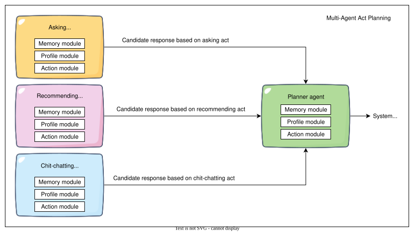

# MACRS_Multi-Agent_Framework_for_Goal-Directed_Dialogue

Source: https://www.educative.io/courses/agentic-ai-systems/macrs-multi-agent-act-planning-framework

---

[Home](https://www.educative.io/)

[Courses](https://www.educative.io/search?tab=courses)

[Agentic System Design](https://www.educative.io/courses/agentic-ai-systems)

# MACRS Multi-Agent Act Planning Framework

Explore the MACRS multi-agent act planning framework to understand how multiple responder agents generate options and a planner agent selects the most contextually appropriate response. Learn how goal-directed dialogue benefits from coordinated decision-making, shared memory, and strategic oversight to deliver coherent and purposeful recommendations.

We'll cover the following...

- [Generating response options](https://www.educative.io/courses/agentic-ai-systems/macrs-multi-agent-act-planning-framework#Generating-response-options)
- [Selecting the final response](https://www.educative.io/courses/agentic-ai-systems/macrs-multi-agent-act-planning-framework#Selecting-the-final-response)
  - [What does the planner agent do](https://www.educative.io/courses/agentic-ai-systems/macrs-multi-agent-act-planning-framework#What-does-the-planner-agent-do)
  - [Visualizing MACRS in Action](https://www.educative.io/courses/agentic-ai-systems/macrs-multi-agent-act-planning-framework#Visualizing-MACRS-in-Action)
- [Agentic design takeaways from MACRS planning](https://www.educative.io/courses/agentic-ai-systems/macrs-multi-agent-act-planning-framework#Agentic-design-takeaways-from-MACRS-planning)
- [Summary](https://www.educative.io/courses/agentic-ai-systems/macrs-multi-agent-act-planning-framework#Summary)

In the previous lesson, we saw how MACRS reimagines conversational recommendation as a multi-agent system, where different agents bring specialized capabilities to the table. But here’s a key challenge: even with well-designed agents, who decides what actually gets said?

Imagine this everyday moment: you’re chatting with a recommendation assistant about what to watch tonight. One moment, it asks if you like thrillers. Next, it throws a random movie at you. Then it loops back to “So, what genre do you enjoy?” It feels scattered, even though each individual response may sound fine.

This is the problem with act planning. It’s not about what *can* be said, but about what *should* be said next to move the conversation forward. In goal-directed dialogue, the system isn’t just filling time; it’s trying to accomplish something. That means every turn should be:

- Purposeful
- Context-aware
- Strategically chosen

Many LLM-based chat systems fall short here. They generate plausible-sounding replies, but without a clear planning mechanism, they often stall or meander. MACRS takes a different route. It breaks the “what to say” problem into two coordinated steps:

1. Generate options using specialized responder agents.
2. Select the best one using a central planner agent.

MACRS multi-agent act planning framework

This cooperative act planning pattern is a prime example of the Manager-Worker orchestration model we discussed in Chapter 1, explicitly designed for goal-directed dialogue in CRSs.

## Generating response options[#](https://www.educative.io/courses/agentic-ai-systems/macrs-multi-agent-act-planning-framework#Generating-response-options)

Instead of relying on a single model to juggle all conversational tasks, MACRS introduces three responder agents, each with a clearly defined role:

|  |  |
| --- | --- |
| **Agent Type** | **Goal** |
| **Asking Agent** | Elicit more user preferences through targeted questions |
| **Recommending Agent** | Suggest relevant items based on current user profile |
| **Chit-Chat Agent** | Keep the conversation engaging and natural, especially when no immediate goal move is available |

Each of these agents operates independently, but all draw from a shared user profile and memory. This gives them context about the conversation so far.

Think of it like a brainstorming session. Each agent proposes what it thinks the system should say next, based on its specific goal and knowledge. But how do they know what to say?

That’s where profiling instructions come in.

Each responder agent is primed with role-specific instructions (provided through prompts) and has access to:

- **Dialogue history:** To avoid repetition or irrelevance.
- **User profile:** What the user has already revealed, liked, skipped, or responded to.
- **Agent goal:** Whether it is meant to ask a question, recommend an item, or keep the conversation light and engaging.

These role-specific instructions are critical examples of prompt design for specialized agents. For instance, the MACRS paper specifies prompts like:

- **Asking agent:** “You should elicit user preferences by asking questions.”
- **Chit-chat agent:** “You should chit-chat with the user to learn about their preferences. You can express your admiration for certain item elements to guide the conversation towards them, thereby gaining insights into the user preferences regarding those elements.”
- **Recommending agent:** “You should recommend an item to user, and generate an engaging description about the item.”

Similarly, the planner agent receives an instruction like:

- **Planner agent:** “Choose one of the candidate responses based on three different dialogue acts. These three dialogue acts are: recommending, asking, and chit-chatting.”

**Note on prompt engineering:** While these examples illustrate the core instruction, production-level prompts for LLM-powered agents are often significantly more detailed and complex. They typically include extensive context, few-shot examples, specific output formatting requirements (e.g., JSON), safety guidelines, and persona definitions. This is to ensure robust and predictable behavior in diverse scenarios. These concise examples from MACRS highlight the essence of the instruction, but a real-world implementation would involve more sophisticated prompt engineering techniques.

For example:

- The asking agent might suggest: “Do you usually prefer series or standalone movies?”
- The recommending agent might suggest: “You might like *Inception*. It’s a top-rated thriller.”
- The chit-chat agent might suggest: “That reminds me, some people say watching thrillers at night is the best!”

Each of these is a valid candidate. But only one will be used.

So, who decides?

## Selecting the final response[#](https://www.educative.io/courses/agentic-ai-systems/macrs-multi-agent-act-planning-framework#Selecting-the-final-response)

Once the three responder agents have generated their candidate replies, the baton passes to a fourth agent: the planner agent.

If the responder agents are like creative team members proposing ideas, the planner agent is the team lead who is responsible for selecting the option that best advances the conversation toward the system’s goal.

### What does the planner agent do[#](https://www.educative.io/courses/agentic-ai-systems/macrs-multi-agent-act-planning-framework#What-does-the-planner-agent-do)

The planner doesn’t just choose randomly or always favor one agent over the others. Instead, it performs multi-step reasoning to evaluate:

- **User preferences:** What do we already know about the user?
- **Dialogue progress:** Are we still gathering preferences, or are we ready to recommend?
- **Candidate options:** Which response adds the most value right now?
- **Engagement balance:** Will the response keep the conversation natural, while nudging it forward?

In doing so, it selects the most contextually appropriate response, one that balances task effectiveness (e.g., gathering info, making recommendations) with user experience (e.g., sounding friendly and coherent). These planner decisions are critical and can be logged and audited, providing invaluable data for debugging the system and continuously improving its dialogue strategies.

> For example, if a user seems hesitant or hasn’t revealed enough preferences, the planner might favor a follow-up question from the asking agent. If the user already clicked on or praised a similar movie, the recommending agent’s suggestion might be prioritized.

Critically, the planner agent has its own access to:

- The full dialogue history.
- A shared memory structure.
- The current user profile (including inferred preferences).
- A summary of the three candidate responses.

This allows it to reason not just over surface features like keywords, but also semantic relevance, dialogue strategy, and conversational timing.

### Visualizing MACRS in Action[#](https://www.educative.io/courses/agentic-ai-systems/macrs-multi-agent-act-planning-framework#Visualizing-MACRS-in-Action)

The diagram below shows an example of how MACRS coordinates its agents to produce a single, contextually appropriate response:

MACRS multi-agent act planning framework: Three responder agents, each focused on asking questions, recommending items, or maintaining engagement, propose responses based on the user’s input. A central planner agent then evaluates these suggestions, and selects the one that best advances the conversation toward a successful recommendation

In this example, the user expresses a general intent: *“*I want to watch a relaxing animated film.” Each responder agent generates a possible next move:

- Recommend a movie (*Zootopia*)
- Ask a clarifying question (“What era do you prefer?”)
- Engage in small talk (Chat about Disney)

The planner agent then evaluates these options in context and selects the best next step: “Are you looking for classic films or more recent ones?” This process guides the conversation toward a useful recommendation without losing fluency.

1.

Why not simply use one very large and complex prompt with a single powerful LLM, instructing it to simulate all roles: asking, recommending, chit-chatting, and then choosing the best response?

Show Answer

Did you find this helpful?

## Agentic design takeaways from MACRS planning[#](https://www.educative.io/courses/agentic-ai-systems/macrs-multi-agent-act-planning-framework#Agentic-design-takeaways-from-MACRS-planning)

The multi-agent planning framework in MACRS isn’t just clever implementation, it’s a pattern that illustrates how agentic systems can handle complexity by combining specialization with coordination.

Let’s break down what this teaches us as system designers:

- **Delegate, don’t overload:** Instead of making one agent responsible for everything, MACRS delegates roles to specialized responders. This mirrors how human teams work, task division leads to improved focus, clearer logic, and easier debugging.
- **Strategize with oversight:** The planner agent isn’t just a traffic cop, it’s a strategist. Its job is to reason across different options and select the one that advances the goal. This kind of centralized planning, fed by distributed agents, is a powerful design pattern when your system needs to adapt dynamically while staying on course.
- **Maintain shared memory:** By giving all agents access to a common user profile and dialogue history, MACRS ensures coherence. Every response, whether it’s a question, a suggestion, or small talk, is informed by what’s already known. This creates conversations that feel intelligent, not disjointed. Specifically, the memory modules for both responder and planner agents contain a combination of dialogue history, user profile, strategy-level suggestions, dialogue act history, and corrective experiences. This shared context is crucial for informed decision-making across the multi-agent system.
- **Orchestrate, don’t dominate:** Even though the planner agent is in charge of the final output, it doesn’t micromanage the responders. It lets them propose ideas freely based on their domain expertise. This kind of loose coupling with tight coordination is what makes MACRS both flexible and goal-aligned.
- **Trade-offs of multi-agent orchestration (latency and cost):** While MACRS’s multi-agent architecture offers significant advantages in dialogue control and adaptability, it’s important for system designers to recognize a practical trade-off. For each turn in the conversation, this architecture typically involves four separate LLM calls (one for each of the three responder agents and one for the planner agent). This design choice, while enabling sophisticated planning and specialization, can introduce increased latency and operational costs compared to a single, monolithic LLM call. However, this overhead is often justified by the enhanced performance in goal-directed dialogue, and improved interpretability. It also leads to greater modularity for development and maintenance, as demonstrated by MACRS’s superior results.

## Summary[#](https://www.educative.io/courses/agentic-ai-systems/macrs-multi-agent-act-planning-framework#Summary)

In this lesson, we saw how MACRS plans its next move through a structured yet dynamic multi-agent conversation flow. Each responder agent contributes a candidate reply, and the planner agent, through contextual reasoning and user awareness, selects the most appropriate one.

This architecture embodies key agentic principles: division of responsibility, shared memory, and coordinated decision-making.

Next, we’ll explore how MACRS goes one step further by learning from its own conversations. Through user feedback-aware reflection, the system doesn’t just act, it *adapts*.

Are you ready to see how an agentic system evolves through experience? Let’s learn in the next lesson.

Introduction to MACRS and the Design Challenge

MACRS User Feedback-Aware Reflection Mechanism

Ask

[Generating response options](https://www.educative.io/courses/agentic-ai-systems/macrs-multi-agent-act-planning-framework#Generating-response-options)

[Selecting the final response](https://www.educative.io/courses/agentic-ai-systems/macrs-multi-agent-act-planning-framework#Selecting-the-final-response)

[What does the planner agent do](https://www.educative.io/courses/agentic-ai-systems/macrs-multi-agent-act-planning-framework#What-does-the-planner-agent-do)

[Visualizing MACRS in Action](https://www.educative.io/courses/agentic-ai-systems/macrs-multi-agent-act-planning-framework#Visualizing-MACRS-in-Action)

[Agentic design takeaways from MACRS planning](https://www.educative.io/courses/agentic-ai-systems/macrs-multi-agent-act-planning-framework#Agentic-design-takeaways-from-MACRS-planning)

[Summary](https://www.educative.io/courses/agentic-ai-systems/macrs-multi-agent-act-planning-framework#Summary)