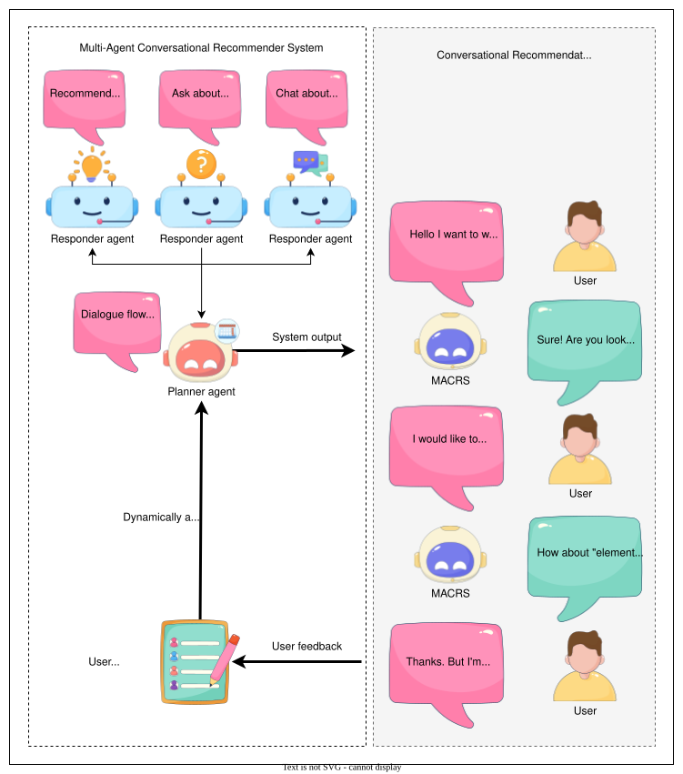

# MACRS_User_Feedback_Reflection_for_Adaptive_AI_Conversations

Source: https://www.educative.io/courses/agentic-ai-systems/macrs-user-feedback-aware-reflection-mechanism

---

[Home](https://www.educative.io/)

[Courses](https://www.educative.io/search?tab=courses)

[Agentic System Design](https://www.educative.io/courses/agentic-ai-systems)

# MACRS User Feedback-Aware Reflection Mechanism

Explore MACRS's user feedback-aware reflection mechanism that enables real-time adaptation in conversational recommendation systems. Understand how MACRS analyzes user behavior and failed interactions to update user profiles and dialogue strategies dynamically during conversations, enhancing responsiveness and personalization.

We'll cover the following...

- [Information-level reflection: Learning what the user really wants](https://www.educative.io/courses/agentic-ai-systems/macrs-user-feedback-aware-reflection-mechanism#Information-level-reflection-Learning-what-the-user-really-wants)
  - [What kind of feedback does it learn from?](https://www.educative.io/courses/agentic-ai-systems/macrs-user-feedback-aware-reflection-mechanism#What-kind-of-feedback-does-it-learn-from)
  - [How does this reflection help?](https://www.educative.io/courses/agentic-ai-systems/macrs-user-feedback-aware-reflection-mechanism#How-does-this-reflection-help)
- [Strategy-level reflection: Learning from failure](https://www.educative.io/courses/agentic-ai-systems/macrs-user-feedback-aware-reflection-mechanism#Strategy-level-reflection-Learning-from-failure)
  - [Step 1: Detecting failure patterns](https://www.educative.io/courses/agentic-ai-systems/macrs-user-feedback-aware-reflection-mechanism#Step-1-Detecting-failure-patterns)
  - [Step 2: Generating agent feedback](https://www.educative.io/courses/agentic-ai-systems/macrs-user-feedback-aware-reflection-mechanism#Step-2-Generating-agent-feedback)
  - [Step 3: Updating the dialogue plan](https://www.educative.io/courses/agentic-ai-systems/macrs-user-feedback-aware-reflection-mechanism#Step-3-Updating-the-dialogue-plan)
  - [Comparing the two reflection layers](https://www.educative.io/courses/agentic-ai-systems/macrs-user-feedback-aware-reflection-mechanism#Comparing-the-two-reflection-layers)
- [Summary](https://www.educative.io/courses/agentic-ai-systems/macrs-user-feedback-aware-reflection-mechanism#Summary)

Even with good planning, conversations don’t always go as expected.

Imagine this: a user is chatting with a recommendation assistant. The assistant asks all the right questions, suggests a movie that matches the preferences, and the user skips it without responding. Or worse, closes the chat.

What happened?

The assistant might have missed subtle cues in the user’s behavior. Maybe the tone felt too robotic. Maybe the movie sounded right on paper, but didn’t match the user’s mood. Maybe the user had just seen that title elsewhere and didn’t want it again.

Whatever the reason, a fixed system wouldn’t notice. It would try again with a similar suggestion, or keep asking more questions, unaware that it’s starting to frustrate the user.

This is the real-world challenge of goal-directed dialogue: things change mid-conversation. Preferences evolve. Users respond indirectly. And what worked five seconds ago might not work now.

That’s why a well-designed agentic system can’t just plan its moves. It must also reflect on how those moves are received and adjust its behavior accordingly.

This is exactly what MACRS does through its user feedback-aware reflection mechanism. Instead of treating failed recommendations or skipped responses as dead ends, MACRS treats them as learning opportunities. This reflection functionality is handled by distinct LLM-based components, acting as specialized critics or evaluator agents. Their sole job is to analyze the conversation’s performance and generate structured feedback to improve the primary agents (responder and planner agents). These operate in a feedback loop external to the immediate act planning, but feeding back into it.

After generating a response through multiple agents and the planner, MACRS observes how the user reacts. It then uses this feedback to adjust its planning, and recommendations in future turns

As the image shows, MACRS doesn’t just react; it reflects. It observes how users respond to its messages and then adjusts its understanding and behavior accordingly. This ability to learn mid-conversation is what makes MACRS feel more human and responsive. But how exactly does it do that?

MACRS incorporates reflection at two levels, each guided by different types of feedback:

- **Information-level reflection** helps the system refine its understanding of what the user wants.
- **Strategy-level reflection** helps the system adjust how it chooses to act next.

The MACRS user feedback-aware reflection mechanism: user feedback is processed by information-level reflection to update user profiles. This is done for responder agents, and by strategy-level reflection to generate suggestions and corrective experiences for both responder and planner agents

Crucially, this adjustment occurs in real-time within the ongoing conversation, influencing the planning and generation of responses for subsequent dialogue turns by updating the agents’ internal memory modules (user profiles, strategy suggestions, corrective experiences). It focuses on immediate, in-session adaptation rather than triggering broader, long-term updates to the underlying models or system-wide strategic re-weighting.

## Information-level reflection: Learning what the user really wants[#](https://www.educative.io/courses/agentic-ai-systems/macrs-user-feedback-aware-reflection-mechanism#Information-level-reflection-Learning-what-the-user-really-wants)

When people express their preferences, they often do so in indirect or inconsistent ways. They may not say “I like romantic comedies,” but their actions, such as browsing certain movies or skipping others, tell a clearer story.

MACRS’s information-level reflection is designed to pick up on this behavioral feedback, and use it to sharpen the system’s understanding of the user. Instead of relying solely on what the user says, it listens to what the user does.

### What kind of feedback does it learn from?[#](https://www.educative.io/courses/agentic-ai-systems/macrs-user-feedback-aware-reflection-mechanism#What-kind-of-feedback-does-it-learn-from)

Some of the key signals it tracks include:

- **Browsing behavior:** Which items the user clicked on, skipped, or spent more time viewing.
- **Response patterns:** Whether the user answered a question, ignored it, or changed the topic.
- **Engagement signals:** Turns where the user seemed responsive, passive, or disengaged.

Each of these is a clue, like digital body language, that helps MACRS infer what matters most to the user at that moment.

### How does this reflection help?[#](https://www.educative.io/courses/agentic-ai-systems/macrs-user-feedback-aware-reflection-mechanism#How-does-this-reflection-help)

MACRS uses these inferred signals to update the user profile, a structured memory that captures evolving preferences, interests, and constraints. This profile is shared with the three responder agents (asking, recommending, and chit-chatting), so each one can tailor its output more intelligently.

For example:

- The asking agent might stop repeating questions about genres the user clearly avoids.
- The recommending agent can prioritize movies similar to those the user engaged with, even if they were never mentioned directly.
- The chit-chatting agent might refer to recently viewed content to keep the conversation light and relevant.

In short, information-level reflection helps the system shift from “What did the user say?” to “What has the user shown us through their behavior?”

## Strategy-level reflection: Learning from failure[#](https://www.educative.io/courses/agentic-ai-systems/macrs-user-feedback-aware-reflection-mechanism#Strategy-level-reflection-Learning-from-failure)

While information-level reflection helps MACRS understand the user better, it doesn’t tell the system *how* to change its strategy when things go wrong. For example, what should the system do if a recommendation is rejected? Or if a conversation stalls without collecting enough preferences?

This is where strategy-level reflection comes in. Its purpose is to help MACRS learn not just what the user wants, but how to talk to them more effectively in future turns.

### Step 1: Detecting failure patterns[#](https://www.educative.io/courses/agentic-ai-systems/macrs-user-feedback-aware-reflection-mechanism#Step-1-Detecting-failure-patterns)

MACRS monitors signals like:

- Recommendation rejection (e.g., user skips or dislikes suggestions).
- User disengagement (e.g., short or vague replies).
- Repetitive dialogue without progress.

These signals act as feedback triggers, alerting the system that its current dialogue strategy may not be working. This failure detection can be implemented using a hybrid approach:

- **Rule-based triggers:** Simple, fast checks for explicit negative feedback (e.g., if the user’s message contains ‘no’, ‘wrong’, ‘that's not what I want’.)
- **Model-based classification:** A separate, lightweight classifier model can be trained to detect more subtle signs of disengagement, or frustration based on the conversational flow (e.g., tone, sentiment shifts, lack of progress).

### Step 2: Generating agent feedback[#](https://www.educative.io/courses/agentic-ai-systems/macrs-user-feedback-aware-reflection-mechanism#Step-2-Generating-agent-feedback)

Once a failure is detected, MACRS doesn’t just log it, it reflects on it. It uses the LLM to generate:

- **Strategy suggestions for the responder agents:** For example, the asking agent might be advised to avoid generic questions like “What do you like?” and instead use context-aware prompts based on browsing history.
- **Corrective experiences for the planner agent:** These are insights about what types of plans or agent choices led to failure, helping the planner avoid similar missteps in future rounds.

These reflections are grounded in the conversation history and outcomes, meaning they’re specific and actionable not just general advice.

### Step 3: Updating the dialogue plan[#](https://www.educative.io/courses/agentic-ai-systems/macrs-user-feedback-aware-reflection-mechanism#Step-3-Updating-the-dialogue-plan)

MACRS then uses these reflections to adjust the way it plans future conversations:

- The asking agent might start probing more specifically.
- The recommending agent may be steered toward safer, fallback options.
- The planner might prioritize engagement over aggressive recommendation.

This adjustment is primarily achieved by dynamically modifying the context, and instructions provided to the agents’ LLMs for subsequent turns. The updated user profiles, strategy suggestions, and corrective experiences are fed into the agents’ prompts, allowing them to adapt their behavior and decision-making in real-time.

In this way, MACRS transforms failures into fuel for adaptation.

Unlike static systems that rely on hardcoded rules, MACRS learns from the interaction itself, updating its tactics dynamically based on what works and what doesn’t. This is all carried out within the scope of a single conversation.

### Comparing the two reflection layers[#](https://www.educative.io/courses/agentic-ai-systems/macrs-user-feedback-aware-reflection-mechanism#Comparing-the-two-reflection-layers)

At first glance, both reflection layers in MACRS, the information-level and the strategy-level, appear to be learning from user feedback. Although this is true, they serve very different purposes and operate at distinct levels of abstraction.

Let’s break that down.

|  |  |  |
| --- | --- | --- |
| **Aspect** | **Information-Level Reflection** | **Strategy-Level Reflection** |
| **Purpose** | Understand what the user wants | Improve how the system behaves |
| **Input** | User feedback, behavior patterns (e.g., clicks, skips) | Dialogue failures, disengagement, negative feedback |
| **Output** | Updated user profile (preferences, interests, constraints) | Adjusted tactics and agent behaviors (suggestions, corrections) |
| **Target** | Responder agents | Both responder agents and the planner agent |
| **Timescale** | Ongoing personalization during the session | Adaptive strategy refinement within or across dialogue turns |

Together, these two mechanisms form a closed-loop learning system:

- One loop tunes the *content* of responses by better modeling the user.
- The other loop improves the *method* of conversation by learning from past missteps.

This dual-reflection structure ensures that we are not just being reactive, but strategically self-improving, even during a single user session.

## Summary[#](https://www.educative.io/courses/agentic-ai-systems/macrs-user-feedback-aware-reflection-mechanism#Summary)

From an agentic system design perspective, the continuous process of feedback-aware reflection is a crucial pattern for building adaptive AI systems.

, leading to adaptation (adjusting strategies), and ultimately resulting in improved decision-making for future agent interactions")

The feedback-aware reflection pattern is a continuous learning cycle where user feedback is processed for interpretation (understanding issues), leading to adaptation (adjusting strategies), and ultimately resulting in improved decision-making for future agent interactions

This pattern is important because it allows agents to:

- **Self-improve in real time:** Agents can learn from their past interactions and adjust their behavior dynamically, rather than relying on static rules or external retraining.
- **Handle dynamic environments:** It enables systems to respond gracefully to unexpected user behavior, evolving preferences, or conversational missteps within a single session.
- **Enhance trustworthiness:** By actively learning from errors and adapting, the agent becomes more reliable and aligned with user needs over time.

Reflection, in MACRS, isn’t a separate post-hoc analysis. It’s part of the agent workflow itself. This points to a core principle of agentic systems:

Good agents don’t just act: they reflect.  
The best agentic systems are not only fluent and capable but also self-aware in their decision-making process.

MACRS Multi-Agent Act Planning Framework

Evaluating MACRS: Performance and Insights

Ask

[Information-level reflection: Learning what the user really wants](https://www.educative.io/courses/agentic-ai-systems/macrs-user-feedback-aware-reflection-mechanism#Information-level-reflection-Learning-what-the-user-really-wants)

[What kind of feedback does it learn from?](https://www.educative.io/courses/agentic-ai-systems/macrs-user-feedback-aware-reflection-mechanism#What-kind-of-feedback-does-it-learn-from)

[How does this reflection help?](https://www.educative.io/courses/agentic-ai-systems/macrs-user-feedback-aware-reflection-mechanism#How-does-this-reflection-help)

[Strategy-level reflection: Learning from failure](https://www.educative.io/courses/agentic-ai-systems/macrs-user-feedback-aware-reflection-mechanism#Strategy-level-reflection-Learning-from-failure)

[Step 1: Detecting failure patterns](https://www.educative.io/courses/agentic-ai-systems/macrs-user-feedback-aware-reflection-mechanism#Step-1-Detecting-failure-patterns)

[Step 2: Generating agent feedback](https://www.educative.io/courses/agentic-ai-systems/macrs-user-feedback-aware-reflection-mechanism#Step-2-Generating-agent-feedback)

[Step 3: Updating the dialogue plan](https://www.educative.io/courses/agentic-ai-systems/macrs-user-feedback-aware-reflection-mechanism#Step-3-Updating-the-dialogue-plan)

[Comparing the two reflection layers](https://www.educative.io/courses/agentic-ai-systems/macrs-user-feedback-aware-reflection-mechanism#Comparing-the-two-reflection-layers)

[Summary](https://www.educative.io/courses/agentic-ai-systems/macrs-user-feedback-aware-reflection-mechanism#Summary)