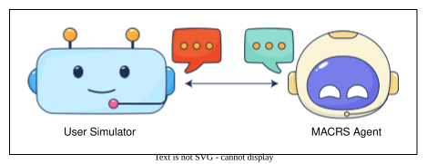

# Evaluating_MACRS_Performance_in_Multi-Agent_Conversational_Systems

Source: https://www.educative.io/courses/agentic-ai-systems/evaluating-macrs-performance-and-insights

---

[Home](https://www.educative.io/)

[Courses](https://www.educative.io/search?tab=courses)

[Agentic System Design](https://www.educative.io/courses/agentic-ai-systems)

# Evaluating MACRS: Performance and Insights

Understand how to evaluate multi-agent conversational recommender systems like MACRS by assessing success rates, adaptation, and efficiency metrics. Learn how coordinated agent collaboration, reflection mechanisms, and strategic planning improve goal-directed dialogues in dynamic environments.

We'll cover the following...

- [Experimental setup](https://www.educative.io/courses/agentic-ai-systems/evaluating-macrs-performance-and-insights#Experimental-setup)
- [Evaluation metrics](https://www.educative.io/courses/agentic-ai-systems/evaluating-macrs-performance-and-insights#Evaluation-metrics)
- [Comparative results](https://www.educative.io/courses/agentic-ai-systems/evaluating-macrs-performance-and-insights#Comparative-results)
- [Learning from ablations](https://www.educative.io/courses/agentic-ai-systems/evaluating-macrs-performance-and-insights#Learning-from-ablations)
- [Wrapping up the MACRS case study](https://www.educative.io/courses/agentic-ai-systems/evaluating-macrs-performance-and-insights#Wrapping-up-the-MACRS-case-study)
- [Summary: Key takeaways for agentic system designers](https://www.educative.io/courses/agentic-ai-systems/evaluating-macrs-performance-and-insights#Summary-Key-takeaways-for-agentic-system-designers)

In agentic system design, evaluation means assessing the behavior of the entire system over time, not just checking the accuracy of individual outputs. An effective agentic system must demonstrate its ability to reason strategically, adapt to user behavior, and maintain progress toward its goal, all within a dynamic and often unpredictable environment.

This requires a broader lens. Success is not measured solely by correct responses, but by how effectively the system manages dialogue, gathers information, makes decisions, and adjusts to feedback. These aspects are especially important when multiple agents collaborate toward a shared objective.

In this final lesson of the MACRS case study, we will explore how MACRS was evaluated to assess its coordination, adaptability, and overall performance, and what that reveals about building well-designed agentic systems.

## Experimental setup[#](https://www.educative.io/courses/agentic-ai-systems/evaluating-macrs-performance-and-insights#Experimental-setup)

To evaluate MACRS’s performance, the authors designed a controlled simulation framework that closely mimics real conversational recommendation scenarios. Instead of relying on unpredictable human users, they used an LLM-based user simulator. This simulated user could respond in diverse, realistic ways while ensuring consistency across different test cases.

The simulator was built using GPT-3.5 and was conditioned on both the item catalog, and a set of target user preferences. During each simulated dialogue, it responded to system prompts with natural language answers, selected or ignored recommendations, and occasionally changed preferences, just like a real user might.

It is important to note that while LLM-based user simulators offer consistency and reproducibility, evaluations using simulators built from the same family of LLMs as the system being tested (e.g., a GPT-based simulator evaluating GPT-based MACRS) can sometimes introduce a positive bias. Subsequent evaluations with diverse human users are typically needed for full generalizability, and to confirm real-world performance.

By using this setup, the researchers were able to test how well MACRS:

- Collects user preferences through dialogue.
- Adapts its behavior across turns.
- Delivers relevant, persuasive recommendations.
- Recovers from failed recommendations or uncooperative user behavior.

This approach also enabled controlled comparisons across different system variants and baselines, which is critical for evaluating design choices in agentic systems fairly.

As agentic system designers, we should think of simulation not just as evaluation, but as part of the design feedback loop. It helps us surface edge cases, test coordination strategies, and iterate before going live. Especially in systems where multiple agents interact, simulation is how we learn whether design choices hold up under real conversational complexity.

It is worth noting that, within the scope of the MACRS paper’s reported experiments, the system’s handling of complex edge cases was not explicitly evaluated. These include situations such as extreme user impatience, or highly ambiguous preferences that fall outside the simulator’s conditioning. The paper also does not detail specific error recovery mechanisms, such as how the system responds to tool invocation failures or unexpected API responses.

## Evaluation metrics[#](https://www.educative.io/courses/agentic-ai-systems/evaluating-macrs-performance-and-insights#Evaluation-metrics)

MACRS evaluation involves three key metrics. Each one reflects a different dimension of agentic performance:

- **Success Rate:** This metric captures the completion of the recommendation task. A session is considered successful if the simulated user selects one of the system’s recommended items before the dialogue ends. In agentic terms, this is our goal-completion score.
- **Hit Ratio@K:** This measures whether the correct item appeared in the top-K recommendations shown to the user. It reflects the quality of the agent’s reasoning and ranking ability. If the user liked item number 3 and the system ranked it in the top 5, that’s a hit. It shows the system is surfacing relevant options efficiently.
- **Average Number of Turns:** A measure of efficiency. How many dialogue turns does the system need to reach success? Too few, and it might be rushing. Too many, and it might be dithering or repeating itself. Good agentic systems strike the right balance eliciting enough information without tiring the user.

Together, these metrics give us a well-rounded picture:

- Did the system achieve its objective?
- Did it recommend the right items?
- Did it use dialogue turns wisely?

These are exactly the kind of questions we should ask of any agentic system. It’s not about perfection in individual responses; it’s about sustained, adaptive performance across interaction.

## Comparative results[#](https://www.educative.io/courses/agentic-ai-systems/evaluating-macrs-performance-and-insights#Comparative-results)

So, how well did MACRS perform? To answer this, the authors compared it against multiple baseline systems, including both traditional and LLM-only approaches.

Among the key baselines:

- **Fine-tuned GPT:** A single-agent system trained end-to-end on conversational data.
- **GPT-RL:** A reinforcement-learning-tuned agent optimizing for success rate.
- **GPT-RS:** A simpler rule-based system with GPT-generated recommendations.

Across multiple simulated sessions, MACRS consistently outperformed these baselines on all major metrics.

|  |  |  |  |
| --- | --- | --- | --- |
| **Model** | **Success Rate** | **Hit Ratio@K** | **Avg. Number of Turns** |
| **Fine-tuned GPT** | 40.2% | 58.6% | 7.9 |
| **GPT-RS** | 42.5% | 60.1% | 7.4 |
| **GPT-RL** | 48.7% | 64.3% | 6.8 |
| **MACRS** | 58.3% | 69.5% | 5.9 |

Let’s break that down from a design perspective:

- Higher Success Rate shows MACRS was more effective at reaching the recommendation goal. Its modular design enabled better strategy control, helping the system guide users more purposefully.
- Higher Hit Ratio@K suggests that MACRS offered more relevant, personalized suggestions. The user modeling and reflection mechanisms helped responder agents recommend items that aligned more closely with inferred preferences.
- Fewer dialogue turns reveal that MACRS achieved its goals with greater efficiency. Rather than circling around topics, it used better timing, more strategic transitions, and adaptive planning to move the dialogue forward.

From an agentic design standpoint, these gains reflect structural choices, not just better prompting or fine-tuning. The coordinated behavior we observe in MACRS stems from multi-agent collaboration, shared memory, and reflection mechanisms. These are all designed to help the system reason strategically, and adapt to evolving conversations.

The result was a system that didn’t just sound fluent, but that acted intelligently.

Example dialogues illustrating MACRS’s strategic conversation flow versus ChatGPT’s approach

As illustrated in the case study dialogue provided in the MACRS paper above, MACRS demonstrated superior strategic planning and adaptability compared to single-agent baselines. This lead to more intelligent and goal-oriented interactions.

## Mapping Design Features to Performance Gains

|  |  |  |
| --- | --- | --- |
| **Agentic Design Feature** | **What It Enables** | **Performance Impact** |
| **Multi-agent role specialization** | Delegates tasks like asking, recommending, and chit-chatting to focused agents | Higher dialogue diversity, improved goal alignment |
| **Central planner with reasoning** | Selects optimal response based on context and user state | Fewer redundant turns, higher success rate |
| **Shared user profile memory** | Maintains persistent, structured preference data across turns | Better personalization, more relevant recommendations |
| **Feedback-aware reflection** | Learns from user behavior and adjusts dialogue strategy | Increased adaptability, reduced recommendation failure |

## Learning from ablations[#](https://www.educative.io/courses/agentic-ai-systems/evaluating-macrs-performance-and-insights#Learning-from-ablations)

Ablation studies are like stress tests for design. By disabling certain components and observing the drop in performance, we get a clearer view of what really matters in the system’s behavior.

MACRS was evaluated under several ablated configurations. Here’s what the designers tested:

- **Without information-level reflection:** The system no longer updated user preferences based on subtle signals (e.g., skipped items, browsing history).
- **Without strategy-level reflection:** The planner and responder agents didn’t learn from previous failures.
- **Without multi-agent separation:** A single-agent generated the full response, eliminating role specialization.
- **Without the planner:** Candidate responses were chosen randomly, without strategic reasoning.

The results were consistent: each removed component led to significant performance degradation, particularly in Success Rate, and the ability to recommend relevant items earlier in the conversation.

## Wrapping up the MACRS case study[#](https://www.educative.io/courses/agentic-ai-systems/evaluating-macrs-performance-and-insights#Wrapping-up-the-MACRS-case-study)

The MACRS case study has shown what happens when you move beyond monolithic LLM applications, and start thinking like a system designer.

We began with a clear design challenge: building a goal-directed conversational recommender that could gather preferences, keep users engaged, and drive toward successful recommendations, all through natural dialogue. Along the way, we saw how traditional CRSs lacked adaptability, while LLM-only systems lacked control.

MACRS addressed these limitations with a multi-agent architecture rooted in agentic design principles:

- Role specialization through distinct responder agents.
- Centralized planning to enable strategic coordination.
- Feedback-aware reflection to support real-time adaptation.
- Shared memory to maintain coherence across dialogue turns.

Each of these design choices was not just a technical enhancement, but a deliberate architectural commitment to modularity, adaptability, and strategic reasoning.

## Summary: Key takeaways for agentic system designers[#](https://www.educative.io/courses/agentic-ai-systems/evaluating-macrs-performance-and-insights#Summary-Key-takeaways-for-agentic-system-designers)

From MACRS, we can extract agentic system design insights that extend beyond recommender systems. These are principles we can carry forward when building any multi-agent system that must operate in dynamic environments, reason over time, and adapt to user behavior.

- **Design for role clarity:** Dividing responsibilities among agents leads to more interpretable and controllable behavior. For example, a legal research agent splitting tasks among a document retrieval specialist, a summarizer, and a legal drafter.
- **Plan, don’t just prompt:** A planning agent introduces deliberation into what would otherwise be reactive output generation. For example, a software development agent using a planner to break down feature implementation into coding, testing, and documentation sub-tasks.
- **Reflect and adapt:** Feedback loops aren’t optional; they’re essential for systems that must operate in open, shifting environments. For example, a manufacturing automation agent can adjust robot movements based on sensor feedback and detected anomalies to improve assembly precision.
- **Optimize the system, not just the model:** The performance gains didn’t come from a more powerful LLM, but from a smarter system design. This principle applies universally; it focuses on architectural excellence, not just scaling up models.

As agentic system designers, we can take inspiration from MACRS to build intelligent applications that go beyond one-shot prompts. These can be systems that reason, adapt, and learn across time. These principles are applicable across diverse domains, from optimizing supply chains with specialized logistics agents to automating scientific discovery through hypothesis-generating and experiment-planning agents.

MACRS User Feedback-Aware Reflection Mechanism

Design Your First Agent

Ask

[Experimental setup](https://www.educative.io/courses/agentic-ai-systems/evaluating-macrs-performance-and-insights#Experimental-setup)

[Evaluation metrics](https://www.educative.io/courses/agentic-ai-systems/evaluating-macrs-performance-and-insights#Evaluation-metrics)

[Comparative results](https://www.educative.io/courses/agentic-ai-systems/evaluating-macrs-performance-and-insights#Comparative-results)

[Learning from ablations](https://www.educative.io/courses/agentic-ai-systems/evaluating-macrs-performance-and-insights#Learning-from-ablations)

[Wrapping up the MACRS case study](https://www.educative.io/courses/agentic-ai-systems/evaluating-macrs-performance-and-insights#Wrapping-up-the-MACRS-case-study)

[Summary: Key takeaways for agentic system designers](https://www.educative.io/courses/agentic-ai-systems/evaluating-macrs-performance-and-insights#Summary-Key-takeaways-for-agentic-system-designers)