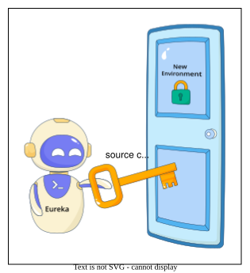
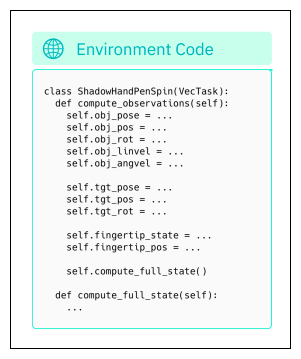

# Eureka's_Zero-Shot_RL_Reward_Generation_Using_Environment_Code

Source: https://www.educative.io/courses/agentic-ai-systems/eurekas-zero-shot-reward-generation

---

[Home](https://www.educative.io/)

[Courses](https://www.educative.io/search?tab=courses)

[Agentic System Design](https://www.educative.io/courses/agentic-ai-systems)

# Eureka’s Zero-Shot Reward Generation

Understand how Eureka leverages raw reinforcement learning environment code to autonomously generate zero-shot reward functions. Learn how this approach enables agents to interpret complex new environments without prior examples. This lesson highlights the strengths and limitations of initial reward functions and prepares you to explore automated refinement methods.

We'll cover the following...

- [How Eureka uses code as context](https://www.educative.io/courses/agentic-ai-systems/eurekas-zero-shot-reward-generation#How-Eureka-uses-code-as-context)
- [Evaluating the zero-shot reward: How good is the first attempt?](https://www.educative.io/courses/agentic-ai-systems/eurekas-zero-shot-reward-generation#Evaluating-the-zero-shot-reward-How-good-is-the-first-attempt)
- [Summary](https://www.educative.io/courses/agentic-ai-systems/eurekas-zero-shot-reward-generation#Summary)

In reinforcement learning (RL), agents learn to perform tasks by interacting with an environment and receiving feedback in the form of rewards. But before an agent can effectively learn, a precise reward function (a piece of code defining what success looks like) must be written. In many real-world scenarios, especially when dealing with novel environments or tasks, no pre-existing reward function exists. This often means there are no sample outputs or human-written instructions to guide the design process; only the environment’s raw source code is available to describe how the world operates.

Eureka uses raw environment source code as the ‘key’ to understand, and generate reward functions for new, unseen environments in a zero-shot manner

The fundamental challenge then becomes: how can an AI agent understand a new environment from scratch and autonomously generate an effective reward function? Eureka tackles this initial challenge in its design loop: generating a reward function in a zero-shot setting, using only the environment’s definition as context. This capability directly relates to the perception and input interface aspects of an agent, where it must transform raw environmental data into meaningful signals for its reasoning core.

## How Eureka uses code as context[#](https://www.educative.io/courses/agentic-ai-systems/eurekas-zero-shot-reward-generation#How-Eureka-uses-code-as-context)

As we saw in the previous lesson’s architectural overview of Eureka, the system begins by consuming raw environment code and a task description. In this lesson, we’ll focus on that crucial first step: how the agent leverages this context to autonomously generate meaningful reward functions in a zero-shot manner.

To overcome the problem of generating a reward function with no examples or prior explicit knowledge, Eureka turns to the most fundamental resource available: the environment’s raw source code.

Environment code

This code, typically written in Python and often following Gym-like conventions, contains the complete specification of the simulated world. It defines:

- The state and action spaces, outlining what the agent can observe and what actions it can perform.
- The `step()` and `reset()` methods, which dictate how the environment transitions between states.
- Any reward placeholders, if they exist, that might signal success.
- The underlying physics or interaction logic that determines success or failure conditions.

Eureka treats this environment code as direct context, acting as its environmental sensing mechanism. This is a powerful demonstration of how an agent can “perceive” its surroundings through structured data. Much like a human developer would when onboarding onto a new software project, Eureka “reads” how the virtual world behaves and then, based on this understanding, writes a reward function that aligns with the task embedded within that world.

As shown in the illustration below, the process begins with two critical inputs passed directly into a powerful coding-capable large language model (LLM), such as GPT-4:

1. **Environment code:** The unmodified source code of the RL environment. This provides the LLM with an exhaustive, and unambiguous understanding of the observable variables and their relationships within the simulation. Eureka often extracts just the observation portion of the code to reduce context length and cost, a practical design strategy for managing high inference latency and context window limitations.
2. **Task description:** A brief, natural language description of what the agent is supposed to achieve in the environment. For example, for the shadow hand pen spin task, the description is “To make the shadow hand spin the pen to a target orientation.”

Eureka’s zero-shot reward generation process: The coding LLM takes raw environment code, and a task description as context to directly generate executable reward function candidates

The LLM, acting as Eureka’s reasoning core or “brain,” parses these inputs and, without any pre-defined reward templates or few-shot examples, generates a set of executable reward function candidates. This is what constitutes Eureka’s remarkable zero-shot generation capability.

This initial, autonomous code generation is the crucial first step in Eureka’s iterative design loop, enabling it to tackle novel environments without prior human-engineered examples. This capability is vital for building modular and scalable agentic systems, as it removes the bottleneck of manual template creation for every new task.

This design is powerful because it leverages structured context (the raw code) and the LLM’s inherent code-writing, compositional, and semantic abilities to produce task-specific reward code from scratch. This makes it maximally scalable as environment source code always exists.

## Evaluating the zero-shot reward: How good is the first attempt?[#](https://www.educative.io/courses/agentic-ai-systems/eurekas-zero-shot-reward-generation#Evaluating-the-zero-shot-reward-How-good-is-the-first-attempt)

The effectiveness of these initial, zero-shot reward functions is a critical question. Yet, Eureka’s first attempts are often surprisingly effective, frequently producing functional reinforcement learning policies that perform well on the given task. This highlights the power of modern coding-capable LLMs when they are grounded in well-structured, and relevant context like environment source code.

However, “functional” does not always equate to “optimal” or “desired behavior.” Even a seemingly well-written zero-shot reward function can fall short if it fails to consistently guide the RL agent’s learning or adapt to edge cases. This points to the output uncertainty and hallucinationchallenge inherent in LLMs, even in code generation. Common limitations of these initial attempts include:

Common limitations of Eureka’s initial zero-shot reward functions, including partial emphasis, logical inconsistencies, and susceptibility to corner-case exploits

- **Partial emphasis:** The reward might over-emphasize only one aspect of the task (e.g., focusing on position but neglecting speed or smoothness).
- **Logical inconsistencies:** The generated reward could be logically flawed, potentially always returning zero, or providing rewards that don’t genuinely correlate with progress.
- **Corner-case exploits:** Agents might discover unexpected “loopholes” in the reward function, leading to behaviors that maximize the reward without achieving the intended goal (e.g., spinning endlessly in place or flinging an object to quickly accumulate points).

These shortcomings highlight that while Eureka’s zero-shot generation is a strong starting point and a powerful display of LLM capabilities, it’s not the complete solution. The initial reward functions are often sub-optimal with respect to the task fitness metric.

## Summary[#](https://www.educative.io/courses/agentic-ai-systems/eurekas-zero-shot-reward-generation#Summary)

In this lesson, we explored how Eureka tackles the initial challenge of reward design by leveraging the environment’s raw source code as direct context. We saw how this unique approach enables zero-shot generation of executable reward functions, demonstrating the power of grounding LLMs in structured data to understand novel environments from scratch. While these initial, autonomously generated rewards are functional, we also recognized their inherent limitations, often being sub-optimal or prone to unintended behaviors.

Understanding these initial shortcomings sets the stage for Eureka’s subsequent steps. In the next lesson, we will delve into how Eureka overcomes these imperfections through its powerful evolutionary search strategy, iteratively refining these initial reward functions to achieve human-level performance.

Eureka: Automating Reward Design with Coding LLMs

Eureka’s Evolutionary Search for Iterative Improvement

Ask

[How Eureka uses code as context](https://www.educative.io/courses/agentic-ai-systems/eurekas-zero-shot-reward-generation#How-Eureka-uses-code-as-context)

[Evaluating the zero-shot reward: How good is the first attempt?](https://www.educative.io/courses/agentic-ai-systems/eurekas-zero-shot-reward-generation#Evaluating-the-zero-shot-reward-How-good-is-the-first-attempt)

[Summary](https://www.educative.io/courses/agentic-ai-systems/eurekas-zero-shot-reward-generation#Summary)