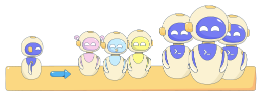

# Eureka's_Evolutionary_Search_for_Autonomous_Reward_Improvements

Source: https://www.educative.io/courses/agentic-ai-systems/eurekas-evolutionary-search-for-iterative-improvement

---

[Home](https://www.educative.io/)

[Courses](https://www.educative.io/search?tab=courses)

[Agentic System Design](https://www.educative.io/courses/agentic-ai-systems)

# Eureka’s Evolutionary Search for Iterative Improvement

Explore how Eureka employs an evolutionary search strategy to continuously refine reward functions in reinforcement learning. Understand the multi-sampling generation of candidates, context-driven code mutations, and rapid evaluation using GPU-accelerated simulations. Gain insights into building self-improving AI agents with fault tolerance and automated optimization.

We'll cover the following...

- [Building a self-improving AI agent system](https://www.educative.io/courses/agentic-ai-systems/eurekas-evolutionary-search-for-iterative-improvement#Building-a-self-improving-AI-agent-system)
  - [Step 1: Generating many options](https://www.educative.io/courses/agentic-ai-systems/eurekas-evolutionary-search-for-iterative-improvement#Step-1-Generating-many-options)
  - [Step 2: Making changes based on feedback](https://www.educative.io/courses/agentic-ai-systems/eurekas-evolutionary-search-for-iterative-improvement#Step-2-Making-changes-based-on-feedback)
  - [Step 3: Evaluating options](https://www.educative.io/courses/agentic-ai-systems/eurekas-evolutionary-search-for-iterative-improvement#Step-3-Evaluating-options)
    - [Enabling rapid evaluation](https://www.educative.io/courses/agentic-ai-systems/eurekas-evolutionary-search-for-iterative-improvement#Enabling-rapid-evaluation)
- [Summary](https://www.educative.io/courses/agentic-ai-systems/eurekas-evolutionary-search-for-iterative-improvement#Summary)

In the previous lesson, we witnessed Eureka’s remarkable ability to generate initial reward functions using a coding LLM, acting as the agent’s reasoning core for understanding an environment. This demonstrated a powerful first step in automating reward design. However, these initial attempts, though functional, were often not optimal. They might overly emphasize certain parts of a task, contain logical errors, or even lead the agent to “exploit” the reward function by doing things that get high scores but don’t match the human’s true goal. Manually fixing these subtle flaws in reward code is a time-consuming process that needs deep knowledge, which is a major problem in reinforcement learning development.

Eureka’s evolutionary search, where multiple reward function candidates are generated and iteratively refined. This leads to an improved ‘population’ of solutions over generations

This challenge of imperfect initial outputs highlights a basic design problem for any complex agentic system: it exposes output uncertainty and hallucination from the LLM. For an autonomous agent to successfully tackle open-ended design problems like creating rewards, it cannot rely on just one, possibly flawed, attempt. It needs a clear way to continuously make itself better. This is where Eureka’s evolutionary search strategy comes in. It provides an advanced optimization method to solve these challenges, directly leading to a more reliable and adaptive AI agent system.

## Building a self-improving AI agent system[#](https://www.educative.io/courses/agentic-ai-systems/eurekas-evolutionary-search-for-iterative-improvement#Building-a-self-improving-AI-agent-system)

Eureka’s evolutionary search works as a powerful self-improvement loop that continuously refines the generated reward functions. This process is inspired by natural selection, where a population of solutions is progressively improved over generations. In each “generation” or iteration, Eureka’s core LLM (acting as the agent’s main reasoning core) suggests a group of new reward function candidates.

Here’s how this iterative refinement process, central to Eureka’s design, functions:

### Step 1: Generating many options[#](https://www.educative.io/courses/agentic-ai-systems/eurekas-evolutionary-search-for-iterative-improvement#Step-1-Generating-many-options)

In each iteration, Eureka tells the coding LLM to create multiple independent reward function candidates. Typically, it makes 16 examples in each iteration. This “multi-sampling” is a key robustness feature in agentic design. Even if some code snippets have bugs or are not optimal, creating many options greatly increases the chance of finding at least one working and potentially better reward function in that group. This helps prevent the system from getting stuck due to a single ineffective LLM output, adding a layer of fault tolerance.

Eureka’s multi-sampling strategy, where the coding LLM generates multiple independent reward function candidates in each iteration to increase robustness and fault tolerance

1.

Why generate multiple reward functions at once?

Show Answer

Did you find this helpful?

### Step 2: Making changes based on feedback[#](https://www.educative.io/courses/agentic-ai-systems/eurekas-evolutionary-search-for-iterative-improvement#Step-2-Making-changes-based-on-feedback)

The LLM doesn’t just create new rewards randomly. It uses its strong in-context learning ability. For later iterations, Eureka gives the LLM the best-performing reward function from the previous iteration as part of its context. Along with this, the LLM receives prompts that suggest general ways to change the existing reward code. This process explicitly guides the LLM to perform self reflection via in-context reasoning, enabling “in-context reward mutation,” suggesting specific improvements based on past performance feedback.

 to guide its generation of refined reward functions, which can involve changing hyperparameters, functional forms, or adding new components")

Eureka’s in-context reward mutation process where the LLM receives the best previous reward and ‘Mutation instructions’ (textual feedback) to guide its generation of refined reward functions, which can involve changing hyperparameters, functional forms, or adding new components

Common types of changes seen (as illustrated above) are:

1. **Changing hyperparameters:** Adjusting coefficients or weights within existing reward components.
2. **Changing functional form:** Modifying the mathematical expression of a reward component (e.g., changing linear to exponential).
3. **Introducing a new component:** Adding entirely new reward elements to capture previously unaddressed aspects of the task.

This process showcases how well-crafted instructions (via prompt engineering) can dynamically guide the LLM’s dynamic task planning to generate specific tool use outputs (in this case, executable Python code as a form of “action execution.” )

### Step 3: Evaluating options[#](https://www.educative.io/courses/agentic-ai-systems/eurekas-evolutionary-search-for-iterative-improvement#Step-3-Evaluating-options)

To find which of the newly generated reward functions is the most effective, Eureka needs to see how well a reinforcement learning program (called an RL policy) performs when trained with each of them. This evaluation step is crucial for completing the self-improvement loop.

Evaluation of reward candidates. After training RL policies with each candidate, the reward function that achieves the highest fitness score is selected as the best fit for that iteration

For each candidate reward function, an RL policy is trained and its performance is measured using a set fitness function (FFF), making this the true goal metric for the task. The reward function that helps the policy achieve the highest fitness score (F(π)F(π)F(π), where πππ is the policy) is chosen as the best for that iteration. This can be formally expressed as selecting the policy π∗π^\*π∗ that maximizes the fitness function:

π∗=arg maxπiF(πi)π^\* = arg\space max\_{πi}F(πi)π∗=arg maxπi​F(πi)

where πiπ\_iπi​​ is the policy trained on reward candidate rir\_iri​.​

Traditionally, refining reward functions has required human experts to manually analyze policy behaviors, tweak coefficients, rerun training, and repeat (often across days or weeks of experimentation.) Eureka automates this entire loop, not only accelerating the process but removing human bottlenecks and inconsistencies. This contrast underscores the power of agentic systems to replace slow, manual iteration with autonomous, high-throughput optimization.

#### Enabling rapid evaluation[#](https://www.educative.io/courses/agentic-ai-systems/eurekas-evolutionary-search-for-iterative-improvement#Enabling-rapid-evaluation)

Trying out many different reward functions in an evolutionary search requires very fast testing. Training an RL policy from scratch for each candidate can take too much time and resources, creating a significant scalability challenge for the entire agentic system.

Eureka solves this by using NVIDIA’s Isaac Gym, a high-performance, GPU-accelerated simulation platform for robot learning. Isaac Gym acts as a vital tool in Eureka’s system, allowing it to quickly train and evaluate RL policies. Its parallelization capabilities enable policy learning speeds that are “up to three orders of magnitude” faster than traditional CPU-based simulations. This speedy evaluation makes Eureka’s extensive reward search practical, and ensures efficient action execution within Eureka’s overall (meta) agent loop. For checking rewards during the search, Eureka typically uses one PPO (proximal policy optimization) run for each candidate. For the final report on the best rewards, it uses five PPO runs to ensure results are strong and reliable. This smart use of a high-performance external tool is a clear example of effective tool augmentation in agentic design.

## Summary[#](https://www.educative.io/courses/agentic-ai-systems/eurekas-evolutionary-search-for-iterative-improvement#Summary)

In this lesson, we’ve seen how Eureka goes beyond initial reward generation by using a powerful evolutionary search. This step-by-step process, which involves creating many options, makes changes based on what works best. Checking them promptly is vital for fixing initial problems, and reaching human-level performance. It highlights how important self-improvement loops, strong fault tolerance, and smart tool integration are when building truly adaptive and effective AI agent systems.

While evolutionary search helps Eureka improve, how does it get the exact information it needs to make targeted changes to its reward code? In our next lesson, we will explore Eureka’s reward reflection mechanism. This is a sophisticated component that provides detailed feedback on how well the learning process is going, allowing for smart and focused reward adjustments.

Eureka’s Zero-Shot Reward Generation

Eureka's Reward Reflection Mechanism

Ask

[Building a self-improving AI agent system](https://www.educative.io/courses/agentic-ai-systems/eurekas-evolutionary-search-for-iterative-improvement#Building-a-self-improving-AI-agent-system)

[Step 1: Generating many options](https://www.educative.io/courses/agentic-ai-systems/eurekas-evolutionary-search-for-iterative-improvement#Step-1-Generating-many-options)

[Step 2: Making changes based on feedback](https://www.educative.io/courses/agentic-ai-systems/eurekas-evolutionary-search-for-iterative-improvement#Step-2-Making-changes-based-on-feedback)

[Step 3: Evaluating options](https://www.educative.io/courses/agentic-ai-systems/eurekas-evolutionary-search-for-iterative-improvement#Step-3-Evaluating-options)

[Enabling rapid evaluation](https://www.educative.io/courses/agentic-ai-systems/eurekas-evolutionary-search-for-iterative-improvement#Enabling-rapid-evaluation)

[Summary](https://www.educative.io/courses/agentic-ai-systems/eurekas-evolutionary-search-for-iterative-improvement#Summary)