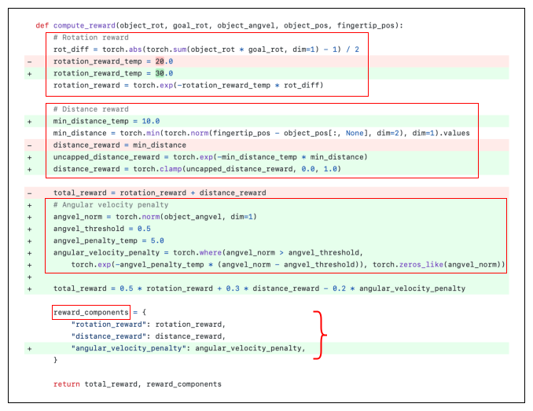

# Eureka's_Reward_Reflection_for_Targeted_RL_Improvement

Source: https://www.educative.io/courses/agentic-ai-systems/eurekas-reward-reflection-mechanism

---

[Home](https://www.educative.io/)

[Courses](https://www.educative.io/search?tab=courses)

[Agentic System Design](https://www.educative.io/courses/agentic-ai-systems)

# Eureka's Reward Reflection Mechanism

Explore Eureka's reward reflection mechanism that provides detailed textual feedback on individual reward components during reinforcement learning. Understand how this mechanism enables precise self-improvement, targeted reward editing, and better synergy with RL algorithms to create more adaptive AI agents.

We'll cover the following...

- [Eureka’s solution: Automated reward reflection for granular feedback](https://www.educative.io/courses/agentic-ai-systems/eurekas-reward-reflection-mechanism#Eurekas-solution-Automated-reward-reflection-for-granular-feedback)
  - [Exposing reward components](https://www.educative.io/courses/agentic-ai-systems/eurekas-reward-reflection-mechanism#Exposing-reward-components)
  - [Tracking training dynamics](https://www.educative.io/courses/agentic-ai-systems/eurekas-reward-reflection-mechanism#Tracking-training-dynamics)
  - [Textual summary for the LLM](https://www.educative.io/courses/agentic-ai-systems/eurekas-reward-reflection-mechanism#Textual-summary-for-the-LLM)
- [Why reward reflection is crucial](https://www.educative.io/courses/agentic-ai-systems/eurekas-reward-reflection-mechanism#Why-reward-reflection-is-crucial)
- [Summary](https://www.educative.io/courses/agentic-ai-systems/eurekas-reward-reflection-mechanism#Summary)

In the last lesson, we explored how Eureka uses evolutionary search to iteratively improve its generated reward functions. This powerful self-improvement loop relies on creating multiple candidates, evaluating them, and selecting the best one based on a fitness score (F). However, a single numerical score, while indicating overall performance, has a significant limitation: it doesn’t explain why a reward function works well or where it falls short. It’s like a software developer trying to debug a complex distributed system by only looking at the final pass/fail status, without access to the logs or metrics from individual microservices. You know there’s a problem, but you don’t know where or why to fix it. This problem is known as a lack of credit assignment.

For an AI agent designed to autonomously refine complex code, simply knowing a numerical score isn’t enough to perform targeted, intelligent editing. The agent’s reasoning core (the LLM) needs more granular insights into the policy’s training dynamics to understand the impact of different reward components. How can Eureka get this precise, actionable feedback? This is where Eureka’s reward reflection mechanism becomes essential, acting as a critical internal feedback loop for the agent.

## Eureka’s solution: Automated reward reflection for granular feedback[#](https://www.educative.io/courses/agentic-ai-systems/eurekas-reward-reflection-mechanism#Eurekas-solution-Automated-reward-reflection-for-granular-feedback)

Eureka solves the problem of credit assignment by generating automated, textual feedback that summarizes the policy training dynamics in detail. This is how it works:

### Exposing reward components[#](https://www.educative.io/courses/agentic-ai-systems/eurekas-reward-reflection-mechanism#Exposing-reward-components)

Eureka’s generated reward functions are designed to explicitly expose their individual components. This is done by requiring the reward code to return not just a total reward, but also a dictionary of each individual reward component (e.g., rotation\_reward, distance\_reward, angular\_velocity\_penalty). This structural requirement is a clever design choice that enables fine-grained monitoring.

Eureka’s reward function structure, explicitly exposing individual reward components in a dictionary for granular tracking and reflection

### Tracking training dynamics[#](https://www.educative.io/courses/agentic-ai-systems/eurekas-reward-reflection-mechanism#Tracking-training-dynamics)

During the RL policy training phase (which happens in Isaac Gym), Eureka continuously tracks the scalar values of all these individual reward components at various intermediate checkpoints throughout the training process. For instance, snapshot values of components like `av_penalty` are recorded as a list in the reward feedback.

The Eureka architecture highlighting the reward reflection feedback loop, where detailed training data informs subsequent reward function revisions

### Textual summary for the LLM[#](https://www.educative.io/courses/agentic-ai-systems/eurekas-reward-reflection-mechanism#Textual-summary-for-the-LLM)

This detailed training data (values of individual reward components, along with global metrics like success rates and episode lengths) is then compiled into a textual summary. This summary serves as the reward reflection feedback, which is fed back into the LLM’s context window for the next iteration of evolutionary search.

How is this reflection turned into a prompt?

To make the LLM effectively use this reflection summary for targeted edits, Eureka transforms the training metrics into a natural language prompt. This prompt includes the raw policy feedback (like `rotation_reward: [values], Max: X, Mean: Y, Min: Z`, and `success_rate: [values]`) and specific instructions for the LLM to analyze this data.

For example, a portion of the prompt provided to the LLM looks like this:

Ace Editor

1

2

3

4

5

6

7

8

9

10

11

12

13

14

15

16

17

18

19

20

We trained a RL policy using the provided reward function code and tracked the values of the

individual components in the reward function as well as global policy metrics such as

success rates and episode lengths after every (epoch\_freq) epochs and the maximum, mean,

minimum values encountered:

<REWARD REFLECTION HERE>

Please carefully analyze the policy feedback and provide a new, improved reward function that

can better solve the task. Some helpful tips for analyzing the policy feedback:

(1) If the success rates are always near zero, then you must rewrite the entire reward function

(2) If the values for a certain reward component are near identical throughout, then this

means RL is not able to optimize this component as it is written. You may consider

(a) Changing its scale or the value of its temperature parameter

(b) Re-writing the reward component

(c) Discarding the reward component

(3) If some reward components' magnitude is significantly larger, then you must re-scale

its value to a proper range

Please analyze each existing reward component in the suggested manner above first, and then

write the reward function code.

הההההההההההההההההההההההההההההההההההההההההההההההההההההההההההההההההההההההההההההההההההההההההההההההההההההההההההההההההההההההההההההההההההההההההההההההההההההההההההההההההההההההההההההההההההההההההההההההההההההההההההההההההההההההההההההההההההההההההההההההההההההההההההההההההההההההההההההההההההההההההההההההההההההההההההההההההההההההההההההההההההההההההההההההההההההההההההההההההההההההההההההההההההההההההההההההההההההההההההההההההההההההההההההההההההההההההההההההההההההההההההההההההההההההההההההההההההההההההההההההההההההההההההההההההההההההההההההההה

XXXXXXXXXXXXXXXXXXXXXXXXXXXXXXXXXXXXXXXXXXXXXXXXXXXXXXXXXXXXXXXXXXXXXXXXXXXXXXXXXXXXXXXXXXXXXXXXXXXXXXXXXXXXXXXXXXXXXXXXXXXXXXXXXXXXXXXXXXXXXXXXXXXXXXXXXXXXXXXXXXXXXXXXXXXXXXXXXXXXXXXXXXXXXXXXXXXXXXXXXXXXXXXXXXXXXXXXXXXXXXXXXXXXXXXXXXXXXXXXXXXXXXXXXXXXXXXXXXXXXXXXXXXXXXXXXXXXXXXXXXXXXXXXXXXXXXXXXXXXXXXXXXXXXXXXXXXXXXXXXXXXXXXXXXXXXXXXXXXXXXXXXXXXXXXXXXXXXXXXXXXXXXXXXXXXXXXXXXXXXXXXXXXXXXXXXXXXXXXXXXXXXXXXXXXXXXXXXXXXXXXXXXXXXXXXXXXXXXXXXXXXXXXXXXXXXXXXXXXXXXXXXXXXXXXXXXXXXXXXXXXXXXXXXXXXXXXXXXXXXXXXXXXXXXXX

Structure of Eureka’s reward reflection prompt, which combines performance metrics with targeted instructions to guide the LLM’s revision process

This structured prompt guides the LLM to interpret the numerical feedback and propose specific code modifications, directly leveraging its reasoning and code-writing capabilities for self-correction.

## Why reward reflection is crucial[#](https://www.educative.io/courses/agentic-ai-systems/eurekas-reward-reflection-mechanism#Why-reward-reflection-is-crucial)

The reward reflection mechanism, though seemingly simple, is vital for Eureka’s ability to perform targeted reward editing and achieve its impressive results. It provides the necessary detailed context for the LLM’s reasoning core to make informed decisions for refinement:

This illustrates the effectiveness of reward reflection. Granular feedback on individual reward components enables Eureka to perform targeted self-correction. This drives continuous and effective reward function refinement within its iterative loop

- **Enabling targeted improvement:** By providing a breakdown of how each reward component performs and whether it is being effectively optimized by the RL algorithm, Eureka enables more precise and targeted reward editing. For example, if the reflection indicates a `distance_reward` component remains flat throughout training, the LLM can infer it’s not being effectively optimized. This means it can suggest adjusting its scale or functional form.
- **Synergy with the RL algorithm:** The effectiveness of a reward function is highly dependent on the specific RL algorithm and even its hyperparameters. By witnessing how the RL algorithm optimizes individual reward components, Eureka can synthesize reward functions that better synergize with the fixed RL algorithm it’s using. This is a form of internal adaptability where the agent customizes its output not just to the task, but to the specific learning environment/algorithm.
- **Enhanced self-correction:** This mechanism fundamentally empowers the agent’s self-improvement loop. It acts as a critical internal feedback mechanism, allowing Eureka to “understand” its own design flaws at a granular level. This moves beyond basic success/failure signals to a more sophisticated form of agent introspection, and learning from failure.

- **Beyond simple metrics:** For complex agent behaviors, simple numerical scores are often insufficient for guiding nuanced improvements. Reward reflection demonstrates the need for rich, interpretable feedback in advanced agentic tasks.

## Summary[#](https://www.educative.io/courses/agentic-ai-systems/eurekas-reward-reflection-mechanism#Summary)

In this lesson, we’ve examined Eureka’s reward reflection mechanism, a sophisticated component that closes the loop on its evolutionary search by providing detailed, textual feedback on the performance of individual reward components. This capability moves beyond simple overall scores, enabling the agent’s reasoning core to perform highly targeted reward editing. It showcases a powerful pattern for self-improvement and adaptability in agentic systems, emphasizing the critical role of interpretable internal feedback for intelligent design.

We’ve seen how Eureka autonomously designs and refines reward functions. But how does this powerful agent interact with human input? In our next lesson, we will examine how human guidance can further enhance its capabilities, and how Eureka can discover entirely new reward strategies.

Eureka’s Evolutionary Search for Iterative Improvement

Eureka from Human Feedback and Novel Reward Discovery

Ask

[Eureka’s solution: Automated reward reflection for granular feedback](https://www.educative.io/courses/agentic-ai-systems/eurekas-reward-reflection-mechanism#Eurekas-solution-Automated-reward-reflection-for-granular-feedback)

[Exposing reward components](https://www.educative.io/courses/agentic-ai-systems/eurekas-reward-reflection-mechanism#Exposing-reward-components)

[Tracking training dynamics](https://www.educative.io/courses/agentic-ai-systems/eurekas-reward-reflection-mechanism#Tracking-training-dynamics)

[Textual summary for the LLM](https://www.educative.io/courses/agentic-ai-systems/eurekas-reward-reflection-mechanism#Textual-summary-for-the-LLM)

[Why reward reflection is crucial](https://www.educative.io/courses/agentic-ai-systems/eurekas-reward-reflection-mechanism#Why-reward-reflection-is-crucial)

[Summary](https://www.educative.io/courses/agentic-ai-systems/eurekas-reward-reflection-mechanism#Summary)