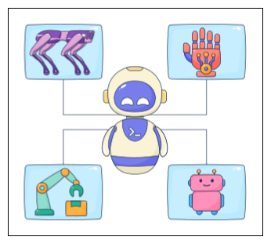

# Evaluating_Eureka_Agent_Performance_in_Multi-Task_Reinforcement_Learning

Source: https://www.educative.io/courses/agentic-ai-systems/evaluating-eureka-performance-and-insights

---

[Home](https://www.educative.io/)

[Courses](https://www.educative.io/search?tab=courses)

[Agentic System Design](https://www.educative.io/courses/agentic-ai-systems)

# Evaluating Eureka: Performance and Insights

Discover how Eureka, an LLM-powered agent, autonomously generates and refines reinforcement learning reward functions. Learn to assess its performance across diverse robotic tasks, understanding key metrics and architectural choices that enable it to outperform human benchmarks with adaptive, novel solutions in complex environments.

We'll cover the following...

- [Experimental setup: Creating a fair playing field for agent evaluation](https://www.educative.io/courses/agentic-ai-systems/evaluating-eureka-performance-and-insights#Experimental-setup-Creating-a-fair-playing-field-for-agent-evaluation)
- [Key baselines: Understanding Eureka’s competitive edge](https://www.educative.io/courses/agentic-ai-systems/evaluating-eureka-performance-and-insights#Key-baselines-Understanding-Eurekas-competitive-edge)
- [Evaluation metrics: Measuring agentic success](https://www.educative.io/courses/agentic-ai-systems/evaluating-eureka-performance-and-insights#Evaluation-metrics-Measuring-agentic-success)
  - [Human normalized score (for Isaac tasks)](https://www.educative.io/courses/agentic-ai-systems/evaluating-eureka-performance-and-insights#Human-normalized-score-for-Isaac-tasks)
  - [Success Rate (for dexterity tasks)](https://www.educative.io/courses/agentic-ai-systems/evaluating-eureka-performance-and-insights#Success-Rate-for-dexterity-tasks)
- [Eureka’s groundbreaking results: Lessons in agentic superiority](https://www.educative.io/courses/agentic-ai-systems/evaluating-eureka-performance-and-insights#Eurekas-groundbreaking-results-Lessons-in-agentic-superiority)
- [Key insights for agentic system designers](https://www.educative.io/courses/agentic-ai-systems/evaluating-eureka-performance-and-insights#Key-insights-for-agentic-system-designers)

We’ve now explored Eureka’s sophisticated mechanisms: its ability to generate reward functions from environment code, its powerful evolutionary search for continuous self-improvement, and its flexibility in incorporating human feedback. However, for any agentic system, the ultimate measure of success isn’t just about clever algorithms or individual components. It’s about how the entire system behaves over time, and how effectively it achieves its complex, dynamic goals in diverse environments. Evaluating Eureka means assessing its overall strategic reasoning, adaptability to various tasks, and consistent progress toward designing high-performing rewards.

In this lesson, we will analyze Eureka’s performance through the lens of its empirical evaluation, focusing on what these results teach us about effective agentic system design. We’ll move beyond just listing numbers, and interpret why Eureka’s architectural choices led to its groundbreaking performance.

## Experimental setup: Creating a fair playing field for agent evaluation[#](https://www.educative.io/courses/agentic-ai-systems/evaluating-eureka-performance-and-insights#Experimental-setup-Creating-a-fair-playing-field-for-agent-evaluation)

To rigorously evaluate Eureka’s capabilities, researchers conducted extensive experiments across a diverse suite of reinforcement learning environments. This setup is key to understanding the robustness, and generality of an agentic system:

- **Diverse environments:** Eureka was tested on 29 open-source RL environments, featuring 10 distinct robot types. This broad range includes quadrupeds, bipeds, robotic arms, and dexterous hands. This means it covers both the Isaac Gym (9 original tasks) and the more complex Bidexterous Manipulation (Dexterity) benchmark (20 tasks). This wide testbed confirms an agent’s ability to generalize across varied problem spaces, a critical trait for adaptable AI agents.
- **Unbiased knowledge:** Importantly, many of these benchmarks were publicly released concurrently with or after the GPT-4 knowledge cut-off date (September 2021). This means the LLM powering Eureka was unlikely to have seen extensive internet knowledge about these specific tasks. This makes them ideal for assessing Eureka’s true zero-shot generation capability, and its ability to learn from raw environment context, rather than memorized solutions.
- **Consistent RL training:** For fair comparison, all reward functions (those generated by Eureka, human-engineered ones, and baselines) were optimized using the same RL algorithm (PPO) with identical hyperparameters tuned for the human-engineered rewards. This isolates the impact of the reward function design itself, ensuring that Eureka’s success is due to its superior reward design, not just better RL training. This is a crucial aspect of controlled experimentation in agentic AI.

## Key baselines: Understanding Eureka’s competitive edge[#](https://www.educative.io/courses/agentic-ai-systems/evaluating-eureka-performance-and-insights#Key-baselines-Understanding-Eurekas-competitive-edge)

To truly understand Eureka’s performance, it was compared against several important baselines:

- **Human:** These are the original, manually shaped reward functions provided in the benchmark tasks, created by expert reinforcement learning researchers. This provides the “human-level” benchmark that Eureka aims to surpass.
- **Sparse:** These are the pure, often difficult-to-optimize ground-truth fitness functions (F) for each task. They represent the bare minimum reward signal, often indicating only task success (e.g., binary 1 or 0). This baseline shows if the designed reward provides effective “shaping” beyond the basic goal.
- **L2R (language-to-rewards):** A prior LLM-based approach to reward design, which uses a two-stage prompting solution to generate templated rewards. L2R is given an advantage by having access to some of the same reward components as human experts. Comparing Eureka to L2R highlights the value of Eureka’s free-form, expressive reward-program generation and its lack of reliance on predefined templates. This acts as a key differentiator in LLM-powered agent design.

## Evaluation metrics: Measuring agentic success[#](https://www.educative.io/courses/agentic-ai-systems/evaluating-eureka-performance-and-insights#Evaluation-metrics-Measuring-agentic-success)

The evaluation of Eureka focuses on metrics that reflect the ultimate goal-achievement of the RL policies trained with the designed rewards:

### Human normalized score (for Isaac tasks)[#](https://www.educative.io/courses/agentic-ai-systems/evaluating-eureka-performance-and-insights#Human-normalized-score-for-Isaac-tasks)

Since Isaac tasks have varied fitness functions, this metric normalizes performance against human and sparse rewards. It is calculated as:

Normalized Score=Scoremethod−ScoresparseScorehuman−Scoresparse​​Normalized Score= \frac{Score
\_{method}−Score\_{sparse}}{Score\_{human}−Score\_{sparse}}
​
​
Normalized Score=Scorehuman​−Scoresparse​Scoremethod​−Scoresparse​​​​

A score greater than 1 means the method outperformed human experts. This is a crucial metric for evaluating a meta-agent’s performance in a heterogeneous environment, indicating how much ‘normalized improvement’ it provides over human-expert systems.

### Success Rate (for dexterity tasks)[#](https://www.educative.io/courses/agentic-ai-systems/evaluating-eureka-performance-and-insights#Success-Rate-for-dexterity-tasks)

For the 20 complex Dexterity tasks, which typically have a binary success function, the Success Rate directly measures task completion. This provides a clear, interpretable measure of an agent’s ability to achieve its objectives in challenging manipulation scenarios.

## Eureka’s groundbreaking results: Lessons in agentic superiority[#](https://www.educative.io/courses/agentic-ai-systems/evaluating-eureka-performance-and-insights#Eurekas-groundbreaking-results-Lessons-in-agentic-superiority)

Eureka’s evaluation results are groundbreaking, offering several key takeaways for agentic system designers:

- **Outperforming human experts:** Eureka consistently surpasses expert human-designed rewards, achieving an average normalized improvement of 52% over human efforts across diverse tasks. This highlights the power of LLM-powered agents to automate complex, expert-level tasks and generate flexible solutions , especially in high-dimensional environments.
- **Consistent self-improvement:** Eureka’s performance steadily improves through its evolutionary search, consistently surpassing human benchmarks. This strongly validates the critical role of robust self-improvement loops in agentic design, showing how adaptive refinement is essential for high-quality results in open-ended challenges.
- **Novel reward discovery:** Eureka often discovers unique reward principles, generating functions weakly or even negatively correlated with human designs, yet performing better. This demonstrates an agent’s capacity for novel solution discovery, exploring broader design spaces beyond human intuition.
- **Performance drop without reflection:** The detailed reward reflection mechanism is crucial; without it, Eureka’s performance significantly drops. This performance degradation can be quantified using the formula given below. In Eureka’s case, this drop is 28.6% on average normalized score, underscoring the importance of interpretable internal feedback mechanisms for an agent’s reasoning core to perform targeted self-correction and adaptability.

Δ=Fwith reflection−Fno reflectionFwith reflection×100%\Delta = \frac{F\_{with~reflection} - F\_{no~reflection}}{F\_{with~reflection}} \times 100\%Δ=Fwith reflection​Fwith reflection​−Fno reflection​​×100%

- **Solving previously unfeasible tasks:** Eureka enables complex tasks like dexterous pen spinning, previously unachievable with manual reward engineering. This highlights how a powerful meta-agent can automate bottlenecks, extending AI’s reach into highly challenging domains.

Eureka’s impressive performance is a direct result of its intelligent agentic architecture. The table below summarizes how Eureka’s specific design features translate into significant performance gains, and address common challenges in agentic system design:

## Mapping Design Features to Performance Gains

|  |  |  |
| --- | --- | --- |
| **Agentic Design Feature** | **What It Enables** | **Performance Impact** |
| **LLM as reasoning core** | Autonomous initial reward generation from raw environment code, understanding complex contexts. | Produces plausible initial reward functions in a zero-shot manner, eliminating the need for manual templates or extensive prompt engineering. |
| **Evolutionary search** | Iterative refinement of reward functions, adaptive design, robustness against initial sub-optimality. | Consistently outperforms human-engineered rewards (e.g., 52% average normalized improvement). This steadily improves performance over iterations. |
| **Reward reflection mechanism** | Granular diagnosis of reward components’ performance, targeted editing, synergy with the RL algorithm, and enhanced self-correction. | Enables precise self-correction, and prevents significant performance degradation (28.6% drop without it). This is crucial for complex tasks where simple scores are insufficient. |
| **GPU-accelerated RL (Isaac gym) as a tool** | Rapid, high-throughput evaluation of many reward candidates, feasible execution of extensive evolutionary search, efficient action execution. | Enables practical evolutionary search, speeds up policy learning by “up to three orders of magnitude” (allowing for more iterations and samples). This makes it vital to address the scalability challenge. |
| **Human feedback integration** | Incorporating nuanced human preferences, improving existing human-engineered rewards, and co-piloting design. | Eureka (human initialization) uniformly performs better than Eureka alone or human-designed rewards. This leads to human-preferred behaviors (e.g., stable humanoid gait over speed, 15/20 user preference). |
| **Novel reward discovery** | Exploration of a broader design space, finding non-obvious reward principles, overcoming human biases, and conventional assumptions. | Results in reward functions are weakly or even negatively correlated with human ones, yet outperform them. Solves previously unfeasible tasks (e.g., dexterous pen spinning), pushing the boundaries of RL capabilities. |

## Key insights for agentic system designers[#](https://www.educative.io/courses/agentic-ai-systems/evaluating-eureka-performance-and-insights#Key-insights-for-agentic-system-designers)

The Eureka case study provides profound insights for anyone looking to design and build agentic AI systems. It demonstrates that combining the code-writing prowess of LLMs. With iterative self-improvement loops and high-throughput evaluation, this case study creates a powerful meta-agent capable of tackling complex design challenges, previously exclusive to human experts.

From Eureka, we reinforce the following core agentic system design principles:

- **Empower LLMs as reasoning cores:** Leverage their code-writing and semantic understanding for complex problem-solving.
- **Embrace self-improvement loops:** Design iterative refinement processes with strong feedback mechanisms (like reward reflection which embodies ReAct-style reasoning) to overcome initial imperfections, and achieve optimal results. This is a dominant pattern throughout Eureka’s operation.
- **Strategic tool augmentation:** Integrate high-performance external tools (like Isaac Gym) to enable scalability and efficient execution of agent “actions.” This is a prime example of a tool-augmented architecture.
- **Prioritize adaptability and generalization:** Build systems that can adapt to diverse environments, and tasks without extensive re-engineering.
- **Facilitate human-AI collaboration:** Design for seamless incorporation of human feedback (exemplifying human-in-the-loop or human-on-the-loop patterns) to ensure alignment, and leverage complementary expertise.
- **Seek novelty:** Recognize the potential for autonomous agents to discover solutions beyond human intuition.

Eureka is not just about designing rewards; it’s a blueprint for building autonomous, adaptive, and highly capable AI agents. These agents, in turn, can learn, design, and innovate in the real world.

Eureka from Human Feedback and Novel Reward Discovery

Agent Design, Code Structure, and Output Demonstration

Ask

[Experimental setup: Creating a fair playing field for agent evaluation](https://www.educative.io/courses/agentic-ai-systems/evaluating-eureka-performance-and-insights#Experimental-setup-Creating-a-fair-playing-field-for-agent-evaluation)

[Key baselines: Understanding Eureka’s competitive edge](https://www.educative.io/courses/agentic-ai-systems/evaluating-eureka-performance-and-insights#Key-baselines-Understanding-Eurekas-competitive-edge)

[Evaluation metrics: Measuring agentic success](https://www.educative.io/courses/agentic-ai-systems/evaluating-eureka-performance-and-insights#Evaluation-metrics-Measuring-agentic-success)

[Human normalized score (for Isaac tasks)](https://www.educative.io/courses/agentic-ai-systems/evaluating-eureka-performance-and-insights#Human-normalized-score-for-Isaac-tasks)

[Success Rate (for dexterity tasks)](https://www.educative.io/courses/agentic-ai-systems/evaluating-eureka-performance-and-insights#Success-Rate-for-dexterity-tasks)

[Eureka’s groundbreaking results: Lessons in agentic superiority](https://www.educative.io/courses/agentic-ai-systems/evaluating-eureka-performance-and-insights#Eurekas-groundbreaking-results-Lessons-in-agentic-superiority)

[Key insights for agentic system designers](https://www.educative.io/courses/agentic-ai-systems/evaluating-eureka-performance-and-insights#Key-insights-for-agentic-system-designers)