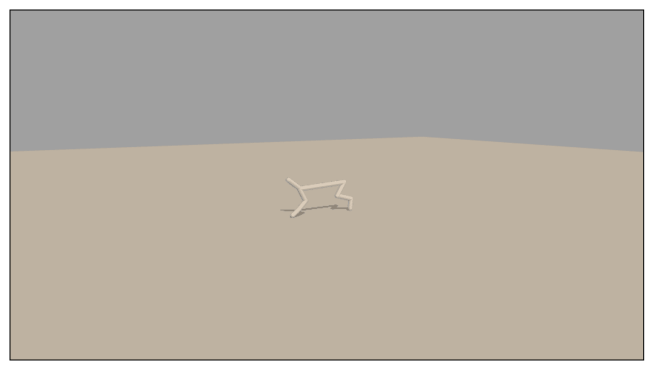

# Designing_and_Demonstrating_a_Eureka-Like_Reward_Learning_Agent

Source: https://www.educative.io/courses/agentic-ai-systems/agent-design-code-structure-and-output-demonstration

---

[Home](https://www.educative.io/)

[Courses](https://www.educative.io/search?tab=courses)

[Agentic System Design](https://www.educative.io/courses/agentic-ai-systems)

# Agent Design, Code Structure, and Output Demonstration

Understand how to design and orchestrate a Eureka-like reward learning system with Google ADK. Learn the agent roles, code organization, iterative reward loop, and how to interpret rollout visualizations. Gain a foundational mental model before implementation of this agentic reward evolution framework.

We'll cover the following...

- [Before we begin: A few key terms](https://www.educative.io/courses/agentic-ai-systems/agent-design-code-structure-and-output-demonstration#Before-we-begin-A-few-key-terms)
  - [Policy](https://www.educative.io/courses/agentic-ai-systems/agent-design-code-structure-and-output-demonstration#Policy)
  - [Reward function](https://www.educative.io/courses/agentic-ai-systems/agent-design-code-structure-and-output-demonstration#Reward-function)
  - [Rollout](https://www.educative.io/courses/agentic-ai-systems/agent-design-code-structure-and-output-demonstration#Rollout)
  - [Iteration](https://www.educative.io/courses/agentic-ai-systems/agent-design-code-structure-and-output-demonstration#Iteration)
- [Adapting the Eureka design for practical exploration](https://www.educative.io/courses/agentic-ai-systems/agent-design-code-structure-and-output-demonstration#Adapting-the-Eureka-design-for-practical-exploration)
- [The Eureka workflow as an agentic loop](https://www.educative.io/courses/agentic-ai-systems/agent-design-code-structure-and-output-demonstration#The-Eureka-workflow-as-an-agentic-loop)
  - [Why reward design needs a loop](https://www.educative.io/courses/agentic-ai-systems/agent-design-code-structure-and-output-demonstration#Why-reward-design-needs-a-loop)
  - [One iteration, step by step](https://www.educative.io/courses/agentic-ai-systems/agent-design-code-structure-and-output-demonstration#One-iteration-step-by-step)
    - [Step 1: Reward generation](https://www.educative.io/courses/agentic-ai-systems/agent-design-code-structure-and-output-demonstration#Step-1-Reward-generation)
    - [Step 2: Policy training and evaluation](https://www.educative.io/courses/agentic-ai-systems/agent-design-code-structure-and-output-demonstration#Step-2-Policy-training-and-evaluation)
    - [Step 3: Selection](https://www.educative.io/courses/agentic-ai-systems/agent-design-code-structure-and-output-demonstration#Step-3-Selection)
    - [Step 4: Reflection](https://www.educative.io/courses/agentic-ai-systems/agent-design-code-structure-and-output-demonstration#Step-4-Reflection)
    - [Step 5: Loop control](https://www.educative.io/courses/agentic-ai-systems/agent-design-code-structure-and-output-demonstration#Step-5-Loop-control)
- [Project structure](https://www.educative.io/courses/agentic-ai-systems/agent-design-code-structure-and-output-demonstration#Project-structure)
- [Inspecting the execution logs](https://www.educative.io/courses/agentic-ai-systems/agent-design-code-structure-and-output-demonstration#Inspecting-the-execution-logs)
- [Summary](https://www.educative.io/courses/agentic-ai-systems/agent-design-code-structure-and-output-demonstration#Summary)

In the previous chapter, we studied NVIDIA's Eureka system, an agentic framework that uses large language models to automatically design and iteratively refine reward functions for reinforcement learning. While the original system operates in large-scale robotic environments and physics simulations tightly coupled to NVIDIA's hardware, reproducing those conditions exactly in an instructional setting is impractical.

For a hands-on demonstration, we will instead implement a Eureka-like reward-learning agent using:

- Lightweight Brax environments, specifically HalfCheetah
- Google's Agent Development Kit (ADK) for agent orchestration
- Free T4 GPU resources on Google Colab



HalfCheetah Brax environment

The goal is not to reproduce NVIDIA's system at full scale, but to reimplement the core design principles behind Eureka in a form that is computationally tractable, easier to reason about, and suitable for controlled experimentation.

In this lesson, we will focus on agent design and workflow, code structure, and observing the system's outputs. Specifically, we will examine:

- The agents involved in our Eureka-like system.
- The role and responsibilities of each agent.
- The inputs and outputs flowing through the system.
- The orchestration pattern used to manage the iterative reward evolution loop.
- The overall project structure.

Finally, we will run the complete system once and inspect its outputs, trained policies, generated reward functions, and rollout visualizations to see the design in action before diving into the implementation details in the next lessons.

## Before we begin: A few key terms[#](https://www.educative.io/courses/agentic-ai-systems/agent-design-code-structure-and-output-demonstration#Before-we-begin-A-few-key-terms)

Before we implement the system, well define a few reinforcement learning terms that well use throughout the chapter. You don't need a deep RL background, just enough intuition to follow the mechanics.

### Policy[#](https://www.educative.io/courses/agentic-ai-systems/agent-design-code-structure-and-output-demonstration#Policy)

A **policy** is the decision-making component of a reinforcement learning agent. Given the current state of the environment, the policy decides what action to take next. In our case, the policy controls the HalfCheetah robot, deciding how each joint should move at every step. When we say training a policy, we mean optimizing this decision-making function so that the agent behaves better according to a reward signal.

### Reward function[#](https://www.educative.io/courses/agentic-ai-systems/agent-design-code-structure-and-output-demonstration#Reward-function)

A **reward function** assigns a numerical score to the agent's behavior at each step. For example:

- Moving forward might give a positive reward.
- Falling over might give a negative reward.
- Wasting energy might incur a penalty.

Designing this function is difficult, and that is exactly the problem Eureka is trying to solve.

### Rollout[#](https://www.educative.io/courses/agentic-ai-systems/agent-design-code-structure-and-output-demonstration#Rollout)

A **rollout** is a recorded execution of a policy in the environment. Think of it as:

> Let the trained agent run for several steps and watch what it actually does.

In our implementation, rollouts are visualized as interactive 3D animations, allowing us to see how the HalfCheetah moves, not just how well it scores numerically. Rollouts are critical because scalar reward values alone can be misleading. An agent might achieve a high score while exhibiting unintended or incorrect behavior. In such cases, human feedback on the robot's observed behavior can be used as a reflection signal to regenerate an improved reward function.

### Iteration[#](https://www.educative.io/courses/agentic-ai-systems/agent-design-code-structure-and-output-demonstration#Iteration)

An **iteration** refers to one complete pass through the reward evolution loop. During a single iteration, the system:

1. Generates reward candidates.
2. Trains policies using those rewards.
3. Evaluates results.
4. Reflects on what happened.
5. Decides whether to continue.

Eureka's intelligence emerges not from a single iteration, but from repeated refinement over many iterations.

With this terminology in place, we can now focus on an important question:

How do we turn a research-grade system like Eureka into something that can be meaningfully studied and implemented in a course?

## Adapting the Eureka design for practical exploration[#](https://www.educative.io/courses/agentic-ai-systems/agent-design-code-structure-and-output-demonstration#Adapting-the-Eureka-design-for-practical-exploration)

NVIDIA's original Eureka system is designed to maximize performance. It assumes access to high-end hardware, long training runs, and complex robotic environments.

The objective here is different. The goal is to make the reward design process explicit. This involves deliberately choosing simpler environments, fewer reward candidates per iteration, shorter training runs, and clearly defined agent boundaries. These choices are not limitations; they are design decisions made to support learning. By reducing scale, we gain clarity. By making the workflow explicit, we gain insight into how agentic systems reason, act, and improve over time.

By the end of this lesson, you should be able to:

- Explain how a Eureka-like system is structured as a collection of cooperating agents.
- Identify where reward generation, evaluation, selection, and reflection occur.
- Understand how agent orchestration replaces manual reward tuning.
- Interpret rollout visualizations as evidence of reward quality.
- Read the project structure and immediately recognize each component's role.

You are not expected to write or modify code yet. This lesson is about building a mental model of the system.

## The Eureka workflow as an agentic loop[#](https://www.educative.io/courses/agentic-ai-systems/agent-design-code-structure-and-output-demonstration#The-Eureka-workflow-as-an-agentic-loop)

Now that we've covered the motivation and terminology, we can move to the core idea behind Eureka: reward engineering isn't a one-off decision; it's an iterative, agent-driven process.

In traditional reinforcement learning workflows, reward design usually happens outside the system. A human designer writes a reward function, runs training, inspects the behavior, and then manually revises the reward. This process is slow, subjective, and difficult to scale.

Eureka changes this by bringing reward design inside the system. Instead of a human repeatedly adjusting rewards, Eureka treats reward engineering as a task that can be reasoned about, evaluated, and improved by an agentic workflow. At a high level, this workflow forms a closed loop:

1. Propose reward designs.
2. Test those rewards by training agents.
3. Observe the resulting behavior.
4. Reflect on what worked and what failed.
5. Use that reflection to improve the next reward design.

This loop is the core of the system.

### Why reward design needs a loop[#](https://www.educative.io/courses/agentic-ai-systems/agent-design-code-structure-and-output-demonstration#Why-reward-design-needs-a-loop)

It's worth pausing to understand why a loop is necessary in the first place. A reward function is not evaluated directly. It is evaluated indirectly through the behavior it produces after training, which means:

- You cannot tell if a reward is good just by reading it.
- You must observe how an agent behaves when trained with that reward.
- Subtle changes in reward terms can lead to drastically different behaviors.

This creates a fundamental challenge: the quality of the reward is only visible after training, not before. Each iteration produces concrete evidence, trained policies, and rollouts that the system can reason over.

### One iteration, step by step[#](https://www.educative.io/courses/agentic-ai-systems/agent-design-code-structure-and-output-demonstration#One-iteration-step-by-step)

Let's look at a single iteration of the Eureka-like workflow, focusing on what happens conceptually, not how it is implemented.

#### Step 1: Reward generation[#](https://www.educative.io/courses/agentic-ai-systems/agent-design-code-structure-and-output-demonstration#Step-1-Reward-generation)

The iteration begins with a reward designer agent. This agent uses a large language model to generate reward function code, conditioned on the following:

- The task description
- The environment dynamics
- Feedback from previous iterations (if any)

The key point here is that the reward is generated as executable code rather than a natural language suggestion. This allows the system to immediately test the reward by training an agent.

At this stage, the reward design is a hypothesis.

#### Step 2: Policy training and evaluation[#](https://www.educative.io/courses/agentic-ai-systems/agent-design-code-structure-and-output-demonstration#Step-2-Policy-training-and-evaluation)

Next, the system evaluates each proposed reward by training a policy under that reward. For each reward candidate:

- A policy is trained in the environment.
- Performance metrics are recorded.
- Rollout visualizations are generated.

This step transforms abstract reward ideas into observable behavior. This is where the system gathers empirical evidence. Importantly, the system does not rely solely on numeric scores. Visual rollouts allow us to see how the agent is achieving its reward.

#### Step 3: Selection[#](https://www.educative.io/courses/agentic-ai-systems/agent-design-code-structure-and-output-demonstration#Step-3-Selection)

Once all reward candidates have been evaluated, the system selects the best-performing one. This step introduces an important subtlety:

A reward that scores highly is not always a reward that produces *desired behavior*.

We'll see concrete examples of policies that achieve high returns while moving inefficiently, exploiting loopholes in the reward structure, or even moving in the wrong direction.

Selection is therefore not just about optimization; it defines what the system considers success. So, we need to carefully design our measure of success as well.

#### Step 4: Reflection[#](https://www.educative.io/courses/agentic-ai-systems/agent-design-code-structure-and-output-demonstration#Step-4-Reflection)

Selection tells us which reward performed best. Reflection tells us why. The reward reflector agent analyzes training outcomes and produces structured feedback. This feedback may include:

- Which reward terms dominated learning?
- What behaviors were encouraged or suppressed?
- Where did misalignment or exploitation occur?

This reflection becomes input to the next iteration's reward generation step. Without reflection, the system would be an opaque system, mutating rewards. With reflection, it becomes deliberate and directed.

#### Step 5: Loop control[#](https://www.educative.io/courses/agentic-ai-systems/agent-design-code-structure-and-output-demonstration#Step-5-Loop-control)

Finally, the system decides whether to continue or stop.

Stopping conditions might include:

- Reaching a performance threshold.
- Observing diminishing improvements.
- Hitting a maximum number of iterations.

If the system continues, the next iteration begins with improved context and stronger guidance.

This workflow exhibits several properties that distinguish it from a simple optimization script:

- **Reasoning:** LLM-based agents analyze outcomes and propose changes.
- **Action:** The system trains policies and interacts with the environment.
- **Observation:** Rollouts and metrics provide feedback.
- **Memory:** Reflections and best rewards are carried forward.
- **Control:** Explicit stopping criteria prevent uncontrolled execution.

This agentic loop is the conceptual backbone of everything that follows.

## Project structure[#](https://www.educative.io/courses/agentic-ai-systems/agent-design-code-structure-and-output-demonstration#Project-structure)

To implement a Eureka-like reward-learning system, we'll use Google's Agent Development Kit (ADK) as the underlying agent orchestration framework. Here's the full hierarchy of the module we run with this command: `adk run eureka_loop`:

```
task_name: "HalfCheetah Forward Locomotion"
objective: "Run forward as fast as possible while staying stable and using smooth, energy-efficient actions."
success_metric: "Average forward velocity in evaluation rollout."
constraints:
  - "Reward must be numerically stable and bounded."
  - "Avoid extremely high control penalties that cause freezing."
  - "Avoid purely sparse reward; include shaping."
evaluation:
  horizon: 1000
  episodes: 1
```

This structure is intentional. It mirrors the system design discussed earlier.

- `agent.py`**:** The assembly point where we define the top-level ADK workflow.
- `agents/`**:** This folder contains decision-making units.
- `tools/`**:** This folder contains execution utilities (training, scoring, saving artifacts, and environment setup).
- `configs/`**:** This folder contains parameters that control loop behavior and task specs.

Before examining individual agents or code files in the next lessons, let's first look at the entire execution flow of the system as a single pipeline. The diagram below shows where execution starts, how control flows through the system, where the iterative loop begins, which agents run inside the loop, and where tools are invoked to interact with the environment.

")

End-to-end execution flow (how the system runs)

- Execution starts at the ADK entry point (`eureka_loop/agent.py`), where the entire workflow is assembled using a *sequential orchestration* pattern. This explicitly separates one-time initialization from iterative learning.
- The first phase is the SetupAgent (`agents/setup_agent.py`), which runs exactly once. It initializes shared state, loads task and loop configuration, prepares output directories, and generates a baseline rollout, which is a reference visualization of agent behavior before any reward learning begins.
- After setup, control moves into the RewardEvolutionLoop (`agents/reward_loop.py`), implemented using ADK's *loop orchestration* pattern. Everything inside this loop executes repeatedly until a stopping condition is met.
- Each iteration begins with the RewardDesigner agent (`agents/llm_agents.py`), which consumes task context, environment information, and prior feedback and produces reward function candidates as executable code.
- Reward candidates are passed to the CandidateEvaluatorAgent (`agents/evaluator_agent.py`), which trains reinforcement learning policies using those rewards and produces metrics, rollout visualizations, and saved artifacts. This agent interacts with the environment and training stack through tools such as `rl_runner.py`, `scoring.py`, `artifacts.py`, and `brax_env.py`.
- Evaluation results flow into the SelectorAgent (`agents/selector_agent.py`), which compares candidates and selects the best-performing reward for the current iteration.
- The selected reward and observed behavior are then analyzed by the RewardReflector agent (`agents/llm_agents.py`), which produces structured reflection and improvement guidance for the next iteration.
- An optional HumanReflectionAgent (`agents/human_reflection_agent.py`) allows a human to inject qualitative feedback, making human oversight an explicit part of the system design.
- The ExitCheckerAgent (`agents/exit_checker_agent.py`) evaluates whether learning should stop based on performance trends or iteration limits.
- If learning continues, the IncrementIterationAgent (`agents/increment_iteration_agent.py`) updates the loop state and returns control to the RewardDesigner, starting the next iteration.
- If the exit condition is met, the loop terminates, and the system produces final outputs: the reward code, trained policies, rollout visualizations, and logs.

## Inspecting the execution logs[#](https://www.educative.io/courses/agentic-ai-systems/agent-design-code-structure-and-output-demonstration#Inspecting-the-execution-logs)

Earlier in the lesson, we saw rollout visualizations generated by running the Eureka-like system end to end. Below are the raw execution logs from that run, captured in Google Colab. As you scroll through the logs, you can see the system's execution flow in practice. Setup completes, iterations begin, reward candidates are generated, evaluations run, and feedback is carried into the next iteration.

Launch the app below to see the notebook that shows the execution logs.

**Your app can be found at:** https://5700103157186560.educative.educative-sandbox.com/notebooks/Eureka\_like\_agent\_logs.ipynb

Click to launch app!

These logs provide a concrete view of the agent's execution flow. They make it easy to follow how different stages of the system unfold over time and how progress is tracked across iterations.

These logs also serve as a useful reference for inspecting behavior and identifying where adjustments can be made, such as improving reward prompts or reflection logic.

## Summary[#](https://www.educative.io/courses/agentic-ai-systems/agent-design-code-structure-and-output-demonstration#Summary)

In this lesson, we focused on understanding the design and execution flow of our Eureka-like system. We examined how agents are orchestrated, how the reward-evolution loop operates, and how the system behaves when run in practice.

At this point, you should have a clear mental model of:

- What is the system doing?
- When does each agent run?
- How is progress made across iterations?

In the next lesson, we'll walk through the implementation, starting with the SetupAgent. We'll cover environment initialization, task-context preparation, and baseline rollout generation, which sets up the rest of the reward-evolution loop.

**Note:** In this design-level course, we won't cover syntax. However, in the next lesson, we'll explain enough code from a high-level perspective to help you understand the implementation. If you want to learn syntax and implement your own agents, consider our ["Building AI Agents using Google ADK](https://www.educative.io/courses/google-agent-development-kit)" course.

Evaluating Eureka: Performance and Insights

SetupAgent and Environment Grounding

Ask

[Before we begin: A few key terms](https://www.educative.io/courses/agentic-ai-systems/agent-design-code-structure-and-output-demonstration#Before-we-begin-A-few-key-terms)

[Policy](https://www.educative.io/courses/agentic-ai-systems/agent-design-code-structure-and-output-demonstration#Policy)

[Reward function](https://www.educative.io/courses/agentic-ai-systems/agent-design-code-structure-and-output-demonstration#Reward-function)

[Rollout](https://www.educative.io/courses/agentic-ai-systems/agent-design-code-structure-and-output-demonstration#Rollout)

[Iteration](https://www.educative.io/courses/agentic-ai-systems/agent-design-code-structure-and-output-demonstration#Iteration)

[Adapting the Eureka design for practical exploration](https://www.educative.io/courses/agentic-ai-systems/agent-design-code-structure-and-output-demonstration#Adapting-the-Eureka-design-for-practical-exploration)

[The Eureka workflow as an agentic loop](https://www.educative.io/courses/agentic-ai-systems/agent-design-code-structure-and-output-demonstration#The-Eureka-workflow-as-an-agentic-loop)

[Why reward design needs a loop](https://www.educative.io/courses/agentic-ai-systems/agent-design-code-structure-and-output-demonstration#Why-reward-design-needs-a-loop)

[One iteration, step by step](https://www.educative.io/courses/agentic-ai-systems/agent-design-code-structure-and-output-demonstration#One-iteration-step-by-step)

[Step 1: Reward generation](https://www.educative.io/courses/agentic-ai-systems/agent-design-code-structure-and-output-demonstration#Step-1-Reward-generation)

[Step 2: Policy training and evaluation](https://www.educative.io/courses/agentic-ai-systems/agent-design-code-structure-and-output-demonstration#Step-2-Policy-training-and-evaluation)

[Step 3: Selection](https://www.educative.io/courses/agentic-ai-systems/agent-design-code-structure-and-output-demonstration#Step-3-Selection)

[Step 4: Reflection](https://www.educative.io/courses/agentic-ai-systems/agent-design-code-structure-and-output-demonstration#Step-4-Reflection)

[Step 5: Loop control](https://www.educative.io/courses/agentic-ai-systems/agent-design-code-structure-and-output-demonstration#Step-5-Loop-control)

[Project structure](https://www.educative.io/courses/agentic-ai-systems/agent-design-code-structure-and-output-demonstration#Project-structure)

[Inspecting the execution logs](https://www.educative.io/courses/agentic-ai-systems/agent-design-code-structure-and-output-demonstration#Inspecting-the-execution-logs)

[Summary](https://www.educative.io/courses/agentic-ai-systems/agent-design-code-structure-and-output-demonstration#Summary)