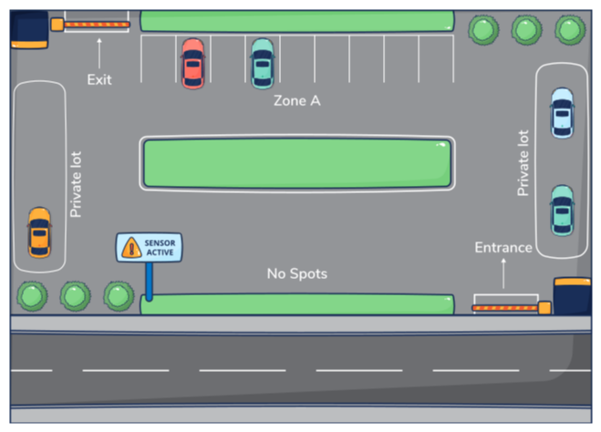

# Designing_a_Smart_Parking_Agent_System_with_Autonomous_AI

Source: https://www.educative.io/courses/agentic-ai-systems/thought-exercise-design-a-smart-parking-agent-system

---

[Home](https://www.educative.io/)

[Courses](https://www.educative.io/search?tab=courses)

[Agentic System Design](https://www.educative.io/courses/agentic-ai-systems)

# Thought Exercise: Design a Smart Parking Agent System

Discover how to transform a modular smart parking system into an intelligent, proactive multi-agent system. Learn to design agents that anticipate user needs, perform complex reasoning, coordinate actions, and include safety guardrails for reliability and trustworthiness.

We'll cover the following...

- [The need for agency](https://www.educative.io/courses/agentic-ai-systems/thought-exercise-design-a-smart-parking-agent-system#The-need-for-agency)
  - [Part 1: The first big decision, centralized or decentralized?](https://www.educative.io/courses/agentic-ai-systems/thought-exercise-design-a-smart-parking-agent-system#Part-1-The-first-big-decision-centralized-or-decentralized)
  - [Part 2: Designing the internal agent logic](https://www.educative.io/courses/agentic-ai-systems/thought-exercise-design-a-smart-parking-agent-system#Part-2-Designing-the-internal-agent-logic)
  - [Part 3: Choosing the right orchestration patterns](https://www.educative.io/courses/agentic-ai-systems/thought-exercise-design-a-smart-parking-agent-system#Part-3-Choosing-the-right-orchestration-patterns)
  - [Part 4: Designing the safety guardrails](https://www.educative.io/courses/agentic-ai-systems/thought-exercise-design-a-smart-parking-agent-system#Part-4-Designing-the-safety-guardrails)

Let's assume we are starting with a good foundation: a modern, modular “smart parking” service built on a microservices architecture.

This system is already scalable and resilient. It has separate, well-defined services that handle specific jobs:

- A `SensorService` that provides real-time data on which spots are occupied.
- A `BookingService` that handles reservations for specific spots.
- A `UserService` that manages user profiles and payment information.
- A `NotificationService` that sends alerts to users.

Each service waits to be called by a central application logic and perform its defined task. This system is efficient and reliable for handling simple, direct requests. However, it's not truly intelligent. It's reactive, not proactive.

## The need for agency[#](https://www.educative.io/courses/agentic-ai-systems/thought-exercise-design-a-smart-parking-agent-system#The-need-for-agency)

This reactive design struggles with complex, dynamic, and user-centric problems. This is where we, as agentic system designers, can add immense value. Let's look at a few key needs that a traditional modular architecture struggles to meet without becoming overly complex or rigid:

- **Need for proactive assistance:** The system can't anticipate user needs. It can't, for example, proactively reroute a user to a different parking zone when it detects a sudden traffic jam near their original destination.
- **Need for complex reasoning:** It cannot make nuanced, multi-factor decisions. It can't dynamically adjust parking prices based on real-time demand, a local event (like a concert), and historical data.
- **Need for personalized experience:** The system can't tailor its recommendations. It might suggest the closest spot, but it can't reason that a specific user has a history of choosing cheaper, covered spots and prioritize those options.
- **Need for robust error handling:** If a sensor fails, the `SensorService` simply reports an error. It cannot autonomously reason about the failure, infer the spot's status from nearby sensors, or temporarily mark the zone as unreliable.

Could we solve these problems with a traditional, non-agentic system?

Perhaps. We could write thousands of lines of complex, hard-coded rules and conditional logic to try and anticipate every possible scenario. But this approach is brittle, hard to maintain, and struggles to adapt to new situations.

This is the key insight: an agentic architecture is the right choice when a system needs to move beyond fixed rules and into the realm of goal-oriented, autonomous reasoning. To solve these problems effectively, we need to evolve our reactive services into proactive agents.

The following diagram shows how the various agents in the smart parking system interact during a typical parking request:

### Part 1: The first big decision, centralized or decentralized?[#](https://www.educative.io/courses/agentic-ai-systems/thought-exercise-design-a-smart-parking-agent-system#Part-1-The-first-big-decision-centralized-or-decentralized)

Before we design the individual agents, we must make a high-level architectural decision that will shape the entire system. Given the need for coordination between various functions (drivers, sensors, reservations), we need to choose a primary multi-agent orchestration strategy.

- A centralized approach (like the Manager-Worker pattern) would use a single “manager” agent to coordinate all the others. This offers strong control but can create a single point of failure.
- A decentralized approach (like the Decentralized Handoff pattern) would allow specialized agents to communicate directly with each other as peers. This is more resilient but can be harder to debug.

AI Powered

Saved

2 attempts left

Reset

As the architect, which high-level orchestration pattern would you choose for this system, and why? Justify your decision by considering the challenges of scalability, fault tolerance, and observability.

You have 2 attempts to answer.

Choose and justify a high-level orchestration pattern (e.g., centralized, decentralized, or both), considering scalability and fault tolerance

### Part 2: Designing the internal agent logic[#](https://www.educative.io/courses/agentic-ai-systems/thought-exercise-design-a-smart-parking-agent-system#Part-2-Designing-the-internal-agent-logic)

Now that we have a high-level orchestration plan, a hybrid approach centered around a **manager agent**, our next task as architects is to design the individual agents that will execute this plan. A robust agent is more than just a name; it has a well-defined internal architecture that dictates how it perceives, reasons, and acts.

For our system to work, we need to evolve our existing modular services (`UserService`, `SensorService`, `BookingService`) into intelligent agents. Let's start with the agent that interacts directly with the user.

AI Powered

Saved

2 attempts left

Reset

**The driver agent:** Using the four-part agent architecture (input interface, reasoning core, tools, and memory), describe the internal logic for the DriverAgent. Specify:

- What data or events trigger it to act?
- What kind of reasoning does it perform?
- What specific tools (like APIs to the underlying services) does it use?
- What information does it need to remember?

You have 2 attempts to answer.

Describe the driver agent's internal logic: its inputs, reasoning, tools, and memory, focusing on user interaction

With the driver agent handling the user’s side, let’s design the agent that manages parking availability.

AI Powered

Saved

1 attempt left

Reset

**The zone agent:** Now, let's design the ZoneAgent. This agent is responsible for managing a specific geographic parking zone. Using the same four-part agent architecture, describe its internal logic. Specify:

- What data or events trigger it to act?
- What kind of reasoning does it perform?
- What specific tools (like APIs to the underlying services) does it use?
- What information does it need to remember?

This is your last attempt.

Describe the zone agent's internal logic, focusing on how it uses data and tools for pricing and availability decisions.

Once a spot is found, another agent has to book it.

AI Powered

Saved

2 attempts left

Reset

**The reservation agent:** We have now designed the agents responsible for user interaction (DriverAgent) and for managing parking availability (ZoneAgent). The final core component is the ReservationAgent, which handles the critical booking and payment process. Using the same four-part agent architecture, describe its internal logic. Specify:

- What data or events trigger it to act?
- What kind of reasoning does it perform?
- What specific tools (like APIs to the underlying services) does it use?
- What information does it need to remember?

You have 2 attempts to answer.

Describe the reservation agent's internal logic, focusing on the tools and memory needed for a secure transaction

### Part 3: Choosing the right orchestration patterns[#](https://www.educative.io/courses/agentic-ai-systems/thought-exercise-design-a-smart-parking-agent-system#Part-3-Choosing-the-right-orchestration-patterns)

We have now designed the internal architecture of our individual agents. The next crucial step for us as system architects is to define how these agents will structure their own internal workflows. The choice of an internal orchestration pattern is what gives an agent's behavior a predictable and reliable structure.

As we learned in our lesson on orchestration, different patterns are suited for different kinds of tasks. Some agents might operate in a simple loop, while others might need a more complex, multi-step plan. Let's start with the agent that interacts directly with the user.

AI Powered

Saved

2 attempts left

Reset

**The driver agent’s pattern:** For the DriverAgent, which internal orchestration pattern would you choose? Justify your choice by explaining how the pattern fits the agent's role of interacting with a human user.

You have 2 attempts to answer.

Choose and justify the best internal orchestration pattern for the interactive, user-facing driver agent

Now let’s choose a pattern for an agent with a very different job: processing data, not talking to users.

AI Powered

Saved

2 attempts left

Reset

**The zone agent's pattern:** Next, let's consider the ZoneAgent. Its job is to respond to requests from the manager by querying sensors, checking for local events, and applying dynamic pricing. Which internal orchestration pattern best fits this multi-step, data-driven task? Justify your choice.

You have 2 attempts to answer.

Choose and justify the best internal pattern for the zone agent's multi-step, data-driven workflow

Finally, let’s look at the agent where a single failed step could leave a booking half-finished.

AI Powered

Saved

2 attempts left

Reset

**The reservation agent's pattern:** Finally, let's design the orchestration pattern for the ReservationAgent. This agent's role is to handle the critical, multi-step process of booking a parking spot, which includes verifying the user, processing payment, and confirming the reservation. Which internal orchestration pattern is the best fit for this kind of transactional workflow? Justify your choice.

You have 2 attempts to answer.

Choose and justify the best internal pattern for the reservation agent, focusing on transactional integrity

### Part 4: Designing the safety guardrails[#](https://www.educative.io/courses/agentic-ai-systems/thought-exercise-design-a-smart-parking-agent-system#Part-4-Designing-the-safety-guardrails)

We have now designed a sophisticated, proactive multi-agent system for smart parking. It can anticipate user needs, reason about complex data, and coordinate multiple actions to achieve its goals. However, with this increased autonomy comes increased responsibility. An agent that can handle payments, manage reservations, and access user data must be designed with safety as a core requirement, not an afterthought.

A failure in this system could have real-world consequences: double-booking a spot, leaking a user's location history, or causing a pricing error that loses revenue. To prevent this, we need to build in a robust set of safety guardrails.

AI Powered

Saved

2 attempts left

Reset

Autonomous agents can make mistakes. Describe at least two specific guardrails for our smart parking system that ensure safe, ethical, and reliable behavior. For each guardrail, you must:

- Identify the type of risk it prevents (e.g., privacy, financial, safety).
- Explain the technical safeguard that would be implemented.
- Specify which agent(s) would be responsible for enforcing it.

You have 2 attempts to answer.

Based on the principles from our lesson on trustworthy agents, design at least two specific guardrails for the system

This completes our thought exercise. By working through these design challenges, we have evolved a standard modular system into a sophisticated, resilient, and trustworthy multi-agent system. This exercise demonstrates that the principles we've learned are the practical tools we will use to build the next generation of intelligent, autonomous systems.

Thinking Through Eureka

Introduction to ChainBuddy and the “Blank Page Problem”

Ask

[The need for agency](https://www.educative.io/courses/agentic-ai-systems/thought-exercise-design-a-smart-parking-agent-system#The-need-for-agency)

[Part 1: The first big decision, centralized or decentralized?](https://www.educative.io/courses/agentic-ai-systems/thought-exercise-design-a-smart-parking-agent-system#Part-1-The-first-big-decision-centralized-or-decentralized)

[Part 2: Designing the internal agent logic](https://www.educative.io/courses/agentic-ai-systems/thought-exercise-design-a-smart-parking-agent-system#Part-2-Designing-the-internal-agent-logic)

[Part 3: Choosing the right orchestration patterns](https://www.educative.io/courses/agentic-ai-systems/thought-exercise-design-a-smart-parking-agent-system#Part-3-Choosing-the-right-orchestration-patterns)

[Part 4: Designing the safety guardrails](https://www.educative.io/courses/agentic-ai-systems/thought-exercise-design-a-smart-parking-agent-system#Part-4-Designing-the-safety-guardrails)