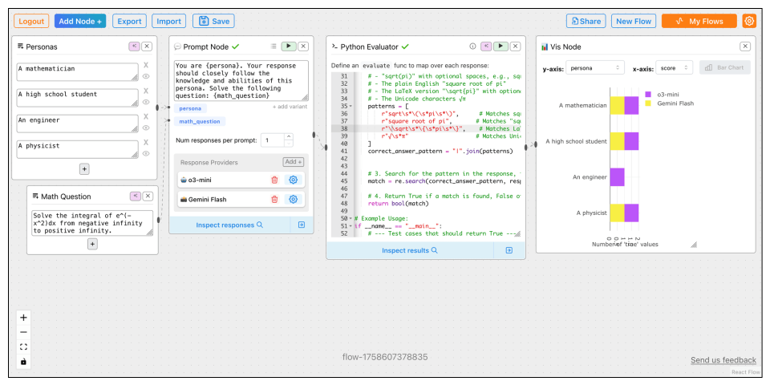

# ChainBuddy_Solves_the_Blank_Page_Problem_in_LLM_Pipeline_Design

Source: https://www.educative.io/courses/agentic-ai-systems/introduction-to-chainbuddy-and-the-blank-page-problem

---

[Home](https://www.educative.io/)

[Courses](https://www.educative.io/search?tab=courses)

[Agentic System Design](https://www.educative.io/courses/agentic-ai-systems)

# Introduction to ChainBuddy and the “Blank Page Problem”

Explore how ChainBuddy addresses the blank page problem in designing large language model (LLM) evaluation pipelines. Understand its role as an AI assistant that generates starter workflows to help AI developers and researchers build, modify, and expand complex LLM testing environments efficiently. Discover the two-phase architecture combining conversational interaction and multi-agent pipeline assembly, which supports diverse real-world AI workflows and accelerates prompt engineering, model auditing, and data processing tasks.

We'll cover the following...

- [Understanding the challenge in LLM evaluation](https://www.educative.io/courses/agentic-ai-systems/introduction-to-chainbuddy-and-the-blank-page-problem#Understanding-the-challenge-in-LLM-evaluation)
  - [The “blank page problem” emerges](https://www.educative.io/courses/agentic-ai-systems/introduction-to-chainbuddy-and-the-blank-page-problem#The-blank-page-problem-emerges)
  - [Who faces this problem in the real-world?](https://www.educative.io/courses/agentic-ai-systems/introduction-to-chainbuddy-and-the-blank-page-problem#Who-faces-this-problem-in-the-real-world)
- [Introducing ChainBuddy](https://www.educative.io/courses/agentic-ai-systems/introduction-to-chainbuddy-and-the-blank-page-problem#Introducing-ChainBuddy)
  - [ChainBuddy’s core mission](https://www.educative.io/courses/agentic-ai-systems/introduction-to-chainbuddy-and-the-blank-page-problem#ChainBuddys-core-mission)
  - [Operating within ChainForge](https://www.educative.io/courses/agentic-ai-systems/introduction-to-chainbuddy-and-the-blank-page-problem#Operating-within-ChainForge)
- [Design goals of ChainBuddy](https://www.educative.io/courses/agentic-ai-systems/introduction-to-chainbuddy-and-the-blank-page-problem#Design-goals-of-ChainBuddy)
  - [Overcoming initial hurdles](https://www.educative.io/courses/agentic-ai-systems/introduction-to-chainbuddy-and-the-blank-page-problem#Overcoming-initial-hurdles)
  - [Supporting diverse use cases](https://www.educative.io/courses/agentic-ai-systems/introduction-to-chainbuddy-and-the-blank-page-problem#Supporting-diverse-use-cases)
- [High-level architectural overview](https://www.educative.io/courses/agentic-ai-systems/introduction-to-chainbuddy-and-the-blank-page-problem#High-level-architectural-overview)
  - [Phase 1: The requirement-gathering chat assistant](https://www.educative.io/courses/agentic-ai-systems/introduction-to-chainbuddy-and-the-blank-page-problem#Phase-1-The-requirement-gathering-chat-assistant)
  - [Phase 2: From conversation to workflow generation](https://www.educative.io/courses/agentic-ai-systems/introduction-to-chainbuddy-and-the-blank-page-problem#Phase-2-From-conversation-to-workflow-generation)

> **Problem space:** LLM evaluation

Before we consider the agentic solution, it’s crucial to understand the design challenge we’re trying to solve. In this chapter, we’ll follow a real-world journey: turning a vague research question into a robust, automated LLM evaluation pipeline.

The core of the problem lies in the difficulty of rigorously testing and comparing LLM behavior. Let’s suppose that we are AI developers to see why this is such a common and complex challenge.

## Understanding the challenge in LLM evaluation[#](https://www.educative.io/courses/agentic-ai-systems/introduction-to-chainbuddy-and-the-blank-page-problem#Understanding-the-challenge-in-LLM-evaluation)

Imagine that we are tasked with answering what appears to be a simple question.

**Question:** “Does an LLM provide a better solution to a complex math problem if we prompt or instruct it to act like a ‘mathematician’ vs. a ‘high school student’?”

To answer this properly, we need to frame it as a clear experiment. Our independent variable (the “knob” we’re turning) is the persona given to the LLM. Our dependent variable (the outcome we’re measuring) is the accuracy of its answer.

By isolating these variables, we can design a robust test. However, to actually *run* this test, we need to build the entire pipeline. This is where a powerful LLM evaluation tool like ChainForge comes in.

**ChainForge** is an open-source, visual toolkit for prompt engineering and LLM evaluation. It’s designed to help developers, researchers, and product teams systematically test, compare, and analyze large language model (LLM) behavior without having to write complex code. Think of it as a “playground + lab” for working with multiple LLMs in a structured and visual way.

We open the [tool](https://chainforge.ai/play/), but we’re greeted with a blank canvas. Now, the responsibility is on us to construct the pipeline from scratch. What does that involve?

1. **Create personas:** To be thorough, we can’t just test two. We would need to create a list of a dozen different roles (e.g., ‘physicist,’ ‘historian,’ ‘poet’).
2. **Write the prompts:** We’d need a prompt template to combine our variables, like `As a {persona}, solve the following: {math_question}`.
3. **Select the models:** Is this effect unique to one model? We’ll have to test it across several top models, like GPT-4, Gemini, and Claude.
4. **Evaluate the results:** With dozens of responses, manually checking them is infeasible. We would need to write a code evaluator, a program that automatically parses each response and checks for the correct answer.
5. **Visualize the outcome:** Finally, we’d need to create a chart to clearly see which persona-model combination performed best.

**Note on experiment design:** To get a reliable answer to our question, it’s crucial that we only change one thing at a time. When testing the effect of the persona, we must ensure all other variables, like the question text, the prompt format, and the model’s temperature setting, are kept *exactly* the same for every run. This ensures that we are measuring the impact of the persona alone.

Suddenly, our simple question has evolved into a complex, multi-step workflow. As we stare at the blank canvas, thinking about creating all these components and connecting them correctly and clearly, we might feel overwhelmed.

Here is a sample LLM evaluation pipeline that demonstrates the kind of workflow we’ve been discussing. We’ve built this example to show how all the pieces fit together to answer our research question in a structured and automated way:

A complete LLM evaluation pipeline in ChainForge that can be automatically generated by ChainBuddy through a single user prompt

The pipeline flows logically from left to right, as outlined below.

1. **Inputs:** We begin by defining our variables. The Text Nodes contains a list of personas, different roles (e.g., ‘A mathematician’), and a math question holding the complex integral we want the models to solve.
2. **Prompting:** The Prompt Node combines these inputs to create a unique prompt for each persona. It then queries three different models (`GPT-4o`, `GPT-3.5`, and `o3-mini`) with each of these prompts.
3. **Evaluation:** The Python Evaluator receives all the responses. Its code automatically checks if each response contains the correct answer (π​) and outputs a `True` or `False` score.
4. **Visualization:** Finally, the Vis Node aggregates these scores and displays them in a grouped bar chart. This chart provides an immediate visual answer to our question, clearly showing how each model performed under the influence of different personas.

**Key terminology:**

- **Persona prompting:** A technique where we instruct an LLM to adopt a specific role or personality (e.g., “act like a mathematician”) to influence the style and content of its response.
- **Evaluator:** A program or an LLM-based prompt used to automatically check the quality, correctness, or other attributes of a model’s output.
- **LLMOps (large language model operations):** The practice of managing the end-to-end life cycle of LLM-powered applications, including development, testing, deployment, and monitoring.

### The “blank page problem” emerges[#](https://www.educative.io/courses/agentic-ai-systems/introduction-to-chainbuddy-and-the-blank-page-problem#The-blank-page-problem-emerges)

The gap between having a clear goal and knowing the concrete steps to build the pipeline that achieves that goal, is the essence of the “blank page problem.” It’s a common hurdle that slows down development and can prevent valuable ideas from ever being tested.

LLM Evaluation tool: We know the problem we want to use to evaluate different LLMs, but we're unsure where to begin or how to design a complete evaluation pipeline

### Who faces this problem in the real-world?[#](https://www.educative.io/courses/agentic-ai-systems/introduction-to-chainbuddy-and-the-blank-page-problem#Who-faces-this-problem-in-the-real-world)

This isn’t just a hypothetical scenario; it’s a daily reality for a growing number of professionals.

- **Machine learning engineers and AI researchers:** They need to rigorously benchmark different models and prompting strategies to make evidence-based decisions for a product or scientific study.
- **Software developers and prompt engineers:** They build applications on top of LLMs and need to constantly test their prompts for robustness, check for biases, or ensure outputs are correctly formatted.
- **Students and beginners:** Anyone new to “LLMOps” can be intimidated by its apparent complexity. However, an assistant can serve as a guide, introducing best practices through a working example to help them get started.

For all these roles, the motivation is the same: to reduce manual effort, accelerate the testing cycle, and ultimately produce higher-quality, more reliable AI systems. It is this specific, practical challenge that drives the need for an intelligent assistant, or an agent that can handle the complex setup for us.

## Introducing ChainBuddy[#](https://www.educative.io/courses/agentic-ai-systems/introduction-to-chainbuddy-and-the-blank-page-problem#Introducing-ChainBuddy)

Earlier, we established the “blank page problem,” as that moment of uncertainty when we’re faced with a powerful tool but don’t know where to begin. So, how do we solve this? This is where our case study, ChainBuddy, introduces a powerful solution: an agent designed to be our creative partner.

**ChainBuddy**is an AI-assisted agent system built on top of the open-source visual platform ChainForge. It addresses the “blank page problem,” the challenge of figuring out where to begin when designing and evaluating LLM-based workflows.

The ChainBuddy chat interface allows the user to initiate a conversation by expressing their high-level goal in natural language

- From a simple prompt or chat message describing our goal, ChainBuddy generates a complete starter pipeline in ChainForge. This includes:

  - Input Data Nodes.
  - Prompt templates.
  - Connections to one or more language models.
  - Evaluation metrics or automated evaluators.
- It interacts with us through a chat-like interface, asking clarifying questions to better understand our objectives before assembling a tailored workflow.
- Technically, it uses a multi-agent architecture built with LangGraph, which enables:

  - Long-term planning (breaking down tasks into actionable steps).
  - Dedicated agents for managing different stages of workflow generation.
- The generated pipeline is editable and interactive; we can tweak prompt templates, add new models, refine evaluation logic, and adjust layout as needed.

Instead of leaving us to figure out the complex setup on our own, ChainBuddy acts as an intelligent assistant that helps us get started. Let’s take a closer look at its core mission and the ways it’s built to support users from the very beginning.

### ChainBuddy’s core mission[#](https://www.educative.io/courses/agentic-ai-systems/introduction-to-chainbuddy-and-the-blank-page-problem#ChainBuddys-core-mission)

ChainBuddy’s primary mission is to act as an intelligent assistant that automates the creation of a starter LLM pipeline. Think of it as performing the same functions as a GPS for our project. When we’re unsure of the first few steps, we can simply tell it our destination (our goal), and it will generate the initial route (the starter workflow) for us.

A user can describe their goal in natural language, and ChainBuddy generates a workflow tailored to their needs. This generated pipeline isn’t a rigid, final product; it’s a flexible starting point that we can immediately inspect, modify, and expand upon. By handling the initial setup, ChainBuddy makes the complex process of evaluating LLMs much more accessible and less daunting.

### Operating within ChainForge[#](https://www.educative.io/courses/agentic-ai-systems/introduction-to-chainbuddy-and-the-blank-page-problem#Operating-within-ChainForge)

A key part of ChainBuddy’s design is that it isn’t a standalone application. It is an agent system built directly into ChainForge, an open-source visual environment designed for prompt engineering and LLM experimentation.

ChainBuddy is integrated directly into the ChainForge visual environment, allowing it to generate workflows onto the main canvas

This integration is a crucial design choice. By living inside the visual environment, ChainBuddy can directly create and connect all the necessary components of a pipeline, like Text Nodes for data, Prompt Nodes for models, and Evaluator Nodes for tests. This allows for a seamless experience where we can move from describing a goal in a chat window to seeing a fully formed, interactive pipeline on our canvas, ready for us to take over and refine it.

**Note:** Please be aware that as of late 2025, ChainBuddy is not publicly available yet in the main release of ChainForge (v0.3.6), and is listed as an active work in progress in the official documentation.

## Design goals of ChainBuddy[#](https://www.educative.io/courses/agentic-ai-systems/introduction-to-chainbuddy-and-the-blank-page-problem#Design-goals-of-ChainBuddy)

Now that we understand ChainBuddy’s core mission, let’s explore the specific design goals that guided its creation. When we build an agentic assistant, it’s not enough for it to just “work”; it needs to be genuinely helpful, flexible, and empowering for the user. The creators of ChainBuddy centered their approach around two key principles to achieve this goal.

### Overcoming initial hurdles[#](https://www.educative.io/courses/agentic-ai-systems/introduction-to-chainbuddy-and-the-blank-page-problem#Overcoming-initial-hurdles)

The primary goal of ChainBuddy is to solve the “blank page problem” that we discussed earlier. The system is designed to provide users with a custom-tailored starter workflow that they can immediately begin to edit and extend. The key here is a “starter workflow” that users can build on right away. The agent’s purpose isn’t to deliver a final, perfect solution that the user passively accepts. Instead, it aims to handle the initial, often tedious, setup. By generating a relevant and functional starting point, it empowers the user to jump directly into the more creative and interesting parts of their work: refining prompts, analyzing results, and drawing conclusions.

This emphasis on an editable “starter workflow” is a crucial safeguard against the risks of user over-reliance. It keeps the human user in a position of authority and encourages them to critically engage with, and improve upon the AI’s output.

### Supporting diverse use cases[#](https://www.educative.io/courses/agentic-ai-systems/introduction-to-chainbuddy-and-the-blank-page-problem#Supporting-diverse-use-cases)

A truly useful assistant needs to be versatile. The second major design goal for ChainBuddy is to support a wide range of real-world tasks that developers and researchers face. The system is designed to handle diverse and complex requirements beyond simple prompt comparison. This includes workflows for a number of tasks mentioned below.

- **Prompt engineering:** Comparing different prompts to see which one performs best.
- **LLM auditing:** Testing models for things like accuracy, bias, or ethical alignment.
- **Data processing:** Using LLMs for tasks like summarizing text, extracting information, or reformatting data.

By designing for this diversity, ChainBuddy becomes a general-purpose assistant for LLMOps, rather than a niche tool for a single problem. With these clear goals in mind, the next question is: what kind of architecture can make this happen?

## High-level architectural overview[#](https://www.educative.io/courses/agentic-ai-systems/introduction-to-chainbuddy-and-the-blank-page-problem#High-level-architectural-overview)

To achieve both conversational understanding and complex workflow construction, ChainBuddy’s architecture is cleverly split into a two-phase system: a frontend for user interaction and a backend for pipeline generation.

ChainBuddy’s two-phase architecture, featuring a front-end requirement-gathering chat assistant and a back-end LLM pipeline generation module

### Phase 1: The requirement-gathering chat assistant[#](https://www.educative.io/courses/agentic-ai-systems/introduction-to-chainbuddy-and-the-blank-page-problem#Phase-1-The-requirement-gathering-chat-assistant)

The process begins with a front-end agent that acts as a requirement-gathering chat assistant. This agent’s primary job is to interact with us in a natural, conversational way to understand our goals and clarify our intent. Through a short series of targeted questions, it helps us refine our initial idea into a detailed, structured specification of what the final pipeline should accomplish.

### Phase 2: From conversation to workflow generation[#](https://www.educative.io/courses/agentic-ai-systems/introduction-to-chainbuddy-and-the-blank-page-problem#Phase-2-From-conversation-to-workflow-generation)

Once the front-end agent has a clear understanding of our needs, it sends this specification to the back-end LLM pipeline generation module. This is where the heavy lifting happens. This module is a multi-agent system that:

1. Uses a planner agent to create a comprehensive plan for building the workflow.
2. Assigns each step of the plan to various task-specific agents that generate the individual components (like text fields, prompts, and evaluators).
3. Assembles all the pieces into a single JSON file. This isn’t just a static plan; it is a complete, executable, and fully editable workflow that renders visually in the ChainForge interface, empowering the user to take over and continue the work.

This separation of concerns is a key design pattern. A fast, conversational agent handles the user interaction, while a more powerful, methodical multi-agent system handles the complex task of code and workflow generation.

In the next lessons, we’ll break down each of these modules in detail.

Thought Exercise: Design a Smart Parking Agent System

The Requirement-Gathering Chat Assistant

Ask

[Understanding the challenge in LLM evaluation](https://www.educative.io/courses/agentic-ai-systems/introduction-to-chainbuddy-and-the-blank-page-problem#Understanding-the-challenge-in-LLM-evaluation)

[The “blank page problem” emerges](https://www.educative.io/courses/agentic-ai-systems/introduction-to-chainbuddy-and-the-blank-page-problem#The-blank-page-problem-emerges)

[Who faces this problem in the real-world?](https://www.educative.io/courses/agentic-ai-systems/introduction-to-chainbuddy-and-the-blank-page-problem#Who-faces-this-problem-in-the-real-world)

[Introducing ChainBuddy](https://www.educative.io/courses/agentic-ai-systems/introduction-to-chainbuddy-and-the-blank-page-problem#Introducing-ChainBuddy)

[ChainBuddy’s core mission](https://www.educative.io/courses/agentic-ai-systems/introduction-to-chainbuddy-and-the-blank-page-problem#ChainBuddys-core-mission)

[Operating within ChainForge](https://www.educative.io/courses/agentic-ai-systems/introduction-to-chainbuddy-and-the-blank-page-problem#Operating-within-ChainForge)

[Design goals of ChainBuddy](https://www.educative.io/courses/agentic-ai-systems/introduction-to-chainbuddy-and-the-blank-page-problem#Design-goals-of-ChainBuddy)

[Overcoming initial hurdles](https://www.educative.io/courses/agentic-ai-systems/introduction-to-chainbuddy-and-the-blank-page-problem#Overcoming-initial-hurdles)

[Supporting diverse use cases](https://www.educative.io/courses/agentic-ai-systems/introduction-to-chainbuddy-and-the-blank-page-problem#Supporting-diverse-use-cases)

[High-level architectural overview](https://www.educative.io/courses/agentic-ai-systems/introduction-to-chainbuddy-and-the-blank-page-problem#High-level-architectural-overview)

[Phase 1: The requirement-gathering chat assistant](https://www.educative.io/courses/agentic-ai-systems/introduction-to-chainbuddy-and-the-blank-page-problem#Phase-1-The-requirement-gathering-chat-assistant)

[Phase 2: From conversation to workflow generation](https://www.educative.io/courses/agentic-ai-systems/introduction-to-chainbuddy-and-the-blank-page-problem#Phase-2-From-conversation-to-workflow-generation)