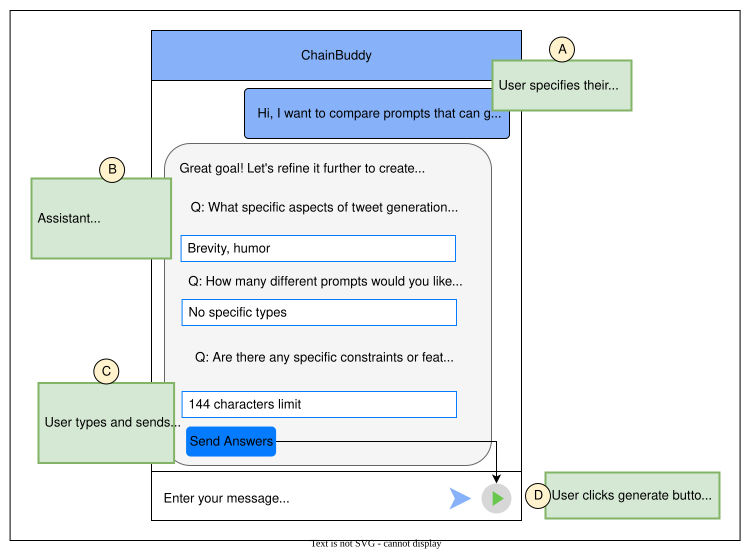

# Requirement-Gathering_Chat_Assistant_for_Building_LLM_Pipelines

Source: https://www.educative.io/courses/agentic-ai-systems/the-requirement-gathering-chat-assistant

---

[Home](https://www.educative.io/)

[Courses](https://www.educative.io/search?tab=courses)

[Agentic System Design](https://www.educative.io/courses/agentic-ai-systems)

# The Requirement-Gathering Chat Assistant

Explore how a requirement-gathering chat assistant uses structured dialogue to clarify user goals and preferences before generating AI workflows. Understand the architecture that separates user interaction from complex backend tasks, improving efficiency and user experience through a focused, goal-oriented conversation.

We'll cover the following...

- [The first step: A purposeful conversation](https://www.educative.io/courses/agentic-ai-systems/the-requirement-gathering-chat-assistant#The-first-step-A-purposeful-conversation)
- [Architecting the requirement-gathering agent](https://www.educative.io/courses/agentic-ai-systems/the-requirement-gathering-chat-assistant#Architecting-the-requirement-gathering-agent)
  - [An internal “brain” for understanding](https://www.educative.io/courses/agentic-ai-systems/the-requirement-gathering-chat-assistant#An-internal-brain-for-understanding)
  - [A “smart intake form” for asking questions](https://www.educative.io/courses/agentic-ai-systems/the-requirement-gathering-chat-assistant#A-smart-intake-form-for-asking-questions)
- [The final output: A structured specification](https://www.educative.io/courses/agentic-ai-systems/the-requirement-gathering-chat-assistant#The-final-output-A-structured-specification)
- [Key design takeaways](https://www.educative.io/courses/agentic-ai-systems/the-requirement-gathering-chat-assistant#Key-design-takeaways)

In our last lesson, we saw that ChainBuddy uses a two-phase architecture, starting with a front-end agent that speaks to us. But why is this conversation so important? It exists to fix a common failure mode: a vague user request often leads to an incorrect or irrelevant pipeline, resulting in wasted time and resources. This lesson explores how a structured conversation is the first and most critical step in building a useful AI-generated workflow.

## The first step: A purposeful conversation[#](https://www.educative.io/courses/agentic-ai-systems/the-requirement-gathering-chat-assistant#The-first-step-A-purposeful-conversation)

Imagine hiring a skilled professional, like an architect. You wouldn’t just simply say, “build me a house,” and expect them to start laying bricks. Their first, most critical step is to sit down with you and have a conversation. They ask smart questions to understand your vision, your needs, and your constraints.

ChainBuddy’s structured requirement-gathering process, which proves more user-friendly than an unstructured chat

This is the exact principle behind the first phase of ChainBuddy’s architecture. Before the system can “build” a complex workflow, it must first truly understand what we want to achieve. A vague initial request like, “Help me compare prompts for writing professional emails,” is a starting point, but it’s not enough to act upon. This is where the system’s first agent comes into play. Its entire job is intent clarification: resolving ambiguity or confusion to obtain a crystal-clear picture of our goal.

## Architecting the requirement-gathering agent[#](https://www.educative.io/courses/agentic-ai-systems/the-requirement-gathering-chat-assistant#Architecting-the-requirement-gathering-agent)

A key architectural question is whether to use a single, powerful agent for everything. While simple, this “monolithic” approach means using a slow, expensive model for a simple chat, leading to a poor user experience. The ChainBuddy team chose to decouple these tasks. They created a dedicated user-facing agent whose only job is to manage the user interaction.

This choice enabled a key strategy called **heterogeneous model tiering**. The system uses a faster, cost-effective model (Claude 3.5 Sonnet) for the user chat, while reserving a more powerful model (GPT-4o) for the heavy-duty pipeline generation. This separation is highly efficient and dramatically improves the user experience. The front-end chat with a smaller model is relatively fast and inexpensive, while the back-end generation with a powerful model is slower and more costly. The system is designed to make sense of the user’s intent early on to avoid wasting expensive resources on building the wrong thing.

The requirement-gathering agent is not just a simple chatbot. Its architecture includes two key design features.

Design of requirement-gathering chat assistant: The requirement-gathering agent maintains an internal state that is updated throughout the conversation before being passed to the back-end planner

### An internal “brain” for understanding[#](https://www.educative.io/courses/agentic-ai-systems/the-requirement-gathering-chat-assistant#An-internal-brain-for-understanding)

To understand our request, the front-end agent maintains a structured internal “mental model” of the conversation. It populates this model using a Chain-of-Reasoning (CoR) methodology, a technique for guiding an agent toward a complex goal. It’s crucial to distinguish this from the more common Chain-of-Thought (CoT) prompting, as they operate at different levels.

- **Chain-of-Thought (CoT)** is about structuring an LLM’s output. You prompt the model to “think step-by-step” to improve the reasoning for a *single, complex answer*. Think of it as demonstrating your work on a math problem.
- **Chain-of-Reasoning (CoR)**, in this context, is about structuring the agent’s internal state. The agent maintains a “whiteboard” of goals and requirements to guide its actions over a *multi-step task*.

The key difference is the focus: CoT improves a single thought process, while CoR guides an entire project.

This Chain-of-Reasoning approach is what allows the agent to continuously update its understanding of our primary goal, specific requirements, and preferences as the conversation progresses. Technically, it uses an internal dictionary to keep track of its evolving understanding. Throughout the conversation, it populates this internal state with key information like:

- The primary user goal.
- A running list of specific requirements.
- Any user preferences that it discovers.

This gives the agent a form of short-term memory, ensuring it builds a coherent and comprehensive picture of our needs before taking action.

### A “smart intake form” for asking questions[#](https://www.educative.io/courses/agentic-ai-systems/the-requirement-gathering-chat-assistant#A-smart-intake-form-for-asking-questions)

One common approach to gather requirements is an open-ended, free-form chat where the agent asks questions one by one, like a continuous conversation. The developers initially tested this “infinite questioner” pattern. However, the pilot studies quickly revealed flaws in this approach. Users found the process slow and stressful, feeling pressured to answer every single question perfectly before the system could proceed.

So, to guide the conversation effectively, the team designed a “smart intake form,” which presents up to three targeted questions at once in a structured format.

1. **Goal clarification questions:** The agent starts broad to understand our high-level objective. (e.g., “What specific aspects of tweet generation are most important to you (brevity, humor)?”
2. **Requirements exploration questions:** It then narrows down to uncover specific needs and constraints we might not have thought to mention. (e.g., “Are there any constraints you want to include, like a character limit?” )
3. **Clarifying questions:** Finally, it double-checks for any ambiguities or contradictions to ensure the final plan is logical and sound.

This design choice, that is, collecting requirements through a structured form, proves to be more efficient and less stressful for users when conveying their needs.

It’s important to remember that the user is always in control. They can choose to answer any or all of the questions, or simply click the “Generate” button at any time to start the workflow building process based on the information provided so far.

## The final output: A structured specification[#](https://www.educative.io/courses/agentic-ai-systems/the-requirement-gathering-chat-assistant#The-final-output-A-structured-specification)

After the conversation is complete, the requirement-gathering agent’s final task is to compile everything it has learned into a structured format. The output is not a simple chat transcript; it’s a detailed specification that acts as a “work ticket” for the back-end system.

Internally, the agent builds this specification as a Python dictionary, a flexible, in-memory data structure. But for the handoff to the back-end system, it’s converted into a JSON object.

Ace Editor

1

2

3

4

5

6

7

8

9

10

11

12

13

14

15

16

17

18

19

20

21

22

23

24

25

26

27

{

"user\_goal": "Compare prompts for generating catchy tweets from long paragraphs.",

"requirements": [

"Tweets must be concise.",

"Stay within a 144-character limit."

],

"plan": {

"justification": "This workflow transforms long paragraphs into catchy tweets.",

"layer\_skeleton": [

{ "layer\_id": 1, "name": "Input Layer" },

{ "layer\_id": 2, "name": "Template Layer" },

{ "layer\_id": 3, "name": "Prompt Node Layer" },

{ "layer\_id": 4, "name": "Evaluation Layer" }

],

"variable\_traces": [

{

"variable": "long\_paragraph",

"origin": "TextFieldsNode1",

"consumed\_by": ["TextFieldsNode2"]

},

{

"variable": "prompt\_template\_tweet",

"origin": "TextFieldsNode2",

"consumed\_by": ["PromptNode1"]

}

]

}

הההההההההההההההההההההההההההההההההההההההההההההההההההההההההההההההההההההההההההההההההההההההההההההההההההההההההההההההההההההההההההההההההההההההההההההההההההההההההההההההההההההההההההההההההההההההההההההההההההההההההההההההההההההההההההההההההההההההההההההההההההההההההההההההההההההההההההההההההההההההההההההההההההההההההההההההההההההההההההההההההההההההההההההההההההההההההההההההההההההההההההההההההההההההההההההההההההההההההההההההההההההההההההההההההההההההההההההההההההההההההההההההההההההההההההההההההההההההההההההההההההההההההההההההההההההההההההההההה

XXXXXXXXXXXXXXXXXXXXXXXXXXXXXXXXXXXXXXXXXXXXXXXXXXXXXXXXXXXXXXXXXXXXXXXXXXXXXXXXXXXXXXXXXXXXXXXXXXXXXXXXXXXXXXXXXXXXXXXXXXXXXXXXXXXXXXXXXXXXXXXXXXXXXXXXXXXXXXXXXXXXXXXXXXXXXXXXXXXXXXXXXXXXXXXXXXXXXXXXXXXXXXXXXXXXXXXXXXXXXXXXXXXXXXXXXXXXXXXXXXXXXXXXXXXXXXXXXXXXXXXXXXXXXXXXXXXXXXXXXXXXXXXXXXXXXXXXXXXXXXXXXXXXXXXXXXXXXXXXXXXXXXXXXXXXXXXXXXXXXXXXXXXXXXXXXXXXXXXXXXXXXXXXXXXXXXXXXXXXXXXXXXXXXXXXXXXXXXXXXXXXXXXXXXXXXXXXXXXXXXXXXXXXXXXXXXXXXXXXXXXXXXXXXXXXXXXXXXXXXXXXXXXXXXXXXXXXXXXXXXXXXXXXXXXXXXXXXXXXXXXXXXXXXXXX

A sample JSON sketch

While the ultimate goal of the ChainBuddy system is to support a broad range of LLMOps tasks, it’s important to remember that the prototype and user study focuses on a narrower, core set of workflow generation capabilities.

## Key design takeaways[#](https://www.educative.io/courses/agentic-ai-systems/the-requirement-gathering-chat-assistant#Key-design-takeaways)

The design of this front-end agent provides us with powerful, reusable patterns for building our own agentic systems.

- **Decouple user interaction from heavy processing:** A dedicated user-facing agent creates a better user experience (it’s fast and responsive) and is generally more efficient. This architectural split allows for smart strategies like heterogeneous model tiering, using smaller, faster models for conversation and larger, more powerful models for complex back-end tasks.
- **Use structured dialogue for goal-oriented tasks:** For tasks that require specific inputs, a structured conversation (like ChainBuddy’s Q&A form) is often more preferable to a completely open-ended chat. It gathers the necessary data more reliably and prevents the conversation from drifting off-topic.
- **Structured dialogue as a safeguard:** This conversational pattern does more than just gather data. By forcing the user to articulate their goals, it mitigates over-reliance, as the user cannot passively accept a default solution. It also helps counter the Dunning-Kruger effect by surfacing hidden complexities the user may not have considered on their own.
- **Hand off a “work ticket” not a transcript:** The conversation’s final output should be a neatly organized, machine-readable specification (like a JSON object). This structured “work ticket” ensures the back-end agents know exactly what to build, without ambiguity.

With this clear and detailed plan in hand, the system is now ready for the next phase. In our next lesson, we’ll explore the powerful back-end multi-agent system that takes this “work ticket” and turns it into a fully functional pipeline.

Introduction to ChainBuddy and the “Blank Page Problem”

The Multi-Agent Pipeline Generation Framework

Ask

[The first step: A purposeful conversation](https://www.educative.io/courses/agentic-ai-systems/the-requirement-gathering-chat-assistant#The-first-step-A-purposeful-conversation)

[Architecting the requirement-gathering agent](https://www.educative.io/courses/agentic-ai-systems/the-requirement-gathering-chat-assistant#Architecting-the-requirement-gathering-agent)

[An internal “brain” for understanding](https://www.educative.io/courses/agentic-ai-systems/the-requirement-gathering-chat-assistant#An-internal-brain-for-understanding)

[A “smart intake form” for asking questions](https://www.educative.io/courses/agentic-ai-systems/the-requirement-gathering-chat-assistant#A-smart-intake-form-for-asking-questions)

[The final output: A structured specification](https://www.educative.io/courses/agentic-ai-systems/the-requirement-gathering-chat-assistant#The-final-output-A-structured-specification)

[Key design takeaways](https://www.educative.io/courses/agentic-ai-systems/the-requirement-gathering-chat-assistant#Key-design-takeaways)