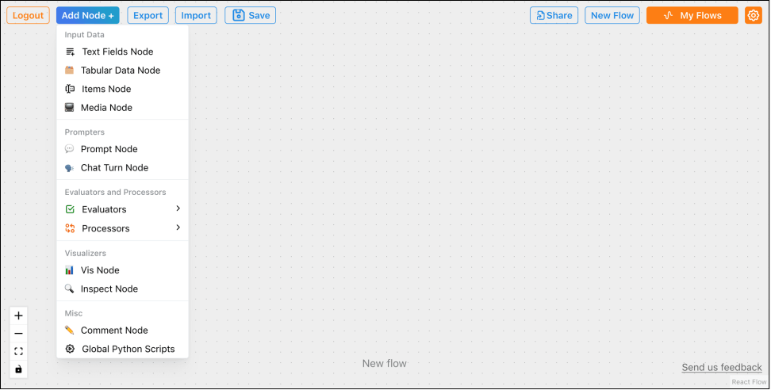
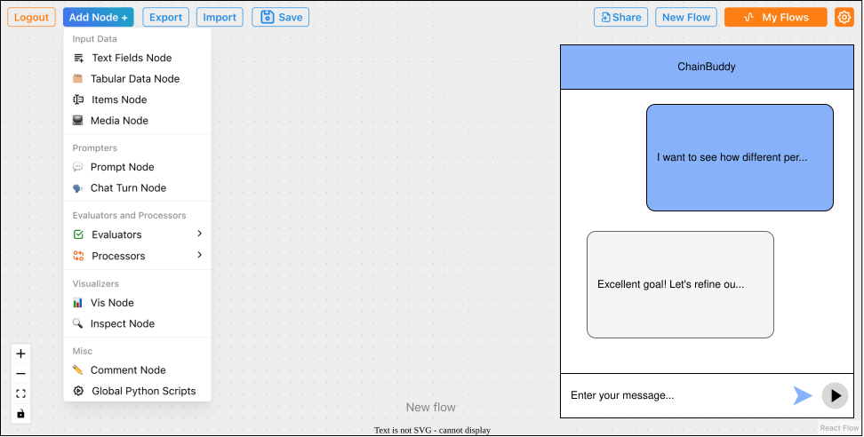

# Evaluating_ChainBuddy_AI_Assistant_for_Performance_and_Usability

Source: https://www.educative.io/courses/agentic-ai-systems/evaluating-chainbuddy-performance-usability-and-design-insight

---

[Home](https://www.educative.io/)

[Courses](https://www.educative.io/search?tab=courses)

[Agentic System Design](https://www.educative.io/courses/agentic-ai-systems)

# Evaluating ChainBuddy: Performance, Usability, and Design Insight

Explore how the ChainBuddy AI assistant enhances workflow creation by reducing cognitive load and increasing output quality. Learn through a detailed evaluation that combines user studies, expert ratings, and qualitative feedback to understand its effectiveness. Understand key design insights including overcoming the blank page problem, recognizing the impact of cognitive biases like the Dunning-Kruger effect, and principles for creating AI agents that support collaboration and user empowerment.

We'll cover the following...

- [The evaluation framework](https://www.educative.io/courses/agentic-ai-systems/evaluating-chainbuddy-performance-usability-and-design-insight#The-evaluation-framework)
  - [How performance was measured](https://www.educative.io/courses/agentic-ai-systems/evaluating-chainbuddy-performance-usability-and-design-insight#How-performance-was-measured)
- [Key performance and usability findings](https://www.educative.io/courses/agentic-ai-systems/evaluating-chainbuddy-performance-usability-and-design-insight#Key-performance-and-usability-findings)
  - [The assistant made the task feel easier](https://www.educative.io/courses/agentic-ai-systems/evaluating-chainbuddy-performance-usability-and-design-insight#The-assistant-made-the-task-feel-easier)
  - [The assistant led to better work](https://www.educative.io/courses/agentic-ai-systems/evaluating-chainbuddy-performance-usability-and-design-insight#The-assistant-led-to-better-work)
  - [The qualitative experience: Overcoming the blank page](https://www.educative.io/courses/agentic-ai-systems/evaluating-chainbuddy-performance-usability-and-design-insight#The-qualitative-experience-Overcoming-the-blank-page)
- [The Dunning-Kruger effect: A critical insight for AI assistants](https://www.educative.io/courses/agentic-ai-systems/evaluating-chainbuddy-performance-usability-and-design-insight#The-Dunning-Kruger-effect-A-critical-insight-for-AI-assistants)
  - [A mismatch between perception and reality](https://www.educative.io/courses/agentic-ai-systems/evaluating-chainbuddy-performance-usability-and-design-insight#A-mismatch-between-perception-and-reality)
  - [The risks: Overreliance and bias](https://www.educative.io/courses/agentic-ai-systems/evaluating-chainbuddy-performance-usability-and-design-insight#The-risks-Overreliance-and-bias)
- [Agentic design takeaways from the ChainBuddy case study](https://www.educative.io/courses/agentic-ai-systems/evaluating-chainbuddy-performance-usability-and-design-insight#Agentic-design-takeaways-from-the-ChainBuddy-case-study)

In our last lesson, we deconstructed the impressive multi-agent system that acts as ChainBuddy’s “factory,” taking a set of requirements and methodically building a complete workflow. We saw the “architect” (the planner agent) and the “specialist crews” (the worker agents) in action. But for any agentic system that we design, the most important question remains: Does it actually work? More than that, does it provide real value to the user?

In this final lesson of our case study, we will answer that question by looking into ChainBuddy’s evaluation. We’ll explore not just the performance results, but what those results teach us about designing effective and trustworthy AI assistants.

## The evaluation framework[#](https://www.educative.io/courses/agentic-ai-systems/evaluating-chainbuddy-performance-usability-and-design-insight#The-evaluation-framework)

To get a clear, comparative result, the researchers designed a within-subjects user study. This is a classic experimental design where each participant acts as their own control. Each of the 12 participants completed tasks under two different conditions.

- **The control condition:** Using the baseline ChainForge interface without any help from the agent.
- **The assistant condition:** Using the same interface but with access to the ChainBuddy agent.

1 / 2

The baseline ChainForge interface

1 / 2

The ChainForge interface with access to the ChainBuddy agent

This setup allows us to directly compare how the presence of an agentic assistant changes a user’s behavior, performance, and perception.

### How performance was measured[#](https://www.educative.io/courses/agentic-ai-systems/evaluating-chainbuddy-performance-usability-and-design-insight#How-performance-was-measured)

A good evaluation looks at a problem from multiple angles. The researchers used a mix of quantitative and qualitative metrics to get a complete picture.

- **Cognitive load:** Participants completed the NASA TLX survey, a standard method for measuring perceived workload. Did the assistant make the task feel easier or more demanding?
- **System usability:** Users answered questions from the system usability scale to rate their confidence and the system’s ease of use. Did the agent make them feel more empowered?
- **Workflow quality:** To get an objective measure of performance, expert raters (who were unaware of the condition) graded the quality of the final pipelines created by each participant on a 1–5 scale. Did the agent actually help users produce better work?
- **User experience:** The entire session was screen and audio recorded, and followed up by an interview. This qualitative data allowed the researchers to understand the *why* behind the numbers.

This multi-faceted framework is a great example of how to rigorously evaluate an agentic system. It reminds us that as designers, we need to measure not just the agent’s output, but its impact on the human user.

## Key performance and usability findings[#](https://www.educative.io/courses/agentic-ai-systems/evaluating-chainbuddy-performance-usability-and-design-insight#Key-performance-and-usability-findings)

With the rigorous evaluation in place, the study revealed compelling results, showing that the ChainBuddy agent provides considerable, measurable value across several key areas. As we analyze these findings, we can see clear evidence of how a well-designed assistant can enhance a user’s workflow.

### The assistant made the task feel easier[#](https://www.educative.io/courses/agentic-ai-systems/evaluating-chainbuddy-performance-usability-and-design-insight#The-assistant-made-the-task-feel-easier)

One of the most direct benefits was the reduction in user effort. According to the NASA TLX surveys, participants reported that the tasks felt significantly less mentally and physically demanding when they used the ChainBuddy assistant.

They also felt more confident in their work, a key finding from the system usability scale questions. This shows that the agent was successful in its goal of lowering the barrier to entry, and reducing the cognitive load required to build a complex pipeline.

### The assistant led to better work[#](https://www.educative.io/courses/agentic-ai-systems/evaluating-chainbuddy-performance-usability-and-design-insight#The-assistant-led-to-better-work)

Here, we see the direct payoff of the agentic architecture we deconstructed. The data showed that users were far more likely to include critical Evaluator Nodes in their workflows when using ChainBuddy. This isn’t an accident; it’s a direct result of the planner agent’s structured blueprint, which systematically includes an evaluation layer in its plan.

The architecture guided users to build more complete and robust pipelines than they typically did on their own.

### The qualitative experience: Overcoming the blank page[#](https://www.educative.io/courses/agentic-ai-systems/evaluating-chainbuddy-performance-usability-and-design-insight#The-qualitative-experience-Overcoming-the-blank-page)

The interviews with participants after the study provided the “why” behind the numbers. The feedback was overwhelmingly positive, with several key themes emerging:

- **It solved the blank page problem:** Eight participants explicitly stated that ChainBuddy provided a great starting point, helping them overcome the initial challenge of facing an empty canvas. As one user put it, “it’s hard to start with an empty page. It’s better to start with a little bit of question and answer here, so you have a base structure.”

- **It helped refine ideas:** Six participants found that the agent’s requirement-gathering process helped them think more deeply about their own goals. The structured questions prompted them to consider details they might have otherwise overlooked, leading to more comprehensive workflows.
- **It exceeded expectations:** Ten of the twelve participants remarked that the assistant’s capabilities surprised them, specifically its ability to ask relevant follow-up questions and generate detailed, high-quality workflows from scratch.

These findings show that the agent succeeded not just as an automation tool, but as a genuine collaborative partner that improved both the process and the outcome of the user’s work.

## The Dunning-Kruger effect: A critical insight for AI assistants[#](https://www.educative.io/courses/agentic-ai-systems/evaluating-chainbuddy-performance-usability-and-design-insight#The-Dunning-Kruger-effect-A-critical-insight-for-AI-assistants)

While the results we’ve just seen paint a very positive picture, the evaluation uncovered a more subtle and fascinating finding, one that has critical implications for how we design and think about AI assistants.

### A mismatch between perception and reality[#](https://www.educative.io/courses/agentic-ai-systems/evaluating-chainbuddy-performance-usability-and-design-insight#A-mismatch-between-perception-and-reality)

Here is the most surprising result from the study: although independent experts confirmed that participants produced significantly higher-quality work with the ChainBuddy assistant, the participants themselves did not rate their own success much higher.

This strange mismatch, where performance improves but self-perception doesn’t, is a classic example of a cognitive bias known as the Dunning-Kruger effect.

The Dunning-Kruger effect is a cognitive bias where people with lower ability at a task tend to overestimate their own performance. This finding suggests that when working alone, some users may have believed their work was better than it actually was, and the AI assistant helped close that gap between their perception and reality.

### The risks: Overreliance and bias[#](https://www.educative.io/courses/agentic-ai-systems/evaluating-chainbuddy-performance-usability-and-design-insight#The-risks-Overreliance-and-bias)

This insight is critical for us as agentic system designers because it highlights two major risks.

1. **Overreliance:** If users can’t accurately judge the quality of an AI’s output, they might passively accept subpar or even incorrect solutions without question.
2. **Bias:** Several participants worried that the assistant was interfering with their problem-solving approach, noticing that they would follow its patterns even when working alone later.

This is precisely why ChainBuddy’s design goal of producing an editable starter workflow, rather than a final, locked-in solution, is incredibly important. It positions the user as the final arbiter of quality, giving them the tools and the responsibility to catch and correct the AI’s mistakes.

## Agentic design takeaways from the ChainBuddy case study[#](https://www.educative.io/courses/agentic-ai-systems/evaluating-chainbuddy-performance-usability-and-design-insight#Agentic-design-takeaways-from-the-ChainBuddy-case-study)

This entire case study, from the agent’s architecture to its evaluation, provides us with invaluable lessons. As we conclude, let’s distill the most important principles we can apply to our own work:

- **The blank page mitigation pattern:** The core value of assistants like ChainBuddy is solving the “blank page problem.” By generating a relevant, editable starter workflow, agents can dramatically lower the initial effort and cognitive load required to tackle a complex task.
- **The dual evaluation principle:** To understand an agent’s true impact, combine subjective user feedback (like surveys) with objective performance metrics (like expert ratings). Relying on user perception alone can be misleading due to cognitive biases like the Dunning-Kruger effect, where users may not accurately assess the quality of their own work.
- **Design for collaboration, not just automation:** The risk of overreliance offers a crucial lesson here. The goal is to design agents that enrich a user’s judgment rather than replacing it. The best systems empower users to critically engage with, question, and refine the AI’s suggestions, positioning the human as the final director of the work.

The Multi-Agent Pipeline Generation Framework

Develop a Multi-Agent Research Assistant Using AutoGen

Ask

[The evaluation framework](https://www.educative.io/courses/agentic-ai-systems/evaluating-chainbuddy-performance-usability-and-design-insight#The-evaluation-framework)

[How performance was measured](https://www.educative.io/courses/agentic-ai-systems/evaluating-chainbuddy-performance-usability-and-design-insight#How-performance-was-measured)

[Key performance and usability findings](https://www.educative.io/courses/agentic-ai-systems/evaluating-chainbuddy-performance-usability-and-design-insight#Key-performance-and-usability-findings)

[The assistant made the task feel easier](https://www.educative.io/courses/agentic-ai-systems/evaluating-chainbuddy-performance-usability-and-design-insight#The-assistant-made-the-task-feel-easier)

[The assistant led to better work](https://www.educative.io/courses/agentic-ai-systems/evaluating-chainbuddy-performance-usability-and-design-insight#The-assistant-led-to-better-work)

[The qualitative experience: Overcoming the blank page](https://www.educative.io/courses/agentic-ai-systems/evaluating-chainbuddy-performance-usability-and-design-insight#The-qualitative-experience-Overcoming-the-blank-page)

[The Dunning-Kruger effect: A critical insight for AI assistants](https://www.educative.io/courses/agentic-ai-systems/evaluating-chainbuddy-performance-usability-and-design-insight#The-Dunning-Kruger-effect-A-critical-insight-for-AI-assistants)

[A mismatch between perception and reality](https://www.educative.io/courses/agentic-ai-systems/evaluating-chainbuddy-performance-usability-and-design-insight#A-mismatch-between-perception-and-reality)

[The risks: Overreliance and bias](https://www.educative.io/courses/agentic-ai-systems/evaluating-chainbuddy-performance-usability-and-design-insight#The-risks-Overreliance-and-bias)

[Agentic design takeaways from the ChainBuddy case study](https://www.educative.io/courses/agentic-ai-systems/evaluating-chainbuddy-performance-usability-and-design-insight#Agentic-design-takeaways-from-the-ChainBuddy-case-study)