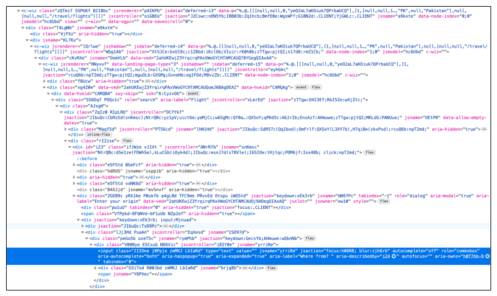

# Comparing_Text-Only_and_Multimodal_Web_Agents_for_Real_Tasks

Source: https://www.educative.io/courses/agentic-ai-systems/text-vs-multimodal-web-agents-in-a-real-world-task

---

[Home](https://www.educative.io/)

[Courses](https://www.educative.io/search?tab=courses)

[Agentic System Design](https://www.educative.io/courses/agentic-ai-systems)

# Text vs. Multimodal Web Agents in a Real-World Task

Learn to evaluate the key differences between text-only and multimodal web agents by examining their approach to booking a flight. Understand how multimodal perception enables agents to interpret and act on visual and textual cues from web pages, leading to more accurate and reliable task completion compared to text-only agents.

We'll cover the following...

- [A live web task: Book a flight](https://www.educative.io/courses/agentic-ai-systems/text-vs-multimodal-web-agents-in-a-real-world-task#A-live-web-task-Book-a-flight)
- [How a text-only web agent performs the task](https://www.educative.io/courses/agentic-ai-systems/text-vs-multimodal-web-agents-in-a-real-world-task#How-a-text-only-web-agent-performs-the-task)
  - [Step 1: Analyzing the homepage](https://www.educative.io/courses/agentic-ai-systems/text-vs-multimodal-web-agents-in-a-real-world-task#Step-1-Analyzing-the-homepage)
  - [Step 2: The challenge of the date picker](https://www.educative.io/courses/agentic-ai-systems/text-vs-multimodal-web-agents-in-a-real-world-task#Step-2-The-challenge-of-the-date-picker)
- [How a multimodal web agent performs the task](https://www.educative.io/courses/agentic-ai-systems/text-vs-multimodal-web-agents-in-a-real-world-task#How-a-multimodal-web-agent-performs-the-task)
- [Step 1: Analyzing the homepage](https://www.educative.io/courses/agentic-ai-systems/text-vs-multimodal-web-agents-in-a-real-world-task#Step-1-Analyzing-the-homepage-1)
  - [Step 2: Conquering the date picker](https://www.educative.io/courses/agentic-ai-systems/text-vs-multimodal-web-agents-in-a-real-world-task#Step-2-Conquering-the-date-picker)
  - [Step 3: Completing the task and returning the answer](https://www.educative.io/courses/agentic-ai-systems/text-vs-multimodal-web-agents-in-a-real-world-task#Step-3-Completing-the-task-and-returning-the-answer)
- [Summary](https://www.educative.io/courses/agentic-ai-systems/text-vs-multimodal-web-agents-in-a-real-world-task#Summary)

We will compare two agent workflows, one text-only and one multimodal, as they attempt the same real-world task: booking a flight. This detailed walkthrough will highlight the common failure points of text-only agents and show how a multimodal approach, like WebVoyager’s, is designed to overcome them.

## A live web task: Book a flight[#](https://www.educative.io/courses/agentic-ai-systems/text-vs-multimodal-web-agents-in-a-real-world-task#A-live-web-task-Book-a-flight)

To truly understand the difference between a text-only web agent and a multimodal one, we need to see them in action. We’ll give both agents the same, seemingly simple task.

> **User instruction:** “Find the cheapest one-way flight from Los Angeles (LAX) to New York (JFK) for next Friday.”

The starting point for the flight booking task. For the agents, this page represents a visually simple but structurally complex challenge.

For this challenge, we will assume both agents start on the Google Flights homepage. Our goal is to analyze not whether they succeed, but how they perceive, reason, and act at each step. This will give us, as agent designers, a clear mental model of their strengths and weaknesses.

## How a text-only web agent performs the task[#](https://www.educative.io/courses/agentic-ai-systems/text-vs-multimodal-web-agents-in-a-real-world-task#How-a-text-only-web-agent-performs-the-task)

The tradition text-only web agent agent relies solely on the website’s HTML code to understand and navigate the page. It cannot “see” the website; it can only read its underlying structure.

The text-only agent’s perception: A verbose and noisy wall of HTML code. Without visual context, grounding an action to the correct, visible element is a significant challenge

We’ll walk through the process of how a text‑only web agent works, step-by-step.

### Step 1: Analyzing the homepage[#](https://www.educative.io/courses/agentic-ai-systems/text-vs-multimodal-web-agents-in-a-real-world-task#Step-1-Analyzing-the-homepage)

- **Perception (The agent’s view):** The agent’s browsing environment provides it with the complete HTML of the Google Flights homepage. This is a massive wall of text, potentially thousands of lines long, filled with `
`, ``, `<script>`, and `<style>` tags. The agent’s LLM must parse all of this to find the relevant interactive elements.
- **Reasoning (The agent’s thought process):** The LLM sifts through the HTML, looking for keywords like “from,” “to,” and “date” to identify the main form fields. It might generate a thought similar to the one shown below.

**Thought:** “I have analyzed the HTML. I’ve identified an `<input>` element with an `aria-label` of ‘Where from’ which seems to be the correct field for the departure city. I need to type ‘LAX’ into this element.”

- **The challenge (Ambiguity in the code):** Here, the agent immediately faces a problem. Modern websites are incredibly complex. There might be multiple elements that look like an “Origin” field in the code (e.g., one for the main form, another in a hidden menu, a third in an example snippet). The HTML alone doesn’t provide enough context to know which one is the correct, visible input field.
- **Action and potential failure:** The agent chooses one of the elements that seems correct from the code and attempts to execute an action, like `Type [element_id_123]; "LAX"`. If it chose the wrong one (e.g., a hidden element), the action will either fail silently or flag an error.

This is the first major hurdle for a text-only agent; without visual context, grounding an action to the correct element is just educated guesswork.

### Step 2: The challenge of the date picker[#](https://www.educative.io/courses/agentic-ai-systems/text-vs-multimodal-web-agents-in-a-real-world-task#Step-2-The-challenge-of-the-date-picker)

- **Perception (The agent’s view):** After the agent fills in the destination, a calendar widget for selecting the date appears on the screen. Visually, this is a simple grid of dates. In the HTML, however, it’s a complex and often confusing structure. The code for a calendar can be a maze of nested `
`s, ``s, and difficult-to-parse `aria-label` attributes. The number for a specific day, like “13,” might not be directly associated with the clickable element for that day in a way that’s obvious from the code alone.
- **Reasoning (The agent’s thought process):** The agent’s LLM must now analyze this new, complex section of HTML to find the correct element for “next Friday.” It might generate a thought similar to the one shown below.

**Thought:** “The user specified ‘next Friday.’ I need to find the HTML element corresponding to that date in the calendar widget. I will look for an element with a date string that matches next Friday’s date, for example, ‘Friday, September 12, 2025’.”

- **The challenge (Visual logic in code):** This is where text-only agents almost always fail. The logic of a calendar is inherently visual. A human user instantly understands the grid of a calendar, but in the HTML, the dates might be represented as a flat list of elements with no clear grid structure. The agent might find multiple elements for the number “12” (e.g., for the current month and the next month) and has no reliable way to know which one is the correct one to click. It cannot see which dates are grayed out or which month is currently displayed.
- **Action and failure:** The agent attempts to ground its action. It might find an element that contains the correct date string and execute `Click [element_id_456]`. However, it’s highly likely that it has selected the wrong element. Perhaps it clicked on a non-interactive `` that just displays the number, or it clicked on the date for the wrong month. The result is a failure. The agent is now stuck, unable to complete one of the most basic parts of the task.

This common failure point perfectly illustrates the ceiling of a text-only approach. When an interface relies on visual logic that isn’t explicitly and cleanly represented in the HTML structure, the agent is effectively stuck and cannot proceed reliably.

## How a multimodal web agent performs the task[#](https://www.educative.io/courses/agentic-ai-systems/text-vs-multimodal-web-agents-in-a-real-world-task#How-a-multimodal-web-agent-performs-the-task)

Now let’s see how a multimodal agent, like WebVoyager, handles the exact same task. This agent has a significant advantage as it can do both: read the underlying text of web elements and see the rendered webpage, just like a human. This multimodal perception is the key to its enhanced performance.

The multimodal agent’s perception of the same homepage. Interactive elements are identified and assigned a unique numerical label, creating a clear, actionable map for the agent

## Step 1: Analyzing the homepage[#](https://www.educative.io/courses/agentic-ai-systems/text-vs-multimodal-web-agents-in-a-real-world-task#Step-1-Analyzing-the-homepage-1)

- **Perception (How the agent sees the page):**The agent’s perception is a fully automated, multi-part process managed by its browsing environment.

  - **Set a fixed viewport:** The environment, built on Selenium (a browser automation tool), first sets the browser window to a fixed, predictable size (e.g., 1024x768 pixels). This ensures that all screenshots and coordinates are captured in a consistent frame of reference.
  - **Take a screenshot:** The environment then captures a complete visual screenshot of this viewport. This image is the agent’s primary visual input, showing it exactly what a human user would see.
  - **Identify and label interactive elements:** A specialized Javascript tool runs within the browser. It scans the page’s underlying HTML structure to find all the interactive elements (like `<button>`, `<a>`, and `<input>`). For each one, it asks the browser for its exact pixel coordinates and then draws a bounding box, and a unique numerical label onto the screenshot.
  - **Extract auxiliary text:** The same Javascript tool also extracts key textual information (like the button’s label) from the HTML for each numbered element.The final output of this perception step is a rich, multimodal observation for the current page. This includes a labeled screenshot and a corresponding list of text descriptions.
- **Reasoning (The role of the multimodal LLM):** This is where the “brain” of the agent, the Large Multimodal Model (LMM) like GPT-4V, comes in. The LMM receives this rich, multimodal observation and decides what to do next.

  - **Generate a thought:** The LMM analyzes the labeled screenshot and text. Its reasoning is now grounded in both visual and textual context.

**Thought:** “I see a form for booking flights. The user wants to go from LAX to JFK. I can see an input field visually labeled ‘Where from’ which corresponds to the numerical label [`23`]. I will type ‘LAX’ into this element.”

- **Generate an action:** Immediately after the thought, the LMM generates a single, precise command. As each interactive element has a unique numerical label on the screenshot, there is no ambiguity. The agent doesn’t have to guess which `<input>` tag is correct; it can see the correct one and directly reference it.

**Action:** `Input [23]; “LAX”`

- **Action (Executing the command):** The `Input [23]; "LAX"` command is sent back to the browsing environment. The Selenium tool then performs the action on the live website, confidently typing “LAX” into the correct, visible input field.

### Step 2: Conquering the date picker[#](https://www.educative.io/courses/agentic-ai-systems/text-vs-multimodal-web-agents-in-a-real-world-task#Step-2-Conquering-the-date-picker)

- **Perception (How the agent sees the calendar):** After the agent fills in the destination, the calendar widget appears. The agent’s environment automatically repeats the perception process:

  - A new screenshot is taken, this time showing the calendar.
  - The Javascript tool runs again, identifying every clickable date in the calendar and overlaying each one with its own unique numerical label.

Conquering the date picker: The multimodal agent perceives the calendar visually, with each clickable date clearly labeled. This allows it to easily overcome a common failure point for text-only agents

- A new list of auxiliary text is generated, corresponding to the labels on the dates.

- **Reasoning (The role of the multimodal LLM):** The LMM now receives this new, clearly labeled screenshot. Its reasoning is straightforward because the visual logic of the calendar is perfectly preserved.

  - **Generate a thought:** The LMM analyzes the visual grid of the calendar:

**Thought:** “The user wants to book a flight for ‘next Friday.’ I can see the calendar for the current month. ‘Next Friday’ corresponds to the box labeled ‘Friday, September 12,’ which has the numerical label [`46`]. I will click this element to select the date.”

- **Generate an action:** The LMM generates the unambiguous command. Because the agent can see the visual layout, it can easily distinguish between the 12th of this month and the 12th of next month, and it can ignore dates that are grayed out. The grounding is no longer a guess; it’s a direct visual reference.

**Action:** “`Click [46]`”

- **Action (Executing the command):** The `Click [46]` command is sent to the browsing environment. The Selenium tool executes the click on the correct date element, and the agent successfully completes the step.

At each step, the agent keeps track of past actions but only feeds recent observations into context, so it doesn’t get distracted by outdated pages.

### Step 3: Completing the task and returning the answer[#](https://www.educative.io/courses/agentic-ai-systems/text-vs-multimodal-web-agents-in-a-real-world-task#Step-3-Completing-the-task-and-returning-the-answer)

- **Perception:** After the date is selected, the website loads the flight results. The agent’s environment once again captures a new, labeled screenshot of this results page. Every flight listing, sorting button, and filter option is now clearly marked with a numerical label.
- **Reasoning:** The LMM receives the new observation. Its reasoning now focuses on the user’s final requirement: “find the *cheapest* flight.” After clicking the sort button and seeing the updated results on a new screenshot, the agent would then reason as follows.

  - **Generate a thought:**

**Thought:** “I have successfully selected the date and now see the flight results. The user asked for the cheapest option. I can see a ‘Sort by’ button, labeled [`58`], which is currently set to ‘Best.’ I need to click this to sort the results by price.”

- **Generate an action:**

**Action:** “`Click [58]`”

- **Action and success:** The agent executes the final `Answer` action, successfully completing the task. The entire process was smooth, efficient, and reliable because at every step, the agent could clearly see and understand the visual interface.

**Note:** It’s important to note that even this advanced multimodal grounding isn’t perfect. While techniques like bounding boxes drastically reduce errors, they don’t eliminate them entirely. Challenges can still arise from overlapping boxes that confuse the model, dynamic elements that appear or move after the screenshot is taken, or pages with an overwhelming number of interactive elements. Improving the robustness of visual grounding remains a key area of research.

## Summary[#](https://www.educative.io/courses/agentic-ai-systems/text-vs-multimodal-web-agents-in-a-real-world-task#Summary)

This direct comparison highlights a crucial principle for us as agentic system designers: the agent’s perception must match the logic of its environment.

- A text-only agent struggles because modern websites are designed for visual interaction. When the underlying HTML code doesn’t perfectly match the visual layout, as is often the case with complex components like calendars or dynamic forms, the agent is effectively unaware of the page’s logic. This makes grounding its actions difficult and error-prone.
- A multimodal agent, by contrast, perceives the website in the same way a human does. By combining visual information from screenshots with structured text from the HTML, it can overcome the grounding problem. It can also navigate complex, visually-driven interfaces with much higher accuracy and reliability.

As we design our own systems, this case study teaches us a vital lesson. For agents that need to operate in human-centric environments like the web, a multimodal approach is not just a feature, but a fundamental requirement for building robust and effective agents.

WebVoyager’s Architecture: A Multimodal ReAct Loop

Evaluating WebVoyager and Design Insights

Ask

[A live web task: Book a flight](https://www.educative.io/courses/agentic-ai-systems/text-vs-multimodal-web-agents-in-a-real-world-task#A-live-web-task-Book-a-flight)

[How a text-only web agent performs the task](https://www.educative.io/courses/agentic-ai-systems/text-vs-multimodal-web-agents-in-a-real-world-task#How-a-text-only-web-agent-performs-the-task)

[Step 1: Analyzing the homepage](https://www.educative.io/courses/agentic-ai-systems/text-vs-multimodal-web-agents-in-a-real-world-task#Step-1-Analyzing-the-homepage)

[Step 2: The challenge of the date picker](https://www.educative.io/courses/agentic-ai-systems/text-vs-multimodal-web-agents-in-a-real-world-task#Step-2-The-challenge-of-the-date-picker)

[How a multimodal web agent performs the task](https://www.educative.io/courses/agentic-ai-systems/text-vs-multimodal-web-agents-in-a-real-world-task#How-a-multimodal-web-agent-performs-the-task)

[Step 1: Analyzing the homepage](https://www.educative.io/courses/agentic-ai-systems/text-vs-multimodal-web-agents-in-a-real-world-task#Step-1-Analyzing-the-homepage-1)

[Step 2: Conquering the date picker](https://www.educative.io/courses/agentic-ai-systems/text-vs-multimodal-web-agents-in-a-real-world-task#Step-2-Conquering-the-date-picker)

[Step 3: Completing the task and returning the answer](https://www.educative.io/courses/agentic-ai-systems/text-vs-multimodal-web-agents-in-a-real-world-task#Step-3-Completing-the-task-and-returning-the-answer)

[Summary](https://www.educative.io/courses/agentic-ai-systems/text-vs-multimodal-web-agents-in-a-real-world-task#Summary)