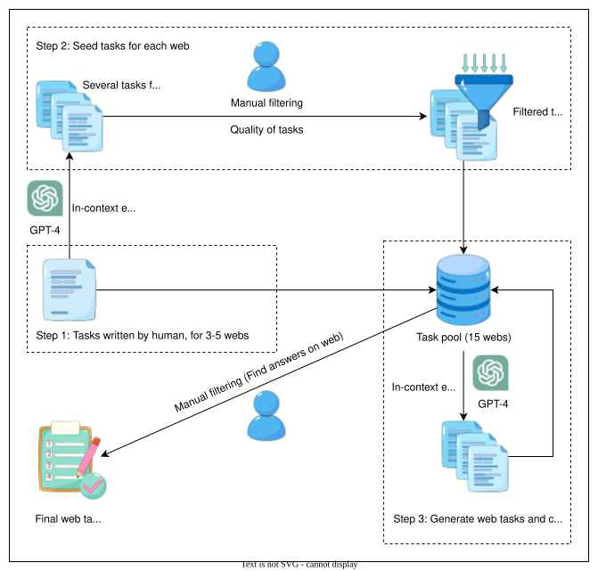

# Evaluating_WebVoyager_Performance_on_Real-World_Web_Tasks

Source: https://www.educative.io/courses/agentic-ai-systems/evaluating-webvoyager-and-design-insights

---

[Home](https://www.educative.io/)

[Courses](https://www.educative.io/search?tab=courses)

[Agentic System Design](https://www.educative.io/courses/agentic-ai-systems)

# Evaluating WebVoyager and Design Insights

Understand the evaluation process of WebVoyager using a real-world benchmark with 643 live web tasks. Learn how human and LLM assessments measure success, and discover key failure areas that guide designing more robust and effective web agents.

We'll cover the following...

- [Data construction via the self-instruct method](https://www.educative.io/courses/agentic-ai-systems/evaluating-webvoyager-and-design-insights#Data-construction-via-the-self-instruct-method)
- [Human evaluation](https://www.educative.io/courses/agentic-ai-systems/evaluating-webvoyager-and-design-insights#Human-evaluation)
- [LLM evaluation: The scalable proxy](https://www.educative.io/courses/agentic-ai-systems/evaluating-webvoyager-and-design-insights#LLM-evaluation-The-scalable-proxy)
- [Performance and key findings](https://www.educative.io/courses/agentic-ai-systems/evaluating-webvoyager-and-design-insights#Performance-and-key-findings)
  - [A strong indicator of success](https://www.educative.io/courses/agentic-ai-systems/evaluating-webvoyager-and-design-insights#A-strong-indicator-of-success)
  - [Failure analysis: Where we focus our design efforts](https://www.educative.io/courses/agentic-ai-systems/evaluating-webvoyager-and-design-insights#Failure-analysis-Where-we-focus-our-design-efforts)
- [Key takeaways for web agent designers](https://www.educative.io/courses/agentic-ai-systems/evaluating-webvoyager-and-design-insights#Key-takeaways-for-web-agent-designers)

We’ve explored WebVoyager’s architecture, but how do we know if it’s truly effective? A key challenge in agentic systems is creating a fair and realistic test. Many early web agents were tested in simplified simulators or on static, cached websites, which don’t capture the messiness of the live web.

To properly test a generalist agent like WebVoyager, we need to evaluate it on the same websites that real users interact with every day. This is the only way to test an agent’s ability to handle real-world challenges like floating ads, pop-up windows, constant updates, etc.

This led to the creation of a new benchmark, a curated collection of 643 real-world web tasks spread across 15 popular, live websites, including Amazon, Google Flights, ESPN, and GitHub.

## Data construction via the self-instruct method[#](https://www.educative.io/courses/agentic-ai-systems/evaluating-webvoyager-and-design-insights#Data-construction-via-the-self-instruct-method)

As agent designers, creating high-quality test data is a common challenge. The method used to build this benchmark, called **self-instruct**, is a powerful technique that we can adopt. It works like this:

The self-instruct method combines human expertise with LLM generation. Humans provide initial “seed tasks,” an LLM expands the dataset, and humans then verify the final quality to create the benchmark.

1. **Seed tasks:** We start by manually writing a small number of high-quality “seed tasks.”
2. **Generative loop:** We then use these seed tasks as examples to prompt an LLM to generate a large number of new, similar tasks.
3. **Human verification:** Crucially, every task generated by the LLM is then manually verified by a human to ensure it’s high-quality and solvable on the live website.

This semi-automated process is a practical way to create diverse and realistic datasets for evaluating our own agentic systems.

With a robust, real-world benchmark in place, the next challenge is to design an evaluation protocol that can accurately measure an agent’s success.

## Human evaluation[#](https://www.educative.io/courses/agentic-ai-systems/evaluating-webvoyager-and-design-insights#Human-evaluation)

To get the most accurate measure of performance, the study establishes a “ground truth” using meticulous human evaluation, which is the main evaluation metric for this research.

The process works as mentioned below.

- **What human evaluators received:** Each human judge was given the complete trajectory of an agent’s attempt at a task. This included the original instruction, all the actions the agent took, and every screenshot it saw along the way.
- **What they did:** Their job was to provide a simple binary judgment: did the agent successfully complete the task or not?
- **Ensuring reliability:** Three separate annotators reviewed a subset of tasks to ensure consistency in the judgments. This rigorous, human-led process provides the gold standard for measuring the agent’s true performance.

This human-centric approach also solves a major problem with traditional evaluation methods, which often rely on a single, predefined “golden” trajectory.

A golden trajectory means the agent is *only* considered successful if it follows a specific, hard-coded sequence of actions. This is too rigid for the live web, where an agent might find a different but equally valid path to success. By having humans judge the final outcome, the evaluation can reward any valid solution, regardless of the path taken.

## LLM evaluation: The scalable proxy[#](https://www.educative.io/courses/agentic-ai-systems/evaluating-webvoyager-and-design-insights#LLM-evaluation-The-scalable-proxy)

While human evaluation is the most accurate method, it's too slow and expensive to be practical at scale. As a scalable solution, the study uses a powerful LMM (GPT-4V) to automate the evaluation.

The LMM is designed to emulate the human process, receiving the same task information and trajectory screenshots to make a holistic judgment of success or failure. However, instead of the full visual history, it was given the lastkkkscreenshots from the trajectory.

Here,kkkis a hyperparameter, and a configurable setting. By testing different values for k (e.g., showing only the final screenshot, the last three, or the full trajectory), we can determine how much context the evaluator needs to make a reliable judgment. The LMM is then asked to make the same holistic judgment of success or failure.

This automated protocol was validated against the human judges, achieving an impressive 85.3% agreement rate, proving it to be a reliable and scalable proxy.

## Performance and key findings[#](https://www.educative.io/courses/agentic-ai-systems/evaluating-webvoyager-and-design-insights#Performance-and-key-findings)

So, how did WebVoyager perform? The results are a perfect illustration of the state of modern agentic systems: incredibly promising yet with clear areas for innovation by designers.

### A strong indicator of success[#](https://www.educative.io/courses/agentic-ai-systems/evaluating-webvoyager-and-design-insights#A-strong-indicator-of-success)

On its custom benchmark of 643 real-world tasks, WebVoyager achieved a 59.1% success rate. It’s important to frame this correctly: on a brand new, highly complex benchmark of live websites, the agent succeeded almost 60% of the time without any task-specific training. This is a powerful demonstration of the potential of multimodal agents and significantly outperformed text-only (40.1%) and general-purpose (30.8%) agents.

![Step 1: Click [10]](https://www.educative.io/api/collection/10370001/4654968800673792/page/6130202838958080/image/5427750720372736?page_type=collection_lesson&get_optimised=true&slide_id=5342494159929344&collection_token=wSNhI9Yq7ke6TPccfU8Vr4 "Step 1: Click [10]")

1 / 11

Step 1: Click [10]

![Step 2: Click [12]](https://www.educative.io/api/collection/10370001/4654968800673792/page/6130202838958080/image/5202690172649472?page_type=collection_lesson&get_optimised=true&slide_id=5342494159929344&collection_token=wSNhI9Yq7ke6TPccfU8Vr4 "Step 2: Click [12]")

1 / 11

Step 2: Click [12]

![Step 3: Type [13]; Dublin](https://www.educative.io/api/collection/10370001/4654968800673792/page/6130202838958080/image/6453129534898176?page_type=collection_lesson&get_optimised=true&slide_id=5342494159929344&collection_token=wSNhI9Yq7ke6TPccfU8Vr4 "Step 3: Type [13]; Dublin")

1 / 11

Step 3: Type [13]; Dublin

![Step 4: Type [14]; Athens, Greece](https://www.educative.io/api/collection/10370001/4654968800673792/page/6130202838958080/image/5337513642033152?page_type=collection_lesson&get_optimised=true&slide_id=5342494159929344&collection_token=wSNhI9Yq7ke6TPccfU8Vr4 "Step 4: Type [14]; Athens, Greece")

1 / 11

Step 4: Type [14]; Athens, Greece

![Step 5: Click [16]](https://www.educative.io/api/collection/10370001/4654968800673792/page/6130202838958080/image/6525565601185792?page_type=collection_lesson&get_optimised=true&slide_id=5342494159929344&collection_token=wSNhI9Yq7ke6TPccfU8Vr4 "Step 5: Click [16]")

1 / 11

Step 5: Click [16]

### Failure analysis: Where we focus our design efforts[#](https://www.educative.io/courses/agentic-ai-systems/evaluating-webvoyager-and-design-insights#Failure-analysis-Where-we-focus-our-design-efforts)

The ~40% of cases where the agent failed are, in many ways, the most valuable part of the study. They provide us with a clear, data-driven list of the key challenges we need to solve to build the next generation of web agents.

Here are the primary failure points, reframed as opportunities for design.

1. **Navigation and recovery (44.4% of failures):** The agent often got stuck in loops or couldn’t recover after a mistake. This highlights the need for more robust planning and error-recovery mechanisms. As designers, we can ask: How can we build agents that recognize when they are stuck and have fallback strategies, like trying a new approach or using the “Jump to Search Engine” tool more effectively?
2. **Visual grounding (24.8% of failures):** The agent sometimes struggled to correctly interpret complex visual layouts. This points directly to the core grounding problem and shows that while Set-of-Mark prompting is a good start, there is a huge opportunity to develop more advanced grounding techniques.
3. **Agent hallucination (21.8% of failures):** The agent sometimes believed it had completed a task when it hadn’t. This reinforces a lesson from our earlier chapters: the critical need for guardrails and self-critique loops. A more advanced agent might include a final “verification step” where it double-checks its own work against the user’s original request before giving an answer.
4. **Prompt misalignment (9.0% of failures):** The agent sometimes failed to follow complex instructions. This is a classic prompt engineering challenge, reminding us that the initial instructions we give our agents are a critical part of the system’s overall design.

## Key takeaways for web agent designers[#](https://www.educative.io/courses/agentic-ai-systems/evaluating-webvoyager-and-design-insights#Key-takeaways-for-web-agent-designers)

- **Failure is a guide, not a verdict:** A 40% failure rate on a difficult, novel benchmark is not a reason to abandon an approach. It’s a roadmap that tells us exactly where to innovate.
- **Focus on the core challenges:** As agentic system designers, our biggest opportunities for impact in this space lie in improving planning, grounding, and self-critique.
- **The system is the solution:** WebVoyager's performance gains came from its specialized, multimodal architecture. This reinforces a core theme of this course: success comes from thoughtful System Design, not just from using a more powerful model.

This concludes our exploration of the WebVoyager case study. In our next lesson, we’ll shift from analyzing an existing agent to designing our own advanced, self-improving system in an interactive thought exercise.

Text vs. Multimodal Web Agents in a Real-World Task

Thought Exercise: Designing a Self-Improving Web Agent

Ask

[Data construction via the self-instruct method](https://www.educative.io/courses/agentic-ai-systems/evaluating-webvoyager-and-design-insights#Data-construction-via-the-self-instruct-method)

[Human evaluation](https://www.educative.io/courses/agentic-ai-systems/evaluating-webvoyager-and-design-insights#Human-evaluation)

[LLM evaluation: The scalable proxy](https://www.educative.io/courses/agentic-ai-systems/evaluating-webvoyager-and-design-insights#LLM-evaluation-The-scalable-proxy)

[Performance and key findings](https://www.educative.io/courses/agentic-ai-systems/evaluating-webvoyager-and-design-insights#Performance-and-key-findings)

[A strong indicator of success](https://www.educative.io/courses/agentic-ai-systems/evaluating-webvoyager-and-design-insights#A-strong-indicator-of-success)

[Failure analysis: Where we focus our design efforts](https://www.educative.io/courses/agentic-ai-systems/evaluating-webvoyager-and-design-insights#Failure-analysis-Where-we-focus-our-design-efforts)

[Key takeaways for web agent designers](https://www.educative.io/courses/agentic-ai-systems/evaluating-webvoyager-and-design-insights#Key-takeaways-for-web-agent-designers)