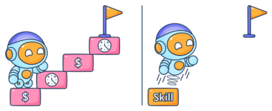

# Designing_Self-Improving_Web_Agents_with_Reusable_Skills

Source: https://www.educative.io/courses/agentic-ai-systems/thought-exercise-designing-a-self-improving-web-agent

---

[Home](https://www.educative.io/)

[Courses](https://www.educative.io/search?tab=courses)

[Agentic System Design](https://www.educative.io/courses/agentic-ai-systems)

# Thought Exercise: Designing a Self-Improving Web Agent

Explore how to design a self-improving web agent that autonomously learns from experience, creates reusable skills like finding flights, and manages these skills for improved efficiency. Understand how such agents reduce latency, token use, and errors by avoiding repetitive tasks. This lesson guides you step-by-step through solving key design challenges to build intelligent systems that not only perform tasks but continuously get smarter.

We'll cover the following...

- [The goal: An agent that learns skills](https://www.educative.io/courses/agentic-ai-systems/thought-exercise-designing-a-self-improving-web-agent#The-goal-An-agent-that-learns-skills)
- [Part 1: The problem of redundant work](https://www.educative.io/courses/agentic-ai-systems/thought-exercise-designing-a-self-improving-web-agent#Part-1-The-problem-of-redundant-work)
  - [The cost of re-learning](https://www.educative.io/courses/agentic-ai-systems/thought-exercise-designing-a-self-improving-web-agent#The-cost-of-re-learning)
- [Part 2: From idea to implementation](https://www.educative.io/courses/agentic-ai-systems/thought-exercise-designing-a-self-improving-web-agent#Part-2-From-idea-to-implementation)
- [Part 3: Building a skill library](https://www.educative.io/courses/agentic-ai-systems/thought-exercise-designing-a-self-improving-web-agent#Part-3-Building-a-skill-library)
- [Conclusion: A self-improving agent](https://www.educative.io/courses/agentic-ai-systems/thought-exercise-designing-a-self-improving-web-agent#Conclusion-A-self-improving-agent)

In our previous lessons, we explored the architecture of WebVoyager, an agent designed to complete live web tasks with a higher probability of success than traditional web agents. But what happens after the task is done? How does an agent continue to get smarter over time?

One of the key limitations of many web agents is the generalization problem. While they often perform well on the specific tasks they are designed for, they struggle to adapt to new websites or apply what they’ve learned in one context to another. This is because most agents lack a built-in mechanism for self-improvement and the ability to abstract procedural knowledge that can be reused across tasks.

## The goal: An agent that learns skills[#](https://www.educative.io/courses/agentic-ai-systems/thought-exercise-designing-a-self-improving-web-agent#The-goal-An-agent-that-learns-skills)

To overcome this, we need to design an agent that doesn’t just execute tasks, but also learns from its experience. The goal of this exercise is to architect a framework in which an agent can explore a website, identify common routines (like searching for a product or filling out a form), and then turn those routines into a reusable library of skills.

The cost of re-learning vs. the reusable skill

In this interactive exercise, you will step into the role of an agentic system designer. We will guide you, step by step, through the process of designing the three core stages of this self-improving agent framework. For each stage, we will pose a design question for you to answer.

## Part 1: The problem of redundant work[#](https://www.educative.io/courses/agentic-ai-systems/thought-exercise-designing-a-self-improving-web-agent#Part-1-The-problem-of-redundant-work)

Let’s start with a concrete problem. Imagine our basic web agent, like the one we studied in the WebVoyager case study, has been asked to perform very similar tasks on the same travel website multiple times. A few examples are given below.

- **Task 1:** “Find a flight from LAX to JFK.”
- **Task 2:** “Find a flight from SFO to MIA.”
- **Task 3:** “Find a flight from ORD to DFW.”

Each time it receives a new task, the agent starts from scratch, navigating the same menus, clicking the same buttons, and filling out the same form fields.

### The cost of re-learning[#](https://www.educative.io/courses/agentic-ai-systems/thought-exercise-designing-a-self-improving-web-agent#The-cost-of-re-learning)

This inefficiency isn’t just a minor inconvenience; it has significant real-world costs that we, as system designers, must consider.

- **Latency:** Each step in the agent’s reasoning loop takes time. Re-learning a multi-step procedure from scratch for every task makes the agent slower for the end user.
- **Token consumption:** More steps mean more calls to the LLM. This directly translates to higher operational costs, as each call consumes tokens.
- **Increased error rate:** Each step is a new opportunity for the agent to make a mistake. A long, repetitive procedure has a higher chance of failure than a single, reliable action.

This is inefficient and costly.

AI Powered

Saved

2 attempts left

Reset

How could we design a mechanism for the agent to remember and reuse the procedure for “finding a flight” so it doesn’t have to re-learn it every time? What would be the ideal output of this mechanism?

You have 2 attempts to answer.

## Part 2: From idea to implementation[#](https://www.educative.io/courses/agentic-ai-systems/thought-exercise-designing-a-self-improving-web-agent#Part-2-From-idea-to-implementation)

In the last section, we concluded that our agent should create a reusable function like `find_flight(origin, destination)` to avoid redundant work. But how can an agent autonomously create a robust, working piece of code from scratch?

This is a complex design challenge. It’s not enough for the agent to try something once; it needs a systematic process for practicing, creating, and verifying its new skill.

AI Powered

Saved

2 attempts left

Reset

Our agent needs to create a `find_flight(origin, destination)` function. What are the key steps the agent must take to go from a simple goal (like “find a flight from LAX to JFK”) to a reliable, working function that can be added to its toolbox?

You have 2 attempts to answer.

## Part 3: Building a skill library[#](https://www.educative.io/courses/agentic-ai-systems/thought-exercise-designing-a-self-improving-web-agent#Part-3-Building-a-skill-library)

So far in our design, our agent has a powerful new capability. It can autonomously create a robust, tested, and reusable function (like `find_flight`) from its own experience.

However, a real-world website has dozens of common routines. Over time, our agent could create many different skills for the same travel website, such as:

- `find_hotel(city, check_in_date, check_out_date)`.
- `check_booking_status(confirmation_number)`.
- `apply_discount_code(code)`.

This is a fantastic outcome, but it introduces a new design challenge: skill management.

AI Powered

Saved

2 attempts left

Reset

Our agent will eventually create dozens of skills for a single website. How should the agent manage this growing library of functions, and how should it decide which skill to use for a new, incoming user task?

You have 2 attempts to answer.

## Conclusion: A self-improving agent[#](https://www.educative.io/courses/agentic-ai-systems/thought-exercise-designing-a-self-improving-web-agent#Conclusion-A-self-improving-agent)

Congratulations! By working through these design questions, we have architected the core components of a sophisticated, self-improving web agent. The system we’ve designed, which can autonomously propose, synthesize, and hone its own reusable skills, is a direct implementation of the principles from a highly influential research paper called SkillWeaver.

This exercise shows how the foundational principles of agentic design, like planning, tool use, and self-correction, can be combined. Together, they can be used to create truly intelligent systems that don’t just execute tasks, but learn and get better over time.

Evaluating WebVoyager and Design Insights

From Design to a Running Multimodal Web Agent

Ask

[The goal: An agent that learns skills](https://www.educative.io/courses/agentic-ai-systems/thought-exercise-designing-a-self-improving-web-agent#The-goal-An-agent-that-learns-skills)

[Part 1: The problem of redundant work](https://www.educative.io/courses/agentic-ai-systems/thought-exercise-designing-a-self-improving-web-agent#Part-1-The-problem-of-redundant-work)

[The cost of re-learning](https://www.educative.io/courses/agentic-ai-systems/thought-exercise-designing-a-self-improving-web-agent#The-cost-of-re-learning)

[Part 2: From idea to implementation](https://www.educative.io/courses/agentic-ai-systems/thought-exercise-designing-a-self-improving-web-agent#Part-2-From-idea-to-implementation)

[Part 3: Building a skill library](https://www.educative.io/courses/agentic-ai-systems/thought-exercise-designing-a-self-improving-web-agent#Part-3-Building-a-skill-library)

[Conclusion: A self-improving agent](https://www.educative.io/courses/agentic-ai-systems/thought-exercise-designing-a-self-improving-web-agent#Conclusion-A-self-improving-agent)