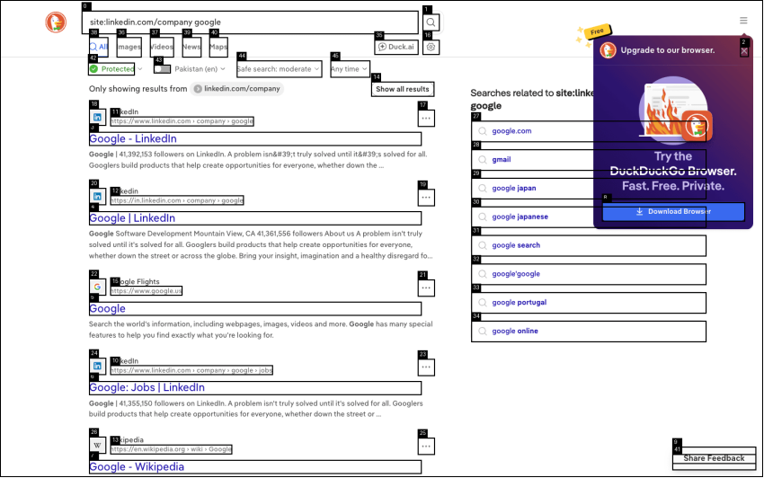

# Building_a_Multimodal_Web_Agent_with_Google_ADK_and_Playwright

Source: https://www.educative.io/courses/agentic-ai-systems/from-design-to-a-running-multimodal-web-agent

---

[Home](https://www.educative.io/)

[Courses](https://www.educative.io/search?tab=courses)

[Agentic System Design](https://www.educative.io/courses/agentic-ai-systems)

# From Design to a Running Multimodal Web Agent

Explore the transition from designing to running a multimodal web agent using Google ADK. Understand how the agent observes, acts, and navigates real websites, inspect project structure, and verify the agent's behavior by analyzing run artifacts and logs.

We'll cover the following...

- [Demo: Watch the agent complete a real task](https://www.educative.io/courses/agentic-ai-systems/from-design-to-a-running-multimodal-web-agent#Demo-Watch-the-agent-complete-a-real-task)
  - [What you should notice while watching](https://www.educative.io/courses/agentic-ai-systems/from-design-to-a-running-multimodal-web-agent#What-you-should-notice-while-watching)
  - [Typical phases](https://www.educative.io/courses/agentic-ai-systems/from-design-to-a-running-multimodal-web-agent#Typical-phases)
- [Project structure](https://www.educative.io/courses/agentic-ai-systems/from-design-to-a-running-multimodal-web-agent#Project-structure)
- [Agent output files after running a web task](https://www.educative.io/courses/agentic-ai-systems/from-design-to-a-running-multimodal-web-agent#Agent-output-files-after-running-a-web-task)
  - [Conclusion](https://www.educative.io/courses/agentic-ai-systems/from-design-to-a-running-multimodal-web-agent#Conclusion)

In the previous chapter, we designed the architecture of a multimodal web agent: how it observes pages, chooses actions, and stays grounded while interacting with the web. But architecture diagrams alone are not enough. To understand whether a design actually works, we need to study the implementation, run the agent on real websites, and inspect what happens step by step.

This lesson is the starting point for that transition from design to code. Before diving into individual functions and components, we will build a practical mental map of the project. You will watch the agent perform a real task, explore the main folders and files in the repository, and learn which outputs to inspect after a run for debugging and verification.

By the end of this lesson, you should be able to:

- Describe, at a high level, what happens during a demo run: observations, tool use, and final response.
- Read the project tree and connect each major path to its specific responsibility.
- List the files you would open after a run to replay what happened.

**Pause and reflect:** Before you continue, write one sentence: What would you want to see in a log file to convince yourself the agent "really looked" at the page before clicking?

## Demo: Watch the agent complete a real task[#](https://www.educative.io/courses/agentic-ai-systems/from-design-to-a-running-multimodal-web-agent#Demo-Watch-the-agent-complete-a-real-task)

To build a mental model, we will begin with one fixed task prompt so we can consistently compare the agent's intent and execution.

> **Task prompt used for the demo:** Go to LinkedIn, find the company "Google," and tell me the most recent post they made. Extract the complete post content and the URL.

Screen recording of the multimodal web agent running the LinkedIn task in the ADK web UI. Watch for alternating observations (screenshots and labeled elements) and single-step actions

**Note:** Your environment may show different URLs or extra steps. That is normal for LLM-based live web automation.

### What you should notice while watching[#](https://www.educative.io/courses/agentic-ai-systems/from-design-to-a-running-multimodal-web-agent#What-you-should-notice-while-watching)

You do not need to memorize tool names yet. Focus on the rhythm of the run.

- **Observations:** After meaningful navigation or actions, the system refreshes what the model can see: a viewport capture, overlays that assign numeric labels to candidate interactive regions, and text summaries of those regions. When multimodal fusion is enabled, you may also see a visual-language summary layered on top of the DOM-based view.
- **Decisions and actions:** The model proposes steps such as opening a search, typing a query, clicking a result, dismissing a banner, scrolling the feed, or submitting a final answer. The intended pattern is one main browser move, then a fresh observation, rather than many undocumented clicks in one burst.
- **Friction you might see:** Search engines sometimes show challenge or rate-limit pages. Sites may ask for sign-in before a full company feed is visible. A good run either recovers (for example, by trying another path) or stops with an honest limitation. Both outcomes are useful for learning.
- **Stopping:** When the task is considered complete, you should hear or see a final answer that includes the requested content (post text and URL) when the site allows public access. If access is blocked, the answer should reflect that instead of inventing a post.

### Typical phases[#](https://www.educative.io/courses/agentic-ai-systems/from-design-to-a-running-multimodal-web-agent#Typical-phases)

The list below is a teaching scaffold. Your run might reorder steps or add retries.

1. **Start:** The browser may begin on an empty page. Early observations can show few or no labeled elements until navigation starts.
2. **Reach the site or search:** The agent may open a search engine, enter a query, or navigate directly. If a provider responds with a challenge page, you might see recovery behavior instead of immediate results.
3. **Arrive on LinkedIn:** The goal is to reach the correct company presence and then the content that holds posts.
4. **Deal with overlays:** Cookie banners and dismiss buttons are common. Watch whether the agent clears enough of the overlay to continue.
5. **Scroll and read:** Most recent post often requires scrolling until the feed region is stable and readable.
6. **Answer:** The agent consolidates what it believes it saw into a final response, including the URL when available.

## Project structure[#](https://www.educative.io/courses/agentic-ai-systems/from-design-to-a-running-multimodal-web-agent#Project-structure)

To implement this workflow, our codebase is broken down into specific, modular responsibilities. Here is a high-level overview of the files we will build and explore in the upcoming lessons:

```
"""ADK discovery entrypoint for the `src` app."""

from src.adk_agent.web_agent import build_root_agent

root_agent = build_root_agent()
```

Complete implementation

- `src/agent.py`**:** This is the simplified discovery entry point. It acts as the application launcher, calling `build_root_agent()` to initialize the Google ADK multi-agent system.
- `src/tools/browser_runtime.py`**:** This file defines the `BrowserRuntime` class, a module-global wrapper around Playwright. It is responsible for maintaining browser state (contexts, pages, visited URLs, action history, and screenshots) across the ReAct loops.
- `src/tools/web_tools.py`**:** This is the operational core of the agent, containing all the custom tools exposed to the LLM. It handles everything from capturing fused multimodal observations (`capture_multimodal_observation`) and injecting bounding boxes onto screenshots (`_annotate_screenshot`) to interacting with elements (`click_element`, `type_text_element`) and evaluating Visual Language Model (VLM) prompts (`analyze_screenshot_with_vlm`).
- `src/adk_agent/web_agent.py`**:** This file binds the tools to the LLMs using Google ADK. It configures the system prompts (instructions) that govern the agent's behavior, whether running in a "strict mode" loop, a "single agent" mode, or a delegated multi-agent workflow (using a Planner, Vision, and Browser agent).

## Agent output files after running a web task[#](https://www.educative.io/courses/agentic-ai-systems/from-design-to-a-running-multimodal-web-agent#Agent-output-files-after-running-a-web-task)

Transparency is critical in agentic web systems. When we run the agent, the implementation automatically writes files under an `artifacts` folder next to our working directory. We treat these as evidence: we can replay the sequence and check whether each action matches what was on-screen.

- `process_log.jsonl`**:** One JSON object per line. This is the timeline of stages (observations, actions, outcomes, and sometimes blockers).
- `page_*.png`: Raw screenshots captured during the run.
- `page_*_labeled.png`**:** The same moment with numeric labels drawn on candidate elements.

Below is a sequential look at what the agent sees and captures in its `artifacts` folder during the LinkedIn task:

 alongside the crucial process_log.jsonl file")

1 / 10

The Artifacts Directory. A view of the generated files showing paired images for every step (e.g., page\_1.png and page\_1\_labeled.png) alongside the crucial process\_log.jsonl file

. The agent begins its task by launching the browser. The very first observation occurs on an about:blank page, establishing a fresh, empty environment before navigation starts")

1 / 10

The Initial Browser State (about:blank). The agent begins its task by launching the browser. The very first observation occurs on an about:blank page, establishing a fresh, empty environment before navigation starts


1 / 10

The Google Homepage. The agent navigates to Google. Notice the numeric bounding boxes injected over candidate interactive elements like the search bar, "Google Search" button, and "I'm Feeling Lucky" button


1 / 10

The CAPTCHA Challenge. The agent encounters an "unusual traffic" block from Google. A robust agent must recognize this page block and trigger a recovery behavior



1 / 10

The agent bypasses the blocker via a fallback search, successfully querying site:linkedin.com/company google on DuckDuckGo. The labeled screenshot highlights organic links to the official LinkedIn page

Let's take a closer look at the `process_log.jsonl` file to see how the agent thinks and acts under the hood. The log file serializes the agent's behavior step by step.

C++

```
{"stage": "observation", "url": "about:blank", "data": {"url": "about:blank", "title": "", "screenshot_path": "/Users/Asmat_1/Desktop/webagent-implementation/artifacts/page_1.png", "labeled_screenshot_path": "/Users/Asmat_1/Desktop/webagent-implementation/artifacts/page_1_labeled.png", "elements": [], "web_elements_text": [], "observation_cached": false}}

{"stage": "multimodal_observation", "url": "about:blank", "data": {"observation_type": "multimodal_fused", "url": "about:blank", "title": "", "screenshot_path": "/Users/Asmat_1/Desktop/webagent-implementation/artifacts/page_1.png", "labeled_screenshot_path": "/Users/Asmat_1/Desktop/webagent-implementation/artifacts/page_1_labeled.png", "elements": [], "web_elements_text": [], "vlm_analysis": {"provider": "openai", "model": "gpt-5-mini", "prompt": "Describe the page goal, key UI regions, and best next actions using visible clues.", "screenshot_path": "/Users/Asmat_1/Desktop/webagent-implementation/artifacts/page_1.png", "vlm_output": {"id": "chatcmpl-DUspgCIiP80ncAEMxlrMpowVgeORR", "object": "chat.completion", "created": 1776252988, "model": "gpt-5-mini-2025-08-07", "choices": [{"index": 0, "message": {"role": "assistant", "content": "There are no visible UI elements in the screenshot (it\u2019s just a blank white canvas), so I can\u2019t definitively identify the page\u2019s purpose or regions from what\u2019s shown. Based only on this empty view, here are reasonable interpretations and the best next actions you can take to diagnose or proceed.\n\nWhat the page goal might be (plausible guesses)\n- A blank/empty state for an app (e.g., new document, whiteboard, drawing canvas).\n- A page that failed to load content (network error, server error, blocked resources).\n- A hidden UI due to CSS (white text on white background, off-screen elements, z-index covering).\n- A print/preview or intentionally minimal \u201cblank\u201d page.\n- A rendering bug in the browser or a stalled JavaScript app.\n\nKey UI regions (not visible, inferred possibilities)\n- Header/navigation area (top): could contain branding, menu, or controls \u2014 not visible.\n- Main content area / canvas (center): appears empty \u2014 likely intended to host content or editing tools.\n- Toolbar / sidebar (left or right): might be hidden, collapsed, or not loaded.\n- Footer/status bar (bottom): may contain messages, but not shown.\n\nBest next actions (diagnostic + user actions)\n1. Reload the page (Ctrl/Cmd+R) to rule out a transient load failure.\n2. Check the browser address bar and URL to confirm you\u2019re on the correct page.\n3. Open developer tools (F12 / Ctrl+Shift+I):\n   - Look at the Console for JS errors.\n   - Check the Network tab for failed resource requests (404/500).\n   - Inspect the DOM to see if elements exist but are invisible (CSS color/visibility/position).\n4. Disable extensions (adblockers, privacy tools) or try Incognito/Private mode to rule out extension interference.\n5. Clear cache or force a full reload (Ctrl+F5).\n6. Try a different browser or device to see if it\u2019s environment-specific.\n7. View page source (Ctrl+U) to confirm if content is present in HTML.\n8. If this is an app you control: ensure backend services are running and APIs respond.\n9. If the page should show a document/canvas: check for a \u201cNew document\u201d or similar option in the app menu (if you can access it) or look for keyboard shortcuts (e.g., Ctrl+N).\n10. If nothing helps, capture the browser console output and a screenshot that includes the URL bar and timing, then contact the site/app support or developer with those details.\n\nIf you want, tell me:\n- the URL or app name (if safe to share) and what you expected to see,\n- whether you see anything when you open devtools\u2019 Elements or Console,\n\nand I\u2019ll suggest targeted troubleshooting steps.", "refusal": null, "annotations": []}, "finish_reason": "stop"}], "usage": {"prompt_tokens": 1590, "completion_tokens": 906, "total_tokens": 2496, "prompt_tokens_details": {"cached_tokens": 0, "audio_tokens": 0}, "completion_tokens_details": {"reasoning_tokens": 320, "audio_tokens": 0, "accepted_prediction_tokens": 0, "rejected_prediction_tokens": 0}}, "service_tier": "default", "system_fingerprint": null}}, "observation_streak": 1, "observation_cached": false, "required_domains": [], "task_constraints": {}, "task_constraints_meta": {"seen_inputs": ["describe the page goal, key ui regions, and best next actions using visible clues."], "last_source": "observation_prompt", "llm_used": false, "last_input_preview": "Describe the page goal, key UI regions, and best next actions using visible clues."}, "action_hint": "Proceed with one concrete action."}}

{"stage": "observation", "url": "https://www.google.com/", "data": {"url": "https://www.google.com/", "title": "Google", "screenshot_path": "/Users/Asmat_1/Desktop/webagent-implementation/artifacts/page_2.png", "labeled_screenshot_path": "/Users/Asmat_1/Desktop/webagent-implementation/artifacts/page_2_labeled.png", "elements": [{"tag": "textarea", "selector": "#APjFqb", "text": "Search", "role": "combobox", "name": "q", "input_type": "", "aria_label": "Search", "placeholder": "", "data_testid": "", "disabled": false, "x": 427, "y": 377, "width": 444, "height": 50, "viewport_width": 1440, "viewport_height": 900, "id": "0"}, {"tag": "input", "selector": null, "text": "Google Search", "role": "button", "name": "btnK", "input_type": "submit", "aria_label": "Google Search", "placeholder": "", "data_testid": "", "disabled": false, "x": 579, "y": 457, "width": 127, "height": 36, "viewport_width": 1440, "viewport_height": 900, "id": "1"}, {"tag": "button", "selector": null, "text": "AI Mode", "role": "link", "name": "", "input_type": "button", "aria_label": "", "placeholder": "", "data_testid": "", "disabled": false, "x": 959, "y": 384, "width": 96, "height": 36, "viewport_width": 1440, "viewport_height": 900, "id": "2"}, {"tag": "a", "selector": null, "text": "Google apps", "role": "button", "name": "", "input_type": "", "aria_label": "Google apps", "placeholder": "", "data_testid": "", "disabled": false, "x": 1297, "y": 8, "width": 40, "height": 40, "viewport_width": 1440, "viewport_height": 900, "id": "3"}, {"tag": "button", "selector": null, "text": "Upload files or images", "role": "", "name": "", "input_type": "button", "aria_label": "Upload files or images", "placeholder": "", "data_testid": "", "disabled": false, "x": 384, "y": 384, "width": 36, "height": 36, "viewport_width": 1440, "viewport_height": 900, "id": "4"}, {"tag": "input", "selector": null, "text": "I'm Feeling Lucky", "role": "", "name": "btnI", "input_type": "submit", "aria_label": "I'm Feeling Lucky", "placeholder": "", "data_testid": "", "disabled": false, "x": 718, "y": 457, "width": 143, "height": 36, "viewport_width": 1440, "viewport_height": 900, "id": "5"}, {"tag": "a", "selector": null, "text": "Sign in", "role": "", "name": "", "input_type": "", "aria_label": "Sign in", "placeholder": "", "data_testid": "", "disabled": false, "x": 1345, "y": 8, "width": 85, "height": 40, "viewport_width": 1440, "viewport_height": 900, "id": "6"}, {"tag": "a", "selector": null, "text": "Images", "role": "", "name": "", "input_type": "", "aria_label": "Search for Images", "placeholder": "", "data_testid": "", "disabled": false, "x": 1239, "y": 16, "width": 43, "height": 24, "viewport_width": 1440, "viewport_height": 900, "id": "7"}, {"tag": "div", "selector": null, "text": "Search by voice", "role": "button", "name": "", "input_type": "", "aria_label": "Search by voice", "placeholder": "", "data_testid": "", "disabled": false, "x": 871, "y": 390, "width": 40, "height": 24, "viewport_width": 1440, "viewport_height": 900, "id": "8"}, {"tag": "div", "selector": null, "text": "Search by image", "role": "button", "name": "", "input_type": "", "aria_label": "Search by image", "placeholder": "", "data_testid": "", "disabled": false, "x": 911, "y": 390, "width": 40, "height": 24, "viewport_width": 1440, "viewport_height": 900, "id": "9"}, {"tag": "a", "selector": null, "text": "Gmail", "role": "", "name": "", "input_type": "", "aria_label": "Gmail", "placeholder": "", "data_testid": "", "disabled": false, "x": 1190, "y": 16, "width": 34, "height": 24, "viewport_width": 1440, "viewport_height": 900, "id": "10"}, {"tag": "a", "selector": null, "text": "How Search works", "role": "", "name": "", "input_type": "", "aria_label": "", "placeholder": "", "data_testid": "", "disabled": false, "x": 273, "y": 854, "width": 147, "height": 46, "viewport_width": 1440, "viewport_height": 900, "id": "11"}, {"tag": "a", "selector": null, "text": "Advertising", "role": "", "name": "", "input_type": "", "aria_label": "", "placeholder": "", "data_testid": "", "disabled": false, "x": 87, "y": 854, "width": 99, "height": 46, "viewport_width": 1440, "viewport_height": 900, "id": "12"}, {"tag": "a", "selector": null, "text": "Business", "role": "", "name": "", "input_type": "", "aria_label": "", "placeholder": "", "data_testid": "", "disabled": false, "x": 186, "y": 854, "width": 87, "height": 46, "viewport_width": 1440, "viewport_height": 900, "id": "13"}, {"tag": "div", "selector": null, "text": "Settings", "role": "button", "name": "", "input_type": "", "aria_label": "", "placeholder": "", "data_testid": "", "disabled": false, "x": 1339, "y": 854, "width": 81, "height": 46, "viewport_width": 1440, "viewport_height": 900, "id": "14"}, {"tag": "a", "selector": null, "text": "Privacy", "role": "", "name": "", "input_type": "", "aria_label": "", "placeholder": "", "data_testid": "", "disabled": false, "x": 1195, "y": 854, "width": 76, "height": 46, "viewport_width": 1440, "viewport_height": 900, "id": "15"}, {"tag": "a", "selector": null, "text": "Terms", "role": "", "name": "", "input_type": "", "aria_label": "", "placeholder": "", "data_testid": "", "disabled": false, "x": 1271, "y": 854, "width": 68, "height": 46, "viewport_width": 1440, "viewport_height": 900, "id": "16"}, {"tag": "a", "selector": null, "text": "About", "role": "", "name": "", "input_type": "", "aria_label": "", "placeholder": "", "data_testid": "", "disabled": false, "x": 20, "y": 854, "width": 67, "height": 46, "viewport_width": 1440, "viewport_height": 900, "id": "17"}, {"tag": "a", "selector": null, "text": "\u0633\u0646\u068c\u064a", "role": "", "name": "", "input_type": "", "aria_label": "", "placeholder": "", "data_testid": "", "disabled": false, "x": 785, "y": 543, "width": 23, "height": 15, "viewport_width": 1440, "viewport_height": 900, "id": "18"}, {"tag": "a", "selector": null, "text": "\u0627\u0631\u062f\u0648", "role": "", "name": "", "input_type": "", "aria_label": "", "placeholder": "", "data_testid": "", "disabled": false, "x": 739, "y": 543, "width": 19, "height": 15, "viewport_width": 1440, "viewport_height": 900, "id": "19"}, {"tag": "a", "selector": null, "text": "\u067e\u069a\u062a\u0648", "role": "", "name": "", "input_type": "", "aria_label": "", "placeholder": "", "data_testid": "", "disabled": false, "x": 762, "y": 543, "width": 19, "height": 15, "viewport_width": 1440, "viewport_height": 900, "id": "20"}, {"tag": "svg", "selector": null, "text": "Google", "role": "img", "name": "", "input_type": "", "aria_label": "Google", "placeholder": "", "data_testid": "", "disabled": false, "x": 584, "y": 258, "width": 272, "height": 92, "viewport_width": 1440, "viewport_height": 900, "id": "21"}], "web_elements_text": ["[0]: <Input> Search", "[1]: <Click> Google Search", "[2]: <Click> AI Mode", "[3]: <Click> Google apps", "[4]: <Click> Upload files or images", "[5]: <Click> I'm Feeling Lucky", "[6]: <Click> Sign in", "[7]: <Click> Search for Images", "[8]: <Click> Search by voice", "[9]: <Click> Search by image", "[10]: <Click> Gmail", "[11]: <Click> How Search works", "[12]: <Click> Advertising", "[13]: <Click> Business", "[14]: <Click> Settings", "[15]: <Click> Privacy", "[16]: <Click> Terms", "[17]: <Click> About", "[18]: <Click> \u0633\u0646\u068c\u064a", "[19]: <Click> \u0627\u0631\u062f\u0648", "[20]: <Click> \u067e\u069a\u062a\u0648", "[21]: <Click> Google"], "observation_cached": false}}

{"stage": "multimodal_observation", "url": "https://www.google.com/", "data": {"observation_type": "multimodal_fused", "url": "https://www.google.com/", "title": "Google", "screenshot_path": "/Users/Asmat_1/Desktop/webagent-implementation/artifacts/page_2.png", "labeled_screenshot_path": "/Users/Asmat_1/Desktop/webagent-implementation/artifacts/page_2_labeled.png", "elements": [{"tag": "textarea", "selector": "#APjFqb", "text": "Search", "role": "combobox", "name": "q", "input_type": "", "aria_label": "Search", "placeholder": "", "data_testid": "", "disabled": false, "x": 427, "y": 377, "width": 444, "height": 50, "viewport_width": 1440, "viewport_height": 900, "id": "0"}, {"tag": "input", "selector": null, "text": "Google Search", "role": "button", "name": "btnK", "input_type": "submit", "aria_label": "Google Search", "placeholder": "", "data_testid": "", "disabled": false, "x": 579, "y": 457, "width": 127, "height": 36, "viewport_width": 1440, "viewport_height": 900, "id": "1"}, {"tag": "button", "selector": null, "text": "AI Mode", "role": "link", "name": "", "input_type": "button", "aria_label": "", "placeholder": "", "data_testid": "", "disabled": false, "x": 959, "y": 384, "width": 96, "height": 36, "viewport_width": 1440, "viewport_height": 900, "id": "2"}, {"tag": "a", "selector": null, "text": "Google apps", "role": "button", "name": "", "input_type": "", "aria_label": "Google apps", "placeholder": "", "data_testid": "", "disabled": false, "x": 1297, "y": 8, "width": 40, "height": 40, "viewport_width": 1440, "viewport_height": 900, "id": "3"}, {"tag": "button", "selector": null, "text": "Upload files or images", "role": "", "name": "", "input_type": "button", "aria_label": "Upload files or images", "placeholder": "", "data_testid": "", "disabled": false, "x": 384, "y": 384, "width": 36, "height": 36, "viewport_width": 1440, "viewport_height": 900, "id": "4"}, {"tag": "input", "selector": null, "text": "I'm Feeling Lucky", "role": "", "name": "btnI", "input_type": "submit", "aria_label": "I'm Feeling Lucky", "placeholder": "", "data_testid": "", "disabled": false, "x": 718, "y": 457, "width": 143, "height": 36, "viewport_width": 1440, "viewport_height": 900, "id": "5"}, {"tag": "a", "selector": null, "text": "Sign in", "role": "", "name": "", "input_type": "", "aria_label": "Sign in", "placeholder": "", "data_testid": "", "disabled": false, "x": 1345, "y": 8, "width": 85, "height": 40, "viewport_width": 1440, "viewport_height": 900, "id": "6"}, {"tag": "a", "selector": null, "text": "Images", "role": "", "name": "", "input_type": "", "aria_label": "Search for Images", "placeholder": "", "data_testid": "", "disabled": false, "x": 1239, "y": 16, "width": 43, "height": 24, "viewport_width": 1440, "viewport_height": 900, "id": "7"}, {"tag": "div", "selector": null, "text": "Search by voice", "role": "button", "name": "", "input_type": "", "aria_label": "Search by voice", "placeholder": "", "data_testid": "", "disabled": false, "x": 871, "y": 390, "width": 40, "height": 24, "viewport_width": 1440, "viewport_height": 900, "id": "8"}, {"tag": "div", "selector": null, "text": "Search by image", "role": "button", "name": "", "input_type": "", "aria_label": "Search by image", "placeholder": "", "data_testid": "", "disabled": false, "x": 911, "y": 390, "width": 40, "height": 24, "viewport_width": 1440, "viewport_height": 900, "id": "9"}, {"tag": "a", "selector": null, "text": "Gmail", "role": "", "name": "", "input_type": "", "aria_label": "Gmail", "placeholder": "", "data_testid": "", "disabled": false, "x": 1190, "y": 16, "width": 34, "height": 24, "viewport_width": 1440, "viewport_height": 900, "id": "10"}, {"tag": "a", "selector": null, "text": "How Search works", "role": "", "name": "", "input_type": "", "aria_label": "", "placeholder": "", "data_testid": "", "disabled": false, "x": 273, "y": 854, "width": 147, "height": 46, "viewport_width": 1440, "viewport_height": 900, "id": "11"}, {"tag": "a", "selector": null, "text": "Advertising", "role": "", "name": "", "input_type": "", "aria_label": "", "placeholder": "", "data_testid": "", "disabled": false, "x": 87, "y": 854, "width": 99, "height": 46, "viewport_width": 1440, "viewport_height": 900, "id": "12"}, {"tag": "a", "selector": null, "text": "Business", "role": "", "name": "", "input_type": "", "aria_label": "", "placeholder": "", "data_testid": "", "disabled": false, "x": 186, "y": 854, "width": 87, "height": 46, "viewport_width": 1440, "viewport_height": 900, "id": "13"}, {"tag": "div", "selector": null, "text": "Settings", "role": "button", "name": "", "input_type": "", "aria_label": "", "placeholder": "", "data_testid": "", "disabled": false, "x": 1339, "y": 854, "width": 81, "height": 46, "viewport_width": 1440, "viewport_height": 900, "id": "14"}, {"tag": "a", "selector": null, "text": "Privacy", "role": "", "name": "", "input_type": "", "aria_label": "", "placeholder": "", "data_testid": "", "disabled": false, "x": 1195, "y": 854, "width": 76, "height": 46, "viewport_width": 1440, "viewport_height": 900, "id": "15"}, {"tag": "a", "selector": null, "text": "Terms", "role": "", "name": "", "input_type": "", "aria_label": "", "placeholder": "", "data_testid": "", "disabled": false, "x": 1271, "y": 854, "width": 68, "height": 46, "viewport_width": 1440, "viewport_height": 900, "id": "16"}, {"tag": "a", "selector": null, "text": "About", "role": "", "name": "", "input_type": "", "aria_label": "", "placeholder": "", "data_testid": "", "disabled": false, "x": 20, "y": 854, "width": 67, "height": 46, "viewport_width": 1440, "viewport_height": 900, "id": "17"}, {"tag": "a", "selector": null, "text": "\u0633\u0646\u068c\u064a", "role": "", "name": "", "input_type": "", "aria_label": "", "placeholder": "", "data_testid": "", "disabled": false, "x": 785, "y": 543, "width": 23, "height": 15, "viewport_width": 1440, "viewport_height": 900, "id": "18"}, {"tag": "a", "selector": null, "text": "\u0627\u0631\u062f\u0648", "role": "", "name": "", "input_type": "", "aria_label": "", "placeholder": "", "data_testid": "", "disabled": false, "x": 739, "y": 543, "width": 19, "height": 15, "viewport_width": 1440, "viewport_height": 900, "id": "19"}, {"tag": "a", "selector": null, "text": "\u067e\u069a\u062a\u0648", "role": "", "name": "", "input_type": "", "aria_label": "", "placeholder": "", "data_testid": "", "disabled": false, "x": 762, "y": 543, "width": 19, "height": 15, "viewport_width": 1440, "viewport_height": 900, "id": "20"}, {"tag": "svg", "selector": null, "text": "Google", "role": "img", "name": "", "input_type": "", "aria_label": "Google", "placeholder": "", "data_testid": "", "disabled": false, "x": 584, "y": 258, "width": 272, "height": 92, "viewport_width": 1440, "viewport_height": 900, "id": "21"}], "web_elements_text": ["[0]: <Input> Search", "[1]: <Click> Google Search", "[2]: <Click> AI Mode", "[3]: <Click> Google apps", "[4]: <Click> Upload files or images", "[5]: <Click> I'm Feeling Lucky", "[6]: <Click> Sign in", "[7]: <Click> Search for Images", "[8]: <Click> Search by voice", "[9]: <Click> Search by image", "[10]: <Click> Gmail", "[11]: <Click> How Search works", "[12]: <Click> Advertising", "[13]: <Click> Business", "[14]: <Click> Settings", "[15]: <Click> Privacy", "[16]: <Click> Terms", "[17]: <Click> About", "[18]: <Click> \u0633\u0646\u068c\u064a", "[19]: <Click> \u0627\u0631\u062f\u0648", "[20]: <Click> \u067e\u069a\u062a\u0648", "[21]: <Click> Google"], "vlm_analysis": {"provider": "openai", "model": "gpt-5-mini", "prompt": "Describe the page goal, key UI regions, and best next actions using visible clues.", "screenshot_path": "/Users/Asmat_1/Desktop/webagent-implementation/artifacts/page_2.png", "vlm_output": {"id": "chatcmpl-DUsq099sR4qMo2zCOS8aZzcEVDdBK", "object": "chat.completion", "created": 1776253008, "model": "gpt-5-mini-2025-08-07", "choices": [{"index": 0, "message": {"role": "assistant", "content": "Page goal\n- Let the user start a web search quickly (primary). The central search bar, Google logo, and action buttons indicate this is a search home page that\u2019s focused on finding information fast. Secondary goals include using voice/image search or Google\u2019s \u201cAI Mode,\u201d and signing in for a personalized experience.\n\nKey UI regions (what you can see)\n- Header (top-right): \u201cGmail\u201d, \u201cImages\u201d, apps grid icon, and a blue \u201cSign in\u201d button \u2014 for account access and quick navigation to other Google services.\n- Main / Hero (center):\n  - Large Google logo (brand and focus).\n  - Main search box with icons: a plus/shortcut on the left, microphone (voice search), image/visual search icon, and an \u201cAI Mode\u201d pill on the right.\n  - Primary action buttons below the box: \u201cGoogle Search\u201d and \u201cI\u2019m Feeling Lucky.\u201d\n- Footer (bottom): country label (\u201cPakistan\u201d) on the left and informational/utility links across the bottom (About, Advertising, Business, How Search works, Privacy, Terms, Settings). A small language link is shown under the action buttons.\n\nBest next actions (based on visible clues)\n1. Type a search query in the big search box and press Enter or click \u201cGoogle Search\u201d \u2014 the most direct way to find information.\n2. Tap the microphone icon to do a voice search if you prefer speaking.\n3. Tap the image/visual search icon to search by image.\n4. Try the \u201cAI Mode\u201d pill to use Google\u2019s AI-assisted search features.\n5. Click \u201cI\u2019m Feeling Lucky\u201d to go directly to the top result for your query.\n6. Click \u201cSign in\u201d to see personalized results, saved searches, and account features.\n7. Use the header links (Gmail, Images) or the apps grid to jump to other Google services.\n8. Use footer links (Settings, Privacy, Terms, About) to change preferences or learn more about Google.\n\nSuggested quick flows\n- If you just want information: type query \u2192 Enter or Google Search.\n- If you want hands-free input: tap microphone \u2192 speak query \u2192 choose result.\n- If you have an image: click visual search icon \u2192 upload or paste image.\n- If you want personalized results or saved history: click Sign in.", "refusal": null, "annotations": []}, "finish_reason": "stop"}], "usage": {"prompt_tokens": 1590, "completion_tokens": 736, "total_tokens": 2326, "prompt_tokens_details": {"cached_tokens": 0, "audio_tokens": 0}, "completion_tokens_details": {"reasoning_tokens": 256, "audio_tokens": 0, "accepted_prediction_tokens": 0, "rejected_prediction_tokens": 0}}, "service_tier": "default", "system_fingerprint": null}}, "observation_streak": 1, "observation_cached": false, "required_domains": [], "task_constraints": {}, "task_constraints_meta": {"seen_inputs": ["describe the page goal, key ui regions, and best next actions using visible clues."], "last_source": "observation_prompt", "llm_used": false, "last_input_preview": "Describe the page goal, key UI regions, and best next actions using visible clues."}, "action_hint": "Proceed with one concrete action."}}

{"stage": "action", "url": "https://www.google.com/", "tool": "go_google"}

{"stage": "action_result", "url": "https://www.google.com/", "action_name": "google", "progress_changed": true, "no_progress_streak": 0, "search_loop_streak": 0, "before_url": "about:blank", "after_url": "https://www.google.com/", "before_title": "", "after_title": "Google", "focus_domain": "", "required_domains": [], "task_constraints": {}, "wrong_domain_detour_count": 0, "next_step_hint": "click relevant result or apply filter"}

{"stage": "observation", "url": "https://www.google.com/", "data": {"url": "https://www.google.com/", "title": "Google", "screenshot_path": "/Users/Asmat_1/Desktop/webagent-implementation/artifacts/page_2.png", "labeled_screenshot_path": "/Users/Asmat_1/Desktop/webagent-implementation/artifacts/page_2_labeled.png", "elements": [{"tag": "textarea", "selector": "#APjFqb", "text": "Search", "role": "combobox", "name": "q", "input_type": "", "aria_label": "Search", "placeholder": "", "data_testid": "", "disabled": false, "x": 427, "y": 377, "width": 444, "height": 50, "viewport_width": 1440, "viewport_height": 900, "id": "0"}, {"tag": "input", "selector": null, "text": "Google Search", "role": "button", "name": "btnK", "input_type": "submit", "aria_label": "Google Search", "placeholder": "", "data_testid": "", "disabled": false, "x": 579, "y": 457, "width": 127, "height": 36, "viewport_width": 1440, "viewport_height": 900, "id": "1"}, {"tag": "button", "selector": null, "text": "AI Mode", "role": "link", "name": "", "input_type": "button", "aria_label": "", "placeholder": "", "data_testid": "", "disabled": false, "x": 959, "y": 384, "width": 96, "height": 36, "viewport_width": 1440, "viewport_height": 900, "id": "2"}, {"tag": "a", "selector": null, "text": "Google apps", "role": "button", "name": "", "input_type": "", "aria_label": "Google apps", "placeholder": "", "data_testid": "", "disabled": false, "x": 1297, "y": 8, "width": 40, "height": 40, "viewport_width": 1440, "viewport_height": 900, "id": "3"}, {"tag": "button", "selector": null, "text": "Upload files or images", "role": "", "name": "", "input_type": "button", "aria_label": "Upload files or images", "placeholder": "", "data_testid": "", "disabled": false, "x": 384, "y": 384, "width": 36, "height": 36, "viewport_width": 1440, "viewport_height": 900, "id": "4"}, {"tag": "input", "selector": null, "text": "I'm Feeling Lucky", "role": "", "name": "btnI", "input_type": "submit", "aria_label": "I'm Feeling Lucky", "placeholder": "", "data_testid": "", "disabled": false, "x": 718, "y": 457, "width": 143, "height": 36, "viewport_width": 1440, "viewport_height": 900, "id": "5"}, {"tag": "a", "selector": null, "text": "Sign in", "role": "", "name": "", "input_type": "", "aria_label": "Sign in", "placeholder": "", "data_testid": "", "disabled": false, "x": 1345, "y": 8, "width": 85, "height": 40, "viewport_width": 1440, "viewport_height": 900, "id": "6"}, {"tag": "a", "selector": null, "text": "Images", "role": "", "name": "", "input_type": "", "aria_label": "Search for Images", "placeholder": "", "data_testid": "", "disabled": false, "x": 1239, "y": 16, "width": 43, "height": 24, "viewport_width": 1440, "viewport_height": 900, "id": "7"}, {"tag": "div", "selector": null, "text": "Search by voice", "role": "button", "name": "", "input_type": "", "aria_label": "Search by voice", "placeholder": "", "data_testid": "", "disabled": false, "x": 871, "y": 390, "width": 40, "height": 24, "viewport_width": 1440, "viewport_height": 900, "id": "8"}, {"tag": "div", "selector": null, "text": "Search by image", "role": "button", "name": "", "input_type": "", "aria_label": "Search by image", "placeholder": "", "data_testid": "", "disabled": false, "x": 911, "y": 390, "width": 40, "height": 24, "viewport_width": 1440, "viewport_height": 900, "id": "9"}, {"tag": "a", "selector": null, "text": "Gmail", "role": "", "name": "", "input_type": "", "aria_label": "Gmail", "placeholder": "", "data_testid": "", "disabled": false, "x": 1190, "y": 16, "width": 34, "height": 24, "viewport_width": 1440, "viewport_height": 900, "id": "10"}, {"tag": "a", "selector": null, "text": "How Search works", "role": "", "name": "", "input_type": "", "aria_label": "", "placeholder": "", "data_testid": "", "disabled": false, "x": 273, "y": 854, "width": 147, "height": 46, "viewport_width": 1440, "viewport_height": 900, "id": "11"}, {"tag": "a", "selector": null, "text": "Advertising", "role": "", "name": "", "input_type": "", "aria_label": "", "placeholder": "", "data_testid": "", "disabled": false, "x": 87, "y": 854, "width": 99, "height": 46, "viewport_width": 1440, "viewport_height": 900, "id": "12"}, {"tag": "a", "selector": null, "text": "Business", "role": "", "name": "", "input_type": "", "aria_label": "", "placeholder": "", "data_testid": "", "disabled": false, "x": 186, "y": 854, "width": 87, "height": 46, "viewport_width": 1440, "viewport_height": 900, "id": "13"}, {"tag": "div", "selector": null, "text": "Settings", "role": "button", "name": "", "input_type": "", "aria_label": "", "placeholder": "", "data_testid": "", "disabled": false, "x": 1339, "y": 854, "width": 81, "height": 46, "viewport_width": 1440, "viewport_height": 900, "id": "14"}, {"tag": "a", "selector": null, "text": "Privacy", "role": "", "name": "", "input_type": "", "aria_label": "", "placeholder": "", "data_testid": "", "disabled": false, "x": 1195, "y": 854, "width": 76, "height": 46, "viewport_width": 1440, "viewport_height": 900, "id": "15"}, {"tag": "a", "selector": null, "text": "Terms", "role": "", "name": "", "input_type": "", "aria_label": "", "placeholder": "", "data_testid": "", "disabled": false, "x": 1271, "y": 854, "width": 68, "height": 46, "viewport_width": 1440, "viewport_height": 900, "id": "16"}, {"tag": "a", "selector": null, "text": "About", "role": "", "name": "", "input_type": "", "aria_label": "", "placeholder": "", "data_testid": "", "disabled": false, "x": 20, "y": 854, "width": 67, "height": 46, "viewport_width": 1440, "viewport_height": 900, "id": "17"}, {"tag": "a", "selector": null, "text": "\u0633\u0646\u068c\u064a", "role": "", "name": "", "input_type": "", "aria_label": "", "placeholder": "", "data_testid": "", "disabled": false, "x": 785, "y": 543, "width": 23, "height": 15, "viewport_width": 1440, "viewport_height": 900, "id": "18"}, {"tag": "a", "selector": null, "text": "\u0627\u0631\u062f\u0648", "role": "", "name": "", "input_type": "", "aria_label": "", "placeholder": "", "data_testid": "", "disabled": false, "x": 739, "y": 543, "width": 19, "height": 15, "viewport_width": 1440, "viewport_height": 900, "id": "19"}, {"tag": "a", "selector": null, "text": "\u067e\u069a\u062a\u0648", "role": "", "name": "", "input_type": "", "aria_label": "", "placeholder": "", "data_testid": "", "disabled": false, "x": 762, "y": 543, "width": 19, "height": 15, "viewport_width": 1440, "viewport_height": 900, "id": "20"}, {"tag": "svg", "selector": null, "text": "Google", "role": "img", "name": "", "input_type": "", "aria_label": "Google", "placeholder": "", "data_testid": "", "disabled": false, "x": 584, "y": 258, "width": 272, "height": 92, "viewport_width": 1440, "viewport_height": 900, "id": "21"}], "web_elements_text": ["[0]: <Input> Search", "[1]: <Click> Google Search", "[2]: <Click> AI Mode", "[3]: <Click> Google apps", "[4]: <Click> Upload files or images", "[5]: <Click> I'm Feeling Lucky", "[6]: <Click> Sign in", "[7]: <Click> Search for Images", "[8]: <Click> Search by voice", "[9]: <Click> Search by image", "[10]: <Click> Gmail", "[11]: <Click> How Search works", "[12]: <Click> Advertising", "[13]: <Click> Business", "[14]: <Click> Settings", "[15]: <Click> Privacy", "[16]: <Click> Terms", "[17]: <Click> About", "[18]: <Click> \u0633\u0646\u068c\u064a", "[19]: <Click> \u0627\u0631\u062f\u0648", "[20]: <Click> \u067e\u069a\u062a\u0648", "[21]: <Click> Google"], "observation_cached": true}, "cached": true}

{"stage": "multimodal_observation", "url": "https://www.google.com/", "data": {"observation_type": "multimodal_fused", "url": "https://www.google.com/", "title": "Google", "screenshot_path": "/Users/Asmat_1/Desktop/webagent-implementation/artifacts/page_2.png", "labeled_screenshot_path": "/Users/Asmat_1/Desktop/webagent-implementation/artifacts/page_2_labeled.png", "elements": [{"tag": "textarea", "selector": "#APjFqb", "text": "Search", "role": "combobox", "name": "q", "input_type": "", "aria_label": "Search", "placeholder": "", "data_testid": "", "disabled": false, "x": 427, "y": 377, "width": 444, "height": 50, "viewport_width": 1440, "viewport_height": 900, "id": "0"}, {"tag": "input", "selector": null, "text": "Google Search", "role": "button", "name": "btnK", "input_type": "submit", "aria_label": "Google Search", "placeholder": "", "data_testid": "", "disabled": false, "x": 579, "y": 457, "width": 127, "height": 36, "viewport_width": 1440, "viewport_height": 900, "id": "1"}, {"tag": "button", "selector": null, "text": "AI Mode", "role": "link", "name": "", "input_type": "button", "aria_label": "", "placeholder": "", "data_testid": "", "disabled": false, "x": 959, "y": 384, "width": 96, "height": 36, "viewport_width": 1440, "viewport_height": 900, "id": "2"}, {"tag": "a", "selector": null, "text": "Google apps", "role": "button", "name": "", "input_type": "", "aria_label": "Google apps", "placeholder": "", "data_testid": "", "disabled": false, "x": 1297, "y": 8, "width": 40, "height": 40, "viewport_width": 1440, "viewport_height": 900, "id": "3"}, {"tag": "button", "selector": null, "text": "Upload files or images", "role": "", "name": "", "input_type": "button", "aria_label": "Upload files or images", "placeholder": "", "data_testid": "", "disabled": false, "x": 384, "y": 384, "width": 36, "height": 36, "viewport_width": 1440, "viewport_height": 900, "id": "4"}, {"tag": "input", "selector": null, "text": "I'm Feeling Lucky", "role": "", "name": "btnI", "input_type": "submit", "aria_label": "I'm Feeling Lucky", "placeholder": "", "data_testid": "", "disabled": false, "x": 718, "y": 457, "width": 143, "height": 36, "viewport_width": 1440, "viewport_height": 900, "id": "5"}, {"tag": "a", "selector": null, "text": "Sign in", "role": "", "name": "", "input_type": "", "aria_label": "Sign in", "placeholder": "", "data_testid": "", "disabled": false, "x": 1345, "y": 8, "width": 85, "height": 40, "viewport_width": 1440, "viewport_height": 900, "id": "6"}, {"tag": "a", "selector": null, "text": "Images", "role": "", "name": "", "input_type": "", "aria_label": "Search for Images", "placeholder": "", "data_testid": "", "disabled": false, "x": 1239, "y": 16, "width": 43, "height": 24, "viewport_width": 1440, "viewport_height": 900, "id": "7"}, {"tag": "div", "selector": null, "text": "Search by voice", "role": "button", "name": "", "input_type": "", "aria_label": "Search by voice", "placeholder": "", "data_testid": "", "disabled": false, "x": 871, "y": 390, "width": 40, "height": 24, "viewport_width": 1440, "viewport_height": 900, "id": "8"}, {"tag": "div", "selector": null, "text": "Search by image", "role": "button", "name": "", "input_type": "", "aria_label": "Search by image", "placeholder": "", "data_testid": "", "disabled": false, "x": 911, "y": 390, "width": 40, "height": 24, "viewport_width": 1440, "viewport_height": 900, "id": "9"}, {"tag": "a", "selector": null, "text": "Gmail", "role": "", "name": "", "input_type": "", "aria_label": "Gmail", "placeholder": "", "data_testid": "", "disabled": false, "x": 1190, "y": 16, "width": 34, "height": 24, "viewport_width": 1440, "viewport_height": 900, "id": "10"}, {"tag": "a", "selector": null, "text": "How Search works", "role": "", "name": "", "input_type": "", "aria_label": "", "placeholder": "", "data_testid": "", "disabled": false, "x": 273, "y": 854, "width": 147, "height": 46, "viewport_width": 1440, "viewport_height": 900, "id": "11"}, {"tag": "a", "selector": null, "text": "Advertising", "role": "", "name": "", "input_type": "", "aria_label": "", "placeholder": "", "data_testid": "", "disabled": false, "x": 87, "y": 854, "width": 99, "height": 46, "viewport_width": 1440, "viewport_height": 900, "id": "12"}, {"tag": "a", "selector": null, "text": "Business", "role": "", "name": "", "input_type": "", "aria_label": "", "placeholder": "", "data_testid": "", "disabled": false, "x": 186, "y": 854, "width": 87, "height": 46, "viewport_width": 1440, "viewport_height": 900, "id": "13"}, {"tag": "div", "selector": null, "text": "Settings", "role": "button", "name": "", "input_type": "", "aria_label": "", "placeholder": "", "data_testid": "", "disabled": false, "x": 1339, "y": 854, "width": 81, "height": 46, "viewport_width": 1440, "viewport_height": 900, "id": "14"}, {"tag": "a", "selector": null, "text": "Privacy", "role": "", "name": "", "input_type": "", "aria_label": "", "placeholder": "", "data_testid": "", "disabled": false, "x": 1195, "y": 854, "width": 76, "height": 46, "viewport_width": 1440, "viewport_height": 900, "id": "15"}, {"tag": "a", "selector": null, "text": "Terms", "role": "", "name": "", "input_type": "", "aria_label": "", "placeholder": "", "data_testid": "", "disabled": false, "x": 1271, "y": 854, "width": 68, "height": 46, "viewport_width": 1440, "viewport_height": 900, "id": "16"}, {"tag": "a", "selector": null, "text": "About", "role": "", "name": "", "input_type": "", "aria_label": "", "placeholder": "", "data_testid": "", "disabled": false, "x": 20, "y": 854, "width": 67, "height": 46, "viewport_width": 1440, "viewport_height": 900, "id": "17"}, {"tag": "a", "selector": null, "text": "\u0633\u0646\u068c\u064a", "role": "", "name": "", "input_type": "", "aria_label": "", "placeholder": "", "data_testid": "", "disabled": false, "x": 785, "y": 543, "width": 23, "height": 15, "viewport_width": 1440, "viewport_height": 900, "id": "18"}, {"tag": "a", "selector": null, "text": "\u0627\u0631\u062f\u0648", "role": "", "name": "", "input_type": "", "aria_label": "", "placeholder": "", "data_testid": "", "disabled": false, "x": 739, "y": 543, "width": 19, "height": 15, "viewport_width": 1440, "viewport_height": 900, "id": "19"}, {"tag": "a", "selector": null, "text": "\u067e\u069a\u062a\u0648", "role": "", "name": "", "input_type": "", "aria_label": "", "placeholder": "", "data_testid": "", "disabled": false, "x": 762, "y": 543, "width": 19, "height": 15, "viewport_width": 1440, "viewport_height": 900, "id": "20"}, {"tag": "svg", "selector": null, "text": "Google", "role": "img", "name": "", "input_type": "", "aria_label": "Google", "placeholder": "", "data_testid": "", "disabled": false, "x": 584, "y": 258, "width": 272, "height": 92, "viewport_width": 1440, "viewport_height": 900, "id": "21"}], "web_elements_text": ["[0]: <Input> Search", "[1]: <Click> Google Search", "[2]: <Click> AI Mode", "[3]: <Click> Google apps", "[4]: <Click> Upload files or images", "[5]: <Click> I'm Feeling Lucky", "[6]: <Click> Sign in", "[7]: <Click> Search for Images", "[8]: <Click> Search by voice", "[9]: <Click> Search by image", "[10]: <Click> Gmail", "[11]: <Click> How Search works", "[12]: <Click> Advertising", "[13]: <Click> Business", "[14]: <Click> Settings", "[15]: <Click> Privacy", "[16]: <Click> Terms", "[17]: <Click> About", "[18]: <Click> \u0633\u0646\u068c\u064a", "[19]: <Click> \u0627\u0631\u062f\u0648", "[20]: <Click> \u067e\u069a\u062a\u0648", "[21]: <Click> Google"], "vlm_analysis": {"provider": "openai", "model": "gpt-5-mini", "prompt": "You are viewing the Google homepage search box. Describe the visible elements, their numerical labels in the top-left corner, and best next action to find LinkedIn Google company page.", "screenshot_path": "/Users/Asmat_1/Desktop/webagent-implementation/artifacts/page_2.png", "vlm_output": {"id": "chatcmpl-DUsqLWRrCwC2Lo2NiKcSDM15aKoA3", "object": "chat.completion", "created": 1776253029, "model": "gpt-5-mini-2025-08-07", "choices": [{"index": 0, "message": {"role": "assistant", "content": "Visible elements (numbered labels I would place in the top-left of the view)\n1. Google logo (large, centered)\n2. Search box (rounded rectangle, centered)\n   - 2a. Plus icon at left of the box\n   - 2b. Microphone (voice search) icon inside the box, right side\n   - 2c. Google Lens / image search icon next to microphone\n   - 2d. \"AI Mode\" pill/button at the far right inside the box\n3. Two buttons below the search box: \"Google Search\" and \"I'm Feeling Lucky\"\n4. Small language link / \"Google offered in:\" under the buttons\n5. Top-right links: \"Gmail\", \"Images\", apps grid icon (Google apps), and \"Sign in\" button\n6. Bottom footer row: country label (\"Pakistan\") and links: About, Advertising, Business, How Search works, Privacy, Terms, Settings\n\nBest next action to find LinkedIn\u2019s Google company page\n- Click the search box, type one of these queries, then press Enter or click \"Google Search\":\n  - google linkedin\n  - site:linkedin.com/company google\n  - google linkedin company page\n- In the results, open the result whose URL is linkedin.com/company/google (or similar). If LinkedIn requires sign-in to view details, sign in to LinkedIn first.\nAlternative: go directly to linkedin.com and use LinkedIn\u2019s search, filter by \"Companies\", and search for \"Google\".", "refusal": null, "annotations": []}, "finish_reason": "stop"}], "usage": {"prompt_tokens": 1608, "completion_tokens": 1217, "total_tokens": 2825, "prompt_tokens_details": {"cached_tokens": 0, "audio_tokens": 0}, "completion_tokens_details": {"reasoning_tokens": 896, "audio_tokens": 0, "accepted_prediction_tokens": 0, "rejected_prediction_tokens": 0}}, "service_tier": "default", "system_fingerprint": null}}, "observation_streak": 2, "observation_cached": true, "required_domains": [], "task_constraints": {"required_domains": ["google.com", "linkedin.com"], "requires_ranking": true, "requires_rating": false, "needs_scroll": true}, "task_constraints_meta": {"seen_inputs": ["you are viewing the google homepage search box. describe the visible elements, their numerical labels in the top-left corner, and best next action to find linkedin google company page.", "describe the page goal, key ui regions, and best next actions using visible clues."], "last_source": "observation_prompt", "llm_used": true, "last_input_preview": "You are viewing the Google homepage search box. Describe the visible elements, their numerical labels in the top-left corner, and best next action to find LinkedIn Google company p"}, "action_hint": "Proceed with one concrete action."}}

{"stage": "observation", "url": "https://www.google.com/sorry/index?continue=https://www.google.com/search%3Fq%3Dsite%253Alinkedin.com%252Fcompany%2Bgoogle%26sca_esv%3D21f0f7159a2b44ff%26source%3Dhp%26ei%3DS3jfacLJCImqkdUPhZ2diA0%26iflsig%3DAFdpzrgAAAAAad-GW_5h7ClDkTT4oruWvoz-77IlFsqY%26ved%3D0ahUKEwiCm6KK4u-TAxUJVaQEHYVOB9EQ4dUDCBQ%26uact%3D5%26oq%3Dsite%253Alinkedin.com%252Fcompany%2Bgoogle%26gs_lp%3DEgdnd3Mtd2l6IiBzaXRlOmxpbmtlZGluLmNvbS9jb21wYW55IGdvb2dsZTIKEAAYAxiPARjqAjIKEAAYAxiPARjqAjIKEAAYAxiPARjqAjIKEAAYAxiPARjqAjIKEAAYAxiPARjqAjIKEAAYAxiPARjqAjIKEAAYAxiPARjqAjIKEAAYAxiPARjqAjIKEAAYAxiPARjqAjIKEAAYAxiPARjqAkhJUD1YPXABeACQAQCYAQCgAQCqAQC4AQPIAQD4AQGYAgGgAgWoAgqYAwXxBTx9QRhp1b37kgcBMaAHALIHALgHAMIHAzItMcgHBIAIAQ%26sclient%3Dgws-wiz%26sei%3DiHjfafKPGOvIruEPtsCFsQI&q=EgR0ADOqGIjx_c4GIjB5njorPfBqynZuoTKgtpHPitrth13RHKkEaNxlMG-a7eM5-6yMqrzQd3ewtb8S6GcyAVJaAUM", "data": {"url": "https://www.google.com/sorry/index?continue=https://www.google.com/search%3Fq%3Dsite%253Alinkedin.com%252Fcompany%2Bgoogle%26sca_esv%3D21f0f7159a2b44ff%26source%3Dhp%26ei%3DS3jfacLJCImqkdUPhZ2diA0%26iflsig%3DAFdpzrgAAAAAad-GW_5h7ClDkTT4oruWvoz-77IlFsqY%26ved%3D0ahUKEwiCm6KK4u-TAxUJVaQEHYVOB9EQ4dUDCBQ%26uact%3D5%26oq%3Dsite%253Alinkedin.com%252Fcompany%2Bgoogle%26gs_lp%3DEgdnd3Mtd2l6IiBzaXRlOmxpbmtlZGluLmNvbS9jb21wYW55IGdvb2dsZTIKEAAYAxiPARjqAjIKEAAYAxiPARjqAjIKEAAYAxiPARjqAjIKEAAYAxiPARjqAjIKEAAYAxiPARjqAjIKEAAYAxiPARjqAjIKEAAYAxiPARjqAjIKEAAYAxiPARjqAjIKEAAYAxiPARjqAjIKEAAYAxiPARjqAkhJUD1YPXABeACQAQCYAQCgAQCqAQC4AQPIAQD4AQGYAgGgAgWoAgqYAwXxBTx9QRhp1b37kgcBMaAHALIHALgHAMIHAzItMcgHBIAIAQ%26sclient%3Dgws-wiz%26sei%3DiHjfafKPGOvIruEPtsCFsQI&q=EgR0ADOqGIjx_c4GIjB5njorPfBqynZuoTKgtpHPitrth13RHKkEaNxlMG-a7eM5-6yMqrzQd3ewtb8S6GcyAVJaAUM", "title": "https://www.google.com/search?q=site%3Alinkedin.com%2Fcompany+google&sca_esv=21f0f7159a2b44ff&source=hp&ei=S3jfacLJCImqkdUPhZ2diA0&iflsig=AFdpzrgAAAAAad-GW_5h7ClDkTT4oruWvoz-77IlFsqY&ved=0ahUKEwiCm6KK4u-TAxUJVaQEHYVOB9EQ4dUDCBQ&uact=5&oq=site%3Alinkedin.com%2Fcompany+google&gs_lp=Egdnd3Mtd2l6IiBzaXRlOmxpbmtlZGluLmNvbS9jb21wYW55IGdvb2dsZTIKEAAYAxiPARjqAjIKEAAYAxiPARjqAjIKEAAYAxiPARjqAjIKEAAYAxiPARjqAjIKEAAYAxiPARjqAjIKEAAYAxiPARjqAjIKEAAYAxiPARjqAjIKEAAYAxiPARjqAjIKEAAYAxiPARjqAjIKEAAYAxiPARjqAkhJUD1YPXABeACQAQCYAQCgAQCqAQC4AQPIAQD4AQGYAgGgAgWoAgqYAwXxBTx9QRhp1b37kgcBMaAHALIHALgHAMIHAzItMcgHBIAIAQ&sclient=gws-wiz&sei=iHjfafKPGOvIruEPtsCFsQI", "screenshot_path": "/Users/Asmat_1/Desktop/webagent-implementation/artifacts/page_3.png", "labeled_screenshot_path": "/Users/Asmat_1/Desktop/webagent-implementation/artifacts/page_3_labeled.png", "elements": [], "web_elements_text": [], "observation_cached": false}}

{"stage": "multimodal_observation", "url": "https://www.google.com/sorry/index?continue=https://www.google.com/search%3Fq%3Dsite%253Alinkedin.com%252Fcompany%2Bgoogle%26sca_esv%3D21f0f7159a2b44ff%26source%3Dhp%26ei%3DS3jfacLJCImqkdUPhZ2diA0%26iflsig%3DAFdpzrgAAAAAad-GW_5h7ClDkTT4oruWvoz-77IlFsqY%26ved%3D0ahUKEwiCm6KK4u-TAxUJVaQEHYVOB9EQ4dUDCBQ%26uact%3D5%26oq%3Dsite%253Alinkedin.com%252Fcompany%2Bgoogle%26gs_lp%3DEgdnd3Mtd2l6IiBzaXRlOmxpbmtlZGluLmNvbS9jb21wYW55IGdvb2dsZTIKEAAYAxiPARjqAjIKEAAYAxiPARjqAjIKEAAYAxiPARjqAjIKEAAYAxiPARjqAjIKEAAYAxiPARjqAjIKEAAYAxiPARjqAjIKEAAYAxiPARjqAjIKEAAYAxiPARjqAjIKEAAYAxiPARjqAjIKEAAYAxiPARjqAkhJUD1YPXABeACQAQCYAQCgAQCqAQC4AQPIAQD4AQGYAgGgAgWoAgqYAwXxBTx9QRhp1b37kgcBMaAHALIHALgHAMIHAzItMcgHBIAIAQ%26sclient%3Dgws-wiz%26sei%3DiHjfafKPGOvIruEPtsCFsQI&q=EgR0ADOqGIjx_c4GIjB5njorPfBqynZuoTKgtpHPitrth13RHKkEaNxlMG-a7eM5-6yMqrzQd3ewtb8S6GcyAVJaAUM", "data": {"observation_type": "multimodal_fused", "url": "https://www.google.com/sorry/index?continue=https://www.google.com/search%3Fq%3Dsite%253Alinkedin.com%252Fcompany%2Bgoogle%26sca_esv%3D21f0f7159a2b44ff%26source%3Dhp%26ei%3DS3jfacLJCImqkdUPhZ2diA0%26iflsig%3DAFdpzrgAAAAAad-GW_5h7ClDkTT4oruWvoz-77IlFsqY%26ved%3D0ahUKEwiCm6KK4u-TAxUJVaQEHYVOB9EQ4dUDCBQ%26uact%3D5%26oq%3Dsite%253Alinkedin.com%252Fcompany%2Bgoogle%26gs_lp%3DEgdnd3Mtd2l6IiBzaXRlOmxpbmtlZGluLmNvbS9jb21wYW55IGdvb2dsZTIKEAAYAxiPARjqAjIKEAAYAxiPARjqAjIKEAAYAxiPARjqAjIKEAAYAxiPARjqAjIKEAAYAxiPARjqAjIKEAAYAxiPARjqAjIKEAAYAxiPARjqAjIKEAAYAxiPARjqAjIKEAAYAxiPARjqAjIKEAAYAxiPARjqAkhJUD1YPXABeACQAQCYAQCgAQCqAQC4AQPIAQD4AQGYAgGgAgWoAgqYAwXxBTx9QRhp1b37kgcBMaAHALIHALgHAMIHAzItMcgHBIAIAQ%26sclient%3Dgws-wiz%26sei%3DiHjfafKPGOvIruEPtsCFsQI&q=EgR0ADOqGIjx_c4GIjB5njorPfBqynZuoTKgtpHPitrth13RHKkEaNxlMG-a7eM5-6yMqrzQd3ewtb8S6GcyAVJaAUM", "title": "https://www.google.com/search?q=site%3Alinkedin.com%2Fcompany+google&sca_esv=21f0f7159a2b44ff&source=hp&ei=S3jfacLJCImqkdUPhZ2diA0&iflsig=AFdpzrgAAAAAad-GW_5h7ClDkTT4oruWvoz-77IlFsqY&ved=0ahUKEwiCm6KK4u-TAxUJVaQEHYVOB9EQ4dUDCBQ&uact=5&oq=site%3Alinkedin.com%2Fcompany+google&gs_lp=Egdnd3Mtd2l6IiBzaXRlOmxpbmtlZGluLmNvbS9jb21wYW55IGdvb2dsZTIKEAAYAxiPARjqAjIKEAAYAxiPARjqAjIKEAAYAxiPARjqAjIKEAAYAxiPARjqAjIKEAAYAxiPARjqAjIKEAAYAxiPARjqAjIKEAAYAxiPARjqAjIKEAAYAxiPARjqAjIKEAAYAxiPARjqAjIKEAAYAxiPARjqAkhJUD1YPXABeACQAQCYAQCgAQCqAQC4AQPIAQD4AQGYAgGgAgWoAgqYAwXxBTx9QRhp1b37kgcBMaAHALIHALgHAMIHAzItMcgHBIAIAQ&sclient=gws-wiz&sei=iHjfafKPGOvIruEPtsCFsQI", "screenshot_path": "/Users/Asmat_1/Desktop/webagent-implementation/artifacts/page_3.png", "labeled_screenshot_path": "/Users/Asmat_1/Desktop/webagent-implementation/artifacts/page_3_labeled.png", "elements": [], "web_elements_text": [], "vlm_analysis": {"provider": "openai", "model": "gpt-5-mini", "prompt": "Describe the page goal, key UI regions, and best next actions using visible clues.", "screenshot_path": "/Users/Asmat_1/Desktop/webagent-implementation/artifacts/page_3.png", "vlm_output": {"id": "chatcmpl-DUsqz0L2XHz3XA3TMubvXk7c6iP2L", "object": "chat.completion", "created": 1776253069, "model": "gpt-5-mini-2025-08-07", "choices": [{"index": 0, "message": {"role": "assistant", "content": "Page goal\n- This page is a Google reCAPTCHA checkpoint whose purpose is to verify that the requests coming from your computer/network are from a human (not an automated bot) before letting you continue to the requested search/website.\n\nKey UI regions (visible)\n- reCAPTCHA control (top-left): large checkbox labelled \"I'm not a robot\" and the reCAPTCHA logo \u2014 the primary interactive control for verification.\n- Explanation area (below checkbox): short heading \"About this page\" and text explaining that unusual traffic was detected and this page checks whether you are a human.\n- Help link: \"Why did this happen?\" \u2014 opens more information about causes and next steps.\n- Technical details block (bottom-left): IP address, timestamp and the URL/query that triggered the check \u2014 useful for diagnostics or support.\n\nBest next actions (recommended)\n1. Click the \"I'm not a robot\" checkbox and follow any challenge prompts that appear (image selections, audio, etc.).  \n2. If the checkbox/challenge completes successfully, reload or retry the original action (the search or site request).  \n3. If the check fails or reappears repeatedly:\n   - Disable any VPN/proxy or try from a different network/IP and try again.  \n   - Run a malware/antivirus scan on your device and close any automated scripts or browser extensions that might be sending repeated requests.  \n   - Clear browser cookies/cache or try a different browser.  \n4. If you need more detail or this keeps happening for a managed network, click \"Why did this happen?\" or share the IP/timestamp details with your network administrator or ISP for investigation.", "refusal": null, "annotations": []}, "finish_reason": "stop"}], "usage": {"prompt_tokens": 1590, "completion_tokens": 533, "total_tokens": 2123, "prompt_tokens_details": {"cached_tokens": 0, "audio_tokens": 0}, "completion_tokens_details": {"reasoning_tokens": 192, "audio_tokens": 0, "accepted_prediction_tokens": 0, "rejected_prediction_tokens": 0}}, "service_tier": "default", "system_fingerprint": null}}, "observation_streak": 1, "observation_cached": false, "required_domains": ["linkedin.com"], "task_constraints": {"required_domains": ["google.com", "linkedin.com", "linkedin.com/company"], "requires_ranking": true, "requires_rating": false, "needs_scroll": true}, "task_constraints_meta": {"seen_inputs": ["site:linkedin.com/company google", "you are viewing the google homepage search box. describe the visible elements, their numerical labels in the top-left corner, and best next action to find linkedin google company page.", "describe the page goal, key ui regions, and best next actions using visible clues."], "last_source": "search_input", "llm_used": true, "last_input_preview": "site:linkedin.com/company google"}, "action_hint": "Proceed with one concrete action."}}

{"stage": "action", "url": "https://www.google.com/sorry/index?continue=https://www.google.com/search%3Fq%3Dsite%253Alinkedin.com%252Fcompany%2Bgoogle%26sca_esv%3D21f0f7159a2b44ff%26source%3Dhp%26ei%3DS3jfacLJCImqkdUPhZ2diA0%26iflsig%3DAFdpzrgAAAAAad-GW_5h7ClDkTT4oruWvoz-77IlFsqY%26ved%3D0ahUKEwiCm6KK4u-TAxUJVaQEHYVOB9EQ4dUDCBQ%26uact%3D5%26oq%3Dsite%253Alinkedin.com%252Fcompany%2Bgoogle%26gs_lp%3DEgdnd3Mtd2l6IiBzaXRlOmxpbmtlZGluLmNvbS9jb21wYW55IGdvb2dsZTIKEAAYAxiPARjqAjIKEAAYAxiPARjqAjIKEAAYAxiPARjqAjIKEAAYAxiPARjqAjIKEAAYAxiPARjqAjIKEAAYAxiPARjqAjIKEAAYAxiPARjqAjIKEAAYAxiPARjqAjIKEAAYAxiPARjqAjIKEAAYAxiPARjqAkhJUD1YPXABeACQAQCYAQCgAQCqAQC4AQPIAQD4AQGYAgGgAgWoAgqYAwXxBTx9QRhp1b37kgcBMaAHALIHALgHAMIHAzItMcgHBIAIAQ%26sclient%3Dgws-wiz%26sei%3DiHjfafKPGOvIruEPtsCFsQI&q=EgR0ADOqGIjx_c4GIjB5njorPfBqynZuoTKgtpHPitrth13RHKkEaNxlMG-a7eM5-6yMqrzQd3ewtb8S6GcyAVJaAUM", "tool": "type_text_element", "element_id": "0", "mode": "selector", "selector": "#APjFqb", "press_enter": true}

{"stage": "observation", "url": "https://duckduckgo.com/?q=site%3Alinkedin.com%2Fcompany+google&ia=web", "data": {"url": "https://duckduckgo.com/?q=site%3Alinkedin.com%2Fcompany+google&ia=web", "title": "site:linkedin.com/company google at DuckDuckGo", "screenshot_path": "/Users/Asmat_1/Desktop/webagent-implementation/artifacts/page_4.png", "labeled_screenshot_path": "/Users/Asmat_1/Desktop/webagent-implementation/artifacts/page_4_labeled.png", "elements": [{"tag": "input", "selector": "#search_form_input", "text": "site:linkedin.com/company google", "role": "combobox", "name": "q", "input_type": "", "aria_label": "", "placeholder": "Search privately", "data_testid": "", "disabled": false, "x": 154, "y": 20, "width": 636, "height": 44, "viewport_width": 1440, "viewport_height": 900, "id": "0"}, {"tag": "button", "selector": null, "text": "search", "role": "", "name": "", "input_type": "submit", "aria_label": "search", "placeholder": "", "data_testid": "", "disabled": false, "x": 798, "y": 26, "width": 32, "height": 32, "viewport_width": 1440, "viewport_height": 900, "id": "1"}, {"tag": "button", "selector": null, "text": "", "role": "", "name": "", "input_type": "", "aria_label": "", "placeholder": "", "data_testid": "serp-popover-promo-close", "disabled": false, "x": 1398, "y": 88, "width": 16, "height": 19, "viewport_width": 1440, "viewport_height": 900, "id": "2"}, {"tag": "a", "selector": null, "text": "Google - LinkedIn", "role": "", "name": "", "input_type": "", "aria_label": "", "placeholder": "", "data_testid": "result-title-a", "disabled": false, "x": 168, "y": 249, "width": 628, "height": 26, "viewport_width": 1440, "viewport_height": 900, "id": "3"}, {"tag": "a", "selector": null, "text": "Google | LinkedIn", "role": "", "name": "", "input_type": "", "aria_label": "", "placeholder": "", "data_testid": "result-title-a", "disabled": false, "x": 168, "y": 399, "width": 628, "height": 26, "viewport_width": 1440, "viewport_height": 900, "id": "4"}, {"tag": "a", "selector": null, "text": "Google", "role": "", "name": "", "input_type": "", "aria_label": "", "placeholder": "", "data_testid": "result-title-a", "disabled": false, "x": 168, "y": 570, "width": 628, "height": 26, "viewport_width": 1440, "viewport_height": 900, "id": "5"}, {"tag": "a", "selector": null, "text": "Google: Jobs | LinkedIn", "role": "", "name": "", "input_type": "", "aria_label": "", "placeholder": "", "data_testid": "result-title-a", "disabled": false, "x": 168, "y": 720, "width": 628, "height": 26, "viewport_width": 1440, "viewport_height": 900, "id": "6"}, {"tag": "a", "selector": null, "text": "Google - Wikipedia", "role": "", "name": "", "input_type": "", "aria_label": "", "placeholder": "", "data_testid": "result-title-a", "disabled": false, "x": 168, "y": 869, "width": 628, "height": 26, "viewport_width": 1440, "viewport_height": 900, "id": "7"}, {"tag": "a", "selector": null, "text": "Download Browser", "role": "", "name": "", "input_type": "", "aria_label": "", "placeholder": "", "data_testid": "serp-popover-promo-cta", "disabled": false, "x": 1137, "y": 382, "width": 270, "height": 36, "viewport_width": 1440, "viewport_height": 900, "id": "8"}, {"tag": "button", "selector": null, "text": "Share Feedback", "role": "", "name": "", "input_type": "button", "aria_label": "", "placeholder": "", "data_testid": "", "disabled": false, "x": 1270, "y": 844, "width": 158, "height": 44, "viewport_width": 1440, "viewport_height": 900, "id": "9"}, {"tag": "a", "selector": null, "text": "https://www.linkedin.com \u203a company \u203a google \u203a jobs", "role": "", "name": "", "input_type": "", "aria_label": "", "placeholder": "", "data_testid": "result-extras-url-link", "disabled": false, "x": 208, "y": 690, "width": 307, "height": 18, "viewport_width": 1440, "viewport_height": 900, "id": "10"}, {"tag": "a", "selector": null, "text": "https://www.linkedin.com \u203a company \u203a google", "role": "", "name": "", "input_type": "", "aria_label": "", "placeholder": "", "data_testid": "result-extras-url-link", "disabled": false, "x": 208, "y": 220, "width": 271, "height": 18, "viewport_width": 1440, "viewport_height": 900, "id": "11"}, {"tag": "a", "selector": null, "text": "https://in.linkedin.com \u203a company \u203a google", "role": "", "name": "", "input_type": "", "aria_label": "", "placeholder": "", "data_testid": "result-extras-url-link", "disabled": false, "x": 208, "y": 369, "width": 252, "height": 18, "viewport_width": 1440, "viewport_height": 900, "id": "12"}, {"tag": "a", "selector": null, "text": "https://en.wikipedia.org \u203a wiki \u203a Google", "role": "", "name": "", "input_type": "", "aria_label": "", "placeholder": "", "data_testid": "result-extras-url-link", "disabled": false, "x": 208, "y": 840, "width": 230, "height": 18, "viewport_width": 1440, "viewport_height": 900, "id": "13"}, {"tag": "button", "selector": null, "text": "Show all results", "role": "", "name": "", "input_type": "", "aria_label": "", "placeholder": "", "data_testid": "", "disabled": false, "x": 701, "y": 154, "width": 119, "height": 28, "viewport_width": 1440, "viewport_height": 900, "id": "14"}, {"tag": "a", "selector": null, "text": "https://www.google.us", "role": "", "name": "", "input_type": "", "aria_label": "", "placeholder": "", "data_testid": "result-extras-url-link", "disabled": false, "x": 208, "y": 540, "width": 136, "height": 18, "viewport_width": 1440, "viewport_height": 900, "id": "15"}, {"tag": "button", "selector": null, "text": "Search Settings", "role": "", "name": "", "input_type": "", "aria_label": "", "placeholder": "", "data_testid": "", "disabled": false, "x": 798, "y": 75, "width": 32, "height": 28, "viewport_width": 1440, "viewport_height": 900, "id": "16"}, {"tag": "button", "selector": null, "text": "", "role": "", "name": "", "input_type": "button", "aria_label": "", "placeholder": "", "data_testid": "", "disabled": false, "x": 789, "y": 207, "width": 32, "height": 32, "viewport_width": 1440, "viewport_height": 900, "id": "17"}, {"tag": "a", "selector": null, "text": "", "role": "", "name": "", "input_type": "", "aria_label": "", "placeholder": "", "data_testid": "result-extras-site-search-link", "disabled": false, "x": 168, "y": 205, "width": 32, "height": 32, "viewport_width": 1440, "viewport_height": 900, "id": "18"}, {"tag": "button", "selector": null, "text": "", "role": "", "name": "", "input_type": "button", "aria_label": "", "placeholder": "", "data_testid": "", "disabled": false, "x": 789, "y": 357, "width": 32, "height": 32, "viewport_width": 1440, "viewport_height": 900, "id": "19"}, {"tag": "a", "selector": null, "text": "", "role": "", "name": "", "input_type": "", "aria_label": "", "placeholder": "", "data_testid": "result-extras-site-search-link", "disabled": false, "x": 168, "y": 355, "width": 32, "height": 32, "viewport_width": 1440, "viewport_height": 900, "id": "20"}, {"tag": "button", "selector": null, "text": "", "role": "", "name": "", "input_type": "button", "aria_label": "", "placeholder": "", "data_testid": "", "disabled": false, "x": 789, "y": 528, "width": 32, "height": 32, "viewport_width": 1440, "viewport_height": 900, "id": "21"}, {"tag": "a", "selector": null, "text": "", "role": "", "name": "", "input_type": "", "aria_label": "", "placeholder": "", "data_testid": "result-extras-site-search-link", "disabled": false, "x": 168, "y": 526, "width": 32, "height": 32, "viewport_width": 1440, "viewport_height": 900, "id": "22"}, {"tag": "button", "selector": null, "text": "", "role": "", "name": "", "input_type": "button", "aria_label": "", "placeholder": "", "data_testid": "", "disabled": false, "x": 789, "y": 678, "width": 32, "height": 32, "viewport_width": 1440, "viewport_height": 900, "id": "23"}, {"tag": "a", "selector": null, "text": "", "role": "", "name": "", "input_type": "", "aria_label": "", "placeholder": "", "data_testid": "result-extras-site-search-link", "disabled": false, "x": 168, "y": 676, "width": 32, "height": 32, "viewport_width": 1440, "viewport_height": 900, "id": "24"}, {"tag": "button", "selector": null, "text": "", "role": "", "name": "", "input_type": "button", "aria_label": "", "placeholder": "", "data_testid": "", "disabled": false, "x": 789, "y": 827, "width": 32, "height": 32, "viewport_width": 1440, "viewport_height": 900, "id": "25"}, {"tag": "a", "selector": null, "text": "", "role": "", "name": "", "input_type": "", "aria_label": "", "placeholder": "", "data_testid": "result-extras-site-search-link", "disabled": false, "x": 168, "y": 825, "width": 32, "height": 32, "viewport_width": 1440, "viewport_height": 900, "id": "26"}, {"tag": "a", "selector": null, "text": "google.com\u200b", "role": "", "name": "", "input_type": "", "aria_label": "", "placeholder": "", "data_testid": "", "disabled": false, "x": 890, "y": 228, "width": 444, "height": 40, "viewport_width": 1440, "viewport_height": 900, "id": "27"}, {"tag": "a", "selector": null, "text": "gmail\u200b", "role": "", "name": "", "input_type": "", "aria_label": "", "placeholder": "", "data_testid": "", "disabled": false, "x": 890, "y": 282, "width": 444, "height": 40, "viewport_width": 1440, "viewport_height": 900, "id": "28"}, {"tag": "a", "selector": null, "text": "google japan\u200b", "role": "", "name": "", "input_type": "", "aria_label": "", "placeholder": "", "data_testid": "", "disabled": false, "x": 890, "y": 336, "width": 444, "height": 40, "viewport_width": 1440, "viewport_height": 900, "id": "29"}, {"tag": "a", "selector": null, "text": "google japanese\u200b", "role": "", "name": "", "input_type": "", "aria_label": "", "placeholder": "", "data_testid": "", "disabled": false, "x": 890, "y": 390, "width": 444, "height": 40, "viewport_width": 1440, "viewport_height": 900, "id": "30"}, {"tag": "a", "selector": null, "text": "google search\u200b", "role": "", "name": "", "input_type": "", "aria_label": "", "placeholder": "", "data_testid": "", "disabled": false, "x": 890, "y": 444, "width": 444, "height": 40, "viewport_width": 1440, "viewport_height": 900, "id": "31"}, {"tag": "a", "selector": null, "text": "google'google\u200b", "role": "", "name": "", "input_type": "", "aria_label": "", "placeholder": "", "data_testid": "", "disabled": false, "x": 890, "y": 498, "width": 444, "height": 40, "viewport_width": 1440, "viewport_height": 900, "id": "32"}, {"tag": "a", "selector": null, "text": "google portugal\u200b", "role": "", "name": "", "input_type": "", "aria_label": "", "placeholder": "", "data_testid": "", "disabled": false, "x": 890, "y": 552, "width": 444, "height": 40, "viewport_width": 1440, "viewport_height": 900, "id": "33"}, {"tag": "a", "selector": null, "text": "google online\u200b", "role": "", "name": "", "input_type": "", "aria_label": "", "placeholder": "", "data_testid": "", "disabled": false, "x": 890, "y": 606, "width": 444, "height": 40, "viewport_width": 1440, "viewport_height": 900, "id": "34"}, {"tag": "a", "selector": null, "text": "Duck.ai", "role": "", "name": "", "input_type": "", "aria_label": "", "placeholder": "", "data_testid": "", "disabled": false, "x": 707, "y": 75, "width": 83, "height": 28, "viewport_width": 1440, "viewport_height": 900, "id": "35"}, {"tag": "a", "selector": null, "text": "Images", "role": "", "name": "", "input_type": "", "aria_label": "", "placeholder": "", "data_testid": "", "disabled": false, "x": 220, "y": 70, "width": 47, "height": 38, "viewport_width": 1440, "viewport_height": 900, "id": "36"}, {"tag": "a", "selector": null, "text": "Videos", "role": "", "name": "", "input_type": "", "aria_label": "", "placeholder": "", "data_testid": "", "disabled": false, "x": 283, "y": 70, "width": 45, "height": 38, "viewport_width": 1440, "viewport_height": 900, "id": "37"}, {"tag": "a", "selector": null, "text": "All", "role": "", "name": "", "input_type": "", "aria_label": "", "placeholder": "", "data_testid": "", "disabled": false, "x": 168, "y": 70, "width": 36, "height": 38, "viewport_width": 1440, "viewport_height": 900, "id": "38"}, {"tag": "a", "selector": null, "text": "News", "role": "", "name": "", "input_type": "", "aria_label": "", "placeholder": "", "data_testid": "", "disabled": false, "x": 344, "y": 70, "width": 36, "height": 38, "viewport_width": 1440, "viewport_height": 900, "id": "39"}, {"tag": "a", "selector": null, "text": "Maps", "role": "", "name": "", "input_type": "", "aria_label": "", "placeholder": "", "data_testid": "", "disabled": false, "x": 395, "y": 70, "width": 35, "height": 38, "viewport_width": 1440, "viewport_height": 900, "id": "40"}, {"tag": "span", "selector": null, "text": "Share Feedback", "role": "", "name": "", "input_type": "", "aria_label": "", "placeholder": "", "data_testid": "feedback-prompt", "disabled": false, "x": 1270, "y": 858, "width": 158, "height": 18, "viewport_width": 1440, "viewport_height": 900, "id": "41"}, {"tag": "div", "selector": null, "text": "Protected", "role": "", "name": "", "input_type": "", "aria_label": "", "placeholder": "", "data_testid": "privacy-reminder", "disabled": false, "x": 166, "y": 118, "width": 88, "height": 24, "viewport_width": 1440, "viewport_height": 900, "id": "42"}, {"tag": "div", "selector": null, "text": "", "role": "switch", "name": "", "input_type": "", "aria_label": "", "placeholder": "", "data_testid": "", "disabled": false, "x": 290, "y": 122, "width": 32, "height": 16, "viewport_width": 1440, "viewport_height": 900, "id": "43"}, {"tag": "div", "selector": null, "text": "Safe search: moderate", "role": "", "name": "", "input_type": "", "aria_label": "", "placeholder": "", "data_testid": "", "disabled": false, "x": 447, "y": 114, "width": 161, "height": 32, "viewport_width": 1440, "viewport_height": 900, "id": "44"}, {"tag": "div", "selector": null, "text": "Any time", "role": "", "name": "", "input_type": "", "aria_label": "", "placeholder": "", "data_testid": "", "disabled": false, "x": 624, "y": 114, "width": 75, "height": 32, "viewport_width": 1440, "viewport_height": 900, "id": "45"}], "web_elements_text": ["[0]: <Input> Search privately", "[1]: <Click> search", "[2]: <Click> button element", "[3]: <Click> Google - LinkedIn", "[4]: <Click> Google | LinkedIn", "[5]: <Click> Google", "[6]: <Click> Google: Jobs | LinkedIn", "[7]: <Click> Google - Wikipedia", "[8]: <Click> Download Browser", "[9]: <Click> Share Feedback", "[10]: <Click> https://www.linkedin.com \u203a company \u203a google \u203a jobs", "[11]: <Click> https://www.linkedin.com \u203a company \u203a google", "[12]: <Click> https://in.linkedin.com \u203a company \u203a google", "[13]: <Click> https://en.wikipedia.org \u203a wiki \u203a Google", "[14]: <Click> Show all results", "[15]: <Click> https://www.google.us", "[16]: <Click> Search Settings", "[17]: <Click> button element", "[18]: <Click> a element", "[19]: <Click> button element", "[20]: <Click> a element", "[21]: <Click> button element", "[22]: <Click> a element", "[23]: <Click> button element", "[24]: <Click> a element", "[25]: <Click> button element", "[26]: <Click> a element", "[27]: <Click> google.com\u200b", "[28]: <Click> gmail\u200b", "[29]: <Click> google japan\u200b", "[30]: <Click> google japanese\u200b", "[31]: <Click> google search\u200b", "[32]: <Click> google'google\u200b", "[33]: <Click> google portugal\u200b", "[34]: <Click> google online\u200b", "[35]: <Click> Duck.ai", "[36]: <Click> Images", "[37]: <Click> Videos", "[38]: <Click> All", "[39]: <Click> News", "[40]: <Click> Maps", "[41]: <Click> Share Feedback", "[42]: <Click> Protected", "[43]: <Select> div element", "[44]: <Click> Safe search: moderate", "[45]: <Click> Any time"], "observation_cached": false}}

{"stage": "multimodal_observation", "url": "https://duckduckgo.com/?q=site%3Alinkedin.com%2Fcompany+google&ia=web", "data": {"observation_type": "multimodal_fused", "url": "https://duckduckgo.com/?q=site%3Alinkedin.com%2Fcompany+google&ia=web", "title": "site:linkedin.com/company google at DuckDuckGo", "screenshot_path": "/Users/Asmat_1/Desktop/webagent-implementation/artifacts/page_4.png", "labeled_screenshot_path": "/Users/Asmat_1/Desktop/webagent-implementation/artifacts/page_4_labeled.png", "elements": [{"tag": "input", "selector": "#search_form_input", "text": "site:linkedin.com/company google", "role": "combobox", "name": "q", "input_type": "", "aria_label": "", "placeholder": "Search privately", "data_testid": "", "disabled": false, "x": 154, "y": 20, "width": 636, "height": 44, "viewport_width": 1440, "viewport_height": 900, "id": "0"}, {"tag": "button", "selector": null, "text": "search", "role": "", "name": "", "input_type": "submit", "aria_label": "search", "placeholder": "", "data_testid": "", "disabled": false, "x": 798, "y": 26, "width": 32, "height": 32, "viewport_width": 1440, "viewport_height": 900, "id": "1"}, {"tag": "button", "selector": null, "text": "", "role": "", "name": "", "input_type": "", "aria_label": "", "placeholder": "", "data_testid": "serp-popover-promo-close", "disabled": false, "x": 1398, "y": 88, "width": 16, "height": 19, "viewport_width": 1440, "viewport_height": 900, "id": "2"}, {"tag": "a", "selector": null, "text": "Google - LinkedIn", "role": "", "name": "", "input_type": "", "aria_label": "", "placeholder": "", "data_testid": "result-title-a", "disabled": false, "x": 168, "y": 249, "width": 628, "height": 26, "viewport_width": 1440, "viewport_height": 900, "id": "3"}, {"tag": "a", "selector": null, "text": "Google | LinkedIn", "role": "", "name": "", "input_type": "", "aria_label": "", "placeholder": "", "data_testid": "result-title-a", "disabled": false, "x": 168, "y": 399, "width": 628, "height": 26, "viewport_width": 1440, "viewport_height": 900, "id": "4"}, {"tag": "a", "selector": null, "text": "Google", "role": "", "name": "", "input_type": "", "aria_label": "", "placeholder": "", "data_testid": "result-title-a", "disabled": false, "x": 168, "y": 570, "width": 628, "height": 26, "viewport_width": 1440, "viewport_height": 900, "id": "5"}, {"tag": "a", "selector": null, "text": "Google: Jobs | LinkedIn", "role": "", "name": "", "input_type": "", "aria_label": "", "placeholder": "", "data_testid": "result-title-a", "disabled": false, "x": 168, "y": 720, "width": 628, "height": 26, "viewport_width": 1440, "viewport_height": 900, "id": "6"}, {"tag": "a", "selector": null, "text": "Google - Wikipedia", "role": "", "name": "", "input_type": "", "aria_label": "", "placeholder": "", "data_testid": "result-title-a", "disabled": false, "x": 168, "y": 869, "width": 628, "height": 26, "viewport_width": 1440, "viewport_height": 900, "id": "7"}, {"tag": "a", "selector": null, "text": "Download Browser", "role": "", "name": "", "input_type": "", "aria_label": "", "placeholder": "", "data_testid": "serp-popover-promo-cta", "disabled": false, "x": 1137, "y": 382, "width": 270, "height": 36, "viewport_width": 1440, "viewport_height": 900, "id": "8"}, {"tag": "button", "selector": null, "text": "Share Feedback", "role": "", "name": "", "input_type": "button", "aria_label": "", "placeholder": "", "data_testid": "", "disabled": false, "x": 1270, "y": 844, "width": 158, "height": 44, "viewport_width": 1440, "viewport_height": 900, "id": "9"}, {"tag": "a", "selector": null, "text": "https://www.linkedin.com \u203a company \u203a google \u203a jobs", "role": "", "name": "", "input_type": "", "aria_label": "", "placeholder": "", "data_testid": "result-extras-url-link", "disabled": false, "x": 208, "y": 690, "width": 307, "height": 18, "viewport_width": 1440, "viewport_height": 900, "id": "10"}, {"tag": "a", "selector": null, "text": "https://www.linkedin.com \u203a company \u203a google", "role": "", "name": "", "input_type": "", "aria_label": "", "placeholder": "", "data_testid": "result-extras-url-link", "disabled": false, "x": 208, "y": 220, "width": 271, "height": 18, "viewport_width": 1440, "viewport_height": 900, "id": "11"}, {"tag": "a", "selector": null, "text": "https://in.linkedin.com \u203a company \u203a google", "role": "", "name": "", "input_type": "", "aria_label": "", "placeholder": "", "data_testid": "result-extras-url-link", "disabled": false, "x": 208, "y": 369, "width": 252, "height": 18, "viewport_width": 1440, "viewport_height": 900, "id": "12"}, {"tag": "a", "selector": null, "text": "https://en.wikipedia.org \u203a wiki \u203a Google", "role": "", "name": "", "input_type": "", "aria_label": "", "placeholder": "", "data_testid": "result-extras-url-link", "disabled": false, "x": 208, "y": 840, "width": 230, "height": 18, "viewport_width": 1440, "viewport_height": 900, "id": "13"}, {"tag": "button", "selector": null, "text": "Show all results", "role": "", "name": "", "input_type": "", "aria_label": "", "placeholder": "", "data_testid": "", "disabled": false, "x": 701, "y": 154, "width": 119, "height": 28, "viewport_width": 1440, "viewport_height": 900, "id": "14"}, {"tag": "a", "selector": null, "text": "https://www.google.us", "role": "", "name": "", "input_type": "", "aria_label": "", "placeholder": "", "data_testid": "result-extras-url-link", "disabled": false, "x": 208, "y": 540, "width": 136, "height": 18, "viewport_width": 1440, "viewport_height": 900, "id": "15"}, {"tag": "button", "selector": null, "text": "Search Settings", "role": "", "name": "", "input_type": "", "aria_label": "", "placeholder": "", "data_testid": "", "disabled": false, "x": 798, "y": 75, "width": 32, "height": 28, "viewport_width": 1440, "viewport_height": 900, "id": "16"}, {"tag": "button", "selector": null, "text": "", "role": "", "name": "", "input_type": "button", "aria_label": "", "placeholder": "", "data_testid": "", "disabled": false, "x": 789, "y": 207, "width": 32, "height": 32, "viewport_width": 1440, "viewport_height": 900, "id": "17"}, {"tag": "a", "selector": null, "text": "", "role": "", "name": "", "input_type": "", "aria_label": "", "placeholder": "", "data_testid": "result-extras-site-search-link", "disabled": false, "x": 168, "y": 205, "width": 32, "height": 32, "viewport_width": 1440, "viewport_height": 900, "id": "18"}, {"tag": "button", "selector": null, "text": "", "role": "", "name": "", "input_type": "button", "aria_label": "", "placeholder": "", "data_testid": "", "disabled": false, "x": 789, "y": 357, "width": 32, "height": 32, "viewport_width": 1440, "viewport_height": 900, "id": "19"}, {"tag": "a", "selector": null, "text": "", "role": "", "name": "", "input_type": "", "aria_label": "", "placeholder": "", "data_testid": "result-extras-site-search-link", "disabled": false, "x": 168, "y": 355, "width": 32, "height": 32, "viewport_width": 1440, "viewport_height": 900, "id": "20"}, {"tag": "button", "selector": null, "text": "", "role": "", "name": "", "input_type": "button", "aria_label": "", "placeholder": "", "data_testid": "", "disabled": false, "x": 789, "y": 528, "width": 32, "height": 32, "viewport_width": 1440, "viewport_height": 900, "id": "21"}, {"tag": "a", "selector": null, "text": "", "role": "", "name": "", "input_type": "", "aria_label": "", "placeholder": "", "data_testid": "result-extras-site-search-link", "disabled": false, "x": 168, "y": 526, "width": 32, "height": 32, "viewport_width": 1440, "viewport_height": 900, "id": "22"}, {"tag": "button", "selector": null, "text": "", "role": "", "name": "", "input_type": "button", "aria_label": "", "placeholder": "", "data_testid": "", "disabled": false, "x": 789, "y": 678, "width": 32, "height": 32, "viewport_width": 1440, "viewport_height": 900, "id": "23"}, {"tag": "a", "selector": null, "text": "", "role": "", "name": "", "input_type": "", "aria_label": "", "placeholder": "", "data_testid": "result-extras-site-search-link", "disabled": false, "x": 168, "y": 676, "width": 32, "height": 32, "viewport_width": 1440, "viewport_height": 900, "id": "24"}, {"tag": "button", "selector": null, "text": "", "role": "", "name": "", "input_type": "button", "aria_label": "", "placeholder": "", "data_testid": "", "disabled": false, "x": 789, "y": 827, "width": 32, "height": 32, "viewport_width": 1440, "viewport_height": 900, "id": "25"}, {"tag": "a", "selector": null, "text": "", "role": "", "name": "", "input_type": "", "aria_label": "", "placeholder": "", "data_testid": "result-extras-site-search-link", "disabled": false, "x": 168, "y": 825, "width": 32, "height": 32, "viewport_width": 1440, "viewport_height": 900, "id": "26"}, {"tag": "a", "selector": null, "text": "google.com\u200b", "role": "", "name": "", "input_type": "", "aria_label": "", "placeholder": "", "data_testid": "", "disabled": false, "x": 890, "y": 228, "width": 444, "height": 40, "viewport_width": 1440, "viewport_height": 900, "id": "27"}, {"tag": "a", "selector": null, "text": "gmail\u200b", "role": "", "name": "", "input_type": "", "aria_label": "", "placeholder": "", "data_testid": "", "disabled": false, "x": 890, "y": 282, "width": 444, "height": 40, "viewport_width": 1440, "viewport_height": 900, "id": "28"}, {"tag": "a", "selector": null, "text": "google japan\u200b", "role": "", "name": "", "input_type": "", "aria_label": "", "placeholder": "", "data_testid": "", "disabled": false, "x": 890, "y": 336, "width": 444, "height": 40, "viewport_width": 1440, "viewport_height": 900, "id": "29"}, {"tag": "a", "selector": null, "text": "google japanese\u200b", "role": "", "name": "", "input_type": "", "aria_label": "", "placeholder": "", "data_testid": "", "disabled": false, "x": 890, "y": 390, "width": 444, "height": 40, "viewport_width": 1440, "viewport_height": 900, "id": "30"}, {"tag": "a", "selector": null, "text": "google search\u200b", "role": "", "name": "", "input_type": "", "aria_label": "", "placeholder": "", "data_testid": "", "disabled": false, "x": 890, "y": 444, "width": 444, "height": 40, "viewport_width": 1440, "viewport_height": 900, "id": "31"}, {"tag": "a", "selector": null, "text": "google'google\u200b", "role": "", "name": "", "input_type": "", "aria_label": "", "placeholder": "", "data_testid": "", "disabled": false, "x": 890, "y": 498, "width": 444, "height": 40, "viewport_width": 1440, "viewport_height": 900, "id": "32"}, {"tag": "a", "selector": null, "text": "google portugal\u200b", "role": "", "name": "", "input_type": "", "aria_label": "", "placeholder": "", "data_testid": "", "disabled": false, "x": 890, "y": 552, "width": 444, "height": 40, "viewport_width": 1440, "viewport_height": 900, "id": "33"}, {"tag": "a", "selector": null, "text": "google online\u200b", "role": "", "name": "", "input_type": "", "aria_label": "", "placeholder": "", "data_testid": "", "disabled": false, "x": 890, "y": 606, "width": 444, "height": 40, "viewport_width": 1440, "viewport_height": 900, "id": "34"}, {"tag": "a", "selector": null, "text": "Duck.ai", "role": "", "name": "", "input_type": "", "aria_label": "", "placeholder": "", "data_testid": "", "disabled": false, "x": 707, "y": 75, "width": 83, "height": 28, "viewport_width": 1440, "viewport_height": 900, "id": "35"}, {"tag": "a", "selector": null, "text": "Images", "role": "", "name": "", "input_type": "", "aria_label": "", "placeholder": "", "data_testid": "", "disabled": false, "x": 220, "y": 70, "width": 47, "height": 38, "viewport_width": 1440, "viewport_height": 900, "id": "36"}, {"tag": "a", "selector": null, "text": "Videos", "role": "", "name": "", "input_type": "", "aria_label": "", "placeholder": "", "data_testid": "", "disabled": false, "x": 283, "y": 70, "width": 45, "height": 38, "viewport_width": 1440, "viewport_height": 900, "id": "37"}, {"tag": "a", "selector": null, "text": "All", "role": "", "name": "", "input_type": "", "aria_label": "", "placeholder": "", "data_testid": "", "disabled": false, "x": 168, "y": 70, "width": 36, "height": 38, "viewport_width": 1440, "viewport_height": 900, "id": "38"}, {"tag": "a", "selector": null, "text": "News", "role": "", "name": "", "input_type": "", "aria_label": "", "placeholder": "", "data_testid": "", "disabled": false, "x": 344, "y": 70, "width": 36, "height": 38, "viewport_width": 1440, "viewport_height": 900, "id": "39"}, {"tag": "a", "selector": null, "text": "Maps", "role": "", "name": "", "input_type": "", "aria_label": "", "placeholder": "", "data_testid": "", "disabled": false, "x": 395, "y": 70, "width": 35, "height": 38, "viewport_width": 1440, "viewport_height": 900, "id": "40"}, {"tag": "span", "selector": null, "text": "Share Feedback", "role": "", "name": "", "input_type": "", "aria_label": "", "placeholder": "", "data_testid": "feedback-prompt", "disabled": false, "x": 1270, "y": 858, "width": 158, "height": 18, "viewport_width": 1440, "viewport_height": 900, "id": "41"}, {"tag": "div", "selector": null, "text": "Protected", "role": "", "name": "", "input_type": "", "aria_label": "", "placeholder": "", "data_testid": "privacy-reminder", "disabled": false, "x": 166, "y": 118, "width": 88, "height": 24, "viewport_width": 1440, "viewport_height": 900, "id": "42"}, {"tag": "div", "selector": null, "text": "", "role": "switch", "name": "", "input_type": "", "aria_label": "", "placeholder": "", "data_testid": "", "disabled": false, "x": 290, "y": 122, "width": 32, "height": 16, "viewport_width": 1440, "viewport_height": 900, "id": "43"}, {"tag": "div", "selector": null, "text": "Safe search: moderate", "role": "", "name": "", "input_type": "", "aria_label": "", "placeholder": "", "data_testid": "", "disabled": false, "x": 447, "y": 114, "width": 161, "height": 32, "viewport_width": 1440, "viewport_height": 900, "id": "44"}, {"tag": "div", "selector": null, "text": "Any time", "role": "", "name": "", "input_type": "", "aria_label": "", "placeholder": "", "data_testid": "", "disabled": false, "x": 624, "y": 114, "width": 75, "height": 32, "viewport_width": 1440, "viewport_height": 900, "id": "45"}], "web_elements_text": ["[0]: <Input> Search privately", "[1]: <Click> search", "[2]: <Click> button element", "[3]: <Click> Google - LinkedIn", "[4]: <Click> Google | LinkedIn", "[5]: <Click> Google", "[6]: <Click> Google: Jobs | LinkedIn", "[7]: <Click> Google - Wikipedia", "[8]: <Click> Download Browser", "[9]: <Click> Share Feedback", "[10]: <Click> https://www.linkedin.com \u203a company \u203a google \u203a jobs", "[11]: <Click> https://www.linkedin.com \u203a company \u203a google", "[12]: <Click> https://in.linkedin.com \u203a company \u203a google", "[13]: <Click> https://en.wikipedia.org \u203a wiki \u203a Google", "[14]: <Click> Show all results", "[15]: <Click> https://www.google.us", "[16]: <Click> Search Settings", "[17]: <Click> button element", "[18]: <Click> a element", "[19]: <Click> button element", "[20]: <Click> a element", "[21]: <Click> button element", "[22]: <Click> a element", "[23]: <Click> button element", "[24]: <Click> a element", "[25]: <Click> button element", "[26]: <Click> a element", "[27]: <Click> google.com\u200b", "[28]: <Click> gmail\u200b", "[29]: <Click> google japan\u200b", "[30]: <Click> google japanese\u200b", "[31]: <Click> google search\u200b", "[32]: <Click> google'google\u200b", "[33]: <Click> google portugal\u200b", "[34]: <Click> google online\u200b", "[35]: <Click> Duck.ai", "[36]: <Click> Images", "[37]: <Click> Videos", "[38]: <Click> All", "[39]: <Click> News", "[40]: <Click> Maps", "[41]: <Click> Share Feedback", "[42]: <Click> Protected", "[43]: <Select> div element", "[44]: <Click> Safe search: moderate", "[45]: <Click> Any time"], "vlm_analysis": {"provider": "openai", "model": "gpt-5-mini", "prompt": "Describe the page goal, key UI regions, and best next actions using visible clues.", "screenshot_path": "/Users/Asmat_1/Desktop/webagent-implementation/artifacts/page_4.png", "vlm_output": {"id": "chatcmpl-DUsrGGQwjuQExXirIde0fIUG56R6Z", "object": "chat.completion", "created": 1776253086, "model": "gpt-5-mini-2025-08-07", "choices": [{"index": 0, "message": {"role": "assistant", "content": "Page goal (what this page is for)\n- Show search results for the query \"site:linkedin.com/company google\" \u2014 i.e., LinkedIn company pages (and related LinkedIn results) for Google. The page is a DuckDuckGo search-results page constrained to linkedin.com/company.\n\nKey visible UI regions\n- Top search bar / header\n  - Query text (\"site:linkedin.com/company google\") and DuckDuckGo logo. Controls for account/menu likely at far right.\n- Filter/controls row (under the search bar)\n  - Tabs for All / Images / Videos / News / Maps.\n  - Status and settings indicators: \"Protected\" (green), region/language (Pakistan (en)), Safe search (moderate), time filter (Any time).\n  - A badge and button that say \"Only showing results from linkedin.com/company\" and a \"Show all results\" button to remove the site restriction.\n- Main results column (left, primary content)\n  - A vertical list of result cards. Each card shows an icon/source, URL, blue title link, short snippet, and an ellipsis menu for more actions.\n  - Top results are LinkedIn pages for Google (company page, jobs, etc.), then other sources (Google Flights, Wikipedia).\n- Right column (sidebar)\n  - \"Searches related to site:linkedin.com/company google\" \u2014 a list of suggested queries (google.com, gmail, google japan, etc.) you can click to pivot the search.\n  - A large promotional overlay for the DuckDuckGo browser (Download Browser button) covering part of this column.\n- Floating / utility elements\n  - \"Share Feedback\" button bottom-right.\n  - Popup close (X) in the browser upgrade overlay.\n\nBest next actions (based on what you probably want to do)\n- If you want the official LinkedIn company page for Google: click the first result titled \"Google - LinkedIn.\"\n- If you\u2019re looking for Google job listings on LinkedIn: click \"Google: Jobs | LinkedIn.\"\n- If you want broader search results across the web (remove the linkedin restriction): click \"Show all results\" or edit the query to remove site:linkedin.com/company.\n- If you want related query ideas or to broaden/narrow the topic: pick one of the suggestions in the right-side list (e.g., \"google japan\" or \"google search\").\n- To reduce visual clutter or continue browsing: close the DuckDuckGo browser promotion using the X in the overlay (or Download if you want the app).\n- To change search filters: use the All/Images/Videos/News tabs or adjust Safe Search / time filter shown under the search bar.\n- To view more options for a result (cache, similar, open in new tab): click the ellipsis menu on a result card.\n- To report feedback about the results or page: click \"Share Feedback.\"", "refusal": null, "annotations": []}, "finish_reason": "stop"}], "usage": {"prompt_tokens": 1590, "completion_tokens": 1109, "total_tokens": 2699, "prompt_tokens_details": {"cached_tokens": 0, "audio_tokens": 0}, "completion_tokens_details": {"reasoning_tokens": 512, "audio_tokens": 0, "accepted_prediction_tokens": 0, "rejected_prediction_tokens": 0}}, "service_tier": "default", "system_fingerprint": null}}, "observation_streak": 2, "observation_cached": false, "required_domains": ["linkedin.com"], "task_constraints": {"required_domains": ["google.com", "linkedin.com", "linkedin.com/company"], "requires_ranking": true, "requires_rating": false, "needs_scroll": true}, "task_constraints_meta": {"seen_inputs": ["site:linkedin.com/company google", "you are viewing the google homepage search box. describe the visible elements, their numerical labels in the top-left corner, and best next action to find linkedin google company page.", "describe the page goal, key ui regions, and best next actions using visible clues."], "last_source": "search_input", "llm_used": true, "last_input_preview": "site:linkedin.com/company google"}, "action_hint": "Proceed with one concrete action."}}

{"stage": "action", "url": "https://duckduckgo.com/?q=site%3Alinkedin.com%2Fcompany+google&ia=web", "tool": "fallback_search", "provider": "duckduckgo", "query": "site:linkedin.com/company google", "required_domains": ["linkedin.com"], "reason": "search provider fallback", "next_step": "open a concrete result link on required domain and continue task"}

{"stage": "observation", "url": "https://www.linkedin.com/company/google", "data": {"url": "https://www.linkedin.com/company/google", "title": "Google | LinkedIn", "screenshot_path": "/Users/Asmat_1/Desktop/webagent-implementation/artifacts/page_5.png", "labeled_screenshot_path": "/Users/Asmat_1/Desktop/webagent-implementation/artifacts/page_5_labeled.png", "elements": [{"tag": "button", "selector": null, "text": "Dismiss", "role": "", "name": "", "input_type": "", "aria_label": "Dismiss", "placeholder": "", "data_testid": "", "disabled": false, "x": 840, "y": 239, "width": 40, "height": 40, "viewport_width": 1440, "viewport_height": 900, "id": "0"}, {"tag": "button", "selector": null, "text": "Sign in with Email", "role": "", "name": "", "input_type": "", "aria_label": "", "placeholder": "", "data_testid": "", "disabled": false, "x": 564, "y": 462, "width": 312, "height": 40, "viewport_width": 1440, "viewport_height": 900, "id": "1"}, {"tag": "div", "selector": null, "text": "Continue with google", "role": "button", "name": "", "input_type": "", "aria_label": "Continue with google", "placeholder": "", "data_testid": "", "disabled": false, "x": 564, "y": 406, "width": 312, "height": 40, "viewport_width": 1440, "viewport_height": 900, "id": "2"}, {"tag": "a", "selector": null, "text": "User Agreement", "role": "", "name": "", "input_type": "", "aria_label": "", "placeholder": "", "data_testid": "", "disabled": false, "x": 643, "y": 615, "width": 96, "height": 14, "viewport_width": 1440, "viewport_height": 900, "id": "3"}, {"tag": "a", "selector": null, "text": "Join now", "role": "", "name": "", "input_type": "", "aria_label": "", "placeholder": "", "data_testid": "", "disabled": false, "x": 750, "y": 558, "width": 67, "height": 19, "viewport_width": 1440, "viewport_height": 900, "id": "4"}, {"tag": "a", "selector": null, "text": "Privacy Policy", "role": "", "name": "", "input_type": "", "aria_label": "", "placeholder": "", "data_testid": "", "disabled": false, "x": 746, "y": 615, "width": 82, "height": 14, "viewport_width": 1440, "viewport_height": 900, "id": "5"}, {"tag": "a", "selector": null, "text": "Cookie Policy", "role": "", "name": "", "input_type": "", "aria_label": "", "placeholder": "", "data_testid": "", "disabled": false, "x": 678, "y": 633, "width": 80, "height": 14, "viewport_width": 1440, "viewport_height": 900, "id": "6"}], "web_elements_text": ["[0]: <Click> Dismiss", "[1]: <Click> Sign in with Email", "[2]: <Click> Continue with google", "[3]: <Click> User Agreement", "[4]: <Click> Join now", "[5]: <Click> Privacy Policy", "[6]: <Click> Cookie Policy"], "observation_cached": false}}

{"stage": "multimodal_observation", "url": "https://www.linkedin.com/company/google", "data": {"observation_type": "multimodal_fused", "url": "https://www.linkedin.com/company/google", "title": "Google | LinkedIn", "screenshot_path": "/Users/Asmat_1/Desktop/webagent-implementation/artifacts/page_5.png", "labeled_screenshot_path": "/Users/Asmat_1/Desktop/webagent-implementation/artifacts/page_5_labeled.png", "elements": [{"tag": "button", "selector": null, "text": "Dismiss", "role": "", "name": "", "input_type": "", "aria_label": "Dismiss", "placeholder": "", "data_testid": "", "disabled": false, "x": 840, "y": 239, "width": 40, "height": 40, "viewport_width": 1440, "viewport_height": 900, "id": "0"}, {"tag": "button", "selector": null, "text": "Sign in with Email", "role": "", "name": "", "input_type": "", "aria_label": "", "placeholder": "", "data_testid": "", "disabled": false, "x": 564, "y": 462, "width": 312, "height": 40, "viewport_width": 1440, "viewport_height": 900, "id": "1"}, {"tag": "div", "selector": null, "text": "Continue with google", "role": "button", "name": "", "input_type": "", "aria_label": "Continue with google", "placeholder": "", "data_testid": "", "disabled": false, "x": 564, "y": 406, "width": 312, "height": 40, "viewport_width": 1440, "viewport_height": 900, "id": "2"}, {"tag": "a", "selector": null, "text": "User Agreement", "role": "", "name": "", "input_type": "", "aria_label": "", "placeholder": "", "data_testid": "", "disabled": false, "x": 643, "y": 615, "width": 96, "height": 14, "viewport_width": 1440, "viewport_height": 900, "id": "3"}, {"tag": "a", "selector": null, "text": "Join now", "role": "", "name": "", "input_type": "", "aria_label": "", "placeholder": "", "data_testid": "", "disabled": false, "x": 750, "y": 558, "width": 67, "height": 19, "viewport_width": 1440, "viewport_height": 900, "id": "4"}, {"tag": "a", "selector": null, "text": "Privacy Policy", "role": "", "name": "", "input_type": "", "aria_label": "", "placeholder": "", "data_testid": "", "disabled": false, "x": 746, "y": 615, "width": 82, "height": 14, "viewport_width": 1440, "viewport_height": 900, "id": "5"}, {"tag": "a", "selector": null, "text": "Cookie Policy", "role": "", "name": "", "input_type": "", "aria_label": "", "placeholder": "", "data_testid": "", "disabled": false, "x": 678, "y": 633, "width": 80, "height": 14, "viewport_width": 1440, "viewport_height": 900, "id": "6"}], "web_elements_text": ["[0]: <Click> Dismiss", "[1]: <Click> Sign in with Email", "[2]: <Click> Continue with google", "[3]: <Click> User Agreement", "[4]: <Click> Join now", "[5]: <Click> Privacy Policy", "[6]: <Click> Cookie Policy"], "vlm_analysis": {"provider": "openai", "model": "gpt-5-mini", "prompt": "Describe the page goal, key UI regions, and best next actions using visible clues.", "screenshot_path": "/Users/Asmat_1/Desktop/webagent-implementation/artifacts/page_5.png", "vlm_output": {"id": "chatcmpl-DUsraYRzoOyuqgCga0gJrZTIhnZA0", "object": "chat.completion", "created": 1776253106, "model": "gpt-5-mini-2025-08-07", "choices": [{"index": 0, "message": {"role": "assistant", "content": "Page goal (what this page wants you to do)\n- This is a LinkedIn company page for Google. The primary goal is to surface the company\u2019s profile and job opportunities and to get you to sign in so LinkedIn can personalize the experience (especially \u201csee who you already know at Google\u201d).\n\nKey visible UI regions\n- Top navigation: LinkedIn logo + nav items (Top Content, People, Learning, Jobs) and Sign in / Join now buttons.\n- Company header (left/center): Google logo, name, industry, location, follower count, and primary CTAs: \u201cSee jobs\u201d and \u201cFollow.\u201d\n- Content tabs under the header: Overview / Jobs / Life (controls which company content is shown).\n- Main content area (left/center below tabs): About us text and company details (website, industry, company size, headquarters).\n- Right sidebar: \u201cAffiliated pages\u201d and \u201cSimilar pages\u201d lists with icons and a \u201cShow more\u201d control.\n- Center modal overlay (prominent): sign-in prompt reading \u201cSign in to see who you already know at Google\u201d with CTAs: \u201cContinue with Google\u201d (primary), \u201cSign in with Email,\u201d a \u201cJoin now\u201d link, and a close (X) control.\n\nBest next actions (based on what you want to achieve)\n- If you want full access / personalized info (recommended for job search or networking): click \u201cContinue with Google\u201d or \u201cSign in with Email\u201d in the modal to sign in. This will unlock \u201csee who you know,\u201d job applications, and other member-only features.\n- If you want to quickly view the page content without signing in: close the modal (click the X or press Esc) to reveal the company profile, Overview tab, and right sidebar content.\n- If your goal is to browse jobs specifically: sign in (modal) and then click \u201cSee jobs\u201d in the company header, or close the modal and choose the Jobs tab (some job actions may still require sign\u2011in).\n- If you want to follow updates: use the \u201cFollow\u201d button in the company header (may prompt sign-in).\n- If you want more company context or competitors: close the modal and use the right sidebar\u2019s Affiliated / Similar pages links.\n\nQuick guidance on choice\n- Want personalization / apply / contact people: sign in via Google or email.\n- Want to inspect public info without creating an account: close the modal to continue browsing.", "refusal": null, "annotations": []}, "finish_reason": "stop"}], "usage": {"prompt_tokens": 1590, "completion_tokens": 954, "total_tokens": 2544, "prompt_tokens_details": {"cached_tokens": 0, "audio_tokens": 0}, "completion_tokens_details": {"reasoning_tokens": 448, "audio_tokens": 0, "accepted_prediction_tokens": 0, "rejected_prediction_tokens": 0}}, "service_tier": "default", "system_fingerprint": null}}, "observation_streak": 3, "observation_cached": false, "required_domains": ["linkedin.com"], "task_constraints": {"required_domains": ["google.com", "linkedin.com", "linkedin.com/company"], "requires_ranking": true, "requires_rating": false, "needs_scroll": true}, "task_constraints_meta": {"seen_inputs": ["site:linkedin.com/company google", "you are viewing the google homepage search box. describe the visible elements, their numerical labels in the top-left corner, and best next action to find linkedin google company page.", "describe the page goal, key ui regions, and best next actions using visible clues."], "last_source": "search_input", "llm_used": true, "last_input_preview": "site:linkedin.com/company google"}, "action_hint": "Observation-only loop detected. Execute a concrete action now (scroll/click/input)."}}

{"stage": "action", "url": "https://www.linkedin.com/company/google", "tool": "open_top_result", "from_url": "https://duckduckgo.com/?q=site%3Alinkedin.com%2Fcompany+google&ia=web", "target_url": "https://www.linkedin.com/company/google", "required_domains": ["linkedin.com"]}

{"stage": "blocker", "reason": "google_block_or_captcha", "evidence_url": "https://www.google.com/sorry/index?continue=https://www.google.com/search%3Fq%3Dsite%253Alinkedin.com%252Fcompany%2Bgoogle%26sca_esv%3D21f0f7159a2b44ff%26source%3Dhp%26ei%3DS3jfacLJCImqkdUPhZ2diA0%26iflsig%3DAFdpzrgAAAAAad-GW_5h7ClDkTT4oruWvoz-77IlFsqY%26ved%3D0ahUKEwiCm6KK4u-TAxUJVaQEHYVOB9EQ4dUDCBQ%26uact%3D5%26oq%3Dsite%253Alinkedin.com%252Fcompany%2Bgoogle%26gs_lp%3DEgdnd3Mtd2l6IiBzaXRlOmxpbmtlZGluLmNvbS9jb21wYW55IGdvb2dsZTIKEAAYAxiPARjqAjIKEAAYAxiPARjqAjIKEAAYAxiPARjqAjIKEAAYAxiPARjqAjIKEAAYAxiPARjqAjIKEAAYAxiPARjqAjIKEAAYAxiPARjqAjIKEAAYAxiPARjqAjIKEAAYAxiPARjqAjIKEAAYAxiPARjqAkhJUD1YPXABeACQAQCYAQCgAQCqAQC4AQPIAQD4AQGYAgGgAgWoAgqYAwXxBTx9QRhp1b37kgcBMaAHALIHALgHAMIHAzItMcgHBIAIAQ%26sclient%3Dgws-wiz%26sei%3DiHjfafKPGOvIruEPtsCFsQI&q=EgR0ADOqGIjx_c4GIjB5njorPfBqynZuoTKgtpHPitrth13RHKkEaNxlMG-a7eM5-6yMqrzQd3ewtb8S6GcyAVJaAUM", "evidence_hint": "Detected /sorry or captcha/challenge pattern in URL.", "next_step": "fallback to DuckDuckGo and open relevant result"}

{"stage": "action_result", "url": "https://www.linkedin.com/company/google", "action_name": "input", "progress_changed": false, "no_progress_streak": 0, "auto_recovery": "captcha_fallback_duckduckgo", "focus_domain": "", "required_domains": ["linkedin.com"]}

{"stage": "observation", "url": "https://www.linkedin.com/company/google", "data": {"url": "https://www.linkedin.com/company/google", "title": "Google | LinkedIn", "screenshot_path": "/Users/Asmat_1/Desktop/webagent-implementation/artifacts/page_5.png", "labeled_screenshot_path": "/Users/Asmat_1/Desktop/webagent-implementation/artifacts/page_5_labeled.png", "elements": [{"tag": "button", "selector": null, "text": "Dismiss", "role": "", "name": "", "input_type": "", "aria_label": "Dismiss", "placeholder": "", "data_testid": "", "disabled": false, "x": 840, "y": 239, "width": 40, "height": 40, "viewport_width": 1440, "viewport_height": 900, "id": "0"}, {"tag": "button", "selector": null, "text": "Sign in with Email", "role": "", "name": "", "input_type": "", "aria_label": "", "placeholder": "", "data_testid": "", "disabled": false, "x": 564, "y": 462, "width": 312, "height": 40, "viewport_width": 1440, "viewport_height": 900, "id": "1"}, {"tag": "div", "selector": null, "text": "Continue with google", "role": "button", "name": "", "input_type": "", "aria_label": "Continue with google", "placeholder": "", "data_testid": "", "disabled": false, "x": 564, "y": 406, "width": 312, "height": 40, "viewport_width": 1440, "viewport_height": 900, "id": "2"}, {"tag": "a", "selector": null, "text": "User Agreement", "role": "", "name": "", "input_type": "", "aria_label": "", "placeholder": "", "data_testid": "", "disabled": false, "x": 643, "y": 615, "width": 96, "height": 14, "viewport_width": 1440, "viewport_height": 900, "id": "3"}, {"tag": "a", "selector": null, "text": "Join now", "role": "", "name": "", "input_type": "", "aria_label": "", "placeholder": "", "data_testid": "", "disabled": false, "x": 750, "y": 558, "width": 67, "height": 19, "viewport_width": 1440, "viewport_height": 900, "id": "4"}, {"tag": "a", "selector": null, "text": "Privacy Policy", "role": "", "name": "", "input_type": "", "aria_label": "", "placeholder": "", "data_testid": "", "disabled": false, "x": 746, "y": 615, "width": 82, "height": 14, "viewport_width": 1440, "viewport_height": 900, "id": "5"}, {"tag": "a", "selector": null, "text": "Cookie Policy", "role": "", "name": "", "input_type": "", "aria_label": "", "placeholder": "", "data_testid": "", "disabled": false, "x": 678, "y": 633, "width": 80, "height": 14, "viewport_width": 1440, "viewport_height": 900, "id": "6"}], "web_elements_text": ["[0]: <Click> Dismiss", "[1]: <Click> Sign in with Email", "[2]: <Click> Continue with google", "[3]: <Click> User Agreement", "[4]: <Click> Join now", "[5]: <Click> Privacy Policy", "[6]: <Click> Cookie Policy"], "observation_cached": true}, "cached": true}

{"stage": "multimodal_observation", "url": "https://www.linkedin.com/company/google", "data": {"observation_type": "multimodal_fused", "url": "https://www.linkedin.com/company/google", "title": "Google | LinkedIn", "screenshot_path": "/Users/Asmat_1/Desktop/webagent-implementation/artifacts/page_5.png", "labeled_screenshot_path": "/Users/Asmat_1/Desktop/webagent-implementation/artifacts/page_5_labeled.png", "elements": [{"tag": "button", "selector": null, "text": "Dismiss", "role": "", "name": "", "input_type": "", "aria_label": "Dismiss", "placeholder": "", "data_testid": "", "disabled": false, "x": 840, "y": 239, "width": 40, "height": 40, "viewport_width": 1440, "viewport_height": 900, "id": "0"}, {"tag": "button", "selector": null, "text": "Sign in with Email", "role": "", "name": "", "input_type": "", "aria_label": "", "placeholder": "", "data_testid": "", "disabled": false, "x": 564, "y": 462, "width": 312, "height": 40, "viewport_width": 1440, "viewport_height": 900, "id": "1"}, {"tag": "div", "selector": null, "text": "Continue with google", "role": "button", "name": "", "input_type": "", "aria_label": "Continue with google", "placeholder": "", "data_testid": "", "disabled": false, "x": 564, "y": 406, "width": 312, "height": 40, "viewport_width": 1440, "viewport_height": 900, "id": "2"}, {"tag": "a", "selector": null, "text": "User Agreement", "role": "", "name": "", "input_type": "", "aria_label": "", "placeholder": "", "data_testid": "", "disabled": false, "x": 643, "y": 615, "width": 96, "height": 14, "viewport_width": 1440, "viewport_height": 900, "id": "3"}, {"tag": "a", "selector": null, "text": "Join now", "role": "", "name": "", "input_type": "", "aria_label": "", "placeholder": "", "data_testid": "", "disabled": false, "x": 750, "y": 558, "width": 67, "height": 19, "viewport_width": 1440, "viewport_height": 900, "id": "4"}, {"tag": "a", "selector": null, "text": "Privacy Policy", "role": "", "name": "", "input_type": "", "aria_label": "", "placeholder": "", "data_testid": "", "disabled": false, "x": 746, "y": 615, "width": 82, "height": 14, "viewport_width": 1440, "viewport_height": 900, "id": "5"}, {"tag": "a", "selector": null, "text": "Cookie Policy", "role": "", "name": "", "input_type": "", "aria_label": "", "placeholder": "", "data_testid": "", "disabled": false, "x": 678, "y": 633, "width": 80, "height": 14, "viewport_width": 1440, "viewport_height": 900, "id": "6"}], "web_elements_text": ["[0]: <Click> Dismiss", "[1]: <Click> Sign in with Email", "[2]: <Click> Continue with google", "[3]: <Click> User Agreement", "[4]: <Click> Join now", "[5]: <Click> Privacy Policy", "[6]: <Click> Cookie Policy"], "vlm_analysis": {"provider": "openai", "model": "gpt-5-mini", "prompt": "You are viewing the LinkedIn company page for Google. Describe visible elements, their numerical labels in top-left corner, and best next action to find the most recent post (show post content and URL). Note if sign-in or paywall blocks content.", "screenshot_path": "/Users/Asmat_1/Desktop/webagent-implementation/artifacts/page_5.png", "vlm_output": {"id": "chatcmpl-DUss3ctx76ja3ZS8cb6IPcI0oTGcZ", "object": "chat.completion", "created": 1776253135, "model": "gpt-5-mini-2025-08-07", "choices": [{"index": 0, "message": {"role": "assistant", "content": "Short answer\n- A sign-in modal is covering the middle of the page and prevents reading posts. Best next action is to either (A) sign in to LinkedIn (or click the modal\u2019s X to dismiss it and then open the company\u2019s \u201cPosts\u201d view), or (B) open the company posts URL directly: https://www.linkedin.com/company/google/posts/ \u2014 note LinkedIn will likely prompt you to sign in. I can fetch the most recent post and its URL for you if you sign in and paste the page URL or give me temporary access (I can\u2019t sign in for you).\n\nWhat I can see in the screenshot (numbered items referenced in the top-left area of the image)\n1. LinkedIn logo \u2014 top-left corner of the site header.\n2. Page header/cover image \u2014 large banner across the top of the company card.\n3. Google profile logo (square G avatar) \u2014 left side, overlapping the cover image.\n4. Company name and metadata \u2014 \u201cGoogle\u201d, industry (\u201cSoftware Development\u201d), location (Mountain View, CA) and follower count.\n5. Primary action buttons \u2014 \u201cSee jobs\u201d (blue) and \u201cFollow\u201d (outlined).\n6. Tabs under the company card \u2014 visible: \u201cOverview\u201d, \u201cJobs\u201d, \u201cLife\u201d (these are the page navigation tabs).\n7. \u201cAbout us\u201d section content \u2014 page content area under the tabs with company description and links (website, industry, size, HQ).\n8. Affiliated pages / Similar pages column \u2014 right-hand column listing related Google pages and competitor pages (Google Cloud, YouTube, Microsoft, Amazon, Apple, etc.).\n9. Site-level Sign in / Join now buttons \u2014 top-right of the page header.\n\nBlocking element (important)\n- A sign-in prompt modal is centered over the page. It offers \u201cContinue with Google\u201d and \u201cSign in with Email\u201d and includes an X in the top-right of the modal. This modal blocks reading the company content and any posts. LinkedIn sometimes re-shows or forces sign-in after dismissing the modal; sometimes dismissing lets you continue briefly, sometimes you must sign in to see posts.\n\nBest next steps to find the most recent post (practical options)\n1. Try dismissing the modal: click the X in the modal\u2019s top-right, then on the company page click the Posts tab (or the \u201cTop content\u201d / \u201cPosts\u201d area) and refresh. If posts become visible, the newest post appears at the top; copy its text and the page/post URL.\n2. If dismissing doesn\u2019t work, sign in: use \u201cContinue with Google\u201d or \u201cSign in with Email,\u201d then open the company page and go to the Posts view.\n3. Direct posts URL: open https://www.linkedin.com/company/google/posts/ \u2014 LinkedIn will usually require sign-in but this is the canonical place to see their posts chronologically.\n4. If you prefer not to sign in: search the web for cached or indexed LinkedIn posts (e.g., Google search for \u201csite:linkedin.com/company/google posts\u201d or use a news/aggregation site that republishes the company\u2019s public announcements). Note this may not show the very latest post.\n\nWhat I cannot do from this image\n- I can\u2019t click through or fetch the live most-recent post and URL from your screenshot. I can help you fetch it if you sign in and paste the resulting posts page URL here, or if you permit me to guide you step-by-step while you click (or share the post link).\n\nIf you want, tell me which option you prefer (I\u2019ll give the exact clicks to reveal the posts or the search query to find cached posts), or paste the company posts URL after you sign in and I\u2019ll extract the latest post content and its URL.", "refusal": null, "annotations": []}, "finish_reason": "stop"}], "usage": {"prompt_tokens": 1623, "completion_tokens": 1932, "total_tokens": 3555, "prompt_tokens_details": {"cached_tokens": 0, "audio_tokens": 0}, "completion_tokens_details": {"reasoning_tokens": 1152, "audio_tokens": 0, "accepted_prediction_tokens": 0, "rejected_prediction_tokens": 0}}, "service_tier": "default", "system_fingerprint": null}}, "observation_streak": 4, "observation_cached": true, "required_domains": ["linkedin.com"], "task_constraints": {"required_domains": ["google.com", "linkedin.com", "linkedin.com/company"], "requires_ranking": true, "requires_rating": false, "needs_scroll": true}, "task_constraints_meta": {"seen_inputs": ["site:linkedin.com/company google", "you are viewing the linkedin company page for google. describe visible elements, their numerical labels in top-left corner, and best next action to find the most recent post (show post content and url). note if sign-in or paywall blocks content.", "you are viewing the google homepage search box. describe the visible elements, their numerical labels in the top-left corner, and best next action to find linkedin google company page.", "describe the page goal, key ui regions, and best next actions using visible clues."], "last_source": "observation_prompt", "llm_used": true, "last_input_preview": "You are viewing the LinkedIn company page for Google. Describe visible elements, their numerical labels in top-left corner, and best next action to find the most recent post (show "}, "action_hint": "Observation-only loop detected. Execute a concrete action now (scroll/click/input)."}}

{"stage": "observation", "url": "https://www.linkedin.com/company/google", "data": {"url": "https://www.linkedin.com/company/google", "title": "Google | LinkedIn", "screenshot_path": "/Users/Asmat_1/Desktop/webagent-implementation/artifacts/page_6.png", "labeled_screenshot_path": "/Users/Asmat_1/Desktop/webagent-implementation/artifacts/page_6_labeled.png", "elements": [{"tag": "button", "selector": null, "text": "Open menu", "role": "", "name": "", "input_type": "", "aria_label": "Open menu", "placeholder": "", "data_testid": "", "disabled": false, "x": 881, "y": 235, "width": 42, "height": 40, "viewport_width": 1440, "viewport_height": 900, "id": "0"}, {"tag": "button", "selector": null, "text": "Show more affiliated pages", "role": "", "name": "", "input_type": "", "aria_label": "", "placeholder": "", "data_testid": "", "disabled": false, "x": 964, "y": 437, "width": 241, "height": 34, "viewport_width": 1440, "viewport_height": 900, "id": "1"}, {"tag": "button", "selector": null, "text": "Show more similar pages", "role": "", "name": "", "input_type": "", "aria_label": "", "placeholder": "", "data_testid": "", "disabled": false, "x": 964, "y": 870, "width": 226, "height": 34, "viewport_width": 1440, "viewport_height": 900, "id": "2"}, {"tag": "a", "selector": null, "text": "Apple Computers and Electronics Manufacturing Cupertino, California", "role": "", "name": "", "input_type": "", "aria_label": "", "placeholder": "", "data_testid": "", "disabled": false, "x": 964, "y": 701, "width": 320, "height": 77, "viewport_width": 1440, "viewport_height": 900, "id": "3"}, {"tag": "a", "selector": null, "text": "Google for Developers Technology, Information and Internet Mountain View, CA", "role": "", "name": "", "input_type": "", "aria_label": "", "placeholder": "", "data_testid": "", "disabled": false, "x": 964, "y": 142, "width": 320, "height": 60, "viewport_width": 1440, "viewport_height": 900, "id": "4"}, {"tag": "a", "selector": null, "text": "Google Cloud Software Development Mountain View, California", "role": "", "name": "", "input_type": "", "aria_label": "", "placeholder": "", "data_testid": "", "disabled": false, "x": 964, "y": 214, "width": 320, "height": 60, "viewport_width": 1440, "viewport_height": 900, "id": "5"}, {"tag": "a", "selector": null, "text": "YouTube Technology, Information and Internet San Bruno, CA", "role": "", "name": "", "input_type": "", "aria_label": "", "placeholder": "", "data_testid": "", "disabled": false, "x": 964, "y": 286, "width": 320, "height": 60, "viewport_width": 1440, "viewport_height": 900, "id": "6"}, {"tag": "a", "selector": null, "text": "Think with Google Advertising Services Mountain View, California", "role": "", "name": "", "input_type": "", "aria_label": "", "placeholder": "", "data_testid": "", "disabled": false, "x": 964, "y": 357, "width": 320, "height": 60, "viewport_width": 1440, "viewport_height": 900, "id": "7"}, {"tag": "a", "selector": null, "text": "Microsoft Software Development Redmond, Washington", "role": "", "name": "", "input_type": "", "aria_label": "", "placeholder": "", "data_testid": "", "disabled": false, "x": 964, "y": 558, "width": 320, "height": 60, "viewport_width": 1440, "viewport_height": 900, "id": "8"}, {"tag": "a", "selector": null, "text": "Amazon Software Development Seattle, WA", "role": "", "name": "", "input_type": "", "aria_label": "", "placeholder": "", "data_testid": "", "disabled": false, "x": 964, "y": 629, "width": 320, "height": 60, "viewport_width": 1440, "viewport_height": 900, "id": "9"}, {"tag": "a", "selector": null, "text": "Meta Software Development Menlo Park, CA", "role": "", "name": "", "input_type": "", "aria_label": "", "placeholder": "", "data_testid": "", "disabled": false, "x": 964, "y": 791, "width": 320, "height": 60, "viewport_width": 1440, "viewport_height": 900, "id": "10"}, {"tag": "a", "selector": null, "text": "Discover all 340,209 employees", "role": "", "name": "", "input_type": "", "aria_label": "", "placeholder": "", "data_testid": "", "disabled": false, "x": 627, "y": 301, "width": 288, "height": 42, "viewport_width": 1440, "viewport_height": 900, "id": "11"}, {"tag": "a", "selector": null, "text": "Overview", "role": "", "name": "", "input_type": "", "aria_label": "", "placeholder": "", "data_testid": "", "disabled": false, "x": 180, "y": 498, "width": 119, "height": 48, "viewport_width": 1440, "viewport_height": 900, "id": "12"}, {"tag": "a", "selector": null, "text": "Join now", "role": "", "name": "", "input_type": "", "aria_label": "", "placeholder": "", "data_testid": "", "disabled": false, "x": 1169, "y": 14, "width": 115, "height": 48, "viewport_width": 1440, "viewport_height": 900, "id": "13"}, {"tag": "a", "selector": null, "text": "See jobs", "role": "", "name": "", "input_type": "", "aria_label": "", "placeholder": "", "data_testid": "", "disabled": false, "x": 181, "y": 401, "width": 112, "height": 48, "viewport_width": 1440, "viewport_height": 900, "id": "14"}, {"tag": "a", "selector": null, "text": "LinkedIn", "role": "", "name": "", "input_type": "", "aria_label": "", "placeholder": "", "data_testid": "", "disabled": false, "x": 156, "y": 12, "width": 102, "height": 52, "viewport_width": 1440, "viewport_height": 900, "id": "15"}, {"tag": "a", "selector": null, "text": "Sign in", "role": "", "name": "", "input_type": "", "aria_label": "", "placeholder": "", "data_testid": "", "disabled": false, "x": 1062, "y": 14, "width": 99, "height": 48, "viewport_width": 1440, "viewport_height": 900, "id": "16"}, {"tag": "a", "selector": null, "text": "Follow", "role": "", "name": "", "input_type": "", "aria_label": "", "placeholder": "", "data_testid": "", "disabled": false, "x": 305, "y": 401, "width": 97, "height": 48, "viewport_width": 1440, "viewport_height": 900, "id": "17"}, {"tag": "a", "selector": null, "text": "Jobs", "role": "", "name": "", "input_type": "", "aria_label": "", "placeholder": "", "data_testid": "", "disabled": false, "x": 323, "y": 498, "width": 85, "height": 48, "viewport_width": 1440, "viewport_height": 900, "id": "18"}, {"tag": "a", "selector": null, "text": "https://goo.gle/3DLEokh", "role": "", "name": "", "input_type": "", "aria_label": "", "placeholder": "", "data_testid": "", "disabled": false, "x": 526, "y": 764, "width": 204, "height": 19, "viewport_width": 1440, "viewport_height": 900, "id": "19"}, {"tag": "a", "selector": null, "text": "Life", "role": "", "name": "", "input_type": "", "aria_label": "", "placeholder": "", "data_testid": "", "disabled": false, "x": 432, "y": 498, "width": 76, "height": 48, "viewport_width": 1440, "viewport_height": 900, "id": "20"}, {"tag": "a", "selector": null, "text": "Top Content", "role": "", "name": "", "input_type": "", "aria_label": "", "placeholder": "", "data_testid": "", "disabled": false, "x": 639, "y": 12, "width": 69, "height": 52, "viewport_width": 1440, "viewport_height": 900, "id": "21"}, {"tag": "a", "selector": null, "text": "People", "role": "", "name": "", "input_type": "", "aria_label": "", "placeholder": "", "data_testid": "", "disabled": false, "x": 725, "y": 12, "width": 64, "height": 52, "viewport_width": 1440, "viewport_height": 900, "id": "22"}, {"tag": "a", "selector": null, "text": "Learning", "role": "", "name": "", "input_type": "", "aria_label": "", "placeholder": "", "data_testid": "", "disabled": false, "x": 805, "y": 12, "width": 64, "height": 52, "viewport_width": 1440, "viewport_height": 900, "id": "23"}, {"tag": "a", "selector": null, "text": "Jobs", "role": "", "name": "", "input_type": "", "aria_label": "", "placeholder": "", "data_testid": "", "disabled": false, "x": 885, "y": 12, "width": 64, "height": 52, "viewport_width": 1440, "viewport_height": 900, "id": "24"}, {"tag": "a", "selector": null, "text": "Games", "role": "", "name": "", "input_type": "", "aria_label": "", "placeholder": "", "data_testid": "", "disabled": false, "x": 965, "y": 12, "width": 64, "height": 52, "viewport_width": 1440, "viewport_height": 900, "id": "25"}], "web_elements_text": ["[0]: <Click> Open menu", "[1]: <Click> Show more affiliated pages", "[2]: <Click> Show more similar pages", "[3]: <Click> Apple Computers and Electronics Manufacturing Cupertino, California", "[4]: <Click> Google for Developers Technology, Information and Internet Mountain View, CA", "[5]: <Click> Google Cloud Software Development Mountain View, California", "[6]: <Click> YouTube Technology, Information and Internet San Bruno, CA", "[7]: <Click> Think with Google Advertising Services Mountain View, California", "[8]: <Click> Microsoft Software Development Redmond, Washington", "[9]: <Click> Amazon Software Development Seattle, WA", "[10]: <Click> Meta Software Development Menlo Park, CA", "[11]: <Click> Discover all 340,209 employees", "[12]: <Click> Overview", "[13]: <Click> Join now", "[14]: <Click> See jobs", "[15]: <Click> LinkedIn", "[16]: <Click> Sign in", "[17]: <Click> Follow", "[18]: <Click> Jobs", "[19]: <Click> https://goo.gle/3DLEokh", "[20]: <Click> Life", "[21]: <Click> Top Content", "[22]: <Click> People", "[23]: <Click> Learning", "[24]: <Click> Jobs", "[25]: <Click> Games"], "observation_cached": false}}

{"stage": "multimodal_observation", "url": "https://www.linkedin.com/company/google", "data": {"observation_type": "multimodal_fused", "url": "https://www.linkedin.com/company/google", "title": "Google | LinkedIn", "screenshot_path": "/Users/Asmat_1/Desktop/webagent-implementation/artifacts/page_6.png", "labeled_screenshot_path": "/Users/Asmat_1/Desktop/webagent-implementation/artifacts/page_6_labeled.png", "elements": [{"tag": "button", "selector": null, "text": "Open menu", "role": "", "name": "", "input_type": "", "aria_label": "Open menu", "placeholder": "", "data_testid": "", "disabled": false, "x": 881, "y": 235, "width": 42, "height": 40, "viewport_width": 1440, "viewport_height": 900, "id": "0"}, {"tag": "button", "selector": null, "text": "Show more affiliated pages", "role": "", "name": "", "input_type": "", "aria_label": "", "placeholder": "", "data_testid": "", "disabled": false, "x": 964, "y": 437, "width": 241, "height": 34, "viewport_width": 1440, "viewport_height": 900, "id": "1"}, {"tag": "button", "selector": null, "text": "Show more similar pages", "role": "", "name": "", "input_type": "", "aria_label": "", "placeholder": "", "data_testid": "", "disabled": false, "x": 964, "y": 870, "width": 226, "height": 34, "viewport_width": 1440, "viewport_height": 900, "id": "2"}, {"tag": "a", "selector": null, "text": "Apple Computers and Electronics Manufacturing Cupertino, California", "role": "", "name": "", "input_type": "", "aria_label": "", "placeholder": "", "data_testid": "", "disabled": false, "x": 964, "y": 701, "width": 320, "height": 77, "viewport_width": 1440, "viewport_height": 900, "id": "3"}, {"tag": "a", "selector": null, "text": "Google for Developers Technology, Information and Internet Mountain View, CA", "role": "", "name": "", "input_type": "", "aria_label": "", "placeholder": "", "data_testid": "", "disabled": false, "x": 964, "y": 142, "width": 320, "height": 60, "viewport_width": 1440, "viewport_height": 900, "id": "4"}, {"tag": "a", "selector": null, "text": "Google Cloud Software Development Mountain View, California", "role": "", "name": "", "input_type": "", "aria_label": "", "placeholder": "", "data_testid": "", "disabled": false, "x": 964, "y": 214, "width": 320, "height": 60, "viewport_width": 1440, "viewport_height": 900, "id": "5"}, {"tag": "a", "selector": null, "text": "YouTube Technology, Information and Internet San Bruno, CA", "role": "", "name": "", "input_type": "", "aria_label": "", "placeholder": "", "data_testid": "", "disabled": false, "x": 964, "y": 286, "width": 320, "height": 60, "viewport_width": 1440, "viewport_height": 900, "id": "6"}, {"tag": "a", "selector": null, "text": "Think with Google Advertising Services Mountain View, California", "role": "", "name": "", "input_type": "", "aria_label": "", "placeholder": "", "data_testid": "", "disabled": false, "x": 964, "y": 357, "width": 320, "height": 60, "viewport_width": 1440, "viewport_height": 900, "id": "7"}, {"tag": "a", "selector": null, "text": "Microsoft Software Development Redmond, Washington", "role": "", "name": "", "input_type": "", "aria_label": "", "placeholder": "", "data_testid": "", "disabled": false, "x": 964, "y": 558, "width": 320, "height": 60, "viewport_width": 1440, "viewport_height": 900, "id": "8"}, {"tag": "a", "selector": null, "text": "Amazon Software Development Seattle, WA", "role": "", "name": "", "input_type": "", "aria_label": "", "placeholder": "", "data_testid": "", "disabled": false, "x": 964, "y": 629, "width": 320, "height": 60, "viewport_width": 1440, "viewport_height": 900, "id": "9"}, {"tag": "a", "selector": null, "text": "Meta Software Development Menlo Park, CA", "role": "", "name": "", "input_type": "", "aria_label": "", "placeholder": "", "data_testid": "", "disabled": false, "x": 964, "y": 791, "width": 320, "height": 60, "viewport_width": 1440, "viewport_height": 900, "id": "10"}, {"tag": "a", "selector": null, "text": "Discover all 340,209 employees", "role": "", "name": "", "input_type": "", "aria_label": "", "placeholder": "", "data_testid": "", "disabled": false, "x": 627, "y": 301, "width": 288, "height": 42, "viewport_width": 1440, "viewport_height": 900, "id": "11"}, {"tag": "a", "selector": null, "text": "Overview", "role": "", "name": "", "input_type": "", "aria_label": "", "placeholder": "", "data_testid": "", "disabled": false, "x": 180, "y": 498, "width": 119, "height": 48, "viewport_width": 1440, "viewport_height": 900, "id": "12"}, {"tag": "a", "selector": null, "text": "Join now", "role": "", "name": "", "input_type": "", "aria_label": "", "placeholder": "", "data_testid": "", "disabled": false, "x": 1169, "y": 14, "width": 115, "height": 48, "viewport_width": 1440, "viewport_height": 900, "id": "13"}, {"tag": "a", "selector": null, "text": "See jobs", "role": "", "name": "", "input_type": "", "aria_label": "", "placeholder": "", "data_testid": "", "disabled": false, "x": 181, "y": 401, "width": 112, "height": 48, "viewport_width": 1440, "viewport_height": 900, "id": "14"}, {"tag": "a", "selector": null, "text": "LinkedIn", "role": "", "name": "", "input_type": "", "aria_label": "", "placeholder": "", "data_testid": "", "disabled": false, "x": 156, "y": 12, "width": 102, "height": 52, "viewport_width": 1440, "viewport_height": 900, "id": "15"}, {"tag": "a", "selector": null, "text": "Sign in", "role": "", "name": "", "input_type": "", "aria_label": "", "placeholder": "", "data_testid": "", "disabled": false, "x": 1062, "y": 14, "width": 99, "height": 48, "viewport_width": 1440, "viewport_height": 900, "id": "16"}, {"tag": "a", "selector": null, "text": "Follow", "role": "", "name": "", "input_type": "", "aria_label": "", "placeholder": "", "data_testid": "", "disabled": false, "x": 305, "y": 401, "width": 97, "height": 48, "viewport_width": 1440, "viewport_height": 900, "id": "17"}, {"tag": "a", "selector": null, "text": "Jobs", "role": "", "name": "", "input_type": "", "aria_label": "", "placeholder": "", "data_testid": "", "disabled": false, "x": 323, "y": 498, "width": 85, "height": 48, "viewport_width": 1440, "viewport_height": 900, "id": "18"}, {"tag": "a", "selector": null, "text": "https://goo.gle/3DLEokh", "role": "", "name": "", "input_type": "", "aria_label": "", "placeholder": "", "data_testid": "", "disabled": false, "x": 526, "y": 764, "width": 204, "height": 19, "viewport_width": 1440, "viewport_height": 900, "id": "19"}, {"tag": "a", "selector": null, "text": "Life", "role": "", "name": "", "input_type": "", "aria_label": "", "placeholder": "", "data_testid": "", "disabled": false, "x": 432, "y": 498, "width": 76, "height": 48, "viewport_width": 1440, "viewport_height": 900, "id": "20"}, {"tag": "a", "selector": null, "text": "Top Content", "role": "", "name": "", "input_type": "", "aria_label": "", "placeholder": "", "data_testid": "", "disabled": false, "x": 639, "y": 12, "width": 69, "height": 52, "viewport_width": 1440, "viewport_height": 900, "id": "21"}, {"tag": "a", "selector": null, "text": "People", "role": "", "name": "", "input_type": "", "aria_label": "", "placeholder": "", "data_testid": "", "disabled": false, "x": 725, "y": 12, "width": 64, "height": 52, "viewport_width": 1440, "viewport_height": 900, "id": "22"}, {"tag": "a", "selector": null, "text": "Learning", "role": "", "name": "", "input_type": "", "aria_label": "", "placeholder": "", "data_testid": "", "disabled": false, "x": 805, "y": 12, "width": 64, "height": 52, "viewport_width": 1440, "viewport_height": 900, "id": "23"}, {"tag": "a", "selector": null, "text": "Jobs", "role": "", "name": "", "input_type": "", "aria_label": "", "placeholder": "", "data_testid": "", "disabled": false, "x": 885, "y": 12, "width": 64, "height": 52, "viewport_width": 1440, "viewport_height": 900, "id": "24"}, {"tag": "a", "selector": null, "text": "Games", "role": "", "name": "", "input_type": "", "aria_label": "", "placeholder": "", "data_testid": "", "disabled": false, "x": 965, "y": 12, "width": 64, "height": 52, "viewport_width": 1440, "viewport_height": 900, "id": "25"}], "web_elements_text": ["[0]: <Click> Open menu", "[1]: <Click> Show more affiliated pages", "[2]: <Click> Show more similar pages", "[3]: <Click> Apple Computers and Electronics Manufacturing Cupertino, California", "[4]: <Click> Google for Developers Technology, Information and Internet Mountain View, CA", "[5]: <Click> Google Cloud Software Development Mountain View, California", "[6]: <Click> YouTube Technology, Information and Internet San Bruno, CA", "[7]: <Click> Think with Google Advertising Services Mountain View, California", "[8]: <Click> Microsoft Software Development Redmond, Washington", "[9]: <Click> Amazon Software Development Seattle, WA", "[10]: <Click> Meta Software Development Menlo Park, CA", "[11]: <Click> Discover all 340,209 employees", "[12]: <Click> Overview", "[13]: <Click> Join now", "[14]: <Click> See jobs", "[15]: <Click> LinkedIn", "[16]: <Click> Sign in", "[17]: <Click> Follow", "[18]: <Click> Jobs", "[19]: <Click> https://goo.gle/3DLEokh", "[20]: <Click> Life", "[21]: <Click> Top Content", "[22]: <Click> People", "[23]: <Click> Learning", "[24]: <Click> Jobs", "[25]: <Click> Games"], "vlm_analysis": {"provider": "openai", "model": "gpt-5-mini", "prompt": "Describe the page goal, key UI regions, and best next actions using visible clues.", "screenshot_path": "/Users/Asmat_1/Desktop/webagent-implementation/artifacts/page_6.png", "vlm_output": {"id": "chatcmpl-DUssfOMe5s5I6lMGe4Ov13bz15oZ1", "object": "chat.completion", "created": 1776253173, "model": "gpt-5-mini-2025-08-07", "choices": [{"index": 0, "message": {"role": "assistant", "content": "Page goal\n- Present Google\u2019s company profile on LinkedIn and drive career-related engagement \u2014 primarily to surface job openings, give people quick company facts, and let visitors follow or explore employees/related pages.\n\nKey UI regions (what they are and what they do)\n- Global header / navigation (top): LinkedIn logo, main site sections (Top Content, People, Learning, Jobs \u2014 Jobs is selected), and Sign in / Join now controls. Used to move between LinkedIn areas or sign in to take actions.\n- Company hero card (left, top of page): large banner, Google logo, company name, industry, location, follower count and a small employee-preview. Primary actions live here: a blue \u201cSee jobs\u201d CTA and an outlined \u201cFollow\u201d button. Also an ellipsis menu for additional actions.\n- Tabs row (below hero): Overview (selected), Jobs, Life \u2014 lets you switch the focused company content.\n- Main content / Overview (center): \u201cAbout us\u201d blurb and company facts (website link, industry, company size, headquarters). This is where detailed company information appears.\n- Right sidebar: \u201cAffiliated pages\u201d and \u201cSimilar pages\u201d lists with small CTAs (\u201cShow more affiliated pages\u201d, \u201cShow more similar pages\u201d). Good for exploring related brands and teams.\n- Inline links and employee discovery: clickable employee-count/avatars and the website link in the details section that lead to deeper pages or external site.\n\nBest next actions (prioritized, with visible clues)\n1. Click \u201cSee jobs\u201d (blue primary CTA) \u2014 obvious primary conversion on the hero card; takes you to Google\u2019s job listings.\n2. Click \u201cFollow\u201d (outlined button) \u2014 subscribe to company updates so posts and new jobs show in your feed.\n3. Switch to the Jobs tab (top tabs) \u2014 alternate way to view open positions and filters if you want to browse by role or location.\n4. Click the small employee avatars / \u201cDiscover all 340,209 employees\u201d \u2014 explore current employees to see teams, roles, or contacts for networking.\n5. Open the website link in the About section (https://goo.gle/3DLEokh) \u2014 go to Google\u2019s careers site for application details or external resources.\n6. Use the ellipsis menu on the hero card \u2014 for additional options (share, save, report, etc.) if you want more actions related to the company profile.\n7. Explore the right sidebar (Affiliated / Similar pages) \u2014 discover related Google brands (YouTube, Google Cloud) or competitor pages (Microsoft, Amazon) for comparative research.\n8. Sign in / Join now (top-right) \u2014 if you\u2019re not signed in, do this to follow, apply, message employees, or save jobs.\n\nShort usage hints by persona\n- Job seeker: See jobs \u2192 Jobs tab \u2192 company website \u2192 follow.\n- Networker/recruiter: Discover employees \u2192 view profiles \u2192 message (requires sign-in).\n- Researcher/comparator: Read About + company facts \u2192 explore affiliated/similar pages.", "refusal": null, "annotations": []}, "finish_reason": "stop"}], "usage": {"prompt_tokens": 1590, "completion_tokens": 1013, "total_tokens": 2603, "prompt_tokens_details": {"cached_tokens": 0, "audio_tokens": 0}, "completion_tokens_details": {"reasoning_tokens": 384, "audio_tokens": 0, "accepted_prediction_tokens": 0, "rejected_prediction_tokens": 0}}, "service_tier": "default", "system_fingerprint": null}}, "observation_streak": 1, "observation_cached": false, "required_domains": ["linkedin.com"], "task_constraints": {"required_domains": ["google.com", "linkedin.com", "linkedin.com/company"], "requires_ranking": true, "requires_rating": false, "needs_scroll": true}, "task_constraints_meta": {"seen_inputs": ["site:linkedin.com/company google", "you are viewing the linkedin company page for google. describe visible elements, their numerical labels in top-left corner, and best next action to find the most recent post (show post content and url). note if sign-in or paywall blocks content.", "you are viewing the google homepage search box. describe the visible elements, their numerical labels in the top-left corner, and best next action to find linkedin google company page.", "describe the page goal, key ui regions, and best next actions using visible clues."], "last_source": "observation_prompt", "llm_used": true, "last_input_preview": "You are viewing the LinkedIn company page for Google. Describe visible elements, their numerical labels in top-left corner, and best next action to find the most recent post (show "}, "action_hint": "Proceed with one concrete action."}}

{"stage": "action", "url": "https://www.linkedin.com/company/google", "tool": "click_element", "element_id": "0", "mode": "coordinates", "x": 860, "y": 259}

{"stage": "action_result", "url": "https://www.linkedin.com/company/google", "action_name": "click", "progress_changed": false, "no_progress_streak": 1, "search_loop_streak": 0, "before_url": "https://www.linkedin.com/company/google", "after_url": "https://www.linkedin.com/company/google", "before_title": "Google | LinkedIn", "after_title": "Google | LinkedIn", "focus_domain": "linkedin.com", "required_domains": ["linkedin.com"], "task_constraints": {"required_domains": ["google.com", "linkedin.com", "linkedin.com/company"], "requires_ranking": true, "requires_rating": false, "needs_scroll": true}, "wrong_domain_detour_count": 0, "next_step_hint": "choose a different element or use scroll/back"}

{"stage": "observation", "url": "https://www.linkedin.com/company/google", "data": {"url": "https://www.linkedin.com/company/google", "title": "Google | LinkedIn", "screenshot_path": "/Users/Asmat_1/Desktop/webagent-implementation/artifacts/page_6.png", "labeled_screenshot_path": "/Users/Asmat_1/Desktop/webagent-implementation/artifacts/page_6_labeled.png", "elements": [{"tag": "button", "selector": null, "text": "Open menu", "role": "", "name": "", "input_type": "", "aria_label": "Open menu", "placeholder": "", "data_testid": "", "disabled": false, "x": 881, "y": 235, "width": 42, "height": 40, "viewport_width": 1440, "viewport_height": 900, "id": "0"}, {"tag": "button", "selector": null, "text": "Show more affiliated pages", "role": "", "name": "", "input_type": "", "aria_label": "", "placeholder": "", "data_testid": "", "disabled": false, "x": 964, "y": 437, "width": 241, "height": 34, "viewport_width": 1440, "viewport_height": 900, "id": "1"}, {"tag": "button", "selector": null, "text": "Show more similar pages", "role": "", "name": "", "input_type": "", "aria_label": "", "placeholder": "", "data_testid": "", "disabled": false, "x": 964, "y": 870, "width": 226, "height": 34, "viewport_width": 1440, "viewport_height": 900, "id": "2"}, {"tag": "a", "selector": null, "text": "Apple Computers and Electronics Manufacturing Cupertino, California", "role": "", "name": "", "input_type": "", "aria_label": "", "placeholder": "", "data_testid": "", "disabled": false, "x": 964, "y": 701, "width": 320, "height": 77, "viewport_width": 1440, "viewport_height": 900, "id": "3"}, {"tag": "a", "selector": null, "text": "Google for Developers Technology, Information and Internet Mountain View, CA", "role": "", "name": "", "input_type": "", "aria_label": "", "placeholder": "", "data_testid": "", "disabled": false, "x": 964, "y": 142, "width": 320, "height": 60, "viewport_width": 1440, "viewport_height": 900, "id": "4"}, {"tag": "a", "selector": null, "text": "Google Cloud Software Development Mountain View, California", "role": "", "name": "", "input_type": "", "aria_label": "", "placeholder": "", "data_testid": "", "disabled": false, "x": 964, "y": 214, "width": 320, "height": 60, "viewport_width": 1440, "viewport_height": 900, "id": "5"}, {"tag": "a", "selector": null, "text": "YouTube Technology, Information and Internet San Bruno, CA", "role": "", "name": "", "input_type": "", "aria_label": "", "placeholder": "", "data_testid": "", "disabled": false, "x": 964, "y": 286, "width": 320, "height": 60, "viewport_width": 1440, "viewport_height": 900, "id": "6"}, {"tag": "a", "selector": null, "text": "Think with Google Advertising Services Mountain View, California", "role": "", "name": "", "input_type": "", "aria_label": "", "placeholder": "", "data_testid": "", "disabled": false, "x": 964, "y": 357, "width": 320, "height": 60, "viewport_width": 1440, "viewport_height": 900, "id": "7"}, {"tag": "a", "selector": null, "text": "Microsoft Software Development Redmond, Washington", "role": "", "name": "", "input_type": "", "aria_label": "", "placeholder": "", "data_testid": "", "disabled": false, "x": 964, "y": 558, "width": 320, "height": 60, "viewport_width": 1440, "viewport_height": 900, "id": "8"}, {"tag": "a", "selector": null, "text": "Amazon Software Development Seattle, WA", "role": "", "name": "", "input_type": "", "aria_label": "", "placeholder": "", "data_testid": "", "disabled": false, "x": 964, "y": 629, "width": 320, "height": 60, "viewport_width": 1440, "viewport_height": 900, "id": "9"}, {"tag": "a", "selector": null, "text": "Meta Software Development Menlo Park, CA", "role": "", "name": "", "input_type": "", "aria_label": "", "placeholder": "", "data_testid": "", "disabled": false, "x": 964, "y": 791, "width": 320, "height": 60, "viewport_width": 1440, "viewport_height": 900, "id": "10"}, {"tag": "a", "selector": null, "text": "Discover all 340,209 employees", "role": "", "name": "", "input_type": "", "aria_label": "", "placeholder": "", "data_testid": "", "disabled": false, "x": 627, "y": 301, "width": 288, "height": 42, "viewport_width": 1440, "viewport_height": 900, "id": "11"}, {"tag": "a", "selector": null, "text": "Overview", "role": "", "name": "", "input_type": "", "aria_label": "", "placeholder": "", "data_testid": "", "disabled": false, "x": 180, "y": 498, "width": 119, "height": 48, "viewport_width": 1440, "viewport_height": 900, "id": "12"}, {"tag": "a", "selector": null, "text": "Join now", "role": "", "name": "", "input_type": "", "aria_label": "", "placeholder": "", "data_testid": "", "disabled": false, "x": 1169, "y": 14, "width": 115, "height": 48, "viewport_width": 1440, "viewport_height": 900, "id": "13"}, {"tag": "a", "selector": null, "text": "See jobs", "role": "", "name": "", "input_type": "", "aria_label": "", "placeholder": "", "data_testid": "", "disabled": false, "x": 181, "y": 401, "width": 112, "height": 48, "viewport_width": 1440, "viewport_height": 900, "id": "14"}, {"tag": "a", "selector": null, "text": "LinkedIn", "role": "", "name": "", "input_type": "", "aria_label": "", "placeholder": "", "data_testid": "", "disabled": false, "x": 156, "y": 12, "width": 102, "height": 52, "viewport_width": 1440, "viewport_height": 900, "id": "15"}, {"tag": "a", "selector": null, "text": "Sign in", "role": "", "name": "", "input_type": "", "aria_label": "", "placeholder": "", "data_testid": "", "disabled": false, "x": 1062, "y": 14, "width": 99, "height": 48, "viewport_width": 1440, "viewport_height": 900, "id": "16"}, {"tag": "a", "selector": null, "text": "Follow", "role": "", "name": "", "input_type": "", "aria_label": "", "placeholder": "", "data_testid": "", "disabled": false, "x": 305, "y": 401, "width": 97, "height": 48, "viewport_width": 1440, "viewport_height": 900, "id": "17"}, {"tag": "a", "selector": null, "text": "Jobs", "role": "", "name": "", "input_type": "", "aria_label": "", "placeholder": "", "data_testid": "", "disabled": false, "x": 323, "y": 498, "width": 85, "height": 48, "viewport_width": 1440, "viewport_height": 900, "id": "18"}, {"tag": "a", "selector": null, "text": "https://goo.gle/3DLEokh", "role": "", "name": "", "input_type": "", "aria_label": "", "placeholder": "", "data_testid": "", "disabled": false, "x": 526, "y": 764, "width": 204, "height": 19, "viewport_width": 1440, "viewport_height": 900, "id": "19"}, {"tag": "a", "selector": null, "text": "Life", "role": "", "name": "", "input_type": "", "aria_label": "", "placeholder": "", "data_testid": "", "disabled": false, "x": 432, "y": 498, "width": 76, "height": 48, "viewport_width": 1440, "viewport_height": 900, "id": "20"}, {"tag": "a", "selector": null, "text": "Top Content", "role": "", "name": "", "input_type": "", "aria_label": "", "placeholder": "", "data_testid": "", "disabled": false, "x": 639, "y": 12, "width": 69, "height": 52, "viewport_width": 1440, "viewport_height": 900, "id": "21"}, {"tag": "a", "selector": null, "text": "People", "role": "", "name": "", "input_type": "", "aria_label": "", "placeholder": "", "data_testid": "", "disabled": false, "x": 725, "y": 12, "width": 64, "height": 52, "viewport_width": 1440, "viewport_height": 900, "id": "22"}, {"tag": "a", "selector": null, "text": "Learning", "role": "", "name": "", "input_type": "", "aria_label": "", "placeholder": "", "data_testid": "", "disabled": false, "x": 805, "y": 12, "width": 64, "height": 52, "viewport_width": 1440, "viewport_height": 900, "id": "23"}, {"tag": "a", "selector": null, "text": "Jobs", "role": "", "name": "", "input_type": "", "aria_label": "", "placeholder": "", "data_testid": "", "disabled": false, "x": 885, "y": 12, "width": 64, "height": 52, "viewport_width": 1440, "viewport_height": 900, "id": "24"}, {"tag": "a", "selector": null, "text": "Games", "role": "", "name": "", "input_type": "", "aria_label": "", "placeholder": "", "data_testid": "", "disabled": false, "x": 965, "y": 12, "width": 64, "height": 52, "viewport_width": 1440, "viewport_height": 900, "id": "25"}], "web_elements_text": ["[0]: <Click> Open menu", "[1]: <Click> Show more affiliated pages", "[2]: <Click> Show more similar pages", "[3]: <Click> Apple Computers and Electronics Manufacturing Cupertino, California", "[4]: <Click> Google for Developers Technology, Information and Internet Mountain View, CA", "[5]: <Click> Google Cloud Software Development Mountain View, California", "[6]: <Click> YouTube Technology, Information and Internet San Bruno, CA", "[7]: <Click> Think with Google Advertising Services Mountain View, California", "[8]: <Click> Microsoft Software Development Redmond, Washington", "[9]: <Click> Amazon Software Development Seattle, WA", "[10]: <Click> Meta Software Development Menlo Park, CA", "[11]: <Click> Discover all 340,209 employees", "[12]: <Click> Overview", "[13]: <Click> Join now", "[14]: <Click> See jobs", "[15]: <Click> LinkedIn", "[16]: <Click> Sign in", "[17]: <Click> Follow", "[18]: <Click> Jobs", "[19]: <Click> https://goo.gle/3DLEokh", "[20]: <Click> Life", "[21]: <Click> Top Content", "[22]: <Click> People", "[23]: <Click> Learning", "[24]: <Click> Jobs", "[25]: <Click> Games"], "observation_cached": true}, "cached": true}

{"stage": "multimodal_observation", "url": "https://www.linkedin.com/company/google", "data": {"observation_type": "multimodal_fused", "url": "https://www.linkedin.com/company/google", "title": "Google | LinkedIn", "screenshot_path": "/Users/Asmat_1/Desktop/webagent-implementation/artifacts/page_6.png", "labeled_screenshot_path": "/Users/Asmat_1/Desktop/webagent-implementation/artifacts/page_6_labeled.png", "elements": [{"tag": "button", "selector": null, "text": "Open menu", "role": "", "name": "", "input_type": "", "aria_label": "Open menu", "placeholder": "", "data_testid": "", "disabled": false, "x": 881, "y": 235, "width": 42, "height": 40, "viewport_width": 1440, "viewport_height": 900, "id": "0"}, {"tag": "button", "selector": null, "text": "Show more affiliated pages", "role": "", "name": "", "input_type": "", "aria_label": "", "placeholder": "", "data_testid": "", "disabled": false, "x": 964, "y": 437, "width": 241, "height": 34, "viewport_width": 1440, "viewport_height": 900, "id": "1"}, {"tag": "button", "selector": null, "text": "Show more similar pages", "role": "", "name": "", "input_type": "", "aria_label": "", "placeholder": "", "data_testid": "", "disabled": false, "x": 964, "y": 870, "width": 226, "height": 34, "viewport_width": 1440, "viewport_height": 900, "id": "2"}, {"tag": "a", "selector": null, "text": "Apple Computers and Electronics Manufacturing Cupertino, California", "role": "", "name": "", "input_type": "", "aria_label": "", "placeholder": "", "data_testid": "", "disabled": false, "x": 964, "y": 701, "width": 320, "height": 77, "viewport_width": 1440, "viewport_height": 900, "id": "3"}, {"tag": "a", "selector": null, "text": "Google for Developers Technology, Information and Internet Mountain View, CA", "role": "", "name": "", "input_type": "", "aria_label": "", "placeholder": "", "data_testid": "", "disabled": false, "x": 964, "y": 142, "width": 320, "height": 60, "viewport_width": 1440, "viewport_height": 900, "id": "4"}, {"tag": "a", "selector": null, "text": "Google Cloud Software Development Mountain View, California", "role": "", "name": "", "input_type": "", "aria_label": "", "placeholder": "", "data_testid": "", "disabled": false, "x": 964, "y": 214, "width": 320, "height": 60, "viewport_width": 1440, "viewport_height": 900, "id": "5"}, {"tag": "a", "selector": null, "text": "YouTube Technology, Information and Internet San Bruno, CA", "role": "", "name": "", "input_type": "", "aria_label": "", "placeholder": "", "data_testid": "", "disabled": false, "x": 964, "y": 286, "width": 320, "height": 60, "viewport_width": 1440, "viewport_height": 900, "id": "6"}, {"tag": "a", "selector": null, "text": "Think with Google Advertising Services Mountain View, California", "role": "", "name": "", "input_type": "", "aria_label": "", "placeholder": "", "data_testid": "", "disabled": false, "x": 964, "y": 357, "width": 320, "height": 60, "viewport_width": 1440, "viewport_height": 900, "id": "7"}, {"tag": "a", "selector": null, "text": "Microsoft Software Development Redmond, Washington", "role": "", "name": "", "input_type": "", "aria_label": "", "placeholder": "", "data_testid": "", "disabled": false, "x": 964, "y": 558, "width": 320, "height": 60, "viewport_width": 1440, "viewport_height": 900, "id": "8"}, {"tag": "a", "selector": null, "text": "Amazon Software Development Seattle, WA", "role": "", "name": "", "input_type": "", "aria_label": "", "placeholder": "", "data_testid": "", "disabled": false, "x": 964, "y": 629, "width": 320, "height": 60, "viewport_width": 1440, "viewport_height": 900, "id": "9"}, {"tag": "a", "selector": null, "text": "Meta Software Development Menlo Park, CA", "role": "", "name": "", "input_type": "", "aria_label": "", "placeholder": "", "data_testid": "", "disabled": false, "x": 964, "y": 791, "width": 320, "height": 60, "viewport_width": 1440, "viewport_height": 900, "id": "10"}, {"tag": "a", "selector": null, "text": "Discover all 340,209 employees", "role": "", "name": "", "input_type": "", "aria_label": "", "placeholder": "", "data_testid": "", "disabled": false, "x": 627, "y": 301, "width": 288, "height": 42, "viewport_width": 1440, "viewport_height": 900, "id": "11"}, {"tag": "a", "selector": null, "text": "Overview", "role": "", "name": "", "input_type": "", "aria_label": "", "placeholder": "", "data_testid": "", "disabled": false, "x": 180, "y": 498, "width": 119, "height": 48, "viewport_width": 1440, "viewport_height": 900, "id": "12"}, {"tag": "a", "selector": null, "text": "Join now", "role": "", "name": "", "input_type": "", "aria_label": "", "placeholder": "", "data_testid": "", "disabled": false, "x": 1169, "y": 14, "width": 115, "height": 48, "viewport_width": 1440, "viewport_height": 900, "id": "13"}, {"tag": "a", "selector": null, "text": "See jobs", "role": "", "name": "", "input_type": "", "aria_label": "", "placeholder": "", "data_testid": "", "disabled": false, "x": 181, "y": 401, "width": 112, "height": 48, "viewport_width": 1440, "viewport_height": 900, "id": "14"}, {"tag": "a", "selector": null, "text": "LinkedIn", "role": "", "name": "", "input_type": "", "aria_label": "", "placeholder": "", "data_testid": "", "disabled": false, "x": 156, "y": 12, "width": 102, "height": 52, "viewport_width": 1440, "viewport_height": 900, "id": "15"}, {"tag": "a", "selector": null, "text": "Sign in", "role": "", "name": "", "input_type": "", "aria_label": "", "placeholder": "", "data_testid": "", "disabled": false, "x": 1062, "y": 14, "width": 99, "height": 48, "viewport_width": 1440, "viewport_height": 900, "id": "16"}, {"tag": "a", "selector": null, "text": "Follow", "role": "", "name": "", "input_type": "", "aria_label": "", "placeholder": "", "data_testid": "", "disabled": false, "x": 305, "y": 401, "width": 97, "height": 48, "viewport_width": 1440, "viewport_height": 900, "id": "17"}, {"tag": "a", "selector": null, "text": "Jobs", "role": "", "name": "", "input_type": "", "aria_label": "", "placeholder": "", "data_testid": "", "disabled": false, "x": 323, "y": 498, "width": 85, "height": 48, "viewport_width": 1440, "viewport_height": 900, "id": "18"}, {"tag": "a", "selector": null, "text": "https://goo.gle/3DLEokh", "role": "", "name": "", "input_type": "", "aria_label": "", "placeholder": "", "data_testid": "", "disabled": false, "x": 526, "y": 764, "width": 204, "height": 19, "viewport_width": 1440, "viewport_height": 900, "id": "19"}, {"tag": "a", "selector": null, "text": "Life", "role": "", "name": "", "input_type": "", "aria_label": "", "placeholder": "", "data_testid": "", "disabled": false, "x": 432, "y": 498, "width": 76, "height": 48, "viewport_width": 1440, "viewport_height": 900, "id": "20"}, {"tag": "a", "selector": null, "text": "Top Content", "role": "", "name": "", "input_type": "", "aria_label": "", "placeholder": "", "data_testid": "", "disabled": false, "x": 639, "y": 12, "width": 69, "height": 52, "viewport_width": 1440, "viewport_height": 900, "id": "21"}, {"tag": "a", "selector": null, "text": "People", "role": "", "name": "", "input_type": "", "aria_label": "", "placeholder": "", "data_testid": "", "disabled": false, "x": 725, "y": 12, "width": 64, "height": 52, "viewport_width": 1440, "viewport_height": 900, "id": "22"}, {"tag": "a", "selector": null, "text": "Learning", "role": "", "name": "", "input_type": "", "aria_label": "", "placeholder": "", "data_testid": "", "disabled": false, "x": 805, "y": 12, "width": 64, "height": 52, "viewport_width": 1440, "viewport_height": 900, "id": "23"}, {"tag": "a", "selector": null, "text": "Jobs", "role": "", "name": "", "input_type": "", "aria_label": "", "placeholder": "", "data_testid": "", "disabled": false, "x": 885, "y": 12, "width": 64, "height": 52, "viewport_width": 1440, "viewport_height": 900, "id": "24"}, {"tag": "a", "selector": null, "text": "Games", "role": "", "name": "", "input_type": "", "aria_label": "", "placeholder": "", "data_testid": "", "disabled": false, "x": 965, "y": 12, "width": 64, "height": 52, "viewport_width": 1440, "viewport_height": 900, "id": "25"}], "web_elements_text": ["[0]: <Click> Open menu", "[1]: <Click> Show more affiliated pages", "[2]: <Click> Show more similar pages", "[3]: <Click> Apple Computers and Electronics Manufacturing Cupertino, California", "[4]: <Click> Google for Developers Technology, Information and Internet Mountain View, CA", "[5]: <Click> Google Cloud Software Development Mountain View, California", "[6]: <Click> YouTube Technology, Information and Internet San Bruno, CA", "[7]: <Click> Think with Google Advertising Services Mountain View, California", "[8]: <Click> Microsoft Software Development Redmond, Washington", "[9]: <Click> Amazon Software Development Seattle, WA", "[10]: <Click> Meta Software Development Menlo Park, CA", "[11]: <Click> Discover all 340,209 employees", "[12]: <Click> Overview", "[13]: <Click> Join now", "[14]: <Click> See jobs", "[15]: <Click> LinkedIn", "[16]: <Click> Sign in", "[17]: <Click> Follow", "[18]: <Click> Jobs", "[19]: <Click> https://goo.gle/3DLEokh", "[20]: <Click> Life", "[21]: <Click> Top Content", "[22]: <Click> People", "[23]: <Click> Learning", "[24]: <Click> Jobs", "[25]: <Click> Games"], "vlm_analysis": {"provider": "openai", "model": "gpt-5-mini", "prompt": "After dismissing the sign-in modal, describe the visible page content, numbered labels, and identify the Posts tab or area showing the company's most recent post. Provide label of the element to click next to view posts or the post itself if visible.", "screenshot_path": "/Users/Asmat_1/Desktop/webagent-implementation/artifacts/page_6.png", "vlm_output": {"id": "chatcmpl-DUsttnmRgGGuZVHFkCVFyPmohGDpb", "object": "chat.completion", "created": 1776253249, "model": "gpt-5-mini-2025-08-07", "choices": [{"index": 0, "message": {"role": "assistant", "content": "Summary after dismissing the sign\u2011in modal\n\n1) Top navigation\n- LinkedIn logo (top left)\n- Icons: Top Content, People, Learning, Jobs (selected), Games (center top)\n- Sign in / Join now buttons (top right)\n\n2) Company header (large card, left column)\n- Google logo/avatar (square G)\n- Cover/banner image (snow/ski scene)\n- Company name and metadata:\n  - \"Google\"\n  - \"Software Development\"\n  - \"Mountain View, CA \u00b7 41,395,859 followers\"\n- Action buttons: \"See jobs\" (blue) and \"Follow\" (outline)\n- Small employee bubble and link text: \"Discover all 340,209 employees\"\n- Header overflow menu: \"...\" (ellipsis)\n\n3) Tabs row (below header)\n- \"Overview\" (active, underlined)\n- \"Jobs\"\n- \"Life\"\n\n4) Main content (under Overview)\n- Section title: \"About us\"\n- Company blurb paragraph\n- Company details list (labels + values): Website (https://goo.gle/3DLEokh), Industry (Software Development), Company size (10,001+ employees), Headquarters (Mountain View, CA), etc.\n\n5) Right column\n- \"Affiliated pages\" list (Google for Developers, Google Cloud, YouTube, Think with Google) and button \"Show more affiliated pages\"\n- \"Similar pages\" list (Microsoft, Amazon, Apple, Meta) and button \"Show more similar pages\"\n\nWhere are the Posts?\n- The screenshot does not show any posts or a visible \"Posts\" feed \u2014 the most recent company post is not visible in this view.\n- To view the company\u2019s posts you should either:\n  - Click a tab labeled \"Posts\" if one appears in the tabs row (it would be next to \"Overview / Jobs / Life\"), OR\n  - Stay on the \"Overview\" tab (already selected) and scroll down the page \u2014 posts often appear further below the About section, OR\n  - Open the header overflow menu \"...\" (ellipsis) \u2014 sometimes there\u2019s an option for \"View recent posts\" or \"Activity\".\n\nRecommended element to click next (based on this screenshot)\n- If present: click the tab labeled \"Posts\".\n- Otherwise: scroll down while on the active \"Overview\" tab, or click the header \"...\" (ellipsis) to look for a posts/activity option.\n\nIf you want, I can point out exactly where a \"Posts\" tab would appear on this screenshot (it would be immediately to the right of \"Life\") or I can analyze another screenshot showing more of the page (scrolled down) to find the company\u2019s most recent post.", "refusal": null, "annotations": []}, "finish_reason": "stop"}], "usage": {"prompt_tokens": 1622, "completion_tokens": 1716, "total_tokens": 3338, "prompt_tokens_details": {"cached_tokens": 0, "audio_tokens": 0}, "completion_tokens_details": {"reasoning_tokens": 1152, "audio_tokens": 0, "accepted_prediction_tokens": 0, "rejected_prediction_tokens": 0}}, "service_tier": "default", "system_fingerprint": null}}, "observation_streak": 2, "observation_cached": true, "required_domains": ["linkedin.com"], "task_constraints": {"required_domains": ["google.com", "linkedin.com", "linkedin.com/company"], "requires_ranking": true, "requires_rating": false, "needs_scroll": true}, "task_constraints_meta": {"seen_inputs": ["you are viewing the google homepage search box. describe the visible elements, their numerical labels in the top-left corner, and best next action to find linkedin google company page.", "site:linkedin.com/company google", "you are viewing the linkedin company page for google. describe visible elements, their numerical labels in top-left corner, and best next action to find the most recent post (show post content and url). note if sign-in or paywall blocks content.", "after dismissing the sign-in modal, describe the visible page content, numbered labels, and identify the posts tab or area showing the company's most recent post. provide label of the element to click next to view posts or the post itself if visible.", "describe the page goal, key ui regions, and best next actions using visible clues."], "last_source": "observation_prompt", "llm_used": true, "last_input_preview": "After dismissing the sign-in modal, describe the visible page content, numbered labels, and identify the Posts tab or area showing the company's most recent post. Provide label of "}, "action_hint": "Proceed with one concrete action."}}

{"stage": "observation", "url": "https://www.linkedin.com/company/google", "data": {"url": "https://www.linkedin.com/company/google", "title": "Google | LinkedIn", "screenshot_path": "/Users/Asmat_1/Desktop/webagent-implementation/artifacts/page_7.png", "labeled_screenshot_path": "/Users/Asmat_1/Desktop/webagent-implementation/artifacts/page_7_labeled.png", "elements": [{"tag": "button", "selector": null, "text": "Show more similar pages", "role": "", "name": "", "input_type": "", "aria_label": "", "placeholder": "", "data_testid": "", "disabled": false, "x": 964, "y": 170, "width": 226, "height": 34, "viewport_width": 1440, "viewport_height": 900, "id": "0"}, {"tag": "button", "selector": null, "text": "Show more jobs like this", "role": "", "name": "", "input_type": "", "aria_label": "", "placeholder": "", "data_testid": "", "disabled": false, "x": 964, "y": 842, "width": 220, "height": 34, "viewport_width": 1440, "viewport_height": 900, "id": "1"}, {"tag": "button", "selector": null, "text": "Show more locations", "role": "", "name": "", "input_type": "", "aria_label": "", "placeholder": "", "data_testid": "", "disabled": false, "x": 180, "y": 681, "width": 198, "height": 34, "viewport_width": 1440, "viewport_height": 900, "id": "2"}, {"tag": "a", "selector": null, "text": "Linus Upson Google\u20222K followers", "role": "", "name": "", "input_type": "", "aria_label": "", "placeholder": "", "data_testid": "", "disabled": false, "x": 180, "y": 826, "width": 736, "height": 77, "viewport_width": 1440, "viewport_height": 900, "id": "3"}, {"tag": "a", "selector": null, "text": "Meta Software Development Menlo Park, CA", "role": "", "name": "", "input_type": "", "aria_label": "", "placeholder": "", "data_testid": "", "disabled": false, "x": 964, "y": 91, "width": 320, "height": 60, "viewport_width": 1440, "viewport_height": 900, "id": "4"}, {"tag": "a", "selector": null, "text": "Google jobs 127,126 open jobs", "role": "", "name": "", "input_type": "", "aria_label": "", "placeholder": "", "data_testid": "", "disabled": false, "x": 964, "y": 291, "width": 320, "height": 42, "viewport_width": 1440, "viewport_height": 900, "id": "5"}, {"tag": "a", "selector": null, "text": "Analyst jobs 694,057 open jobs", "role": "", "name": "", "input_type": "", "aria_label": "", "placeholder": "", "data_testid": "", "disabled": false, "x": 964, "y": 345, "width": 320, "height": 42, "viewport_width": 1440, "viewport_height": 900, "id": "6"}, {"tag": "a", "selector": null, "text": "Engineer jobs 555,845 open jobs", "role": "", "name": "", "input_type": "", "aria_label": "", "placeholder": "", "data_testid": "", "disabled": false, "x": 964, "y": 399, "width": 320, "height": 42, "viewport_width": 1440, "viewport_height": 900, "id": "7"}, {"tag": "a", "selector": null, "text": "Manager jobs 1,880,925 open jobs", "role": "", "name": "", "input_type": "", "aria_label": "", "placeholder": "", "data_testid": "", "disabled": false, "x": 964, "y": 454, "width": 320, "height": 42, "viewport_width": 1440, "viewport_height": 900, "id": "8"}, {"tag": "a", "selector": null, "text": "Intern jobs 71,196 open jobs", "role": "", "name": "", "input_type": "", "aria_label": "", "placeholder": "", "data_testid": "", "disabled": false, "x": 964, "y": 508, "width": 320, "height": 42, "viewport_width": 1440, "viewport_height": 900, "id": "9"}, {"tag": "a", "selector": null, "text": "Project Manager jobs 253,048 open jobs", "role": "", "name": "", "input_type": "", "aria_label": "", "placeholder": "", "data_testid": "", "disabled": false, "x": 964, "y": 562, "width": 320, "height": 42, "viewport_width": 1440, "viewport_height": 900, "id": "10"}, {"tag": "a", "selector": null, "text": "Associate jobs 1,091,945 open jobs", "role": "", "name": "", "input_type": "", "aria_label": "", "placeholder": "", "data_testid": "", "disabled": false, "x": 964, "y": 617, "width": 320, "height": 42, "viewport_width": 1440, "viewport_height": 900, "id": "11"}, {"tag": "a", "selector": null, "text": "Developer jobs 258,935 open jobs", "role": "", "name": "", "input_type": "", "aria_label": "", "placeholder": "", "data_testid": "", "disabled": false, "x": 964, "y": 671, "width": 320, "height": 42, "viewport_width": 1440, "viewport_height": 900, "id": "12"}, {"tag": "a", "selector": null, "text": "Scientist jobs 48,969 open jobs", "role": "", "name": "", "input_type": "", "aria_label": "", "placeholder": "", "data_testid": "", "disabled": false, "x": 964, "y": 725, "width": 320, "height": 42, "viewport_width": 1440, "viewport_height": 900, "id": "13"}, {"tag": "a", "selector": null, "text": "Director jobs 1,220,357 open jobs", "role": "", "name": "", "input_type": "", "aria_label": "", "placeholder": "", "data_testid": "", "disabled": false, "x": 964, "y": 780, "width": 320, "height": 42, "viewport_width": 1440, "viewport_height": 900, "id": "14"}, {"tag": "a", "selector": null, "text": "Join now", "role": "", "name": "", "input_type": "", "aria_label": "", "placeholder": "", "data_testid": "", "disabled": false, "x": 1169, "y": 14, "width": 115, "height": 48, "viewport_width": 1440, "viewport_height": 900, "id": "15"}, {"tag": "a", "selector": null, "text": "LinkedIn", "role": "", "name": "", "input_type": "", "aria_label": "", "placeholder": "", "data_testid": "", "disabled": false, "x": 156, "y": 12, "width": 102, "height": 52, "viewport_width": 1440, "viewport_height": 900, "id": "16"}, {"tag": "a", "selector": null, "text": "Sign in", "role": "", "name": "", "input_type": "", "aria_label": "", "placeholder": "", "data_testid": "", "disabled": false, "x": 1062, "y": 14, "width": 99, "height": 48, "viewport_width": 1440, "viewport_height": 900, "id": "17"}, {"tag": "a", "selector": null, "text": "Top Content", "role": "", "name": "", "input_type": "", "aria_label": "", "placeholder": "", "data_testid": "", "disabled": false, "x": 639, "y": 12, "width": 69, "height": 52, "viewport_width": 1440, "viewport_height": 900, "id": "18"}, {"tag": "a", "selector": null, "text": "People", "role": "", "name": "", "input_type": "", "aria_label": "", "placeholder": "", "data_testid": "", "disabled": false, "x": 725, "y": 12, "width": 64, "height": 52, "viewport_width": 1440, "viewport_height": 900, "id": "19"}, {"tag": "a", "selector": null, "text": "Learning", "role": "", "name": "", "input_type": "", "aria_label": "", "placeholder": "", "data_testid": "", "disabled": false, "x": 805, "y": 12, "width": 64, "height": 52, "viewport_width": 1440, "viewport_height": 900, "id": "20"}, {"tag": "a", "selector": null, "text": "Jobs", "role": "", "name": "", "input_type": "", "aria_label": "", "placeholder": "", "data_testid": "", "disabled": false, "x": 885, "y": 12, "width": 64, "height": 52, "viewport_width": 1440, "viewport_height": 900, "id": "21"}, {"tag": "a", "selector": null, "text": "Games", "role": "", "name": "", "input_type": "", "aria_label": "", "placeholder": "", "data_testid": "", "disabled": false, "x": 965, "y": 12, "width": 64, "height": 52, "viewport_width": 1440, "viewport_height": 900, "id": "22"}, {"tag": "a", "selector": null, "text": "Get directions", "role": "", "name": "", "input_type": "", "aria_label": "", "placeholder": "", "data_testid": "", "disabled": false, "x": 180, "y": 528, "width": 127, "height": 19, "viewport_width": 1440, "viewport_height": 900, "id": "23"}, {"tag": "a", "selector": null, "text": "Get directions", "role": "", "name": "", "input_type": "", "aria_label": "", "placeholder": "", "data_testid": "", "disabled": false, "x": 548, "y": 504, "width": 127, "height": 19, "viewport_width": 1440, "viewport_height": 900, "id": "24"}, {"tag": "a", "selector": null, "text": "Get directions", "role": "", "name": "", "input_type": "", "aria_label": "", "placeholder": "", "data_testid": "", "disabled": false, "x": 180, "y": 626, "width": 127, "height": 19, "viewport_width": 1440, "viewport_height": 900, "id": "25"}, {"tag": "a", "selector": null, "text": "Get directions", "role": "", "name": "", "input_type": "", "aria_label": "", "placeholder": "", "data_testid": "", "disabled": false, "x": 548, "y": 626, "width": 127, "height": 19, "viewport_width": 1440, "viewport_height": 900, "id": "26"}], "web_elements_text": ["[0]: <Click> Show more similar pages", "[1]: <Click> Show more jobs like this", "[2]: <Click> Show more locations", "[3]: <Click> Linus Upson Google\u20222K followers", "[4]: <Click> Meta Software Development Menlo Park, CA", "[5]: <Click> Google jobs 127,126 open jobs", "[6]: <Click> Analyst jobs 694,057 open jobs", "[7]: <Click> Engineer jobs 555,845 open jobs", "[8]: <Click> Manager jobs 1,880,925 open jobs", "[9]: <Click> Intern jobs 71,196 open jobs", "[10]: <Click> Project Manager jobs 253,048 open jobs", "[11]: <Click> Associate jobs 1,091,945 open jobs", "[12]: <Click> Developer jobs 258,935 open jobs", "[13]: <Click> Scientist jobs 48,969 open jobs", "[14]: <Click> Director jobs 1,220,357 open jobs", "[15]: <Click> Join now", "[16]: <Click> LinkedIn", "[17]: <Click> Sign in", "[18]: <Click> Top Content", "[19]: <Click> People", "[20]: <Click> Learning", "[21]: <Click> Jobs", "[22]: <Click> Games", "[23]: <Click> Get directions", "[24]: <Click> Get directions", "[25]: <Click> Get directions", "[26]: <Click> Get directions"], "observation_cached": false}}

{"stage": "multimodal_observation", "url": "https://www.linkedin.com/company/google", "data": {"observation_type": "multimodal_fused", "url": "https://www.linkedin.com/company/google", "title": "Google | LinkedIn", "screenshot_path": "/Users/Asmat_1/Desktop/webagent-implementation/artifacts/page_7.png", "labeled_screenshot_path": "/Users/Asmat_1/Desktop/webagent-implementation/artifacts/page_7_labeled.png", "elements": [{"tag": "button", "selector": null, "text": "Show more similar pages", "role": "", "name": "", "input_type": "", "aria_label": "", "placeholder": "", "data_testid": "", "disabled": false, "x": 964, "y": 170, "width": 226, "height": 34, "viewport_width": 1440, "viewport_height": 900, "id": "0"}, {"tag": "button", "selector": null, "text": "Show more jobs like this", "role": "", "name": "", "input_type": "", "aria_label": "", "placeholder": "", "data_testid": "", "disabled": false, "x": 964, "y": 842, "width": 220, "height": 34, "viewport_width": 1440, "viewport_height": 900, "id": "1"}, {"tag": "button", "selector": null, "text": "Show more locations", "role": "", "name": "", "input_type": "", "aria_label": "", "placeholder": "", "data_testid": "", "disabled": false, "x": 180, "y": 681, "width": 198, "height": 34, "viewport_width": 1440, "viewport_height": 900, "id": "2"}, {"tag": "a", "selector": null, "text": "Linus Upson Google\u20222K followers", "role": "", "name": "", "input_type": "", "aria_label": "", "placeholder": "", "data_testid": "", "disabled": false, "x": 180, "y": 826, "width": 736, "height": 77, "viewport_width": 1440, "viewport_height": 900, "id": "3"}, {"tag": "a", "selector": null, "text": "Meta Software Development Menlo Park, CA", "role": "", "name": "", "input_type": "", "aria_label": "", "placeholder": "", "data_testid": "", "disabled": false, "x": 964, "y": 91, "width": 320, "height": 60, "viewport_width": 1440, "viewport_height": 900, "id": "4"}, {"tag": "a", "selector": null, "text": "Google jobs 127,126 open jobs", "role": "", "name": "", "input_type": "", "aria_label": "", "placeholder": "", "data_testid": "", "disabled": false, "x": 964, "y": 291, "width": 320, "height": 42, "viewport_width": 1440, "viewport_height": 900, "id": "5"}, {"tag": "a", "selector": null, "text": "Analyst jobs 694,057 open jobs", "role": "", "name": "", "input_type": "", "aria_label": "", "placeholder": "", "data_testid": "", "disabled": false, "x": 964, "y": 345, "width": 320, "height": 42, "viewport_width": 1440, "viewport_height": 900, "id": "6"}, {"tag": "a", "selector": null, "text": "Engineer jobs 555,845 open jobs", "role": "", "name": "", "input_type": "", "aria_label": "", "placeholder": "", "data_testid": "", "disabled": false, "x": 964, "y": 399, "width": 320, "height": 42, "viewport_width": 1440, "viewport_height": 900, "id": "7"}, {"tag": "a", "selector": null, "text": "Manager jobs 1,880,925 open jobs", "role": "", "name": "", "input_type": "", "aria_label": "", "placeholder": "", "data_testid": "", "disabled": false, "x": 964, "y": 454, "width": 320, "height": 42, "viewport_width": 1440, "viewport_height": 900, "id": "8"}, {"tag": "a", "selector": null, "text": "Intern jobs 71,196 open jobs", "role": "", "name": "", "input_type": "", "aria_label": "", "placeholder": "", "data_testid": "", "disabled": false, "x": 964, "y": 508, "width": 320, "height": 42, "viewport_width": 1440, "viewport_height": 900, "id": "9"}, {"tag": "a", "selector": null, "text": "Project Manager jobs 253,048 open jobs", "role": "", "name": "", "input_type": "", "aria_label": "", "placeholder": "", "data_testid": "", "disabled": false, "x": 964, "y": 562, "width": 320, "height": 42, "viewport_width": 1440, "viewport_height": 900, "id": "10"}, {"tag": "a", "selector": null, "text": "Associate jobs 1,091,945 open jobs", "role": "", "name": "", "input_type": "", "aria_label": "", "placeholder": "", "data_testid": "", "disabled": false, "x": 964, "y": 617, "width": 320, "height": 42, "viewport_width": 1440, "viewport_height": 900, "id": "11"}, {"tag": "a", "selector": null, "text": "Developer jobs 258,935 open jobs", "role": "", "name": "", "input_type": "", "aria_label": "", "placeholder": "", "data_testid": "", "disabled": false, "x": 964, "y": 671, "width": 320, "height": 42, "viewport_width": 1440, "viewport_height": 900, "id": "12"}, {"tag": "a", "selector": null, "text": "Scientist jobs 48,969 open jobs", "role": "", "name": "", "input_type": "", "aria_label": "", "placeholder": "", "data_testid": "", "disabled": false, "x": 964, "y": 725, "width": 320, "height": 42, "viewport_width": 1440, "viewport_height": 900, "id": "13"}, {"tag": "a", "selector": null, "text": "Director jobs 1,220,357 open jobs", "role": "", "name": "", "input_type": "", "aria_label": "", "placeholder": "", "data_testid": "", "disabled": false, "x": 964, "y": 780, "width": 320, "height": 42, "viewport_width": 1440, "viewport_height": 900, "id": "14"}, {"tag": "a", "selector": null, "text": "Join now", "role": "", "name": "", "input_type": "", "aria_label": "", "placeholder": "", "data_testid": "", "disabled": false, "x": 1169, "y": 14, "width": 115, "height": 48, "viewport_width": 1440, "viewport_height": 900, "id": "15"}, {"tag": "a", "selector": null, "text": "LinkedIn", "role": "", "name": "", "input_type": "", "aria_label": "", "placeholder": "", "data_testid": "", "disabled": false, "x": 156, "y": 12, "width": 102, "height": 52, "viewport_width": 1440, "viewport_height": 900, "id": "16"}, {"tag": "a", "selector": null, "text": "Sign in", "role": "", "name": "", "input_type": "", "aria_label": "", "placeholder": "", "data_testid": "", "disabled": false, "x": 1062, "y": 14, "width": 99, "height": 48, "viewport_width": 1440, "viewport_height": 900, "id": "17"}, {"tag": "a", "selector": null, "text": "Top Content", "role": "", "name": "", "input_type": "", "aria_label": "", "placeholder": "", "data_testid": "", "disabled": false, "x": 639, "y": 12, "width": 69, "height": 52, "viewport_width": 1440, "viewport_height": 900, "id": "18"}, {"tag": "a", "selector": null, "text": "People", "role": "", "name": "", "input_type": "", "aria_label": "", "placeholder": "", "data_testid": "", "disabled": false, "x": 725, "y": 12, "width": 64, "height": 52, "viewport_width": 1440, "viewport_height": 900, "id": "19"}, {"tag": "a", "selector": null, "text": "Learning", "role": "", "name": "", "input_type": "", "aria_label": "", "placeholder": "", "data_testid": "", "disabled": false, "x": 805, "y": 12, "width": 64, "height": 52, "viewport_width": 1440, "viewport_height": 900, "id": "20"}, {"tag": "a", "selector": null, "text": "Jobs", "role": "", "name": "", "input_type": "", "aria_label": "", "placeholder": "", "data_testid": "", "disabled": false, "x": 885, "y": 12, "width": 64, "height": 52, "viewport_width": 1440, "viewport_height": 900, "id": "21"}, {"tag": "a", "selector": null, "text": "Games", "role": "", "name": "", "input_type": "", "aria_label": "", "placeholder": "", "data_testid": "", "disabled": false, "x": 965, "y": 12, "width": 64, "height": 52, "viewport_width": 1440, "viewport_height": 900, "id": "22"}, {"tag": "a", "selector": null, "text": "Get directions", "role": "", "name": "", "input_type": "", "aria_label": "", "placeholder": "", "data_testid": "", "disabled": false, "x": 180, "y": 528, "width": 127, "height": 19, "viewport_width": 1440, "viewport_height": 900, "id": "23"}, {"tag": "a", "selector": null, "text": "Get directions", "role": "", "name": "", "input_type": "", "aria_label": "", "placeholder": "", "data_testid": "", "disabled": false, "x": 548, "y": 504, "width": 127, "height": 19, "viewport_width": 1440, "viewport_height": 900, "id": "24"}, {"tag": "a", "selector": null, "text": "Get directions", "role": "", "name": "", "input_type": "", "aria_label": "", "placeholder": "", "data_testid": "", "disabled": false, "x": 180, "y": 626, "width": 127, "height": 19, "viewport_width": 1440, "viewport_height": 900, "id": "25"}, {"tag": "a", "selector": null, "text": "Get directions", "role": "", "name": "", "input_type": "", "aria_label": "", "placeholder": "", "data_testid": "", "disabled": false, "x": 548, "y": 626, "width": 127, "height": 19, "viewport_width": 1440, "viewport_height": 900, "id": "26"}], "web_elements_text": ["[0]: <Click> Show more similar pages", "[1]: <Click> Show more jobs like this", "[2]: <Click> Show more locations", "[3]: <Click> Linus Upson Google\u20222K followers", "[4]: <Click> Meta Software Development Menlo Park, CA", "[5]: <Click> Google jobs 127,126 open jobs", "[6]: <Click> Analyst jobs 694,057 open jobs", "[7]: <Click> Engineer jobs 555,845 open jobs", "[8]: <Click> Manager jobs 1,880,925 open jobs", "[9]: <Click> Intern jobs 71,196 open jobs", "[10]: <Click> Project Manager jobs 253,048 open jobs", "[11]: <Click> Associate jobs 1,091,945 open jobs", "[12]: <Click> Developer jobs 258,935 open jobs", "[13]: <Click> Scientist jobs 48,969 open jobs", "[14]: <Click> Director jobs 1,220,357 open jobs", "[15]: <Click> Join now", "[16]: <Click> LinkedIn", "[17]: <Click> Sign in", "[18]: <Click> Top Content", "[19]: <Click> People", "[20]: <Click> Learning", "[21]: <Click> Jobs", "[22]: <Click> Games", "[23]: <Click> Get directions", "[24]: <Click> Get directions", "[25]: <Click> Get directions", "[26]: <Click> Get directions"], "vlm_analysis": {"provider": "openai", "model": "gpt-5-mini", "prompt": "Describe the page goal, key UI regions, and best next actions using visible clues.", "screenshot_path": "/Users/Asmat_1/Desktop/webagent-implementation/artifacts/page_7.png", "vlm_output": {"id": "chatcmpl-DUsuNqvNrXTQbhpldPPLLNJ7MqWBx", "object": "chat.completion", "created": 1776253279, "model": "gpt-5-mini-2025-08-07", "choices": [{"index": 0, "message": {"role": "assistant", "content": "Page goal (what this page is for)\n- This is a company profile page on LinkedIn (showing company details for a large tech firm). The page\u2019s primary goal is to surface company information and help visitors discover jobs, locations, and people associated with the company so they can research the employer or find/open applications.\n\nKey visible UI regions\n- Global header / top nav (top of page): LinkedIn logo, main navigation items (Top Content, People, Learning, Jobs \u2014 Jobs is active), and account CTAs (\"Sign in\", \"Join now\"). This controls site-wide navigation and account actions.\n- Main company details (left/center column, top): Industry, company size, headquarters, company type and specialties \u2014 core facts about the company.\n- Locations section (center): Listed office addresses with \"Get directions\" links and a \"Show more locations\" button.\n- Employees section (center, below locations): List or spotlight of employees associated with the company (clickable profiles).\n- Right sidebar (right column): Suggested similar company (Meta) and a \u201cBrowse jobs\u201d list with job categories and open job counts, plus buttons like \u201cShow more similar pages\u201d and \u201cShow more jobs like this\u201d.\n- Page-level CTAs / interactive elements: \"Get directions\" links, \"Show more locations\", job category links, and the prominent Sign in / Join now buttons.\n\nBest next actions (based on what you might want to do)\n- If you want to apply or see full job details: Sign in or Join now (top right) to get access to apply, save jobs, and view application options. Then click a job category in the right column (e.g., Engineer jobs, Manager jobs) to browse openings.\n- If you want to visit an office or find its address: Click the \"Get directions\" link next to the address you want, or click \"Show more locations\" to see additional offices.\n- If you\u2019re researching the company: Scan the Industry / Specialties / Headquarters block, then scroll to employee profiles to view current employees (click a profile to see public bio/roles).\n- If you want similar employers or roles: Use \"Show more similar pages\" in the right column or the \"Show more jobs like this\" control to discover alternatives.\n- If you\u2019re exploring other LinkedIn features: Use the top nav to jump to People, Learning, or Jobs sections for related searches and resources.\n\nQuick prioritized checklist\n1. Sign in / Join now (needed for full job/apply functionality).  \n2. Click a job category in the right sidebar to view open roles.  \n3. Click Get directions for any office you want to visit.  \n4. View employee profiles for hiring managers or org context.  \n5. Use \"Show more similar pages\" or \"Show more locations\" to broaden your search.", "refusal": null, "annotations": []}, "finish_reason": "stop"}], "usage": {"prompt_tokens": 1590, "completion_tokens": 1160, "total_tokens": 2750, "prompt_tokens_details": {"cached_tokens": 0, "audio_tokens": 0}, "completion_tokens_details": {"reasoning_tokens": 576, "audio_tokens": 0, "accepted_prediction_tokens": 0, "rejected_prediction_tokens": 0}}, "service_tier": "default", "system_fingerprint": null}}, "observation_streak": 1, "observation_cached": false, "required_domains": ["linkedin.com"], "task_constraints": {"required_domains": ["google.com", "linkedin.com", "linkedin.com/company"], "requires_ranking": true, "requires_rating": false, "needs_scroll": true}, "task_constraints_meta": {"seen_inputs": ["you are viewing the google homepage search box. describe the visible elements, their numerical labels in the top-left corner, and best next action to find linkedin google company page.", "site:linkedin.com/company google", "you are viewing the linkedin company page for google. describe visible elements, their numerical labels in top-left corner, and best next action to find the most recent post (show post content and url). note if sign-in or paywall blocks content.", "after dismissing the sign-in modal, describe the visible page content, numbered labels, and identify the posts tab or area showing the company's most recent post. provide label of the element to click next to view posts or the post itself if visible.", "describe the page goal, key ui regions, and best next actions using visible clues."], "last_source": "observation_prompt", "llm_used": true, "last_input_preview": "After dismissing the sign-in modal, describe the visible page content, numbered labels, and identify the Posts tab or area showing the company's most recent post. Provide label of "}, "action_hint": "Proceed with one concrete action."}}

{"stage": "action_result", "url": "https://www.linkedin.com/company/google", "action_name": "scroll", "progress_changed": false, "no_progress_streak": 2, "search_loop_streak": 0, "before_url": "https://www.linkedin.com/company/google", "after_url": "https://www.linkedin.com/company/google", "before_title": "Google | LinkedIn", "after_title": "Google | LinkedIn", "focus_domain": "linkedin.com", "required_domains": ["linkedin.com"], "task_constraints": {"required_domains": ["google.com", "linkedin.com", "linkedin.com/company"], "requires_ranking": true, "requires_rating": false, "needs_scroll": true}, "wrong_domain_detour_count": 0, "next_step_hint": "choose a different element or use scroll/back"}

{"stage": "observation", "url": "https://www.linkedin.com/company/google", "data": {"url": "https://www.linkedin.com/company/google", "title": "Google | LinkedIn", "screenshot_path": "/Users/Asmat_1/Desktop/webagent-implementation/artifacts/page_7.png", "labeled_screenshot_path": "/Users/Asmat_1/Desktop/webagent-implementation/artifacts/page_7_labeled.png", "elements": [{"tag": "button", "selector": null, "text": "Show more similar pages", "role": "", "name": "", "input_type": "", "aria_label": "", "placeholder": "", "data_testid": "", "disabled": false, "x": 964, "y": 170, "width": 226, "height": 34, "viewport_width": 1440, "viewport_height": 900, "id": "0"}, {"tag": "button", "selector": null, "text": "Show more jobs like this", "role": "", "name": "", "input_type": "", "aria_label": "", "placeholder": "", "data_testid": "", "disabled": false, "x": 964, "y": 842, "width": 220, "height": 34, "viewport_width": 1440, "viewport_height": 900, "id": "1"}, {"tag": "button", "selector": null, "text": "Show more locations", "role": "", "name": "", "input_type": "", "aria_label": "", "placeholder": "", "data_testid": "", "disabled": false, "x": 180, "y": 681, "width": 198, "height": 34, "viewport_width": 1440, "viewport_height": 900, "id": "2"}, {"tag": "a", "selector": null, "text": "Linus Upson Google\u20222K followers", "role": "", "name": "", "input_type": "", "aria_label": "", "placeholder": "", "data_testid": "", "disabled": false, "x": 180, "y": 826, "width": 736, "height": 77, "viewport_width": 1440, "viewport_height": 900, "id": "3"}, {"tag": "a", "selector": null, "text": "Meta Software Development Menlo Park, CA", "role": "", "name": "", "input_type": "", "aria_label": "", "placeholder": "", "data_testid": "", "disabled": false, "x": 964, "y": 91, "width": 320, "height": 60, "viewport_width": 1440, "viewport_height": 900, "id": "4"}, {"tag": "a", "selector": null, "text": "Google jobs 127,126 open jobs", "role": "", "name": "", "input_type": "", "aria_label": "", "placeholder": "", "data_testid": "", "disabled": false, "x": 964, "y": 291, "width": 320, "height": 42, "viewport_width": 1440, "viewport_height": 900, "id": "5"}, {"tag": "a", "selector": null, "text": "Analyst jobs 694,057 open jobs", "role": "", "name": "", "input_type": "", "aria_label": "", "placeholder": "", "data_testid": "", "disabled": false, "x": 964, "y": 345, "width": 320, "height": 42, "viewport_width": 1440, "viewport_height": 900, "id": "6"}, {"tag": "a", "selector": null, "text": "Engineer jobs 555,845 open jobs", "role": "", "name": "", "input_type": "", "aria_label": "", "placeholder": "", "data_testid": "", "disabled": false, "x": 964, "y": 399, "width": 320, "height": 42, "viewport_width": 1440, "viewport_height": 900, "id": "7"}, {"tag": "a", "selector": null, "text": "Manager jobs 1,880,925 open jobs", "role": "", "name": "", "input_type": "", "aria_label": "", "placeholder": "", "data_testid": "", "disabled": false, "x": 964, "y": 454, "width": 320, "height": 42, "viewport_width": 1440, "viewport_height": 900, "id": "8"}, {"tag": "a", "selector": null, "text": "Intern jobs 71,196 open jobs", "role": "", "name": "", "input_type": "", "aria_label": "", "placeholder": "", "data_testid": "", "disabled": false, "x": 964, "y": 508, "width": 320, "height": 42, "viewport_width": 1440, "viewport_height": 900, "id": "9"}, {"tag": "a", "selector": null, "text": "Project Manager jobs 253,048 open jobs", "role": "", "name": "", "input_type": "", "aria_label": "", "placeholder": "", "data_testid": "", "disabled": false, "x": 964, "y": 562, "width": 320, "height": 42, "viewport_width": 1440, "viewport_height": 900, "id": "10"}, {"tag": "a", "selector": null, "text": "Associate jobs 1,091,945 open jobs", "role": "", "name": "", "input_type": "", "aria_label": "", "placeholder": "", "data_testid": "", "disabled": false, "x": 964, "y": 617, "width": 320, "height": 42, "viewport_width": 1440, "viewport_height": 900, "id": "11"}, {"tag": "a", "selector": null, "text": "Developer jobs 258,935 open jobs", "role": "", "name": "", "input_type": "", "aria_label": "", "placeholder": "", "data_testid": "", "disabled": false, "x": 964, "y": 671, "width": 320, "height": 42, "viewport_width": 1440, "viewport_height": 900, "id": "12"}, {"tag": "a", "selector": null, "text": "Scientist jobs 48,969 open jobs", "role": "", "name": "", "input_type": "", "aria_label": "", "placeholder": "", "data_testid": "", "disabled": false, "x": 964, "y": 725, "width": 320, "height": 42, "viewport_width": 1440, "viewport_height": 900, "id": "13"}, {"tag": "a", "selector": null, "text": "Director jobs 1,220,357 open jobs", "role": "", "name": "", "input_type": "", "aria_label": "", "placeholder": "", "data_testid": "", "disabled": false, "x": 964, "y": 780, "width": 320, "height": 42, "viewport_width": 1440, "viewport_height": 900, "id": "14"}, {"tag": "a", "selector": null, "text": "Join now", "role": "", "name": "", "input_type": "", "aria_label": "", "placeholder": "", "data_testid": "", "disabled": false, "x": 1169, "y": 14, "width": 115, "height": 48, "viewport_width": 1440, "viewport_height": 900, "id": "15"}, {"tag": "a", "selector": null, "text": "LinkedIn", "role": "", "name": "", "input_type": "", "aria_label": "", "placeholder": "", "data_testid": "", "disabled": false, "x": 156, "y": 12, "width": 102, "height": 52, "viewport_width": 1440, "viewport_height": 900, "id": "16"}, {"tag": "a", "selector": null, "text": "Sign in", "role": "", "name": "", "input_type": "", "aria_label": "", "placeholder": "", "data_testid": "", "disabled": false, "x": 1062, "y": 14, "width": 99, "height": 48, "viewport_width": 1440, "viewport_height": 900, "id": "17"}, {"tag": "a", "selector": null, "text": "Top Content", "role": "", "name": "", "input_type": "", "aria_label": "", "placeholder": "", "data_testid": "", "disabled": false, "x": 639, "y": 12, "width": 69, "height": 52, "viewport_width": 1440, "viewport_height": 900, "id": "18"}, {"tag": "a", "selector": null, "text": "People", "role": "", "name": "", "input_type": "", "aria_label": "", "placeholder": "", "data_testid": "", "disabled": false, "x": 725, "y": 12, "width": 64, "height": 52, "viewport_width": 1440, "viewport_height": 900, "id": "19"}, {"tag": "a", "selector": null, "text": "Learning", "role": "", "name": "", "input_type": "", "aria_label": "", "placeholder": "", "data_testid": "", "disabled": false, "x": 805, "y": 12, "width": 64, "height": 52, "viewport_width": 1440, "viewport_height": 900, "id": "20"}, {"tag": "a", "selector": null, "text": "Jobs", "role": "", "name": "", "input_type": "", "aria_label": "", "placeholder": "", "data_testid": "", "disabled": false, "x": 885, "y": 12, "width": 64, "height": 52, "viewport_width": 1440, "viewport_height": 900, "id": "21"}, {"tag": "a", "selector": null, "text": "Games", "role": "", "name": "", "input_type": "", "aria_label": "", "placeholder": "", "data_testid": "", "disabled": false, "x": 965, "y": 12, "width": 64, "height": 52, "viewport_width": 1440, "viewport_height": 900, "id": "22"}, {"tag": "a", "selector": null, "text": "Get directions", "role": "", "name": "", "input_type": "", "aria_label": "", "placeholder": "", "data_testid": "", "disabled": false, "x": 180, "y": 528, "width": 127, "height": 19, "viewport_width": 1440, "viewport_height": 900, "id": "23"}, {"tag": "a", "selector": null, "text": "Get directions", "role": "", "name": "", "input_type": "", "aria_label": "", "placeholder": "", "data_testid": "", "disabled": false, "x": 548, "y": 504, "width": 127, "height": 19, "viewport_width": 1440, "viewport_height": 900, "id": "24"}, {"tag": "a", "selector": null, "text": "Get directions", "role": "", "name": "", "input_type": "", "aria_label": "", "placeholder": "", "data_testid": "", "disabled": false, "x": 180, "y": 626, "width": 127, "height": 19, "viewport_width": 1440, "viewport_height": 900, "id": "25"}, {"tag": "a", "selector": null, "text": "Get directions", "role": "", "name": "", "input_type": "", "aria_label": "", "placeholder": "", "data_testid": "", "disabled": false, "x": 548, "y": 626, "width": 127, "height": 19, "viewport_width": 1440, "viewport_height": 900, "id": "26"}], "web_elements_text": ["[0]: <Click> Show more similar pages", "[1]: <Click> Show more jobs like this", "[2]: <Click> Show more locations", "[3]: <Click> Linus Upson Google\u20222K followers", "[4]: <Click> Meta Software Development Menlo Park, CA", "[5]: <Click> Google jobs 127,126 open jobs", "[6]: <Click> Analyst jobs 694,057 open jobs", "[7]: <Click> Engineer jobs 555,845 open jobs", "[8]: <Click> Manager jobs 1,880,925 open jobs", "[9]: <Click> Intern jobs 71,196 open jobs", "[10]: <Click> Project Manager jobs 253,048 open jobs", "[11]: <Click> Associate jobs 1,091,945 open jobs", "[12]: <Click> Developer jobs 258,935 open jobs", "[13]: <Click> Scientist jobs 48,969 open jobs", "[14]: <Click> Director jobs 1,220,357 open jobs", "[15]: <Click> Join now", "[16]: <Click> LinkedIn", "[17]: <Click> Sign in", "[18]: <Click> Top Content", "[19]: <Click> People", "[20]: <Click> Learning", "[21]: <Click> Jobs", "[22]: <Click> Games", "[23]: <Click> Get directions", "[24]: <Click> Get directions", "[25]: <Click> Get directions", "[26]: <Click> Get directions"], "observation_cached": true}, "cached": true}

{"stage": "multimodal_observation", "url": "https://www.linkedin.com/company/google", "data": {"observation_type": "multimodal_fused", "url": "https://www.linkedin.com/company/google", "title": "Google | LinkedIn", "screenshot_path": "/Users/Asmat_1/Desktop/webagent-implementation/artifacts/page_7.png", "labeled_screenshot_path": "/Users/Asmat_1/Desktop/webagent-implementation/artifacts/page_7_labeled.png", "elements": [{"tag": "button", "selector": null, "text": "Show more similar pages", "role": "", "name": "", "input_type": "", "aria_label": "", "placeholder": "", "data_testid": "", "disabled": false, "x": 964, "y": 170, "width": 226, "height": 34, "viewport_width": 1440, "viewport_height": 900, "id": "0"}, {"tag": "button", "selector": null, "text": "Show more jobs like this", "role": "", "name": "", "input_type": "", "aria_label": "", "placeholder": "", "data_testid": "", "disabled": false, "x": 964, "y": 842, "width": 220, "height": 34, "viewport_width": 1440, "viewport_height": 900, "id": "1"}, {"tag": "button", "selector": null, "text": "Show more locations", "role": "", "name": "", "input_type": "", "aria_label": "", "placeholder": "", "data_testid": "", "disabled": false, "x": 180, "y": 681, "width": 198, "height": 34, "viewport_width": 1440, "viewport_height": 900, "id": "2"}, {"tag": "a", "selector": null, "text": "Linus Upson Google\u20222K followers", "role": "", "name": "", "input_type": "", "aria_label": "", "placeholder": "", "data_testid": "", "disabled": false, "x": 180, "y": 826, "width": 736, "height": 77, "viewport_width": 1440, "viewport_height": 900, "id": "3"}, {"tag": "a", "selector": null, "text": "Meta Software Development Menlo Park, CA", "role": "", "name": "", "input_type": "", "aria_label": "", "placeholder": "", "data_testid": "", "disabled": false, "x": 964, "y": 91, "width": 320, "height": 60, "viewport_width": 1440, "viewport_height": 900, "id": "4"}, {"tag": "a", "selector": null, "text": "Google jobs 127,126 open jobs", "role": "", "name": "", "input_type": "", "aria_label": "", "placeholder": "", "data_testid": "", "disabled": false, "x": 964, "y": 291, "width": 320, "height": 42, "viewport_width": 1440, "viewport_height": 900, "id": "5"}, {"tag": "a", "selector": null, "text": "Analyst jobs 694,057 open jobs", "role": "", "name": "", "input_type": "", "aria_label": "", "placeholder": "", "data_testid": "", "disabled": false, "x": 964, "y": 345, "width": 320, "height": 42, "viewport_width": 1440, "viewport_height": 900, "id": "6"}, {"tag": "a", "selector": null, "text": "Engineer jobs 555,845 open jobs", "role": "", "name": "", "input_type": "", "aria_label": "", "placeholder": "", "data_testid": "", "disabled": false, "x": 964, "y": 399, "width": 320, "height": 42, "viewport_width": 1440, "viewport_height": 900, "id": "7"}, {"tag": "a", "selector": null, "text": "Manager jobs 1,880,925 open jobs", "role": "", "name": "", "input_type": "", "aria_label": "", "placeholder": "", "data_testid": "", "disabled": false, "x": 964, "y": 454, "width": 320, "height": 42, "viewport_width": 1440, "viewport_height": 900, "id": "8"}, {"tag": "a", "selector": null, "text": "Intern jobs 71,196 open jobs", "role": "", "name": "", "input_type": "", "aria_label": "", "placeholder": "", "data_testid": "", "disabled": false, "x": 964, "y": 508, "width": 320, "height": 42, "viewport_width": 1440, "viewport_height": 900, "id": "9"}, {"tag": "a", "selector": null, "text": "Project Manager jobs 253,048 open jobs", "role": "", "name": "", "input_type": "", "aria_label": "", "placeholder": "", "data_testid": "", "disabled": false, "x": 964, "y": 562, "width": 320, "height": 42, "viewport_width": 1440, "viewport_height": 900, "id": "10"}, {"tag": "a", "selector": null, "text": "Associate jobs 1,091,945 open jobs", "role": "", "name": "", "input_type": "", "aria_label": "", "placeholder": "", "data_testid": "", "disabled": false, "x": 964, "y": 617, "width": 320, "height": 42, "viewport_width": 1440, "viewport_height": 900, "id": "11"}, {"tag": "a", "selector": null, "text": "Developer jobs 258,935 open jobs", "role": "", "name": "", "input_type": "", "aria_label": "", "placeholder": "", "data_testid": "", "disabled": false, "x": 964, "y": 671, "width": 320, "height": 42, "viewport_width": 1440, "viewport_height": 900, "id": "12"}, {"tag": "a", "selector": null, "text": "Scientist jobs 48,969 open jobs", "role": "", "name": "", "input_type": "", "aria_label": "", "placeholder": "", "data_testid": "", "disabled": false, "x": 964, "y": 725, "width": 320, "height": 42, "viewport_width": 1440, "viewport_height": 900, "id": "13"}, {"tag": "a", "selector": null, "text": "Director jobs 1,220,357 open jobs", "role": "", "name": "", "input_type": "", "aria_label": "", "placeholder": "", "data_testid": "", "disabled": false, "x": 964, "y": 780, "width": 320, "height": 42, "viewport_width": 1440, "viewport_height": 900, "id": "14"}, {"tag": "a", "selector": null, "text": "Join now", "role": "", "name": "", "input_type": "", "aria_label": "", "placeholder": "", "data_testid": "", "disabled": false, "x": 1169, "y": 14, "width": 115, "height": 48, "viewport_width": 1440, "viewport_height": 900, "id": "15"}, {"tag": "a", "selector": null, "text": "LinkedIn", "role": "", "name": "", "input_type": "", "aria_label": "", "placeholder": "", "data_testid": "", "disabled": false, "x": 156, "y": 12, "width": 102, "height": 52, "viewport_width": 1440, "viewport_height": 900, "id": "16"}, {"tag": "a", "selector": null, "text": "Sign in", "role": "", "name": "", "input_type": "", "aria_label": "", "placeholder": "", "data_testid": "", "disabled": false, "x": 1062, "y": 14, "width": 99, "height": 48, "viewport_width": 1440, "viewport_height": 900, "id": "17"}, {"tag": "a", "selector": null, "text": "Top Content", "role": "", "name": "", "input_type": "", "aria_label": "", "placeholder": "", "data_testid": "", "disabled": false, "x": 639, "y": 12, "width": 69, "height": 52, "viewport_width": 1440, "viewport_height": 900, "id": "18"}, {"tag": "a", "selector": null, "text": "People", "role": "", "name": "", "input_type": "", "aria_label": "", "placeholder": "", "data_testid": "", "disabled": false, "x": 725, "y": 12, "width": 64, "height": 52, "viewport_width": 1440, "viewport_height": 900, "id": "19"}, {"tag": "a", "selector": null, "text": "Learning", "role": "", "name": "", "input_type": "", "aria_label": "", "placeholder": "", "data_testid": "", "disabled": false, "x": 805, "y": 12, "width": 64, "height": 52, "viewport_width": 1440, "viewport_height": 900, "id": "20"}, {"tag": "a", "selector": null, "text": "Jobs", "role": "", "name": "", "input_type": "", "aria_label": "", "placeholder": "", "data_testid": "", "disabled": false, "x": 885, "y": 12, "width": 64, "height": 52, "viewport_width": 1440, "viewport_height": 900, "id": "21"}, {"tag": "a", "selector": null, "text": "Games", "role": "", "name": "", "input_type": "", "aria_label": "", "placeholder": "", "data_testid": "", "disabled": false, "x": 965, "y": 12, "width": 64, "height": 52, "viewport_width": 1440, "viewport_height": 900, "id": "22"}, {"tag": "a", "selector": null, "text": "Get directions", "role": "", "name": "", "input_type": "", "aria_label": "", "placeholder": "", "data_testid": "", "disabled": false, "x": 180, "y": 528, "width": 127, "height": 19, "viewport_width": 1440, "viewport_height": 900, "id": "23"}, {"tag": "a", "selector": null, "text": "Get directions", "role": "", "name": "", "input_type": "", "aria_label": "", "placeholder": "", "data_testid": "", "disabled": false, "x": 548, "y": 504, "width": 127, "height": 19, "viewport_width": 1440, "viewport_height": 900, "id": "24"}, {"tag": "a", "selector": null, "text": "Get directions", "role": "", "name": "", "input_type": "", "aria_label": "", "placeholder": "", "data_testid": "", "disabled": false, "x": 180, "y": 626, "width": 127, "height": 19, "viewport_width": 1440, "viewport_height": 900, "id": "25"}, {"tag": "a", "selector": null, "text": "Get directions", "role": "", "name": "", "input_type": "", "aria_label": "", "placeholder": "", "data_testid": "", "disabled": false, "x": 548, "y": 626, "width": 127, "height": 19, "viewport_width": 1440, "viewport_height": 900, "id": "26"}], "web_elements_text": ["[0]: <Click> Show more similar pages", "[1]: <Click> Show more jobs like this", "[2]: <Click> Show more locations", "[3]: <Click> Linus Upson Google\u20222K followers", "[4]: <Click> Meta Software Development Menlo Park, CA", "[5]: <Click> Google jobs 127,126 open jobs", "[6]: <Click> Analyst jobs 694,057 open jobs", "[7]: <Click> Engineer jobs 555,845 open jobs", "[8]: <Click> Manager jobs 1,880,925 open jobs", "[9]: <Click> Intern jobs 71,196 open jobs", "[10]: <Click> Project Manager jobs 253,048 open jobs", "[11]: <Click> Associate jobs 1,091,945 open jobs", "[12]: <Click> Developer jobs 258,935 open jobs", "[13]: <Click> Scientist jobs 48,969 open jobs", "[14]: <Click> Director jobs 1,220,357 open jobs", "[15]: <Click> Join now", "[16]: <Click> LinkedIn", "[17]: <Click> Sign in", "[18]: <Click> Top Content", "[19]: <Click> People", "[20]: <Click> Learning", "[21]: <Click> Jobs", "[22]: <Click> Games", "[23]: <Click> Get directions", "[24]: <Click> Get directions", "[25]: <Click> Get directions", "[26]: <Click> Get directions"], "vlm_analysis": {"provider": "openai", "model": "gpt-5-mini", "prompt": "After scrolling down on the Google LinkedIn company page, describe visible content and identify the most recent post content and its post URL if visible. Provide labels and suggest next action.", "screenshot_path": "/Users/Asmat_1/Desktop/webagent-implementation/artifacts/page_7.png", "vlm_output": {"id": "chatcmpl-DUsuqM1nFSlH47qRLoszNx6pA02o6", "object": "chat.completion", "created": 1776253308, "model": "gpt-5-mini-2025-08-07", "choices": [{"index": 0, "message": {"role": "assistant", "content": "Summary of what\u2019s visible in the screenshot\n- Page context: LinkedIn company page for Google (you\u2019ve scrolled down past the header).\n- Company details block (left column): Industry (Software Development); Company size (10,001+ employees); Headquarters (Mountain View, CA); Type (Public Company); Specialties (search, ads, mobile, android, online video, apps, machine learning, virtual reality, cloud, hardware, artificial intelligence, youtube, and software).\n- Locations section: Primary address (1600 Amphitheatre Parkway, Mountain View, CA 94043, US) plus other addresses (111 8th Ave, New York, NY; an Amsterdam address; a Sao Paulo address) with \u201cGet directions\u201d links and a \u201cShow more locations\u201d button.\n- Employees section (partial): \u201cEmployees at Google\u201d heading and at least one profile tile visible (profile photo + name/title/followers). (I\u2019m not repeating the visible person\u2019s name to avoid identifying individuals in the image.)\n- Right sidebar: Similar pages suggestion (Meta) and a \u201cBrowse jobs\u201d list with job categories and open-job counts (e.g., Google jobs 127,126 open jobs; Analyst jobs 694,057; Engineer jobs 555,845; Manager jobs 1,880,925; etc.) and a \u201cShow more jobs like this\u201d button.\n- Top navigation (small): icons/links for Top Content, People, Learning, Jobs, Games; Sign in / Join now buttons at top-right.\n\nMost recent post content and URL\n- No posts or post feed are visible in this screenshot. I cannot see any post text, timestamp, or a post-specific URL in the visible area. Therefore I cannot identify the most recent post or its URL from this image.\n\nSuggested next actions\n- If you want the most recent post and its URL:\n  1. Scroll up or capture a screenshot that includes the posts/feed area (usually above or adjacent to these sections) so a post\u2019s content and timestamp are visible.\n  2. Sign in to LinkedIn (if required) and open the company\u2019s \u201cPosts\u201d or \u201cActivity\u201d tab; then click the timestamp on the most recent post to open/copy its URL.\n  3. If you can share a screenshot that includes an actual post (with visible text/timestamp), I can extract and summarize the post content and report any visible URL.\n- If you prefer me to find the post URL myself, I can give step-by-step instructions to locate it in a browser (navigate to the company page \u2192 Posts \u2192 click timestamp \u2192 copy URL). Which would you like?", "refusal": null, "annotations": []}, "finish_reason": "stop"}], "usage": {"prompt_tokens": 1608, "completion_tokens": 1508, "total_tokens": 3116, "prompt_tokens_details": {"cached_tokens": 0, "audio_tokens": 0}, "completion_tokens_details": {"reasoning_tokens": 960, "audio_tokens": 0, "accepted_prediction_tokens": 0, "rejected_prediction_tokens": 0}}, "service_tier": "default", "system_fingerprint": null}}, "observation_streak": 2, "observation_cached": true, "required_domains": ["linkedin.com"], "task_constraints": {"required_domains": ["google.com", "linkedin.com", "linkedin.com/company"], "requires_ranking": true, "requires_rating": false, "needs_scroll": true}, "task_constraints_meta": {"seen_inputs": ["you are viewing the google homepage search box. describe the visible elements, their numerical labels in the top-left corner, and best next action to find linkedin google company page.", "site:linkedin.com/company google", "you are viewing the linkedin company page for google. describe visible elements, their numerical labels in top-left corner, and best next action to find the most recent post (show post content and url). note if sign-in or paywall blocks content.", "after dismissing the sign-in modal, describe the visible page content, numbered labels, and identify the posts tab or area showing the company's most recent post. provide label of the element to click next to view posts or the post itself if visible.", "describe the page goal, key ui regions, and best next actions using visible clues.", "after scrolling down on the google linkedin company page, describe visible content and identify the most recent post content and its post url if visible. provide labels and suggest next action."], "last_source": "observation_prompt", "llm_used": true, "last_input_preview": "After scrolling down on the Google LinkedIn company page, describe visible content and identify the most recent post content and its post URL if visible. Provide labels and suggest"}, "action_hint": "Proceed with one concrete action."}}

{"stage": "observation", "url": "https://www.linkedin.com/company/google", "data": {"url": "https://www.linkedin.com/company/google", "title": "Google | LinkedIn", "screenshot_path": "/Users/Asmat_1/Desktop/webagent-implementation/artifacts/page_8.png", "labeled_screenshot_path": "/Users/Asmat_1/Desktop/webagent-implementation/artifacts/page_8_labeled.png", "elements": [{"tag": "button", "selector": null, "text": "Show more jobs like this", "role": "", "name": "", "input_type": "", "aria_label": "", "placeholder": "", "data_testid": "", "disabled": false, "x": 964, "y": 142, "width": 220, "height": 34, "viewport_width": 1440, "viewport_height": 900, "id": "0"}, {"tag": "a", "selector": null, "text": "Update 1", "role": "", "name": "", "input_type": "", "aria_label": "Update 1", "placeholder": "", "data_testid": "", "disabled": false, "x": 180, "y": 619, "width": 736, "height": 1382, "viewport_width": 1440, "viewport_height": 900, "id": "1"}, {"tag": "a", "selector": null, "text": "Kleiner Perkins", "role": "", "name": "", "input_type": "", "aria_label": "Kleiner Perkins Crunchbase external link", "placeholder": "", "data_testid": "", "disabled": false, "x": 964, "y": 476, "width": 320, "height": 32, "viewport_width": 1440, "viewport_height": 900, "id": "2"}, {"tag": "a", "selector": null, "text": "Sequoia Capital", "role": "", "name": "", "input_type": "", "aria_label": "Sequoia Capital Crunchbase external link", "placeholder": "", "data_testid": "", "disabled": false, "x": 964, "y": 516, "width": 320, "height": 32, "viewport_width": 1440, "viewport_height": 900, "id": "3"}, {"tag": "a", "selector": null, "text": "Google 3 total rounds", "role": "", "name": "", "input_type": "", "aria_label": "Google had 3 rounds of funding", "placeholder": "", "data_testid": "", "disabled": false, "x": 964, "y": 262, "width": 162, "height": 21, "viewport_width": 1440, "viewport_height": 900, "id": "4"}, {"tag": "a", "selector": null, "text": "Linus Upson Google\u20222K followers", "role": "", "name": "", "input_type": "", "aria_label": "", "placeholder": "", "data_testid": "", "disabled": false, "x": 180, "y": 126, "width": 736, "height": 77, "viewport_width": 1440, "viewport_height": 900, "id": "5"}, {"tag": "a", "selector": null, "text": "Phillip Pearson Google\u2022944 followers", "role": "", "name": "", "input_type": "", "aria_label": "", "placeholder": "", "data_testid": "", "disabled": false, "x": 180, "y": 204, "width": 736, "height": 77, "viewport_width": 1440, "viewport_height": 900, "id": "6"}, {"tag": "a", "selector": null, "text": "Lenny T. Google\u20221K followers", "role": "", "name": "", "input_type": "", "aria_label": "", "placeholder": "", "data_testid": "", "disabled": false, "x": 180, "y": 281, "width": 736, "height": 77, "viewport_width": 1440, "viewport_height": 900, "id": "7"}, {"tag": "a", "selector": null, "text": "Brentley Beerline Google\u20222K followers", "role": "", "name": "", "input_type": "", "aria_label": "", "placeholder": "", "data_testid": "", "disabled": false, "x": 180, "y": 358, "width": 736, "height": 77, "viewport_width": 1440, "viewport_height": 900, "id": "8"}, {"tag": "a", "selector": null, "text": "See more info on crunchbase", "role": "", "name": "", "input_type": "", "aria_label": "", "placeholder": "", "data_testid": "", "disabled": false, "x": 964, "y": 564, "width": 288, "height": 50, "viewport_width": 1440, "viewport_height": 900, "id": "9"}, {"tag": "a", "selector": null, "text": "Director jobs 1,220,357 open jobs", "role": "", "name": "", "input_type": "", "aria_label": "", "placeholder": "", "data_testid": "", "disabled": false, "x": 964, "y": 80, "width": 320, "height": 42, "viewport_width": 1440, "viewport_height": 900, "id": "10"}, {"tag": "a", "selector": null, "text": "See all employees", "role": "", "name": "", "input_type": "", "aria_label": "", "placeholder": "", "data_testid": "", "disabled": false, "x": 180, "y": 468, "width": 184, "height": 48, "viewport_width": 1440, "viewport_height": 900, "id": "11"}, {"tag": "a", "selector": null, "text": "Join now", "role": "", "name": "", "input_type": "", "aria_label": "", "placeholder": "", "data_testid": "", "disabled": false, "x": 1169, "y": 14, "width": 115, "height": 48, "viewport_width": 1440, "viewport_height": 900, "id": "12"}, {"tag": "a", "selector": null, "text": "LinkedIn", "role": "", "name": "", "input_type": "", "aria_label": "", "placeholder": "", "data_testid": "", "disabled": false, "x": 156, "y": 12, "width": 102, "height": 52, "viewport_width": 1440, "viewport_height": 900, "id": "13"}, {"tag": "a", "selector": null, "text": "Sign in", "role": "", "name": "", "input_type": "", "aria_label": "", "placeholder": "", "data_testid": "", "disabled": false, "x": 1062, "y": 14, "width": 99, "height": 48, "viewport_width": 1440, "viewport_height": 900, "id": "14"}, {"tag": "a", "selector": null, "text": "Series unknown Jul 7, 1999", "role": "", "name": "", "input_type": "", "aria_label": "", "placeholder": "", "data_testid": "", "disabled": false, "x": 964, "y": 338, "width": 199, "height": 21, "viewport_width": 1440, "viewport_height": 900, "id": "15"}, {"tag": "a", "selector": null, "text": "Top Content", "role": "", "name": "", "input_type": "", "aria_label": "", "placeholder": "", "data_testid": "", "disabled": false, "x": 639, "y": 12, "width": 69, "height": 52, "viewport_width": 1440, "viewport_height": 900, "id": "16"}, {"tag": "a", "selector": null, "text": "People", "role": "", "name": "", "input_type": "", "aria_label": "", "placeholder": "", "data_testid": "", "disabled": false, "x": 725, "y": 12, "width": 64, "height": 52, "viewport_width": 1440, "viewport_height": 900, "id": "17"}, {"tag": "a", "selector": null, "text": "Learning", "role": "", "name": "", "input_type": "", "aria_label": "", "placeholder": "", "data_testid": "", "disabled": false, "x": 805, "y": 12, "width": 64, "height": 52, "viewport_width": 1440, "viewport_height": 900, "id": "18"}, {"tag": "a", "selector": null, "text": "Jobs", "role": "", "name": "", "input_type": "", "aria_label": "", "placeholder": "", "data_testid": "", "disabled": false, "x": 885, "y": 12, "width": 64, "height": 52, "viewport_width": 1440, "viewport_height": 900, "id": "19"}, {"tag": "a", "selector": null, "text": "Games", "role": "", "name": "", "input_type": "", "aria_label": "", "placeholder": "", "data_testid": "", "disabled": false, "x": 965, "y": 12, "width": 64, "height": 52, "viewport_width": 1440, "viewport_height": 900, "id": "20"}], "web_elements_text": ["[0]: <Click> Show more jobs like this", "[1]: <Click> Update 1", "[2]: <Click> Kleiner Perkins Crunchbase external link", "[3]: <Click> Sequoia Capital Crunchbase external link", "[4]: <Click> Google had 3 rounds of funding", "[5]: <Click> Linus Upson Google\u20222K followers", "[6]: <Click> Phillip Pearson Google\u2022944 followers", "[7]: <Click> Lenny T. Google\u20221K followers", "[8]: <Click> Brentley Beerline Google\u20222K followers", "[9]: <Click> See more info on crunchbase", "[10]: <Click> Director jobs 1,220,357 open jobs", "[11]: <Click> See all employees", "[12]: <Click> Join now", "[13]: <Click> LinkedIn", "[14]: <Click> Sign in", "[15]: <Click> Series unknown Jul 7, 1999", "[16]: <Click> Top Content", "[17]: <Click> People", "[18]: <Click> Learning", "[19]: <Click> Jobs", "[20]: <Click> Games"], "observation_cached": false}}

{"stage": "multimodal_observation", "url": "https://www.linkedin.com/company/google", "data": {"observation_type": "multimodal_fused", "url": "https://www.linkedin.com/company/google", "title": "Google | LinkedIn", "screenshot_path": "/Users/Asmat_1/Desktop/webagent-implementation/artifacts/page_8.png", "labeled_screenshot_path": "/Users/Asmat_1/Desktop/webagent-implementation/artifacts/page_8_labeled.png", "elements": [{"tag": "button", "selector": null, "text": "Show more jobs like this", "role": "", "name": "", "input_type": "", "aria_label": "", "placeholder": "", "data_testid": "", "disabled": false, "x": 964, "y": 142, "width": 220, "height": 34, "viewport_width": 1440, "viewport_height": 900, "id": "0"}, {"tag": "a", "selector": null, "text": "Update 1", "role": "", "name": "", "input_type": "", "aria_label": "Update 1", "placeholder": "", "data_testid": "", "disabled": false, "x": 180, "y": 619, "width": 736, "height": 1382, "viewport_width": 1440, "viewport_height": 900, "id": "1"}, {"tag": "a", "selector": null, "text": "Kleiner Perkins", "role": "", "name": "", "input_type": "", "aria_label": "Kleiner Perkins Crunchbase external link", "placeholder": "", "data_testid": "", "disabled": false, "x": 964, "y": 476, "width": 320, "height": 32, "viewport_width": 1440, "viewport_height": 900, "id": "2"}, {"tag": "a", "selector": null, "text": "Sequoia Capital", "role": "", "name": "", "input_type": "", "aria_label": "Sequoia Capital Crunchbase external link", "placeholder": "", "data_testid": "", "disabled": false, "x": 964, "y": 516, "width": 320, "height": 32, "viewport_width": 1440, "viewport_height": 900, "id": "3"}, {"tag": "a", "selector": null, "text": "Google 3 total rounds", "role": "", "name": "", "input_type": "", "aria_label": "Google had 3 rounds of funding", "placeholder": "", "data_testid": "", "disabled": false, "x": 964, "y": 262, "width": 162, "height": 21, "viewport_width": 1440, "viewport_height": 900, "id": "4"}, {"tag": "a", "selector": null, "text": "Linus Upson Google\u20222K followers", "role": "", "name": "", "input_type": "", "aria_label": "", "placeholder": "", "data_testid": "", "disabled": false, "x": 180, "y": 126, "width": 736, "height": 77, "viewport_width": 1440, "viewport_height": 900, "id": "5"}, {"tag": "a", "selector": null, "text": "Phillip Pearson Google\u2022944 followers", "role": "", "name": "", "input_type": "", "aria_label": "", "placeholder": "", "data_testid": "", "disabled": false, "x": 180, "y": 204, "width": 736, "height": 77, "viewport_width": 1440, "viewport_height": 900, "id": "6"}, {"tag": "a", "selector": null, "text": "Lenny T. Google\u20221K followers", "role": "", "name": "", "input_type": "", "aria_label": "", "placeholder": "", "data_testid": "", "disabled": false, "x": 180, "y": 281, "width": 736, "height": 77, "viewport_width": 1440, "viewport_height": 900, "id": "7"}, {"tag": "a", "selector": null, "text": "Brentley Beerline Google\u20222K followers", "role": "", "name": "", "input_type": "", "aria_label": "", "placeholder": "", "data_testid": "", "disabled": false, "x": 180, "y": 358, "width": 736, "height": 77, "viewport_width": 1440, "viewport_height": 900, "id": "8"}, {"tag": "a", "selector": null, "text": "See more info on crunchbase", "role": "", "name": "", "input_type": "", "aria_label": "", "placeholder": "", "data_testid": "", "disabled": false, "x": 964, "y": 564, "width": 288, "height": 50, "viewport_width": 1440, "viewport_height": 900, "id": "9"}, {"tag": "a", "selector": null, "text": "Director jobs 1,220,357 open jobs", "role": "", "name": "", "input_type": "", "aria_label": "", "placeholder": "", "data_testid": "", "disabled": false, "x": 964, "y": 80, "width": 320, "height": 42, "viewport_width": 1440, "viewport_height": 900, "id": "10"}, {"tag": "a", "selector": null, "text": "See all employees", "role": "", "name": "", "input_type": "", "aria_label": "", "placeholder": "", "data_testid": "", "disabled": false, "x": 180, "y": 468, "width": 184, "height": 48, "viewport_width": 1440, "viewport_height": 900, "id": "11"}, {"tag": "a", "selector": null, "text": "Join now", "role": "", "name": "", "input_type": "", "aria_label": "", "placeholder": "", "data_testid": "", "disabled": false, "x": 1169, "y": 14, "width": 115, "height": 48, "viewport_width": 1440, "viewport_height": 900, "id": "12"}, {"tag": "a", "selector": null, "text": "LinkedIn", "role": "", "name": "", "input_type": "", "aria_label": "", "placeholder": "", "data_testid": "", "disabled": false, "x": 156, "y": 12, "width": 102, "height": 52, "viewport_width": 1440, "viewport_height": 900, "id": "13"}, {"tag": "a", "selector": null, "text": "Sign in", "role": "", "name": "", "input_type": "", "aria_label": "", "placeholder": "", "data_testid": "", "disabled": false, "x": 1062, "y": 14, "width": 99, "height": 48, "viewport_width": 1440, "viewport_height": 900, "id": "14"}, {"tag": "a", "selector": null, "text": "Series unknown Jul 7, 1999", "role": "", "name": "", "input_type": "", "aria_label": "", "placeholder": "", "data_testid": "", "disabled": false, "x": 964, "y": 338, "width": 199, "height": 21, "viewport_width": 1440, "viewport_height": 900, "id": "15"}, {"tag": "a", "selector": null, "text": "Top Content", "role": "", "name": "", "input_type": "", "aria_label": "", "placeholder": "", "data_testid": "", "disabled": false, "x": 639, "y": 12, "width": 69, "height": 52, "viewport_width": 1440, "viewport_height": 900, "id": "16"}, {"tag": "a", "selector": null, "text": "People", "role": "", "name": "", "input_type": "", "aria_label": "", "placeholder": "", "data_testid": "", "disabled": false, "x": 725, "y": 12, "width": 64, "height": 52, "viewport_width": 1440, "viewport_height": 900, "id": "17"}, {"tag": "a", "selector": null, "text": "Learning", "role": "", "name": "", "input_type": "", "aria_label": "", "placeholder": "", "data_testid": "", "disabled": false, "x": 805, "y": 12, "width": 64, "height": 52, "viewport_width": 1440, "viewport_height": 900, "id": "18"}, {"tag": "a", "selector": null, "text": "Jobs", "role": "", "name": "", "input_type": "", "aria_label": "", "placeholder": "", "data_testid": "", "disabled": false, "x": 885, "y": 12, "width": 64, "height": 52, "viewport_width": 1440, "viewport_height": 900, "id": "19"}, {"tag": "a", "selector": null, "text": "Games", "role": "", "name": "", "input_type": "", "aria_label": "", "placeholder": "", "data_testid": "", "disabled": false, "x": 965, "y": 12, "width": 64, "height": 52, "viewport_width": 1440, "viewport_height": 900, "id": "20"}], "web_elements_text": ["[0]: <Click> Show more jobs like this", "[1]: <Click> Update 1", "[2]: <Click> Kleiner Perkins Crunchbase external link", "[3]: <Click> Sequoia Capital Crunchbase external link", "[4]: <Click> Google had 3 rounds of funding", "[5]: <Click> Linus Upson Google\u20222K followers", "[6]: <Click> Phillip Pearson Google\u2022944 followers", "[7]: <Click> Lenny T. Google\u20221K followers", "[8]: <Click> Brentley Beerline Google\u20222K followers", "[9]: <Click> See more info on crunchbase", "[10]: <Click> Director jobs 1,220,357 open jobs", "[11]: <Click> See all employees", "[12]: <Click> Join now", "[13]: <Click> LinkedIn", "[14]: <Click> Sign in", "[15]: <Click> Series unknown Jul 7, 1999", "[16]: <Click> Top Content", "[17]: <Click> People", "[18]: <Click> Learning", "[19]: <Click> Jobs", "[20]: <Click> Games"], "vlm_analysis": {"provider": "openai", "model": "gpt-5-mini", "prompt": "Describe the page goal, key UI regions, and best next actions using visible clues.", "screenshot_path": "/Users/Asmat_1/Desktop/webagent-implementation/artifacts/page_8.png", "vlm_output": {"id": "chatcmpl-DUsvGBq4WNPtc3hRXVhpfv8kf9UO6", "object": "chat.completion", "created": 1776253334, "model": "gpt-5-mini-2025-08-07", "choices": [{"index": 0, "message": {"role": "assistant", "content": "Page goal (what this screen is for)\n- This is a LinkedIn company overview page for Google. Its purpose is to surface quick company information (people who work there, recent updates), hiring opportunities, and high\u2011level funding/investor details so visitors can learn about the company, find employees to connect with, or discover jobs.\n\nKey visible UI regions\n- Global header / navigation (top): LinkedIn logo, global nav icons (Top Content, People, Learning, Jobs \u2014 Jobs is active), and account CTAs (Sign in, Join now). Used to navigate the site or sign in.\n- Left column \u2014 Employees: \u201cEmployees at Google\u201d list showing profile avatars, names and follower counts + a prominent \u201cSee all employees\u201d button. Likely lets you open individual profiles or view the full employee list.\n- Main content \u2014 Updates: \u201cUpdates\u201d feed with a recent Google post (company logo, follower count, post text) and a kebab/ellipsis menu on the post for post actions.\n- Right sidebar \u2014 Jobs and Funding: Jobs summary (e.g., \u201cDirector jobs\u201d with a count) and a \u201cShow more jobs like this\u201d control; Funding summary with last round amount, investor logos, and a \u201cSee more info on crunchbase\u201d button.\n- CTAs visible on the page: Sign in / Join now, See all employees, Show more jobs like this, See more info on crunchbase, and the post\u2019s options menu.\n\nBest next actions (based on common visitor goals)\n- If you want to apply or see job listings: click \u201cShow more jobs like this\u201d or use the Jobs nav. Sign in / Join now first if you need to apply or see personalized job details.\n- If you want to network or view people: click \u201cSee all employees\u201d to browse staff and open individual profiles (or click an avatar/name) to connect or message \u2014 sign in may be required to contact.\n- If you want company background / funding details: click \u201cSee more info on crunchbase\u201d to open the external Crunchbase page for detailed funding history and investor info.\n- If you want company news: scroll the Updates area and open the post (or use the post\u2019s ellipsis menu) to view options such as save, share or report.\n- If you need broader navigation or features: use the top nav (People, Learning, Jobs) or sign in / join to unlock more LinkedIn features.\n\nShort prioritized checklist\n1. Sign in / Join now (if you need to interact, apply, or message).  \n2. Show more jobs like this (job seeker) or See all employees (networking).  \n3. Read Updates or open the post menu for actions (follow/save/share).  \n4. See more info on crunchbase for funding/investor research.", "refusal": null, "annotations": []}, "finish_reason": "stop"}], "usage": {"prompt_tokens": 1590, "completion_tokens": 1412, "total_tokens": 3002, "prompt_tokens_details": {"cached_tokens": 0, "audio_tokens": 0}, "completion_tokens_details": {"reasoning_tokens": 832, "audio_tokens": 0, "accepted_prediction_tokens": 0, "rejected_prediction_tokens": 0}}, "service_tier": "default", "system_fingerprint": null}}, "observation_streak": 1, "observation_cached": false, "required_domains": ["linkedin.com"], "task_constraints": {"required_domains": ["google.com", "linkedin.com", "linkedin.com/company"], "requires_ranking": true, "requires_rating": false, "needs_scroll": true}, "task_constraints_meta": {"seen_inputs": ["you are viewing the google homepage search box. describe the visible elements, their numerical labels in the top-left corner, and best next action to find linkedin google company page.", "site:linkedin.com/company google", "you are viewing the linkedin company page for google. describe visible elements, their numerical labels in top-left corner, and best next action to find the most recent post (show post content and url). note if sign-in or paywall blocks content.", "after dismissing the sign-in modal, describe the visible page content, numbered labels, and identify the posts tab or area showing the company's most recent post. provide label of the element to click next to view posts or the post itself if visible.", "describe the page goal, key ui regions, and best next actions using visible clues.", "after scrolling down on the google linkedin company page, describe visible content and identify the most recent post content and its post url if visible. provide labels and suggest next action."], "last_source": "observation_prompt", "llm_used": true, "last_input_preview": "After scrolling down on the Google LinkedIn company page, describe visible content and identify the most recent post content and its post URL if visible. Provide labels and suggest"}, "action_hint": "Proceed with one concrete action."}}

{"stage": "action_result", "url": "https://www.linkedin.com/company/google", "action_name": "scroll", "progress_changed": false, "no_progress_streak": 3, "search_loop_streak": 0, "before_url": "https://www.linkedin.com/company/google", "after_url": "https://www.linkedin.com/company/google", "before_title": "Google | LinkedIn", "after_title": "Google | LinkedIn", "focus_domain": "linkedin.com", "required_domains": ["linkedin.com"], "task_constraints": {"required_domains": ["google.com", "linkedin.com", "linkedin.com/company"], "requires_ranking": true, "requires_rating": false, "needs_scroll": true}, "wrong_domain_detour_count": 0, "next_step_hint": "choose a different element or use scroll/back"}

{"stage": "observation", "url": "https://www.linkedin.com/company/google", "data": {"url": "https://www.linkedin.com/company/google", "title": "Google | LinkedIn", "screenshot_path": "/Users/Asmat_1/Desktop/webagent-implementation/artifacts/page_8.png", "labeled_screenshot_path": "/Users/Asmat_1/Desktop/webagent-implementation/artifacts/page_8_labeled.png", "elements": [{"tag": "button", "selector": null, "text": "Show more jobs like this", "role": "", "name": "", "input_type": "", "aria_label": "", "placeholder": "", "data_testid": "", "disabled": false, "x": 964, "y": 142, "width": 220, "height": 34, "viewport_width": 1440, "viewport_height": 900, "id": "0"}, {"tag": "a", "selector": null, "text": "Update 1", "role": "", "name": "", "input_type": "", "aria_label": "Update 1", "placeholder": "", "data_testid": "", "disabled": false, "x": 180, "y": 619, "width": 736, "height": 1382, "viewport_width": 1440, "viewport_height": 900, "id": "1"}, {"tag": "a", "selector": null, "text": "Kleiner Perkins", "role": "", "name": "", "input_type": "", "aria_label": "Kleiner Perkins Crunchbase external link", "placeholder": "", "data_testid": "", "disabled": false, "x": 964, "y": 476, "width": 320, "height": 32, "viewport_width": 1440, "viewport_height": 900, "id": "2"}, {"tag": "a", "selector": null, "text": "Sequoia Capital", "role": "", "name": "", "input_type": "", "aria_label": "Sequoia Capital Crunchbase external link", "placeholder": "", "data_testid": "", "disabled": false, "x": 964, "y": 516, "width": 320, "height": 32, "viewport_width": 1440, "viewport_height": 900, "id": "3"}, {"tag": "a", "selector": null, "text": "Google 3 total rounds", "role": "", "name": "", "input_type": "", "aria_label": "Google had 3 rounds of funding", "placeholder": "", "data_testid": "", "disabled": false, "x": 964, "y": 262, "width": 162, "height": 21, "viewport_width": 1440, "viewport_height": 900, "id": "4"}, {"tag": "a", "selector": null, "text": "Linus Upson Google\u20222K followers", "role": "", "name": "", "input_type": "", "aria_label": "", "placeholder": "", "data_testid": "", "disabled": false, "x": 180, "y": 126, "width": 736, "height": 77, "viewport_width": 1440, "viewport_height": 900, "id": "5"}, {"tag": "a", "selector": null, "text": "Phillip Pearson Google\u2022944 followers", "role": "", "name": "", "input_type": "", "aria_label": "", "placeholder": "", "data_testid": "", "disabled": false, "x": 180, "y": 204, "width": 736, "height": 77, "viewport_width": 1440, "viewport_height": 900, "id": "6"}, {"tag": "a", "selector": null, "text": "Lenny T. Google\u20221K followers", "role": "", "name": "", "input_type": "", "aria_label": "", "placeholder": "", "data_testid": "", "disabled": false, "x": 180, "y": 281, "width": 736, "height": 77, "viewport_width": 1440, "viewport_height": 900, "id": "7"}, {"tag": "a", "selector": null, "text": "Brentley Beerline Google\u20222K followers", "role": "", "name": "", "input_type": "", "aria_label": "", "placeholder": "", "data_testid": "", "disabled": false, "x": 180, "y": 358, "width": 736, "height": 77, "viewport_width": 1440, "viewport_height": 900, "id": "8"}, {"tag": "a", "selector": null, "text": "See more info on crunchbase", "role": "", "name": "", "input_type": "", "aria_label": "", "placeholder": "", "data_testid": "", "disabled": false, "x": 964, "y": 564, "width": 288, "height": 50, "viewport_width": 1440, "viewport_height": 900, "id": "9"}, {"tag": "a", "selector": null, "text": "Director jobs 1,220,357 open jobs", "role": "", "name": "", "input_type": "", "aria_label": "", "placeholder": "", "data_testid": "", "disabled": false, "x": 964, "y": 80, "width": 320, "height": 42, "viewport_width": 1440, "viewport_height": 900, "id": "10"}, {"tag": "a", "selector": null, "text": "See all employees", "role": "", "name": "", "input_type": "", "aria_label": "", "placeholder": "", "data_testid": "", "disabled": false, "x": 180, "y": 468, "width": 184, "height": 48, "viewport_width": 1440, "viewport_height": 900, "id": "11"}, {"tag": "a", "selector": null, "text": "Join now", "role": "", "name": "", "input_type": "", "aria_label": "", "placeholder": "", "data_testid": "", "disabled": false, "x": 1169, "y": 14, "width": 115, "height": 48, "viewport_width": 1440, "viewport_height": 900, "id": "12"}, {"tag": "a", "selector": null, "text": "LinkedIn", "role": "", "name": "", "input_type": "", "aria_label": "", "placeholder": "", "data_testid": "", "disabled": false, "x": 156, "y": 12, "width": 102, "height": 52, "viewport_width": 1440, "viewport_height": 900, "id": "13"}, {"tag": "a", "selector": null, "text": "Sign in", "role": "", "name": "", "input_type": "", "aria_label": "", "placeholder": "", "data_testid": "", "disabled": false, "x": 1062, "y": 14, "width": 99, "height": 48, "viewport_width": 1440, "viewport_height": 900, "id": "14"}, {"tag": "a", "selector": null, "text": "Series unknown Jul 7, 1999", "role": "", "name": "", "input_type": "", "aria_label": "", "placeholder": "", "data_testid": "", "disabled": false, "x": 964, "y": 338, "width": 199, "height": 21, "viewport_width": 1440, "viewport_height": 900, "id": "15"}, {"tag": "a", "selector": null, "text": "Top Content", "role": "", "name": "", "input_type": "", "aria_label": "", "placeholder": "", "data_testid": "", "disabled": false, "x": 639, "y": 12, "width": 69, "height": 52, "viewport_width": 1440, "viewport_height": 900, "id": "16"}, {"tag": "a", "selector": null, "text": "People", "role": "", "name": "", "input_type": "", "aria_label": "", "placeholder": "", "data_testid": "", "disabled": false, "x": 725, "y": 12, "width": 64, "height": 52, "viewport_width": 1440, "viewport_height": 900, "id": "17"}, {"tag": "a", "selector": null, "text": "Learning", "role": "", "name": "", "input_type": "", "aria_label": "", "placeholder": "", "data_testid": "", "disabled": false, "x": 805, "y": 12, "width": 64, "height": 52, "viewport_width": 1440, "viewport_height": 900, "id": "18"}, {"tag": "a", "selector": null, "text": "Jobs", "role": "", "name": "", "input_type": "", "aria_label": "", "placeholder": "", "data_testid": "", "disabled": false, "x": 885, "y": 12, "width": 64, "height": 52, "viewport_width": 1440, "viewport_height": 900, "id": "19"}, {"tag": "a", "selector": null, "text": "Games", "role": "", "name": "", "input_type": "", "aria_label": "", "placeholder": "", "data_testid": "", "disabled": false, "x": 965, "y": 12, "width": 64, "height": 52, "viewport_width": 1440, "viewport_height": 900, "id": "20"}], "web_elements_text": ["[0]: <Click> Show more jobs like this", "[1]: <Click> Update 1", "[2]: <Click> Kleiner Perkins Crunchbase external link", "[3]: <Click> Sequoia Capital Crunchbase external link", "[4]: <Click> Google had 3 rounds of funding", "[5]: <Click> Linus Upson Google\u20222K followers", "[6]: <Click> Phillip Pearson Google\u2022944 followers", "[7]: <Click> Lenny T. Google\u20221K followers", "[8]: <Click> Brentley Beerline Google\u20222K followers", "[9]: <Click> See more info on crunchbase", "[10]: <Click> Director jobs 1,220,357 open jobs", "[11]: <Click> See all employees", "[12]: <Click> Join now", "[13]: <Click> LinkedIn", "[14]: <Click> Sign in", "[15]: <Click> Series unknown Jul 7, 1999", "[16]: <Click> Top Content", "[17]: <Click> People", "[18]: <Click> Learning", "[19]: <Click> Jobs", "[20]: <Click> Games"], "observation_cached": true}, "cached": true}

{"stage": "multimodal_observation", "url": "https://www.linkedin.com/company/google", "data": {"observation_type": "multimodal_fused", "url": "https://www.linkedin.com/company/google", "title": "Google | LinkedIn", "screenshot_path": "/Users/Asmat_1/Desktop/webagent-implementation/artifacts/page_8.png", "labeled_screenshot_path": "/Users/Asmat_1/Desktop/webagent-implementation/artifacts/page_8_labeled.png", "elements": [{"tag": "button", "selector": null, "text": "Show more jobs like this", "role": "", "name": "", "input_type": "", "aria_label": "", "placeholder": "", "data_testid": "", "disabled": false, "x": 964, "y": 142, "width": 220, "height": 34, "viewport_width": 1440, "viewport_height": 900, "id": "0"}, {"tag": "a", "selector": null, "text": "Update 1", "role": "", "name": "", "input_type": "", "aria_label": "Update 1", "placeholder": "", "data_testid": "", "disabled": false, "x": 180, "y": 619, "width": 736, "height": 1382, "viewport_width": 1440, "viewport_height": 900, "id": "1"}, {"tag": "a", "selector": null, "text": "Kleiner Perkins", "role": "", "name": "", "input_type": "", "aria_label": "Kleiner Perkins Crunchbase external link", "placeholder": "", "data_testid": "", "disabled": false, "x": 964, "y": 476, "width": 320, "height": 32, "viewport_width": 1440, "viewport_height": 900, "id": "2"}, {"tag": "a", "selector": null, "text": "Sequoia Capital", "role": "", "name": "", "input_type": "", "aria_label": "Sequoia Capital Crunchbase external link", "placeholder": "", "data_testid": "", "disabled": false, "x": 964, "y": 516, "width": 320, "height": 32, "viewport_width": 1440, "viewport_height": 900, "id": "3"}, {"tag": "a", "selector": null, "text": "Google 3 total rounds", "role": "", "name": "", "input_type": "", "aria_label": "Google had 3 rounds of funding", "placeholder": "", "data_testid": "", "disabled": false, "x": 964, "y": 262, "width": 162, "height": 21, "viewport_width": 1440, "viewport_height": 900, "id": "4"}, {"tag": "a", "selector": null, "text": "Linus Upson Google\u20222K followers", "role": "", "name": "", "input_type": "", "aria_label": "", "placeholder": "", "data_testid": "", "disabled": false, "x": 180, "y": 126, "width": 736, "height": 77, "viewport_width": 1440, "viewport_height": 900, "id": "5"}, {"tag": "a", "selector": null, "text": "Phillip Pearson Google\u2022944 followers", "role": "", "name": "", "input_type": "", "aria_label": "", "placeholder": "", "data_testid": "", "disabled": false, "x": 180, "y": 204, "width": 736, "height": 77, "viewport_width": 1440, "viewport_height": 900, "id": "6"}, {"tag": "a", "selector": null, "text": "Lenny T. Google\u20221K followers", "role": "", "name": "", "input_type": "", "aria_label": "", "placeholder": "", "data_testid": "", "disabled": false, "x": 180, "y": 281, "width": 736, "height": 77, "viewport_width": 1440, "viewport_height": 900, "id": "7"}, {"tag": "a", "selector": null, "text": "Brentley Beerline Google\u20222K followers", "role": "", "name": "", "input_type": "", "aria_label": "", "placeholder": "", "data_testid": "", "disabled": false, "x": 180, "y": 358, "width": 736, "height": 77, "viewport_width": 1440, "viewport_height": 900, "id": "8"}, {"tag": "a", "selector": null, "text": "See more info on crunchbase", "role": "", "name": "", "input_type": "", "aria_label": "", "placeholder": "", "data_testid": "", "disabled": false, "x": 964, "y": 564, "width": 288, "height": 50, "viewport_width": 1440, "viewport_height": 900, "id": "9"}, {"tag": "a", "selector": null, "text": "Director jobs 1,220,357 open jobs", "role": "", "name": "", "input_type": "", "aria_label": "", "placeholder": "", "data_testid": "", "disabled": false, "x": 964, "y": 80, "width": 320, "height": 42, "viewport_width": 1440, "viewport_height": 900, "id": "10"}, {"tag": "a", "selector": null, "text": "See all employees", "role": "", "name": "", "input_type": "", "aria_label": "", "placeholder": "", "data_testid": "", "disabled": false, "x": 180, "y": 468, "width": 184, "height": 48, "viewport_width": 1440, "viewport_height": 900, "id": "11"}, {"tag": "a", "selector": null, "text": "Join now", "role": "", "name": "", "input_type": "", "aria_label": "", "placeholder": "", "data_testid": "", "disabled": false, "x": 1169, "y": 14, "width": 115, "height": 48, "viewport_width": 1440, "viewport_height": 900, "id": "12"}, {"tag": "a", "selector": null, "text": "LinkedIn", "role": "", "name": "", "input_type": "", "aria_label": "", "placeholder": "", "data_testid": "", "disabled": false, "x": 156, "y": 12, "width": 102, "height": 52, "viewport_width": 1440, "viewport_height": 900, "id": "13"}, {"tag": "a", "selector": null, "text": "Sign in", "role": "", "name": "", "input_type": "", "aria_label": "", "placeholder": "", "data_testid": "", "disabled": false, "x": 1062, "y": 14, "width": 99, "height": 48, "viewport_width": 1440, "viewport_height": 900, "id": "14"}, {"tag": "a", "selector": null, "text": "Series unknown Jul 7, 1999", "role": "", "name": "", "input_type": "", "aria_label": "", "placeholder": "", "data_testid": "", "disabled": false, "x": 964, "y": 338, "width": 199, "height": 21, "viewport_width": 1440, "viewport_height": 900, "id": "15"}, {"tag": "a", "selector": null, "text": "Top Content", "role": "", "name": "", "input_type": "", "aria_label": "", "placeholder": "", "data_testid": "", "disabled": false, "x": 639, "y": 12, "width": 69, "height": 52, "viewport_width": 1440, "viewport_height": 900, "id": "16"}, {"tag": "a", "selector": null, "text": "People", "role": "", "name": "", "input_type": "", "aria_label": "", "placeholder": "", "data_testid": "", "disabled": false, "x": 725, "y": 12, "width": 64, "height": 52, "viewport_width": 1440, "viewport_height": 900, "id": "17"}, {"tag": "a", "selector": null, "text": "Learning", "role": "", "name": "", "input_type": "", "aria_label": "", "placeholder": "", "data_testid": "", "disabled": false, "x": 805, "y": 12, "width": 64, "height": 52, "viewport_width": 1440, "viewport_height": 900, "id": "18"}, {"tag": "a", "selector": null, "text": "Jobs", "role": "", "name": "", "input_type": "", "aria_label": "", "placeholder": "", "data_testid": "", "disabled": false, "x": 885, "y": 12, "width": 64, "height": 52, "viewport_width": 1440, "viewport_height": 900, "id": "19"}, {"tag": "a", "selector": null, "text": "Games", "role": "", "name": "", "input_type": "", "aria_label": "", "placeholder": "", "data_testid": "", "disabled": false, "x": 965, "y": 12, "width": 64, "height": 52, "viewport_width": 1440, "viewport_height": 900, "id": "20"}], "web_elements_text": ["[0]: <Click> Show more jobs like this", "[1]: <Click> Update 1", "[2]: <Click> Kleiner Perkins Crunchbase external link", "[3]: <Click> Sequoia Capital Crunchbase external link", "[4]: <Click> Google had 3 rounds of funding", "[5]: <Click> Linus Upson Google\u20222K followers", "[6]: <Click> Phillip Pearson Google\u2022944 followers", "[7]: <Click> Lenny T. Google\u20221K followers", "[8]: <Click> Brentley Beerline Google\u20222K followers", "[9]: <Click> See more info on crunchbase", "[10]: <Click> Director jobs 1,220,357 open jobs", "[11]: <Click> See all employees", "[12]: <Click> Join now", "[13]: <Click> LinkedIn", "[14]: <Click> Sign in", "[15]: <Click> Series unknown Jul 7, 1999", "[16]: <Click> Top Content", "[17]: <Click> People", "[18]: <Click> Learning", "[19]: <Click> Jobs", "[20]: <Click> Games"], "vlm_analysis": {"provider": "openai", "model": "gpt-5-mini", "prompt": "After further scrolling down the LinkedIn Google company page, describe visible elements and find any company posts. If a post is visible, extract full post text and the post's URL. If still not visible, suggest next action.", "screenshot_path": "/Users/Asmat_1/Desktop/webagent-implementation/artifacts/page_8.png", "vlm_output": {"id": "chatcmpl-DUsvn18C779BwiKLp4ebzcXYX1V5H", "object": "chat.completion", "created": 1776253367, "model": "gpt-5-mini-2025-08-07", "choices": [{"index": 0, "message": {"role": "assistant", "content": "What I can see after scrolling:\n\n- Page header and site nav (LinkedIn logo, tabs like Top Content / People / Learning / Jobs, Sign in / Join now).\n- Left column: an \"Employees at Google\" section showing several employee avatars with follower counts and a \"See all employees\" button.\n- Main column: an \"Updates\" heading and a company post card from Google (shows Google logo, follower count ~41,395,859, and \"17h\" timestamp). The post card has a three-dot menu icon.\n- Right column: job-related info (e.g., \"Director jobs, 1,220,357 open jobs\" and a \"Show more jobs like this\" control) and a \"Funding\" panel showing \"US$ 25.0M\" with two investor logos and a \"See more info on crunchbase\" button.\n\nCompany post found\n- The post is partially visible; the bottom of the text is cut off in the screenshot. Visible text (verbatim as shown):\n\n  \"Today, we\u2019re introducing Skills in Google Chrome, so you can build one-click workflows for your most frequently used AI prompts \u2014 like scanning long documents for important information or generating side-by-side comparisons across multiple tabs.\n\n  When you write a prompt that you\u2019ll want to use again, you can save it as a Skill directly from your chat history. The next time you need it, select your saved Skill in Gemini in Chrome by typing forward slash ( / ) or clicking the plus sign ( + ) button, and your Skill will run on the page you\u2019re viewing, along with any other\"\n\n- Post URL: not visible in this screenshot.\n\nSuggested next actions to get the full post text and the post URL\n1. Sign in to LinkedIn (many company posts and the post URL are accessible only when signed in).\n2. Click the post card (or the timestamp \"17h\") to open the full post in its dedicated view \u2014 that will reveal the rest of the text.\n3. To copy the post URL: open the full post and either copy the page URL from the browser address bar or click the post's three-dot menu (or the \"More\" menu) and choose \"Copy link to post\" (wording may vary).\n4. If you want, scroll further down the page (while signed in) to reveal the remainder of the post in-line.\n\nIf you want, I can (a) point you to the exact clicks for desktop vs mobile, or (b) when you provide a screenshot showing the post after opening it, extract the full text and URL from that image. Which would you prefer?", "refusal": null, "annotations": []}, "finish_reason": "stop"}], "usage": {"prompt_tokens": 1618, "completion_tokens": 1633, "total_tokens": 3251, "prompt_tokens_details": {"cached_tokens": 0, "audio_tokens": 0}, "completion_tokens_details": {"reasoning_tokens": 1088, "audio_tokens": 0, "accepted_prediction_tokens": 0, "rejected_prediction_tokens": 0}}, "service_tier": "default", "system_fingerprint": null}}, "observation_streak": 2, "observation_cached": true, "required_domains": ["linkedin.com"], "task_constraints": {"required_domains": ["google.com", "linkedin.com", "linkedin.com/company"], "requires_ranking": true, "requires_rating": false, "needs_scroll": true}, "task_constraints_meta": {"seen_inputs": ["you are viewing the google homepage search box. describe the visible elements, their numerical labels in the top-left corner, and best next action to find linkedin google company page.", "after further scrolling down the linkedin google company page, describe visible elements and find any company posts. if a post is visible, extract full post text and the post's url. if still not visible, suggest next action.", "site:linkedin.com/company google", "you are viewing the linkedin company page for google. describe visible elements, their numerical labels in top-left corner, and best next action to find the most recent post (show post content and url). note if sign-in or paywall blocks content.", "after dismissing the sign-in modal, describe the visible page content, numbered labels, and identify the posts tab or area showing the company's most recent post. provide label of the element to click next to view posts or the post itself if visible.", "describe the page goal, key ui regions, and best next actions using visible clues.", "after scrolling down on the google linkedin company page, describe visible content and identify the most recent post content and its post url if visible. provide labels and suggest next action."], "last_source": "observation_prompt", "llm_used": true, "last_input_preview": "After further scrolling down the LinkedIn Google company page, describe visible elements and find any company posts. If a post is visible, extract full post text and the post's URL"}, "action_hint": "Proceed with one concrete action."}}

{"stage": "observation", "url": "https://www.linkedin.com/posts/google_today-were-introducing-skills-in-google-activity-7449874156898136064-0Wch", "data": {"url": "https://www.linkedin.com/posts/google_today-were-introducing-skills-in-google-activity-7449874156898136064-0Wch", "title": "Today, we\u2019re introducing Skills in Google Chrome, so you can build one-click workflows for your most frequently used AI prompts \u2014 like scanning long documents for important information or\u00a0 generating\u2026 | Google | 44 comments", "screenshot_path": "/Users/Asmat_1/Desktop/webagent-implementation/artifacts/page_9.png", "labeled_screenshot_path": "/Users/Asmat_1/Desktop/webagent-implementation/artifacts/page_9_labeled.png", "elements": [{"tag": "button", "selector": null, "text": "Open menu", "role": "", "name": "", "input_type": "", "aria_label": "Open menu", "placeholder": "", "data_testid": "", "disabled": false, "x": 873, "y": 155, "width": 42, "height": 40, "viewport_width": 1440, "viewport_height": 900, "id": "0"}, {"tag": "button", "selector": null, "text": "Show more", "role": "", "name": "", "input_type": "", "aria_label": "", "placeholder": "", "data_testid": "", "disabled": false, "x": 965, "y": 825, "width": 133, "height": 32, "viewport_width": 1440, "viewport_height": 900, "id": "1"}, {"tag": "a", "selector": null, "text": "Soft Skills & Emotional Intelligence", "role": "", "name": "", "input_type": "", "aria_label": "Soft Skills & Emotional Intelligence", "placeholder": "", "data_testid": "", "disabled": false, "x": 964, "y": 733, "width": 268, "height": 32, "viewport_width": 1440, "viewport_height": 900, "id": "2"}, {"tag": "a", "selector": null, "text": "Project Management", "role": "", "name": "", "input_type": "", "aria_label": "Project Management", "placeholder": "", "data_testid": "", "disabled": false, "x": 964, "y": 773, "width": 174, "height": 32, "viewport_width": 1440, "viewport_height": 900, "id": "3"}, {"tag": "a", "selector": null, "text": "Productivity", "role": "", "name": "", "input_type": "", "aria_label": "Productivity", "placeholder": "", "data_testid": "", "disabled": false, "x": 1051, "y": 693, "width": 116, "height": 32, "viewport_width": 1440, "viewport_height": 900, "id": "4"}, {"tag": "a", "selector": null, "text": "Education", "role": "", "name": "", "input_type": "", "aria_label": "Education", "placeholder": "", "data_testid": "", "disabled": false, "x": 1146, "y": 773, "width": 101, "height": 32, "viewport_width": 1440, "viewport_height": 900, "id": "5"}, {"tag": "a", "selector": null, "text": "Finance", "role": "", "name": "", "input_type": "", "aria_label": "Finance", "placeholder": "", "data_testid": "", "disabled": false, "x": 1176, "y": 693, "width": 87, "height": 32, "viewport_width": 1440, "viewport_height": 900, "id": "6"}, {"tag": "a", "selector": null, "text": "Career", "role": "", "name": "", "input_type": "", "aria_label": "Career", "placeholder": "", "data_testid": "", "disabled": false, "x": 964, "y": 693, "width": 79, "height": 32, "viewport_width": 1440, "viewport_height": 900, "id": "7"}, {"tag": "a", "selector": null, "text": "Google Chrome", "role": "", "name": "", "input_type": "", "aria_label": "View organization page for Google Chrome", "placeholder": "", "data_testid": "", "disabled": false, "x": 414, "y": 550, "width": 109, "height": 17, "viewport_width": 1440, "viewport_height": 900, "id": "8"}, {"tag": "a", "selector": null, "text": "Google", "role": "", "name": "", "input_type": "", "aria_label": "View organization page for Google", "placeholder": "", "data_testid": "", "disabled": false, "x": 397, "y": 160, "width": 52, "height": 17, "viewport_width": 1440, "viewport_height": 900, "id": "9"}, {"tag": "a", "selector": null, "text": "Here\u2019s what Google leaders announced at the AI Impact Summit in India Google 1mo", "role": "", "name": "", "input_type": "", "aria_label": "", "placeholder": "", "data_testid": "", "disabled": false, "x": 964, "y": 526, "width": 320, "height": 85, "viewport_width": 1440, "viewport_height": 900, "id": "10"}, {"tag": "a", "selector": null, "text": "The latest AI news we announced in March 2026 Google 1w", "role": "", "name": "", "input_type": "", "aria_label": "", "placeholder": "", "data_testid": "", "disabled": false, "x": 964, "y": 375, "width": 320, "height": 64, "viewport_width": 1440, "viewport_height": 900, "id": "11"}, {"tag": "a", "selector": null, "text": "The latest AI news we announced in February Google 1mo", "role": "", "name": "", "input_type": "", "aria_label": "", "placeholder": "", "data_testid": "", "disabled": false, "x": 964, "y": 450, "width": 320, "height": 64, "viewport_width": 1440, "viewport_height": 900, "id": "12"}, {"tag": "a", "selector": null, "text": "Join now", "role": "", "name": "", "input_type": "", "aria_label": "", "placeholder": "", "data_testid": "", "disabled": false, "x": 1169, "y": 14, "width": 115, "height": 48, "viewport_width": 1440, "viewport_height": 900, "id": "13"}, {"tag": "a", "selector": null, "text": "LinkedIn", "role": "", "name": "", "input_type": "", "aria_label": "", "placeholder": "", "data_testid": "", "disabled": false, "x": 156, "y": 12, "width": 102, "height": 52, "viewport_width": 1440, "viewport_height": 900, "id": "14"}, {"tag": "a", "selector": null, "text": "Sign in", "role": "", "name": "", "input_type": "", "aria_label": "", "placeholder": "", "data_testid": "", "disabled": false, "x": 1062, "y": 14, "width": 99, "height": 48, "viewport_width": 1440, "viewport_height": 900, "id": "15"}, {"tag": "a", "selector": null, "text": "View Profile", "role": "", "name": "", "input_type": "", "aria_label": "", "placeholder": "", "data_testid": "", "disabled": false, "x": 965, "y": 250, "width": 122, "height": 38, "viewport_width": 1440, "viewport_height": 900, "id": "16"}, {"tag": "a", "selector": null, "text": "Follow", "role": "", "name": "", "input_type": "", "aria_label": "", "placeholder": "", "data_testid": "", "disabled": false, "x": 1095, "y": 250, "width": 109, "height": 38, "viewport_width": 1440, "viewport_height": 900, "id": "17"}, {"tag": "a", "selector": null, "text": "Top Content", "role": "", "name": "", "input_type": "", "aria_label": "", "placeholder": "", "data_testid": "", "disabled": false, "x": 639, "y": 12, "width": 69, "height": 52, "viewport_width": 1440, "viewport_height": 900, "id": "18"}, {"tag": "a", "selector": null, "text": "People", "role": "", "name": "", "input_type": "", "aria_label": "", "placeholder": "", "data_testid": "", "disabled": false, "x": 725, "y": 12, "width": 64, "height": 52, "viewport_width": 1440, "viewport_height": 900, "id": "19"}, {"tag": "a", "selector": null, "text": "Learning", "role": "", "name": "", "input_type": "", "aria_label": "", "placeholder": "", "data_testid": "", "disabled": false, "x": 805, "y": 12, "width": 64, "height": 52, "viewport_width": 1440, "viewport_height": 900, "id": "20"}, {"tag": "a", "selector": null, "text": "Jobs", "role": "", "name": "", "input_type": "", "aria_label": "", "placeholder": "", "data_testid": "", "disabled": false, "x": 885, "y": 12, "width": 64, "height": 52, "viewport_width": 1440, "viewport_height": 900, "id": "21"}, {"tag": "a", "selector": null, "text": "Games", "role": "", "name": "", "input_type": "", "aria_label": "", "placeholder": "", "data_testid": "", "disabled": false, "x": 965, "y": 12, "width": 64, "height": 52, "viewport_width": 1440, "viewport_height": 900, "id": "22"}, {"tag": "a", "selector": null, "text": "https://goo.gle/4cbNskD", "role": "", "name": "", "input_type": "", "aria_label": "", "placeholder": "", "data_testid": "", "disabled": false, "x": 434, "y": 502, "width": 166, "height": 17, "viewport_width": 1440, "viewport_height": 900, "id": "23"}, {"tag": "a", "selector": null, "text": "", "role": "", "name": "", "input_type": "", "aria_label": "", "placeholder": "", "data_testid": "", "disabled": false, "x": 341, "y": 156, "width": 48, "height": 54, "viewport_width": 1440, "viewport_height": 900, "id": "24"}, {"tag": "a", "selector": null, "text": "", "role": "", "name": "", "input_type": "", "aria_label": "", "placeholder": "", "data_testid": "", "disabled": false, "x": 358, "y": 547, "width": 48, "height": 54, "viewport_width": 1440, "viewport_height": 900, "id": "25"}, {"tag": "div", "selector": "#vjs_video_3", "text": "Play Video", "role": "region", "name": "", "input_type": "", "aria_label": "Video Player", "placeholder": "", "data_testid": "", "disabled": false, "x": 342, "y": 685, "width": 580, "height": 580, "viewport_width": 1440, "viewport_height": 900, "id": "26"}], "web_elements_text": ["[0]: <Click> Open menu", "[1]: <Click> Show more", "[2]: <Click> Soft Skills & Emotional Intelligence", "[3]: <Click> Project Management", "[4]: <Click> Productivity", "[5]: <Click> Education", "[6]: <Click> Finance", "[7]: <Click> Career", "[8]: <Click> View organization page for Google Chrome", "[9]: <Click> View organization page for Google", "[10]: <Click> Here\u2019s what Google leaders announced at the AI Impact Summit in India Google 1mo", "[11]: <Click> The latest AI news we announced in March 2026 Google 1w", "[12]: <Click> The latest AI news we announced in February Google 1mo", "[13]: <Click> Join now", "[14]: <Click> LinkedIn", "[15]: <Click> Sign in", "[16]: <Click> View Profile", "[17]: <Click> Follow", "[18]: <Click> Top Content", "[19]: <Click> People", "[20]: <Click> Learning", "[21]: <Click> Jobs", "[22]: <Click> Games", "[23]: <Click> https://goo.gle/4cbNskD", "[24]: <Click> a element", "[25]: <Click> a element", "[26]: <Click> Video Player"], "observation_cached": false}}

{"stage": "multimodal_observation", "url": "https://www.linkedin.com/posts/google_today-were-introducing-skills-in-google-activity-7449874156898136064-0Wch", "data": {"observation_type": "multimodal_fused", "url": "https://www.linkedin.com/posts/google_today-were-introducing-skills-in-google-activity-7449874156898136064-0Wch", "title": "Today, we\u2019re introducing Skills in Google Chrome, so you can build one-click workflows for your most frequently used AI prompts \u2014 like scanning long documents for important information or\u00a0 generating\u2026 | Google | 44 comments", "screenshot_path": "/Users/Asmat_1/Desktop/webagent-implementation/artifacts/page_9.png", "labeled_screenshot_path": "/Users/Asmat_1/Desktop/webagent-implementation/artifacts/page_9_labeled.png", "elements": [{"tag": "button", "selector": null, "text": "Open menu", "role": "", "name": "", "input_type": "", "aria_label": "Open menu", "placeholder": "", "data_testid": "", "disabled": false, "x": 873, "y": 155, "width": 42, "height": 40, "viewport_width": 1440, "viewport_height": 900, "id": "0"}, {"tag": "button", "selector": null, "text": "Show more", "role": "", "name": "", "input_type": "", "aria_label": "", "placeholder": "", "data_testid": "", "disabled": false, "x": 965, "y": 825, "width": 133, "height": 32, "viewport_width": 1440, "viewport_height": 900, "id": "1"}, {"tag": "a", "selector": null, "text": "Soft Skills & Emotional Intelligence", "role": "", "name": "", "input_type": "", "aria_label": "Soft Skills & Emotional Intelligence", "placeholder": "", "data_testid": "", "disabled": false, "x": 964, "y": 733, "width": 268, "height": 32, "viewport_width": 1440, "viewport_height": 900, "id": "2"}, {"tag": "a", "selector": null, "text": "Project Management", "role": "", "name": "", "input_type": "", "aria_label": "Project Management", "placeholder": "", "data_testid": "", "disabled": false, "x": 964, "y": 773, "width": 174, "height": 32, "viewport_width": 1440, "viewport_height": 900, "id": "3"}, {"tag": "a", "selector": null, "text": "Productivity", "role": "", "name": "", "input_type": "", "aria_label": "Productivity", "placeholder": "", "data_testid": "", "disabled": false, "x": 1051, "y": 693, "width": 116, "height": 32, "viewport_width": 1440, "viewport_height": 900, "id": "4"}, {"tag": "a", "selector": null, "text": "Education", "role": "", "name": "", "input_type": "", "aria_label": "Education", "placeholder": "", "data_testid": "", "disabled": false, "x": 1146, "y": 773, "width": 101, "height": 32, "viewport_width": 1440, "viewport_height": 900, "id": "5"}, {"tag": "a", "selector": null, "text": "Finance", "role": "", "name": "", "input_type": "", "aria_label": "Finance", "placeholder": "", "data_testid": "", "disabled": false, "x": 1176, "y": 693, "width": 87, "height": 32, "viewport_width": 1440, "viewport_height": 900, "id": "6"}, {"tag": "a", "selector": null, "text": "Career", "role": "", "name": "", "input_type": "", "aria_label": "Career", "placeholder": "", "data_testid": "", "disabled": false, "x": 964, "y": 693, "width": 79, "height": 32, "viewport_width": 1440, "viewport_height": 900, "id": "7"}, {"tag": "a", "selector": null, "text": "Google Chrome", "role": "", "name": "", "input_type": "", "aria_label": "View organization page for Google Chrome", "placeholder": "", "data_testid": "", "disabled": false, "x": 414, "y": 550, "width": 109, "height": 17, "viewport_width": 1440, "viewport_height": 900, "id": "8"}, {"tag": "a", "selector": null, "text": "Google", "role": "", "name": "", "input_type": "", "aria_label": "View organization page for Google", "placeholder": "", "data_testid": "", "disabled": false, "x": 397, "y": 160, "width": 52, "height": 17, "viewport_width": 1440, "viewport_height": 900, "id": "9"}, {"tag": "a", "selector": null, "text": "Here\u2019s what Google leaders announced at the AI Impact Summit in India Google 1mo", "role": "", "name": "", "input_type": "", "aria_label": "", "placeholder": "", "data_testid": "", "disabled": false, "x": 964, "y": 526, "width": 320, "height": 85, "viewport_width": 1440, "viewport_height": 900, "id": "10"}, {"tag": "a", "selector": null, "text": "The latest AI news we announced in March 2026 Google 1w", "role": "", "name": "", "input_type": "", "aria_label": "", "placeholder": "", "data_testid": "", "disabled": false, "x": 964, "y": 375, "width": 320, "height": 64, "viewport_width": 1440, "viewport_height": 900, "id": "11"}, {"tag": "a", "selector": null, "text": "The latest AI news we announced in February Google 1mo", "role": "", "name": "", "input_type": "", "aria_label": "", "placeholder": "", "data_testid": "", "disabled": false, "x": 964, "y": 450, "width": 320, "height": 64, "viewport_width": 1440, "viewport_height": 900, "id": "12"}, {"tag": "a", "selector": null, "text": "Join now", "role": "", "name": "", "input_type": "", "aria_label": "", "placeholder": "", "data_testid": "", "disabled": false, "x": 1169, "y": 14, "width": 115, "height": 48, "viewport_width": 1440, "viewport_height": 900, "id": "13"}, {"tag": "a", "selector": null, "text": "LinkedIn", "role": "", "name": "", "input_type": "", "aria_label": "", "placeholder": "", "data_testid": "", "disabled": false, "x": 156, "y": 12, "width": 102, "height": 52, "viewport_width": 1440, "viewport_height": 900, "id": "14"}, {"tag": "a", "selector": null, "text": "Sign in", "role": "", "name": "", "input_type": "", "aria_label": "", "placeholder": "", "data_testid": "", "disabled": false, "x": 1062, "y": 14, "width": 99, "height": 48, "viewport_width": 1440, "viewport_height": 900, "id": "15"}, {"tag": "a", "selector": null, "text": "View Profile", "role": "", "name": "", "input_type": "", "aria_label": "", "placeholder": "", "data_testid": "", "disabled": false, "x": 965, "y": 250, "width": 122, "height": 38, "viewport_width": 1440, "viewport_height": 900, "id": "16"}, {"tag": "a", "selector": null, "text": "Follow", "role": "", "name": "", "input_type": "", "aria_label": "", "placeholder": "", "data_testid": "", "disabled": false, "x": 1095, "y": 250, "width": 109, "height": 38, "viewport_width": 1440, "viewport_height": 900, "id": "17"}, {"tag": "a", "selector": null, "text": "Top Content", "role": "", "name": "", "input_type": "", "aria_label": "", "placeholder": "", "data_testid": "", "disabled": false, "x": 639, "y": 12, "width": 69, "height": 52, "viewport_width": 1440, "viewport_height": 900, "id": "18"}, {"tag": "a", "selector": null, "text": "People", "role": "", "name": "", "input_type": "", "aria_label": "", "placeholder": "", "data_testid": "", "disabled": false, "x": 725, "y": 12, "width": 64, "height": 52, "viewport_width": 1440, "viewport_height": 900, "id": "19"}, {"tag": "a", "selector": null, "text": "Learning", "role": "", "name": "", "input_type": "", "aria_label": "", "placeholder": "", "data_testid": "", "disabled": false, "x": 805, "y": 12, "width": 64, "height": 52, "viewport_width": 1440, "viewport_height": 900, "id": "20"}, {"tag": "a", "selector": null, "text": "Jobs", "role": "", "name": "", "input_type": "", "aria_label": "", "placeholder": "", "data_testid": "", "disabled": false, "x": 885, "y": 12, "width": 64, "height": 52, "viewport_width": 1440, "viewport_height": 900, "id": "21"}, {"tag": "a", "selector": null, "text": "Games", "role": "", "name": "", "input_type": "", "aria_label": "", "placeholder": "", "data_testid": "", "disabled": false, "x": 965, "y": 12, "width": 64, "height": 52, "viewport_width": 1440, "viewport_height": 900, "id": "22"}, {"tag": "a", "selector": null, "text": "https://goo.gle/4cbNskD", "role": "", "name": "", "input_type": "", "aria_label": "", "placeholder": "", "data_testid": "", "disabled": false, "x": 434, "y": 502, "width": 166, "height": 17, "viewport_width": 1440, "viewport_height": 900, "id": "23"}, {"tag": "a", "selector": null, "text": "", "role": "", "name": "", "input_type": "", "aria_label": "", "placeholder": "", "data_testid": "", "disabled": false, "x": 341, "y": 156, "width": 48, "height": 54, "viewport_width": 1440, "viewport_height": 900, "id": "24"}, {"tag": "a", "selector": null, "text": "", "role": "", "name": "", "input_type": "", "aria_label": "", "placeholder": "", "data_testid": "", "disabled": false, "x": 358, "y": 547, "width": 48, "height": 54, "viewport_width": 1440, "viewport_height": 900, "id": "25"}, {"tag": "div", "selector": "#vjs_video_3", "text": "Play Video", "role": "region", "name": "", "input_type": "", "aria_label": "Video Player", "placeholder": "", "data_testid": "", "disabled": false, "x": 342, "y": 685, "width": 580, "height": 580, "viewport_width": 1440, "viewport_height": 900, "id": "26"}], "web_elements_text": ["[0]: <Click> Open menu", "[1]: <Click> Show more", "[2]: <Click> Soft Skills & Emotional Intelligence", "[3]: <Click> Project Management", "[4]: <Click> Productivity", "[5]: <Click> Education", "[6]: <Click> Finance", "[7]: <Click> Career", "[8]: <Click> View organization page for Google Chrome", "[9]: <Click> View organization page for Google", "[10]: <Click> Here\u2019s what Google leaders announced at the AI Impact Summit in India Google 1mo", "[11]: <Click> The latest AI news we announced in March 2026 Google 1w", "[12]: <Click> The latest AI news we announced in February Google 1mo", "[13]: <Click> Join now", "[14]: <Click> LinkedIn", "[15]: <Click> Sign in", "[16]: <Click> View Profile", "[17]: <Click> Follow", "[18]: <Click> Top Content", "[19]: <Click> People", "[20]: <Click> Learning", "[21]: <Click> Jobs", "[22]: <Click> Games", "[23]: <Click> https://goo.gle/4cbNskD", "[24]: <Click> a element", "[25]: <Click> a element", "[26]: <Click> Video Player"], "vlm_analysis": {"provider": "openai", "model": "gpt-5-mini", "prompt": "Describe the page goal, key UI regions, and best next actions using visible clues.", "screenshot_path": "/Users/Asmat_1/Desktop/webagent-implementation/artifacts/page_9.png", "vlm_output": {"id": "chatcmpl-DUswHT23ivEZErbuc1trnd0ifCQb8", "object": "chat.completion", "created": 1776253397, "model": "gpt-5-mini-2025-08-07", "choices": [{"index": 0, "message": {"role": "assistant", "content": "Page goal (what this page is trying to do)\n- Present a LinkedIn post from Google announcing a product feature (Skills in Google Chrome), provide a short feed of related content, and prompt viewers to engage with the author or explore related content. The page encourages discovery (read the post, follow the author, click the \u201clearn more\u201d link) and conversion to platform actions (sign in / join, follow, view profile).\n\nKey UI regions and what they show\n- Global header (top, horizontal): LinkedIn brand logo left, primary navigation icons centered (Top Content, People, Learning, Jobs, Games), and account CTAs on the right (\u201cSign in\u201d and \u201cJoin now\u201d). Clues: logo, nav icons and two prominent buttons.\n- Main content / feed (center-left): the post container titled \u201cGoogle\u2019s Post\u201d with the Google avatar, follower count, timestamp, the text body, a \u201cLearn more \u2192\u201d link (shortened goo.gle URL), and a nested card from \u201cGoogle Chrome\u201d containing an image. There\u2019s also a kebab menu (three dots) for post actions. Clues: post layout, avatar, text, link, image and menu.\n- Right sidebar (center-right): author card with avatar, follower count, \u201cView Profile\u201d and \u201c+ Follow\u201d button; \u201cMore from this author\u201d list of recent posts (thumbnails + titles + age); \u201cExplore content categories\u201d tag buttons (Career, Productivity, Finance, etc.) and a \u201cShow more\u201d control. Clues: follow button, list of related posts, category pills.\n- Visual affordances: clickable links (blue link text), CTA buttons (Join now, Sign in, Follow), menu icon for post actions, thumbnails for related posts.\n\nBest next actions (based on common user goals) \u2014 and where to do them\n- If you want to read more about the feature\n  - Click the \u201cLearn more \u2192 https://goo.gle/\u2026\u201d link in the post to open the full announcement.\n- If you want ongoing updates from Google\n  - Click \u201c+ Follow\u201d in the author card on the right to follow Google for future posts.\n  - Or click \u201cView Profile\u201d to see the author/company page and other posts.\n- If you want to engage with this post (like/comment/share/save)\n  - Sign in (top-right \u201cSign in\u201d) or create an account (\u201cJoin now\u201d) first\u2014visible CTAs indicate you must be signed in to interact.\n  - After signing in, use the post\u2019s action menu (three dots) for options like save or copy link; use inline reaction/comment/share controls (not shown in cropped image but typically appear near posts once signed in).\n- If you want to explore related content\n  - Click one of the items under \u201cMore from this author\u201d to read similar posts.\n  - Use the \u201cExplore content categories\u201d tags (Career, Productivity, etc.) or \u201cShow more\u201d to find topic-based content.\n- If you want to navigate elsewhere on LinkedIn\n  - Use the top navigation icons (Top Content, People, Learning, Jobs, Games) to change scope.\n\nWhy these are the best next steps (visible clues)\n- The \u201cLearn more\u201d link is a direct, prominent call-to-action in the post text.\n- The \u201c+ Follow\u201d button and author card are visually emphasized to convert casual readers into followers.\n- Sign in / Join now CTAs are prominent, indicating engagement features require an account.\n- Related-post thumbnails and category pills present clear exploration paths for additional content.\n\nIf you want, I can list what an engaged user flow looks like step-by-step (e.g., sign in \u2192 follow \u2192 save post \u2192 open link), or call out likely post-action options behind the three\u2011dot menu. Which would be most helpful?", "refusal": null, "annotations": []}, "finish_reason": "stop"}], "usage": {"prompt_tokens": 1590, "completion_tokens": 1173, "total_tokens": 2763, "prompt_tokens_details": {"cached_tokens": 0, "audio_tokens": 0}, "completion_tokens_details": {"reasoning_tokens": 384, "audio_tokens": 0, "accepted_prediction_tokens": 0, "rejected_prediction_tokens": 0}}, "service_tier": "default", "system_fingerprint": null}}, "observation_streak": 1, "observation_cached": false, "required_domains": ["linkedin.com"], "task_constraints": {"required_domains": ["google.com", "linkedin.com", "linkedin.com/company"], "requires_ranking": true, "requires_rating": false, "needs_scroll": true}, "task_constraints_meta": {"seen_inputs": ["you are viewing the google homepage search box. describe the visible elements, their numerical labels in the top-left corner, and best next action to find linkedin google company page.", "after further scrolling down the linkedin google company page, describe visible elements and find any company posts. if a post is visible, extract full post text and the post's url. if still not visible, suggest next action.", "site:linkedin.com/company google", "you are viewing the linkedin company page for google. describe visible elements, their numerical labels in top-left corner, and best next action to find the most recent post (show post content and url). note if sign-in or paywall blocks content.", "after dismissing the sign-in modal, describe the visible page content, numbered labels, and identify the posts tab or area showing the company's most recent post. provide label of the element to click next to view posts or the post itself if visible.", "describe the page goal, key ui regions, and best next actions using visible clues.", "after scrolling down on the google linkedin company page, describe visible content and identify the most recent post content and its post url if visible. provide labels and suggest next action."], "last_source": "observation_prompt", "llm_used": true, "last_input_preview": "After further scrolling down the LinkedIn Google company page, describe visible elements and find any company posts. If a post is visible, extract full post text and the post's URL"}, "action_hint": "Proceed with one concrete action."}}

{"stage": "action", "url": "https://www.linkedin.com/posts/google_today-were-introducing-skills-in-google-activity-7449874156898136064-0Wch", "tool": "click_element", "element_id": "1", "mode": "selector", "selector": "a[aria-label=\"Update 1\"]"}

{"stage": "action_result", "url": "https://www.linkedin.com/posts/google_today-were-introducing-skills-in-google-activity-7449874156898136064-0Wch", "action_name": "click", "progress_changed": true, "no_progress_streak": 0, "search_loop_streak": 0, "before_url": "https://www.linkedin.com/company/google", "after_url": "https://www.linkedin.com/posts/google_today-were-introducing-skills-in-google-activity-7449874156898136064-0Wch", "before_title": "Google | LinkedIn", "after_title": "Today, we\u2019re introducing Skills in Google Chrome, so you can build one-click workflows for your most frequently used AI prompts \u2014 like scanning long documents for important information or\u00a0 generating\u2026 | Google | 44 comments", "focus_domain": "linkedin.com", "required_domains": ["linkedin.com"], "task_constraints": {"required_domains": ["google.com", "linkedin.com", "linkedin.com/company"], "requires_ranking": true, "requires_rating": false, "needs_scroll": true}, "wrong_domain_detour_count": 0, "next_step_hint": "click relevant result or apply filter"}

{"stage": "observation", "url": "https://www.linkedin.com/posts/google_today-were-introducing-skills-in-google-activity-7449874156898136064-0Wch", "data": {"url": "https://www.linkedin.com/posts/google_today-were-introducing-skills-in-google-activity-7449874156898136064-0Wch", "title": "Today, we\u2019re introducing Skills in Google Chrome, so you can build one-click workflows for your most frequently used AI prompts \u2014 like scanning long documents for important information or\u00a0 generating\u2026 | Google | 44 comments", "screenshot_path": "/Users/Asmat_1/Desktop/webagent-implementation/artifacts/page_9.png", "labeled_screenshot_path": "/Users/Asmat_1/Desktop/webagent-implementation/artifacts/page_9_labeled.png", "elements": [{"tag": "button", "selector": null, "text": "Open menu", "role": "", "name": "", "input_type": "", "aria_label": "Open menu", "placeholder": "", "data_testid": "", "disabled": false, "x": 873, "y": 155, "width": 42, "height": 40, "viewport_width": 1440, "viewport_height": 900, "id": "0"}, {"tag": "button", "selector": null, "text": "Show more", "role": "", "name": "", "input_type": "", "aria_label": "", "placeholder": "", "data_testid": "", "disabled": false, "x": 965, "y": 825, "width": 133, "height": 32, "viewport_width": 1440, "viewport_height": 900, "id": "1"}, {"tag": "a", "selector": null, "text": "Soft Skills & Emotional Intelligence", "role": "", "name": "", "input_type": "", "aria_label": "Soft Skills & Emotional Intelligence", "placeholder": "", "data_testid": "", "disabled": false, "x": 964, "y": 733, "width": 268, "height": 32, "viewport_width": 1440, "viewport_height": 900, "id": "2"}, {"tag": "a", "selector": null, "text": "Project Management", "role": "", "name": "", "input_type": "", "aria_label": "Project Management", "placeholder": "", "data_testid": "", "disabled": false, "x": 964, "y": 773, "width": 174, "height": 32, "viewport_width": 1440, "viewport_height": 900, "id": "3"}, {"tag": "a", "selector": null, "text": "Productivity", "role": "", "name": "", "input_type": "", "aria_label": "Productivity", "placeholder": "", "data_testid": "", "disabled": false, "x": 1051, "y": 693, "width": 116, "height": 32, "viewport_width": 1440, "viewport_height": 900, "id": "4"}, {"tag": "a", "selector": null, "text": "Education", "role": "", "name": "", "input_type": "", "aria_label": "Education", "placeholder": "", "data_testid": "", "disabled": false, "x": 1146, "y": 773, "width": 101, "height": 32, "viewport_width": 1440, "viewport_height": 900, "id": "5"}, {"tag": "a", "selector": null, "text": "Finance", "role": "", "name": "", "input_type": "", "aria_label": "Finance", "placeholder": "", "data_testid": "", "disabled": false, "x": 1176, "y": 693, "width": 87, "height": 32, "viewport_width": 1440, "viewport_height": 900, "id": "6"}, {"tag": "a", "selector": null, "text": "Career", "role": "", "name": "", "input_type": "", "aria_label": "Career", "placeholder": "", "data_testid": "", "disabled": false, "x": 964, "y": 693, "width": 79, "height": 32, "viewport_width": 1440, "viewport_height": 900, "id": "7"}, {"tag": "a", "selector": null, "text": "Google Chrome", "role": "", "name": "", "input_type": "", "aria_label": "View organization page for Google Chrome", "placeholder": "", "data_testid": "", "disabled": false, "x": 414, "y": 550, "width": 109, "height": 17, "viewport_width": 1440, "viewport_height": 900, "id": "8"}, {"tag": "a", "selector": null, "text": "Google", "role": "", "name": "", "input_type": "", "aria_label": "View organization page for Google", "placeholder": "", "data_testid": "", "disabled": false, "x": 397, "y": 160, "width": 52, "height": 17, "viewport_width": 1440, "viewport_height": 900, "id": "9"}, {"tag": "a", "selector": null, "text": "Here\u2019s what Google leaders announced at the AI Impact Summit in India Google 1mo", "role": "", "name": "", "input_type": "", "aria_label": "", "placeholder": "", "data_testid": "", "disabled": false, "x": 964, "y": 526, "width": 320, "height": 85, "viewport_width": 1440, "viewport_height": 900, "id": "10"}, {"tag": "a", "selector": null, "text": "The latest AI news we announced in March 2026 Google 1w", "role": "", "name": "", "input_type": "", "aria_label": "", "placeholder": "", "data_testid": "", "disabled": false, "x": 964, "y": 375, "width": 320, "height": 64, "viewport_width": 1440, "viewport_height": 900, "id": "11"}, {"tag": "a", "selector": null, "text": "The latest AI news we announced in February Google 1mo", "role": "", "name": "", "input_type": "", "aria_label": "", "placeholder": "", "data_testid": "", "disabled": false, "x": 964, "y": 450, "width": 320, "height": 64, "viewport_width": 1440, "viewport_height": 900, "id": "12"}, {"tag": "a", "selector": null, "text": "Join now", "role": "", "name": "", "input_type": "", "aria_label": "", "placeholder": "", "data_testid": "", "disabled": false, "x": 1169, "y": 14, "width": 115, "height": 48, "viewport_width": 1440, "viewport_height": 900, "id": "13"}, {"tag": "a", "selector": null, "text": "LinkedIn", "role": "", "name": "", "input_type": "", "aria_label": "", "placeholder": "", "data_testid": "", "disabled": false, "x": 156, "y": 12, "width": 102, "height": 52, "viewport_width": 1440, "viewport_height": 900, "id": "14"}, {"tag": "a", "selector": null, "text": "Sign in", "role": "", "name": "", "input_type": "", "aria_label": "", "placeholder": "", "data_testid": "", "disabled": false, "x": 1062, "y": 14, "width": 99, "height": 48, "viewport_width": 1440, "viewport_height": 900, "id": "15"}, {"tag": "a", "selector": null, "text": "View Profile", "role": "", "name": "", "input_type": "", "aria_label": "", "placeholder": "", "data_testid": "", "disabled": false, "x": 965, "y": 250, "width": 122, "height": 38, "viewport_width": 1440, "viewport_height": 900, "id": "16"}, {"tag": "a", "selector": null, "text": "Follow", "role": "", "name": "", "input_type": "", "aria_label": "", "placeholder": "", "data_testid": "", "disabled": false, "x": 1095, "y": 250, "width": 109, "height": 38, "viewport_width": 1440, "viewport_height": 900, "id": "17"}, {"tag": "a", "selector": null, "text": "Top Content", "role": "", "name": "", "input_type": "", "aria_label": "", "placeholder": "", "data_testid": "", "disabled": false, "x": 639, "y": 12, "width": 69, "height": 52, "viewport_width": 1440, "viewport_height": 900, "id": "18"}, {"tag": "a", "selector": null, "text": "People", "role": "", "name": "", "input_type": "", "aria_label": "", "placeholder": "", "data_testid": "", "disabled": false, "x": 725, "y": 12, "width": 64, "height": 52, "viewport_width": 1440, "viewport_height": 900, "id": "19"}, {"tag": "a", "selector": null, "text": "Learning", "role": "", "name": "", "input_type": "", "aria_label": "", "placeholder": "", "data_testid": "", "disabled": false, "x": 805, "y": 12, "width": 64, "height": 52, "viewport_width": 1440, "viewport_height": 900, "id": "20"}, {"tag": "a", "selector": null, "text": "Jobs", "role": "", "name": "", "input_type": "", "aria_label": "", "placeholder": "", "data_testid": "", "disabled": false, "x": 885, "y": 12, "width": 64, "height": 52, "viewport_width": 1440, "viewport_height": 900, "id": "21"}, {"tag": "a", "selector": null, "text": "Games", "role": "", "name": "", "input_type": "", "aria_label": "", "placeholder": "", "data_testid": "", "disabled": false, "x": 965, "y": 12, "width": 64, "height": 52, "viewport_width": 1440, "viewport_height": 900, "id": "22"}, {"tag": "a", "selector": null, "text": "https://goo.gle/4cbNskD", "role": "", "name": "", "input_type": "", "aria_label": "", "placeholder": "", "data_testid": "", "disabled": false, "x": 434, "y": 502, "width": 166, "height": 17, "viewport_width": 1440, "viewport_height": 900, "id": "23"}, {"tag": "a", "selector": null, "text": "", "role": "", "name": "", "input_type": "", "aria_label": "", "placeholder": "", "data_testid": "", "disabled": false, "x": 341, "y": 156, "width": 48, "height": 54, "viewport_width": 1440, "viewport_height": 900, "id": "24"}, {"tag": "a", "selector": null, "text": "", "role": "", "name": "", "input_type": "", "aria_label": "", "placeholder": "", "data_testid": "", "disabled": false, "x": 358, "y": 547, "width": 48, "height": 54, "viewport_width": 1440, "viewport_height": 900, "id": "25"}, {"tag": "div", "selector": "#vjs_video_3", "text": "Play Video", "role": "region", "name": "", "input_type": "", "aria_label": "Video Player", "placeholder": "", "data_testid": "", "disabled": false, "x": 342, "y": 685, "width": 580, "height": 580, "viewport_width": 1440, "viewport_height": 900, "id": "26"}], "web_elements_text": ["[0]: <Click> Open menu", "[1]: <Click> Show more", "[2]: <Click> Soft Skills & Emotional Intelligence", "[3]: <Click> Project Management", "[4]: <Click> Productivity", "[5]: <Click> Education", "[6]: <Click> Finance", "[7]: <Click> Career", "[8]: <Click> View organization page for Google Chrome", "[9]: <Click> View organization page for Google", "[10]: <Click> Here\u2019s what Google leaders announced at the AI Impact Summit in India Google 1mo", "[11]: <Click> The latest AI news we announced in March 2026 Google 1w", "[12]: <Click> The latest AI news we announced in February Google 1mo", "[13]: <Click> Join now", "[14]: <Click> LinkedIn", "[15]: <Click> Sign in", "[16]: <Click> View Profile", "[17]: <Click> Follow", "[18]: <Click> Top Content", "[19]: <Click> People", "[20]: <Click> Learning", "[21]: <Click> Jobs", "[22]: <Click> Games", "[23]: <Click> https://goo.gle/4cbNskD", "[24]: <Click> a element", "[25]: <Click> a element", "[26]: <Click> Video Player"], "observation_cached": true}, "cached": true}

{"stage": "multimodal_observation", "url": "https://www.linkedin.com/posts/google_today-were-introducing-skills-in-google-activity-7449874156898136064-0Wch", "data": {"observation_type": "multimodal_fused", "url": "https://www.linkedin.com/posts/google_today-were-introducing-skills-in-google-activity-7449874156898136064-0Wch", "title": "Today, we\u2019re introducing Skills in Google Chrome, so you can build one-click workflows for your most frequently used AI prompts \u2014 like scanning long documents for important information or\u00a0 generating\u2026 | Google | 44 comments", "screenshot_path": "/Users/Asmat_1/Desktop/webagent-implementation/artifacts/page_9.png", "labeled_screenshot_path": "/Users/Asmat_1/Desktop/webagent-implementation/artifacts/page_9_labeled.png", "elements": [{"tag": "button", "selector": null, "text": "Open menu", "role": "", "name": "", "input_type": "", "aria_label": "Open menu", "placeholder": "", "data_testid": "", "disabled": false, "x": 873, "y": 155, "width": 42, "height": 40, "viewport_width": 1440, "viewport_height": 900, "id": "0"}, {"tag": "button", "selector": null, "text": "Show more", "role": "", "name": "", "input_type": "", "aria_label": "", "placeholder": "", "data_testid": "", "disabled": false, "x": 965, "y": 825, "width": 133, "height": 32, "viewport_width": 1440, "viewport_height": 900, "id": "1"}, {"tag": "a", "selector": null, "text": "Soft Skills & Emotional Intelligence", "role": "", "name": "", "input_type": "", "aria_label": "Soft Skills & Emotional Intelligence", "placeholder": "", "data_testid": "", "disabled": false, "x": 964, "y": 733, "width": 268, "height": 32, "viewport_width": 1440, "viewport_height": 900, "id": "2"}, {"tag": "a", "selector": null, "text": "Project Management", "role": "", "name": "", "input_type": "", "aria_label": "Project Management", "placeholder": "", "data_testid": "", "disabled": false, "x": 964, "y": 773, "width": 174, "height": 32, "viewport_width": 1440, "viewport_height": 900, "id": "3"}, {"tag": "a", "selector": null, "text": "Productivity", "role": "", "name": "", "input_type": "", "aria_label": "Productivity", "placeholder": "", "data_testid": "", "disabled": false, "x": 1051, "y": 693, "width": 116, "height": 32, "viewport_width": 1440, "viewport_height": 900, "id": "4"}, {"tag": "a", "selector": null, "text": "Education", "role": "", "name": "", "input_type": "", "aria_label": "Education", "placeholder": "", "data_testid": "", "disabled": false, "x": 1146, "y": 773, "width": 101, "height": 32, "viewport_width": 1440, "viewport_height": 900, "id": "5"}, {"tag": "a", "selector": null, "text": "Finance", "role": "", "name": "", "input_type": "", "aria_label": "Finance", "placeholder": "", "data_testid": "", "disabled": false, "x": 1176, "y": 693, "width": 87, "height": 32, "viewport_width": 1440, "viewport_height": 900, "id": "6"}, {"tag": "a", "selector": null, "text": "Career", "role": "", "name": "", "input_type": "", "aria_label": "Career", "placeholder": "", "data_testid": "", "disabled": false, "x": 964, "y": 693, "width": 79, "height": 32, "viewport_width": 1440, "viewport_height": 900, "id": "7"}, {"tag": "a", "selector": null, "text": "Google Chrome", "role": "", "name": "", "input_type": "", "aria_label": "View organization page for Google Chrome", "placeholder": "", "data_testid": "", "disabled": false, "x": 414, "y": 550, "width": 109, "height": 17, "viewport_width": 1440, "viewport_height": 900, "id": "8"}, {"tag": "a", "selector": null, "text": "Google", "role": "", "name": "", "input_type": "", "aria_label": "View organization page for Google", "placeholder": "", "data_testid": "", "disabled": false, "x": 397, "y": 160, "width": 52, "height": 17, "viewport_width": 1440, "viewport_height": 900, "id": "9"}, {"tag": "a", "selector": null, "text": "Here\u2019s what Google leaders announced at the AI Impact Summit in India Google 1mo", "role": "", "name": "", "input_type": "", "aria_label": "", "placeholder": "", "data_testid": "", "disabled": false, "x": 964, "y": 526, "width": 320, "height": 85, "viewport_width": 1440, "viewport_height": 900, "id": "10"}, {"tag": "a", "selector": null, "text": "The latest AI news we announced in March 2026 Google 1w", "role": "", "name": "", "input_type": "", "aria_label": "", "placeholder": "", "data_testid": "", "disabled": false, "x": 964, "y": 375, "width": 320, "height": 64, "viewport_width": 1440, "viewport_height": 900, "id": "11"}, {"tag": "a", "selector": null, "text": "The latest AI news we announced in February Google 1mo", "role": "", "name": "", "input_type": "", "aria_label": "", "placeholder": "", "data_testid": "", "disabled": false, "x": 964, "y": 450, "width": 320, "height": 64, "viewport_width": 1440, "viewport_height": 900, "id": "12"}, {"tag": "a", "selector": null, "text": "Join now", "role": "", "name": "", "input_type": "", "aria_label": "", "placeholder": "", "data_testid": "", "disabled": false, "x": 1169, "y": 14, "width": 115, "height": 48, "viewport_width": 1440, "viewport_height": 900, "id": "13"}, {"tag": "a", "selector": null, "text": "LinkedIn", "role": "", "name": "", "input_type": "", "aria_label": "", "placeholder": "", "data_testid": "", "disabled": false, "x": 156, "y": 12, "width": 102, "height": 52, "viewport_width": 1440, "viewport_height": 900, "id": "14"}, {"tag": "a", "selector": null, "text": "Sign in", "role": "", "name": "", "input_type": "", "aria_label": "", "placeholder": "", "data_testid": "", "disabled": false, "x": 1062, "y": 14, "width": 99, "height": 48, "viewport_width": 1440, "viewport_height": 900, "id": "15"}, {"tag": "a", "selector": null, "text": "View Profile", "role": "", "name": "", "input_type": "", "aria_label": "", "placeholder": "", "data_testid": "", "disabled": false, "x": 965, "y": 250, "width": 122, "height": 38, "viewport_width": 1440, "viewport_height": 900, "id": "16"}, {"tag": "a", "selector": null, "text": "Follow", "role": "", "name": "", "input_type": "", "aria_label": "", "placeholder": "", "data_testid": "", "disabled": false, "x": 1095, "y": 250, "width": 109, "height": 38, "viewport_width": 1440, "viewport_height": 900, "id": "17"}, {"tag": "a", "selector": null, "text": "Top Content", "role": "", "name": "", "input_type": "", "aria_label": "", "placeholder": "", "data_testid": "", "disabled": false, "x": 639, "y": 12, "width": 69, "height": 52, "viewport_width": 1440, "viewport_height": 900, "id": "18"}, {"tag": "a", "selector": null, "text": "People", "role": "", "name": "", "input_type": "", "aria_label": "", "placeholder": "", "data_testid": "", "disabled": false, "x": 725, "y": 12, "width": 64, "height": 52, "viewport_width": 1440, "viewport_height": 900, "id": "19"}, {"tag": "a", "selector": null, "text": "Learning", "role": "", "name": "", "input_type": "", "aria_label": "", "placeholder": "", "data_testid": "", "disabled": false, "x": 805, "y": 12, "width": 64, "height": 52, "viewport_width": 1440, "viewport_height": 900, "id": "20"}, {"tag": "a", "selector": null, "text": "Jobs", "role": "", "name": "", "input_type": "", "aria_label": "", "placeholder": "", "data_testid": "", "disabled": false, "x": 885, "y": 12, "width": 64, "height": 52, "viewport_width": 1440, "viewport_height": 900, "id": "21"}, {"tag": "a", "selector": null, "text": "Games", "role": "", "name": "", "input_type": "", "aria_label": "", "placeholder": "", "data_testid": "", "disabled": false, "x": 965, "y": 12, "width": 64, "height": 52, "viewport_width": 1440, "viewport_height": 900, "id": "22"}, {"tag": "a", "selector": null, "text": "https://goo.gle/4cbNskD", "role": "", "name": "", "input_type": "", "aria_label": "", "placeholder": "", "data_testid": "", "disabled": false, "x": 434, "y": 502, "width": 166, "height": 17, "viewport_width": 1440, "viewport_height": 900, "id": "23"}, {"tag": "a", "selector": null, "text": "", "role": "", "name": "", "input_type": "", "aria_label": "", "placeholder": "", "data_testid": "", "disabled": false, "x": 341, "y": 156, "width": 48, "height": 54, "viewport_width": 1440, "viewport_height": 900, "id": "24"}, {"tag": "a", "selector": null, "text": "", "role": "", "name": "", "input_type": "", "aria_label": "", "placeholder": "", "data_testid": "", "disabled": false, "x": 358, "y": 547, "width": 48, "height": 54, "viewport_width": 1440, "viewport_height": 900, "id": "25"}, {"tag": "div", "selector": "#vjs_video_3", "text": "Play Video", "role": "region", "name": "", "input_type": "", "aria_label": "Video Player", "placeholder": "", "data_testid": "", "disabled": false, "x": 342, "y": 685, "width": 580, "height": 580, "viewport_width": 1440, "viewport_height": 900, "id": "26"}], "web_elements_text": ["[0]: <Click> Open menu", "[1]: <Click> Show more", "[2]: <Click> Soft Skills & Emotional Intelligence", "[3]: <Click> Project Management", "[4]: <Click> Productivity", "[5]: <Click> Education", "[6]: <Click> Finance", "[7]: <Click> Career", "[8]: <Click> View organization page for Google Chrome", "[9]: <Click> View organization page for Google", "[10]: <Click> Here\u2019s what Google leaders announced at the AI Impact Summit in India Google 1mo", "[11]: <Click> The latest AI news we announced in March 2026 Google 1w", "[12]: <Click> The latest AI news we announced in February Google 1mo", "[13]: <Click> Join now", "[14]: <Click> LinkedIn", "[15]: <Click> Sign in", "[16]: <Click> View Profile", "[17]: <Click> Follow", "[18]: <Click> Top Content", "[19]: <Click> People", "[20]: <Click> Learning", "[21]: <Click> Jobs", "[22]: <Click> Games", "[23]: <Click> https://goo.gle/4cbNskD", "[24]: <Click> a element", "[25]: <Click> a element", "[26]: <Click> Video Player"], "vlm_analysis": {"provider": "openai", "model": "gpt-5-mini", "prompt": "You opened the Google company post. Extract the full post text as visible and capture the post URL from the address bar or visible link. Describe any signs of missing text due to sign-in requirements.", "screenshot_path": "/Users/Asmat_1/Desktop/webagent-implementation/artifacts/page_9.png", "vlm_output": {"id": "chatcmpl-DUswpac8lGVcQsxtuEcBEkFMS9k0P", "object": "chat.completion", "created": 1776253431, "model": "gpt-5-mini-2025-08-07", "choices": [{"index": 0, "message": {"role": "assistant", "content": "Extracted post text (verbatim as visible):\n\nToday, we\u2019re introducing Skills in Google Chrome, so you can build one-click workflows for your most frequently used AI prompts \u2014 like scanning long documents for important information or generating side-by-side comparisons across multiple tabs.\n\nWhen you write a prompt that you\u2019ll want to use again, you can save it as a Skill directly from your chat history. The next time you need it, select your saved Skill in Gemini in Chrome by typing forward slash ( / ) or clicking the plus sign ( + ) button, and your Skill will run on the page you\u2019re viewing, along with any other tabs you select.\n\nWe\u2019re also launching a library of ready-to-use Skills for common tasks and workflows. You\u2019ll be able to add them as a saved Skills, and can customize them to better fit your needs by updating the prompt.\n\nLearn more \u2192 https://goo.gle/4cbNskD\n\nPost URL:\n- The browser address bar is not visible in the screenshot, so I cannot capture the page URL from the address bar.\n- The visible link inside the post is: https://goo.gle/4cbNskD\n\nSigns of missing text or sign-in requirements:\n- The LinkedIn header shows \u201cSign in\u201d and \u201cJoin now\u201d buttons, indicating you are viewing this as a signed-out user; LinkedIn sometimes restricts or truncates content for unsigned visitors.\n- In this screenshot the post text itself appears fully visible (there is no \u201csee more\u201d truncation shown). However, other elements commonly hidden to unsigned users \u2014 comments, reactions, and the full post URL in the address bar \u2014 are not visible in the screenshot and may require signing in to view.", "refusal": null, "annotations": []}, "finish_reason": "stop"}], "usage": {"prompt_tokens": 1612, "completion_tokens": 1188, "total_tokens": 2800, "prompt_tokens_details": {"cached_tokens": 0, "audio_tokens": 0}, "completion_tokens_details": {"reasoning_tokens": 832, "audio_tokens": 0, "accepted_prediction_tokens": 0, "rejected_prediction_tokens": 0}}, "service_tier": "default", "system_fingerprint": null}}, "observation_streak": 2, "observation_cached": true, "required_domains": ["linkedin.com"], "task_constraints": {"required_domains": ["google.com", "linkedin.com", "linkedin.com/company"], "requires_ranking": true, "requires_rating": false, "needs_scroll": true}, "task_constraints_meta": {"seen_inputs": ["after further scrolling down the linkedin google company page, describe visible elements and find any company posts. if a post is visible, extract full post text and the post's url. if still not visible, suggest next action.", "you are viewing the google homepage search box. describe the visible elements, their numerical labels in the top-left corner, and best next action to find linkedin google company page.", "site:linkedin.com/company google", "you are viewing the linkedin company page for google. describe visible elements, their numerical labels in top-left corner, and best next action to find the most recent post (show post content and url). note if sign-in or paywall blocks content.", "after dismissing the sign-in modal, describe the visible page content, numbered labels, and identify the posts tab or area showing the company's most recent post. provide label of the element to click next to view posts or the post itself if visible.", "you opened the google company post. extract the full post text as visible and capture the post url from the address bar or visible link. describe any signs of missing text due to sign-in requirements.", "describe the page goal, key ui regions, and best next actions using visible clues.", "after scrolling down on the google linkedin company page, describe visible content and identify the most recent post content and its post url if visible. provide labels and suggest next action."], "last_source": "observation_prompt", "llm_used": true, "last_input_preview": "You opened the Google company post. Extract the full post text as visible and capture the post URL from the address bar or visible link. Describe any signs of missing text due to s"}, "action_hint": "Proceed with one concrete action."}}

{"stage": "observation", "url": "https://www.linkedin.com/posts/google_today-were-introducing-skills-in-google-activity-7449874156898136064-0Wch", "data": {"url": "https://www.linkedin.com/posts/google_today-were-introducing-skills-in-google-activity-7449874156898136064-0Wch", "title": "Today, we\u2019re introducing Skills in Google Chrome, so you can build one-click workflows for your most frequently used AI prompts \u2014 like scanning long documents for important information or\u00a0 generating\u2026 | Google | 44 comments", "screenshot_path": "/Users/Asmat_1/Desktop/webagent-implementation/artifacts/page_10.png", "labeled_screenshot_path": "/Users/Asmat_1/Desktop/webagent-implementation/artifacts/page_10_labeled.png", "elements": [{"tag": "button", "selector": null, "text": "Open menu", "role": "", "name": "", "input_type": "", "aria_label": "Open menu", "placeholder": "", "data_testid": "", "disabled": false, "x": 873, "y": 155, "width": 42, "height": 40, "viewport_width": 1440, "viewport_height": 900, "id": "0"}, {"tag": "button", "selector": null, "text": "Show more", "role": "", "name": "", "input_type": "", "aria_label": "", "placeholder": "", "data_testid": "", "disabled": false, "x": 965, "y": 825, "width": 133, "height": 32, "viewport_width": 1440, "viewport_height": 900, "id": "1"}, {"tag": "a", "selector": null, "text": "Soft Skills & Emotional Intelligence", "role": "", "name": "", "input_type": "", "aria_label": "Soft Skills & Emotional Intelligence", "placeholder": "", "data_testid": "", "disabled": false, "x": 964, "y": 733, "width": 268, "height": 32, "viewport_width": 1440, "viewport_height": 900, "id": "2"}, {"tag": "a", "selector": null, "text": "Project Management", "role": "", "name": "", "input_type": "", "aria_label": "Project Management", "placeholder": "", "data_testid": "", "disabled": false, "x": 964, "y": 773, "width": 174, "height": 32, "viewport_width": 1440, "viewport_height": 900, "id": "3"}, {"tag": "a", "selector": null, "text": "Productivity", "role": "", "name": "", "input_type": "", "aria_label": "Productivity", "placeholder": "", "data_testid": "", "disabled": false, "x": 1051, "y": 693, "width": 116, "height": 32, "viewport_width": 1440, "viewport_height": 900, "id": "4"}, {"tag": "a", "selector": null, "text": "Education", "role": "", "name": "", "input_type": "", "aria_label": "Education", "placeholder": "", "data_testid": "", "disabled": false, "x": 1146, "y": 773, "width": 101, "height": 32, "viewport_width": 1440, "viewport_height": 900, "id": "5"}, {"tag": "a", "selector": null, "text": "Finance", "role": "", "name": "", "input_type": "", "aria_label": "Finance", "placeholder": "", "data_testid": "", "disabled": false, "x": 1176, "y": 693, "width": 87, "height": 32, "viewport_width": 1440, "viewport_height": 900, "id": "6"}, {"tag": "a", "selector": null, "text": "Career", "role": "", "name": "", "input_type": "", "aria_label": "Career", "placeholder": "", "data_testid": "", "disabled": false, "x": 964, "y": 693, "width": 79, "height": 32, "viewport_width": 1440, "viewport_height": 900, "id": "7"}, {"tag": "a", "selector": null, "text": "Google Chrome", "role": "", "name": "", "input_type": "", "aria_label": "View organization page for Google Chrome", "placeholder": "", "data_testid": "", "disabled": false, "x": 414, "y": 550, "width": 109, "height": 17, "viewport_width": 1440, "viewport_height": 900, "id": "8"}, {"tag": "a", "selector": null, "text": "Google", "role": "", "name": "", "input_type": "", "aria_label": "View organization page for Google", "placeholder": "", "data_testid": "", "disabled": false, "x": 397, "y": 160, "width": 52, "height": 17, "viewport_width": 1440, "viewport_height": 900, "id": "9"}, {"tag": "a", "selector": null, "text": "Here\u2019s what Google leaders announced at the AI Impact Summit in India Google 1mo", "role": "", "name": "", "input_type": "", "aria_label": "", "placeholder": "", "data_testid": "", "disabled": false, "x": 964, "y": 526, "width": 320, "height": 85, "viewport_width": 1440, "viewport_height": 900, "id": "10"}, {"tag": "a", "selector": null, "text": "The latest AI news we announced in March 2026 Google 1w", "role": "", "name": "", "input_type": "", "aria_label": "", "placeholder": "", "data_testid": "", "disabled": false, "x": 964, "y": 375, "width": 320, "height": 64, "viewport_width": 1440, "viewport_height": 900, "id": "11"}, {"tag": "a", "selector": null, "text": "The latest AI news we announced in February Google 1mo", "role": "", "name": "", "input_type": "", "aria_label": "", "placeholder": "", "data_testid": "", "disabled": false, "x": 964, "y": 450, "width": 320, "height": 64, "viewport_width": 1440, "viewport_height": 900, "id": "12"}, {"tag": "a", "selector": null, "text": "Join now", "role": "", "name": "", "input_type": "", "aria_label": "", "placeholder": "", "data_testid": "", "disabled": false, "x": 1169, "y": 14, "width": 115, "height": 48, "viewport_width": 1440, "viewport_height": 900, "id": "13"}, {"tag": "a", "selector": null, "text": "LinkedIn", "role": "", "name": "", "input_type": "", "aria_label": "", "placeholder": "", "data_testid": "", "disabled": false, "x": 156, "y": 12, "width": 102, "height": 52, "viewport_width": 1440, "viewport_height": 900, "id": "14"}, {"tag": "a", "selector": null, "text": "Sign in", "role": "", "name": "", "input_type": "", "aria_label": "", "placeholder": "", "data_testid": "", "disabled": false, "x": 1062, "y": 14, "width": 99, "height": 48, "viewport_width": 1440, "viewport_height": 900, "id": "15"}, {"tag": "a", "selector": null, "text": "View Profile", "role": "", "name": "", "input_type": "", "aria_label": "", "placeholder": "", "data_testid": "", "disabled": false, "x": 965, "y": 250, "width": 122, "height": 38, "viewport_width": 1440, "viewport_height": 900, "id": "16"}, {"tag": "a", "selector": null, "text": "Follow", "role": "", "name": "", "input_type": "", "aria_label": "", "placeholder": "", "data_testid": "", "disabled": false, "x": 1095, "y": 250, "width": 109, "height": 38, "viewport_width": 1440, "viewport_height": 900, "id": "17"}, {"tag": "a", "selector": null, "text": "Top Content", "role": "", "name": "", "input_type": "", "aria_label": "", "placeholder": "", "data_testid": "", "disabled": false, "x": 639, "y": 12, "width": 69, "height": 52, "viewport_width": 1440, "viewport_height": 900, "id": "18"}, {"tag": "a", "selector": null, "text": "People", "role": "", "name": "", "input_type": "", "aria_label": "", "placeholder": "", "data_testid": "", "disabled": false, "x": 725, "y": 12, "width": 64, "height": 52, "viewport_width": 1440, "viewport_height": 900, "id": "19"}, {"tag": "a", "selector": null, "text": "Learning", "role": "", "name": "", "input_type": "", "aria_label": "", "placeholder": "", "data_testid": "", "disabled": false, "x": 805, "y": 12, "width": 64, "height": 52, "viewport_width": 1440, "viewport_height": 900, "id": "20"}, {"tag": "a", "selector": null, "text": "Jobs", "role": "", "name": "", "input_type": "", "aria_label": "", "placeholder": "", "data_testid": "", "disabled": false, "x": 885, "y": 12, "width": 64, "height": 52, "viewport_width": 1440, "viewport_height": 900, "id": "21"}, {"tag": "a", "selector": null, "text": "Games", "role": "", "name": "", "input_type": "", "aria_label": "", "placeholder": "", "data_testid": "", "disabled": false, "x": 965, "y": 12, "width": 64, "height": 52, "viewport_width": 1440, "viewport_height": 900, "id": "22"}, {"tag": "a", "selector": null, "text": "https://goo.gle/4cbNskD", "role": "", "name": "", "input_type": "", "aria_label": "", "placeholder": "", "data_testid": "", "disabled": false, "x": 434, "y": 502, "width": 166, "height": 17, "viewport_width": 1440, "viewport_height": 900, "id": "23"}, {"tag": "a", "selector": null, "text": "", "role": "", "name": "", "input_type": "", "aria_label": "", "placeholder": "", "data_testid": "", "disabled": false, "x": 341, "y": 156, "width": 48, "height": 54, "viewport_width": 1440, "viewport_height": 900, "id": "24"}, {"tag": "a", "selector": null, "text": "", "role": "", "name": "", "input_type": "", "aria_label": "", "placeholder": "", "data_testid": "", "disabled": false, "x": 358, "y": 547, "width": 48, "height": 54, "viewport_width": 1440, "viewport_height": 900, "id": "25"}, {"tag": "div", "selector": "#vjs_video_3", "text": "Play Video", "role": "region", "name": "", "input_type": "", "aria_label": "Video Player", "placeholder": "", "data_testid": "", "disabled": false, "x": 342, "y": 685, "width": 580, "height": 580, "viewport_width": 1440, "viewport_height": 900, "id": "26"}], "web_elements_text": ["[0]: <Click> Open menu", "[1]: <Click> Show more", "[2]: <Click> Soft Skills & Emotional Intelligence", "[3]: <Click> Project Management", "[4]: <Click> Productivity", "[5]: <Click> Education", "[6]: <Click> Finance", "[7]: <Click> Career", "[8]: <Click> View organization page for Google Chrome", "[9]: <Click> View organization page for Google", "[10]: <Click> Here\u2019s what Google leaders announced at the AI Impact Summit in India Google 1mo", "[11]: <Click> The latest AI news we announced in March 2026 Google 1w", "[12]: <Click> The latest AI news we announced in February Google 1mo", "[13]: <Click> Join now", "[14]: <Click> LinkedIn", "[15]: <Click> Sign in", "[16]: <Click> View Profile", "[17]: <Click> Follow", "[18]: <Click> Top Content", "[19]: <Click> People", "[20]: <Click> Learning", "[21]: <Click> Jobs", "[22]: <Click> Games", "[23]: <Click> https://goo.gle/4cbNskD", "[24]: <Click> a element", "[25]: <Click> a element", "[26]: <Click> Video Player"], "observation_cached": false}}

{"stage": "multimodal_observation", "url": "https://www.linkedin.com/posts/google_today-were-introducing-skills-in-google-activity-7449874156898136064-0Wch", "data": {"observation_type": "multimodal_fused", "url": "https://www.linkedin.com/posts/google_today-were-introducing-skills-in-google-activity-7449874156898136064-0Wch", "title": "Today, we\u2019re introducing Skills in Google Chrome, so you can build one-click workflows for your most frequently used AI prompts \u2014 like scanning long documents for important information or\u00a0 generating\u2026 | Google | 44 comments", "screenshot_path": "/Users/Asmat_1/Desktop/webagent-implementation/artifacts/page_10.png", "labeled_screenshot_path": "/Users/Asmat_1/Desktop/webagent-implementation/artifacts/page_10_labeled.png", "elements": [{"tag": "button", "selector": null, "text": "Open menu", "role": "", "name": "", "input_type": "", "aria_label": "Open menu", "placeholder": "", "data_testid": "", "disabled": false, "x": 873, "y": 155, "width": 42, "height": 40, "viewport_width": 1440, "viewport_height": 900, "id": "0"}, {"tag": "button", "selector": null, "text": "Show more", "role": "", "name": "", "input_type": "", "aria_label": "", "placeholder": "", "data_testid": "", "disabled": false, "x": 965, "y": 825, "width": 133, "height": 32, "viewport_width": 1440, "viewport_height": 900, "id": "1"}, {"tag": "a", "selector": null, "text": "Soft Skills & Emotional Intelligence", "role": "", "name": "", "input_type": "", "aria_label": "Soft Skills & Emotional Intelligence", "placeholder": "", "data_testid": "", "disabled": false, "x": 964, "y": 733, "width": 268, "height": 32, "viewport_width": 1440, "viewport_height": 900, "id": "2"}, {"tag": "a", "selector": null, "text": "Project Management", "role": "", "name": "", "input_type": "", "aria_label": "Project Management", "placeholder": "", "data_testid": "", "disabled": false, "x": 964, "y": 773, "width": 174, "height": 32, "viewport_width": 1440, "viewport_height": 900, "id": "3"}, {"tag": "a", "selector": null, "text": "Productivity", "role": "", "name": "", "input_type": "", "aria_label": "Productivity", "placeholder": "", "data_testid": "", "disabled": false, "x": 1051, "y": 693, "width": 116, "height": 32, "viewport_width": 1440, "viewport_height": 900, "id": "4"}, {"tag": "a", "selector": null, "text": "Education", "role": "", "name": "", "input_type": "", "aria_label": "Education", "placeholder": "", "data_testid": "", "disabled": false, "x": 1146, "y": 773, "width": 101, "height": 32, "viewport_width": 1440, "viewport_height": 900, "id": "5"}, {"tag": "a", "selector": null, "text": "Finance", "role": "", "name": "", "input_type": "", "aria_label": "Finance", "placeholder": "", "data_testid": "", "disabled": false, "x": 1176, "y": 693, "width": 87, "height": 32, "viewport_width": 1440, "viewport_height": 900, "id": "6"}, {"tag": "a", "selector": null, "text": "Career", "role": "", "name": "", "input_type": "", "aria_label": "Career", "placeholder": "", "data_testid": "", "disabled": false, "x": 964, "y": 693, "width": 79, "height": 32, "viewport_width": 1440, "viewport_height": 900, "id": "7"}, {"tag": "a", "selector": null, "text": "Google Chrome", "role": "", "name": "", "input_type": "", "aria_label": "View organization page for Google Chrome", "placeholder": "", "data_testid": "", "disabled": false, "x": 414, "y": 550, "width": 109, "height": 17, "viewport_width": 1440, "viewport_height": 900, "id": "8"}, {"tag": "a", "selector": null, "text": "Google", "role": "", "name": "", "input_type": "", "aria_label": "View organization page for Google", "placeholder": "", "data_testid": "", "disabled": false, "x": 397, "y": 160, "width": 52, "height": 17, "viewport_width": 1440, "viewport_height": 900, "id": "9"}, {"tag": "a", "selector": null, "text": "Here\u2019s what Google leaders announced at the AI Impact Summit in India Google 1mo", "role": "", "name": "", "input_type": "", "aria_label": "", "placeholder": "", "data_testid": "", "disabled": false, "x": 964, "y": 526, "width": 320, "height": 85, "viewport_width": 1440, "viewport_height": 900, "id": "10"}, {"tag": "a", "selector": null, "text": "The latest AI news we announced in March 2026 Google 1w", "role": "", "name": "", "input_type": "", "aria_label": "", "placeholder": "", "data_testid": "", "disabled": false, "x": 964, "y": 375, "width": 320, "height": 64, "viewport_width": 1440, "viewport_height": 900, "id": "11"}, {"tag": "a", "selector": null, "text": "The latest AI news we announced in February Google 1mo", "role": "", "name": "", "input_type": "", "aria_label": "", "placeholder": "", "data_testid": "", "disabled": false, "x": 964, "y": 450, "width": 320, "height": 64, "viewport_width": 1440, "viewport_height": 900, "id": "12"}, {"tag": "a", "selector": null, "text": "Join now", "role": "", "name": "", "input_type": "", "aria_label": "", "placeholder": "", "data_testid": "", "disabled": false, "x": 1169, "y": 14, "width": 115, "height": 48, "viewport_width": 1440, "viewport_height": 900, "id": "13"}, {"tag": "a", "selector": null, "text": "LinkedIn", "role": "", "name": "", "input_type": "", "aria_label": "", "placeholder": "", "data_testid": "", "disabled": false, "x": 156, "y": 12, "width": 102, "height": 52, "viewport_width": 1440, "viewport_height": 900, "id": "14"}, {"tag": "a", "selector": null, "text": "Sign in", "role": "", "name": "", "input_type": "", "aria_label": "", "placeholder": "", "data_testid": "", "disabled": false, "x": 1062, "y": 14, "width": 99, "height": 48, "viewport_width": 1440, "viewport_height": 900, "id": "15"}, {"tag": "a", "selector": null, "text": "View Profile", "role": "", "name": "", "input_type": "", "aria_label": "", "placeholder": "", "data_testid": "", "disabled": false, "x": 965, "y": 250, "width": 122, "height": 38, "viewport_width": 1440, "viewport_height": 900, "id": "16"}, {"tag": "a", "selector": null, "text": "Follow", "role": "", "name": "", "input_type": "", "aria_label": "", "placeholder": "", "data_testid": "", "disabled": false, "x": 1095, "y": 250, "width": 109, "height": 38, "viewport_width": 1440, "viewport_height": 900, "id": "17"}, {"tag": "a", "selector": null, "text": "Top Content", "role": "", "name": "", "input_type": "", "aria_label": "", "placeholder": "", "data_testid": "", "disabled": false, "x": 639, "y": 12, "width": 69, "height": 52, "viewport_width": 1440, "viewport_height": 900, "id": "18"}, {"tag": "a", "selector": null, "text": "People", "role": "", "name": "", "input_type": "", "aria_label": "", "placeholder": "", "data_testid": "", "disabled": false, "x": 725, "y": 12, "width": 64, "height": 52, "viewport_width": 1440, "viewport_height": 900, "id": "19"}, {"tag": "a", "selector": null, "text": "Learning", "role": "", "name": "", "input_type": "", "aria_label": "", "placeholder": "", "data_testid": "", "disabled": false, "x": 805, "y": 12, "width": 64, "height": 52, "viewport_width": 1440, "viewport_height": 900, "id": "20"}, {"tag": "a", "selector": null, "text": "Jobs", "role": "", "name": "", "input_type": "", "aria_label": "", "placeholder": "", "data_testid": "", "disabled": false, "x": 885, "y": 12, "width": 64, "height": 52, "viewport_width": 1440, "viewport_height": 900, "id": "21"}, {"tag": "a", "selector": null, "text": "Games", "role": "", "name": "", "input_type": "", "aria_label": "", "placeholder": "", "data_testid": "", "disabled": false, "x": 965, "y": 12, "width": 64, "height": 52, "viewport_width": 1440, "viewport_height": 900, "id": "22"}, {"tag": "a", "selector": null, "text": "https://goo.gle/4cbNskD", "role": "", "name": "", "input_type": "", "aria_label": "", "placeholder": "", "data_testid": "", "disabled": false, "x": 434, "y": 502, "width": 166, "height": 17, "viewport_width": 1440, "viewport_height": 900, "id": "23"}, {"tag": "a", "selector": null, "text": "", "role": "", "name": "", "input_type": "", "aria_label": "", "placeholder": "", "data_testid": "", "disabled": false, "x": 341, "y": 156, "width": 48, "height": 54, "viewport_width": 1440, "viewport_height": 900, "id": "24"}, {"tag": "a", "selector": null, "text": "", "role": "", "name": "", "input_type": "", "aria_label": "", "placeholder": "", "data_testid": "", "disabled": false, "x": 358, "y": 547, "width": 48, "height": 54, "viewport_width": 1440, "viewport_height": 900, "id": "25"}, {"tag": "div", "selector": "#vjs_video_3", "text": "Play Video", "role": "region", "name": "", "input_type": "", "aria_label": "Video Player", "placeholder": "", "data_testid": "", "disabled": false, "x": 342, "y": 685, "width": 580, "height": 580, "viewport_width": 1440, "viewport_height": 900, "id": "26"}], "web_elements_text": ["[0]: <Click> Open menu", "[1]: <Click> Show more", "[2]: <Click> Soft Skills & Emotional Intelligence", "[3]: <Click> Project Management", "[4]: <Click> Productivity", "[5]: <Click> Education", "[6]: <Click> Finance", "[7]: <Click> Career", "[8]: <Click> View organization page for Google Chrome", "[9]: <Click> View organization page for Google", "[10]: <Click> Here\u2019s what Google leaders announced at the AI Impact Summit in India Google 1mo", "[11]: <Click> The latest AI news we announced in March 2026 Google 1w", "[12]: <Click> The latest AI news we announced in February Google 1mo", "[13]: <Click> Join now", "[14]: <Click> LinkedIn", "[15]: <Click> Sign in", "[16]: <Click> View Profile", "[17]: <Click> Follow", "[18]: <Click> Top Content", "[19]: <Click> People", "[20]: <Click> Learning", "[21]: <Click> Jobs", "[22]: <Click> Games", "[23]: <Click> https://goo.gle/4cbNskD", "[24]: <Click> a element", "[25]: <Click> a element", "[26]: <Click> Video Player"], "vlm_analysis": {"provider": "openai", "model": "gpt-5-mini", "prompt": "Describe the page goal, key UI regions, and best next actions using visible clues.", "screenshot_path": "/Users/Asmat_1/Desktop/webagent-implementation/artifacts/page_10.png", "vlm_output": {"id": "chatcmpl-DUsxJjZQq1WIxkdjfTQAoScErVmdE", "object": "chat.completion", "created": 1776253461, "model": "gpt-5-mini-2025-08-07", "choices": [{"index": 0, "message": {"role": "assistant", "content": "Page goal (one line)\n- Present a LinkedIn company post from Google announcing a Chrome feature (Skills) and encourage readers to learn more, follow the author, and explore related content.\n\nKey UI regions (what they are and what you can do there)\n- Top navigation bar: LinkedIn branding and primary site sections (Top Content, People, Learning, Jobs, Games) plus Sign in / Join now \u2014 use to navigate the site or sign in to interact.\n- Main content column (center):\n  - Post header: author avatar/name (\"Google\") and follower count \u2014 identifies source.\n  - Post body: announcement text introducing Skills in Chrome, usage details, and a \u201cLearn more \u2192\u201d link (goo.gl) \u2014 read for details and follow the link for the full announcement.\n  - Nested/attached post (Google Chrome): smaller card with its own avatar, short text, and large image \u2014 visual summary of the feature.\n  - Post controls: three-dot menu (post options like save, report, copy link) visible in the post header; reaction/comment/share controls are typically below the post (not visible here but accessible after sign-in).\n- Right sidebar:\n  - Company card: Google logo, follower count, View Profile and + Follow button \u2014 quick way to follow or view the company page.\n  - \u201cMore from this author\u201d: list of recent posts from the author \u2014 browse related announcements.\n  - Explore content categories: tag buttons (Career, Productivity, etc.) \u2014 jump to topic feeds.\n- Page chrome and affordances: clickable images/titles in the sidebar, the blue link in the post, and the Follow/View Profile buttons are clear action points. Sign in/Join buttons indicate limited interaction for anonymous users.\n\nBest next actions (prioritized, with why)\n1. Click the \u201cLearn more \u2192 https://goo.gl/\u2026\u201d link \u2014 opens the official announcement or details about Skills in Chrome (direct source for full info).\n2. Follow the author (click + Follow on the company card) \u2014 get future updates from Google in your feed.\n3. View Profile (click \u201cView Profile\u201d) \u2014 see more company posts, products, and jobs if you want context or follow the organization.\n4. Open \u201cMore from this author\u201d items \u2014 read related posts to understand broader AI/Chrome announcements.\n5. Use the three-dot menu on the post \u2014 save the post, copy link, or report if needed.\n6. Sign in or Join now (top-right) \u2014 required to react, comment, share, or save posts and to personalize recommendations.\n7. Explore content categories in the sidebar \u2014 find other topic-focused content if you want related learning or career material.\n\nIf you want, I can list likely options in the three-dot menu or suggest a short comment you could post after signing in.", "refusal": null, "annotations": []}, "finish_reason": "stop"}], "usage": {"prompt_tokens": 1590, "completion_tokens": 962, "total_tokens": 2552, "prompt_tokens_details": {"cached_tokens": 0, "audio_tokens": 0}, "completion_tokens_details": {"reasoning_tokens": 384, "audio_tokens": 0, "accepted_prediction_tokens": 0, "rejected_prediction_tokens": 0}}, "service_tier": "default", "system_fingerprint": null}}, "observation_streak": 3, "observation_cached": false, "required_domains": ["linkedin.com"], "task_constraints": {"required_domains": ["google.com", "linkedin.com", "linkedin.com/company"], "requires_ranking": true, "requires_rating": false, "needs_scroll": true}, "task_constraints_meta": {"seen_inputs": ["after further scrolling down the linkedin google company page, describe visible elements and find any company posts. if a post is visible, extract full post text and the post's url. if still not visible, suggest next action.", "you are viewing the google homepage search box. describe the visible elements, their numerical labels in the top-left corner, and best next action to find linkedin google company page.", "site:linkedin.com/company google", "you are viewing the linkedin company page for google. describe visible elements, their numerical labels in top-left corner, and best next action to find the most recent post (show post content and url). note if sign-in or paywall blocks content.", "after dismissing the sign-in modal, describe the visible page content, numbered labels, and identify the posts tab or area showing the company's most recent post. provide label of the element to click next to view posts or the post itself if visible.", "you opened the google company post. extract the full post text as visible and capture the post url from the address bar or visible link. describe any signs of missing text due to sign-in requirements.", "describe the page goal, key ui regions, and best next actions using visible clues.", "after scrolling down on the google linkedin company page, describe visible content and identify the most recent post content and its post url if visible. provide labels and suggest next action."], "last_source": "observation_prompt", "llm_used": true, "last_input_preview": "You opened the Google company post. Extract the full post text as visible and capture the post URL from the address bar or visible link. Describe any signs of missing text due to s"}, "action_hint": "Observation-only loop detected. Execute a concrete action now (scroll/click/input)."}}

{"stage": "action", "url": "https://www.linkedin.com/posts/google_today-were-introducing-skills-in-google-activity-7449874156898136064-0Wch", "tool": "answer", "content": "Most recent LinkedIn post from Google (full post text and post URL): Post text: Today, we\u2019re introducing Skills in Google Chrome, so you can build one-click workflows for your most frequently used AI prompts \u2014 like scanning long documents for important information or generating side-by-side comparisons across multiple tabs. When you write a prompt that you\u2019ll want to use again, you can save it as a Skill directly from your chat history. The next time you need it, select your saved Skill in Gemini in Chrome by typing forward slash (/) or clicking the plus sign (+) button, and your Skill will run on the page you\u2019re viewing, along with any other tabs you select. We\u2019re also launching a library of ready-to-use Skills for common tasks and workflows. You\u2019ll be able to add them as a saved Skills, and can customize them to better fit your needs by updating the prompt. Learn more \u2192 https://goo.gle/4cbNskD Post URL: https://www.linkedin.com/posts/google_today-were-introducing-skills-in-google-activity-7449874156898136064-0Wch", "labeled_screenshot_path": "/Users/Asmat_1/Desktop/webagent-implementation/artifacts/page_10_labeled.png", "focus_domain": "linkedin.com", "required_domains": ["linkedin.com"], "task_constraints": {"required_domains": ["google.com", "linkedin.com", "linkedin.com/company"], "requires_ranking": true, "requires_rating": false, "needs_scroll": true}}

{"stage": "multimodal_observation", "url": "https://www.linkedin.com/posts/google_today-were-introducing-skills-in-google-activity-7449874156898136064-0Wch", "data": {"observation_type": "multimodal_fused", "url": "https://www.linkedin.com/posts/google_today-were-introducing-skills-in-google-activity-7449874156898136064-0Wch", "title": "Today, we\u2019re introducing Skills in Google Chrome, so you can build one-click workflows for your most frequently used AI prompts \u2014 like scanning long documents for important information or\u00a0 generating\u2026 | Google | 44 comments", "session_done": true, "action_hint": "Task already concluded. Do not continue browsing in this session."}}

{"stage": "multimodal_observation", "url": "https://www.linkedin.com/posts/google_today-were-introducing-skills-in-google-activity-7449874156898136064-0Wch", "data": {"observation_type": "multimodal_fused", "url": "https://www.linkedin.com/posts/google_today-were-introducing-skills-in-google-activity-7449874156898136064-0Wch", "title": "Today, we\u2019re introducing Skills in Google Chrome, so you can build one-click workflows for your most frequently used AI prompts \u2014 like scanning long documents for important information or\u00a0 generating\u2026 | Google | 44 comments", "session_done": true, "action_hint": "Task already concluded. Do not continue browsing in this session."}}

{"stage": "multimodal_observation", "url": "https://www.linkedin.com/posts/google_today-were-introducing-skills-in-google-activity-7449874156898136064-0Wch", "data": {"observation_type": "multimodal_fused", "url": "https://www.linkedin.com/posts/google_today-were-introducing-skills-in-google-activity-7449874156898136064-0Wch", "title": "Today, we\u2019re introducing Skills in Google Chrome, so you can build one-click workflows for your most frequently used AI prompts \u2014 like scanning long documents for important information or\u00a0 generating\u2026 | Google | 44 comments", "session_done": true, "action_hint": "Task already concluded. Do not continue browsing in this session."}}

{"stage": "multimodal_observation", "url": "https://www.linkedin.com/posts/google_today-were-introducing-skills-in-google-activity-7449874156898136064-0Wch", "data": {"observation_type": "multimodal_fused", "url": "https://www.linkedin.com/posts/google_today-were-introducing-skills-in-google-activity-7449874156898136064-0Wch", "title": "", "session_done": true, "action_hint": "Task already concluded. Do not continue browsing in this session."}}

{"stage": "multimodal_observation", "url": "https://www.linkedin.com/posts/google_today-were-introducing-skills-in-google-activity-7449874156898136064-0Wch", "data": {"observation_type": "multimodal_fused", "url": "https://www.linkedin.com/posts/google_today-were-introducing-skills-in-google-activity-7449874156898136064-0Wch", "title": "", "session_done": true, "action_hint": "Task already concluded. Do not continue browsing in this session."}}

{"stage": "multimodal_observation", "url": "https://www.linkedin.com/posts/google_today-were-introducing-skills-in-google-activity-7449874156898136064-0Wch", "data": {"observation_type": "multimodal_fused", "url": "https://www.linkedin.com/posts/google_today-were-introducing-skills-in-google-activity-7449874156898136064-0Wch", "title": "", "session_done": true, "action_hint": "Task already concluded. Do not continue browsing in this session."}}
```

⋯

process\_log.jsonl file

First, the agent records an "observation" stage. When it looks at the Google home page, the VLM (vision-language model) outputs a structural understanding of the page:

Ace Editor

1

{"stage": "multimodal\_observation", "url": "https://www.google.com/", "data": {"observation\_type": "multimodal\_fused", "vlm\_analysis": {"vlm\_output": {"choices": [{"message": {"content": "Page goal\n- Let the user start a web search quickly (primary)... \n\nBest next actions (based on visible clues)\n1. Type a search query in the big search box..."}}]}}}}

הההההההההההההההההההההההההההההההההההההההההההההההההההההההההההההההההההההההההההההההההההההההההההההההההההההההההההההההההההההההההההההההההההההההההההההההההההההההההההההההההההההההההההההההההההההההההההההההההההההההההההההההההההההההההההההההההההההההההההההההההההההההההההההההההההההההההההההההההההההההההההההההההההההההההההההההההההההההההההההההההההההההההההההההההההההההההההההההההההההההההההההההההההההההההההההההההההההההההההההההההההההההההההההההההההההההההההההההההההההההההההההההההההההההההההההההההההההההההההההההההההההההההההההההההההההההההההההההה

XXXXXXXXXXXXXXXXXXXXXXXXXXXXXXXXXXXXXXXXXXXXXXXXXXXXXXXXXXXXXXXXXXXXXXXXXXXXXXXXXXXXXXXXXXXXXXXXXXXXXXXXXXXXXXXXXXXXXXXXXXXXXXXXXXXXXXXXXXXXXXXXXXXXXXXXXXXXXXXXXXXXXXXXXXXXXXXXXXXXXXXXXXXXXXXXXXXXXXXXXXXXXXXXXXXXXXXXXXXXXXXXXXXXXXXXXXXXXXXXXXXXXXXXXXXXXXXXXXXXXXXXXXXXXXXXXXXXXXXXXXXXXXXXXXXXXXXXXXXXXXXXXXXXXXXXXXXXXXXXXXXXXXXXXXXXXXXXXXXXXXXXXXXXXXXXXXXXXXXXXXXXXXXXXXXXXXXXXXXXXXXXXXXXXXXXXXXXXXXXXXXXXXXXXXXXXXXXXXXXXXXXXXXXXXXXXXXXXXXXXXXXXXXXXXXXXXXXXXXXXXXXXXXXXXXXXXXXXXXXXXXXXXXXXXXXXXXXXXXXXXXXXXXXXXXX

Next, the agent executes an action based on that observation. If it needs to navigate, we see an action log:

Ace Editor

1

{"stage": "action", "url": "https://www.google.com/", "tool": "go\_google"}

הההההההההההההההההההההההההההההההההההההההההההההההההההההההההההההההההההההההההההההההההההההההההההההההההההההההההההההההההההההההההההההההההההההההההההההההההההההההההההההההההההההההההההההההההההההההההההההההההההההההההההההההההההההההההההההההההההההההההההההההההההההההההההההההההההההההההההההההההההההההההההההההההההההההההההההההההההההההההההההההההההההההההההההההההההההההההההההההההההההההההההההההההההההההההההההההההההההההההההההההההההההההההההההההההההההההההההההההההההההההההההההההההההההההההההההההההההההההההההההההההההההההההההההההההההההההההההההההה

XXXXXXXXXXXXXXXXXXXXXXXXXXXXXXXXXXXXXXXXXXXXXXXXXXXXXXXXXXXXXXXXXXXXXXXXXXXXXXXXXXXXXXXXXXXXXXXXXXXXXXXXXXXXXXXXXXXXXXXXXXXXXXXXXXXXXXXXXXXXXXXXXXXXXXXXXXXXXXXXXXXXXXXXXXXXXXXXXXXXXXXXXXXXXXXXXXXXXXXXXXXXXXXXXXXXXXXXXXXXXXXXXXXXXXXXXXXXXXXXXXXXXXXXXXXXXXXXXXXXXXXXXXXXXXXXXXXXXXXXXXXXXXXXXXXXXXXXXXXXXXXXXXXXXXXXXXXXXXXXXXXXXXXXXXXXXXXXXXXXXXXXXXXXXXXXXXXXXXXXXXXXXXXXXXXXXXXXXXXXXXXXXXXXXXXXXXXXXXXXXXXXXXXXXXXXXXXXXXXXXXXXXXXXXXXXXXXXXXXXXXXXXXXXXXXXXXXXXXXXXXXXXXXXXXXXXXXXXXXXXXXXXXXXXXXXXXXXXXXXXXXXXXXXXXXX

Immediately after, it logs an `action_result` confirming whether the browser state changed:

Ace Editor

1

{"stage": "action\_result", "url": "https://www.google.com/", "action\_name": "google", "progress\_changed": true, "no\_progress\_streak": 0}

הההההההההההההההההההההההההההההההההההההההההההההההההההההההההההההההההההההההההההההההההההההההההההההההההההההההההההההההההההההההההההההההההההההההההההההההההההההההההההההההההההההההההההההההההההההההההההההההההההההההההההההההההההההההההההההההההההההההההההההההההההההההההההההההההההההההההההההההההההההההההההההההההההההההההההההההההההההההההההההההההההההההההההההההההההההההההההההההההההההההההההההההההההההההההההההההההההההההההההההההההההההההההההההההההההההההההההההההההההההההההההההההההההההההההההההההההההההההההההההההההההההההההההההההההההההההההההההההה

XXXXXXXXXXXXXXXXXXXXXXXXXXXXXXXXXXXXXXXXXXXXXXXXXXXXXXXXXXXXXXXXXXXXXXXXXXXXXXXXXXXXXXXXXXXXXXXXXXXXXXXXXXXXXXXXXXXXXXXXXXXXXXXXXXXXXXXXXXXXXXXXXXXXXXXXXXXXXXXXXXXXXXXXXXXXXXXXXXXXXXXXXXXXXXXXXXXXXXXXXXXXXXXXXXXXXXXXXXXXXXXXXXXXXXXXXXXXXXXXXXXXXXXXXXXXXXXXXXXXXXXXXXXXXXXXXXXXXXXXXXXXXXXXXXXXXXXXXXXXXXXXXXXXXXXXXXXXXXXXXXXXXXXXXXXXXXXXXXXXXXXXXXXXXXXXXXXXXXXXXXXXXXXXXXXXXXXXXXXXXXXXXXXXXXXXXXXXXXXXXXXXXXXXXXXXXXXXXXXXXXXXXXXXXXXXXXXXXXXXXXXXXXXXXXXXXXXXXXXXXXXXXXXXXXXXXXXXXXXXXXXXXXXXXXXXXXXXXXXXXXXXXXXXXXXX

When the agent finishes the task, it uses the `answer` tool to return the final output to the user, logging the exact text it extracted:

Ace Editor

1

{"stage": "action", "url": "https://www.linkedin.com/posts/google\_today...", "tool": "answer", "content": "Most recent LinkedIn post from Google (full post text and post URL): Post text: Today, we’re introducing Skills in Google Chrome..."}

הההההההההההההההההההההההההההההההההההההההההההההההההההההההההההההההההההההההההההההההההההההההההההההההההההההההההההההההההההההההההההההההההההההההההההההההההההההההההההההההההההההההההההההההההההההההההההההההההההההההההההההההההההההההההההההההההההההההההההההההההההההההההההההההההההההההההההההההההההההההההההההההההההההההההההההההההההההההההההההההההההההההההההההההההההההההההההההההההההההההההההההההההההההההההההההההההההההההההההההההההההההההההההההההההההההההההההההההההההההההההההההההההההההההההההההההההההההההההההההההההההההההההההההההההההההההההההההההה

XXXXXXXXXXXXXXXXXXXXXXXXXXXXXXXXXXXXXXXXXXXXXXXXXXXXXXXXXXXXXXXXXXXXXXXXXXXXXXXXXXXXXXXXXXXXXXXXXXXXXXXXXXXXXXXXXXXXXXXXXXXXXXXXXXXXXXXXXXXXXXXXXXXXXXXXXXXXXXXXXXXXXXXXXXXXXXXXXXXXXXXXXXXXXXXXXXXXXXXXXXXXXXXXXXXXXXXXXXXXXXXXXXXXXXXXXXXXXXXXXXXXXXXXXXXXXXXXXXXXXXXXXXXXXXXXXXXXXXXXXXXXXXXXXXXXXXXXXXXXXXXXXXXXXXXXXXXXXXXXXXXXXXXXXXXXXXXXXXXXXXXXXXXXXXXXXXXXXXXXXXXXXXXXXXXXXXXXXXXXXXXXXXXXXXXXXXXXXXXXXXXXXXXXXXXXXXXXXXXXXXXXXXXXXXXXXXXXXXXXXXXXXXXXXXXXXXXXXXXXXXXXXXXXXXXXXXXXXXXXXXXXXXXXXXXXXXXXXXXXXXXXXXXXXXXX

By reading this log, we can prove that the agent did not just guess the answer. It explicitly navigated, viewed the DOM elements, passed the screenshot to the VLM, clicked the correct UI labels, and extracted the data directly from the rendered page.

### Conclusion[#](https://www.educative.io/courses/agentic-ai-systems/from-design-to-a-running-multimodal-web-agent#Conclusion)

In this lesson, we established a high-level mental map of the Multimodal Web Agent. You watched how it handles a complex, multi-step web task (navigating to LinkedIn, handling CAPTCHAs and modals, and extracting feed data). You also explored the core files that make up the repository and learned how to verify the agent's “thought process” using generated artifacts and logs.

Now that we know *what* the system does and *where* the files live, it is time to look at *how* it controls the browser. In the next lesson, we will dive into `browser_runtime.py` to learn how we maintain a persistent Playwright session across multiple independent LLM tool calls.

Thought Exercise: Designing a Self-Improving Web Agent

Managing the Browser State

Ask

[Demo: Watch the agent complete a real task](https://www.educative.io/courses/agentic-ai-systems/from-design-to-a-running-multimodal-web-agent#Demo-Watch-the-agent-complete-a-real-task)

[What you should notice while watching](https://www.educative.io/courses/agentic-ai-systems/from-design-to-a-running-multimodal-web-agent#What-you-should-notice-while-watching)

[Typical phases](https://www.educative.io/courses/agentic-ai-systems/from-design-to-a-running-multimodal-web-agent#Typical-phases)

[Project structure](https://www.educative.io/courses/agentic-ai-systems/from-design-to-a-running-multimodal-web-agent#Project-structure)

[Agent output files after running a web task](https://www.educative.io/courses/agentic-ai-systems/from-design-to-a-running-multimodal-web-agent#Agent-output-files-after-running-a-web-task)

[Conclusion](https://www.educative.io/courses/agentic-ai-systems/from-design-to-a-running-multimodal-web-agent#Conclusion)