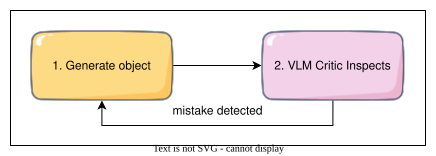

# VLM_Feedback_and_Human-in-the-Loop_for_Robust_Image_Generation

Source: https://www.educative.io/courses/agentic-ai-systems/vlm-feedback-control-and-human-in-the-loop-interaction

---

[Home](https://www.educative.io/)

[Courses](https://www.educative.io/search?tab=courses)

[Agentic System Design](https://www.educative.io/courses/agentic-ai-systems)

# VLM-Feedback Control and Human-in-the-Loop Interaction

Explore how Vision Language Model feedback enables self-correction in multi-step image generation systems. Understand how human-in-the-loop interaction allows real-time adjustments, making AI-powered generative processes more controllable and reliable.

We'll cover the following...

- [VLM-feedback for self-correction](https://www.educative.io/courses/agentic-ai-systems/vlm-feedback-control-and-human-in-the-loop-interaction#VLM-feedback-for-self-correction)
- [Human-in-the-loop: Interactive and controllable generation](https://www.educative.io/courses/agentic-ai-systems/vlm-feedback-control-and-human-in-the-loop-interaction#Human-in-the-loop-Interactive-and-controllable-generation)
  - [Beyond the opaque process](https://www.educative.io/courses/agentic-ai-systems/vlm-feedback-control-and-human-in-the-loop-interaction#Beyond-the-opaque-process)
  - [How human interaction works](https://www.educative.io/courses/agentic-ai-systems/vlm-feedback-control-and-human-in-the-loop-interaction#How-human-interaction-works)
- [MuLan’s principles in practice](https://www.educative.io/courses/agentic-ai-systems/vlm-feedback-control-and-human-in-the-loop-interaction#MuLans-principles-in-practice)

In our last lesson, we saw how MuLan’s planner and progressive generator work together to build a complex image step-by-step. But what happens if the diffusion model makes a mistake in an early stage? Without a mechanism to catch and correct errors, these mistakes would cascade, ruining the final image.

A painter doesn’t just paint without looking; they constantly step back, critique their own work, and make corrections. To make its process robust, the MuLan system needs an internal “critic” that can do the same. This lesson explores the critic and how its step-by-step process unlocks powerful human-AI collaboration.

## VLM-feedback for self-correction[#](https://www.educative.io/courses/agentic-ai-systems/vlm-feedback-control-and-human-in-the-loop-interaction#VLM-feedback-for-self-correction)

This is the third and final pillar of MuLan’s architecture: a VLM-feedback control loop. After each object is generated, a Vision Language Model (VLM), such as LLaVA-1.5, is used as a critic.

Its job is to perform a number of functions mentioned below.

1. **Inspect the image:** The diffusion model generates the object for the current stage. The VLM then looks at the resulting image.
2. **Compare to the prompt:** After each stage, the VLM scores the newly added object against the full original prompt, specifically focusing on checking for object presence, correct attributes (color/size), and proper spatial relations.
3. **Provide feedback:** If the VLM detects a mistake (e.g., the chair is red instead of green), it provides feedback to adjust the hyperparameters of the diffusion model and triggers a re-generation of the current object. The system can attempt to correct the mistake before giving up and moving to the next stage.

This self-correction loop is a crucial design pattern. It ensures that errors are caught and fixed immediately, preventing them from derailing the entire generative process. By adding a critic agent to the system, the overall process becomes significantly more reliable and robust.

> **Point to ponder:** It’s useful to think of the MuLan system using different critics for different jobs. In the last lesson, we saw it use a simple, fast critic (CLIP score) for the specific sub-problem of object overlap. Here, it uses a more powerful and comprehensive critic (the VLM) to judge the overall quality of each generated stage against the original prompt.

In this system, the term “critic” refers specifically to text-image alignment, not aesthetic judgment. The critic’s job is to ensure the generated scene matches the prompt’s factual constraints.

## Human-in-the-loop: Interactive and controllable generation[#](https://www.educative.io/courses/agentic-ai-systems/vlm-feedback-control-and-human-in-the-loop-interaction#Human-in-the-loop-Interactive-and-controllable-generation)

The self-correction loop we just discussed makes the agent more robust when operating autonomously. However, the MuLan system’s progressive, step-by-step nature unlocks another powerful capability: human-in-the-loop interaction.

### Beyond the opaque process[#](https://www.educative.io/courses/agentic-ai-systems/vlm-feedback-control-and-human-in-the-loop-interaction#Beyond-the-opaque-process)

Traditional, one-shot T2I models often feel like uninterpretable systems. We provide a prompt, wait for the generation to complete, and then see the final result. If the image isn’t quite right, our only option is to start over with a new prompt. We have no control over the process while it’s happening.

MuLan’s design fundamentally changes this dynamic. As it generates the scene one object at a time, it creates natural checkpoints where a human user can monitor the progress and intervene to make adjustments *mid-process*. This transforms the user from being a passive prompter into an active director of the creative process.

### How human interaction works[#](https://www.educative.io/courses/agentic-ai-systems/vlm-feedback-control-and-human-in-the-loop-interaction#How-human-interaction-works)

The agent is designed to pause between generation stages, displaying a preview and allowing the user to provide feedback. These instructions then update the next stage’s sub-prompt and rough mask. If the edit targets the object that was just created, it can also trigger a re-generation of the current stage.

At any intermediate stage, a user can provide a simple, natural language instruction to guide the agent. The LLM planner then modifies the subsequent sub-prompts and generation steps to accommodate the user’s feedback. This allows for several types of real-time adjustments:

![An illustration of human-agent interaction during the generation process. The middle branch shows the original, autonomous generation. The top and bottom branches show how a human user can provide natural language feedback at any intermediate step to make adjustments, such as changing an object’s color, swapping an object entirely, or adding a new one. Image reference: “Li, Sen, Ruochen Wang, Cho-Jui Hsieh, Minhao Cheng, and Tianyi Zhou. "Mulan: Multimodal-llm agent for progressive and interactive multi-object diffusion." arXiv preprint arXiv:2402.12741 (2024).”](data:image/gif;base64,R0lGODlhAQABAIAAAAAAAP///yH5BAEAAAAALAAAAAABAAEAAAIBRAA7 "An illustration of human-agent interaction during the generation process. The middle branch shows the original, autonomous generation. The top and bottom branches show how a human user can provide natural language feedback at any intermediate step to make adjustments, such as changing an object’s color, swapping an object entirely, or adding a new one. Image reference: “Li, Sen, Ruochen Wang, Cho-Jui Hsieh, Minhao Cheng, and Tianyi Zhou. \"Mulan: Multimodal-llm agent for progressive and interactive multi-object diffusion.\" arXiv preprint arXiv:2402.12741 (2024).”")

An illustration of human-agent interaction during the generation process. The middle branch shows the original, autonomous generation. The top and bottom branches show how a human user can provide natural language feedback at any intermediate step to make adjustments, such as changing an object’s color, swapping an object entirely, or adding a new one. Image reference: “Li, Sen, Ruochen Wang, Cho-Jui Hsieh, Minhao Cheng, and Tianyi Zhou. "Mulan: Multimodal-llm agent for progressive and interactive multi-object diffusion." arXiv preprint arXiv:2402.12741 (2024).”

- **Attribute adjustment:** If the agent has just generated a green chair, the user can say, “Change the color of the chair to red.”
- **Object adjustment:** The user can swap out objects entirely. For example, “Change the chair to a vase.”
- **Spatial relationship adjustment:** The user can refine the composition, for instance, by saying, “Make the vase smaller.”

This level of interactive control is a direct benefit of an agentic, multi-step architecture. By designing systems that break down complex tasks into a sequence of observable steps, we create opportunities for much richer and more effective human-AI collaboration.

## MuLan’s principles in practice[#](https://www.educative.io/courses/agentic-ai-systems/vlm-feedback-control-and-human-in-the-loop-interaction#MuLans-principles-in-practice)

The agentic principles we’ve seen in MuLan like progressive generation, interactivity, and a human-in-the-loop feedback process, are not just theoretical concepts. They are becoming increasingly influential in the industry, and are already being used in the most powerful commercial image generation tools.

Here are a few real-world examples from major companies that reflect these ideas:

- **Adobe Photoshop (with Firefly)**

  - **Feature:** Generative Fill and Generative Expand.
  - **How it relates:** This is a direct implementation of the “progressive generation with a critic” pattern, with the human acting as both the planner and the critic. The user selects a specific area (creating a “mask,” which is analogous to MuLan’s “rough mask”) and provides a text prompt. The Firefly model then generates content only within that specified region. If the user doesn’t like the result, they can instantly re-generate that part without starting over, creating a powerful human-in-the-loop feedback process.
- **Midjourney**

  - **Feature:** Vary Region and Inpainting.
  - **How it relates:** Similar to Adobe’s tools, this feature allows for a step-by-step, interactive workflow. After generating an initial image, the user can select a specific region and provide a new prompt to modify only that part. This allows the user to build up a complex scene through a series of controlled, iterative steps.
- **NVIDIA Canvas**

  - **Feature:** AI-assisted landscape painting.
  - **How it relates:** This tool directly mirrors MuLan’s painter analogy. The user paints a very rough mask or segmentation map using simple materials like “sky,” “mountain,” or “river.” The AI then takes this layout and generates a photorealistic image that adheres to the user’s plan. The user can add or change elements one at a time, and the AI will update the image accordingly in a real-time, progressive generation process.

These examples show that the trend in the industry is moving away from simple “one-shot” T2I models and toward more controllable, interactive, and collaborative systems. This is where humans and AI work together in a step-by-step process, following exactly the kind of advanced System Design that we are studying.

MuLan’s Planning and Progressive Generation

Evaluating MuLan: Performance and Design Insights

Ask

[VLM-feedback for self-correction](https://www.educative.io/courses/agentic-ai-systems/vlm-feedback-control-and-human-in-the-loop-interaction#VLM-feedback-for-self-correction)

[Human-in-the-loop: Interactive and controllable generation](https://www.educative.io/courses/agentic-ai-systems/vlm-feedback-control-and-human-in-the-loop-interaction#Human-in-the-loop-Interactive-and-controllable-generation)

[Beyond the opaque process](https://www.educative.io/courses/agentic-ai-systems/vlm-feedback-control-and-human-in-the-loop-interaction#Beyond-the-opaque-process)

[How human interaction works](https://www.educative.io/courses/agentic-ai-systems/vlm-feedback-control-and-human-in-the-loop-interaction#How-human-interaction-works)

[MuLan’s principles in practice](https://www.educative.io/courses/agentic-ai-systems/vlm-feedback-control-and-human-in-the-loop-interaction#MuLans-principles-in-practice)