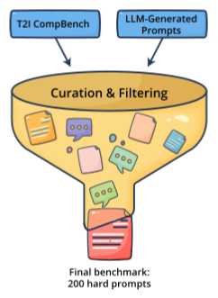

# Evaluating_MuLan_for_Multimodal_AI_Image_Generation

Source: https://www.educative.io/courses/agentic-ai-systems/evaluating-mulan-performance-and-design-insights

---

[Home](https://www.educative.io/)

[Courses](https://www.educative.io/search?tab=courses)

[Agentic System Design](https://www.educative.io/courses/agentic-ai-systems)

# Evaluating MuLan: Performance and Design Insights

Explore how MuLan's multi-step architecture improves text-to-image generation by accurately handling complex prompts with multiple objects, attributes, and spatial relationships. Understand the evaluation framework, performance benefits of feedback control, and practical design principles for building reliable multimodal AI agents.

We'll cover the following...

- [A benchmark for compositional prompts](https://www.educative.io/courses/agentic-ai-systems/evaluating-mulan-performance-and-design-insights#A-benchmark-for-compositional-prompts)
  - [Evaluation metrics via questionnaire](https://www.educative.io/courses/agentic-ai-systems/evaluating-mulan-performance-and-design-insights#Evaluation-metrics-via-questionnaire)
- [Performance results](https://www.educative.io/courses/agentic-ai-systems/evaluating-mulan-performance-and-design-insights#Performance-results)
  - [Proving the value of the VLM-feedback control](https://www.educative.io/courses/agentic-ai-systems/evaluating-mulan-performance-and-design-insights#Proving-the-value-of-the-VLM-feedback-control)
- [Limitations of the MuLan system](https://www.educative.io/courses/agentic-ai-systems/evaluating-mulan-performance-and-design-insights#Limitations-of-the-MuLan-system)
- [Key takeaways for agentic system designers](https://www.educative.io/courses/agentic-ai-systems/evaluating-mulan-performance-and-design-insights#Key-takeaways-for-agentic-system-designers)

We’ve explored MuLan’s innovative, multi-step architecture. But how do we prove that this agentic system design is actually more effective than a standard, one-shot approach? To answer this, the researchers needed a rigorous way to evaluate its performance on complex, multi-object prompts.

## A benchmark for compositional prompts[#](https://www.educative.io/courses/agentic-ai-systems/evaluating-mulan-performance-and-design-insights#A-benchmark-for-compositional-prompts)

To create a fair and challenging test for MuLan, the researchers curated a new dataset consisting of 200 hard prompts. This benchmark wasn’t taken from a single source; it was carefully constructed to test the specific failure points of modern text-to-image models. The creation process involved several steps outlined below.

- **Foundation:** They began by collecting complex spatial prompts from an existing benchmark, T2I-CompBench.
- **Expansion:** To broaden the scope, they used ChatGPT to generate hundreds of new prompts with diverse objects, relationships, and attributes.
- **Curation:** Finally, they manually selected the most difficult prompts that state-of-the-art models like SDXL consistently failed to generate correctly.

The evaluation benchmark for MuLan was curated by collecting prompts from multiple sources, including existing benchmarks and LLM-generated examples. These were then filtered to create a final set of 200 challenging prompts

The final set of 200 prompts specifically targets challenging compositional requirements, as mentioned below.

- **Complex spatial relationships** (e.g., “on top of,” “to the left of”).
- **Attribute bindings** (e.g., “a red cube,” “a blue cylinder”).

### Evaluation metrics via questionnaire[#](https://www.educative.io/courses/agentic-ai-systems/evaluating-mulan-performance-and-design-insights#Evaluation-metrics-via-questionnaire)

Evaluating the “correctness” of a generated image can be subjective. To make the process as objective as possible, the evaluation was performed using a detailed questionnaire that was answered by both GPT-4V and human evaluators. This questionnaire broke down the evaluation into three key, measurable aspects.

1. **Object completeness:** Does the image contain all the objects mentioned in the prompt?
2. **Correctness of attribute bindings:** Are the correct attributes (e.g., color, texture) assigned to the correct objects?
3. **Correctness of spatial relationships:** Are the objects placed in the correct positions relative to each other?

By using this structured, multi-faceted evaluation, it becomes possible to quantitatively measure and compare the performance of different image generation systems on complex compositional tasks.

It’s important to note that the VLM used as the “critic” during the generation process (LLaVA-1.5) was different from the VLM used as the final evaluator (GPT-4V). This separation prevents a potential conflict of interest where the system could be judged by the same model that helped create the image.

## Performance results[#](https://www.educative.io/courses/agentic-ai-systems/evaluating-mulan-performance-and-design-insights#Performance-results)

With the evaluation framework in place, we can now analyze the results to see how MuLan’s agentic system design compares to other methods. The findings clearly demonstrate the value of the “divide and conquer” strategy.

The results from the GPT-4V and human evaluations, as shown in the table below, reveal that MuLan significantly outperforms other T2I generation and controllable generation methods.

To ensure a fair comparison, all methods used the same base diffusion model and comparable sampling steps. MuLan’s multi-stage loop inherently requires a higher wall-clock time to generate an image, but this trade-off results in significantly improved alignment with the prompt.

The following table shows a comparison of MuLan’s performance against several baselines. The results, from both GPT-4V and human evaluations, show that MuLan consistently achieves higher scores, especially in the more difficult categories of “Attribute bindings” and “Spatial relationships.” This demonstrates the effectiveness of its agentic, step-by-step approach

|  |  |  |  |  |
| --- | --- | --- | --- | --- |
| **Method** | **Object completeness** | **Attribute bindings** | **Spatial relationships** | **Overall** |
| Structure Diffusion | 88.987% / 87.37% | 54.62% / 62.63% | 34.36% / 24.24% | 64.31% / 64.85% |
| Promptist-SD v1.4 | 80.36% / 70.71% | 49.23% / 52.02% | 24.49% / 13.13% | 56.73% / 51.72% |
| Promptist-SDXL | 94.36% / **93.94%** | 70.00% / 78.28% | 35.89% / 33.33% | 72.92% / 75.56% |
| SD v1.4 | 90.31% / 74.49% | 57.14% / 51.02% | 37.24% / 32.65% | 66.43% / 56.73% |
| SDXL | 94.64% /78.57% | 66.07% / 53.06% | 41.14% / 24.49% | 72.34% / 57.55% |
| PixArt-Alpha | 92.09% / 76.53% | 66.58% / 61.22% | 34.69% /32.65% | 70.41% / 61.63% |
| **MuLan-SD v1.4** | 93.11% / 86.36% | 74.23% / 74.24% | **51.53%** / **54.54%** | **77.24%** / 75.15% |
| **MuLan-SDXL** | **96.17%** / 90.40% | **75.00%** / **79.29%** | 39.29% / 49.49% | 76.33% / **77.78%** |

The performance gains are particularly noticeable in the two of the most challenging aspects of compositional generation.

- **Attribute bindings:** MuLan is far more accurate at assigning the correct attributes (like color) to the correct objects.
- **Spatial relationships:** It is also significantly better at correctly placing objects in the scene according to the prompt’s instructions (e.g., “on top of,” “to the left of”).

This demonstrates that by breaking the complex task into a sequence of simpler, single-object generation steps, the system can handle detailed constraints with much higher accuracy.

Crucially, the results from the human evaluation were consistent with the GPT-4V evaluation. This consistency confirms MuLan’s superior performance and also reinforces a key takeaway from our previous chapter which is that a powerful VLM can be a reliable and scalable tool for evaluating complex, multimodal agent outputs.

The quantitative results show that MuLan’s architecture is effective, but to truly understand *why* it’s effective, we need to perform an **ablation study**. This is a common and powerful technique in system design where we systematically remove a key component of the system and measure the drop in performance. This helps us prove the value of each architectural choice.

### Proving the value of the VLM-feedback control[#](https://www.educative.io/courses/agentic-ai-systems/evaluating-mulan-performance-and-design-insights#Proving-the-value-of-the-VLM-feedback-control)

The most critical ablation study performed on MuLan was to remove the VLM-feedback control module. In this version of the system, the agent still used the LLM planner to decompose the prompt and the diffusion model to generate objects progressively. However, it no longer had an internal “critic” to check for and correct mistakes at each step.

The results were clear. The paper notes that without the VLM-feedback loop, the system’s performance was much worse. The quantitative data from the ablation study supports this statement directly: the system’s “Overall” score (an average across the three evaluation metrics, judged by GPT-4V) dropped from 77.55% with feedback to just 60.00% without it.

## Limitations of the MuLan system[#](https://www.educative.io/courses/agentic-ai-systems/evaluating-mulan-performance-and-design-insights#Limitations-of-the-MuLan-system)

No system is perfect, and the MuLan paper is transparent about its limitations. As designers, it’s just as important to understand what a system *can’t* do. The key limitations are mentioned below.

- **Speed:** As the process is sequential, generating an image with multiple objects takes significantly longer than a one-shot approach.
- **Planner errors:** The entire process depends on the initial plan from the LLM. If the LLM misunderstands the prompt and creates an incorrect decomposition, the error will effect the entire generation process.

## Key takeaways for agentic system designers[#](https://www.educative.io/courses/agentic-ai-systems/evaluating-mulan-performance-and-design-insights#Key-takeaways-for-agentic-system-designers)

The entire MuLan case study, from its architecture to its evaluation, provides us with a set of powerful, reusable design principles that we can apply to a wide range of complex generative tasks.

- **Decompose complex generative tasks:** The success of MuLan validates the “divide and conquer” strategy. Breaking a single, complex generation task into a sequence of simpler, managed steps is a powerful design pattern. This approach allows us to use less capable models to achieve a result that would otherwise require a much larger, monolithic one.
- **Feedback loops are essential for reliability:** For any agent that operates over multiple steps, an internal “critic” or feedback loop is a core component for ensuring accuracy and correcting errors. The VLM-feedback control module in MuLan is a perfect example of a critic agent that makes the entire system more robust.
- **Design for interaction:** By building agents with a step-by-step, progressive process, we create natural checkpoints for human-in-the-loop interaction. This transforms the user from a passive prompter into an active director, leading to more controllable and collaborative AI systems.

VLM-Feedback Control and Human-in-the-Loop Interaction

Design a Multi-Agent Medical Diagnosis System

Ask

[A benchmark for compositional prompts](https://www.educative.io/courses/agentic-ai-systems/evaluating-mulan-performance-and-design-insights#A-benchmark-for-compositional-prompts)

[Evaluation metrics via questionnaire](https://www.educative.io/courses/agentic-ai-systems/evaluating-mulan-performance-and-design-insights#Evaluation-metrics-via-questionnaire)

[Performance results](https://www.educative.io/courses/agentic-ai-systems/evaluating-mulan-performance-and-design-insights#Performance-results)

[Proving the value of the VLM-feedback control](https://www.educative.io/courses/agentic-ai-systems/evaluating-mulan-performance-and-design-insights#Proving-the-value-of-the-VLM-feedback-control)

[Limitations of the MuLan system](https://www.educative.io/courses/agentic-ai-systems/evaluating-mulan-performance-and-design-insights#Limitations-of-the-MuLan-system)

[Key takeaways for agentic system designers](https://www.educative.io/courses/agentic-ai-systems/evaluating-mulan-performance-and-design-insights#Key-takeaways-for-agentic-system-designers)