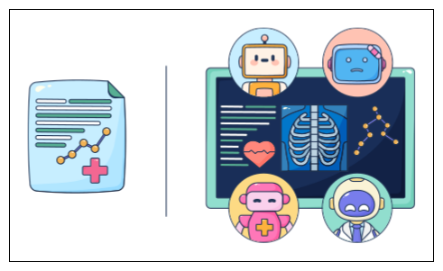

# Designing_Multi-Agent_Systems_for_Medical_Diagnosis_Simulation

Source: https://www.educative.io/courses/agentic-ai-systems/design-a-multi-agent-medical-diagnosis-system

---

[Home](https://www.educative.io/)

[Courses](https://www.educative.io/search?tab=courses)

[Agentic System Design](https://www.educative.io/courses/agentic-ai-systems)

# Design a Multi-Agent Medical Diagnosis System

Understand how to architect a multi-agent system that simulates hospital workflows for medical diagnosis, focusing on collaboration, decision-making, and self-improvement mechanisms to create evolving AI doctor agents that learn from experience and improve over time.

We'll cover the following...

- [The challenge of medical diagnosis with AI](https://www.educative.io/courses/agentic-ai-systems/design-a-multi-agent-medical-diagnosis-system#The-challenge-of-medical-diagnosis-with-AI)
- [Part 1: Architecting the core simulation](https://www.educative.io/courses/agentic-ai-systems/design-a-multi-agent-medical-diagnosis-system#Part-1-Architecting-the-core-simulation)
- [Part 2: Designing for multi-agent collaboration](https://www.educative.io/courses/agentic-ai-systems/design-a-multi-agent-medical-diagnosis-system#Part-2-Designing-for-multi-agent-collaboration)
- [Part 3: Designing for agent evolution and self-improvement](https://www.educative.io/courses/agentic-ai-systems/design-a-multi-agent-medical-diagnosis-system#Part-3-Designing-for-agent-evolution-and-self-improvement)
- [Part 4: The ultimate goal of the simulation](https://www.educative.io/courses/agentic-ai-systems/design-a-multi-agent-medical-diagnosis-system#Part-4-The-ultimate-goal-of-the-simulation)
- [Conclusion: Bringing it all together](https://www.educative.io/courses/agentic-ai-systems/design-a-multi-agent-medical-diagnosis-system#Conclusion-Bringing-it-all-together)
  - [Key takeaway](https://www.educative.io/courses/agentic-ai-systems/design-a-multi-agent-medical-diagnosis-system#Key-takeaway)

**Disclaimer:** This lesson is a thought exercise based on a research simulation. It is for educational purposes only and is not intended to provide or replace professional medical advice.

In this lesson, you will apply everything you have learned about agentic system design to solve a complex, real-world challenge. You will be guided through a thought exercise to architect a multi-agent “AI Hospital,” a simulated clinical environment for evaluating and improving the diagnostic capabilities of LLM-based doctor agents. This exercise will test your ability to design agent roles, orchestrate collaboration, and build mechanisms for long-term agent improvement.

## The challenge of medical diagnosis with AI[#](https://www.educative.io/courses/agentic-ai-systems/design-a-multi-agent-medical-diagnosis-system#The-challenge-of-medical-diagnosis-with-AI)

Medical diagnosis is one of the most complex and high-stakes tasks in human decision-making. Diagnosing a patient involves dynamic, multi-step reasoning, unlike answering a trivia question or recommending a movie. A doctor must gather a patient’s history, interpret symptoms, order and analyze tests, and then integrate all that information into a coherent diagnosis and treatment plan. Every decision carries weight, and mistakes can have serious health consequences.

Today, most evaluations of large language models (LLMs) in medicine rely on static benchmarks, such as multiple-choice exam questions. While useful, these benchmarks fall short. They measure knowledge recall, but not the interactive process of real-world diagnosis. In practice, medicine is not about choosing the best answer from four options; it is about asking the right questions, handling uncertainty, collaborating with colleagues, and learning from experience.

Unlike static benchmarks, the AI Hospital simulation engages doctors, patients, examiners, and directors in a full diagnostic loop

This gap presents an opportunity: What if we could create a simulated clinical environment, an “AI Hospital,” where LLM-based doctor agents are tested not just on recall but also on their ability to act like doctors? Such a system would allow us to study how AI doctors question patients, order tests, make diagnoses, and even evolve through repeated practice.

The challenge, then, is two-fold:

1. Designing a realistic multi-agent simulation that mirrors the workflows of an actual hospital.
2. Evaluating and improving AI doctor agents so they perform well on single cases and evolve through experience, just like human doctors over years of practice.

This exercise will guide you through tackling these challenges step-by-step. It culminates in designing a simulated AI Hospital that demonstrates how multi-agent systems can advance medical AI beyond static testing.

## Part 1: Architecting the core simulation[#](https://www.educative.io/courses/agentic-ai-systems/design-a-multi-agent-medical-diagnosis-system#Part-1-Architecting-the-core-simulation)

We can’t stop at multiple-choice questions if we want to test whether an AI can act like a doctor. Instead, we need to place it inside a hospital-like environment and watch how it behaves.

That means our first design step is to build the core simulation loop, the minimal set of agents that together capture the reality of a clinical consultation.

Think about a typical hospital visit. When we walk in with chest pain, a few things usually happen:

- We speak with a doctor, who asks us questions and tries to understand what’s wrong.
- We’re sent to a department that runs tests, bloodwork, scans, or imaging.
- Our case may be reviewed by senior staff, who check whether the diagnosis and treatment are sound.

This real-world flow gives us a strong starting point for our simulation. The challenge now is how to map these roles into agents.

Let’s try to translate these hospital roles into a multi-agent system.

AI Powered

Saved

2 attempts left

Reset

What responsibilities would each agent need to take on?

- How would the doctor agent behave?
- What would the patient agent need to provide?
- How should we simulate the testing department?
- Who takes responsibility for evaluation?

You have 2 attempts to answer.

Architecting the core simulation process by identifying the agents and their responsibilities

## Part 2: Designing for multi-agent collaboration[#](https://www.educative.io/courses/agentic-ai-systems/design-a-multi-agent-medical-diagnosis-system#Part-2-Designing-for-multi-agent-collaboration)

In real hospitals, doctors rarely work in isolation. Complex cases often require consultations and team-based decision-making. This collaboration reduces individual errors and helps doctors reach a more reliable diagnosis.

If our simulation only includes one intern doctor agent, it risks reflecting that agent’s biases. To make our system more realistic, we need to think about how multiple doctor agents could collaborate under supervision.

AI Powered

Saved

2 attempts left

Reset

How could we extend our simulation so that more than one intern doctor participates?

- How might these doctors collaborate to produce a shared diagnosis?
- What role would the medical director agent play in organizing or guiding this process?

Take a few minutes to outline how a collaboration could work.

You have 2 attempts to answer.

Designing how multiple medical agents collaborate

## Part 3: Designing for agent evolution and self-improvement[#](https://www.educative.io/courses/agentic-ai-systems/design-a-multi-agent-medical-diagnosis-system#Part-3-Designing-for-agent-evolution-and-self-improvement)

Collaboration improves accuracy on a single case, but real doctors don’t just become better by consulting colleagues. They improve over years of practice, learning from both successes and failures across thousands of patients.

If we want our AI doctor agents to behave more like human doctors, our simulation needs a way for them to evolve over time. But here’s the challenge: retraining the core LLM every time is impractical. Instead, we need a mechanism that allows the agent to accumulate experience and apply it to future cases.

AI Powered

Saved

2 attempts left

Reset

How could we design a mechanism that allows a doctor agent to learn from both its successes and failures over thousands of simulated cases, without retraining the core LLM?

- How might successful diagnoses be stored and reused?
- How might failures be turned into lessons for the future?

Take a few minutes to think about your ideas.

You have 2 attempts to answer.

Designing a mechanism that allows a doctor agent to learn from previous experiences

## Part 4: The ultimate goal of the simulation[#](https://www.educative.io/courses/agentic-ai-systems/design-a-multi-agent-medical-diagnosis-system#Part-4-The-ultimate-goal-of-the-simulation)

So far, we have built a simulation with the core roles, extended it for collaboration, and designed a mechanism for long-term improvement. But what is the bigger picture? Why build such a complex system in the first place?

Training LLMs usually involves fine-tuning on static datasets, but that approach has limits. It requires expensive human-labeled data, does not allow for continuous learning, and cannot easily replicate the years of practice that make human doctors reliable.

This raises the final question.

AI Powered

Saved

2 attempts left

Reset

What is the ultimate advantage of building a large-scale, self-improving “Agent Hospital” simulation?

- Think about scale: How much experience can an agent gain?
- Think about data: Where does it come from, and does it require human labels?
- Think about real-world transfer: How could skills developed in simulation carry over to actual benchmarks or tasks?

You have 2 attempts to answer.

## Conclusion: Bringing it all together[#](https://www.educative.io/courses/agentic-ai-systems/design-a-multi-agent-medical-diagnosis-system#Conclusion-Bringing-it-all-together)

In this exercise, we designed a complete multi-agent simulation for medical diagnosis, inspired by the AI Hospital framework. Step-by-step, we explored how to translate the principles of agentic system design into a realistic, high-stakes domain:

A complete AI Hospital integrates role-based simulation, collaboration, and continuous improvement, creating a realistic environment where AI doctors evolve and respond like human physicians

1. **Architecting the core simulation:** We identified four essential roles, namely the intern doctor, patient, examiner, and medical director, that all combine together and replicate the minimal diagnostic loop of questioning, testing, and evaluating.
2. **Designing for multi-agent collaboration:** We extended the simulation to include multiple intern doctors, showing how structured, moderated collaboration reduces errors and leads to stronger consensus diagnoses.
3. **Designing for agent evolution and self-improvement:** We introduced mechanisms for long-term improvement through external memory systems. By learning from both successes and failures, doctor agents evolve continuously without retraining.
4. **The ultimate goal of the simulation:** Finally, we examined why this approach matters. Through SEAL (Simulacrum-based Evolutionary Agent Learning), the AI Hospital enables us to access an accelerated experience, self-generated data, real-world transferability, and closed-loop learning. These are all advantages that traditional fine-tuning cannot match upto.

### Key takeaway[#](https://www.educative.io/courses/agentic-ai-systems/design-a-multi-agent-medical-diagnosis-system#Key-takeaway)

This exercise illustrates the power of agentic system design. By defining roles, structuring collaboration, enabling memory-driven evolution, and situating agents in closed-loop environments, we can build AI systems that improve continuously and realistically.

The AI Hospital is not just a thought experiment. It demonstrates a design paradigm that can extend beyond medicine to any domain where expertise develops through interaction, feedback, and accumulated experience.

Evaluating MuLan: Performance and Design Insights

Designing a Personal AI Assistant like OpenClaw

Ask

[The challenge of medical diagnosis with AI](https://www.educative.io/courses/agentic-ai-systems/design-a-multi-agent-medical-diagnosis-system#The-challenge-of-medical-diagnosis-with-AI)

[Part 1: Architecting the core simulation](https://www.educative.io/courses/agentic-ai-systems/design-a-multi-agent-medical-diagnosis-system#Part-1-Architecting-the-core-simulation)

[Part 2: Designing for multi-agent collaboration](https://www.educative.io/courses/agentic-ai-systems/design-a-multi-agent-medical-diagnosis-system#Part-2-Designing-for-multi-agent-collaboration)

[Part 3: Designing for agent evolution and self-improvement](https://www.educative.io/courses/agentic-ai-systems/design-a-multi-agent-medical-diagnosis-system#Part-3-Designing-for-agent-evolution-and-self-improvement)

[Part 4: The ultimate goal of the simulation](https://www.educative.io/courses/agentic-ai-systems/design-a-multi-agent-medical-diagnosis-system#Part-4-The-ultimate-goal-of-the-simulation)

[Conclusion: Bringing it all together](https://www.educative.io/courses/agentic-ai-systems/design-a-multi-agent-medical-diagnosis-system#Conclusion-Bringing-it-all-together)

[Key takeaway](https://www.educative.io/courses/agentic-ai-systems/design-a-multi-agent-medical-diagnosis-system#Key-takeaway)