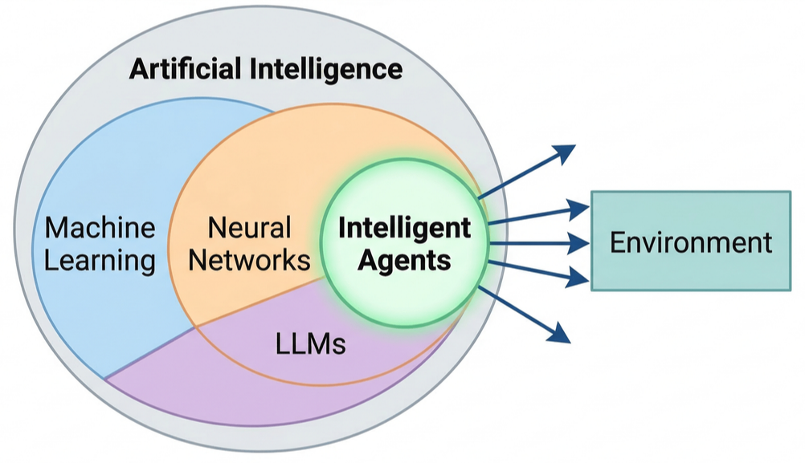
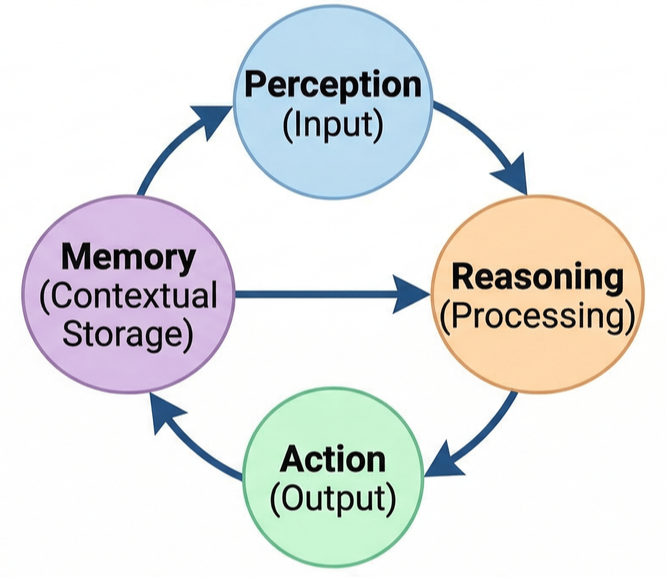

# Understanding_AI_Agent_Capabilities_and_Classifications

Source: https://www.educative.io/courses/agentic-ai-systems/glossary-ai-agent-capabilities-and-classifications

---

[Home](https://www.educative.io/)

[Courses](https://www.educative.io/search?tab=courses)

[Agentic System Design](https://www.educative.io/courses/agentic-ai-systems)

# Glossary: AI Agent Capabilities and Classifications

Explore the fundamental capabilities of AI agents, including perception, reasoning, action, and memory. Understand the major agent types from simple reflex to multi-agent systems, and learn how combining these models creates sophisticated agentic AI. This lesson equips you to classify AI agents and make informed design choices for autonomous, goal-driven systems.

We'll cover the following...

- [From artificial intelligence to intelligent agents](https://www.educative.io/courses/agentic-ai-systems/glossary-ai-agent-capabilities-and-classifications#From-artificial-intelligence-to-intelligent-agents)
- [What are the four core characteristics of an AI agent?](https://www.educative.io/courses/agentic-ai-systems/glossary-ai-agent-capabilities-and-classifications#What-are-the-four-core-characteristics-of-an-AI-agent)
  - [Perception](https://www.educative.io/courses/agentic-ai-systems/glossary-ai-agent-capabilities-and-classifications#Perception)
  - [Reasoning](https://www.educative.io/courses/agentic-ai-systems/glossary-ai-agent-capabilities-and-classifications#Reasoning)
  - [Action](https://www.educative.io/courses/agentic-ai-systems/glossary-ai-agent-capabilities-and-classifications#Action)
  - [Memory](https://www.educative.io/courses/agentic-ai-systems/glossary-ai-agent-capabilities-and-classifications#Memory)
- [The development stack: Architectures, frameworks, and applications](https://www.educative.io/courses/agentic-ai-systems/glossary-ai-agent-capabilities-and-classifications#The-development-stack-Architectures-frameworks-and-applications)
- [Exploring the different types of AI agents](https://www.educative.io/courses/agentic-ai-systems/glossary-ai-agent-capabilities-and-classifications#Exploring-the-different-types-of-AI-agents)
  - [Simple reflex agents](https://www.educative.io/courses/agentic-ai-systems/glossary-ai-agent-capabilities-and-classifications#Simple-reflex-agents)
  - [Model-based reflex agents](https://www.educative.io/courses/agentic-ai-systems/glossary-ai-agent-capabilities-and-classifications#Model-based-reflex-agents)
  - [Goal-based AI agents](https://www.educative.io/courses/agentic-ai-systems/glossary-ai-agent-capabilities-and-classifications#Goal-based-AI-agents)
  - [Utility-based agents](https://www.educative.io/courses/agentic-ai-systems/glossary-ai-agent-capabilities-and-classifications#Utility-based-agents)
  - [Learning agents](https://www.educative.io/courses/agentic-ai-systems/glossary-ai-agent-capabilities-and-classifications#Learning-agents)
  - [Multi-agent systems](https://www.educative.io/courses/agentic-ai-systems/glossary-ai-agent-capabilities-and-classifications#Multi-agent-systems)
  - [Hierarchical agents](https://www.educative.io/courses/agentic-ai-systems/glossary-ai-agent-capabilities-and-classifications#Hierarchical-agents)
  - [Agentic AI: The modern synthesis](https://www.educative.io/courses/agentic-ai-systems/glossary-ai-agent-capabilities-and-classifications#Agentic-AI-The-modern-synthesis)
- [Summary](https://www.educative.io/courses/agentic-ai-systems/glossary-ai-agent-capabilities-and-classifications#Summary)

By the end of this lesson, you will be able to:

- Explain the relationship between artificial intelligence and intelligent agents.
- Identify and describe the four core characteristics of an AI agent.
- Distinguish between the major types of AI agents by their decision-making model.
- Understand how modern agentic AI combines multiple agent types to solve complex tasks.

## From artificial intelligence to intelligent agents[#](https://www.educative.io/courses/agentic-ai-systems/glossary-ai-agent-capabilities-and-classifications#From-artificial-intelligence-to-intelligent-agents)

The field of artificial intelligence has produced an enormous range of techniques, including machine learning, deep neural networks, large language models, computer vision, and more. But within that landscape, one category of system stands apart in how it is designed to operate: the intelligent agent.

Artificial intelligence is the overarching discipline concerned with building systems that can learn, reason, and process information in ways that resemble human cognition. An intelligent agent, however, is a specific type of active implementation within that field. It is defined as an autonomous entity that operates continuously within an environment, using a perception-reasoning-action loop to achieve predefined objectives.

The distinction matters in practice. A standard machine learning model computes an output from a given input and then stops. Ask it a question, and it answers. Feed it an image, and it classifies. But it does not persist, plan, or take initiative, it simply waits for the next instruction.

An intelligent agent is different by design. It does not wait to be queried. It manages context over time, evaluates its environment continuously, and executes multi-step plans without needing a human to supervise every decision. This active stance is what makes agents suitable for complex, real-world workflows rather than isolated data processing tasks.

Think of it this way: a language model is a powerful engine. An intelligent agent is the vehicle that uses that engine to navigate from one place to another, planning the route, adjusting for traffic, and deciding when to stop for fuel.

## What are the four core characteristics of an AI agent?[#](https://www.educative.io/courses/agentic-ai-systems/glossary-ai-agent-capabilities-and-classifications#What-are-the-four-core-characteristics-of-an-AI-agent)

A common question when first studying agentic systems is: What are the four core characteristics of an AI agent? These characteristics form the continuous cycle that allows an agent to perform its job without needing step-by-step human guidance. Understanding them is essential before examining how agents are classified and applied.

### Perception[#](https://www.educative.io/courses/agentic-ai-systems/glossary-ai-agent-capabilities-and-classifications#Perception)

Every agent begins by taking in information from its environment. Perception is the mechanism through which the agent senses what is happening around it. Depending on the system, this could mean reading a text prompt from a user, pulling live data from a weather or financial API, processing an image, or interpreting readings from a physical sensor.

The critical insight here is that perception is goal-directed sensing. The agent is not simply recording everything; it is extracting the information it needs to begin reasoning toward its objective. A customer support agent, for example, does not process the entire history of a company's database every time a user sends a message. It perceives the specific input in front of it and retrieves only the context relevant to that interaction.

### Reasoning[#](https://www.educative.io/courses/agentic-ai-systems/glossary-ai-agent-capabilities-and-classifications#Reasoning)

Once information is gathered, the agent must make sense of it. Reasoning is the cognitive core of the system: the phase where the agent understands context, evaluates its available options, and plans the sequence of steps required to reach its goal.

In modern LLM-powered agents, this reasoning layer is often driven by a large language model acting as the brain of the system. The LLM can interpret ambiguous instructions, infer user intent, decompose a complex task into smaller subtasks, and choose among competing strategies based on the situation. This is a significant leap beyond rule-based reasoning, which required developers to anticipate every possible scenario.

Importantly, reasoning is not a one-time event. As the agent executes its plan and receives feedback from the environment, it continuously re-evaluates its strategy. If an API call fails, a reasoning agent does not simply halt; it considers alternatives, perhaps retrying with different parameters or falling back to a secondary tool.

### Action[#](https://www.educative.io/courses/agentic-ai-systems/glossary-ai-agent-capabilities-and-classifications#Action)

Reasoning is only valuable if it leads to execution. Agents take action by interacting with external systems and environments to carry out their plan. Depending on the agent's design and the tools available to it, this could involve sending an email, writing and running code, querying a database, navigating a web interface, updating a record in a CRM, or instructing a robotic actuator to move.

The breadth of possible actions is one of the defining features of modern agents. Unlike a model that produces text output and waits, an agent is designed to produce effects in the world. Each action it takes changes the state of the environment, and the agent must then perceive that new state and reason about what to do next. This is the essence of the agentic loop.

### Memory[#](https://www.educative.io/courses/agentic-ai-systems/glossary-ai-agent-capabilities-and-classifications#Memory)

To handle complex, multi-step tasks, an agent needs to remember what has already happened. Memory is what allows an agent to maintain continuity across an interaction rather than treating every step as an isolated event.

There are several layers of memory in a well-designed agent system. Short-term or working memory holds the context of the current task, what has been done, what tools have been used, and what the intermediate results were. Long-term memory, often implemented using a vector database, allows the agent to recall information from past sessions, user preferences, or previously retrieved facts. Episodic memory records past actions and their outcomes, enabling the agent to learn from experience and avoid repeating mistakes.

Without memory, even the most sophisticated reasoning engine is operating blind. It cannot build on previous steps, personalize responses, or improve over time. Memory is what transforms a stateless model into a stateful, adaptive agent.

**Deep dive: AI agent models as the reasoning engine**

While perception and action are the senses and limbs, the AI agent models serve as the central nervous system. In modern system design, this role is almost exclusively filled by large language models (LLMs). However, choosing a model is not simply about picking the one with the highest benchmark scores; it is about matching the brain to the specific cognitive requirements of the task. When architects evaluate AI agent models, they typically look at four performance vectors:

- **Reasoning density (task complexity):** Higher-parameter models like GPT-4o or Claude 3.5 Sonnet are required for tasks involving multi-step planning, mathematical logic, or code generation. For simpler, reflexive tasks like sentiment analysis or entity extraction, smaller, faster models like Mistral or Gemma are more efficient.
- **Temporal performance (latency):** In agentic workflows, the model often runs in a loop (e.g., the ReAct pattern). If a model takes 10 seconds to respond, a 5-step loop creates a 50-second delay for the user. Low-latency models are essential for interactive agents.
- **Economic scalability (cost):** Because agents often think through multiple turns before acting, they consume significantly more tokens than a standard chatbot. Architects often use Model Router patterns to send simple tasks to cheap models and reserve expensive models only for high-level decision-making.
- **Contextual horizon (context length):** Agents that need to remember vast technical manuals or long conversation histories require models with massive context windows, such as Gemini 1.5 Pro, to maintain accuracy without forgetting early instructions.

## The development stack: Architectures, frameworks, and applications[#](https://www.educative.io/courses/agentic-ai-systems/glossary-ai-agent-capabilities-and-classifications#The-development-stack-Architectures-frameworks-and-applications)

When transitioning from a conceptual reasoning loop to a production-ready system, developers must navigate a specialized ecosystem. This hierarchy, often categorized by the relationship between AI agents, architectures, frameworks, and applications, defines how an agent is structured, how it is built, and how it eventually delivers value in a specific domain.

By understanding this three-layer stack, you can build systems that are not only intelligent but also maintainable and scalable.

- **The architectural layer:** The AI agent's architecture is the foundational blueprint of your system. A well-designed architecture prioritizes modularity, ensuring that the model, the tools, and the instructions are decoupled.

  - **Modularity:** This allows you to swap out a reasoning model (e.g., moving from GPT-4 to a specialized local model) without overhauling your entire toolset or instruction set.
  - **Scalability:** A modular architecture allows you to integrate new capabilities, like a vector database for long-term memory, as the system's requirements grow.
- **The framework layer:** Rather than coding every perception-action loop from scratch, developers use specialized frameworks. These frameworks act as the scaffolding for agentic behavior:

  - **Orchestration frameworks:** Tools like LangChain or LangGraph manage the state and flow of the agentic workflow.
  - **Multi-agent frameworks:** Tools like AutoGen or CrewAI enable multiple agents to communicate, delegate tasks, and peer-review each other’s work.
- **The application layer:** This is where AI agent capabilities translate into user value. Modern AI agent applications have moved beyond simple text generation into autonomous task completion:

  - **Coding agents:** Applications that autonomously debug repositories, write documentation, and submit pull requests.
  - **Research agents:** Systems that can perceive a complex research goal, reason through which papers to read, and act by synthesizing a comprehensive report.
  - **Workflow agents:** Enterprise applications that monitor emails, reason about which department needs to respond, and act by routing the ticket and drafting a suggested reply.

## Exploring the different types of AI agents[#](https://www.educative.io/courses/agentic-ai-systems/glossary-ai-agent-capabilities-and-classifications#Exploring-the-different-types-of-AI-agents)

Earlier in this course, we organized agents by where they operate: software-based, physical, or hybrid environments. But there is a second, equally important classification system, one based on how agents make decisions, process information, and interact with their objectives.

Moving from the simplest to the most sophisticated, here is a structured overview of the different types of AI agents and the logic that governs each.

### Simple reflex agents[#](https://www.educative.io/courses/agentic-ai-systems/glossary-ai-agent-capabilities-and-classifications#Simple-reflex-agents)

The most basic type of agent, simple reflex agents operate entirely on the current perception. They apply a fixed set of condition-action rules, essentially "if X is true, then do Y", without any reference to what happened before or what might happen next.

These agents work well in fully observable, static environments where the relevant conditions are always visible and predictable. A classic example is a basic email spam filter: if the incoming message contains certain keywords, classify it as spam and move it to the junk folder. The rule is explicit, the condition is detectable, and the action is deterministic. There is no reasoning, no memory, no nuance.

The limitation is obvious: the moment the environment becomes complex or partially hidden, simple reflex agents break down. They cannot handle situations that fall outside their predefined rules, and they have no mechanism for adapting when those rules become outdated.

### Model-based reflex agents[#](https://www.educative.io/courses/agentic-ai-systems/glossary-ai-agent-capabilities-and-classifications#Model-based-reflex-agents)

Model-based reflex agents address the core weakness of their simpler counterparts by maintaining an internal state, a representation of the parts of the environment they cannot currently see. This internal model is updated as new perceptions arrive, allowing the agent to reason about conditions that are not directly observable at this moment.

Consider an autonomous vehicle navigating a busy intersection. The car's cameras and sensors only capture what is immediately visible. But the model-based agent maintains a running representation of nearby vehicles, pedestrians, and traffic signals, even when some of them temporarily pass out of sensor range. This internal state allows the agent to make safer, more informed decisions than a purely reactive system could manage.

### Goal-based AI agents[#](https://www.educative.io/courses/agentic-ai-systems/glossary-ai-agent-capabilities-and-classifications#Goal-based-AI-agents)

Goal-based AI agents represent a significant conceptual leap. Rather than simply reacting to the current state of the environment, these agents act with a specific, long-term objective in mind. Every potential action is evaluated in terms of how well it moves the system toward that goal.

A GPS navigation system provides an intuitive analogy. At each intersection, the system does not simply react to the current road; it evaluates the available routes against the destination and chooses the path most likely to get there efficiently. The goal is the anchor around which all decisions are organized.

In LLM-powered systems, goal-directed behavior is achieved using techniques such as chain-of-thought prompting and task planning, where the agent is prompted to reason about its objective before selecting the next action. This allows the system to maintain strategic coherence even across many sequential steps.

### Utility-based agents[#](https://www.educative.io/courses/agentic-ai-systems/glossary-ai-agent-capabilities-and-classifications#Utility-based-agents)

Utility-based agents extend the goal-based model by introducing optimization. Rather than just achieving a goal, these agents evaluate the quality of different outcomes and choose the action that maximizes a defined utility function, a score that captures how desirable a particular outcome is.

This distinction becomes important when there are competing priorities. A goal-based agent accepts any solution that reaches the destination. A utility-based agent selects the route that minimizes time, fuel cost, and risk. E-commerce platforms, for example, use utility-based agents to calculate dynamic pricing: the system balances revenue, inventory levels, competitor pricing, and demand signals to arrive at the price that maximizes overall business value.

### Learning agents[#](https://www.educative.io/courses/agentic-ai-systems/glossary-ai-agent-capabilities-and-classifications#Learning-agents)

All of the agent types described above operate within the boundaries of what their designers specified at build time. Learning agents break that constraint. They improve their own performance over time by learning from experience, observing the outcomes of their actions, receiving feedback, and updating their internal models accordingly.

This capacity for self-improvement makes learning agents uniquely suited to dynamic environments where conditions change in ways that cannot be anticipated in advance. A content recommendation system, for instance, begins with a general model of user preferences. As it collects interaction data such as clicks and skips, it updates the model and improves recommendation relevance. The more it operates, the better it gets.

In the context of this course, Nvidia's Eureka agent is a compelling example of a learning agent at the frontier of current research. Eureka uses LLM-generated reward functions and evolutionary search to autonomously improve robotic control policies, a form of self-directed learning that operates at a scale and speed no human designer could match.

### Multi-agent systems[#](https://www.educative.io/courses/agentic-ai-systems/glossary-ai-agent-capabilities-and-classifications#Multi-agent-systems)

Multi-agent systems consist of multiple agents that operate within a shared environment, either collaboratively or competitively. This architecture enables parallelism, specialization, and resilience. Complex tasks can be decomposed and distributed across agents with different capabilities, dramatically increasing the scope of what a system can accomplish.

The MACRS system studied earlier in this course is a direct example of this pattern in action. Rather than relying on a single all-purpose agent to handle every aspect of a recommendation conversation, MACRS distributes the work across specialized agents: one focused on user preference modeling, another on act planning, another on reflection and self-critique. Each agent does what it does best, and the system as a whole achieves performance that no individual agent could replicate alone.

### Hierarchical agents[#](https://www.educative.io/courses/agentic-ai-systems/glossary-ai-agent-capabilities-and-classifications#Hierarchical-agents)

Hierarchical agents take the multi-agent concept and add structure. Agents are organized across multiple tiers: a top-level agent handles high-level strategic planning, setting objectives and managing priorities, while lower-level agents execute specific, narrow sub-tasks within the constraints defined by the tier above them.

This architecture closely mirrors how complex human organizations operate. A project manager defines the deliverables and timelines; individual team members execute their assigned components. In an AI system, a hierarchical design allows for clean separation of concerns, easier debugging, and more predictable behavior; qualities that become critical in enterprise and safety-critical deployments such as complex robotics or medical decision support.

### Agentic AI: The modern synthesis[#](https://www.educative.io/courses/agentic-ai-systems/glossary-ai-agent-capabilities-and-classifications#Agentic-AI-The-modern-synthesis)

Agentic AI is the overarching term that describes the current generation of AI systems, and the focus of this entire course. It represents the convergence of everything discussed above: Such systems plan multi-step workflows, integrate with external tools, make context-aware decisions, and execute tasks with minimal human input.

The key insight is that real-world agentic systems rarely conform to a single category. A production-grade system like an autonomous coding assistant is simultaneously goal-based (it has a clear task to complete), utility-optimizing (it selects the most efficient solution among alternatives), learning-capable (it improves through feedback and reflection), and multi-agent (it may delegate sub-tasks to specialized sub-agents for testing, documentation, and code review).

Understanding these foundational categories is a practical design tool. When you encounter a problem that an agent is meant to solve, the first question to ask is: Which types of reasoning does this problem actually require? The answer shapes every architectural decision that follows.

## Quick Reference: Agent Types at a Glance

|  |  |  |  |
| --- | --- | --- | --- |
| **Agent Type** | **Decision Basis** | **Memory** | **Typical Use Case** |
| Simple Reflex | Current perception only | None | Spam filters, basic thermostats |
| Model-Based Reflex | Current perception + internal state | Limited (internal state) | Self-driving cars, robotic navigation |
| Goal-Based | Actions evaluated against a goal | Contextual | Navigation systems, task planners |
| Utility-Based | Optimization of an outcome score | Contextual | Dynamic pricing, resource allocation |
| Learning | Improving from experience and feedback | Yes (adaptive) | Recommendation systems, Eureka-style RL |
| Multi-Agent | Distributed across specialized agents | Shared / distributed | MACRS, collaborative workflow pipelines |
| Hierarchical | Tiered: strategic + tactical layers | Layered | Enterprise automation, complex robotics |
| Agentic AI | Synthesis of all the above | Full (short + long-term) | Autonomous assistants, coding agents |

**Knowledge check:**

1.

A software team is building an AI agent to manage a complex DevOps pipeline. The agent must: monitor build logs (Perception), decide which service to restart when an error is detected (Reasoning), execute the restart via an API (Action), and recall the failure patterns it has seen in the past to avoid known dead ends (Memory).

Based on the agent types covered in this lesson, identify which combination of agent characteristics this system exhibits. Then explain why a simple reflex agent alone would be insufficient for this task.

Show Answer

Did you find this helpful?

## Summary[#](https://www.educative.io/courses/agentic-ai-systems/glossary-ai-agent-capabilities-and-classifications#Summary)

- Artificial intelligence is a broad field; an intelligent agent is an active, autonomous implementation within it that operates in a continuous perception-reasoning-action loop.
- The four core characteristics of an AI agent are perception, reasoning, action, and memory; each plays an essential role in enabling autonomous, multi-step operation.
- Agent types range from simple reflex agents (current input only) through model-based, goal-based, and utility-based agents, up to learning agents and multi-agent or hierarchical systems.
- Modern agentic AI systems combine goal-based planning, utility optimization, and multi-agent collaboration, rarely fitting neatly into a single category.
- Choosing the right type of agent for a problem is a fundamental design decision, and the agent taxonomies covered here provide the vocabulary to make that choice deliberately.

Agentic System Design

Cheatsheet: AI Agent Architecture and Workflow Patterns

Ask

[From artificial intelligence to intelligent agents](https://www.educative.io/courses/agentic-ai-systems/glossary-ai-agent-capabilities-and-classifications#From-artificial-intelligence-to-intelligent-agents)

[What are the four core characteristics of an AI agent?](https://www.educative.io/courses/agentic-ai-systems/glossary-ai-agent-capabilities-and-classifications#What-are-the-four-core-characteristics-of-an-AI-agent)

[Perception](https://www.educative.io/courses/agentic-ai-systems/glossary-ai-agent-capabilities-and-classifications#Perception)

[Reasoning](https://www.educative.io/courses/agentic-ai-systems/glossary-ai-agent-capabilities-and-classifications#Reasoning)

[Action](https://www.educative.io/courses/agentic-ai-systems/glossary-ai-agent-capabilities-and-classifications#Action)

[Memory](https://www.educative.io/courses/agentic-ai-systems/glossary-ai-agent-capabilities-and-classifications#Memory)

[The development stack: Architectures, frameworks, and applications](https://www.educative.io/courses/agentic-ai-systems/glossary-ai-agent-capabilities-and-classifications#The-development-stack-Architectures-frameworks-and-applications)

[Exploring the different types of AI agents](https://www.educative.io/courses/agentic-ai-systems/glossary-ai-agent-capabilities-and-classifications#Exploring-the-different-types-of-AI-agents)

[Simple reflex agents](https://www.educative.io/courses/agentic-ai-systems/glossary-ai-agent-capabilities-and-classifications#Simple-reflex-agents)

[Model-based reflex agents](https://www.educative.io/courses/agentic-ai-systems/glossary-ai-agent-capabilities-and-classifications#Model-based-reflex-agents)

[Goal-based AI agents](https://www.educative.io/courses/agentic-ai-systems/glossary-ai-agent-capabilities-and-classifications#Goal-based-AI-agents)

[Utility-based agents](https://www.educative.io/courses/agentic-ai-systems/glossary-ai-agent-capabilities-and-classifications#Utility-based-agents)

[Learning agents](https://www.educative.io/courses/agentic-ai-systems/glossary-ai-agent-capabilities-and-classifications#Learning-agents)

[Multi-agent systems](https://www.educative.io/courses/agentic-ai-systems/glossary-ai-agent-capabilities-and-classifications#Multi-agent-systems)

[Hierarchical agents](https://www.educative.io/courses/agentic-ai-systems/glossary-ai-agent-capabilities-and-classifications#Hierarchical-agents)

[Agentic AI: The modern synthesis](https://www.educative.io/courses/agentic-ai-systems/glossary-ai-agent-capabilities-and-classifications#Agentic-AI-The-modern-synthesis)

[Summary](https://www.educative.io/courses/agentic-ai-systems/glossary-ai-agent-capabilities-and-classifications#Summary)