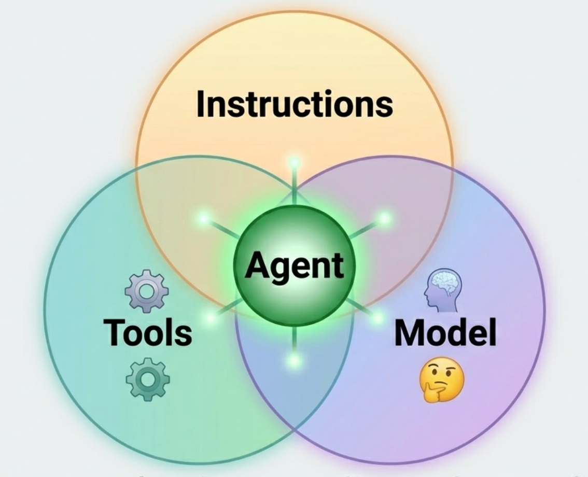

# AI_Agent_Architecture_and_Workflow_Patterns_Explained

Source: https://www.educative.io/courses/agentic-ai-systems/cheatsheet-ai-agent-architecture-and-workflow-patterns

---

[Home](https://www.educative.io/)

[Courses](https://www.educative.io/search?tab=courses)

[Agentic System Design](https://www.educative.io/courses/agentic-ai-systems)

# Cheatsheet: AI Agent Architecture and Workflow Patterns

Explore the essential components of AI agents—instructions, tools, and models—and learn how modular design enables flexible development. Understand different AI agent architecture patterns including single-agent and multi-agent systems, and master four major agentic workflow design patterns: Planning, ReAct, Reflection, and Routing to create adaptable, reliable AI systems.

We'll cover the following...

- [The core components of an AI agent](https://www.educative.io/courses/agentic-ai-systems/cheatsheet-ai-agent-architecture-and-workflow-patterns#The-core-components-of-an-AI-agent)
  - [Instructions](https://www.educative.io/courses/agentic-ai-systems/cheatsheet-ai-agent-architecture-and-workflow-patterns#Instructions)
  - [Tools](https://www.educative.io/courses/agentic-ai-systems/cheatsheet-ai-agent-architecture-and-workflow-patterns#Tools)
  - [The model](https://www.educative.io/courses/agentic-ai-systems/cheatsheet-ai-agent-architecture-and-workflow-patterns#The-model)
- [AI agent architecture patterns](https://www.educative.io/courses/agentic-ai-systems/cheatsheet-ai-agent-architecture-and-workflow-patterns#AI-agent-architecture-patterns)
  - [Single-agent architecture](https://www.educative.io/courses/agentic-ai-systems/cheatsheet-ai-agent-architecture-and-workflow-patterns#Single-agent-architecture)
  - [Multi-agent architecture](https://www.educative.io/courses/agentic-ai-systems/cheatsheet-ai-agent-architecture-and-workflow-patterns#Multi-agent-architecture)
  - [Orchestrator-worker architecture](https://www.educative.io/courses/agentic-ai-systems/cheatsheet-ai-agent-architecture-and-workflow-patterns#Orchestrator-worker-architecture)
- [AI agentic workflows: How the system executes over time](https://www.educative.io/courses/agentic-ai-systems/cheatsheet-ai-agent-architecture-and-workflow-patterns#AI-agentic-workflows-How-the-system-executes-over-time)
- [Agentic workflow design patterns](https://www.educative.io/courses/agentic-ai-systems/cheatsheet-ai-agent-architecture-and-workflow-patterns#Agentic-workflow-design-patterns)
  - [Planning](https://www.educative.io/courses/agentic-ai-systems/cheatsheet-ai-agent-architecture-and-workflow-patterns#Planning)
  - [ReAct (Reasoning and Acting)](https://www.educative.io/courses/agentic-ai-systems/cheatsheet-ai-agent-architecture-and-workflow-patterns#ReAct-Reasoning-and-Acting)
  - [Reflection (Self-Critique)](https://www.educative.io/courses/agentic-ai-systems/cheatsheet-ai-agent-architecture-and-workflow-patterns#Reflection-Self-Critique)
  - [Routing](https://www.educative.io/courses/agentic-ai-systems/cheatsheet-ai-agent-architecture-and-workflow-patterns#Routing)
- [Summary](https://www.educative.io/courses/agentic-ai-systems/cheatsheet-ai-agent-architecture-and-workflow-patterns#Summary)

By the end of this lesson, you will be able to:

- Identify the three core components of every AI agent and explain how they interact.
- Distinguish between an agent's architecture pattern and its agentic workflow.
- Describe the four most common agentic workflow design patterns and when to use each.
- Explain why modularity in agent design is a practical engineering advantage.

## The core components of an AI agent[#](https://www.educative.io/courses/agentic-ai-systems/cheatsheet-ai-agent-architecture-and-workflow-patterns#The-core-components-of-an-AI-agent)

Before designing a system, you need to understand its parts. Across all the case studies in this course, from MACRS and Eureka to WebVoyager and ChainBuddy, a consistent pattern emerges. No matter how sophisticated the application, every AI agent is built from the same three fundamental components: instructions, tools, and a model.

Understanding these building blocks is the foundation of AI agent architecture. More importantly, understanding them as modular, independently configurable elements is what makes modern agent design practical and scalable.

### Instructions[#](https://www.educative.io/courses/agentic-ai-systems/cheatsheet-ai-agent-architecture-and-workflow-patterns#Instructions)

Instructions are the context, constraints, and behavioral directives that shape what the agent is and how it acts. These are typically embedded in the system prompt, a block of text the agent receives before any user interaction begins, and they define the agent's persona, the scope of its responsibilities, its tone, and its guardrails.

Well-written instructions do more than describe a role. They define the agent's decision-making boundaries: what it is allowed to do, what it must escalate to a human, and how it should behave when it encounters ambiguity. In production systems, instructions often encode compliance requirements, safety policies, and escalation procedures alongside more straightforward behavioral guidance.

Consider the difference between telling an agent to be helpful versus instructing it to answer customer questions about billing only, escalate refund requests over $500 to a human agent, and never discuss competitor pricing. The second set of instructions produces a far more predictable, trustworthy system. Precision in instruction design is one of the highest-leverage activities in agent development.

### Tools[#](https://www.educative.io/courses/agentic-ai-systems/cheatsheet-ai-agent-architecture-and-workflow-patterns#Tools)

Tools are the *external capabilities* that allow the agent to take action beyond generating text. Without tools, an LLM-powered agent can reason and plan, but it cannot actually affect anything in the world. Tools are what transform a language model from a conversational partner into an active system.

Tools can take many forms depending on the agent's purpose. A customer support agent might have access to a CRM lookup tool, a knowledge base search tool, and a ticket-creation API. A coding agent might use a code execution sandbox, a file system reader, and a web search tool. A multimodal web agent like WebVoyager, as studied in Chapter 7, uses browser interaction tools, click, scroll, type, and screenshot, to navigate real websites autonomously.

The key engineering principle is that tools should be discrete and composable. Each tool does one thing well and returns a structured result. The agent's reasoning layer decides when to call a tool, what parameters to pass, and how to interpret the output. This separation keeps the system testable and maintainable: you can update or swap a tool without rewriting the agent's reasoning logic.

### The model[#](https://www.educative.io/courses/agentic-ai-systems/cheatsheet-ai-agent-architecture-and-workflow-patterns#The-model)

The model is the *cognitive engine* of the agent, the component that interprets instructions, processes perceptions, reasons through problems, and decides which tools to invoke. In modern agentic systems, this is almost always a Large Language Model (LLM) such as GPT-4, Claude, or Gemini.

The model's role is not simply to produce text. Within an agentic loop, the LLM reads the current state of the conversation, considers the available tools, reasons about the best next action, and outputs either a response to the user or a structured tool call. This reasoning step, sometimes made explicit through chain-of-thought prompting, is what gives the agent its apparent intelligence.

Different models bring different trade-offs to the architecture. Larger, more capable models reason more reliably on complex tasks but cost more per inference and respond more slowly. Smaller models are faster and cheaper but may require more careful prompting to perform reliably. In multi-agent systems, it is common to use a powerful model for high-level planning and lighter models for simpler, repetitive sub-tasks, a practical application of the hierarchical agent design.

**Why modularity matters:** The most important practical implication of this three-component design is that each part can be changed independently. You can swap the underlying model without rewriting your tools. You can add a new tool without changing your instructions. You can refine your instructions without touching your infrastructure.

This modularity is not just an architectural convenience; it is what makes iterative development possible. Production agent systems are never finished. Requirements change, better models are released, and new tools become available. A modular architecture lets you evolve the system incrementally rather than rebuilding it from scratch.

## AI agent architecture patterns[#](https://www.educative.io/courses/agentic-ai-systems/cheatsheet-ai-agent-architecture-and-workflow-patterns#AI-agent-architecture-patterns)

Having the three core components is just the starting point. How those components are arranged and connected, and how many agents are involved, determines what the system can actually accomplish. These structural blueprints are known as AI agent architecture patterns.

An architecture pattern defines the shape of your system at the macro level. It answers the question: how many agents are there, how do they relate to each other, and how does work flow between them? Choosing the right pattern is one of the most consequential design decisions you will make, and getting it wrong early is expensive.

### Single-agent architecture[#](https://www.educative.io/courses/agentic-ai-systems/cheatsheet-ai-agent-architecture-and-workflow-patterns#Single-agent-architecture)

In a single-agent pattern, one LLM handles all reasoning, planning, and tool use for a given task. The agent receives the user's request, reasons through it, calls whatever tools it needs, interprets the results, and produces a response, all within a single, continuous loop.

This pattern is appropriate for tasks that are well-defined, relatively self-contained, and do not require parallel execution. A single-agent architecture is easier to debug, cheaper to run, and simpler to maintain. Many practical applications, such as a document summarizer, a structured data extractor, and a customer FAQ responder, can be handled effectively by a well-designed single agent without any additional complexity.

The limitation emerges when the task is too broad, too long, or requires expertise that a single context window cannot reliably sustain. That is when multi-agent patterns become necessary.

### Multi-agent architecture[#](https://www.educative.io/courses/agentic-ai-systems/cheatsheet-ai-agent-architecture-and-workflow-patterns#Multi-agent-architecture)

In a multi-agent architecture, tasks are distributed across several specialized agents that communicate with one another. Each agent has a narrower scope, its own set of tools, and its own instructions, and the system as a whole achieves outcomes that no individual agent could manage alone.

The MACRS framework from Chapter 2 is a direct implementation of this pattern. Rather than asking a single agent to handle user modeling, act planning, and self-critique simultaneously, MACRS delegates each responsibility to a dedicated agent. The result is a system with higher accuracy, better scalability, and cleaner failure modes: if one agent underperforms, it can be retrained or replaced without disrupting the rest of the pipeline.

Multi-agent systems introduce coordination overhead; agents need to pass information between themselves, and the outputs of one agent must be formatted correctly for the next to consume. Managing this inter-agent communication is one of the central challenges in agentic system design.

### Orchestrator-worker architecture[#](https://www.educative.io/courses/agentic-ai-systems/cheatsheet-ai-agent-architecture-and-workflow-patterns#Orchestrator-worker-architecture)

A common and practical variant of the multi-agent pattern is the orchestrator-worker architecture. A top-level orchestrator agent receives the user's goal, decomposes it into sub-tasks, delegates each sub-task to a specialized worker agent, and then synthesizes the results into a final output.

This pattern maps closely to the hierarchical agent type. The ChainBuddy system from Chapter 6 follows this structure: a requirement-gathering agent handles the initial conversation with the user, and a separate multi-agent pipeline generation framework takes over to construct the LLM workflow. The division of responsibility makes each component easier to test independently and the overall system easier to extend.

## AI agentic workflows: How the system executes over time[#](https://www.educative.io/courses/agentic-ai-systems/cheatsheet-ai-agent-architecture-and-workflow-patterns#AI-agentic-workflows-How-the-system-executes-over-time)

Architecture tells you the shape of a system. Agentic workflows tell you how that system actually moves. Where an architecture pattern defines which agents exist and how they relate to each other, a workflow defines the operational sequence, the step-by-step logic the agent follows as it works through a task over time.

The critical distinction between agentic workflows and traditional software workflows is iteration. A conventional application follows a deterministic path: if the user clicks button A, execute function B, return result C. The path is fixed, and every execution follows the same sequence.

An agentic workflow is fundamentally different. Instead of executing a single, rigid path, the agent iterates, takes an action, observes the result, reassesses its plan, and decides on the next step dynamically. The same request might follow a completely different execution path on two different runs, depending on what the agent encounters in the environment. This flexibility is what makes agents capable of handling complex, open-ended tasks, but it also makes them harder to reason about and test.

**Analogy:** Think of the difference between following a printed recipe and cooking for a dinner party as an experienced chef. The recipe is a fixed workflow: step 1, step 2, step 3. The experienced chef has the same goal: to produce a great meal, but adapts continuously. If the oven runs hot, they adjust the temperature. If a sauce reduces too fast, they add liquid. They observe, reason, and act in a loop until the goal is achieved. An agentic workflow is the chef's approach, not the recipe's*.*

## Agentic workflow design patterns[#](https://www.educative.io/courses/agentic-ai-systems/cheatsheet-ai-agent-architecture-and-workflow-patterns#Agentic-workflow-design-patterns)

Just as architecture patterns give structure to multi-agent systems, agentic workflow design patterns give structure to how individual agents (and systems of agents) execute tasks. These patterns are the reusable templates that experienced practitioners reach for when designing how an agent should behave operationally.

The four patterns below are the most widely used in production systems today. Each addresses a different type of problem, and real-world agents frequently combine several of them within a single workflow.

### Planning[#](https://www.educative.io/courses/agentic-ai-systems/cheatsheet-ai-agent-architecture-and-workflow-patterns#Planning)

Before taking any action on a complex task, a well-designed agent analyzes the request and decomposes it into a sequence of smaller, manageable sub-tasks. This is the planning pattern, and it is the foundation of reliable behavior on long-horizon tasks.

Without an explicit planning step, an agent tends to be reactive: it takes whatever action seems most obvious at the current moment without considering how that action fits into a broader strategy. This often leads to wasted steps, tool calls that return unhelpful results, and tasks that never converge on a correct answer.

With a planning step, the agent first produces a high-level plan ("to answer this question, I need to: 1) retrieve the relevant documents, 2) extract the key data, 3) perform a calculation, 4) format the output"), and then executes that plan one step at a time. If a step fails, the agent can revise the plan for the remaining steps rather than starting over from scratch.

Eureka, studied in Chapter 3, uses an LLM-driven planning step to generate reward function candidates before executing any code. The plan defines the shape of the solution before any computational work begins, a pattern that dramatically improves the quality and efficiency of the overall system.

### ReAct (Reasoning and Acting)[#](https://www.educative.io/courses/agentic-ai-systems/cheatsheet-ai-agent-architecture-and-workflow-patterns#ReAct-Reasoning-and-Acting)

The ReAct pattern, short for Reasoning and Acting, is one of the most foundational loops in modern agentic systems. It was introduced in a 2022 research paper and has since become a standard design pattern across LLM-powered applications.

The loop has three phases, repeated until the task is complete:

- **Think:** The agent is prompted to reason explicitly about the current state. What do I know? What do I need to find out? What tool should I use next and why?
- **Act:** The agent executes a tool call based on its reasoning, a web search, a database query, a code execution, or any other available action.
- **Observe:** The agent receives the output of the tool call and incorporates it into its reasoning context before deciding on the next step.

The power of ReAct is in making the reasoning step explicit. Rather than having the model jump directly from input to output, the Think step forces the agent to articulate its current understanding and justify its next action. This produces more reliable behavior and makes the agent's decision-making process auditable, a property that matters greatly in safety-critical applications.

WebVoyager's architecture, covered in Chapter 7, is built on a multimodal ReAct loop: the agent observes a screenshot of the current web page (Observe), reasons about what action will move it closer to the goal (Think), and then executes a browser action such as a click or a text input (Act). This loop repeats until the task is complete or the agent determines it cannot proceed.

### Reflection (Self-Critique)[#](https://www.educative.io/courses/agentic-ai-systems/cheatsheet-ai-agent-architecture-and-workflow-patterns#Reflection-Self-Critique)

The reflection pattern introduces a quality-control layer into the agentic workflow. After generating an initial response or completing a planning step, the agent, or a separate critic agent, reviews the output for errors, gaps, or suboptimal choices before presenting it to the user or passing it downstream.

This pattern is directly inspired by how careful human professionals work. A developer who writes code and immediately submits it without review makes more mistakes than one who reads through the output critically before committing. The reflection pattern encodes that review step into the agent's workflow.

Reflection can be implemented in several ways. In a single-agent setup, the agent is prompted to critique its own output: "Review the plan you just created. Are there any steps that might fail? Are there any gaps in the approach?" In a multi-agent setup, a dedicated critic agent receives the output of the primary agent and returns structured feedback that the primary agent then uses to revise its work.

MACRS, the multi-agent conversational recommender studied in Chapter 2, implements reflection through its User Feedback-Aware Reflection Mechanism. After generating a recommendation set, a reflection agent evaluates the recommendations against the user's expressed preferences and identified gaps, then feeds that critique back into the act planning agent before the final output is produced. This loop is what gives MACRS its superior recommendation accuracy compared to systems without a reflection step.

### Routing[#](https://www.educative.io/courses/agentic-ai-systems/cheatsheet-ai-agent-architecture-and-workflow-patterns#Routing)

As systems grow in scope, a single agent can no longer be the expert on every type of task it receives. The routing pattern addresses this by introducing an orchestrator or router agent that evaluates the user's input and directs the task to the most appropriate specialized sub-agent.

Routing is both an architectural decision and a workflow pattern. As an architecture, it defines the existence of a router and multiple specialists. As a workflow, it defines the logic the router uses to make its classification decision, which may itself involve LLM-based reasoning rather than simple rule matching.

A practical example: a multi-purpose enterprise assistant might receive queries related to legal compliance, HR policy, financial reporting, and IT support. Rather than trying to answer all of these with a single agent, a router agent classifies the incoming request and forwards it to the appropriate specialist: the legal agent, the HR agent, the finance agent, or the IT agent. Each specialist has domain-specific tools, instructions, and prompting strategies optimized for its particular type of query.

The routing pattern improves both accuracy and safety. Specialist agents can be given tighter instructions and more targeted tools than a generalist agent, reducing the risk of out-of-scope responses. And routing logic can enforce access controls; some users or query types can be restricted from accessing certain specialist agents entirely.

## Quick Reference: Workflow Design Patterns

|  |  |  |  |
| --- | --- | --- | --- |
| **Pattern** | **Core Mechanism** | **Best Used When** | **Course Example** |
| Planning | Decompose the task into ordered sub-steps before execution | Long-horizon tasks with many sequential dependencies | Eureka's reward generation pipeline |
| ReAct | Think → Act (Tool) → Observe loop | Tasks requiring real-time information retrieval or dynamic tool use | WebVoyager's multimodal browsing loop |
| Reflection | Agent (or critic) reviews and revises output before delivery | High-stakes outputs where quality and accuracy are critical | MACRS's feedback-aware reflection mechanism |
| Routing | Orchestrator classifies the input and forwards it to the specialist agent | Systems handling diverse query types requiring different expertise | ChainBuddy's requirement-gathering to pipeline-generation handoff |

**Knowledge check:**

1.

A team is building an AI agent to handle customer insurance claims. The agent must:

1. Receive a customer’s written description of an incident.
2. Search a policy database to determine coverage eligibility.
3. Ask the customer follow-up questions if key information is missing.
4. Generate a structured claim assessment and flag high-value claims for human review before submission.

For each numbered step above, identify which workflow design pattern (Planning, ReAct, Reflection, or Routing) is most directly applicable, and explain why.

As a follow-up, would you design this system as a single-agent or multi-agent architecture? Justify your choice.

Show Answer

Did you find this helpful?

## Summary[#](https://www.educative.io/courses/agentic-ai-systems/cheatsheet-ai-agent-architecture-and-workflow-patterns#Summary)

- Every AI agent is built from three modular components: Instructions (behavioral context), Tools (external capabilities), and a Model (the reasoning engine). Keeping these components modular enables iterative development and system evolution.
- AI agent architecture patterns define the macro structure of a system: single-agent for simpler tasks, multi-agent or orchestrator-worker for complex, parallel, or specialized workflows.
- AI agentic workflows define how a system executes over time. Unlike linear software pipelines, agentic workflows are iterative: the agent acts, observes the result, reassesses, and decides on the next step dynamically.
- The four core agentic workflow design patterns are: Planning (decompose before acting), ReAct (think-act-observe loop), Reflection (self-critique before delivery), and Routing (direct tasks to the right specialist).
- Real-world systems combine multiple patterns. MACRS uses reflection inside a multi-agent architecture. Eureka uses planning within a learning loop. Effective agentic system design is about selecting and composing these patterns deliberately.

Glossary: AI Agent Capabilities and Classifications

Landscape Guide: Building Applications with AI Agents

Ask

[The core components of an AI agent](https://www.educative.io/courses/agentic-ai-systems/cheatsheet-ai-agent-architecture-and-workflow-patterns#The-core-components-of-an-AI-agent)

[Instructions](https://www.educative.io/courses/agentic-ai-systems/cheatsheet-ai-agent-architecture-and-workflow-patterns#Instructions)

[Tools](https://www.educative.io/courses/agentic-ai-systems/cheatsheet-ai-agent-architecture-and-workflow-patterns#Tools)

[The model](https://www.educative.io/courses/agentic-ai-systems/cheatsheet-ai-agent-architecture-and-workflow-patterns#The-model)

[AI agent architecture patterns](https://www.educative.io/courses/agentic-ai-systems/cheatsheet-ai-agent-architecture-and-workflow-patterns#AI-agent-architecture-patterns)

[Single-agent architecture](https://www.educative.io/courses/agentic-ai-systems/cheatsheet-ai-agent-architecture-and-workflow-patterns#Single-agent-architecture)

[Multi-agent architecture](https://www.educative.io/courses/agentic-ai-systems/cheatsheet-ai-agent-architecture-and-workflow-patterns#Multi-agent-architecture)

[Orchestrator-worker architecture](https://www.educative.io/courses/agentic-ai-systems/cheatsheet-ai-agent-architecture-and-workflow-patterns#Orchestrator-worker-architecture)

[AI agentic workflows: How the system executes over time](https://www.educative.io/courses/agentic-ai-systems/cheatsheet-ai-agent-architecture-and-workflow-patterns#AI-agentic-workflows-How-the-system-executes-over-time)

[Agentic workflow design patterns](https://www.educative.io/courses/agentic-ai-systems/cheatsheet-ai-agent-architecture-and-workflow-patterns#Agentic-workflow-design-patterns)

[Planning](https://www.educative.io/courses/agentic-ai-systems/cheatsheet-ai-agent-architecture-and-workflow-patterns#Planning)

[ReAct (Reasoning and Acting)](https://www.educative.io/courses/agentic-ai-systems/cheatsheet-ai-agent-architecture-and-workflow-patterns#ReAct-Reasoning-and-Acting)

[Reflection (Self-Critique)](https://www.educative.io/courses/agentic-ai-systems/cheatsheet-ai-agent-architecture-and-workflow-patterns#Reflection-Self-Critique)

[Routing](https://www.educative.io/courses/agentic-ai-systems/cheatsheet-ai-agent-architecture-and-workflow-patterns#Routing)

[Summary](https://www.educative.io/courses/agentic-ai-systems/cheatsheet-ai-agent-architecture-and-workflow-patterns#Summary)