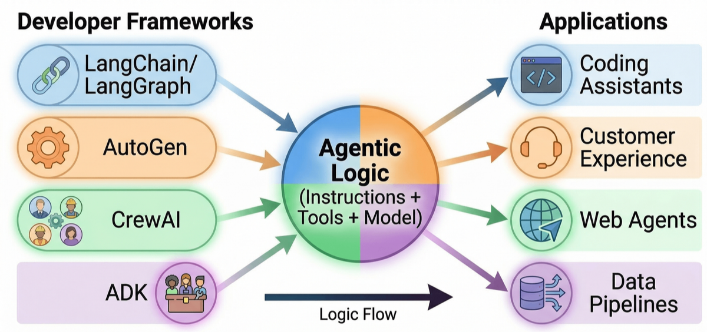

# Building_AI_Agent_Applications_Using_Frameworks_and_Tools

Source: https://www.educative.io/courses/agentic-ai-systems/landscape-guide-building-applications-with-ai-agents

---

[Home](https://www.educative.io/)

[Courses](https://www.educative.io/search?tab=courses)

[Agentic System Design](https://www.educative.io/courses/agentic-ai-systems)

# Landscape Guide: Building Applications with AI Agents

Understand how to build AI agent applications by learning about major frameworks like LangChain, AutoGen, and CrewAI. Explore real-world use cases including coding assistants, customer automation, and scientific research. Discover engineering challenges such as hallucination, latency, observability, and safety practices like minimal footprint design to build effective and secure agentic systems.

We'll cover the following...

- [Why frameworks exist: The complexity problem](https://www.educative.io/courses/agentic-ai-systems/landscape-guide-building-applications-with-ai-agents#Why-frameworks-exist-The-complexity-problem)
- [The major AI agent frameworks](https://www.educative.io/courses/agentic-ai-systems/landscape-guide-building-applications-with-ai-agents#The-major-AI-agent-frameworks)
  - [LangChain and LangGraph](https://www.educative.io/courses/agentic-ai-systems/landscape-guide-building-applications-with-ai-agents#LangChain-and-LangGraph)
  - [AutoGen](https://www.educative.io/courses/agentic-ai-systems/landscape-guide-building-applications-with-ai-agents#AutoGen)
  - [CrewAI](https://www.educative.io/courses/agentic-ai-systems/landscape-guide-building-applications-with-ai-agents#CrewAI)
  - [Google ADK and other emerging frameworks](https://www.educative.io/courses/agentic-ai-systems/landscape-guide-building-applications-with-ai-agents#Google-ADK-and-other-emerging-frameworks)
- [AI agents applications](https://www.educative.io/courses/agentic-ai-systems/landscape-guide-building-applications-with-ai-agents#AI-agents-applications)
  - [Intelligent coding assistants](https://www.educative.io/courses/agentic-ai-systems/landscape-guide-building-applications-with-ai-agents#Intelligent-coding-assistants)
  - [Customer experience automation](https://www.educative.io/courses/agentic-ai-systems/landscape-guide-building-applications-with-ai-agents#Customer-experience-automation)
  - [Multimodal web agents](https://www.educative.io/courses/agentic-ai-systems/landscape-guide-building-applications-with-ai-agents#Multimodal-web-agents)
  - [Automated data pipelines](https://www.educative.io/courses/agentic-ai-systems/landscape-guide-building-applications-with-ai-agents#Automated-data-pipelines)
  - [Scientific research and autonomous experimentation](https://www.educative.io/courses/agentic-ai-systems/landscape-guide-building-applications-with-ai-agents#Scientific-research-and-autonomous-experimentation)
- [Engineering challenges](https://www.educative.io/courses/agentic-ai-systems/landscape-guide-building-applications-with-ai-agents#Engineering-challenges)
  - [Reliability and hallucination](https://www.educative.io/courses/agentic-ai-systems/landscape-guide-building-applications-with-ai-agents#Reliability-and-hallucination)
  - [Latency and cost](https://www.educative.io/courses/agentic-ai-systems/landscape-guide-building-applications-with-ai-agents#Latency-and-cost)
  - [Observability and debugging](https://www.educative.io/courses/agentic-ai-systems/landscape-guide-building-applications-with-ai-agents#Observability-and-debugging)
  - [Safety and scope control](https://www.educative.io/courses/agentic-ai-systems/landscape-guide-building-applications-with-ai-agents#Safety-and-scope-control)
- [Summary](https://www.educative.io/courses/agentic-ai-systems/landscape-guide-building-applications-with-ai-agents#Summary)

By the end of this lesson, you will be able to:

- Explain why specialized frameworks are used to build AI agent applications.
- Compare the major agent development frameworks and understand the trade-offs between them.
- Identify prominent real-world AI agent applications across key industries.
- Understand the practical engineering challenges that arise when moving from agent design to production deployment.

The previous lessons in this appendix covered what agents are and how they are structured. This lesson turns to the practical question of how they are actually built, and where they are being deployed at scale today.

The shift from designing an agent on paper to building one in code is significant. It requires working with a new generation of specialized tools, confronting real engineering constraints, and making deliberate choices about which frameworks, models, and infrastructure best fit the problem at hand. Understanding this landscape is as important as understanding the underlying concepts, because the tools you choose will shape what you can build and how quickly you can iterate.

## Why frameworks exist: The complexity problem[#](https://www.educative.io/courses/agentic-ai-systems/landscape-guide-building-applications-with-ai-agents#Why-frameworks-exist-The-complexity-problem)

When building applications with AI agents, developers face a challenge that does not exist in traditional software development: they must orchestrate a reasoning system that is, by design, non-deterministic. The agent may take different action sequences on different runs. It may call tools in an unexpected order. It may fail partway through a multi-step task and need to recover gracefully.

Implementing all of this from scratch, the agentic loop, tool execution, memory management, state persistence across steps, error handling, and inter-agent communication, is a substantial engineering undertaking. A team that builds all of this custom infrastructure before writing a single line of business logic is not building a product; it is building a platform.

This is the problem that agent development frameworks solve. They abstract the low-level machinery of agentic operation, the perception-reasoning-action loops, the tool-calling interfaces, the context window management, and the message-passing between agents, so that developers can focus on the parts of the system that are unique to their application: the instructions, the tools, and the task logic.

**Analogy:** Think of the relationship between an agent framework and an agentic application the way you might think of a web framework like Django or Rails and a web application. Nobody hand-codes HTTP parsing, session management, or database connection pooling for each new web project. They use a framework that handles those concerns reliably and focus their energy on the routes, views, and business logic that are specific to their product. Agent frameworks play the same role for agentic systems.

## The major AI agent frameworks[#](https://www.educative.io/courses/agentic-ai-systems/landscape-guide-building-applications-with-ai-agents#The-major-AI-agent-frameworks)

The ecosystem of AI agents, architectures, frameworks, and applications has matured rapidly since 2023. Several frameworks have emerged as broadly used starting points, each with a distinct design philosophy and a different set of strengths. Here is an overview of the most widely adopted options and what each one is optimized for.

### LangChain and LangGraph[#](https://www.educative.io/courses/agentic-ai-systems/landscape-guide-building-applications-with-ai-agents#LangChain-and-LangGraph)

LangChain is one of the earliest and most widely adopted frameworks in the LLM application space. Its core contribution was the concept of a chain, a composable sequence of LLM calls, tool uses, and transformations that can be assembled into a pipeline. LangChain provides a large library of pre-built integrations: search engines, vector databases, document loaders, output parsers, and dozens of other components that can be plugged into an agent's tool set with minimal boilerplate.

LangGraph is LangChain's extension for building stateful, cyclical workflows. Where LangChain's original chain abstraction was inherently linear, LangGraph introduces a graph-based execution model in which nodes represent agent actions and edges represent conditional transitions between them. This makes LangGraph particularly well-suited for implementing the iterative, loop-based workflows, ReAct loops, reflection cycles, and multi-agent coordination that are central to modern agentic system design.

LangChain and LangGraph are a strong default choice for teams that want a well-documented framework with broad tool integrations, active community support, and the flexibility to implement any of the workflow patterns covered in this course. The trade-off is complexity: LangChain's abstraction layer is deep, and understanding what is happening at the framework level requires investment.

### AutoGen[#](https://www.educative.io/courses/agentic-ai-systems/landscape-guide-building-applications-with-ai-agents#AutoGen)

AutoGen, developed by Microsoft Research, takes a different approach. Rather than providing a toolkit for building single agents and chaining their outputs, AutoGen is designed specifically for multi-agent conversation. Its central abstraction is the conversable agent: an entity that can send and receive messages, execute code, call tools, and participate in structured group conversations with other agents.

AutoGen is particularly effective for scenarios where the quality of the final output benefits from debate, verification, or collaborative problem-solving between agents. A common pattern is to configure a programmer agent that writes code and an executor agent that runs it and reports the results; the two agents iterate together until the code passes all tests. Another common pattern pairs a researcher agent with a critic agent that challenges its conclusions and forces it to justify its reasoning.

For teams building multi-agent systems where the interaction between agents is itself the core design challenge, rather than the tool integrations, AutoGen is often the more natural fit than LangChain.

### CrewAI[#](https://www.educative.io/courses/agentic-ai-systems/landscape-guide-building-applications-with-ai-agents#CrewAI)

CrewAI structures agents around a human organizational metaphor: a crew of agents, each with a defined role, a goal, and a set of tools, working together to complete a shared mission. This framing maps naturally to the kinds of business processes that agentic systems are most commonly used to automate: research pipelines, content production workflows, data analysis tasks, and customer interaction flows.

CrewAI's role-based abstraction makes it accessible to developers who are new to multi-agent system design. By thinking in terms of roles, researcher, writer, reviewer, and data analyst, rather than abstract graph nodes or message-passing protocols, teams can rapidly prototype multi-agent pipelines that mirror the structure of the human workflows they are replacing.

CrewAI has grown quickly in adoption for applied enterprise use cases, particularly where the goal is to automate a well-understood multi-step business process rather than to build a novel, research-grade agentic capability.

### Google ADK and other emerging frameworks[#](https://www.educative.io/courses/agentic-ai-systems/landscape-guide-building-applications-with-ai-agents#Google-ADK-and-other-emerging-frameworks)

Beyond the three frameworks above, the landscape continues to evolve rapidly. Google's Agent Development Kit (ADK), used in Chapter 4 of this course to implement a Eureka-like reward learning agent, provides a structured programming model for building agents that integrate with Google's model and infrastructure ecosystem. It is particularly well-suited for teams already working within Google Cloud.

Other notable frameworks include OpenAI's Agents SDK, Semantic Kernel from Microsoft, and several open-source projects targeting specific deployment environments such as embedded systems or edge devices. The right framework for any given project depends on the target infrastructure, the team's existing technical stack, and the specific architectural patterns the system needs to implement.

**Choosing a framework**

There is no universally correct answer. Consider these questions when evaluating options:

- Do you need a single-agent or multi-agent system? For single-agent workflows, LangChain or a direct SDK integration may be sufficient. For multi-agent coordination, AutoGen or CrewAI offer more purpose-built abstractions.
- How important are pre-built integrations? LangChain has the broadest library of connectors.
- Is the team new to agentic development? CrewAI's role-based metaphor typically has the lowest conceptual onboarding cost.
- What is your target cloud environment? ADK for Google Cloud, Semantic Kernel for Azure, and so on.
- How much control do you need over the execution loop? Lower-level frameworks or direct LLM SDK usage give more control at the cost of more custom code.

## AI agents applications[#](https://www.educative.io/courses/agentic-ai-systems/landscape-guide-building-applications-with-ai-agents#AI-agents-applications)

The architectural patterns and frameworks discussed above are not academic exercises; they are actively powering a growing class of production systems. Building applications with AI agents has moved well beyond early prototypes. Across industries, agents are displacing rigid, rule-based automation in scenarios that require dynamic decision-making, contextual reasoning, and the ability to handle unstructured data.

What follows is an overview of the most prominent AI agent applications currently in production, with attention to the specific agent capabilities that make each one possible.

### Intelligent coding assistants[#](https://www.educative.io/courses/agentic-ai-systems/landscape-guide-building-applications-with-ai-agents#Intelligent-coding-assistants)

The most widely used AI agent applications today are in software development. Modern coding assistants go far beyond autocomplete or single-function generation. An intelligent coding agent can receive a natural language description of a feature, navigate an existing codebase to understand its structure and conventions, write the implementation, generate unit tests, execute those tests in a sandbox, interpret the results, and iterate on the code until all tests pass, often without human intervention at any intermediate step.

This capability requires the full stack of agentic behaviors: goal-based planning (understand what the feature requires), tool use (read files, write code, run tests), a ReAct loop (observe the test output, reason about what failed, revise the code), and memory (maintain context about the codebase across many sequential steps).

The practical impact is significant. Developers using agentic coding tools report large reductions in the time spent on boilerplate implementation, test scaffolding, and routine debugging, freeing cognitive capacity for the higher-level architectural decisions that still require human judgment.

### Customer experience automation[#](https://www.educative.io/courses/agentic-ai-systems/landscape-guide-building-applications-with-ai-agents#Customer-experience-automation)

Customer-facing AI agents have evolved from simple FAQ chatbots, which were effectively rule-based reflex agents, into systems capable of handling genuinely complex interactions end to end. A sophisticated customer experience agent can parse a customer's message to understand their intent and emotional tone, look up their account history and order status via API, determine the appropriate resolution policy based on the situation, execute the resolution (issue a refund, modify an order, escalate to a human specialist with full context), and follow up to confirm the outcome.

The shift from chatbots to agents changes the value proposition dramatically. A chatbot reduces the volume of calls that reach a human agent by handling simple queries. A customer experience agent reduces the volume of unresolved issues by handling complex queries, the ones that previously required human judgment to navigate.

The design challenge in this domain is guardrail architecture. Customer experience agents operate in high-stakes, high-volume environments where errors have real financial and reputational consequences. The safety and human oversight patterns covered in Chapter 1 of this course, the guardrails and escalation logic that define when an agent must defer to a human, are not optional features in this application domain. They are prerequisites for deployment.

### Multimodal web agents[#](https://www.educative.io/courses/agentic-ai-systems/landscape-guide-building-applications-with-ai-agents#Multimodal-web-agents)

As explored in depth in Chapter 7, multimodal web agents represent one of the most technically ambitious AI agent applications currently in production. These agents navigate web interfaces autonomously, not by parsing HTML or calling structured APIs, but by visually processing screenshots of the browser viewport and interacting with the UI the way a human would: clicking buttons, filling in forms, scrolling through results, and interpreting the visual layout of unfamiliar pages.

WebVoyager, the system studied in Chapter 7, demonstrated that a multimodal ReAct loop, combining a vision-capable LLM with browser action tools, can complete real-world web tasks with meaningful accuracy on benchmarks that include tasks from domains as varied as travel booking, product research, and information retrieval.

The broader significance of web agents is their generality. Most enterprise software does not expose a well-documented API. But almost every enterprise software tool has a web interface. A capable web agent can, in principle, operate any software that a human can operate through a browser, a capability with profound implications for workflow automation at scale.

### Automated data pipelines[#](https://www.educative.io/courses/agentic-ai-systems/landscape-guide-building-applications-with-ai-agents#Automated-data-pipelines)

Data engineering is another domain where agentic systems are generating significant productivity gains. Traditional data pipelines are fragile: they are designed for a specific schema, a specific data source, and a specific output format, and they break when any of those assumptions change. Maintaining them at scale is expensive and slow.

Agentic data pipelines replace brittle deterministic logic with adaptive reasoning. An agent monitoring an incoming data stream can detect schema anomalies, infer the likely cause, attempt a correction strategy, and flag edge cases for human review, all without manual intervention. An agent tasked with generating a weekly business report can pull from multiple data sources, reconcile inconsistencies, compute derived metrics, and produce a formatted output that adjusts its structure based on what the data actually shows.

This adaptability is the core value proposition: the pipeline does not break when the world changes. It reasons about the change and responds accordingly.

### Scientific research and autonomous experimentation[#](https://www.educative.io/courses/agentic-ai-systems/landscape-guide-building-applications-with-ai-agents#Scientific-research-and-autonomous-experimentation)

Perhaps the most consequential long-term application of agentic systems is in scientific discovery. LLM-powered agents are beginning to be used to generate hypotheses, design experiments, analyze results, and synthesize findings across large bodies of literature, tasks that previously required years of specialized training to perform even partially.

Eureka, studied in Chapter 3, is a direct example from the field of robotics. By automating the design and refinement of reinforcement learning reward functions, a task that previously required significant expert effort for each new robot and task combination, Eureka demonstrated that an LLM-powered agent can outperform human-designed reward functions on a significant portion of standard benchmarks. This is not a productivity tool that makes researchers faster. It is a capability expansion that makes previously intractable problems tractable.

Similar agentic systems are being developed for drug discovery, materials science, and climate modeling, domains where the search space of possible experiments is far too large for human researchers to navigate manually, but where an agent capable of reasoning about experimental design could compress years of research into months.

## Engineering challenges[#](https://www.educative.io/courses/agentic-ai-systems/landscape-guide-building-applications-with-ai-agents#Engineering-challenges)

The application landscape described above represents significant genuine capability. But building and deploying production-grade agentic systems involves a set of engineering challenges that are distinct from, and in some ways harder than, those encountered in traditional software development. Understanding these challenges before you start building will save significant time and prevent avoidable failures.

### Reliability and hallucination[#](https://www.educative.io/courses/agentic-ai-systems/landscape-guide-building-applications-with-ai-agents#Reliability-and-hallucination)

LLMs are probabilistic systems. They do not always produce correct outputs, and the errors they make can be subtle, plausibly sounding but factually wrong, or correctly structured but semantically off-target. In a single-turn chatbot, a hallucinated response is a nuisance. In a multi-step agentic workflow, a hallucinated intermediate result can cascade into a sequence of downstream errors that are hard to detect and expensive to reverse.

Mitigating this requires a combination of techniques: grounding the agent's reasoning in retrieved facts rather than relying on parametric knowledge, implementing reflection and verification steps at critical points in the workflow, and designing graceful degradation paths for cases where the agent's confidence is low.

### Latency and cost[#](https://www.educative.io/courses/agentic-ai-systems/landscape-guide-building-applications-with-ai-agents#Latency-and-cost)

Each LLM inference call takes time and costs money. A simple ReAct loop that executes five think-act-observe cycles before arriving at an answer has made at least five LLM calls. A multi-agent system with three specialized agents and a reflection step could easily require ten to fifteen calls per user request. At scale, these costs accumulate rapidly.

Production agentic systems require careful cost architecture: choosing the right model size for each task (smaller models for simpler sub-tasks), caching repeated inferences, batching requests where the workflow allows, and designing the agentic loop to terminate as early as possible once the goal is achieved.

### Observability and debugging[#](https://www.educative.io/courses/agentic-ai-systems/landscape-guide-building-applications-with-ai-agents#Observability-and-debugging)

One of the most underestimated challenges in agentic system development is understanding what the system actually did when something goes wrong. A traditional software bug has a deterministic stack trace. An agent failure is a probabilistic event embedded in a multi-step, multi-tool execution history that may look different on every run.

Building robust observability into agentic systems, logging every LLM call, every tool invocation, every intermediate result, and every branching decision, is not optional in production. Without it, debugging failures and improving the system over time becomes nearly impossible. Frameworks like LangSmith (LangChain's observability tool) and similar products from other vendors are specifically designed to address this need.

### Safety and scope control[#](https://www.educative.io/courses/agentic-ai-systems/landscape-guide-building-applications-with-ai-agents#Safety-and-scope-control)

An agent with access to real-world tools, APIs, databases, file systems, and email can cause real-world harm if it acts outside its intended scope. This is not a hypothetical concern. Production deployments have seen agents send unintended emails, delete records that should not have been deleted, and make API calls that triggered unintended charges.

**Design principle:** Every agent in a production system should operate with the minimum set of tools and permissions required to complete its designated task. This is the principle of minimal footprint, and it is the most important safety practice in Agentic System Design.

An agent that needs to read customer records does not need write access. An agent that queries a database does not need file system access. An agent that drafts emails does not need the ability to send them without human approval. Scope constraints are not just a safety measure; they are a debuggability measure. A narrowly scoped agent's failures are easier to diagnose and contain.

## Quick Reference: Framework Comparison

|  |  |  |  |
| --- | --- | --- | --- |
| **Framework** | **Primary Abstraction** | **Best For** | **Trade-Offs** |
| LangChain / LangGraph | Chains and stateful graphs | Broad tool integrations; cyclical multi-step workflows | Steep learning curve; deep abstraction layer |
| AutoGen | Conversable agents in group chat | Multi-agent debate, verification, and collaborative problem-solving | Less suited to single-agent workflows |
| CrewAI | Role-based agent crews | Business process automation; accessible multi-agent prototyping | Less control over low-level execution |
| Google ADK | Structured agent programming model | programming model  Google Cloud-native deployments; Eureka-style learning agents | Ecosystem lock-in |

**Knowledge check:**

1.

A logistics company wants to build an AI agent system to automate their freight quotation process. The current process works as follows:

1. A sales representative receives a customer request (via email) describing the shipment.
2. They manually look up carrier rates across three different web portals.
3. They apply the company’s margin and discount rules to calculate a quote.
4. A senior rep reviews all quotes above a certain value threshold before they are sent.
5. The final quote is emailed to the customer.

Part A: For each of the five steps, identify which agent capability or workflow pattern from this course (perception, tool use, ReAct, reflection, routing, human-in-the-loop) is most directly applicable.

Part B: Which development framework, LangChain/LangGraph, AutoGen, or CrewAI, would you recommend for this system, and why? What are the main engineering risks you would need to mitigate before deploying it in production?

Show Answer

Did you find this helpful?

## Summary[#](https://www.educative.io/courses/agentic-ai-systems/landscape-guide-building-applications-with-ai-agents#Summary)

- Agent development frameworks (LangChain/LangGraph, AutoGen, CrewAI, Google ADK) exist to abstract the complex infrastructure of agentic operation, letting developers focus on instructions, tools, and task logic.
- Each framework has a distinct design philosophy: LangChain/LangGraph for broad integrations and stateful workflows; AutoGen for multi-agent conversation and verification; CrewAI for role-based business process automation; ADK for Google Cloud-native deployments.
- AI agent applications are already in production across coding assistance, customer experience automation, multimodal web navigation, automated data pipelines, and scientific research.
- Building applications with AI agents introduces distinct engineering challenges: hallucination in multi-step workflows, inference latency and cost, observability, and safety through scope control.
- The minimal footprint principle, every agent should have only the tools and permissions it strictly needs, is the most important safety and debuggability practice in production agentic system design.

Cheatsheet: AI Agent Architecture and Workflow Patterns

Ask

[Why frameworks exist: The complexity problem](https://www.educative.io/courses/agentic-ai-systems/landscape-guide-building-applications-with-ai-agents#Why-frameworks-exist-The-complexity-problem)

[The major AI agent frameworks](https://www.educative.io/courses/agentic-ai-systems/landscape-guide-building-applications-with-ai-agents#The-major-AI-agent-frameworks)

[LangChain and LangGraph](https://www.educative.io/courses/agentic-ai-systems/landscape-guide-building-applications-with-ai-agents#LangChain-and-LangGraph)

[AutoGen](https://www.educative.io/courses/agentic-ai-systems/landscape-guide-building-applications-with-ai-agents#AutoGen)

[CrewAI](https://www.educative.io/courses/agentic-ai-systems/landscape-guide-building-applications-with-ai-agents#CrewAI)

[Google ADK and other emerging frameworks](https://www.educative.io/courses/agentic-ai-systems/landscape-guide-building-applications-with-ai-agents#Google-ADK-and-other-emerging-frameworks)

[AI agents applications](https://www.educative.io/courses/agentic-ai-systems/landscape-guide-building-applications-with-ai-agents#AI-agents-applications)

[Intelligent coding assistants](https://www.educative.io/courses/agentic-ai-systems/landscape-guide-building-applications-with-ai-agents#Intelligent-coding-assistants)

[Customer experience automation](https://www.educative.io/courses/agentic-ai-systems/landscape-guide-building-applications-with-ai-agents#Customer-experience-automation)

[Multimodal web agents](https://www.educative.io/courses/agentic-ai-systems/landscape-guide-building-applications-with-ai-agents#Multimodal-web-agents)

[Automated data pipelines](https://www.educative.io/courses/agentic-ai-systems/landscape-guide-building-applications-with-ai-agents#Automated-data-pipelines)

[Scientific research and autonomous experimentation](https://www.educative.io/courses/agentic-ai-systems/landscape-guide-building-applications-with-ai-agents#Scientific-research-and-autonomous-experimentation)

[Engineering challenges](https://www.educative.io/courses/agentic-ai-systems/landscape-guide-building-applications-with-ai-agents#Engineering-challenges)

[Reliability and hallucination](https://www.educative.io/courses/agentic-ai-systems/landscape-guide-building-applications-with-ai-agents#Reliability-and-hallucination)

[Latency and cost](https://www.educative.io/courses/agentic-ai-systems/landscape-guide-building-applications-with-ai-agents#Latency-and-cost)

[Observability and debugging](https://www.educative.io/courses/agentic-ai-systems/landscape-guide-building-applications-with-ai-agents#Observability-and-debugging)

[Safety and scope control](https://www.educative.io/courses/agentic-ai-systems/landscape-guide-building-applications-with-ai-agents#Safety-and-scope-control)

[Summary](https://www.educative.io/courses/agentic-ai-systems/landscape-guide-building-applications-with-ai-agents#Summary)