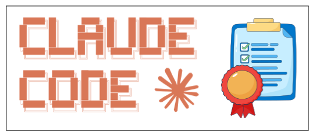

# Exam_Focus_on_Reliable_Production_AI_Systems_with_Claude

Source: https://www.educative.io/courses/claude-certified-architect-foundations/what-this-exam-tests

---

[Home](https://www.educative.io/)

[Courses](https://www.educative.io/search?tab=courses)

[Master Claude Certified Architect Foundations Exam (CCAR-F)](https://www.educative.io/courses/claude-certified-architect-foundations)

# What This Exam Tests

Explore what the Claude Certified Architect Foundations exam assesses, focusing on building reliable AI systems in production. Understand enforcing deterministic workflows, handling errors effectively, maintaining conversation context, and recognizing common architectural anti-patterns. This lesson prepares you to distinguish prototype thinking from production-ready design for successful exam outcomes.

We'll cover the following...

- [What the exam actually tests](https://www.educative.io/courses/claude-certified-architect-foundations/what-this-exam-tests#What-the-exam-actually-tests)
- [The five exam domains](https://www.educative.io/courses/claude-certified-architect-foundations/what-this-exam-tests#The-five-exam-domains)
- [Exam at a glance](https://www.educative.io/courses/claude-certified-architect-foundations/what-this-exam-tests#Exam-at-a-glance)
- [How this course is structured](https://www.educative.io/courses/claude-certified-architect-foundations/what-this-exam-tests#How-this-course-is-structured)
- [Quick knowledge check](https://www.educative.io/courses/claude-certified-architect-foundations/what-this-exam-tests#Quick-knowledge-check)

Many engineers have shipped something with Claude, such as a prototype, a demo, or an agent that works well enough in testing. The Claude Certified Architect – Foundations exam asks a different question: Can you build systems that stay reliable in production?

It recognizes the ability to build systems that enforce business rules deterministically, handle tool errors gracefully, maintain state and context across long conversations, and escalate to humans when the system reaches a decision, safety, or confidence boundary. That is the production architecture skill this certification recognizes.

Every chapter in this course targets one of the exam’s five domains. Every quiz mirrors its scenario-based format. By the time you finish this course, if you work through the exercises, the right answer to an exam question should feel obvious. You will have built that recognition from the ground up by understanding why the wrong answers fail.

## What the exam actually tests[#](https://www.educative.io/courses/claude-certified-architect-foundations/what-this-exam-tests#What-the-exam-actually-tests)

The exam is designed to catch two categories of wrong answers: Answers that are logically appealing but architecturally flawed, and answers that reflect prototype-level thinking applied to production problems.

Consider this example. Suppose an agent needs to stop its loop after completing a task.

Which design is best?

- A) Parse the assistant’s text for phrases like “task complete”
- B) Set a maximum iteration limit of 10
- C) Check the `stop_reason` field: continue on `tool_use`, exit on `end_turn`
- D) Monitor conversation length and stop after a set number of messages

Options A, B, and D all seem reasonable at first glance. Option A is what most people try first. Only **C** is correct: it reads a reliable, machine-generated signal rather than guessing from natural language or arbitrary counts.

The exam rewards the same instinct across all five domains: Reach for code-level enforcement before prompt-level guidance. Every domain has a set of common mistakes. They feel reasonable, they often work in small demos, but they fail under production pressure. We call them anti-patterns, and recognizing them is one of the most important skills this course builds.

|  |  |
| --- | --- |
| **Anti-Pattern** | **The Right Approach** |
| Parse natural language to stop an agent loop | Check `stop_reason` field |
| Enforce business rules with a system prompt | Use programmatic hooks |
| Escalate based on negative sentiment | Escalate on policy gaps and explicit requests |
| Return empty results when a tool fails | Return structured error with `isError: true` |
| Summarize context repeatedly | Preserve critical facts in an immutable block |
| Give one agent 18 tools | Distribute 4–5 tools across specialized subagents |
| Self-review generated code in the same session | Use a fresh, isolated session for review |
| Trust `tool_use` output as semantically correct | Validate semantics separately after structural compliance |

Each of these gets a full chapter. We will understand *why* the anti-pattern fails and *what breaks* when it reaches production, so the correct approach is the one that feels obvious.

## The five exam domains[#](https://www.educative.io/courses/claude-certified-architect-foundations/what-this-exam-tests#The-five-exam-domains)

The exam covers five domains, weighted by importance. Domain 1 carries the most weight at 27%, which is why Chapters 2, 3, and 4 build from a single agent loop all the way to multi-agent orchestration before moving on.

|  |  |  |  |
| --- | --- | --- | --- |
| **#** | **Domain** | **Weight** | **What It Tests** |
| 1 | Agentic Architecture and Orchestration | 27% | Agent SDK loops, multi-agent systems, hooks, session management, task decomposition |
| 2 | Tool Design and MCP Integration | 18% | Tool descriptions, structured error responses, MCP configuration, built-in tools |
| 3 | Claude Code Configuration and Workflows | 20% | CLAUDE.md hierarchy, custom commands and skills, plan mode, CI/CD integration |
| 4 | Prompt Engineering and Structured Output | 20% | Explicit criteria, few-shot prompting, JSON schema design, validation-retry loops |
| 5 | Context Management and Reliability | 15% | Context degradation, escalation patterns, information provenance, human review |

## Exam at a glance[#](https://www.educative.io/courses/claude-certified-architect-foundations/what-this-exam-tests#Exam-at-a-glance)

The “Foundations” exam is a scenario-based assessment delivered through Pearson VUE. Key details:

|  |  |
| --- | --- |
| **Exam code** | CCA-F — Claude Certified Architect, Foundations |
| **Issuer** | Anthropic |
| **Delivery** | Pearson VUE — online proctored (OnVUE) or test center |
| **Questions** | 60 multiple-choice |
| **Time limit** | 120 minutes |
| **Passing score** | 720 (scaled score, range 100–1000) |
| **Format** | Scenario-based multiple-choice; each question presents a realistic engineering situation |
| **Cost** | $125 USD |

Anthropic also offers a Professional level (CCAR-P, $175) for advanced Architect-level knowledge. This course does not cover its specific requirements.

> **To register:** Exam registration, pricing, and policies are on Anthropic Academy at [anthropic-partners.skilljar.com](https://anthropic-partners.skilljar.com). Figures above are accurate as of July 2026; verify current pricing before registering.

## How this course is structured[#](https://www.educative.io/courses/claude-certified-architect-foundations/what-this-exam-tests#How-this-course-is-structured)

Ten chapters, each ending with scenario-based quiz questions in the same format as the exam. By the end, you will have built a complete set of working implementations, from a minimal agent loop in Chapter 2 to a full multi-agent architecture in Chapter 10.

## Quick knowledge check[#](https://www.educative.io/courses/claude-certified-architect-foundations/what-this-exam-tests#Quick-knowledge-check)

A junior engineer on your team is building a customer support agent. The product manager asks: “How do we make sure the agent never approves refunds above $500 without manager sign-off?” The engineer proposes adding the following line to the system prompt:

> “Important: Never approve refunds above $500. Always escalate to a manager for approval.”

Select the correct answer!

1.

What is the fundamental problem with this approach?

A.

Prompt instructions are probabilistic, so the model may still occasionally approve a $700 refund despite the rule.

B.

The instruction is ambiguous: “Never” and “Always” are absolute terms that can confuse a model reading them literally.

C.

The system prompt is simply the wrong configuration layer here; this business rule belongs in a [CLAUDE.md](http://CLAUDE.md) file instead.

D.

The $500 threshold is just a magic number that belongs in a configuration file, not hardcoded into the prompt.

---

1 / 1

Probabilistic vs. Deterministic: The Reliability Foundation

Ask

[What the exam actually tests](https://www.educative.io/courses/claude-certified-architect-foundations/what-this-exam-tests#What-the-exam-actually-tests)

[The five exam domains](https://www.educative.io/courses/claude-certified-architect-foundations/what-this-exam-tests#The-five-exam-domains)

[Exam at a glance](https://www.educative.io/courses/claude-certified-architect-foundations/what-this-exam-tests#Exam-at-a-glance)

[How this course is structured](https://www.educative.io/courses/claude-certified-architect-foundations/what-this-exam-tests#How-this-course-is-structured)

[Quick knowledge check](https://www.educative.io/courses/claude-certified-architect-foundations/what-this-exam-tests#Quick-knowledge-check)