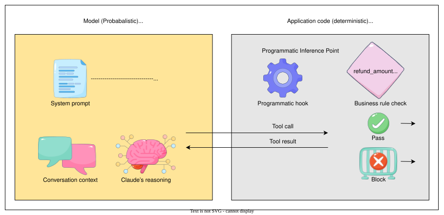

# Probabilistic_and_Deterministic_Approaches_in_Claude_AI_Reliability

Source: https://www.educative.io/courses/claude-certified-architect-foundations/probabilistic-vs-deterministic-the-reliability-foundation

---

[Home](https://www.educative.io/)

[Courses](https://www.educative.io/search?tab=courses)

[Master Claude Certified Architect Foundations Exam (CCAR-F)](https://www.educative.io/courses/claude-certified-architect-foundations)

# Probabilistic vs. Deterministic: The Reliability Foundation

Explore the key reliability trade-offs between probabilistic behavior of language models and deterministic enforcement in code. Understand when to choose fixed workflows, adaptive agents, or multi-agent systems. Discover the importance of tool design and programmatic guardrails to build robust Claude-powered AI systems that pass certification and succeed in production.

We'll cover the following...

- [The gap between “Claude can” and “you should”](https://www.educative.io/courses/claude-certified-architect-foundations/probabilistic-vs-deterministic-the-reliability-foundation#The-gap-between-Claude-can-and-you-should)
- [The five domains as engineering decisions](https://www.educative.io/courses/claude-certified-architect-foundations/probabilistic-vs-deterministic-the-reliability-foundation#The-five-domains-as-engineering-decisions)
- [When to use an agent](https://www.educative.io/courses/claude-certified-architect-foundations/probabilistic-vs-deterministic-the-reliability-foundation#When-to-use-an-agent)
- [Where tools fit](https://www.educative.io/courses/claude-certified-architect-foundations/probabilistic-vs-deterministic-the-reliability-foundation#Where-tools-fit)
- [What does reliability mean in AI systems?](https://www.educative.io/courses/claude-certified-architect-foundations/probabilistic-vs-deterministic-the-reliability-foundation#What-does-reliability-mean-in-AI-systems)
- [Exercise: Match the architecture](https://www.educative.io/courses/claude-certified-architect-foundations/probabilistic-vs-deterministic-the-reliability-foundation#Exercise-Match-the-architecture)
- [What’s next?](https://www.educative.io/courses/claude-certified-architect-foundations/probabilistic-vs-deterministic-the-reliability-foundation#Whats-next)

The Claude Certified Architect exam doesn’t just test what Claude can do. It tests whether you know when and how to apply those capabilities correctly. It tests the engineering judgment that separates a reliable production system from one that looks good in a demo but fails quietly. In this lesson, you’ll learn:

- Why each exam domain maps directly to a real production concern
- The central reliability question that runs through all five domains
- When a task calls for an agent, a fixed workflow, or something simpler
- Where tools fit in the overall picture, and why tool design matters more than it looks

## The gap between “Claude can” and “you should”[#](https://www.educative.io/courses/claude-certified-architect-foundations/probabilistic-vs-deterministic-the-reliability-foundation#The-gap-between-Claude-can-and-you-should)

Claude can follow a system prompt instruction like “never process refunds above $500.” It may comply most of the time, but probabilistic compliance is not enough for a critical business rule in a high-volume transaction workflow. The exam asks: What is the reliable way to enforce this rule? The reliable answer is a **programmatic guardrail**, such as a hook that validates the refund tool call before execution. The check intercepts the tool call in code, regardless of the model’s generated response. Prompt compliance is probabilistic. Code-level enforcement is deterministic. For critical business rules, enforce the rule in code.

The only reliable enforcement point is in the code, not in the prompt

**This is the insight the exam tests across all five domains:** Know which parts of your system can afford to be probabilistic, and which parts need deterministic guarantees.

Relying on the model for deterministic enforcement is a common cause of the anti-patterns tested on the exam. Prompt-based business rule enforcement, natural-language loop termination, and sentiment-based escalation all make the same design mistake: treating model behavior as deterministic when the system requires code-level enforcement.

## The five domains as engineering decisions[#](https://www.educative.io/courses/claude-certified-architect-foundations/probabilistic-vs-deterministic-the-reliability-foundation#The-five-domains-as-engineering-decisions)

Each certification domain represents a class of engineering decisions we face when building Claude-powered systems in production. These are software engineering questions that take on a new shape when one component of the system is a large language model.

|  |  |
| --- | --- |
| **Domain** | **The Core Engineering Question** |
| **Agentic Architecture and Orchestration** | How does the loop know when to stop, and what controls it? |
| **Tool Design and MCP Integration** | What interface does the model need to interact reliably with the outside world? |
| **Claude Code Configuration** | Where do team rules, personal preferences, and automation boundaries belong? |
| **Prompt Engineering and Structured Output** | How do we make Claude's output measurable, consistent, and validatable? |
| **Context Management and Reliability** | What must survive a long session, and what can safely be compressed or forgotten? |

Think of these five questions as the five places where a Claude-powered system can break in production. The exam tests whether we’ve internalized the answers well enough to spot the failure mode when it’s embedded in a realistic scenario.

## When to use an agent[#](https://www.educative.io/courses/claude-certified-architect-foundations/probabilistic-vs-deterministic-the-reliability-foundation#When-to-use-an-agent)

Not every task needs an agent. Choosing the right architecture is a tested skill and a real engineering decision that affects cost, reliability, and debuggability. If you could write a complete flowchart of the task before running it, a fixed workflow is probably the right call. If the flowchart has “it depends on what we find” branches that can’t be resolved until runtime, an agent is the right fit.

 based on task structure, pre-determinability, and subtask independence")

Architectural decision flowchart for selecting the appropriate design pattern (Fixed workflow, multi-agent system, or adaptive agent) based on task structure, pre-determinability, and subtask independence

- **Use a fixed workflow (prompt chain) when:**

  - The steps are known in advance and don’t change based on intermediate results.
  - Each step’s input can be fully specified before execution starts.
  - The task is structurally the same every time: classify this ticket, summarize this document, or extract these fields.
- **Use an adaptive agent when:**

  - The next step depends on what was found in the previous step.
  - The task has an unknown structure at the start, such as a bug investigation or an open-ended research question.
  - Which tools to call depends on context, not a preset sequence.
- **Use a multi-agent system when:**

  - Subtasks are independent enough to run in parallel and benefit from specialization.
  - A single agent with many tools would suffer from tool selection errors (beyond roughly five tools, selection quality degrades).
  - The coordinator’s context would be polluted by the full trace of every exploration step.

**Exam tip:** The exam frequently presents scenarios where a single overloaded agent is the wrong answer, and distributing work across a coordinator plus specialized subagents is correct. The key signal is tool count and task independence.

## Where tools fit[#](https://www.educative.io/courses/claude-certified-architect-foundations/probabilistic-vs-deterministic-the-reliability-foundation#Where-tools-fit)

**Tools** are the interface between the model and the world. They are the only way Claude can read from or write to anything outside the conversation window. Everything the agent knows about the current state of the world comes through tool results; everything it changes in the world happens through tool calls.

This framing has two important consequences:

- Tool design is information design. A tool that returns `{"error": "failed"}` tells the agent almost nothing useful. A tool that returns a structured response with an error category, a retryability flag, and what was attempted gives the agent enough to decide what to do next. The quality of the tool’s output directly shapes the quality of the agent’s decisions.
- Tool calls are the only reliable enforcement boundary. To enforce a business rule (a refund limit, a data access restriction, an irreversible action requiring approval), the only reliable place to do it is at the tool call, in code. The tool call boundary is where probabilistic model behavior meets deterministic system behavior.

We will design tools in detail in *Chapter 5*. For now, the key mental model is this: tools are the points where the system takes control back from the model.

## What does reliability mean in AI systems?[#](https://www.educative.io/courses/claude-certified-architect-foundations/probabilistic-vs-deterministic-the-reliability-foundation#What-does-reliability-mean-in-AI-systems)

In traditional software, reliability usually means: does the function return the correct output for a given input? We write tests, verify behavior, and deploy. In AI systems, the model component is inherently probabilistic. Reliability has a more layered shape:

|  |  |  |
| --- | --- | --- |
| **Type** | **Question** | **What Provides It** |
| **Structural** | Does the output have the right shape? | `tool_use` with a JSON schema |
| **Semantic** | Are the values in the output correct? | Separate validation logic |
| **Behavioral** | Does the agent take the right action? | Prompt quality plus programmatic guardrails |
| **Session** | Does the agent maintain the right context over a long run? | Scratchpads, fact blocks, and delegation strategy |

The exam tests all four types, often by presenting a scenario where one layer is addressed and the candidate’s mistake is assuming that layer covers the others.

**The most common trap:** `tool_use` with a well-defined JSON schema guarantees that the output structure is valid. It does not guarantee that the extracted vendor name, date, or amount is correct. Structural compliance and semantic correctness are separate problems that require separate solutions.

## Exercise: Match the architecture[#](https://www.educative.io/courses/claude-certified-architect-foundations/probabilistic-vs-deterministic-the-reliability-foundation#Exercise-Match-the-architecture)

Review each task description. For each one, classify it as one of three patterns: fixed workflow, adaptive agent, or multi-agent system.

Match The Answer

Statement

Match With

A

**Task A:** A nightly job that reads 500 support tickets from a database, classifies each as billing, technical, or account, and writes the result back.

Adaptive agent

B

**Task B:** An engineer asks Claude to investigate why the checkout conversion rate dropped 15% last Tuesday. Claude has access to analytics dashboards, application logs, and the codebase.

Fixed workflow

C

**Task C:** A research assistant that, given a company name, finds the CEO, recent news, financial summary, and three competitor names, then synthesizes a brief.

Multi-agent system

---

## What’s next?[#](https://www.educative.io/courses/claude-certified-architect-foundations/probabilistic-vs-deterministic-the-reliability-foundation#Whats-next)

In the next lesson, we will walk through a complete API request-response flow, from the initial API call to a tool invocation and back to the final model response. We will identify the key parts of the protocol so you have the API vocabulary needed to reason about the concepts covered later in the course.

What This Exam Tests

Agents, Tools, and Context

Ask

[The gap between “Claude can” and “you should”](https://www.educative.io/courses/claude-certified-architect-foundations/probabilistic-vs-deterministic-the-reliability-foundation#The-gap-between-Claude-can-and-you-should)

[The five domains as engineering decisions](https://www.educative.io/courses/claude-certified-architect-foundations/probabilistic-vs-deterministic-the-reliability-foundation#The-five-domains-as-engineering-decisions)

[When to use an agent](https://www.educative.io/courses/claude-certified-architect-foundations/probabilistic-vs-deterministic-the-reliability-foundation#When-to-use-an-agent)

[Where tools fit](https://www.educative.io/courses/claude-certified-architect-foundations/probabilistic-vs-deterministic-the-reliability-foundation#Where-tools-fit)

[What does reliability mean in AI systems?](https://www.educative.io/courses/claude-certified-architect-foundations/probabilistic-vs-deterministic-the-reliability-foundation#What-does-reliability-mean-in-AI-systems)

[Exercise: Match the architecture](https://www.educative.io/courses/claude-certified-architect-foundations/probabilistic-vs-deterministic-the-reliability-foundation#Exercise-Match-the-architecture)

[What’s next?](https://www.educative.io/courses/claude-certified-architect-foundations/probabilistic-vs-deterministic-the-reliability-foundation#Whats-next)