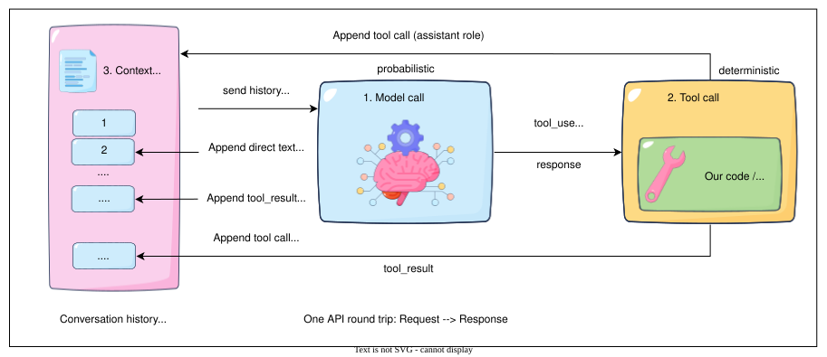

# Understanding_Agents_Tools_and_Context_in_Claude_AI_Systems

Source: https://www.educative.io/courses/claude-certified-architect-foundations/agents-tools-and-context

---

[Home](https://www.educative.io/)

[Courses](https://www.educative.io/search?tab=courses)

[Master Claude Certified Architect Foundations Exam (CCAR-F)](https://www.educative.io/courses/claude-certified-architect-foundations)

# Agents, Tools, and Context

Learn to analyze the core components of Claude AI interactions including model calls tool calls and context management. This lesson helps you visualize request and response structures with practical examples and exercises to understand agent loops and tool usage in depth.

We'll cover the following...

- [The three things in every Claude interaction](https://www.educative.io/courses/claude-certified-architect-foundations/agents-tools-and-context#The-three-things-in-every-Claude-interaction)
  - [Anatomy of a request](https://www.educative.io/courses/claude-certified-architect-foundations/agents-tools-and-context#Anatomy-of-a-request)
  - [When Claude responds directly](https://www.educative.io/courses/claude-certified-architect-foundations/agents-tools-and-context#When-Claude-responds-directly)
  - [When Claude wants to use a tool](https://www.educative.io/courses/claude-certified-architect-foundations/agents-tools-and-context#When-Claude-wants-to-use-a-tool)
  - [Closing the loop: The tool result](https://www.educative.io/courses/claude-certified-architect-foundations/agents-tools-and-context#Closing-the-loop-The-tool-result)
  - [The complete annotated transcript](https://www.educative.io/courses/claude-certified-architect-foundations/agents-tools-and-context#The-complete-annotated-transcript)
  - [Complete code](https://www.educative.io/courses/claude-certified-architect-foundations/agents-tools-and-context#Complete-code)
  - [Exercise: Label the transcript](https://www.educative.io/courses/claude-certified-architect-foundations/agents-tools-and-context#Exercise-Label-the-transcript)
- [What’s next?](https://www.educative.io/courses/claude-certified-architect-foundations/agents-tools-and-context#Whats-next)

In the last lesson, we reasoned about why code-level checks around tool calls provide a reliable enforcement boundary and when a task requires an agent. Now we’ll make that concrete: we’ll inspect what the API sends and receives, label the key parts, and build the vocabulary you’ll use for the rest of the course. By the end of this lesson, you’ll be able to:

- Build a mental model for the three moving parts in every Claude-powered system.
- Review annotated examples of a request, a tool-use response, and a tool result.
- Read a full conversation transcript labeled from the first message to the final reply.
- Complete a short exercise to test whether the labels have landed.

## The three things in every Claude interaction[#](https://www.educative.io/courses/claude-certified-architect-foundations/agents-tools-and-context#The-three-things-in-every-Claude-interaction)

Every interaction with Claude, no matter how complex, is built from three concepts:

- **Model call:** One round trip to the API. We send a request, and Claude returns a response. An agent loop is just many of these in sequence.
- **Tool call:** A request Claude makes in its response, asking us to run a function and report back. Claude does not run the function. We do.
- **Context:** The `messages` array we send on every model call. It is the only memory Claude has. Whatever is not in that array does not exist as far as Claude is concerned.



One model call, one potential tool call, and a context that grows with every turn

These three concepts appear often on the exam. Many questions about agent loops, tool responses, or context degradation come back to one of these concepts.

### Anatomy of a request[#](https://www.educative.io/courses/claude-certified-architect-foundations/agents-tools-and-context#Anatomy-of-a-request)

Here’s a minimal request using the Anthropic Python SDK. We’ll use a customer support scenario throughout this lesson so that each piece of the protocol has a concrete purpose.

Ace Editor

1

2

3

4

5

6

7

8

9

10

11

12

13

14

15

16

17

18

19

20

21

22

23

24

25

26

27

import anthropic

client = anthropic.Anthropic()

response = client.messages.create(

model="claude-opus-4-8",

max\_tokens=1024,

system="You are a customer support agent. Process refunds within policy only.",

tools=[

{

"name": "process\_refund",

"description": "Process a refund for a customer order.",

"input\_schema": {

"type": "object",

"properties": {

"order\_id": {"type": "string"},

"amount": {"type": "number"},

"reason": {"type": "string"}

},

"required": ["order\_id", "amount", "reason"]

}

}

],

messages=[

{"role": "user", "content": "I need a refund for order #12345. It arrived damaged."}

]

)

הההההההההההההההההההההההההההההההההההההההההההההההההההההההההההההההההההההההההההההההההההההההההההההההההההההההההההההההההההההההההההההההההההההההההההההההההההההההההההההההההההההההההההההההההההההההההההההההההההההההההההההההההההההההההההההההההההההההההההההההההההההההההההההההההההההההההההההההההההההההההההההההההההההההההההההההההההההההההההההההההההההההההההההההההההההההההההההההההההההההההההההההההההההההההההההההההההההההההההההההההההההההההההההההההההההההההההההההההההההההההההההההההההההההההההההההההההההההההההההההההההההההההההההההההההההההההההההההה

XXXXXXXXXXXXXXXXXXXXXXXXXXXXXXXXXXXXXXXXXXXXXXXXXXXXXXXXXXXXXXXXXXXXXXXXXXXXXXXXXXXXXXXXXXXXXXXXXXXXXXXXXXXXXXXXXXXXXXXXXXXXXXXXXXXXXXXXXXXXXXXXXXXXXXXXXXXXXXXXXXXXXXXXXXXXXXXXXXXXXXXXXXXXXXXXXXXXXXXXXXXXXXXXXXXXXXXXXXXXXXXXXXXXXXXXXXXXXXXXXXXXXXXXXXXXXXXXXXXXXXXXXXXXXXXXXXXXXXXXXXXXXXXXXXXXXXXXXXXXXXXXXXXXXXXXXXXXXXXXXXXXXXXXXXXXXXXXXXXXXXXXXXXXXXXXXXXXXXXXXXXXXXXXXXXXXXXXXXXXXXXXXXXXXXXXXXXXXXXXXXXXXXXXXXXXXXXXXXXXXXXXXXXXXXXXXXXXXXXXXXXXXXXXXXXXXXXXXXXXXXXXXXXXXXXXXXXXXXXXXXXXXXXXXXXXXXXXXXXXXXXXXXXXXXXX

A minimal API request with a system prompt, one tool definition, and a single user message

Let’s walk through each part:

- **Line 1:** We import the official Anthropic Python SDK. This is the only dependency needed to make API calls.
- **Line 3:** We create a client instance. By default, it reads the `ANTHROPIC_API_KEY` environment variable for authentication. We never hardcode the key.
- **Line 5:** We open the `messages.create()` call, which sends a request to the API and returns a response object.
- **Line 6:** We specify which Claude model to use. The model is set per request, not on the client, so different calls in the same agent loop can target different models if needed.
- **Line 7:** We set a hard cap on how many tokens Claude can generate in this response. This is a budget control, not a quality setting. The response stops at this limit even if Claude is mid-sentence.
- **Line 8:** We provide the system prompt. Claude reads this on every turn of the conversation. It shapes behavior for the whole session, which is why business rules should live here and not in a user message.
- **Lines 9–22:** We define the `tools` list, the functions Claude is allowed to request. Each tool has a `name`, a `description` that Claude reads to decide when to use it, and an `input_schema` that defines the required arguments as a JSON Schema.
- **Lines 13–21:** The `input_schema` tells Claude which arguments to populate, what types they must be, and which are required. Claude uses this schema to construct the `input` object it sends back in a `tool_use` block.
- **Lines 24–26:** We provide the `messages` array, the conversation history. Right now, it holds one user message. After every round trip, we append to this array and send the full history back. This array is the entire state of the conversation.

### When Claude responds directly[#](https://www.educative.io/courses/claude-certified-architect-foundations/agents-tools-and-context#When-Claude-responds-directly)

If Claude has enough information to reply without calling a tool, `stop_reason` is `"end_turn"`, and the response looks like this:

Ace Editor

1

2

3

4

5

6

7

8

9

10

11

12

13

14

{

"id": "msg\_01ABC123",

"type": "message",

"role": "assistant",

"content": [

{

"type": "text",

"text": "I can see order #12345 in the system. Could you confirm the email on the account before I process this?"

}

],

"model": "claude-opus-4-8",

"stop\_reason": "end\_turn",

"usage": {"input\_tokens": 89, "output\_tokens": 31}

}

הההההההההההההההההההההההההההההההההההההההההההההההההההההההההההההההההההההההההההההההההההההההההההההההההההההההההההההההההההההההההההההההההההההההההההההההההההההההההההההההההההההההההההההההההההההההההההההההההההההההההההההההההההההההההההההההההההההההההההההההההההההההההההההההההההההההההההההההההההההההההההההההההההההההההההההההההההההההההההההההההההההההההההההההההההההההההההההההההההההההההההההההההההההההההההההההההההההההההההההההההההההההההההההההההההההההההההההההההההההההההההההההההההההההההההההההההההההההההההההההההההההההההההההההההההההההההההההההה

XXXXXXXXXXXXXXXXXXXXXXXXXXXXXXXXXXXXXXXXXXXXXXXXXXXXXXXXXXXXXXXXXXXXXXXXXXXXXXXXXXXXXXXXXXXXXXXXXXXXXXXXXXXXXXXXXXXXXXXXXXXXXXXXXXXXXXXXXXXXXXXXXXXXXXXXXXXXXXXXXXXXXXXXXXXXXXXXXXXXXXXXXXXXXXXXXXXXXXXXXXXXXXXXXXXXXXXXXXXXXXXXXXXXXXXXXXXXXXXXXXXXXXXXXXXXXXXXXXXXXXXXXXXXXXXXXXXXXXXXXXXXXXXXXXXXXXXXXXXXXXXXXXXXXXXXXXXXXXXXXXXXXXXXXXXXXXXXXXXXXXXXXXXXXXXXXXXXXXXXXXXXXXXXXXXXXXXXXXXXXXXXXXXXXXXXXXXXXXXXXXXXXXXXXXXXXXXXXXXXXXXXXXXXXXXXXXXXXXXXXXXXXXXXXXXXXXXXXXXXXXXXXXXXXXXXXXXXXXXXXXXXXXXXXXXXXXXXXXXXXXXXXXXXXXXX

A response where Claude answered directly. The stop\_reason is "end\_turn" and the content holds a single text block.

Here’s what each field tells us:

- **Line 2:** `"id"` is a unique identifier for this response. Use it when logging or correlating requests to responses.
- **Line 3:** `"type"` is the top-level type of the response object. It is always `"message"` for text and tool interactions.
- **Line 4:** `"role": "assistant"` confirms this is Claude’s output. When we append this response to the messages array to build context, we use this role value.
- **Lines 5–10:** `"content"` is an array of content blocks. Here, it holds a single `text` block. The same array can hold multiple blocks of different types, which we’ll see in the next section.
- **Line 7:** `"type": "text"` inside the content block identifies this as a plain text response. The other content block type we care about is `"tool_use"`, which signals a tool call request.
- **Line 12:** `"stop_reason": "end_turn"` is the most important field for loop control. It means Claude finished its response and is waiting for input. There is no tool to run. The agent loop should surface this response to the user or advance to the next step.
- **Line 13:** `"usage"` provides the token counts for this round trip. Tracking these across turns tells us how fast the context window is filling up.

### When Claude wants to use a tool[#](https://www.educative.io/courses/claude-certified-architect-foundations/agents-tools-and-context#When-Claude-wants-to-use-a-tool)

Now, the same scenario with more context provided. Claude decides it has enough information to act. The response shape changes:

Ace Editor

1

2

3

4

5

6

7

8

9

10

11

12

13

14

15

16

17

18

19

20

21

22

23

24

{

"id": "msg\_01DEF456",

"type": "message",

"role": "assistant",

"content": [

{

"type": "text",

"text": "I'll process that refund for order #12345 right away."

},

{

"type": "tool\_use",

"id": "toolu\_01XYZ789",

"name": "process\_refund",

"input": {

"order\_id": "12345",

"amount": 49.99,

"reason": "Item arrived damaged"

}

}

],

"model": "claude-opus-4-8",

"stop\_reason": "tool\_use",

"usage": {"input\_tokens": 97, "output\_tokens": 52}

}

הההההההההההההההההההההההההההההההההההההההההההההההההההההההההההההההההההההההההההההההההההההההההההההההההההההההההההההההההההההההההההההההההההההההההההההההההההההההההההההההההההההההההההההההההההההההההההההההההההההההההההההההההההההההההההההההההההההההההההההההההההההההההההההההההההההההההההההההההההההההההההההההההההההההההההההההההההההההההההההההההההההההההההההההההההההההההההההההההההההההההההההההההההההההההההההההההההההההההההההההההההההההההההההההההההההההההההההההההההההההההההההההההההההההההההההההההההההההההההההההההההההההההההההההההההההההההההההההה

XXXXXXXXXXXXXXXXXXXXXXXXXXXXXXXXXXXXXXXXXXXXXXXXXXXXXXXXXXXXXXXXXXXXXXXXXXXXXXXXXXXXXXXXXXXXXXXXXXXXXXXXXXXXXXXXXXXXXXXXXXXXXXXXXXXXXXXXXXXXXXXXXXXXXXXXXXXXXXXXXXXXXXXXXXXXXXXXXXXXXXXXXXXXXXXXXXXXXXXXXXXXXXXXXXXXXXXXXXXXXXXXXXXXXXXXXXXXXXXXXXXXXXXXXXXXXXXXXXXXXXXXXXXXXXXXXXXXXXXXXXXXXXXXXXXXXXXXXXXXXXXXXXXXXXXXXXXXXXXXXXXXXXXXXXXXXXXXXXXXXXXXXXXXXXXXXXXXXXXXXXXXXXXXXXXXXXXXXXXXXXXXXXXXXXXXXXXXXXXXXXXXXXXXXXXXXXXXXXXXXXXXXXXXXXXXXXXXXXXXXXXXXXXXXXXXXXXXXXXXXXXXXXXXXXXXXXXXXXXXXXXXXXXXXXXXXXXXXXXXXXXXXXXXXXXX

A response where Claude requested a tool call. The content array holds both a text block and a tool\_use block. The stop\_reason is "tool\_use".

Let’s go through the new and changed fields:

- **Lines 5–20:** The `content` array now holds two blocks: a `text` block and a `tool_use` block. Claude narrated its intention and made the tool call in the same turn. Both blocks must be preserved when we add this response to the messages array.
- **Line 11:** `"type": "tool_use"` identifies this content block as a tool call request. This is Claude’s way of saying “run this function for me and send me the result.”
- **Line 12:** `"id": "toolu_01XYZ789"` is the unique identifier for this specific tool call. This is separate from the message `id` on line 2. We must echo this exact value back as `tool_use_id` when we send the result. Without it, Claude cannot match the result to its request.
- **Line 13:** `"name": "process_refund"` is the tool Claude wants to run. This must exactly match a tool name in the `tools` list we sent in the request.
- **Lines 14–18:** `"input"` contains the arguments Claude chose for this call, populated according to the `input_schema` we defined. These are the values our code will use when running the actual function.
- **Line 22:** `"stop_reason": "tool_use"` signals that Claude is pausing and waiting for a tool result. The agent loop must not surface this to the user. Instead, it runs the requested tool and sends the result back.


The ID field is the handshake between a tool call and its result

### Closing the loop: The tool result[#](https://www.educative.io/courses/claude-certified-architect-foundations/agents-tools-and-context#Closing-the-loop-The-tool-result)

We run the function in our code and get a result. Now we build the next API call by appending two new messages to the array and sending everything back.

Ace Editor

1

2

3

4

5

6

7

8

9

10

11

12

13

14

15

16

17

18

19

20

21

22

23

24

25

26

27

messages = [

{

"role": "user",

"content": "I need a refund for order #12345. It arrived damaged."

},

{

"role": "assistant",

"content": response.content

},

{

"role": "user",

"content": [

{

"type": "tool\_result",

"tool\_use\_id": "toolu\_01XYZ789",

"content": "Refund of $49.99 processed. Confirmation number: REF-7890."

}

]

}

]

final\_response = client.messages.create(

model="claude-opus-4-8",

max\_tokens=1024,

system="You are a customer support agent. Process refunds within policy only.",

tools=[...],

messages=messages

הההההההההההההההההההההההההההההההההההההההההההההההההההההההההההההההההההההההההההההההההההההההההההההההההההההההההההההההההההההההההההההההההההההההההההההההההההההההההההההההההההההההההההההההההההההההההההההההההההההההההההההההההההההההההההההההההההההההההההההההההההההההההההההההההההההההההההההההההההההההההההההההההההההההההההההההההההההההההההההההההההההההההההההההההההההההההההההההההההההההההההההההההההההההההההההההההההההההההההההההההההההההההההההההההההההההההההההההההההההההההההההההההההההההההההההההההההההההההההההההההההההההההההההההההההההההההההההההה

XXXXXXXXXXXXXXXXXXXXXXXXXXXXXXXXXXXXXXXXXXXXXXXXXXXXXXXXXXXXXXXXXXXXXXXXXXXXXXXXXXXXXXXXXXXXXXXXXXXXXXXXXXXXXXXXXXXXXXXXXXXXXXXXXXXXXXXXXXXXXXXXXXXXXXXXXXXXXXXXXXXXXXXXXXXXXXXXXXXXXXXXXXXXXXXXXXXXXXXXXXXXXXXXXXXXXXXXXXXXXXXXXXXXXXXXXXXXXXXXXXXXXXXXXXXXXXXXXXXXXXXXXXXXXXXXXXXXXXXXXXXXXXXXXXXXXXXXXXXXXXXXXXXXXXXXXXXXXXXXXXXXXXXXXXXXXXXXXXXXXXXXXXXXXXXXXXXXXXXXXXXXXXXXXXXXXXXXXXXXXXXXXXXXXXXXXXXXXXXXXXXXXXXXXXXXXXXXXXXXXXXXXXXXXXXXXXXXXXXXXXXXXXXXXXXXXXXXXXXXXXXXXXXXXXXXXXXXXXXXXXXXXXXXXXXXXXXXXXXXXXXXXXXXXXXX

Building the second API call: The original user message, Claude’s previous response, and the tool result are all appended to the messages array before sending

Here’s what each new part does:

- **Lines 1–20:** We construct the full messages array to pass to the next API call. The API is stateless; it has no memory between calls, so we send the complete history every time.
- **Lines 6–9:** We append Claude’s previous response as an `assistant` turn using `response.content`, which gives us the full content list, including both the text block and the `tool_use` block. Claude needs to see its own tool call request in context to understand what the result refers to. Stripping the `tool_use` block would break the conversation.
- **Lines 10–19:** We add the tool result as a `user`-role message. This surprises people at first. The `role` field describes who produced the content. Our application produced this result, so it belongs under `user`. The `assistant` role is reserved exclusively for Claude’s own responses.
- **Line 14:** `"type": "tool_result"` identifies this content block as a function output. Claude looks for this type to know the requested function has been executed.
- **Line 15:** `"tool_use_id": "toolu_01XYZ789"` links this result to the specific tool call that requested it. This must match the `id` field from the `tool_use` block exactly.
- **Line 16:** `"content"` holds the output our function returned. This can be a plain string or a list of content blocks. Claude reads this to determine its next action.
- **Lines 22–28:** We make the second API call, passing the complete updated messages array. This call will produce Turn 4, Claude’s final response to the user.

### The complete annotated transcript[#](https://www.educative.io/courses/claude-certified-architect-foundations/agents-tools-and-context#The-complete-annotated-transcript)

Here is the full four-turn conversation after both API calls complete. Read it top to bottom as if you are the agent loop watching the context grow:

Ace Editor

1

2

3

4

5

6

7

8

9

10

11

12

13

14

15

16

17

18

19

20

21

22

23

24

25

26

27

messages = [

# Turn 1 — User opens the conversation

# This is the only input to API call 1.

{

"role": "user",

"content": "I need a refund for order #12345. It arrived damaged."

},

# Turn 2 — Claude requests a tool call (API call 1 response)

# stop\_reason was "tool\_use". We append the full content list unchanged.

{

"role": "assistant",

"content": [

{"type": "text", "text": "I'll process that refund for order #12345 right away."},

{"type": "tool\_use", "id": "toolu\_01XYZ789", "name": "process\_refund",

"input": {"order\_id": "12345", "amount": 49.99, "reason": "Item arrived damaged"}}

]

},

# Turn 3 — We return the tool result

# Turns 1, 2, and 3 together are the input to API call 2.

{

"role": "user",

"content": [

{"type": "tool\_result", "tool\_use\_id": "toolu\_01XYZ789",

"content": "Refund of $49.99 processed. Confirmation number: REF-7890."}

הההההההההההההההההההההההההההההההההההההההההההההההההההההההההההההההההההההההההההההההההההההההההההההההההההההההההההההההההההההההההההההההההההההההההההההההההההההההההההההההההההההההההההההההההההההההההההההההההההההההההההההההההההההההההההההההההההההההההההההההההההההההההההההההההההההההההההההההההההההההההההההההההההההההההההההההההההההההההההההההההההההההההההההההההההההההההההההההההההההההההההההההההההההההההההההההההההההההההההההההההההההההההההההההההההההההההההההההההההההההההההההההההההההההההההההההההההההההההההההההההההההההההההההההההההההההההההההההה

XXXXXXXXXXXXXXXXXXXXXXXXXXXXXXXXXXXXXXXXXXXXXXXXXXXXXXXXXXXXXXXXXXXXXXXXXXXXXXXXXXXXXXXXXXXXXXXXXXXXXXXXXXXXXXXXXXXXXXXXXXXXXXXXXXXXXXXXXXXXXXXXXXXXXXXXXXXXXXXXXXXXXXXXXXXXXXXXXXXXXXXXXXXXXXXXXXXXXXXXXXXXXXXXXXXXXXXXXXXXXXXXXXXXXXXXXXXXXXXXXXXXXXXXXXXXXXXXXXXXXXXXXXXXXXXXXXXXXXXXXXXXXXXXXXXXXXXXXXXXXXXXXXXXXXXXXXXXXXXXXXXXXXXXXXXXXXXXXXXXXXXXXXXXXXXXXXXXXXXXXXXXXXXXXXXXXXXXXXXXXXXXXXXXXXXXXXXXXXXXXXXXXXXXXXXXXXXXXXXXXXXXXXXXXXXXXXXXXXXXXXXXXXXXXXXXXXXXXXXXXXXXXXXXXXXXXXXXXXXXXXXXXXXXXXXXXXXXXXXXXXXXXXXXXXXX

The complete four-turn messages array after both API calls. Turns 1–3 are the input to API call 2. Turn 4 is its output.

- **Lines 3–8:** Turn 1 is the user’s opening message. This is the only input to the first API call.
- **Lines 10–19:** Turn 2 is Claude’s response to the first API call. The `stop_reason` was `"tool_use"`, so the loop does not surface this to the user. Instead, it appends the full content list (both the text block and the `tool_use` block) unchanged and moves to the next step.
- **Lines 21–28:** Turn 3 is the tool result we send back. Turns 1, 2, and 3 together make up the `messages` array for the second API call. This is the context Claude sees when generating Turn 4.
- **Lines 30–38:** Turn 4 is Claude’s final response. The `stop_reason` is `"end_turn"`, so the loop surfaces the text to the user and stops iterating.

### Complete code[#](https://www.educative.io/courses/claude-certified-architect-foundations/agents-tools-and-context#Complete-code)

We bring together the request anatomy, both response shapes, and the tool result handshake from this lesson into one runnable file. The script makes two API calls: the first returns a `tool_use` stop reason with both a text block and a `tool_use` block in the content array, and the second returns `end_turn` after the tool result is delivered. The annotated transcript at the end labels each turn exactly as the lesson diagrams show.

Please provide values for the following:

ANTHROPIC\_API\_KEY

Import Values from JSON

Python 3.14.0

```
import json

import anthropic

anthropic_api_key = "{{ANTHROPIC_API_KEY}}"

client = anthropic.Anthropic(api_key=anthropic_api_key)

TOOLS = [

{

"name": "process_refund",

"description": "Process a refund for a customer order.",

"input_schema": {

"type": "object",

"properties": {

"order_id": {"type": "string"},

"amount":   {"type": "number"},

"reason":   {"type": "string"}

},

"required": ["order_id", "amount", "reason"]

}

}

]

SYSTEM = (

"You are a customer support agent. Process refunds within policy only.\n\n"

"Order database:\n"

"  #12345 — Widget Set x3, $49.99, shipped 2025-03-10"

)

def process_refund(order_id: str, amount: float, reason: str) -> str:

confirmation = f"REF-{abs(hash(order_id)) % 10000:04d}"

return f"Refund of ${amount:.2f} processed. Confirmation number: {confirmation}."

def run():

print("=== API call 1: user asks for a refund ===\n")

USER_MSG = "I need a refund for order #12345. It arrived damaged."

messages = [

{"role": "user", "content": USER_MSG}

]

response = client.messages.create(

model="claude-opus-4-8",

max_tokens=1024,

system=SYSTEM,

tools=TOOLS,

messages=messages

)

print(f"stop_reason  : {response.stop_reason}")

for i, block in enumerate(response.content):

if block.type == "text":

print(f"content[{i}]   : text      — {block.text}")

elif block.type == "tool_use":

print(f"content[{i}]   : tool_use  — {block.name}({json.dumps(block.input)})")

print(f"tool_use_id  : {block.id}")

if response.stop_reason != "tool_use":

print("\nClaude replied directly (end_turn). No tool cycle needed.")

return

tool_block  = next(b for b in response.content if b.type == "tool_use")

tool_result = process_refund(**tool_block.input)

print(f"\nTool result  : {tool_result}")

print("\n=== API call 2: send tool result, receive final reply ===\n")

messages = [

{"role": "user",      "content": USER_MSG},

{"role": "assistant", "content": response.content},

{"role": "user",      "content": [

{"type": "tool_result", "tool_use_id": tool_block.id, "content": tool_result}

]}

]

final = client.messages.create(

model="claude-opus-4-8",

max_tokens=1024,

system=SYSTEM,

tools=TOOLS,

messages=messages

)

print(f"stop_reason  : {final.stop_reason}")

for i, block in enumerate(final.content):

if block.type == "text":

print(f"content[{i}]   : text      — {block.text}")

print("\n=== Annotated 4-turn transcript ===\n")

print(f"Turn 1 [user]      : {messages[0]['content']}")

for block in messages[1]["content"]:

if block.type == "text":

print(f"Turn 2 [assistant] : text      — {block.text}")

elif block.type == "tool_use":

print(f"Turn 2 [assistant] : tool_use  — {block.name}({json.dumps(block.input)})")

tr = messages[2]["content"][0]

print(f"Turn 3 [user]      : tool_result({tr['tool_use_id'][:24]}...) = {tr['content']}")

for block in final.content:

if block.type == "text":

print(f"Turn 4 [assistant] : text      — {block.text}")

if __name__ == "__main__":

run()
```

⋯

The complete two-call refund conversation. The first call returns `tool\_use`; the second returns `end\_turn` after the tool result is provided. The annotated transcript maps each turn to the messages array entries that built it.

Running the script produces output like this:

Ace Editor

1

2

3

4

5

6

7

8

9

10

11

12

13

14

15

16

17

18

19

20

21

=== API call 1: user asks for a refund ===

stop\_reason : tool\_use

content[0] : text — I'll process that refund for order #12345 right away.

content[1] : tool\_use — process\_refund({"order\_id": "12345", "amount": 49.99, "reason": "Item arrived damaged"})

tool\_use\_id : toolu\_01AbCdEfGhIjKlMnOpQ...

Tool result : Refund of $49.99 processed. Confirmation number: REF-5840.

=== API call 2: send tool result, receive final reply ===

stop\_reason : end\_turn

content[0] : text — Your refund of $49.99 for order #12345 has been processed. Confirmation number: REF-5840.

=== Annotated 4-turn transcript ===

Turn 1 [user] : I need a refund for order #12345. It arrived damaged.

Turn 2 [assistant] : text — I'll process the refund for order #12345 right away.

Turn 2 [assistant] : tool\_use — process\_refund({"order\_id": "12345", "amount": 49.99, "reason": "Item arrived damaged"})

Turn 3 [user] : tool\_result(toolu\_01AbCdEfGhIjKlMnOpQ...) = Refund of $49.99 processed. Confirmation number: REF-5840.

Turn 4 [assistant] : text — Your refund of $49.99 for order #12345 has been processed. Confirmation number: REF-5840.

הההההההההההההההההההההההההההההההההההההההההההההההההההההההההההההההההההההההההההההההההההההההההההההההההההההההההההההההההההההההההההההההההההההההההההההההההההההההההההההההההההההההההההההההההההההההההההההההההההההההההההההההההההההההההההההההההההההההההההההההההההההההההההההההההההההההההההההההההההההההההההההההההההההההההההההההההההההההההההההההההההההההההההההההההההההההההההההההההההההההההההההההההההההההההההההההההההההההההההההההההההההההההההההההההההההההההההההההההההההההההההההההההההההההההההההההההההההההההההההההההההההההההההההההההההההההההההההההה

XXXXXXXXXXXXXXXXXXXXXXXXXXXXXXXXXXXXXXXXXXXXXXXXXXXXXXXXXXXXXXXXXXXXXXXXXXXXXXXXXXXXXXXXXXXXXXXXXXXXXXXXXXXXXXXXXXXXXXXXXXXXXXXXXXXXXXXXXXXXXXXXXXXXXXXXXXXXXXXXXXXXXXXXXXXXXXXXXXXXXXXXXXXXXXXXXXXXXXXXXXXXXXXXXXXXXXXXXXXXXXXXXXXXXXXXXXXXXXXXXXXXXXXXXXXXXXXXXXXXXXXXXXXXXXXXXXXXXXXXXXXXXXXXXXXXXXXXXXXXXXXXXXXXXXXXXXXXXXXXXXXXXXXXXXXXXXXXXXXXXXXXXXXXXXXXXXXXXXXXXXXXXXXXXXXXXXXXXXXXXXXXXXXXXXXXXXXXXXXXXXXXXXXXXXXXXXXXXXXXXXXXXXXXXXXXXXXXXXXXXXXXXXXXXXXXXXXXXXXXXXXXXXXXXXXXXXXXXXXXXXXXXXXXXXXXXXXXXXXXXXXXXXXXXXXX

The `stop_reason` on API call 1 is `tool_use`, which signals that the loop must not surface anything to the user yet. The `tool_use_id` on Turn 2 exactly matches the `tool_use_id` on Turn 3; that match is what allows Claude to associate the result with its request. API call 2 returns `end_turn`, so the loop surfaces Turn 4 to the user and stops.

### Exercise: Label the transcript[#](https://www.educative.io/courses/claude-certified-architect-foundations/agents-tools-and-context#Exercise-Label-the-transcript)

Read the transcript below and answer the four questions that follow. The code runs correctly; your job is to read it, not fix it.

Ace Editor

1

2

3

4

5

6

7

8

9

10

11

12

13

14

15

messages = [

{"role": "user", "content": "What's the status of my order #99001?"},

{"role": "assistant", "content": [

{"type": "tool\_use", "id": "toolu\_ABCdef", "name": "get\_order\_status",

"input": {"order\_id": "99001"}}

]},

{"role": "user", "content": [

{"type": "tool\_result", "tool\_use\_id": "toolu\_ABCdef",

"content": "Order #99001 is in transit. Expected delivery: June 12."}

]},

{"role": "assistant", "content": [

{"type": "text",

"text": "Your order #99001 is on its way and should arrive by June 12."}

]}

]

הההההההההההההההההההההההההההההההההההההההההההההההההההההההההההההההההההההההההההההההההההההההההההההההההההההההההההההההההההההההההההההההההההההההההההההההההההההההההההההההההההההההההההההההההההההההההההההההההההההההההההההההההההההההההההההההההההההההההההההההההההההההההההההההההההההההההההההההההההההההההההההההההההההההההההההההההההההההההההההההההההההההההההההההההההההההההההההההההההההההההההההההההההההההההההההההההההההההההההההההההההההההההההההההההההההההההההההההההההההההההההההההההההההההההההההההההההההההההההההההההההההההההההההההההההההההההההההההה

XXXXXXXXXXXXXXXXXXXXXXXXXXXXXXXXXXXXXXXXXXXXXXXXXXXXXXXXXXXXXXXXXXXXXXXXXXXXXXXXXXXXXXXXXXXXXXXXXXXXXXXXXXXXXXXXXXXXXXXXXXXXXXXXXXXXXXXXXXXXXXXXXXXXXXXXXXXXXXXXXXXXXXXXXXXXXXXXXXXXXXXXXXXXXXXXXXXXXXXXXXXXXXXXXXXXXXXXXXXXXXXXXXXXXXXXXXXXXXXXXXXXXXXXXXXXXXXXXXXXXXXXXXXXXXXXXXXXXXXXXXXXXXXXXXXXXXXXXXXXXXXXXXXXXXXXXXXXXXXXXXXXXXXXXXXXXXXXXXXXXXXXXXXXXXXXXXXXXXXXXXXXXXXXXXXXXXXXXXXXXXXXXXXXXXXXXXXXXXXXXXXXXXXXXXXXXXXXXXXXXXXXXXXXXXXXXXXXXXXXXXXXXXXXXXXXXXXXXXXXXXXXXXXXXXXXXXXXXXXXXXXXXXXXXXXXXXXXXXXXXXXXXXXXXXXX

A complete two-call transcript

Try each question before checking the answers.

Technical Quiz

1.

How many model calls does this transcript represent?

A.

Two, because the assistant role appears twice in the messages array, and each assistant turn is the output of exactly one call to `messages.create`.

B.

One, because the entire four-turn exchange is treated as a single continuous session, with the tool cycle occurring as an internal step inside that one call rather than across a call boundary.

C.

Three calls, one for the user message, one to request the tool call, and one to produce the final reply after the tool result comes back, since the API logs a request each time a turn is appended to the transcript.

D.

Four calls, one for each turn recorded in the messages array, since every entry in that array represents a distinct round trip to the API.

---

1 / 4

## What’s next?[#](https://www.educative.io/courses/claude-certified-architect-foundations/agents-tools-and-context#Whats-next)

We have seen what `stop_reason` tells us: `"tool_use"` means keep going, and `"end_turn"` means we are done. In the next lesson, we will examine every value `stop_reason` can take, what each one means for loop control, and what the rest of the response envelope exposes before we write a single line of agent logic.

Probabilistic vs. Deterministic: The Reliability Foundation

Reading the API Response Shape

Ask

[The three things in every Claude interaction](https://www.educative.io/courses/claude-certified-architect-foundations/agents-tools-and-context#The-three-things-in-every-Claude-interaction)

[Anatomy of a request](https://www.educative.io/courses/claude-certified-architect-foundations/agents-tools-and-context#Anatomy-of-a-request)

[When Claude responds directly](https://www.educative.io/courses/claude-certified-architect-foundations/agents-tools-and-context#When-Claude-responds-directly)

[When Claude wants to use a tool](https://www.educative.io/courses/claude-certified-architect-foundations/agents-tools-and-context#When-Claude-wants-to-use-a-tool)

[Closing the loop: The tool result](https://www.educative.io/courses/claude-certified-architect-foundations/agents-tools-and-context#Closing-the-loop-The-tool-result)

[The complete annotated transcript](https://www.educative.io/courses/claude-certified-architect-foundations/agents-tools-and-context#The-complete-annotated-transcript)

[Complete code](https://www.educative.io/courses/claude-certified-architect-foundations/agents-tools-and-context#Complete-code)

[Exercise: Label the transcript](https://www.educative.io/courses/claude-certified-architect-foundations/agents-tools-and-context#Exercise-Label-the-transcript)

[What’s next?](https://www.educative.io/courses/claude-certified-architect-foundations/agents-tools-and-context#Whats-next)