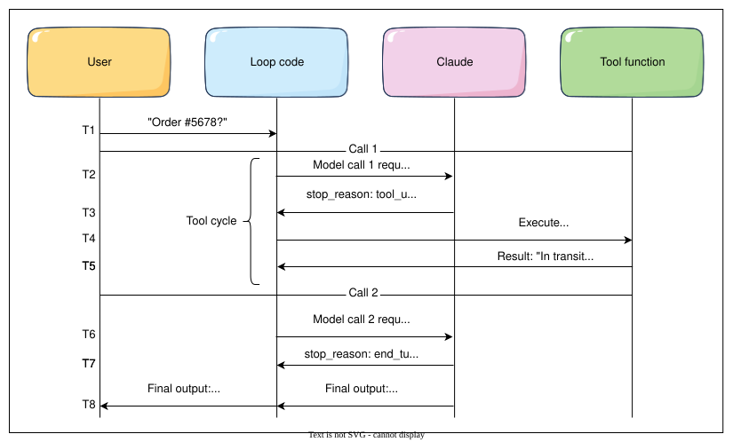

# Build_a_Claude_Client_SDK_Agent_Loop_with_Python

Source: https://www.educative.io/courses/claude-certified-architect-foundations/building-the-agent-loop-client-sdk-from-scratch

---

[Home](https://www.educative.io/)

[Courses](https://www.educative.io/search?tab=courses)

[Master Claude Certified Architect Foundations Exam (CCAR-F)](https://www.educative.io/courses/claude-certified-architect-foundations)

# Building the Agent Loop: Client SDK from Scratch

Explore building a functional agent loop from first principles using the Claude Client SDK. This lesson guides you through implementing tool definitions, dispatching tool calls, and managing API interaction to create a runnable agent loop in Python that handles user queries and tool results systematically.

We'll cover the following...

- [What we are building](https://www.educative.io/courses/claude-certified-architect-foundations/building-the-agent-loop-client-sdk-from-scratch#What-we-are-building)
- [Setting up](https://www.educative.io/courses/claude-certified-architect-foundations/building-the-agent-loop-client-sdk-from-scratch#Setting-up)
- [The tool definition and mock implementation](https://www.educative.io/courses/claude-certified-architect-foundations/building-the-agent-loop-client-sdk-from-scratch#The-tool-definition-and-mock-implementation)
- [The agent loop](https://www.educative.io/courses/claude-certified-architect-foundations/building-the-agent-loop-client-sdk-from-scratch#The-agent-loop)
- [The dispatch function](https://www.educative.io/courses/claude-certified-architect-foundations/building-the-agent-loop-client-sdk-from-scratch#The-dispatch-function)
- [Running the agent](https://www.educative.io/courses/claude-certified-architect-foundations/building-the-agent-loop-client-sdk-from-scratch#Running-the-agent)
- [What just happened: The life cycle trace](https://www.educative.io/courses/claude-certified-architect-foundations/building-the-agent-loop-client-sdk-from-scratch#What-just-happened-The-life-cycle-trace)
  - [Complete code](https://www.educative.io/courses/claude-certified-architect-foundations/building-the-agent-loop-client-sdk-from-scratch#Complete-code)
- [Exercise: Trace the loop](https://www.educative.io/courses/claude-certified-architect-foundations/building-the-agent-loop-client-sdk-from-scratch#Exercise-Trace-the-loop)
- [What’s next?](https://www.educative.io/courses/claude-certified-architect-foundations/building-the-agent-loop-client-sdk-from-scratch#Whats-next)

In the previous chapter, we read the protocol. Now we build with it. By the end of this lesson, we will have a working agent loop that sends a task to Claude, handles tool calls, and returns a final answer. It is written from first principles, so every line has a clear reason to exist. By the end of this lesson, we will have:

- A complete, runnable agent loop in under 50 lines of Python
- A mock tool implementation to observe the full tool cycle
- A labeled trace of what happened during a real run
- A clear map between the code we wrote and the life cycle concepts from the previous chapter

> **Client SDK vs. Agent SDK:** In this chapter, we use the Anthropic Client SDK (`pip install anthropic`), where `client.messages.create()` is our API call, and we implement the tool loop ourselves. This is distinct from the Claude Agent SDK (`pip install claude-agent-sdk`), which ships with built-in tools (Read, Edit, Bash, and more) and handles the loop autonomously via a `query()` function. We will learn the Client SDK because understanding the protocol at a foundational level is what lets you debug and customize any agent system.

## What we are building[#](https://www.educative.io/courses/claude-certified-architect-foundations/building-the-agent-loop-client-sdk-from-scratch#What-we-are-building)

The agent we will build handles order status lookups for a customer support scenario. A user asks about an order, the agent calls a lookup tool, and Claude reads the result and replies. Simple enough to fit on one screen, complex enough to exercise every part of the loop. Here is the target behavior:

1. User sends: *“What is the status of order #5678?”*
2. Claude decides to call `get_order_status`.
3. Our loop runs the function and returns the result.
4. Claude reads the result and replies with a natural language answer.
5. The loop returns that answer.

The diagram below shows the full flow we are about to implement, from the first API call to the final returned string:



The target behavior: One tool cycle, two API calls, one final answer

## Setting up[#](https://www.educative.io/courses/claude-certified-architect-foundations/building-the-agent-loop-client-sdk-from-scratch#Setting-up)

Before writing the loop, we need two things in place: the SDK installed and an API key set.

Ace Editor

1

2

pip install anthropic

export ANTHROPIC\_API\_KEY="your-key-here"

הההההההההההההההההההההההההההההההההההההההההההההההההההההההההההההההההההההההההההההההההההההההההההההההההההההההההההההההההההההההההההההההההההההההההההההההההההההההההההההההההההההההההההההההההההההההההההההההההההההההההההההההההההההההההההההההההההההההההההההההההההההההההההההההההההההההההההההההההההההההההההההההההההההההההההההההההההההההההההההההההההההההההההההההההההההההההההההההההההההההההההההההההההההההההההההההההההההההההההההההההההההההההההההההההההההההההההההההההההההההההההההההההההההההההההההההההההההההההההההההההההההההההההההההההההההההההההההההה

XXXXXXXXXXXXXXXXXXXXXXXXXXXXXXXXXXXXXXXXXXXXXXXXXXXXXXXXXXXXXXXXXXXXXXXXXXXXXXXXXXXXXXXXXXXXXXXXXXXXXXXXXXXXXXXXXXXXXXXXXXXXXXXXXXXXXXXXXXXXXXXXXXXXXXXXXXXXXXXXXXXXXXXXXXXXXXXXXXXXXXXXXXXXXXXXXXXXXXXXXXXXXXXXXXXXXXXXXXXXXXXXXXXXXXXXXXXXXXXXXXXXXXXXXXXXXXXXXXXXXXXXXXXXXXXXXXXXXXXXXXXXXXXXXXXXXXXXXXXXXXXXXXXXXXXXXXXXXXXXXXXXXXXXXXXXXXXXXXXXXXXXXXXXXXXXXXXXXXXXXXXXXXXXXXXXXXXXXXXXXXXXXXXXXXXXXXXXXXXXXXXXXXXXXXXXXXXXXXXXXXXXXXXXXXXXXXXXXXXXXXXXXXXXXXXXXXXXXXXXXXXXXXXXXXXXXXXXXXXXXXXXXXXXXXXXXXXXXXXXXXXXXXXXXXXX

Install the Anthropic SDK and export the API key as an environment variable. The SDK reads the key automatically; never hardcode it in source files.

- **Line 1:** Installs the `anthropic` package from PyPI. This is the only dependency the loop requires.
- **Line 2:** Sets the `ANTHROPIC_API_KEY` environment variable. The SDK reads this on initialization. In production systems, this would come from a secrets manager, not a shell export.

## The tool definition and mock implementation[#](https://www.educative.io/courses/claude-certified-architect-foundations/building-the-agent-loop-client-sdk-from-scratch#The-tool-definition-and-mock-implementation)

We need two things for every tool: a definition that Claude reads to decide when to call it, and a Python function that runs when Claude requests it. Let’s define both:

Ace Editor

1

2

3

4

5

6

7

8

9

10

11

12

13

14

15

16

17

18

19

20

21

22

23

24

25

26

27

import anthropic

import json

TOOLS = [

{

"name": "get\_order\_status",

"description": (

"Look up the current status of a customer order by its ID. "

"Use this when the customer asks about an order, shipment, or delivery."

),

"input\_schema": {

"type": "object",

"properties": {

"order\_id": {

"type": "string",

"description": "The order ID to look up, e.g. '5678'"

}

},

"required": ["order\_id"]

}

}

]

def get\_order\_status(order\_id: str) -> str:

mock\_orders = {

"5678": "Shipped — expected delivery June 14.",

"9999": "Processing — not yet dispatched.",

הההההההההההההההההההההההההההההההההההההההההההההההההההההההההההההההההההההההההההההההההההההההההההההההההההההההההההההההההההההההההההההההההההההההההההההההההההההההההההההההההההההההההההההההההההההההההההההההההההההההההההההההההההההההההההההההההההההההההההההההההההההההההההההההההההההההההההההההההההההההההההההההההההההההההההההההההההההההההההההההההההההההההההההההההההההההההההההההההההההההההההההההההההההההההההההההההההההההההההההההההההההההההההההההההההההההההההההההההההההההההההההההההההההההההההההההההההההההההההההההההההההההההההההההההההההההההההההההה

XXXXXXXXXXXXXXXXXXXXXXXXXXXXXXXXXXXXXXXXXXXXXXXXXXXXXXXXXXXXXXXXXXXXXXXXXXXXXXXXXXXXXXXXXXXXXXXXXXXXXXXXXXXXXXXXXXXXXXXXXXXXXXXXXXXXXXXXXXXXXXXXXXXXXXXXXXXXXXXXXXXXXXXXXXXXXXXXXXXXXXXXXXXXXXXXXXXXXXXXXXXXXXXXXXXXXXXXXXXXXXXXXXXXXXXXXXXXXXXXXXXXXXXXXXXXXXXXXXXXXXXXXXXXXXXXXXXXXXXXXXXXXXXXXXXXXXXXXXXXXXXXXXXXXXXXXXXXXXXXXXXXXXXXXXXXXXXXXXXXXXXXXXXXXXXXXXXXXXXXXXXXXXXXXXXXXXXXXXXXXXXXXXXXXXXXXXXXXXXXXXXXXXXXXXXXXXXXXXXXXXXXXXXXXXXXXXXXXXXXXXXXXXXXXXXXXXXXXXXXXXXXXXXXXXXXXXXXXXXXXXXXXXXXXXXXXXXXXXXXXXXXXXXXXXXX

The tool definition Claude reads and the mock Python function our loop will call. Both must share the same name.

- **Lines 1–2:** We import `anthropic` for the API client and `json` for serializing tool results later.
- **Lines 4–22:** `TOOLS` is the list we will pass to `client.messages.create()`. Claude reads this list to decide which functions are available and when to call them.
- **Line 6:** `"name"` must exactly match the function name we dispatch to later. A mismatch here means the loop tries to call a function that does not exist.
- **Lines 7–10:** `"description"` is what Claude reads to decide whether to use this tool. A vague description leads to wrong selections, while a specific one leads to accurate calls. The description here tells Claude both the purpose (“look up status”) and the trigger condition (“when the customer asks about an order”).
- **Lines 11–20:** `"input_schema"` defines the arguments using JSON Schema. `"required": ["order_id"]` tells Claude it must always provide this field; there is no optional fallback.
- **Lines 22–27:** The Python function is our mock data store. In a real system, this would query a database. Here, it returns a fixed result so we can observe a clean, predictable run.

## The agent loop[#](https://www.educative.io/courses/claude-certified-architect-foundations/building-the-agent-loop-client-sdk-from-scratch#The-agent-loop)

With the tool defined, we can write the loop. This is the core of the lesson:

Ace Editor

1

2

3

4

5

6

7

8

9

10

11

12

13

14

15

16

17

18

19

20

21

22

23

24

25

26

27

client = anthropic.Anthropic()

def run\_agent(task: str) -> str:

messages = [{"role": "user", "content": task}]

while True:

response = client.messages.create(

model="claude-opus-4-8",

max\_tokens=1024,

system="You are a customer support agent. Help customers with order inquiries.",

tools=TOOLS,

messages=messages

)

if response.stop\_reason == "end\_turn":

for block in response.content:

if block.type == "text":

return block.text

if response.stop\_reason == "tool\_use":

messages.append({"role": "assistant", "content": response.content})

tool\_results = []

for block in response.content:

if block.type == "tool\_use":

result = dispatch\_tool(block.name, block.input)

tool\_results.append({

הההההההההההההההההההההההההההההההההההההההההההההההההההההההההההההההההההההההההההההההההההההההההההההההההההההההההההההההההההההההההההההההההההההההההההההההההההההההההההההההההההההההההההההההההההההההההההההההההההההההההההההההההההההההההההההההההההההההההההההההההההההההההההההההההההההההההההההההההההההההההההההההההההההההההההההההההההההההההההההההההההההההההההההההההההההההההההההההההההההההההההההההההההההההההההההההההההההההההההההההההההההההההההההההההההההההההההההההההההההההההההההההההההההההההההההההההההההההההההההההההההההההההההההההההההההההההההההההה

XXXXXXXXXXXXXXXXXXXXXXXXXXXXXXXXXXXXXXXXXXXXXXXXXXXXXXXXXXXXXXXXXXXXXXXXXXXXXXXXXXXXXXXXXXXXXXXXXXXXXXXXXXXXXXXXXXXXXXXXXXXXXXXXXXXXXXXXXXXXXXXXXXXXXXXXXXXXXXXXXXXXXXXXXXXXXXXXXXXXXXXXXXXXXXXXXXXXXXXXXXXXXXXXXXXXXXXXXXXXXXXXXXXXXXXXXXXXXXXXXXXXXXXXXXXXXXXXXXXXXXXXXXXXXXXXXXXXXXXXXXXXXXXXXXXXXXXXXXXXXXXXXXXXXXXXXXXXXXXXXXXXXXXXXXXXXXXXXXXXXXXXXXXXXXXXXXXXXXXXXXXXXXXXXXXXXXXXXXXXXXXXXXXXXXXXXXXXXXXXXXXXXXXXXXXXXXXXXXXXXXXXXXXXXXXXXXXXXXXXXXXXXXXXXXXXXXXXXXXXXXXXXXXXXXXXXXXXXXXXXXXXXXXXXXXXXXXXXXXXXXXXXXXXXXXX

The complete agent loop. It runs until Claude signals "end\_turn", handling tool calls at each iteration.

- **Line 1:** We create the API client. It reads `ANTHROPIC_API_KEY` from the environment automatically.
- **Line 3:** `run_agent` takes a task string and returns Claude’s final text answer. The caller does not need to know anything about the loop internals.
- **Line 4:** We initialize the messages array with the user’s task. This is the entire conversation context at the start: one message.
- **Line 6:** `while True` runs the loop indefinitely until a `return` or `break` condition is met. The main exit is when `stop_reason == "end_turn"`, which returns a value. Any unhandled stop reason exits the loop.
- **Lines 7–12:** Each iteration makes one API call. The full messages array is sent every time because the API is stateless.
- **Lines 14–17:** When `stop_reason` is `"end_turn"`, Claude has finished. We iterate through the content blocks to find the text block and return its value. The loop ends here.
- **Line 19:** When `stop_reason` is `"tool_use"`, Claude wants to run a function. The loop must not return yet.
- **Line 20:** We append Claude’s full response as an `assistant` turn, including both the narration text block and the `tool_use` block. Claude needs this in context to understand what the upcoming tool result refers to.
- **Lines 22–29:** We build the tool results. For each `tool_use` block in the response, we call `dispatch_tool`, get a result, and wrap it in a `tool_result` object with the matching `tool_use_id`.
- **Line 31:** We append the tool results as a `user` turn, and the loop continues. On the next iteration, Claude will read the tool result and generate its final response.

## The dispatch function[#](https://www.educative.io/courses/claude-certified-architect-foundations/building-the-agent-loop-client-sdk-from-scratch#The-dispatch-function)

The loop calls `dispatch_tool`, but we have not defined it yet. This function bridges the gap between the tool name Claude sends and the Python function that handles it:

Ace Editor

1

2

3

4

def dispatch\_tool(name: str, input\_args: dict) -> str:

if name == "get\_order\_status":

return get\_order\_status(\*\*input\_args)

return f"Unknown tool: {name}"

הההההההההההההההההההההההההההההההההההההההההההההההההההההההההההההההההההההההההההההההההההההההההההההההההההההההההההההההההההההההההההההההההההההההההההההההההההההההההההההההההההההההההההההההההההההההההההההההההההההההההההההההההההההההההההההההההההההההההההההההההההההההההההההההההההההההההההההההההההההההההההההההההההההההההההההההההההההההההההההההההההההההההההההההההההההההההההההההההההההההההההההההההההההההההההההההההההההההההההההההההההההההההההההההההההההההההההההההההההההההההההההההההההההההההההההההההההההההההההההההההההההההההההההההההההההההההההההההה

XXXXXXXXXXXXXXXXXXXXXXXXXXXXXXXXXXXXXXXXXXXXXXXXXXXXXXXXXXXXXXXXXXXXXXXXXXXXXXXXXXXXXXXXXXXXXXXXXXXXXXXXXXXXXXXXXXXXXXXXXXXXXXXXXXXXXXXXXXXXXXXXXXXXXXXXXXXXXXXXXXXXXXXXXXXXXXXXXXXXXXXXXXXXXXXXXXXXXXXXXXXXXXXXXXXXXXXXXXXXXXXXXXXXXXXXXXXXXXXXXXXXXXXXXXXXXXXXXXXXXXXXXXXXXXXXXXXXXXXXXXXXXXXXXXXXXXXXXXXXXXXXXXXXXXXXXXXXXXXXXXXXXXXXXXXXXXXXXXXXXXXXXXXXXXXXXXXXXXXXXXXXXXXXXXXXXXXXXXXXXXXXXXXXXXXXXXXXXXXXXXXXXXXXXXXXXXXXXXXXXXXXXXXXXXXXXXXXXXXXXXXXXXXXXXXXXXXXXXXXXXXXXXXXXXXXXXXXXXXXXXXXXXXXXXXXXXXXXXXXXXXXXXXXXXXX

A minimal tool dispatcher. It maps tool names to Python functions and returns the result as a string.

- **Line 1:** `dispatch_tool` receives the tool `name` from the `tool_use` block and the `input` dict that Claude populated.
- **Lines 2–3:** We check the name and call the matching function. `**input_args` unpacks the dict into keyword arguments, so `{"order_id": "5678"}` becomes `get_order_status(order_id="5678")`.
- **Line 4:** Any unrecognized tool name returns a safe error string rather than raising an exception. The loop can pass this error back to Claude, which can then decide how to proceed.

> **Note:** In production systems, `dispatch_tool` would look up handlers from a registry rather than using a chain of `if` statements. For a single tool, the explicit check is clearer.

## Running the agent[#](https://www.educative.io/courses/claude-certified-architect-foundations/building-the-agent-loop-client-sdk-from-scratch#Running-the-agent)

Now we can call the loop and observe what happens:

Ace Editor

1

2

3

if \_\_name\_\_ == "\_\_main\_\_":

answer = run\_agent("What is the status of order #5678?")

print(answer)

הההההההההההההההההההההההההההההההההההההההההההההההההההההההההההההההההההההההההההההההההההההההההההההההההההההההההההההההההההההההההההההההההההההההההההההההההההההההההההההההההההההההההההההההההההההההההההההההההההההההההההההההההההההההההההההההההההההההההההההההההההההההההההההההההההההההההההההההההההההההההההההההההההההההההההההההההההההההההההההההההההההההההההההההההההההההההההההההההההההההההההההההההההההההההההההההההההההההההההההההההההההההההההההההההההההההההההההההההההההההההההההההההההההההההההההההההההההההההההההההההההההההההההההההההההההההההההההההה

XXXXXXXXXXXXXXXXXXXXXXXXXXXXXXXXXXXXXXXXXXXXXXXXXXXXXXXXXXXXXXXXXXXXXXXXXXXXXXXXXXXXXXXXXXXXXXXXXXXXXXXXXXXXXXXXXXXXXXXXXXXXXXXXXXXXXXXXXXXXXXXXXXXXXXXXXXXXXXXXXXXXXXXXXXXXXXXXXXXXXXXXXXXXXXXXXXXXXXXXXXXXXXXXXXXXXXXXXXXXXXXXXXXXXXXXXXXXXXXXXXXXXXXXXXXXXXXXXXXXXXXXXXXXXXXXXXXXXXXXXXXXXXXXXXXXXXXXXXXXXXXXXXXXXXXXXXXXXXXXXXXXXXXXXXXXXXXXXXXXXXXXXXXXXXXXXXXXXXXXXXXXXXXXXXXXXXXXXXXXXXXXXXXXXXXXXXXXXXXXXXXXXXXXXXXXXXXXXXXXXXXXXXXXXXXXXXXXXXXXXXXXXXXXXXXXXXXXXXXXXXXXXXXXXXXXXXXXXXXXXXXXXXXXXXXXXXXXXXXXXXXXXXXXXXXX

Entry point to run the agent. Pass a task string and print the returned answer.

- **Lines 1–3:** We call `run_agent` with the user’s question and print the result. The loop handles everything between the API calls, the tool dispatch, and the context management.

**Expected output:**

Ace Editor

1

Your order #5678 has been shipped and is expected to arrive by June 14.

הההההההההההההההההההההההההההההההההההההההההההההההההההההההההההההההההההההההההההההההההההההההההההההההההההההההההההההההההההההההההההההההההההההההההההההההההההההההההההההההההההההההההההההההההההההההההההההההההההההההההההההההההההההההההההההההההההההההההההההההההההההההההההההההההההההההההההההההההההההההההההההההההההההההההההההההההההההההההההההההההההההההההההההההההההההההההההההההההההההההההההההההההההההההההההההההההההההההההההההההההההההההההההההההההההההההההההההההההההההההההההההההההההההההההההההההההההההההההההההההההההההההההההההההההההההההההההההההה

XXXXXXXXXXXXXXXXXXXXXXXXXXXXXXXXXXXXXXXXXXXXXXXXXXXXXXXXXXXXXXXXXXXXXXXXXXXXXXXXXXXXXXXXXXXXXXXXXXXXXXXXXXXXXXXXXXXXXXXXXXXXXXXXXXXXXXXXXXXXXXXXXXXXXXXXXXXXXXXXXXXXXXXXXXXXXXXXXXXXXXXXXXXXXXXXXXXXXXXXXXXXXXXXXXXXXXXXXXXXXXXXXXXXXXXXXXXXXXXXXXXXXXXXXXXXXXXXXXXXXXXXXXXXXXXXXXXXXXXXXXXXXXXXXXXXXXXXXXXXXXXXXXXXXXXXXXXXXXXXXXXXXXXXXXXXXXXXXXXXXXXXXXXXXXXXXXXXXXXXXXXXXXXXXXXXXXXXXXXXXXXXXXXXXXXXXXXXXXXXXXXXXXXXXXXXXXXXXXXXXXXXXXXXXXXXXXXXXXXXXXXXXXXXXXXXXXXXXXXXXXXXXXXXXXXXXXXXXXXXXXXXXXXXXXXXXXXXXXXXXXXXXXXXXXXX

The agent’s final response after one tool cycle. Claude read the mock result and produced a natural language answer.

The response is Claude’s own phrasing of the tool result. It did not echo the raw string from the mock function; it synthesized a natural language answer from it.

## What just happened: The life cycle trace[#](https://www.educative.io/courses/claude-certified-architect-foundations/building-the-agent-loop-client-sdk-from-scratch#What-just-happened-The-life-cycle-trace)

Let’s label every step that occurred during the run in terms of the protocol vocabulary from the previous chapter.

|  |  |  |  |  |
| --- | --- | --- | --- | --- |
| **Turn** | **Role** | **Content Type** | **Stop Reason** | **Loop Action** |
| 1 | user | text | (input) | Sent as first message |
| 2 | assistant | tool\_use + text | `"tool_use"` | Appended; tool dispatched |
| 3 | user | tool\_result | (input) | Appended; loop continued |
| 4 | assistant | text | `"end_turn"` | Text extracted and returned |

Every row in this table corresponds to a decision point in our `while True` loop. The loop ran twice: once to get the tool call and once to get the final answer.

### Complete code[#](https://www.educative.io/courses/claude-certified-architect-foundations/building-the-agent-loop-client-sdk-from-scratch#Complete-code)

This example combines the lesson’s tool definition, mock implementation, dispatch function, and agent loop in a single runnable file. When you run the file, it executes one full tool cycle, from a user question to one tool call and a final answer. The final Claude response is printed to the terminal.

Please provide values for the following:

ANTHROPIC\_API\_KEY

Import Values from JSON

Python

```
import anthropic

import json

TOOLS = [

{

"name": "get_order_status",

"description": (

"Look up the current status of a customer order by its ID. "

"Use this when the customer asks about an order, shipment, or delivery."

),

"input_schema": {

"type": "object",

"properties": {

"order_id": {

"type": "string",

"description": "The order ID to look up, e.g. '5678'"

}

},

"required": ["order_id"]

}

}

]

def get_order_status(order_id: str) -> str:

mock_orders = {

"5678": "Shipped, expected delivery June 14.",

"9999": "Processing, not yet dispatched.",

}

return mock_orders.get(order_id, f"Order {order_id} not found.")

def dispatch_tool(name: str, input_args: dict) -> str:

if name == "get_order_status":

return get_order_status(**input_args)

return f"Unknown tool: {name}"

anthropic_api_key = "{{ANTHROPIC_API_KEY}}"

client = anthropic.Anthropic(api_key=anthropic_api_key)

def run_agent(task: str) -> str:

messages = [{"role": "user", "content": task}]

while True:

response = client.messages.create(

model="claude-opus-4-8",

max_tokens=1024,

system="You are a customer support agent. Help customers with order inquiries.",

tools=TOOLS,

messages=messages

)

if response.stop_reason == "end_turn":

for block in response.content:

if block.type == "text":

return block.text

if response.stop_reason == "tool_use":

messages.append({"role": "assistant", "content": response.content})

tool_results = []

for block in response.content:

if block.type == "tool_use":

result = dispatch_tool(block.name, block.input)

tool_results.append({

"type": "tool_result",

"tool_use_id": block.id,

"content": result

})

messages.append({"role": "user", "content": tool_results})

if __name__ == "__main__":

answer = run_agent("What is the status of order #5678?")

print(answer)
```

⋯

The complete agent loop

The script makes exactly two API calls before printing the answer: The first returns `stop_reason: "tool_use"`, the loop dispatches `get_order_status`, and the second returns `stop_reason: "end_turn"` with the final response.

**Expected output:**

Ace Editor

1

Your order #5678 has been shipped and is expected to arrive by June 14.

הההההההההההההההההההההההההההההההההההההההההההההההההההההההההההההההההההההההההההההההההההההההההההההההההההההההההההההההההההההההההההההההההההההההההההההההההההההההההההההההההההההההההההההההההההההההההההההההההההההההההההההההההההההההההההההההההההההההההההההההההההההההההההההההההההההההההההההההההההההההההההההההההההההההההההההההההההההההההההההההההההההההההההההההההההההההההההההההההההההההההההההההההההההההההההההההההההההההההההההההההההההההההההההההההההההההההההההההההההההההההההההההההההההההההההההההההההההההההההההההההההההההההההההההההההההההההההההההה

XXXXXXXXXXXXXXXXXXXXXXXXXXXXXXXXXXXXXXXXXXXXXXXXXXXXXXXXXXXXXXXXXXXXXXXXXXXXXXXXXXXXXXXXXXXXXXXXXXXXXXXXXXXXXXXXXXXXXXXXXXXXXXXXXXXXXXXXXXXXXXXXXXXXXXXXXXXXXXXXXXXXXXXXXXXXXXXXXXXXXXXXXXXXXXXXXXXXXXXXXXXXXXXXXXXXXXXXXXXXXXXXXXXXXXXXXXXXXXXXXXXXXXXXXXXXXXXXXXXXXXXXXXXXXXXXXXXXXXXXXXXXXXXXXXXXXXXXXXXXXXXXXXXXXXXXXXXXXXXXXXXXXXXXXXXXXXXXXXXXXXXXXXXXXXXXXXXXXXXXXXXXXXXXXXXXXXXXXXXXXXXXXXXXXXXXXXXXXXXXXXXXXXXXXXXXXXXXXXXXXXXXXXXXXXXXXXXXXXXXXXXXXXXXXXXXXXXXXXXXXXXXXXXXXXXXXXXXXXXXXXXXXXXXXXXXXXXXXXXXXXXXXXXXXXXX

The exact phrasing varies across runs because Claude generates the response each time, but the delivery status always reflects the mock data for order 5678.

Claude does not echo the raw string `"Shipped, expected delivery June 14."` from `get_order_status`. It reads that string, interprets it, and synthesizes a natural-language reply, which is why the output reads like a human support agent rather than a database record.

## Exercise: Trace the loop[#](https://www.educative.io/courses/claude-certified-architect-foundations/building-the-agent-loop-client-sdk-from-scratch#Exercise-Trace-the-loop)

Read the agent output and answer the questions below.

Ace Editor

1

2

3

answer = run\_agent("Is order #9999 ready to ship yet?")

print(answer)

# Output: "Your order #9999 is still being processed and has not yet been dispatched."

הההההההההההההההההההההההההההההההההההההההההההההההההההההההההההההההההההההההההההההההההההההההההההההההההההההההההההההההההההההההההההההההההההההההההההההההההההההההההההההההההההההההההההההההההההההההההההההההההההההההההההההההההההההההההההההההההההההההההההההההההההההההההההההההההההההההההההההההההההההההההההההההההההההההההההההההההההההההההההההההההההההההההההההההההההההההההההההההההההההההההההההההההההההההההההההההההההההההההההההההההההההההההההההההההההההההההההההההההההההההההההההההההההההההההההההההההההההההההההההההההההההההההההההההההההההההההההההההה

XXXXXXXXXXXXXXXXXXXXXXXXXXXXXXXXXXXXXXXXXXXXXXXXXXXXXXXXXXXXXXXXXXXXXXXXXXXXXXXXXXXXXXXXXXXXXXXXXXXXXXXXXXXXXXXXXXXXXXXXXXXXXXXXXXXXXXXXXXXXXXXXXXXXXXXXXXXXXXXXXXXXXXXXXXXXXXXXXXXXXXXXXXXXXXXXXXXXXXXXXXXXXXXXXXXXXXXXXXXXXXXXXXXXXXXXXXXXXXXXXXXXXXXXXXXXXXXXXXXXXXXXXXXXXXXXXXXXXXXXXXXXXXXXXXXXXXXXXXXXXXXXXXXXXXXXXXXXXXXXXXXXXXXXXXXXXXXXXXXXXXXXXXXXXXXXXXXXXXXXXXXXXXXXXXXXXXXXXXXXXXXXXXXXXXXXXXXXXXXXXXXXXXXXXXXXXXXXXXXXXXXXXXXXXXXXXXXXXXXXXXXXXXXXXXXXXXXXXXXXXXXXXXXXXXXXXXXXXXXXXXXXXXXXXXXXXXXXXXXXXXXXXXXXXXXX

Running the agent with a different order ID. Use this trace to answer the questions.

Technical Quiz

1.

How many times did the while True loop iterate to produce this output?

A.

Twice. One iteration for the tool call, one for the final answer.

B.

Once. Claude answered directly without calling a tool.

C.

Three times. One for the task, one for the tool call, one for the answer.

D.

Four times. Once per message in the final messages array.

---

1 / 4

## What’s next?[#](https://www.educative.io/courses/claude-certified-architect-foundations/building-the-agent-loop-client-sdk-from-scratch#Whats-next)

We have a working loop, but it has rough edges: no handling for `"max_tokens"`, no logging to see what is happening inside, and no guard against infinite loops. In the next lesson, we extend the loop to handle every `stop_reason` correctly, add a mock tool that fails, and observe how the loop behaves when tool results carry errors rather than successes.

Foundations Assessment Quiz

Stop Reasons and Tool Results

Ask

[What we are building](https://www.educative.io/courses/claude-certified-architect-foundations/building-the-agent-loop-client-sdk-from-scratch#What-we-are-building)

[Setting up](https://www.educative.io/courses/claude-certified-architect-foundations/building-the-agent-loop-client-sdk-from-scratch#Setting-up)

[The tool definition and mock implementation](https://www.educative.io/courses/claude-certified-architect-foundations/building-the-agent-loop-client-sdk-from-scratch#The-tool-definition-and-mock-implementation)

[The agent loop](https://www.educative.io/courses/claude-certified-architect-foundations/building-the-agent-loop-client-sdk-from-scratch#The-agent-loop)

[The dispatch function](https://www.educative.io/courses/claude-certified-architect-foundations/building-the-agent-loop-client-sdk-from-scratch#The-dispatch-function)

[Running the agent](https://www.educative.io/courses/claude-certified-architect-foundations/building-the-agent-loop-client-sdk-from-scratch#Running-the-agent)

[What just happened: The life cycle trace](https://www.educative.io/courses/claude-certified-architect-foundations/building-the-agent-loop-client-sdk-from-scratch#What-just-happened-The-life-cycle-trace)

[Complete code](https://www.educative.io/courses/claude-certified-architect-foundations/building-the-agent-loop-client-sdk-from-scratch#Complete-code)

[Exercise: Trace the loop](https://www.educative.io/courses/claude-certified-architect-foundations/building-the-agent-loop-client-sdk-from-scratch#Exercise-Trace-the-loop)

[What’s next?](https://www.educative.io/courses/claude-certified-architect-foundations/building-the-agent-loop-client-sdk-from-scratch#Whats-next)