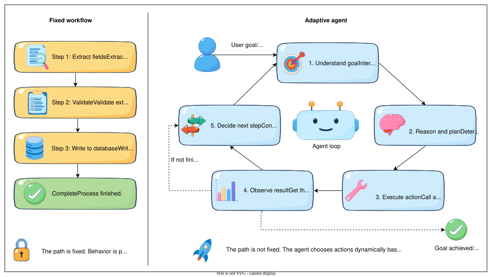

# Choosing_Between_Fixed_Workflows_and_Adaptive_Agents_in_AI_Systems

Source: https://www.educative.io/courses/claude-certified-architect-foundations/fixed-workflows-and-adaptive-agents

---

[Home](https://www.educative.io/)

[Courses](https://www.educative.io/search?tab=courses)

[Master Claude Certified Architect Foundations Exam (CCAR-F)](https://www.educative.io/courses/claude-certified-architect-foundations)

# Fixed Workflows and Adaptive Agents

Explore how to distinguish between fixed workflows and adaptive agents by analyzing task structures and execution plans. Understand when to apply each architecture, the decision framework involving two critical questions, and the reliability risks associated with each. This lesson equips you to make better architectural choices for Claude-powered AI systems, improving predictability and cost-effectiveness.

We'll cover the following...

- [The architectural choice before the loop](https://www.educative.io/courses/claude-certified-architect-foundations/fixed-workflows-and-adaptive-agents#The-architectural-choice-before-the-loop)
- [Scenario A: The invoice extraction pipeline](https://www.educative.io/courses/claude-certified-architect-foundations/fixed-workflows-and-adaptive-agents#Scenario-A-The-invoice-extraction-pipeline)
- [What makes this a fixed workflow decision](https://www.educative.io/courses/claude-certified-architect-foundations/fixed-workflows-and-adaptive-agents#What-makes-this-a-fixed-workflow-decision)
- [Scenario B: The memory leak investigation](https://www.educative.io/courses/claude-certified-architect-foundations/fixed-workflows-and-adaptive-agents#Scenario-B-The-memory-leak-investigation)
  - [Complete code](https://www.educative.io/courses/claude-certified-architect-foundations/fixed-workflows-and-adaptive-agents#Complete-code)
- [The two-question test](https://www.educative.io/courses/claude-certified-architect-foundations/fixed-workflows-and-adaptive-agents#The-two-question-test)
- [The anti-pattern to avoid](https://www.educative.io/courses/claude-certified-architect-foundations/fixed-workflows-and-adaptive-agents#The-anti-pattern-to-avoid)
- [Reliability risks by architecture](https://www.educative.io/courses/claude-certified-architect-foundations/fixed-workflows-and-adaptive-agents#Reliability-risks-by-architecture)
- [Exercise: Choose the architecture](https://www.educative.io/courses/claude-certified-architect-foundations/fixed-workflows-and-adaptive-agents#Exercise-Choose-the-architecture)
- [What’s next?](https://www.educative.io/courses/claude-certified-architect-foundations/fixed-workflows-and-adaptive-agents#Whats-next)

In the previous chapter, we focused on how the agent loop works. This chapter asks a prior question: Should we use an agent loop at all? The loop is not the default choice. It is one of three architectural options, and choosing the wrong one leads to systems that are expensive, fragile, or both.

In this lesson, we work through two concrete scenarios side by side. By the end, we will have a clear decision framework for choosing between a fixed workflow and an adaptive agent, and we will know when a task’s structure is the deciding signal. By the end of this lesson, we will be able to:

- Identify the structural difference between tasks that suit fixed workflows and tasks that suit adaptive agents.
- Apply the two-question decision test to any scenario.
- Name the primary reliability risk that each architecture introduces.
- Recognize the anti-pattern of using an adaptive agent when a fixed workflow is correct/

## The architectural choice before the loop[#](https://www.educative.io/courses/claude-certified-architect-foundations/fixed-workflows-and-adaptive-agents#The-architectural-choice-before-the-loop)

Every Claude-powered system begins with one decision: how predictable is the task?

- If the steps are known in advance and they are the same steps in the same order every time, a fixed workflow (also called a prompt chain) is the right choice. Each step takes an input, produces an output, and passes it to the next step. No agent loop, no tool selection, and no runtime branching.
- If the path through the task depends on what is found at runtime, and step three can only be decided after seeing the result of step two, an adaptive agent is the right choice. The loop exists precisely to handle this: call the API, read the stop reason, and dispatch the next action based on what Claude decided.



Fixed workflows vs. adaptive agents

The difference is not about capability. It is about task structure. Both architectures use Claude. Both can call tools. The choice depends on whether the next step is determined before execution (fixed) or during execution (adaptive).

## Scenario A: The invoice extraction pipeline[#](https://www.educative.io/courses/claude-certified-architect-foundations/fixed-workflows-and-adaptive-agents#Scenario-A-The-invoice-extraction-pipeline)

A finance team processes 300 vendor invoices every week. Each invoice must have four fields extracted: vendor name, invoice date, line items, and total amount. After extraction, the fields are written to a database for reconciliation. The same four fields are extracted from every invoice, regardless of vendor or format.

Here’s what the pipeline looks like as a fixed workflow:

Ace Editor

1

2

3

4

5

6

7

8

9

10

11

12

13

14

15

16

17

18

19

20

21

22

23

def extract\_invoice\_fields(invoice\_text: str) -> dict:

response = client.messages.create(

model="claude-opus-4-8",

max\_tokens=200,

system=(

"You are an invoice parser. Extract the following fields from the invoice text "

"and return them as JSON: vendor\_name, invoice\_date, line\_items (list of strings), total\_amount. "

"Return only the JSON object, no other text."

),

messages=[{"role": "user", "content": invoice\_text}]

)

for block in response.content:

if block.type == "text":

return json.loads(block.text.strip())

return {}

def run\_pipeline(invoices: list[str]) -> list[dict]:

results = []

for invoice in invoices:

fields = extract\_invoice\_fields(invoice)

results.append(fields)

return results

הההההההההההההההההההההההההההההההההההההההההההההההההההההההההההההההההההההההההההההההההההההההההההההההההההההההההההההההההההההההההההההההההההההההההההההההההההההההההההההההההההההההההההההההההההההההההההההההההההההההההההההההההההההההההההההההההההההההההההההההההההההההההההההההההההההההההההההההההההההההההההההההההההההההההההההההההההההההההההההההההההההההההההההההההההההההההההההההההההההההההההההההההההההההההההההההההההההההההההההההההההההההההההההההההההההההההההההההההההההההההההההההההההההההההההההההההההההההההההההההההההההההההההההההההההההההההההההההה

XXXXXXXXXXXXXXXXXXXXXXXXXXXXXXXXXXXXXXXXXXXXXXXXXXXXXXXXXXXXXXXXXXXXXXXXXXXXXXXXXXXXXXXXXXXXXXXXXXXXXXXXXXXXXXXXXXXXXXXXXXXXXXXXXXXXXXXXXXXXXXXXXXXXXXXXXXXXXXXXXXXXXXXXXXXXXXXXXXXXXXXXXXXXXXXXXXXXXXXXXXXXXXXXXXXXXXXXXXXXXXXXXXXXXXXXXXXXXXXXXXXXXXXXXXXXXXXXXXXXXXXXXXXXXXXXXXXXXXXXXXXXXXXXXXXXXXXXXXXXXXXXXXXXXXXXXXXXXXXXXXXXXXXXXXXXXXXXXXXXXXXXXXXXXXXXXXXXXXXXXXXXXXXXXXXXXXXXXXXXXXXXXXXXXXXXXXXXXXXXXXXXXXXXXXXXXXXXXXXXXXXXXXXXXXXXXXXXXXXXXXXXXXXXXXXXXXXXXXXXXXXXXXXXXXXXXXXXXXXXXXXXXXXXXXXXXXXXXXXXXXXXXXXXXXXX

A fixed workflow for invoice field extraction. Every invoice goes through the same single step. The loop in run\_pipeline is a Python iteration over a list, not an agent loop.

- **Lines 1–14:** `extract_invoice_fields` makes one API call per invoice. The system prompt names the four fields and instructs Claude to return only a JSON object. `max_tokens=200` gives enough room for the structured response without allowing verbose elaboration.
- **Line 15:** We parse the JSON string into a dict. If Claude returns no text block, we return an empty dict as a safe fallback rather than crashing the pipeline.
- **Lines 18–23:** `run_pipeline` iterates over the invoices and collects results. This is a Python `for` loop, not an agent loop. There is no `stop_reason` branching, no tool dispatch, and no `while True`.

There is no agent loop here because none is needed. The steps are:

1. Read the invoice text
2. Extract the four fields
3. Store the result

These steps are identical for every invoice. The sequence never changes based on what the invoice contains. A fixed workflow handles this correctly, and it is cheaper and easier to debug than an agent.

## What makes this a fixed workflow decision[#](https://www.educative.io/courses/claude-certified-architect-foundations/fixed-workflows-and-adaptive-agents#What-makes-this-a-fixed-workflow-decision)

The key test is: Can we write the complete execution plan before seeing any invoice content? For this pipeline, yes:

- Step one is always “extract the four fields”
- Step two is always “store the result”
- There are no branches: no step that only runs if the extraction produced a certain value

When the plan is fully writable before execution, the task is a fixed workflow.

The primary reliability risk for this architecture is **semantic**: Claude might extract an incorrect value, such as a total amount that is misread, a date in the wrong format, or a vendor name that is truncated. A structured output guarantee (replying with a JSON object) prevents format errors, but the extracted values themselves may still be wrong. Mitigate this with validation, such as cross-referencing extracted totals against the sum of the line items or auditing a sample against the source PDFs, not an agent loop.

## Scenario B: The memory leak investigation[#](https://www.educative.io/courses/claude-certified-architect-foundations/fixed-workflows-and-adaptive-agents#Scenario-B-The-memory-leak-investigation)

A platform team is seeing memory spikes in a production service. An engineer asks Claude to identify the cause. Claude has access to three tools: `analyze_heap_dump`, `get_deployment_history`, and `search_recent_changes`. No one knows in advance which tools will be needed, in what order, or how many times. Here is the tool set for this adaptive agent:

Ace Editor

1

2

3

4

5

6

7

8

9

10

11

12

13

14

15

16

17

18

19

20

21

22

23

24

25

26

27

TOOLS = [

{

"name": "analyze\_heap\_dump",

"description": (

"Analyze a heap dump snapshot for a given service and time window. "

"Use this first to identify which object types or allocations are growing abnormally."

),

"input\_schema": {

"type": "object",

"properties": {

"service": {"type": "string"},

"start\_time": {"type": "string"},

"end\_time": {"type": "string"}

},

"required": ["service", "start\_time", "end\_time"]

}

},

{

"name": "get\_deployment\_history",

"description": (

"Retrieve deployment events for a service in a time window. "

"Use when the heap analysis points to a growth pattern that started at a specific time."

),

"input\_schema": {

"type": "object",

"properties": {

"service": {"type": "string"},

הההההההההההההההההההההההההההההההההההההההההההההההההההההההההההההההההההההההההההההההההההההההההההההההההההההההההההההההההההההההההההההההההההההההההההההההההההההההההההההההההההההההההההההההההההההההההההההההההההההההההההההההההההההההההההההההההההההההההההההההההההההההההההההההההההההההההההההההההההההההההההההההההההההההההההההההההההההההההההההההההההההההההההההההההההההההההההההההההההההההההההההההההההההההההההההההההההההההההההההההההההההההההההההההההההההההההההההההההההההההההההההההההההההההההההההההההההההההההההההההההההההההההההההההההההההההההההההההה

XXXXXXXXXXXXXXXXXXXXXXXXXXXXXXXXXXXXXXXXXXXXXXXXXXXXXXXXXXXXXXXXXXXXXXXXXXXXXXXXXXXXXXXXXXXXXXXXXXXXXXXXXXXXXXXXXXXXXXXXXXXXXXXXXXXXXXXXXXXXXXXXXXXXXXXXXXXXXXXXXXXXXXXXXXXXXXXXXXXXXXXXXXXXXXXXXXXXXXXXXXXXXXXXXXXXXXXXXXXXXXXXXXXXXXXXXXXXXXXXXXXXXXXXXXXXXXXXXXXXXXXXXXXXXXXXXXXXXXXXXXXXXXXXXXXXXXXXXXXXXXXXXXXXXXXXXXXXXXXXXXXXXXXXXXXXXXXXXXXXXXXXXXXXXXXXXXXXXXXXXXXXXXXXXXXXXXXXXXXXXXXXXXXXXXXXXXXXXXXXXXXXXXXXXXXXXXXXXXXXXXXXXXXXXXXXXXXXXXXXXXXXXXXXXXXXXXXXXXXXXXXXXXXXXXXXXXXXXXXXXXXXXXXXXXXXXXXXXXXXXXXXXXXXXXXX

Three investigation tools. The “Use this first” and “Use when” guidance in each description tells Claude the intended order of operations without hardcoding it in the loop.

- **Lines 1–16:** `analyze_heap_dump` is the entry point. Its description says “Use this first,” which nudges Claude to start here rather than jumping to deployment history.
- **Lines 17–31:** `get_deployment_history` is the second-level tool. Its description explicitly says “Use when the heap analysis points to a growth pattern.” Claude reads this to understand that it should only call this tool if the heap data suggests a time-bounded onset.
- **Lines 32–45:** `search_recent_changes` is the deepest tool. Claude only needs it if deployment history surfaces a specific deploy event that correlates with the spike. It is a conditional third step, not a guaranteed one.

The agent loop for this task is the same loop we built in the previous chapter. What changes is why the loop is necessary: The path through the investigation cannot be written before execution starts. The heap analysis decides whether to check deployments. The deployment history decides whether to search for code changes. Each step depends on the previous one.

### Complete code[#](https://www.educative.io/courses/claude-certified-architect-foundations/fixed-workflows-and-adaptive-agents#Complete-code)

We run both architecture examples from this lesson side by side. The fixed pipeline calls Claude once per invoice and returns a structured dict. The tool definitions for the adaptive agent are shown for contrast. The same agent loop from the previous chapter would drive that scenario, but the path through those tools cannot be written before the first result arrives.

Please provide values for the following:

ANTHROPIC\_API\_KEY

Import Values from JSON

Python

```
import json

import anthropic

anthropic_api_key = "{{ANTHROPIC_API_KEY}}"

client = anthropic.Anthropic(api_key=anthropic_api_key)

# ─── Scenario A: Fixed workflow — invoice extraction pipeline ──────────────────

def extract_invoice_fields(invoice_text: str) -> dict:

response = client.messages.create(

model="claude-opus-4-8",

max_tokens=200,

system=(

"You are an invoice parser. Extract the following fields from the invoice text "

"and return them as JSON: vendor_name, invoice_date, line_items (list of strings), total_amount. "

"Return only the JSON object, no other text."

),

messages=[{"role": "user", "content": invoice_text}]

)

for block in response.content:

if block.type == "text":

return json.loads(block.text.strip())

return {}

def run_pipeline(invoices: list[str]) -> list[dict]:

results = []

for invoice in invoices:

fields = extract_invoice_fields(invoice)

results.append(fields)

return results

# ─── Scenario B: Adaptive agent — memory leak investigation ───────────────────

TOOLS = [

{

"name": "analyze_heap_dump",

"description": (

"Analyze a heap dump snapshot for a given service and time window. "

"Use this first to identify which object types or allocations are growing abnormally."

),

"input_schema": {

"type": "object",

"properties": {

"service":    {"type": "string"},

"start_time": {"type": "string"},

"end_time":   {"type": "string"}

},

"required": ["service", "start_time", "end_time"]

}

},

{

"name": "get_deployment_history",

"description": (

"Retrieve deployment events for a service in a time window. "

"Use when the heap analysis points to a growth pattern that started at a specific time."

),

"input_schema": {

"type": "object",

"properties": {

"service":    {"type": "string"},

"start_time": {"type": "string"},

"end_time":   {"type": "string"}

},

"required": ["service", "start_time", "end_time"]

}

},

{

"name": "search_recent_changes",

"description": (

"Search code changes merged around a specific deployment. "

"Use when a deployment correlates with the onset of the memory spike."

),

"input_schema": {

"type": "object",

"properties": {

"deployment_id": {"type": "string"},

"keyword":       {"type": "string"}

},

"required": ["deployment_id"]

}

}

]

if __name__ == "__main__":

sample_invoices = [

(

"INVOICE\n"

"Vendor: Acme Corp\n"

"Date: 2025-03-15\n"

"Items:\n"

"  Widget x10: $200.00\n"

"  Shipping: $15.00\n"

"Total: $215.00"

),

(

"INVOICE\n"

"Vendor: Globex Industries\n"

"Date: 2025-03-22\n"

"Items:\n"

"  Server license: $1,200.00\n"

"  Support plan: $300.00\n"

"Total: $1,500.00"

),

]

print("=== Scenario A: Fixed workflow (invoice extraction pipeline) ===\n")

print(f"Processing {len(sample_invoices)} invoices...\n")

results = run_pipeline(sample_invoices)

for i, result in enumerate(results, 1):

print(f"Invoice {i}:")

print(f"  vendor_name  : {result.get('vendor_name')}")

print(f"  invoice_date : {result.get('invoice_date')}")

print(f"  line_items   : {result.get('line_items')}")

print(f"  total_amount : {result.get('total_amount')}")

print()

print("=== Scenario B: Adaptive agent (memory leak investigation) ===\n")

print(f"{len(TOOLS)} tools registered for the investigation agent:\n")

for tool in TOOLS:

first_sentence = tool["description"].split(".")[0] + "."

print(f"  {tool['name']}")

print(f"    {first_sentence}")

print()

print("Contrast: For this task, the next tool call cannot be determined before")

print("the previous result arrives; the path is decided at runtime.")

print("The fixed pipeline above runs the same step for every invoice, every time.")
```

⋯

The invoice extraction pipeline and the adaptive agent tool set in one file. run\_pipeline is a Python for loop, no stop\_reason branching, no while True, and no tool dispatch.

Running the script produces output like this:

Ace Editor

1

2

3

4

5

6

7

8

9

10

11

12

13

14

15

16

17

18

19

20

21

22

23

24

25

26

27

=== Scenario A: Fixed workflow — invoice extraction pipeline ===

Processing 2 invoices...

Invoice 1:

vendor\_name : Acme Corp

invoice\_date : 2025-03-15

line\_items : ['Widget x10: $200.00', 'Shipping: $15.00']

total\_amount : $215.00

Invoice 2:

vendor\_name : Globex Industries

invoice\_date : 2025-03-22

line\_items : ['Server license: $1,200.00', 'Support plan: $300.00']

total\_amount : $1,500.00

=== Scenario B: Adaptive agent — memory leak investigation ===

3 tools registered for the investigation agent:

analyze\_heap\_dump

Analyze a heap dump snapshot for a given service and time window.

get\_deployment\_history

Retrieve deployment events for a service in a time window.

search\_recent\_changes

הההההההההההההההההההההההההההההההההההההההההההההההההההההההההההההההההההההההההההההההההההההההההההההההההההההההההההההההההההההההההההההההההההההההההההההההההההההההההההההההההההההההההההההההההההההההההההההההההההההההההההההההההההההההההההההההההההההההההההההההההההההההההההההההההההההההההההההההההההההההההההההההההההההההההההההההההההההההההההההההההההההההההההההההההההההההההההההההההההההההההההההההההההההההההההההההההההההההההההההההההההההההההההההההההההההההההההההההההההההההההההההההההההההההההההההההההההההההההההההההההההההההההההההההההההההההההההההההה

XXXXXXXXXXXXXXXXXXXXXXXXXXXXXXXXXXXXXXXXXXXXXXXXXXXXXXXXXXXXXXXXXXXXXXXXXXXXXXXXXXXXXXXXXXXXXXXXXXXXXXXXXXXXXXXXXXXXXXXXXXXXXXXXXXXXXXXXXXXXXXXXXXXXXXXXXXXXXXXXXXXXXXXXXXXXXXXXXXXXXXXXXXXXXXXXXXXXXXXXXXXXXXXXXXXXXXXXXXXXXXXXXXXXXXXXXXXXXXXXXXXXXXXXXXXXXXXXXXXXXXXXXXXXXXXXXXXXXXXXXXXXXXXXXXXXXXXXXXXXXXXXXXXXXXXXXXXXXXXXXXXXXXXXXXXXXXXXXXXXXXXXXXXXXXXXXXXXXXXXXXXXXXXXXXXXXXXXXXXXXXXXXXXXXXXXXXXXXXXXXXXXXXXXXXXXXXXXXXXXXXXXXXXXXXXXXXXXXXXXXXXXXXXXXXXXXXXXXXXXXXXXXXXXXXXXXXXXXXXXXXXXXXXXXXXXXXXXXXXXXXXXXXXXXXXX

Each invoice goes through exactly one API call in `extract_invoice_fields`. The `run_pipeline` function is a plain Python iterator: no `while True`, no `stop_reason` check, and no branching. The memory leak tool set uses the same agent loop mechanics from the previous chapter, but which tool runs first, and whether `search_recent_changes` runs at all, cannot be decided until the first heap dump result arrives.

## The two-question test[#](https://www.educative.io/courses/claude-certified-architect-foundations/fixed-workflows-and-adaptive-agents#The-two-question-test)

Two questions determine which architecture fits any task. They work together as a decision gate.

- **Question 1:** Can we write the complete execution plan before running?

  - If yes, use a fixed workflow. The steps are known, the sequence is fixed, and no branching is needed at runtime. Invoice extraction, document summarization, format conversion, and sentiment scoring are all fixed workflows.
  - If no, continue to Question 2.
- **Question 2:** Are the subtasks independent of each other?

  - If yes, use a multi-agent system. Independent subtasks can run in parallel, each in its own clean context, with a coordinator collecting results. A product readiness check that needs engineering sign-off, legal review, and marketing status simultaneously is a good fit for a multi-agent system.
  - If no, use an adaptive agent. The subtasks are interdependent and must run in sequence, where each step informs the next. The memory leak investigation above is a good fit for an adaptive agent.

## The anti-pattern to avoid[#](https://www.educative.io/courses/claude-certified-architect-foundations/fixed-workflows-and-adaptive-agents#The-anti-pattern-to-avoid)

The most common architecture mistake on the exam, and in practice, is using an adaptive agent for a task with a fixed, known structure. An adaptive agent for invoice extraction would:

- Run a `while True` loop for every invoice.
- Make at least two API calls per invoice (one to decide what to extract and one to respond).
- Introduce `stop_reason` branching that can never produce a different path.
- Cost more and take longer with no benefit.

Agent architectures add complexity and cost for tasks where the outcome is structurally determined. Fixed workflows are not the “simple” option for beginner tasks. They are the correct option for tasks with a known, unchanging structure. A good signal that an agent is being used where a workflow would suffice is to trace a real run and check whether the path through the loop is identical every time, regardless of input. If it is, the loop is unnecessary.

## Reliability risks by architecture[#](https://www.educative.io/courses/claude-certified-architect-foundations/fixed-workflows-and-adaptive-agents#Reliability-risks-by-architecture)

Each architecture introduces a different primary reliability risk. Knowing which risk applies tells us what to validate.

|  |  |  |
| --- | --- | --- |
| **Architecture** | **Primary Reliability Risk** | **Mitigation** |
| Fixed workflow | Semantic: output values may be wrong | Spot-check labels, second-pass validation |
| Adaptive agent | Session: context degrades over long runs | Monitor input token count, summarize early turns |
| Multi-agent | Error propagation: one subagent's failure corrupts the synthesis | Structured failure reporting, partial-result handling |

These risks are separate from structural validity. A fixed workflow that always produces a syntactically valid label may still produce semantically wrong labels. An adaptive agent that completes without crashing may still lose track of its objective after 20 tool calls. Passing one reliability layer does not mean passing the others.

## Exercise: Choose the architecture[#](https://www.educative.io/courses/claude-certified-architect-foundations/fixed-workflows-and-adaptive-agents#Exercise-Choose-the-architecture)

Read each scenario and determine:

1. The most appropriate architecture.
2. The primary reliability risk to monitor.

Technical Quiz

1.

Scenario A: A security analyst asks an agent to investigate a potential data breach. The agent can query access logs, look up user accounts, check file modification records, and search a SIEM system. The investigation path depends on what each query returns.

A.

1. Fixed workflow
2. Error propagation

B.

1. Adaptive agent
2. Session quality

C.

1. Multi-agent system
2. Semantic

---

1 / 3

## What’s next?[#](https://www.educative.io/courses/claude-certified-architect-foundations/fixed-workflows-and-adaptive-agents#Whats-next)

In the next lesson, we address the reliability concern that appears in every agentic architecture: critical business rules embedded in the system prompt. We wrap a tool call with a programmatic policy check and demonstrate why code-level enforcement is the only reliable option for rules that must hold without exception.

Agent Loop Assessment Quiz

Guardrails Outside the Prompt

Ask

[The architectural choice before the loop](https://www.educative.io/courses/claude-certified-architect-foundations/fixed-workflows-and-adaptive-agents#The-architectural-choice-before-the-loop)

[Scenario A: The invoice extraction pipeline](https://www.educative.io/courses/claude-certified-architect-foundations/fixed-workflows-and-adaptive-agents#Scenario-A-The-invoice-extraction-pipeline)

[What makes this a fixed workflow decision](https://www.educative.io/courses/claude-certified-architect-foundations/fixed-workflows-and-adaptive-agents#What-makes-this-a-fixed-workflow-decision)

[Scenario B: The memory leak investigation](https://www.educative.io/courses/claude-certified-architect-foundations/fixed-workflows-and-adaptive-agents#Scenario-B-The-memory-leak-investigation)

[Complete code](https://www.educative.io/courses/claude-certified-architect-foundations/fixed-workflows-and-adaptive-agents#Complete-code)

[The two-question test](https://www.educative.io/courses/claude-certified-architect-foundations/fixed-workflows-and-adaptive-agents#The-two-question-test)

[The anti-pattern to avoid](https://www.educative.io/courses/claude-certified-architect-foundations/fixed-workflows-and-adaptive-agents#The-anti-pattern-to-avoid)

[Reliability risks by architecture](https://www.educative.io/courses/claude-certified-architect-foundations/fixed-workflows-and-adaptive-agents#Reliability-risks-by-architecture)

[Exercise: Choose the architecture](https://www.educative.io/courses/claude-certified-architect-foundations/fixed-workflows-and-adaptive-agents#Exercise-Choose-the-architecture)

[What’s next?](https://www.educative.io/courses/claude-certified-architect-foundations/fixed-workflows-and-adaptive-agents#Whats-next)