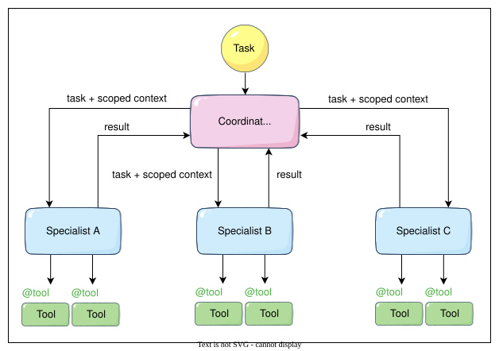

# Coordinator_and_Specialist_Roles_in_Multi-Agent_AI_Systems

Source: https://www.educative.io/courses/claude-certified-architect-foundations/coordinator-and-specialist-roles

---

[Home](https://www.educative.io/)

[Courses](https://www.educative.io/search?tab=courses)

[Master Claude Certified Architect Foundations Exam (CCAR-F)](https://www.educative.io/courses/claude-certified-architect-foundations)

# Coordinator and Specialist Roles

Explore the coordinator and specialist roles within multi-agent systems using the hub-and-spoke architecture. Understand how to isolate context, assign focused tools, and delegate tasks effectively to improve reliability and avoid errors. This lesson helps you design clear responsibility splits and manage independent subtasks without context pollution.

We'll cover the following...

- [The hub-and-spoke architecture](https://www.educative.io/courses/claude-certified-architect-foundations/coordinator-and-specialist-roles#The-hub-and-spoke-architecture)
- [The coordinator’s role](https://www.educative.io/courses/claude-certified-architect-foundations/coordinator-and-specialist-roles#The-coordinators-role)
- [What context the specialist should and should not receive](https://www.educative.io/courses/claude-certified-architect-foundations/coordinator-and-specialist-roles#What-context-the-specialist-should-and-should-not-receive)
- [Defining tool access per specialist](https://www.educative.io/courses/claude-certified-architect-foundations/coordinator-and-specialist-roles#Defining-tool-access-per-specialist)
- [Exercise: Design the split](https://www.educative.io/courses/claude-certified-architect-foundations/coordinator-and-specialist-roles#Exercise-Design-the-split)
- [What’s next?](https://www.educative.io/courses/claude-certified-architect-foundations/coordinator-and-specialist-roles#Whats-next)

In the previous chapter, we introduced multi-agent systems as the right architecture when subtasks are independent. This chapter goes deeper: How do we actually structure the agents, divide the work, and keep the contexts clean? This lesson covers the hub-and-spoke architecture that underpins multi-agent systems and walks through the concrete decisions around what each agent knows, which tools it can access, and how the coordinator and specialists divide responsibility.

By the end of this lesson, we will be able to:

- Describe the hub-and-spoke architecture and why it outperforms flat agent arrangements.
- Define the coordinator's role and what it must not do.
- Define the specialist's role and what context it should and should not receive.
- Design a task split for a concrete research or support scenario.

## The hub-and-spoke architecture[#](https://www.educative.io/courses/claude-certified-architect-foundations/coordinator-and-specialist-roles#The-hub-and-spoke-architecture)

In a flat agent architecture, one agent handles everything: all tools, all context, and all decisions. As the task grows, so do the tool list and the message array. Tool selection degrades. Context fills up. The agent starts making mistakes that a fresh, focused agent would not. The hub-and-spoke architecture solves this by separating concerns: a central coordinator delegates work to specialist subagents, each of which operates in its own isolated context with its own focused set of tools. The coordinator never does the exploratory or lookup work itself. It delegates, waits for results, and synthesizes.

The coordinator delegates; specialists execute. Context flows inward to each specialist and results flow back. Specialists never share context directly.

The structure has three properties that make it reliable at scale:

- **Context isolation:** Each subagent receives only the context specific to its task. It does not see the coordinator's full conversation history, other subagents' intermediate results, or information irrelevant to its specialty. This keeps each agent focused and prevents context pollution.
- **Focused tool access:** Each subagent has four to five tools relevant to its domain. Tool selection quality stays high because the choice set is small. The coordinator knows which specialist to delegate to, and the specialist knows which of their own tools to call.
- **Parallel execution:** Independent subtasks can be delegated simultaneously. The coordinator dispatches all of them in one step and waits for results. Wall-clock time is determined by the slowest specialist, not the sum of all specialists.

## The coordinator’s role[#](https://www.educative.io/courses/claude-certified-architect-foundations/coordinator-and-specialist-roles#The-coordinators-role)

The coordinator is responsible for three things: decomposing the task, delegating subtasks to the right specialists, and synthesizing the results. It does not perform lookups, browse data, or run explorations itself.

This constraint is intentional. If the coordinator also performs lookup work, its context accumulates the full exploration transcript, tool results, intermediate findings, and dead ends. This creates the same problem that makes the flat architecture fail. The coordinator's context stays clean by delegating all of that work outward. Here is what a coordinator's task list looks like in practice for a supplier due diligence check:

Ace Editor

1

2

3

4

5

6

7

8

9

10

COORDINATOR\_SYSTEM = """

You are a due diligence coordinator. Your job is to:

1. Decompose the due diligence task into independent lookup tasks

2. Delegate each lookup to the appropriate specialist

3. Synthesize the results into a final assessment report

You do not perform lookups yourself. You delegate all data retrieval to specialists.

If any specialist reports an error or missing data, include that gap explicitly

in the final report — do not fill it with assumptions.

"""

הההההההההההההההההההההההההההההההההההההההההההההההההההההההההההההההההההההההההההההההההההההההההההההההההההההההההההההההההההההההההההההההההההההההההההההההההההההההההההההההההההההההההההההההההההההההההההההההההההההההההההההההההההההההההההההההההההההההההההההההההההההההההההההההההההההההההההההההההההההההההההההההההההההההההההההההההההההההההההההההההההההההההההההההההההההההההההההההההההההההההההההההההההההההההההההההההההההההההההההההההההההההההההההההההההההההההההההההההההההההההההההההההההההההההההההההההההההההההההההההההההההההההההההההההההההההההההההההה

XXXXXXXXXXXXXXXXXXXXXXXXXXXXXXXXXXXXXXXXXXXXXXXXXXXXXXXXXXXXXXXXXXXXXXXXXXXXXXXXXXXXXXXXXXXXXXXXXXXXXXXXXXXXXXXXXXXXXXXXXXXXXXXXXXXXXXXXXXXXXXXXXXXXXXXXXXXXXXXXXXXXXXXXXXXXXXXXXXXXXXXXXXXXXXXXXXXXXXXXXXXXXXXXXXXXXXXXXXXXXXXXXXXXXXXXXXXXXXXXXXXXXXXXXXXXXXXXXXXXXXXXXXXXXXXXXXXXXXXXXXXXXXXXXXXXXXXXXXXXXXXXXXXXXXXXXXXXXXXXXXXXXXXXXXXXXXXXXXXXXXXXXXXXXXXXXXXXXXXXXXXXXXXXXXXXXXXXXXXXXXXXXXXXXXXXXXXXXXXXXXXXXXXXXXXXXXXXXXXXXXXXXXXXXXXXXXXXXXXXXXXXXXXXXXXXXXXXXXXXXXXXXXXXXXXXXXXXXXXXXXXXXXXXXXXXXXXXXXXXXXXXXXXXXXXX

The coordinator’s system prompt. It defines the three-step role and explicitly prohibits the coordinator from doing lookup work itself. The final rule, report gaps, do not fill them, is the error propagation policy.

- **Lines 3–5:** The three coordinator responsibilities, in order, are decompose, delegate, and synthesize. The coordinator is a planner and synthesizer, not a researcher.
- **Line 7:** “You do not perform lookups yourself” is a hard rule in the prompt. Without this constraint, the coordinator may decide it is faster to look something up directly rather than delegating, which defeats the architecture.
- **Lines 8–9:** The error-propagation policy is stated explicitly: When a specialist returns an error or finds nothing, that gap must appear in the final report. This is the correct behavior; the exam frequently tests whether candidates know that missing data must be surfaced, not silently omitted.

Ace Editor

1

2

3

4

5

6

7

8

9

10

FINANCIAL\_SPECIALIST\_SYSTEM = """

You are a financial data analyst. Your tools are:

- get\_financial\_statements: Retrieve annual and quarterly financials for a company

- check\_credit\_rating: Look up the current credit rating from a rating agency

- get\_debt\_obligations: Retrieve current outstanding debt and maturity schedule

Your task will be provided in the user message. Return your findings as a structured

summary with: key\_metrics (dict), risk\_flags (list), data\_gaps (list).

Include a data\_gaps entry for any metric you could not retrieve.

"""

הההההההההההההההההההההההההההההההההההההההההההההההההההההההההההההההההההההההההההההההההההההההההההההההההההההההההההההההההההההההההההההההההההההההההההההההההההההההההההההההההההההההההההההההההההההההההההההההההההההההההההההההההההההההההההההההההההההההההההההההההההההההההההההההההההההההההההההההההההההההההההההההההההההההההההההההההההההההההההההההההההההההההההההההההההההההההההההההההההההההההההההההההההההההההההההההההההההההההההההההההההההההההההההההההההההההההההההההההההההההההההההההההההההההההההההההההההההההההההההההההההההההההההההההההההההההההההההההה

XXXXXXXXXXXXXXXXXXXXXXXXXXXXXXXXXXXXXXXXXXXXXXXXXXXXXXXXXXXXXXXXXXXXXXXXXXXXXXXXXXXXXXXXXXXXXXXXXXXXXXXXXXXXXXXXXXXXXXXXXXXXXXXXXXXXXXXXXXXXXXXXXXXXXXXXXXXXXXXXXXXXXXXXXXXXXXXXXXXXXXXXXXXXXXXXXXXXXXXXXXXXXXXXXXXXXXXXXXXXXXXXXXXXXXXXXXXXXXXXXXXXXXXXXXXXXXXXXXXXXXXXXXXXXXXXXXXXXXXXXXXXXXXXXXXXXXXXXXXXXXXXXXXXXXXXXXXXXXXXXXXXXXXXXXXXXXXXXXXXXXXXXXXXXXXXXXXXXXXXXXXXXXXXXXXXXXXXXXXXXXXXXXXXXXXXXXXXXXXXXXXXXXXXXXXXXXXXXXXXXXXXXXXXXXXXXXXXXXXXXXXXXXXXXXXXXXXXXXXXXXXXXXXXXXXXXXXXXXXXXXXXXXXXXXXXXXXXXXXXXXXXXXXXXXXX

The financial specialist’s system prompt. It lists exactly its three tools, defines the output format, and requires explicit reporting of any data it could not retrieve.

- **Lines 2–5:** The system prompt names all three tools and their purposes. This gives the specialist a clear map of its own capabilities without exposing it to the coordinator's full tool list.
- **Lines 7–9:** The output format is specified: a structured summary with three keys. This is important; the coordinator expects a consistent shape from each specialist, which makes synthesis predictable.
- **Line 9:** `data_gaps` is a required field. If the specialist cannot retrieve a metric, it lists the gap rather than omitting the key or returning a partial result. The coordinator reads `data_gaps` entries and includes them in the final assessment.
- The distinction between `data_gaps` (could not retrieve) and an empty result (retrieved, found nothing) is one of the most tested concepts on the exam. Returning an empty result when data retrieval fails masks the failure as success.

## What context the specialist should and should not receive[#](https://www.educative.io/courses/claude-certified-architect-foundations/coordinator-and-specialist-roles#What-context-the-specialist-should-and-should-not-receive)

Context passing is where multi-agent systems most commonly go wrong. The principle is: Pass only what this specific specialist needs to complete its specific task. Nothing more. Here is the wrong approach: sharing the full coordinator history.

Ace Editor

1

2

3

4

5

6

# Wrong: passing the coordinator's full conversation history

specialist\_prompt = f"""

{coordinator\_full\_history}

Now analyze the financial statements for {company\_name}.

"""

הההההההההההההההההההההההההההההההההההההההההההההההההההההההההההההההההההההההההההההההההההההההההההההההההההההההההההההההההההההההההההההההההההההההההההההההההההההההההההההההההההההההההההההההההההההההההההההההההההההההההההההההההההההההההההההההההההההההההההההההההההההההההההההההההההההההההההההההההההההההההההההההההההההההההההההההההההההההההההההההההההההההההההההההההההההההההההההההההההההההההההההההההההההההההההההההההההההההההההההההההההההההההההההההההההההההההההההההההההההההההההההההההההההההההההההההההההההההההההההההההההההההההההההההההההההההההההההההה

XXXXXXXXXXXXXXXXXXXXXXXXXXXXXXXXXXXXXXXXXXXXXXXXXXXXXXXXXXXXXXXXXXXXXXXXXXXXXXXXXXXXXXXXXXXXXXXXXXXXXXXXXXXXXXXXXXXXXXXXXXXXXXXXXXXXXXXXXXXXXXXXXXXXXXXXXXXXXXXXXXXXXXXXXXXXXXXXXXXXXXXXXXXXXXXXXXXXXXXXXXXXXXXXXXXXXXXXXXXXXXXXXXXXXXXXXXXXXXXXXXXXXXXXXXXXXXXXXXXXXXXXXXXXXXXXXXXXXXXXXXXXXXXXXXXXXXXXXXXXXXXXXXXXXXXXXXXXXXXXXXXXXXXXXXXXXXXXXXXXXXXXXXXXXXXXXXXXXXXXXXXXXXXXXXXXXXXXXXXXXXXXXXXXXXXXXXXXXXXXXXXXXXXXXXXXXXXXXXXXXXXXXXXXXXXXXXXXXXXXXXXXXXXXXXXXXXXXXXXXXXXXXXXXXXXXXXXXXXXXXXXXXXXXXXXXXXXXXXXXXXXXXXXXXXXX

Passing the coordinator’s full conversation history to the specialist. The specialist receives all prior coordinator messages, other specialists’ results, and setup conversations, none of which it needs.

- **Lines 2–4:** The full history includes every message the coordinator has exchanged: the user's initial request, the decomposition reasoning, results from other specialists, and internal coordinator thoughts. The financial specialist needs none of this.

The problems with this approach are concrete: The specialist's input token count is unnecessarily large, the irrelevant context introduces noise into its decision-making, and if any prior specialist's result contains contradictory information, the financial specialist may factor it in incorrectly. Here is the correct approach: scoped context only.

Ace Editor

1

2

3

4

5

6

7

8

9

10

11

12

13

14

# Correct: passing only what the specialist needs

specialist\_context = {

"company\_name": company\_name,

"fiscal\_year": target\_year,

"task": "Retrieve and analyze the company's financial health for due diligence purposes.",

"required\_outputs": ["key\_metrics", "risk\_flags", "data\_gaps"]

}

specialist\_prompt = f"""

Company: {specialist\_context['company\_name']}

Fiscal year: {specialist\_context['fiscal\_year']}

Task: {specialist\_context['task']}

Required output fields: {', '.join(specialist\_context['required\_outputs'])}

"""

הההההההההההההההההההההההההההההההההההההההההההההההההההההההההההההההההההההההההההההההההההההההההההההההההההההההההההההההההההההההההההההההההההההההההההההההההההההההההההההההההההההההההההההההההההההההההההההההההההההההההההההההההההההההההההההההההההההההההההההההההההההההההההההההההההההההההההההההההההההההההההההההההההההההההההההההההההההההההההההההההההההההההההההההההההההההההההההההההההההההההההההההההההההההההההההההההההההההההההההההההההההההההההההההההההההההההההההההההההההההההההההההההההההההההההההההההההההההההההההההההההההההההההההההההההההההההההההההה

XXXXXXXXXXXXXXXXXXXXXXXXXXXXXXXXXXXXXXXXXXXXXXXXXXXXXXXXXXXXXXXXXXXXXXXXXXXXXXXXXXXXXXXXXXXXXXXXXXXXXXXXXXXXXXXXXXXXXXXXXXXXXXXXXXXXXXXXXXXXXXXXXXXXXXXXXXXXXXXXXXXXXXXXXXXXXXXXXXXXXXXXXXXXXXXXXXXXXXXXXXXXXXXXXXXXXXXXXXXXXXXXXXXXXXXXXXXXXXXXXXXXXXXXXXXXXXXXXXXXXXXXXXXXXXXXXXXXXXXXXXXXXXXXXXXXXXXXXXXXXXXXXXXXXXXXXXXXXXXXXXXXXXXXXXXXXXXXXXXXXXXXXXXXXXXXXXXXXXXXXXXXXXXXXXXXXXXXXXXXXXXXXXXXXXXXXXXXXXXXXXXXXXXXXXXXXXXXXXXXXXXXXXXXXXXXXXXXXXXXXXXXXXXXXXXXXXXXXXXXXXXXXXXXXXXXXXXXXXXXXXXXXXXXXXXXXXXXXXXXXXXXXXXXXXXX

Scoped context: only the company name, the target year, the task description, and the expected output fields. The specialist has everything it needs and nothing it does not.

- **Lines 2–16:** The context dict contains exactly four fields. Each one is necessary: without the company name, the specialist cannot do a lookup; without the fiscal year, it might retrieve the wrong period; without the task description, it may not know the required level of detail; without the output fields, it may not structure its response correctly.
- **Lines 8–13:** The prompt is built only from the scoped context. It contains no references to other specialists, no coordinator history, and no information about the broader workflow.

## Defining tool access per specialist[#](https://www.educative.io/courses/claude-certified-architect-foundations/coordinator-and-specialist-roles#Defining-tool-access-per-specialist)

Each specialist should receive only the tools relevant to its domain. The coordinator's tool list contains only one tool type: the ability to spawn subagents (typically implemented as a `Task` tool). Specialists never have access to the `Task` tool; they do not spawn additional subagents. Here is how the tool distribution looks for a three-specialist due diligence system:

|  |  |  |
| --- | --- | --- |
| **Agent** | **Role** | **Tools** |
| Coordinator | Decompose, delegate, synthesize | `Task` (spawns specialists) |
| Financial specialist | Financial data retrieval | `get_financial_statements`, `check_credit_rating`, `get_debt_obligations` |
| Legal specialist | Corporate and legal record lookup | `search_court_records`, `get_corporate_registration`, `check_sanctions_list` |
| News specialist | Media and reputation analysis | `search_news`, `get_press_releases`, `analyze_sentiment` |

The tool counts are intentional. Three tools per specialist keeps selection quality high. The coordinator has one tool, `Task`, and delegates all domain work through it.

The table above illustrates a hub-and-spoke property that the exam tests directly: a specialist with a focused tool set makes accurate selections; a single agent with all nine tools plus the coordinator tool would struggle to pick the right one in each situation.

## Exercise: Design the split[#](https://www.educative.io/courses/claude-certified-architect-foundations/coordinator-and-specialist-roles#Exercise-Design-the-split)

Read the scenario and answer the questions below.

A software company wants an agent system to evaluate potential acquisition targets. For each target company, the system needs: financial health analysis, technical due diligence on codebase quality, and a summary of employee reviews from public platforms. All three are independent.

Technical Quiz

1.

How many agents should this system have, and what roles should they fill?

A.

One agent with all tools, simpler to build and easier to debug than a multi-agent system.

B.

One coordinator and one generalist subagent that performs all three lookups sequentially.

C.

Three agents with no coordinator; each runs independently and writes results to a shared database for a human to merge.

D.

A coordinator plus financial, technical, and sentiment specialists; the coordinator delegates and synthesizes.

---

1 / 3

## What’s next?[#](https://www.educative.io/courses/claude-certified-architect-foundations/coordinator-and-specialist-roles#Whats-next)

In the next lesson, we design the context handoff packet, the structured object that the coordinator sends to each specialist. We start with a messy, overloaded coordinator prompt and transform it into a focused, minimal handoff that gives each specialist exactly what it needs.

Agentic Architecture Assessment Quiz

Context Handoff Design

Ask

[The hub-and-spoke architecture](https://www.educative.io/courses/claude-certified-architect-foundations/coordinator-and-specialist-roles#The-hub-and-spoke-architecture)

[The coordinator’s role](https://www.educative.io/courses/claude-certified-architect-foundations/coordinator-and-specialist-roles#The-coordinators-role)

[What context the specialist should and should not receive](https://www.educative.io/courses/claude-certified-architect-foundations/coordinator-and-specialist-roles#What-context-the-specialist-should-and-should-not-receive)

[Defining tool access per specialist](https://www.educative.io/courses/claude-certified-architect-foundations/coordinator-and-specialist-roles#Defining-tool-access-per-specialist)

[Exercise: Design the split](https://www.educative.io/courses/claude-certified-architect-foundations/coordinator-and-specialist-roles#Exercise-Design-the-split)

[What’s next?](https://www.educative.io/courses/claude-certified-architect-foundations/coordinator-and-specialist-roles#Whats-next)