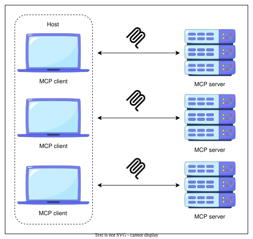

# MCP_Server_Setup_and_Tool_Distribution_for_Claude_Integration

Source: https://www.educative.io/courses/claude-certified-architect-foundations/mcp-configuration-and-tool-distribution

---

[Home](https://www.educative.io/)

[Courses](https://www.educative.io/search?tab=courses)

[Master Claude Certified Architect Foundations Exam (CCAR-F)](https://www.educative.io/courses/claude-certified-architect-foundations)

# MCP Configuration and Tool Distribution

Explore how to configure and distribute tools via MCP servers to multiple Claude agents or applications without duplicating definitions. Understand the MCP architecture including server, transport, and client roles. Learn to write a minimal MCP server in Python and configure it for Claude Code with a .mcp.json file. Discover the behavioral consistency between inline tools and MCP-registered tools and how to manage tool name conflicts through namespacing.

We'll cover the following...

- [The MCP architecture](https://www.educative.io/courses/claude-certified-architect-foundations/mcp-configuration-and-tool-distribution#The-MCP-architecture)
- [Writing a minimal MCP server](https://www.educative.io/courses/claude-certified-architect-foundations/mcp-configuration-and-tool-distribution#Writing-a-minimal-MCP-server)
- [Configuring an MCP server in Claude Code](https://www.educative.io/courses/claude-certified-architect-foundations/mcp-configuration-and-tool-distribution#Configuring-an-MCP-server-in-Claude-Code)
- [What changes and what does not](https://www.educative.io/courses/claude-certified-architect-foundations/mcp-configuration-and-tool-distribution#What-changes-and-what-does-not)
- [Tool name conflicts](https://www.educative.io/courses/claude-certified-architect-foundations/mcp-configuration-and-tool-distribution#Tool-name-conflicts)
- [Exercise: Trace the MCP call path](https://www.educative.io/courses/claude-certified-architect-foundations/mcp-configuration-and-tool-distribution#Exercise-Trace-the-MCP-call-path)
- [What’s next?](https://www.educative.io/courses/claude-certified-architect-foundations/mcp-configuration-and-tool-distribution#Whats-next)

In the previous two lessons, we defined tools inline: a `TOOLS` list passed directly to `client.messages.create()`. That pattern works well for a single agent in a single codebase. The Model Context Protocol (MCP) solves a different problem: how do you expose the same set of tools to Claude across multiple agents, applications, or users without duplicating the tool definitions in every caller?

MCP defines a standard protocol for a server process to advertise tools and for a Claude-compatible client to discover and invoke them. From Claude's perspective, an MCP-registered tool behaves identically to an inline tool. The behavioral contract principles from the previous lessons apply without change. What changes is where the tool lives and how the client learns about it. By the end of this lesson, we will be able to:

- Explain the relationship between an MCP server, a transport, and the Claude client
- Write a minimal MCP server that exposes one tool
- Configure an MCP server for Claude Code in a .mcp.json file
- Identify what changes and what stays the same when moving from inline tools to MCP

## The MCP architecture[#](https://www.educative.io/courses/claude-certified-architect-foundations/mcp-configuration-and-tool-distribution#The-MCP-architecture)

An MCP setup has three parts: the server, the transport, and the client.

- **Server:** The server is a process that owns the tool implementations. It exposes a list of available tools and handles call requests by running the underlying function and returning a result string.
- **Transport:** The transport is the communication channel between the server and the client. Two transports are supported:

  - **stdio:** The server runs as a child process of the client. The client writes JSON to the server's stdin and reads responses from stdout. This is the standard transport for local tools and Claude Code integrations.
  - **HTTP:** The server runs as a separate network service. The client connects over streamable HTTP; the older SSE transport is deprecated. This is used for remote tools, shared services, or servers that need to persist across multiple client sessions.
- **Client:** The client is the application that talks to Claude. It reads the server's tool list, passes the tool definitions to Claude alongside the conversation, and routes Claude's tool call requests back to the server.

## Writing a minimal MCP server[#](https://www.educative.io/courses/claude-certified-architect-foundations/mcp-configuration-and-tool-distribution#Writing-a-minimal-MCP-server)

An MCP server built with the Python MCP SDK has two required handlers: one that advertises the tool list and one that handles tool call requests.

Ace Editor

1

2

3

4

5

6

7

8

9

10

11

12

13

14

15

16

17

18

19

20

21

22

23

24

25

26

27

import asyncio

import json

import mcp.types as types

from mcp.server import Server

from mcp.server.stdio import stdio\_server

ORDER\_DB = {

"ORD-001": {"status": "Shipped", "carrier": "FedEx", "tracking": "7489234723"},

"ORD-002": {"status": "Processing", "carrier": None, "tracking": None},

}

server = Server("order-tools")

@server.list\_tools()

async def list\_tools() -> list[types.Tool]:

return [

types.Tool(

name="get\_order\_status",

description=(

"Retrieve the current status, carrier, and tracking number for an order. "

"Use when the user asks about the status or location of a specific order. "

"Do not use for billing or refund questions."

),

inputSchema={

"type": "object",

"properties": {

הההההההההההההההההההההההההההההההההההההההההההההההההההההההההההההההההההההההההההההההההההההההההההההההההההההההההההההההההההההההההההההההההההההההההההההההההההההההההההההההההההההההההההההההההההההההההההההההההההההההההההההההההההההההההההההההההההההההההההההההההההההההההההההההההההההההההההההההההההההההההההההההההההההההההההההההההההההההההההההההההההההההההההההההההההההההההההההההההההההההההההההההההההההההההההההההההההההההההההההההההההההההההההההההההההההההההההההההההההההההההההההההההההההההההההההההההההההההההההההההההההההההההההההההההההההההההההההההה

XXXXXXXXXXXXXXXXXXXXXXXXXXXXXXXXXXXXXXXXXXXXXXXXXXXXXXXXXXXXXXXXXXXXXXXXXXXXXXXXXXXXXXXXXXXXXXXXXXXXXXXXXXXXXXXXXXXXXXXXXXXXXXXXXXXXXXXXXXXXXXXXXXXXXXXXXXXXXXXXXXXXXXXXXXXXXXXXXXXXXXXXXXXXXXXXXXXXXXXXXXXXXXXXXXXXXXXXXXXXXXXXXXXXXXXXXXXXXXXXXXXXXXXXXXXXXXXXXXXXXXXXXXXXXXXXXXXXXXXXXXXXXXXXXXXXXXXXXXXXXXXXXXXXXXXXXXXXXXXXXXXXXXXXXXXXXXXXXXXXXXXXXXXXXXXXXXXXXXXXXXXXXXXXXXXXXXXXXXXXXXXXXXXXXXXXXXXXXXXXXXXXXXXXXXXXXXXXXXXXXXXXXXXXXXXXXXXXXXXXXXXXXXXXXXXXXXXXXXXXXXXXXXXXXXXXXXXXXXXXXXXXXXXXXXXXXXXXXXXXXXXXXXXXXXXX

A minimal MCP server that exposes one tool over stdio. The tool definition follows the same four-component description format from the previous lessons. The result structure follows the structured failure conventions from the lesson before this one.

- **Lines 1:** Import the MCP SDK components. `Server` is the base class. `stdio_server` is the stdio transport runner. `mcp.types` provides the `Tool` and `TextContent` classes.
- **Lines 7:** A mock order database. In a real server, this would be replaced with a database client or API call.
- **Line 12:** `Server("order-tools")` creates the server instance. The name is used for logging and identification; it does not affect tool naming.
- **Lines 153:** The `list_tools` handler returns the tool definitions. The structure mirrors the inline tool dict: `name`, `description`, and `inputSchema`. The description applies the four-component framework from the previous lesson: domain, trigger, and exclusion are all present.
- **Lines 369:** The `call_tool` handler receives the tool name and argument dict. It runs the function logic and returns a list of `TextContent` objects. Each `TextContent` has `type="text"` and a `text` field containing the result string. This string is exactly what becomes the `content` field of the tool result in the messages array.
- **Line 48:** The unknown tool case returns a structured error, not a Python exception. This follows the structured failure principle: Claude should receive a readable string, not a stack trace.
- **Line 52:** `stdio_server(server)` starts the event loop and handles the stdin/stdout message protocol.

## Configuring an MCP server in Claude Code[#](https://www.educative.io/courses/claude-certified-architect-foundations/mcp-configuration-and-tool-distribution#Configuring-an-MCP-server-in-Claude-Code)

Claude Code reads MCP servers from dedicated MCP configuration files, not from its settings files. Each configured stdio server is started as a child process when Claude Code launches, and its tools are merged into the available tool set.

A project shares its servers in a `.mcp.json` file at the repository root, committed so every teammate gets the same servers. Servers just for you are stored in `~/.claude.json`, either for one project (local scope, the default) or for all your projects (user scope). The `claude mcp add --scope local|project|user` command writes the right file for you. In every file, the `mcpServers` key maps server names to their launch configuration:

Ace Editor

1

2

3

4

5

6

7

8

9

10

11

12

{

"mcpServers": {

"order-tools": {

"command": "python",

"args": ["/Users/dev/agents/order\_server.py"],

"env": {

"ORDER\_API\_BASE\_URL": "https://api.example.com/orders",

"ORDER\_API\_KEY": "${ORDER\_API\_KEY}"

}

}

}

}

הההההההההההההההההההההההההההההההההההההההההההההההההההההההההההההההההההההההההההההההההההההההההההההההההההההההההההההההההההההההההההההההההההההההההההההההההההההההההההההההההההההההההההההההההההההההההההההההההההההההההההההההההההההההההההההההההההההההההההההההההההההההההההההההההההההההההההההההההההההההההההההההההההההההההההההההההההההההההההההההההההההההההההההההההההההההההההההההההההההההההההההההההההההההההההההההההההההההההההההההההההההההההההההההההההההההההההההההההההההההההההההההההההההההההההההההההההההההההההההההההההההההההההההההההההההההההההההההה

XXXXXXXXXXXXXXXXXXXXXXXXXXXXXXXXXXXXXXXXXXXXXXXXXXXXXXXXXXXXXXXXXXXXXXXXXXXXXXXXXXXXXXXXXXXXXXXXXXXXXXXXXXXXXXXXXXXXXXXXXXXXXXXXXXXXXXXXXXXXXXXXXXXXXXXXXXXXXXXXXXXXXXXXXXXXXXXXXXXXXXXXXXXXXXXXXXXXXXXXXXXXXXXXXXXXXXXXXXXXXXXXXXXXXXXXXXXXXXXXXXXXXXXXXXXXXXXXXXXXXXXXXXXXXXXXXXXXXXXXXXXXXXXXXXXXXXXXXXXXXXXXXXXXXXXXXXXXXXXXXXXXXXXXXXXXXXXXXXXXXXXXXXXXXXXXXXXXXXXXXXXXXXXXXXXXXXXXXXXXXXXXXXXXXXXXXXXXXXXXXXXXXXXXXXXXXXXXXXXXXXXXXXXXXXXXXXXXXXXXXXXXXXXXXXXXXXXXXXXXXXXXXXXXXXXXXXXXXXXXXXXXXXXXXXXXXXXXXXXXXXXXXXXXXXXX

An MCP server entry in a project’s .mcp.json. The command and args tell Claude Code how to start the server process. The env block passes configuration to the server; ${ORDER\_API\_KEY} is expanded from each developer’s shell environment, so the secret never lands in the committed file.

- `"order-tools"`**:** The server's local name in the configuration. This name appears in logs and error messages but is not visible to Claude.
- `"command"` **and** `"args"`**:** How to launch the server. Claude Code runs this as a subprocess. The server must read from stdin and write to stdout in the MCP protocol format. `python order_server.py` is the stdio pattern.
- `"env"`**:** Environment variables injected into the server process. This is the correct place to pass API keys, base URLs, and other secrets. Reference secrets as ${VAR} instead of writing them inline; Claude Code expands the reference from the shell environment. The server reads them from `os.environ`. Credentials never appear in the tool definitions Claude reads.

Multiple servers are configured as separate entries under `mcpServers`. Claude Code starts all of them and merges their tool lists:

Ace Editor

1

2

3

4

5

6

7

8

9

10

11

12

13

14

{

"mcpServers": {

"order-tools": {

"command": "python",

"args": ["/agents/order\_server.py"],

"env": {"ORDER\_API\_KEY": "${ORDER\_API\_KEY}"}

},

"billing-tools": {

"command": "python",

"args": ["/agents/billing\_server.py"],

"env": {"BILLING\_API\_KEY": "${BILLING\_API\_KEY}"}

}

}

}

הההההההההההההההההההההההההההההההההההההההההההההההההההההההההההההההההההההההההההההההההההההההההההההההההההההההההההההההההההההההההההההההההההההההההההההההההההההההההההההההההההההההההההההההההההההההההההההההההההההההההההההההההההההההההההההההההההההההההההההההההההההההההההההההההההההההההההההההההההההההההההההההההההההההההההההההההההההההההההההההההההההההההההההההההההההההההההההההההההההההההההההההההההההההההההההההההההההההההההההההההההההההההההההההההההההההההההההההההההההההההההההההההההההההההההההההההההההההההההההההההההההההההההההההההההההההההההההההה

XXXXXXXXXXXXXXXXXXXXXXXXXXXXXXXXXXXXXXXXXXXXXXXXXXXXXXXXXXXXXXXXXXXXXXXXXXXXXXXXXXXXXXXXXXXXXXXXXXXXXXXXXXXXXXXXXXXXXXXXXXXXXXXXXXXXXXXXXXXXXXXXXXXXXXXXXXXXXXXXXXXXXXXXXXXXXXXXXXXXXXXXXXXXXXXXXXXXXXXXXXXXXXXXXXXXXXXXXXXXXXXXXXXXXXXXXXXXXXXXXXXXXXXXXXXXXXXXXXXXXXXXXXXXXXXXXXXXXXXXXXXXXXXXXXXXXXXXXXXXXXXXXXXXXXXXXXXXXXXXXXXXXXXXXXXXXXXXXXXXXXXXXXXXXXXXXXXXXXXXXXXXXXXXXXXXXXXXXXXXXXXXXXXXXXXXXXXXXXXXXXXXXXXXXXXXXXXXXXXXXXXXXXXXXXXXXXXXXXXXXXXXXXXXXXXXXXXXXXXXXXXXXXXXXXXXXXXXXXXXXXXXXXXXXXXXXXXXXXXXXXXXXXXXXXXX

Claude sees both servers' tools together, as if they were all defined in a single `TOOLS` list. The first time a developer starts Claude Code in the project, Claude Code asks them to approve the servers in `.mcp.json` before using them.

## What changes and what does not[#](https://www.educative.io/courses/claude-certified-architect-foundations/mcp-configuration-and-tool-distribution#What-changes-and-what-does-not)

Moving from inline tools to MCP changes the deployment model, not the behavioral model. The following table shows exactly what is different:

|  |  |  |
| --- | --- | --- |
| **Aspect** | **Inline Tools** | **MCP Tools** |
| Tool definition location | `TOOLS` list in your agent code | `list_tools()` handler in the server |
| Tool description format | Python dict | `types.Tool` object with same fields |
| How Claude reads descriptions | Passed in `client.messages.create()` | Fetched from the MCP server, then passed the same way |
| Argument dict Claude generates | Identical | Identical |
| Result string Claude reads | Returned from `dispatch_tool()` | Returned as `types.TextContent.text` from `call_tool()` |
| Credential management | Hardcoded or env var in agent | `env` block in .mcp.json, read from `os.environ` in server |
| Tool reuse across agents | Requires copy-pasting | Multiple agents share one server |

The critical insight for the exam is that Claude does not know whether a tool comes from an MCP server or an inline definition. From Claude’s perspective, it receives a list of tool dictionaries and calls them. The tool-description behavioral contract applies identically. The structured-failure return-value conventions apply identically. MCP is infrastructure, not a change in how Claude reasons about tools.

## Tool name conflicts[#](https://www.educative.io/courses/claude-certified-architect-foundations/mcp-configuration-and-tool-distribution#Tool-name-conflicts)

When multiple MCP servers are configured, their tool lists are merged. If two servers register a tool with the same name, the behavior is client-dependent, but the safe assumption is that one definition shadows the other. The exam tests awareness of this risk. The mitigation is namespacing tool names by server:

Ace Editor

1

2

3

4

5

6

# Fragile: name collision risk if another server also has "search"

types.Tool(name="search", ...)

# Safe: prefixed name prevents collisions

types.Tool(name="orders\_search", ...)

types.Tool(name="billing\_search", ...)

הההההההההההההההההההההההההההההההההההההההההההההההההההההההההההההההההההההההההההההההההההההההההההההההההההההההההההההההההההההההההההההההההההההההההההההההההההההההההההההההההההההההההההההההההההההההההההההההההההההההההההההההההההההההההההההההההההההההההההההההההההההההההההההההההההההההההההההההההההההההההההההההההההההההההההההההההההההההההההההההההההההההההההההההההההההההההההההההההההההההההההההההההההההההההההההההההההההההההההההההההההההההההההההההההההההההההההההההההההההההההההההההההההההההההההההההההההההההההההההההההההההההההההההההההההההההההההההההה

XXXXXXXXXXXXXXXXXXXXXXXXXXXXXXXXXXXXXXXXXXXXXXXXXXXXXXXXXXXXXXXXXXXXXXXXXXXXXXXXXXXXXXXXXXXXXXXXXXXXXXXXXXXXXXXXXXXXXXXXXXXXXXXXXXXXXXXXXXXXXXXXXXXXXXXXXXXXXXXXXXXXXXXXXXXXXXXXXXXXXXXXXXXXXXXXXXXXXXXXXXXXXXXXXXXXXXXXXXXXXXXXXXXXXXXXXXXXXXXXXXXXXXXXXXXXXXXXXXXXXXXXXXXXXXXXXXXXXXXXXXXXXXXXXXXXXXXXXXXXXXXXXXXXXXXXXXXXXXXXXXXXXXXXXXXXXXXXXXXXXXXXXXXXXXXXXXXXXXXXXXXXXXXXXXXXXXXXXXXXXXXXXXXXXXXXXXXXXXXXXXXXXXXXXXXXXXXXXXXXXXXXXXXXXXXXXXXXXXXXXXXXXXXXXXXXXXXXXXXXXXXXXXXXXXXXXXXXXXXXXXXXXXXXXXXXXXXXXXXXXXXXXXXXXXXX

A consistent convention is `{domain}_{action}`: `orders_get`, `orders_cancel`, `billing_get_history`, `billing_issue_refund`. This eliminates collisions and makes the tool’s domain immediately clear in Claude’s tool-selection process.

## Exercise: Trace the MCP call path[#](https://www.educative.io/courses/claude-certified-architect-foundations/mcp-configuration-and-tool-distribution#Exercise-Trace-the-MCP-call-path)

An engineer configures two MCP servers: `inventory-tools` (exposes `inventory_check` and `inventory_reserve`) and `shipping-tools` (exposes `shipping_get_rates` and `shipping_create_label`). A user asks the agent: “Check if SKU B-400 is in stock and get shipping rates for overnight delivery to New York.”

Technical Quiz

1.

How many tool definitions does Claude receive at the start of this conversation?

A.

Two: one per server

B.

One: the MCP client selects the most relevant server automatically

C.

Four: all tools from both servers merged into a single list

D.

Zero: Claude does not receive tool definitions from MCP servers directly

---

1 / 4

## What’s next?[#](https://www.educative.io/courses/claude-certified-architect-foundations/mcp-configuration-and-tool-distribution#Whats-next)

In the next lesson, we consolidate the full tool design and MCP chapter into an assessment quiz that tests tool-description design, structured-failure returns, MCP configuration, and tool registration across scenario-based questions.

Structured Failures and Retry Decisions

Tools and MCP Assessment Quiz

Ask

[The MCP architecture](https://www.educative.io/courses/claude-certified-architect-foundations/mcp-configuration-and-tool-distribution#The-MCP-architecture)

[Writing a minimal MCP server](https://www.educative.io/courses/claude-certified-architect-foundations/mcp-configuration-and-tool-distribution#Writing-a-minimal-MCP-server)

[Configuring an MCP server in Claude Code](https://www.educative.io/courses/claude-certified-architect-foundations/mcp-configuration-and-tool-distribution#Configuring-an-MCP-server-in-Claude-Code)

[What changes and what does not](https://www.educative.io/courses/claude-certified-architect-foundations/mcp-configuration-and-tool-distribution#What-changes-and-what-does-not)

[Tool name conflicts](https://www.educative.io/courses/claude-certified-architect-foundations/mcp-configuration-and-tool-distribution#Tool-name-conflicts)

[Exercise: Trace the MCP call path](https://www.educative.io/courses/claude-certified-architect-foundations/mcp-configuration-and-tool-distribution#Exercise-Trace-the-MCP-call-path)

[What’s next?](https://www.educative.io/courses/claude-certified-architect-foundations/mcp-configuration-and-tool-distribution#Whats-next)