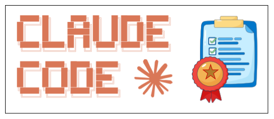

# Overview_of_Claude_Certified_Architect_Professional_Exam_Requirements

Source: https://www.educative.io/courses/claude-certified-architect-professional-exam/what-this-exam-tests

---

[Home](https://www.educative.io/)

[Courses](https://www.educative.io/search?tab=courses)

[Master Claude Certified Architect – Professional Exam (CCAR-P)](https://www.educative.io/courses/claude-certified-architect-professional-exam)

# What This Exam Tests

Explore what the Claude Certified Architect Professional Exam evaluates, focusing on architectural judgment within real-world constraints. Learn about the exam's structure, key domains, candidate profile, and scenario-based questions. This lesson prepares you for making defensible design decisions, managing risks, and understanding the trade-offs required for successful exam performance.

We'll cover the following...

- [What the exam actually tests](https://www.educative.io/courses/claude-certified-architect-professional-exam/what-this-exam-tests#What-the-exam-actually-tests)
- [The minimally qualified candidate](https://www.educative.io/courses/claude-certified-architect-professional-exam/what-this-exam-tests#The-minimally-qualified-candidate)
- [The seven exam domains](https://www.educative.io/courses/claude-certified-architect-professional-exam/what-this-exam-tests#The-seven-exam-domains)
- [How this course is structured](https://www.educative.io/courses/claude-certified-architect-professional-exam/what-this-exam-tests#How-this-course-is-structured)
  - [Meet Atlas Financial](https://www.educative.io/courses/claude-certified-architect-professional-exam/what-this-exam-tests#Meet-Atlas-Financial)
- [The kind of thinking that passes](https://www.educative.io/courses/claude-certified-architect-professional-exam/what-this-exam-tests#The-kind-of-thinking-that-passes)
- [Exam at a glance](https://www.educative.io/courses/claude-certified-architect-professional-exam/what-this-exam-tests#Exam-at-a-glance)
- [Quick knowledge check](https://www.educative.io/courses/claude-certified-architect-professional-exam/what-this-exam-tests#Quick-knowledge-check)
- [What’s next?](https://www.educative.io/courses/claude-certified-architect-professional-exam/what-this-exam-tests#Whats-next)

Many engineers can build applications with Claude. The Claude Certified Architect – Professional exam tests a broader set of skills. Can you design and manage a production Claude system end to end, choosing the architecture, model, and deployment platform, integrating it securely with enterprise systems, validating its performance and reliability, managing its risks, and justifying those decisions to stakeholders?

That is a different skill from building. It is the skill of judgment under constraint. Cost, latency, compliance, and reliability all pull in different directions, and you decide where each one wins. This exam tests that judgment.

In this lesson, we will cover:

- What the exam measures, and the profile of the candidate it is built for
- The seven weighted domains and where to invest study time
- How this course maps onto those domains, and why it is one chapter per domain
- The kind of thinking the questions reward, with a worked example
- The exam logistics you need before scheduling

## What the exam actually tests[#](https://www.educative.io/courses/claude-certified-architect-professional-exam/what-this-exam-tests#What-the-exam-actually-tests)

This is a professional-level credential. It does not test recall of API syntax or whether you can name a parameter. It tests whether you can make and justify architectural decisions in situations where more than one answer looks reasonable and only one is defensible.

The exam guide is explicit that items are written against task statements, the things an architect does on the job. So the questions are scenario-based. A situation is described, constraints are stated or implied, and you choose the best design decision, the most likely root cause, or the correct next action.

The distractors are deliberately plausible. A typical item offers four options, where three are real techniques that are simply wrong for this situation. One might be a detective control where a preventive one is needed. One might be an optimization that sacrifices a stated requirement. One might be a pattern that solves a different problem. Passing means recognizing not just what works, but what works *here, given these constraints*.

**Exam lens:** When there are two options, and both seem valid, the exam is almost always testing a trade-off. Ask what the scenario is optimizing for, such as cost, latency, compliance, reliability, or auditability, and eliminate options that optimize for the wrong constraint.

## The minimally qualified candidate[#](https://www.educative.io/courses/claude-certified-architect-professional-exam/what-this-exam-tests#The-minimally-qualified-candidate)

The exam is calibrated to a minimally qualified candidate (MQC). That is not a beginner and not necessarily an expert, but an experienced practitioner who could competently own a production Claude system. According to the exam guide, that person typically has the following background:

- A foundation in software engineering best practices (modular design, separation of concerns, scalability)
- 3+ years in systems architecture or platform engineering
- 6+ months of hands-on experience with Claude or comparable LLM systems in production
- Experience delivering end-to-end systems from discovery through deployment and operation

There are no mandatory prerequisites. You can sit this exam without holding the Foundations credential. The experience above is recommended, not required, and the credential is awarded on exam performance alone.

If you are coming from the Foundations level, the main shift is from implementation details to system-level decisions. Foundations asks, “How do I implement this agent loop correctly?” Professional asks, “Should this be an agent at all? Which model and platform should it use? What will it cost at scale? What evidence is required for compliance approval?” The underlying technology is similar, but the focus expands to architecture, platform selection, cost, scale, and compliance.

## The seven exam domains[#](https://www.educative.io/courses/claude-certified-architect-professional-exam/what-this-exam-tests#The-seven-exam-domains)

The exam draws 63 scored items from seven domains, weighted by their importance to the job. Integration (19%) and Solution Design (17%) are the two heaviest. Together, they make up nearly forty percent of the exam, which is why this course front-loads them.

|  |  |  |  |
| --- | --- | --- | --- |
| **#** | **Domain** | **Weight** | **What It Tests** |
| 1 | **Solution Design and Architecture** | 17% | Translating business problems into architectures, choosing workflow vs. agentic vs. augmented-LLM patterns, multi-agent orchestration, aligning to business value |
| 2 | **Claude Models, Prompting and Context Engineering** | 13% | Model selection trade-offs, system prompts and guardrails, prompt technique, context-window and token optimization, caching and Skills |
| 3 | **Integration** | 19% | Tool and capability bloat, least privilege, authn/authz gaps, RAG pipeline design, connection protocols (MCP, API/CLI, agent-to-agent), accuracy-latency trade-offs, observability at scale |
| 4 | **Evaluation, Testing and Optimization** | 16% | Evaluation metrics and test frameworks, A/B testing, diagnosing prompt failure vs. hallucination vs. model mismatch, cost/latency/token optimization, monitoring |
| 5 | **Governance, Safety and Risk Management** | 14% | Guardrails and safety controls, LLM failure modes, human-in-the-loop, compliance (GDPR, HIPAA, FedRAMP), ethical AI (bias, fairness, transparency) |
| 6 | **Stakeholder Communication and Lifecycle Management** | 14% | Structured discovery, communicating trade-offs, feedback loops and SLA alignment, documentation and handoff, lifecycle phases |
| 7 | **Developer Productivity and Operational Enablement** | 7% | Configuring Claude tooling for teams (e.g., Claude Code), AI-assisted developer workflows, operational debugging |

Your score report will show a pass/fail result plus the percentage of items you answered correctly within *each domain*. Those per-domain percentages are diagnostic only. The pass/fail decision is based on your total scaled score of 720 on a scale of 100 to 1,000, set by a formal standard-setting study. You do not need to pass every domain; you need enough total scaled points.

## How this course is structured[#](https://www.educative.io/courses/claude-certified-architect-professional-exam/what-this-exam-tests#How-this-course-is-structured)

This course has one chapter per exam domain, seven chapters, matching the blueprint exactly. That is deliberate. While you study, your mental model is the blueprint, and after a practice test, your per-domain score points you straight at the chapter to revisit. Chapter sizes are proportional to each domain’s weight, so your study time follows what the exam actually measures.

Each chapter ends with a scenario-based quiz in the exam's format, and the course finishes with a cross-domain capstone plus a full-length, blueprint-weighted practice exam.

### Meet Atlas Financial[#](https://www.educative.io/courses/claude-certified-architect-professional-exam/what-this-exam-tests#Meet-Atlas-Financial)

To keep the decisions concrete and connected, one system runs through the entire course. **Atlas Financial** is a commercial bank building an AI-assisted platform for commercial loan origination and servicing. You will watch its architecture take shape as the chapters progress.

- **Design:** Atlas turns a vague mandate (“help loan officers process applications faster”) into an architecture, and chooses its pattern, model, and deployment platform.
- **Integrate:** Atlas wires in tool authorization with dollar-limit least privilege, a RAG pipeline over policy and regulatory documents, the protocol to core banking systems, and observability.
- **Prove:** Atlas shows it works through evaluation metrics, an A/B test, a retrieval regression diagnosis, and cost and latency tuning.
- **Govern and deliver:** Atlas ships responsibly with human-in-the-loop for adverse actions, fair lending and privacy compliance, stakeholder and SLA conversations, team handoff, and enablement.

Individual lessons still bring in other industries such as healthcare, government, and retail, so you see each principle generalized. But Atlas is the spine that shows how early design choices constrain later ones.

## The kind of thinking that passes[#](https://www.educative.io/courses/claude-certified-architect-professional-exam/what-this-exam-tests#The-kind-of-thinking-that-passes)

Here is a representative item, adapted from the style of the official sample questions.

> **Question:** A team exposes a customer-support agent that can read tickets, draft replies, issue refunds, and delete user accounts. Support staff only ever need to read tickets and draft replies. Applying least-privilege principles, which change best reduces risk?
>
> **A.** Add logging to the refund and delete tools so misuse can be audited later.
>
> **B.** Remove the refund and delete tools from the agent’s configuration entirely.
>
> **C.** Keep all tools but add a confirmation prompt before refunds and deletions.
>
> **D.** Replace the agent with a larger model that follows instructions more reliably.

All four are things a real team might do. But least privilege means removingcapabilities *the role does not need*, eliminating the attack surface rather than monitoring or guarding it. The answer is **B**.

Notice why the others fail, because this is the pattern the exam repeats.

- **A (logging)** is a detective control. It tells you about misuse after it happened, but it does not reduce the privilege.
- **C (confirmation prompt)** is a compensating control that still leaves the dangerous capability wired up and reachable.
- **D (bigger model)** confuses instruction-following with authorization. Model size has nothing to do with access scope.

The winning move was to identify what the scenario optimized for (reducing risk through least privilege) and pick the option that addresses the root, not a symptom. Every chapter in this course is built to train that reflex.

**Exam lens:** “Add logging,” “add a confirmation,” and “use a bigger or better model” are recurring distractors. They are rarely the *best* answer when the scenario is about eliminating a risk, because they manage the risk instead of removing it.

That first item was a multiple-choice question; select one answer from four options. The Professional exam also includes a second item type, multiple-response, where more than one option is correct, and the stem tells you exactly how many to select. Here is what that format looks like.

> **Question:** A team is deciding how to reduce risk in a Claude-powered pipeline that reads customer PII from a database and writes summaries to a shared document. Select two changes that reduce risk without requiring a new architecture.
>
> **A.** Scope the database credential the pipeline uses to read-only access on the specific tables it needs.
>
> **B.** Increase the model’s context window so it can process more records per call.
>
> **C.** Log every read and write the pipeline performs, including which fields were accessed.
>
> **D.** Switch to a larger model so it is less likely to make an extraction error.
>
> **E.** Replace the shared document with a private one only the pipeline can write to.

The correct selections are A and E. Both reduce the actual exposure: a scoped read-only credential limits what a compromised pipeline could do, and a private destination removes an unnecessary audience for PII-bearing output. Option C, logging, is worth doing but is a detective control, not a risk reduction, the same distractor pattern as the item before. Option B raises cost and processing scope for no stated risk benefit. Option D repeats the “bigger model” distractor from the previous item; model size does not change data exposure.

A multiple-response item is scored as a single unit. Selecting both correct answers along with one extra, incorrect option still does not earn credit. That makes elimination discipline even more important than on a multiple-choice item, since every option has to be judged on its own merits, not just compared to the others.

## Exam at a glance[#](https://www.educative.io/courses/claude-certified-architect-professional-exam/what-this-exam-tests#Exam-at-a-glance)

The Professional exam is delivered through Pearson VUE. Key details, per the Version 1.0 exam guide (effective July 2026):

|  |  |
| --- | --- |
| **Exam code** | CCAR-P (Claude Certified Architect – Professional) |
| **Issuer** | Anthropic |
| **Delivery** | Pearson VUE (online proctored or test center) |
| **Number of items** | 63 |
| **Item format** | Multiple-choice and multiple-response; each item states how many responses to select |
| **Time limit** | 120 minutes |
| **Passing score** | 720 (scaled score, range 100 to 1,000) |
| **Cost** | $175 USD |
| **Validity** | 12 months from the date awarded |
| **Retakes** | Up to 4 attempts per rolling 12 months; waiting periods of 14, 30, and 90 days after successive failures |

A few things are worth internalizing now:

- Multiple-response items state how many answers to select. Read that instruction, because a “select two” item is scored on getting both right.
- The credential is time-limited to 12 months because the technology moves fast. On-time renewal is a free, non-proctored assessment, while letting it lapse means retaking the full exam.
- All exam content is confidential. You will accept a non-disclosure agreement before starting.

> **To register:** Registration, pricing, and policies live on the Anthropic Partner Academy at [anthropic-partners.skilljar.com](https://anthropic-partners.skilljar.com). Verify current details before scheduling, since the figures above are from the July 2026 guide.

## Quick knowledge check[#](https://www.educative.io/courses/claude-certified-architect-professional-exam/what-this-exam-tests#Quick-knowledge-check)

Technical Quiz

1.

You are advising a team that wants to add a new capability to a production Claude system. Two designs both meet the functional requirement. The system processes protected health information and runs in a regulated environment. Which factor should most influence the architectural decision?

A.

Whichever design uses fewer lines of code, since a smaller codebase is cheaper to maintain

B.

Whichever design the engineering team finds most interesting and motivating to build

C.

Whichever design better satisfies the binding constraints the environment imposes on the system

D.

Whichever design uses the newest available model, since newer models generally perform better

---

1 / 1

## What’s next?[#](https://www.educative.io/courses/claude-certified-architect-professional-exam/what-this-exam-tests#Whats-next)

Next, we begin the Solution Design chapter by meeting Atlas Financial and doing the first thing any architect does: turning an ambiguous business problem into a defensible solution architecture. We will build the decomposition and business-value-alignment habits that Domain 1 tests, the habits that every later decision in the course depends on.

From Business Problem to Solution Architecture

Ask

[What the exam actually tests](https://www.educative.io/courses/claude-certified-architect-professional-exam/what-this-exam-tests#What-the-exam-actually-tests)

[The minimally qualified candidate](https://www.educative.io/courses/claude-certified-architect-professional-exam/what-this-exam-tests#The-minimally-qualified-candidate)

[The seven exam domains](https://www.educative.io/courses/claude-certified-architect-professional-exam/what-this-exam-tests#The-seven-exam-domains)

[How this course is structured](https://www.educative.io/courses/claude-certified-architect-professional-exam/what-this-exam-tests#How-this-course-is-structured)

[Meet Atlas Financial](https://www.educative.io/courses/claude-certified-architect-professional-exam/what-this-exam-tests#Meet-Atlas-Financial)

[The kind of thinking that passes](https://www.educative.io/courses/claude-certified-architect-professional-exam/what-this-exam-tests#The-kind-of-thinking-that-passes)

[Exam at a glance](https://www.educative.io/courses/claude-certified-architect-professional-exam/what-this-exam-tests#Exam-at-a-glance)

[Quick knowledge check](https://www.educative.io/courses/claude-certified-architect-professional-exam/what-this-exam-tests#Quick-knowledge-check)

[What’s next?](https://www.educative.io/courses/claude-certified-architect-professional-exam/what-this-exam-tests#Whats-next)