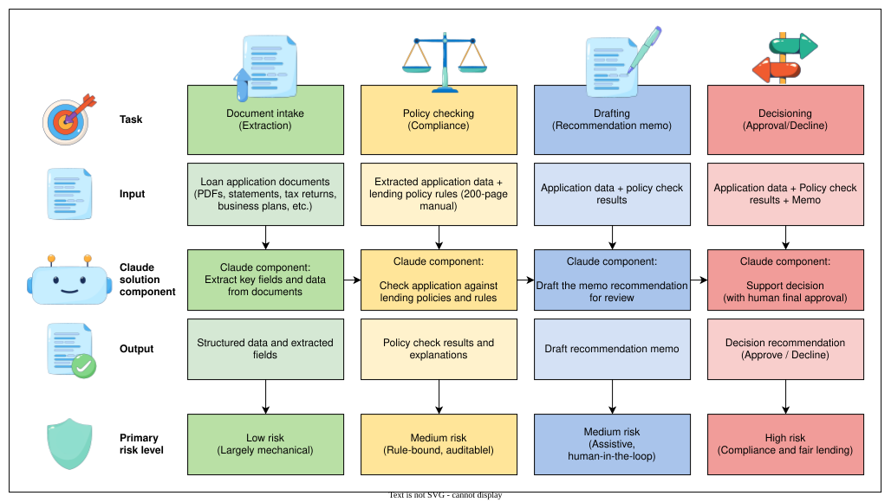

# Translate_Business_Problems_into_Effective_AI_Solution_Architecture

Source: https://www.educative.io/courses/claude-certified-architect-professional-exam/from-business-problem-to-solution-architecture

---

[Home](https://www.educative.io/)

[Courses](https://www.educative.io/search?tab=courses)

[Master Claude Certified Architect – Professional Exam (CCAR-P)](https://www.educative.io/courses/claude-certified-architect-professional-exam)

# From Business Problem to Solution Architecture

Explore how to translate vague business problems into structured AI solution architectures. Understand decomposition methods for breaking tasks into clear components, align architectures with business value, and avoid common design anti-patterns. This lesson prepares you to articulate architectural decisions that meet regulatory and business requirements, foundational for the Claude Certified Architect exam.

We'll cover the following...

- [Meet Atlas Financial](https://www.educative.io/courses/claude-certified-architect-professional-exam/from-business-problem-to-solution-architecture#Meet-Atlas-Financial)
- [Why translation is the architecture](https://www.educative.io/courses/claude-certified-architect-professional-exam/from-business-problem-to-solution-architecture#Why-translation-is-the-architecture)
- [A method for decomposing the mandate](https://www.educative.io/courses/claude-certified-architect-professional-exam/from-business-problem-to-solution-architecture#A-method-for-decomposing-the-mandate)
- [Aligning to business value pillars](https://www.educative.io/courses/claude-certified-architect-professional-exam/from-business-problem-to-solution-architecture#Aligning-to-business-value-pillars)
- [From decomposition to a first architecture sketch](https://www.educative.io/courses/claude-certified-architect-professional-exam/from-business-problem-to-solution-architecture#From-decomposition-to-a-first-architecture-sketch)
- [Anti-patterns](https://www.educative.io/courses/claude-certified-architect-professional-exam/from-business-problem-to-solution-architecture#Anti-patterns)
- [Exercise: Scope the mandate](https://www.educative.io/courses/claude-certified-architect-professional-exam/from-business-problem-to-solution-architecture#Exercise-Scope-the-mandate)
- [What’s next](https://www.educative.io/courses/claude-certified-architect-professional-exam/from-business-problem-to-solution-architecture#Whats-next)

Every production Claude system begins as a sentence from someone who is not an engineer. “Help our loan officers process applications faster.” “Cut support response times.” “Make our policy documents searchable.” These sentences are ambiguous by nature, and the architect’s first job is not to start building. It is to interrogate the sentence until it becomes a set of decisions that can be defended to the people who fund and approve the work.

Domain 1 of the exam (Solution Design and Architecture, 17%) tests exactly this movement, from problem to architecture with the reasoning intact. It is the largest design-oriented domain, and it sits first for a reason. Every other decision in the course, which model to pick, how to integrate, what to measure, how to govern, inherits the framing you set here. Get the framing wrong and you optimize the wrong thing with great discipline. In this lesson, we will cover:

- Why translating the business problem is a distinct architectural skill, not a preamble to one
- A structured method for decomposing an ambiguous mandate into buildable components
- How to align every component to a business value pillar, and how to quantify that value
- The anti-patterns that make an architecture indefensible

## Meet Atlas Financial[#](https://www.educative.io/courses/claude-certified-architect-professional-exam/from-business-problem-to-solution-architecture#Meet-Atlas-Financial)

Throughout this course, we follow one system. **Atlas Financial** is a commercial bank. Its commercial-lending division employs loan officers who take a business’s application for a loan, gather supporting documents (financial statements, tax returns, business plans, existing debt schedules), check them against the bank’s lending policy, and produce a recommendation that a credit committee approves or declines.

The mandate from Atlas’s Head of Commercial Lending is one sentence.

> **Business mandate:** “Help our loan officers process applications faster so we can handle more volume without hiring.”

This is where a weaker architect starts drawing an agent diagram. A stronger architect starts asking questions, because that sentence hides at least four different systems, three different risk profiles, and one regulatory minefield. Let’s do it properly.

## Why translation is the architecture[#](https://www.educative.io/courses/claude-certified-architect-professional-exam/from-business-problem-to-solution-architecture#Why-translation-is-the-architecture)

Translating a business problem into a Claude-based solution is the foundation everything else in solution design rests on, and it comes first because it is where systems are won or lost. An architecture built on an unexamined problem statement optimizes the wrong thing efficiently.

To see how this goes wrong, imagine a team that skips translation. They read “process applications faster” and build a single “loan assistant,” one component that ingests an application and returns a completed recommendation. It demos well. Then it reaches production and three things happen. The extraction errors that a human would have caught in review now flow straight into a recommendation. The system quietly forms an opinion on approval, which means the bank is now letting software influence a lending decision without any of the controls a regulator expects. And when the credit committee asks why a particular applicant was scored the way they were, no one can answer, because the reasoning was never separated into auditable steps. The team built the demo the sentence suggested, not the system the business needed.

Decompose the mandate into distinct tasks; It clarifies what you are building, where risk sits, and how value is delivered

Now consider what “process applications faster” could actually mean, taken apart.

- **Faster document intake:** Extracting fields from statements and tax returns that officers currently key in by hand.
- **Faster policy checking:** Comparing an application against lending rules that today live in a 200-page manual.
- **Faster drafting:** Producing the first draft of the recommendation memo the committee reads.
- **Faster decision-making:** The actual approval or decline judgment.

These are not the same system, and they do not carry the same risk. Document extraction is largely mechanical and low-risk. Policy checking is higher-risk but rule-bound and auditable. Drafting is assistive, with a human editing every word. Decisioning, having software decide who gets a loan, is a fair-lending and compliance question that may not be permissible to automate at all. If the architect treats “process applications faster” as one undifferentiated task, the most dangerous interpretation rides along with the safe ones, invisibly, until it surfaces in an audit.

**The principle:** Decomposition is not a project-management step you do after choosing an architecture. It *is* the architecture’s foundation, because it determines what you are actually building and where the risk sits.

## A method for decomposing the mandate[#](https://www.educative.io/courses/claude-certified-architect-professional-exam/from-business-problem-to-solution-architecture#A-method-for-decomposing-the-mandate)

Use a repeatable four-question decomposition. It works for any ambiguous business request, in any industry, and it is exactly the reasoning the exam wants to see. For each candidate task, ask the following.

1. **What are the distinct tasks hidden inside this sentence?** Break the mandate into the smallest units that could each be a separate component. Push until each unit does one thing. (For Atlas, these are intake, policy-check, draft, and decision.)
2. **What is the input and output of each task?** If you cannot state both concretely, the task is still too vague to build. Naming the input and output also exposes hidden dependencies, since one task’s output is often the next task’s input. (Intake takes a PDF of a financial statement and returns a structured JSON of line items, which then becomes the input to policy checking.)
3. **What is the risk and reversibility of each task’s output?** A wrong extracted number can be caught in review and corrected. A wrongly *issued* decision may be an unlawful adverse action that the bank cannot take back and must report. Rank the tasks by the consequence of a wrong output, because that ranking decides which tasks may be automated, which may only assist, and which stay fully human.
4. **Which tasks actually move the business metric?** The mandate is about volume per officer. Find where officer time actually goes, and target that, rather than the task that is most fun to automate. A task can be technically exciting and contribute nothing to the stated goal.

Running Atlas through this produces a very different picture than the one-line mandate suggested.

|  |  |  |  |
| --- | --- | --- | --- |
| **Task** | **Input → Output** | **Risk and Reversibility** | **Moves the Metric?** |
| Document intake | Uploaded PDFs → structured fields | Low, caught in review | Yes. Officers spend hours keying data |
| Policy check | Application and policy manual → flagged issues | Medium, rule-bound, auditable | Yes, manual lookup is slow |
| Draft memo | Structured application → draft recommendation | Medium, assistive, human-owned | Partly |
| Final decision | All of the above → approve or decline | High, may be an unlawful adverse action | Out of scope, keep human |

The decomposition itself has made the key architectural decision. Atlas should automate intake and policy-checking, assist with drafting, and keep the decision human. No model has been chosen and no pattern selected, and yet the most important call has already been made, and it is defensible to a regulator. That is the mark of good translation. The hard decisions get made in plain language, where stakeholders can see and challenge them, before any technology narrows the options.

**Exam lens:** Scenario stems often describe a broad mandate and then offer architectures at different scopes. The distractor is usually the one that treats the whole mandate as a single component, or that automates the highest-risk step. The correct answer decomposes first and keeps the irreversible step under human control.

## Aligning to business value pillars[#](https://www.educative.io/courses/claude-certified-architect-professional-exam/from-business-problem-to-solution-architecture#Aligning-to-business-value-pillars)

Aligning a solution to business value pillars, efficiency, transformation, productivity, cost, performance SLAs, is not corporate decoration. At the professional level, an architecture you cannot tie to business value is an architecture you cannot get funded, so connecting design choices to value explicitly is part of the design work itself, not a step to add afterward.

Here are the common pillars and what each means in practice.

- **Efficiency:** Doing the same work with fewer resources. Atlas wants officers to handle more applications without new hires.
- **Productivity:** The same people producing more or higher-quality output, such as better-researched memos.
- **Cost:** Direct spend, including the system’s own running cost, which must stay below the value it creates.
- **Transformation:** Enabling something the business simply could not do before, such as same-day preliminary feedback to applicants.
- **Performance and SLAs:** Measurable service levels the business commits to, such as intake completion within five minutes of upload.

For Atlas, the mandate maps cleanly to efficiency (volume per officer) with a cost ceiling (the system must cost less than the officer hours it saves) and an implied SLA (fast enough that officers do not wait on it). Naming the pillar does real architectural work. It tells you that a slow, expensive, maximally accurate design fails the brief, because the brief is about throughput and cost, not squeezing out the last percentage point of extraction accuracy.

It pays to make the value concrete, because a number is what gets a project funded and what tells you when to stop optimizing. Suppose an officer spends about ninety minutes per application on manual data entry and policy lookup, and the division processes four thousand applications a year. If the system removes two-thirds of that time, it returns roughly four thousand officer-hours a year. That figure is now the budget the running cost has to stay under, and it is also the yardstick for every later trade-off. When we reach model selection, and someone proposes a more expensive configuration for a marginal accuracy gain, we can check it against this number instead of arguing from taste.

**Exam lens:** When a scenario states a business goal such as throughput, cost reduction, or a latency SLA, the correct architecture is the one that serves *that* goal. An option that improves an axis the business did not ask about, at the expense of the one it did, is a distractor, even if it sounds more sophisticated.

## From decomposition to a first architecture sketch[#](https://www.educative.io/courses/claude-certified-architect-professional-exam/from-business-problem-to-solution-architecture#From-decomposition-to-a-first-architecture-sketch)

With the tasks scoped and mapped to value, the end-to-end shape falls out. Every architecture can be described as input → processing → output → feedback loops, and Atlas’s now looks like this.

- **Input:** The loan officer uploads application documents.
- **Processing:** Extract fields (intake), check against policy (policy-check), assemble a draft memo (draft).
- **Output:** A structured, populated review form and a draft recommendation the officer edits.
- **Feedback loop:** Officer corrections are captured to measure and improve extraction and policy-check quality over time, and the final human decision is never automated.

The feedback loop is the part inexperienced designs leave out, and it is worth dwelling on because the exam treats it as part of the architecture, not an afterthought. Every time an officer corrects an extracted figure or overrides a policy flag, that correction is a labeled example of where the system was wrong. Capturing it does two things. It gives you the evaluation data you will need in the chapter on testing, and it turns the system into something that gets measurably better instead of drifting silently. A design that produces outputs but never learns whether they were right is a design you cannot improve and cannot defend.

This sketch is deliberately pattern-agnostic. We have not yet decided whether policy-checking is a fixed workflow or an agent, which model runs intake, or where it is all deployed. Those decisions come in the lessons ahead. The point of this lesson is that those decisions now have a frame, a scoped set of tasks, ranked by risk, tied to a quantified business value, so that when we choose a pattern, we are choosing it for a well-defined problem rather than for a slogan.

## Anti-patterns[#](https://www.educative.io/courses/claude-certified-architect-professional-exam/from-business-problem-to-solution-architecture#Anti-patterns)

These are the wrong-but-tempting moves the exam uses as distractors.

- **Solutioning before decomposing:** Jumping to “it’s a multi-agent system” before establishing what the tasks are. The architecture then serves the pattern, not the problem, and every later decision is anchored to a choice that was never justified.
- **Treating the whole mandate as one task:** Building “an application processor” as a single component lets the highest-risk interpretation, automated decisioning, slip in unnoticed and unaudited.
- **Automating the impressive task instead of the valuable one:** Automating the final decision is technically flashy and business-catastrophic, while the value and the safety both sit in the humble tasks, intake and policy-checking.
- **Omitting the value tie:** An architecture presented without its business-value justification cannot be defended to funders, and on the exam it signals a candidate who designs in a vacuum. Always be able to name the pillar and, ideally, the number.
- **Ignoring reversibility:** Failing to rank tasks by the consequence of a wrong output leads to over-automating the irreversible and under-investing in the frequent, which is exactly backwards.

## Exercise: Scope the mandate[#](https://www.educative.io/courses/claude-certified-architect-professional-exam/from-business-problem-to-solution-architecture#Exercise-Scope-the-mandate)

Each scenario tests whether you decompose an ambiguous mandate correctly before choosing an architecture. Choose the best answer.

Technical Quiz

1.

A retailer asks you to “use AI to improve customer reviews.” Which first move is correct?

A.

Prototype the two most technically interesting interpretations in parallel, and let early user feedback decide which interpretation matches the business’s real underlying intent.

B.

Decompose the mandate into its hidden tasks, rank each by risk, and identify which one actually moves the stated business metric.

C.

Choose the augmented-LLM pattern by default for the whole mandate, since it is generally the cheapest and most predictable of the three options.

D.

Treat “improve customer reviews” as one single component, since splitting an ambiguous mandate before requirements are firm risks solving the wrong problem entirely.

---

1 / 4

## What’s next[#](https://www.educative.io/courses/claude-certified-architect-professional-exam/from-business-problem-to-solution-architecture#Whats-next)

Next, we take Atlas’s scoped, value-aligned problem and make the first true architecture decision. Is each component a fixed workflow, an agentic system, or an augmented LLM? We will build the decision framework the exam uses to test pattern selection, including the most common trap: reaching for an agent when a simpler pattern is more reliable and cheaper.

What This Exam Tests

Choosing the Architecture Pattern

Ask

[Meet Atlas Financial](https://www.educative.io/courses/claude-certified-architect-professional-exam/from-business-problem-to-solution-architecture#Meet-Atlas-Financial)

[Why translation is the architecture](https://www.educative.io/courses/claude-certified-architect-professional-exam/from-business-problem-to-solution-architecture#Why-translation-is-the-architecture)

[A method for decomposing the mandate](https://www.educative.io/courses/claude-certified-architect-professional-exam/from-business-problem-to-solution-architecture#A-method-for-decomposing-the-mandate)

[Aligning to business value pillars](https://www.educative.io/courses/claude-certified-architect-professional-exam/from-business-problem-to-solution-architecture#Aligning-to-business-value-pillars)

[From decomposition to a first architecture sketch](https://www.educative.io/courses/claude-certified-architect-professional-exam/from-business-problem-to-solution-architecture#From-decomposition-to-a-first-architecture-sketch)

[Anti-patterns](https://www.educative.io/courses/claude-certified-architect-professional-exam/from-business-problem-to-solution-architecture#Anti-patterns)

[Exercise: Scope the mandate](https://www.educative.io/courses/claude-certified-architect-professional-exam/from-business-problem-to-solution-architecture#Exercise-Scope-the-mandate)

[What’s next](https://www.educative.io/courses/claude-certified-architect-professional-exam/from-business-problem-to-solution-architecture#Whats-next)