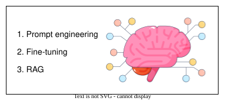

# Choosing_the_Best_AI_Architecture_Pattern_for_Solution_Design

Source: https://www.educative.io/courses/claude-certified-architect-professional-exam/choosing-the-architecture-pattern

---

[Home](https://www.educative.io/)

[Courses](https://www.educative.io/search?tab=courses)

[Master Claude Certified Architect – Professional Exam (CCAR-P)](https://www.educative.io/courses/claude-certified-architect-professional-exam)

# Choosing the Architecture Pattern

Explore how to choose the appropriate architecture pattern for AI tasks by understanding the spectrum of autonomy from augmented LLMs to agents. Learn to apply a decision framework that considers cost, auditability, and runtime adaptability to design effective and efficient AI-powered solutions.

We'll cover the following...

- [The three patterns are a spectrum of autonomy](https://www.educative.io/courses/claude-certified-architect-professional-exam/choosing-the-architecture-pattern#The-three-patterns-are-a-spectrum-of-autonomy)
- [The augmented LLM as the baseline building block](https://www.educative.io/courses/claude-certified-architect-professional-exam/choosing-the-architecture-pattern#The-augmented-LLM-as-the-baseline-building-block)
- [Workflows are predefined paths of steps](https://www.educative.io/courses/claude-certified-architect-professional-exam/choosing-the-architecture-pattern#Workflows-are-predefined-paths-of-steps)
- [Agents let the model control the flow](https://www.educative.io/courses/claude-certified-architect-professional-exam/choosing-the-architecture-pattern#Agents-let-the-model-control-the-flow)
- [The decision framework](https://www.educative.io/courses/claude-certified-architect-professional-exam/choosing-the-architecture-pattern#The-decision-framework)
- [Anti-patterns](https://www.educative.io/courses/claude-certified-architect-professional-exam/choosing-the-architecture-pattern#Anti-patterns)
- [Exercise: Choose the pattern](https://www.educative.io/courses/claude-certified-architect-professional-exam/choosing-the-architecture-pattern#Exercise-Choose-the-pattern)
- [What’s next?](https://www.educative.io/courses/claude-certified-architect-professional-exam/choosing-the-architecture-pattern#Whats-next)

In the previous lesson, we took Atlas Financial’s vague mandate and decomposed it into four scoped tasks, document intake, policy checking, memo drafting, and the final decision (which we keep human). Each of those tasks now needs an architecture. This lesson gives you the framework for choosing between the three architectural patterns, workflow, agentic, and augmented LLM, and for defending the choice.

This is the highest-leverage decision an architect makes. Choose an agent where a workflow would do, and you have built something expensive, slow, and hard to debug for no benefit. Choose a workflow where the task genuinely needs runtime adaptation, and you have built something that breaks the moment reality deviates from your flowchart. In this lesson, we will cover:

- The three patterns as a spectrum of increasing autonomy, cost, and unpredictability
- The augmented LLM as the baseline building block you reach for first
- A decision framework for choosing a pattern for any scoped task
- Why “use an agent” is the exam’s favorite over-engineering distractor

## The three patterns are a spectrum of autonomy[#](https://www.educative.io/courses/claude-certified-architect-professional-exam/choosing-the-architecture-pattern#The-three-patterns-are-a-spectrum-of-autonomy)

There are three architectural patterns, but they are not three unrelated options. They form a spectrum. As you move along it, you hand more control to the model, gaining flexibility but giving up predictability, and paying more in latency and tokens for each step.

|  |  |  |  |  |
| --- | --- | --- | --- | --- |
| **Pattern** | **Who Controls the Flow** | **Predictability** | **Relative Cost** | **Reach for It When** |
| **Augmented LLM** | The developer (a single, bounded call) | Highest | Lowest | One well-defined step, such as retrieve, reason over context, produce structured output |
| **Workflow** | The developer (a predefined path of steps) | High | Medium | The steps are known in advance and do not change based on results |
| **Agentic** | The model (it decides the next step at runtime) | Lowest | Highest | The path genuinely cannot be known until you see intermediate results |

Here is the governing principle, and the single most important idea in this lesson.

**Note:** Use the least autonomy the task requires. Start from the simplest pattern that could work, and move up the spectrum only when the task forces you to. Every step up costs predictability, money, and debuggability.

This is the inverse of how most engineers instinctively approach LLM design. The exciting word is “agent,” so people start there and work backward. The architect starts at the bottom and moves up only under pressure.

## The augmented LLM as the baseline building block[#](https://www.educative.io/courses/claude-certified-architect-professional-exam/choosing-the-architecture-pattern#The-augmented-LLM-as-the-baseline-building-block)

The augmented LLM is a single language model call enhanced with some combination of three things. Retrieval lets it pull in relevant context, tools let it call functions to read or act on the world, and memory lets it carry state. It is *not* a loop and *not* a multi-step plan. It is one bounded interaction, context goes in, and a structured result comes out.

Augmented LLM

This is the building block the other two patterns are made of. A workflow is a series of augmented-LLM calls on a fixed path. An agent is an augmented LLM called repeatedly in a loop where the model chooses what happens next. So the augmented LLM is not the “beginner” option. It is the atom, and a large fraction of real production tasks need nothing more than one well-designed augmented-LLM call.

Take Atlas’s document intake, where the system reads an uploaded financial statement and extracts the line items into structured JSON. This is exactly right for an augmented LLM. There is one input, one output, no branching, and no need for the model to decide anything about control flow. An augmented LLM with a document in context and a structured-output schema does the whole job. Reaching for a workflow or an agent here would add moving parts that buy nothing.

**Exam lens:** When a scenario describes a single, self-contained transformation, such as extract these fields, classify this ticket, or summarize this document, the answer is usually the simplest pattern (an augmented LLM or a one-step call), and options proposing an agent or elaborate orchestration are over-engineering distractors.

## Workflows are predefined paths of steps[#](https://www.educative.io/courses/claude-certified-architect-professional-exam/choosing-the-architecture-pattern#Workflows-are-predefined-paths-of-steps)

A workflow chains multiple LLM calls along a path the developer defines in advance. The model does the work at each step, and the code decides which step runs next. Common workflow shapes include the following.

Common workflow shapes

- **Prompt chaining:** The output of one call feeds the next (extract, then validate, then summarize).
- **Routing:** An initial call classifies the input, then directs it to one of several specialized downstream paths.
- **Parallelization:** The same input is processed several ways at once and the results are combined, for example running three independent checks and aggregating them.

The defining property is simple. You could draw the complete flowchart before running anything. The branches are known. Routing is still a workflow, because the set of routes is fixed in advance. The model picks among known options, it does not invent new ones.

For Atlas’s policy checking, a workflow fits. The steps are stable for every application. First, pull the relevant policy sections for this loan type. Second, check the application’s figures against each rule. Third, produce a structured list of pass, fail, and flag results. The path does not change based on what is found, because a failed rule is recorded, not a trigger to improvise a new investigation. That is a workflow, and building it as an agent would trade away the auditability a bank needs (a fixed path produces the same reasoning trace every time) for a flexibility the task never uses.

## Agents let the model control the flow[#](https://www.educative.io/courses/claude-certified-architect-professional-exam/choosing-the-architecture-pattern#Agents-let-the-model-control-the-flow)

In an agentic architecture, the model runs in a loop and decides the next step at runtime based on what it has found so far. There is no predefined path. The agent chooses which tool to call, reads the result, and decides what to do next, continuing until it judges the task complete (a judgment the application must still bound and verify, as Foundations-level loop-termination discipline requires). Agents are the right call when the path genuinely cannot be known in advance.

Adaptive agent

- The next step depends on intermediate results in a way you cannot enumerate. In “investigate why this application was flagged,” where you look depends on what you find.
- The task is open-ended, such as research, debugging, or multi-step problem-solving with unknown structure.
- Which tools to call, and in what order, is context-dependent rather than fixed.

Notice that none of Atlas’s four tasks are truly agentic. Intake is a single transformation. Policy checking and drafting are fixed paths. The final decision is kept human. This is realistic and worth internalizing. Many production systems that get called “AI agents” are, correctly designed, workflows and augmented LLMs. An agent would be right for Atlas only if it added, say, an open-ended “investigate this borderline application” capability where a loan officer wants the system to autonomously chase down whatever is anomalous, a genuinely unknown path.

**Exam lens:** The signal for a true agent is an *unknown path*, where the next step depends on what is found and cannot be scripted. The signal against one is a task you could flowchart. Scenarios that describe a fully specifiable process and then ask if an agent is appropriate are testing whether you will resist the word “agent.”

## The decision framework[#](https://www.educative.io/courses/claude-certified-architect-professional-exam/choosing-the-architecture-pattern#The-decision-framework)

For any single scoped task, ask these questions in order and stop at the first “yes.”

1. **Can this be one bounded call?** If the task is a single transformation, input to output with no control-flow decisions, use an augmented LLM (with retrieval, tools, and memory as needed). Stop.
2. **Can you draw the complete flowchart in advance?** If the steps and branches are all known before running, use a workflow (chaining, routing, or parallelization). Stop.
3. **Does the path genuinely depend on runtime results in ways you cannot enumerate?** Only then use an agent, and bound its loop, tools, and stopping condition in code.

Two cross-checks the exam rewards:

- **Cost and latency:** Each step up the spectrum multiplies calls and tokens. If two patterns both work, the cheaper, more predictable one wins unless the task’s value justifies the extra autonomy.
- **Auditability and reliability:** Regulated and high-stakes contexts (like Atlas) favor lower-autonomy patterns because a fixed path produces a consistent, reviewable trace. Autonomy is a liability where every decision must be explained to an auditor.

The cost difference is not abstract. A single augmented-LLM call for Atlas’s intake might make one model call per document, so a batch of a thousand statements costs and latencies such as a thousand calls. A workflow for policy checking, with three chained steps, costs roughly three times that per application, because each step is its own call, even though every step is cheap and fast individually.

An agentic investigator, deciding at runtime whether to pull a credit bureau report, re-check a ratio, or ask a follow-up question, might make anywhere from three to fifteen calls depending on what it finds, and that variance is itself a cost you have to plan for, since you cannot quote a single latency number to the business the way you can for the other two patterns. This is exactly why the decision framework insists on stopping at the first “yes.” Every extra step up the spectrum is a cost and a predictability trade the business has to actually want, not one you default into because the word “agent” sounds more capable.

## Anti-patterns[#](https://www.educative.io/courses/claude-certified-architect-professional-exam/choosing-the-architecture-pattern#Anti-patterns)

These are the wrong-but-tempting moves the exam uses as distractors.

- **Agent-first design:** Starting from “let’s build an agent” and fitting the problem to it. The exam consistently rewards the *least* autonomous pattern that satisfies the task.
- **Mistaking routing for agency:** Because a routing step uses the model to choose a path, people call it an agent. It is a workflow, because the routes are fixed and known.
- **Over-decomposing a single call into a workflow:** Splitting one bounded transformation into three chained calls adds latency and failure points without benefit. If one augmented-LLM call does it, use one.
- **Ignoring the auditability cost of autonomy:** Choosing an agent in a regulated context because it is flexible, without accounting for the fact that a non-deterministic path is far harder to explain to a regulator.
- **Confusing “the whole system” with “one pattern”:** A real system (like Atlas) is usually a composition, with augmented LLMs for some tasks, workflows for others, and maybe one agent for a genuinely open-ended part. The pattern is chosen per task, not once for the whole system.

## Exercise: Choose the pattern[#](https://www.educative.io/courses/claude-certified-architect-professional-exam/choosing-the-architecture-pattern#Exercise-Choose-the-pattern)

Each scenario tests whether you can place a task correctly on the autonomy spectrum. Choose the best answer.

Technical Quiz

1.

A team needs to translate a support ticket into one of five known categories and route it to the matching team’s queue. An engineer proposes an autonomous agent “so it can adapt to new kinds of tickets.” What pattern is correct, and what is wrong with the proposal?

A.

An agentic architecture, since deciding which of five categories a ticket belongs to is itself a judgment call only an autonomous agent can reliably make.

B.

A multi-agent system, since dispatching each of the five categories to its own specialist keeps tool selection scoped and avoids overloading any single agent.

C.

A workflow using routing, since the five categories are fixed in advance, and “adapt to new tickets” describes a problem this task lacks.

D.

A workflow, but only after upgrading to a considerably larger model so that classification accuracy across the five known categories improves.

---

1 / 4

## What’s next?[#](https://www.educative.io/courses/claude-certified-architect-professional-exam/choosing-the-architecture-pattern#Whats-next)

We’ve placed each of Atlas’s tasks on the autonomy spectrum. Next, we go deeper into the highest-autonomy end and ask when a single agent should instead become a multi-agent system with a coordinator and specialists, when that added structure earns its cost, and what provenance and scope discipline it requires to stay reliable.

From Business Problem to Solution Architecture

Multi-Agent Systems and Orchestration Strategy

Ask

[The three patterns are a spectrum of autonomy](https://www.educative.io/courses/claude-certified-architect-professional-exam/choosing-the-architecture-pattern#The-three-patterns-are-a-spectrum-of-autonomy)

[The augmented LLM as the baseline building block](https://www.educative.io/courses/claude-certified-architect-professional-exam/choosing-the-architecture-pattern#The-augmented-LLM-as-the-baseline-building-block)

[Workflows are predefined paths of steps](https://www.educative.io/courses/claude-certified-architect-professional-exam/choosing-the-architecture-pattern#Workflows-are-predefined-paths-of-steps)

[Agents let the model control the flow](https://www.educative.io/courses/claude-certified-architect-professional-exam/choosing-the-architecture-pattern#Agents-let-the-model-control-the-flow)

[The decision framework](https://www.educative.io/courses/claude-certified-architect-professional-exam/choosing-the-architecture-pattern#The-decision-framework)

[Anti-patterns](https://www.educative.io/courses/claude-certified-architect-professional-exam/choosing-the-architecture-pattern#Anti-patterns)

[Exercise: Choose the pattern](https://www.educative.io/courses/claude-certified-architect-professional-exam/choosing-the-architecture-pattern#Exercise-Choose-the-pattern)

[What’s next?](https://www.educative.io/courses/claude-certified-architect-professional-exam/choosing-the-architecture-pattern#Whats-next)