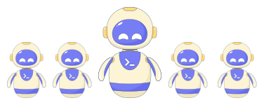

# Designing_Multi-Agent_Systems_and_Orchestration_Strategies

Source: https://www.educative.io/courses/claude-certified-architect-professional-exam/multi-agent-systems-and-orchestration-strategy

---

[Home](https://www.educative.io/)

[Courses](https://www.educative.io/search?tab=courses)

[Master Claude Certified Architect – Professional Exam (CCAR-P)](https://www.educative.io/courses/claude-certified-architect-professional-exam)

# Multi-Agent Systems and Orchestration Strategy

Discover how to design multi-agent AI systems by understanding the roles of coordinators and specialists, recognizing when orchestration adds value, and applying provenance discipline to maintain clarity and reliability. This lesson helps you evaluate independent tasks, manage tool overload, prevent context pollution, and design effective handoffs to create auditable, scalable systems.

We'll cover the following...

- [Multi-agent is a further step up the spectrum](https://www.educative.io/courses/claude-certified-architect-professional-exam/multi-agent-systems-and-orchestration-strategy#Multi-agent-is-a-further-step-up-the-spectrum)
- [The three signals that justify orchestration](https://www.educative.io/courses/claude-certified-architect-professional-exam/multi-agent-systems-and-orchestration-strategy#The-three-signals-that-justify-orchestration)
- [What a coordinator does, and what a specialist does](https://www.educative.io/courses/claude-certified-architect-professional-exam/multi-agent-systems-and-orchestration-strategy#What-a-coordinator-does-and-what-a-specialist-does)
- [Provenance and scope discipline](https://www.educative.io/courses/claude-certified-architect-professional-exam/multi-agent-systems-and-orchestration-strategy#Provenance-and-scope-discipline)
- [Designing the handoff](https://www.educative.io/courses/claude-certified-architect-professional-exam/multi-agent-systems-and-orchestration-strategy#Designing-the-handoff)
- [Anti-patterns](https://www.educative.io/courses/claude-certified-architect-professional-exam/multi-agent-systems-and-orchestration-strategy#Anti-patterns)
- [Exercise: Design the split](https://www.educative.io/courses/claude-certified-architect-professional-exam/multi-agent-systems-and-orchestration-strategy#Exercise-Design-the-split)
- [What’s next?](https://www.educative.io/courses/claude-certified-architect-professional-exam/multi-agent-systems-and-orchestration-strategy#Whats-next)

In the previous lesson, we placed each of Atlas’s tasks on the autonomy spectrum and found that a genuine agent was justified only for one capability, an investigator that chases down whatever is anomalous in a borderline loan application. That decision is not the end of the design work. A single agent and a multi-agent system are both “agentic” in the sense that the model decides its own next step, but they are not the same architecture, and the exam treats the choice between them as its own decision, with its own signals and its own failure modes.

This lesson goes one level deeper into the highest-autonomy end of the spectrum. We ask when a coordinator with specialist subagents is worth building, and how to keep such a system reliable once it exists. In this lesson, we will cover:

- Why a multi-agent system is a further step up in cost and unpredictability, not a free upgrade
- The concrete signals that tell you orchestration is earning its cost
- The distinct roles of a coordinator and a specialist, and what each is responsible for
- Provenance and scope discipline, the design habit that keeps a multi-agent system honest
- How to design the handoff between coordinator and specialists

## Multi-agent is a further step up the spectrum[#](https://www.educative.io/courses/claude-certified-architect-professional-exam/multi-agent-systems-and-orchestration-strategy#Multi-agent-is-a-further-step-up-the-spectrum)

It is tempting to treat “multi-agent system” as a fourth pattern sitting outside the spectrum from the previous lesson. It is not. A multi-agent system is what you get when a single agent’s job is split across several agents, each with a narrower scope, coordinated by one more agent whose job is to split the work and combine the results. Every cost that applies to a single agent still applies, and a new cost is added on top, the cost of coordination itself.

That coordination cost is easy to underestimate. Splitting a task across specialists means the coordinator must decide how to divide the work, must wait on multiple results, must reconcile them if they disagree, and must produce one coherent answer from several partial ones. Each of those steps is itself a place a system can fail. A coordinator that forwards the wrong sub-task to the wrong specialist, or that blends two specialists’ findings without tracking which claim came from which one, has introduced a new failure mode that a single agent never had to face.

**The principle:** Use the least autonomy and the least structure the task requires. A multi-agent system is justified only when a single agent’s drawbacks are worse than a coordinator’s overhead. If a single agent would do the job well, adding a coordinator and specialists is pure cost.

## The three signals that justify orchestration[#](https://www.educative.io/courses/claude-certified-architect-professional-exam/multi-agent-systems-and-orchestration-strategy#The-three-signals-that-justify-orchestration)

Designing multi-agent systems and orchestration strategies comes down to three concrete signals that tell you when the split earns its keep. If none of them apply, keep the single agent.

- **Independent, parallelizable subtasks:** If a task decomposes into pieces that do not depend on each other’s results, a coordinator can dispatch them at once instead of working through them one at a time. A single agent doing four independent lookups in sequence pays the full latency of all four; a coordinator dispatching four specialists in parallel pays roughly the latency of the slowest one.
- **Tool-count overload:** A single agent’s ability to pick the right tool for the moment degrades as its toolbox grows. Past roughly five tools, selection errors rise noticeably, because the model has to hold every tool’s purpose in mind on every turn and disambiguate between similar-sounding options. Splitting eighteen tools across four specialists of four to five tools each keeps each agent’s selection problem small, even though the total tool count across the system is unchanged.
- **Context pollution from exploration:** A single agent that investigates several angles in one session accumulates every dead end, every wrong turn, and every piece of irrelevant material it read along the way, all in the same context window that has to stay coherent for the final answer. A specialist who investigates one angle in its own session, then reports back a clean, structured result, never lets that noise reach the coordinator. The coordinator’s context stays about the findings, not about how each finding was produced.

**Exam lens:** Scenario stems that describe a single agent struggling with too many tools, a slow sequential investigation of independent leads, or a final answer that seems to drift because of irrelevant context earlier in the same session, are describing exactly these three signals. The correct answer is almost always to split the work across a coordinator and specialists, not to make the single agent’s context window bigger or give it a better prompt.

## What a coordinator does, and what a specialist does[#](https://www.educative.io/courses/claude-certified-architect-professional-exam/multi-agent-systems-and-orchestration-strategy#What-a-coordinator-does-and-what-a-specialist-does)

The two roles are not interchangeable, and confusing them is where a lot of multi-agent designs go wrong.

- **Coordinator:** A coordinator decomposes the incoming request into sub-tasks, decides which specialist handles each one, dispatches them, and synthesizes the returned results into one final answer. A coordinator does not investigate itself. Its job is decomposition, dispatch, and synthesis, and its context should stay about those three things, not about the raw material each specialist waded through.
- **Specialist:** A specialist owns one bounded piece of the problem. It receives a scoped task, not the entire original request, does whatever investigation that scoped task requires using its own small toolset, and returns a structured result. A specialist should not need to know what the other specialists are doing, and should not see their raw output. Its context is disposable once it reports back, which is exactly what keeps the coordinator’s context clean.

The coordinator delegates; specialists execute.

For Atlas’s borderline-application investigator, this split looks concrete rather than abstract. Instead of one agent juggling credit-bureau lookups, financial-ratio recalculation, and industry-risk lookups in a single session, a coordinator receives the flagged application and dispatches three specialists in parallel: a financial-ratio specialist that recomputes the figures that triggered the flag, a business-history specialist that checks the borrower’s prior repayment record and any public filings, and an industry-risk specialist that checks whether the borrower’s sector is under unusual stress. Each specialist has three or four tools relevant only to their domain, investigates independently, and returns a short structured finding. The coordinator never touches a credit bureau API itself. It waits for three structured findings and writes the summary the loan officer reads.

## Provenance and scope discipline[#](https://www.educative.io/courses/claude-certified-architect-professional-exam/multi-agent-systems-and-orchestration-strategy#Provenance-and-scope-discipline)

The single most tested failure mode in multi-agent design is losing track of which specialist said what, and letting a claim from one specialist’s domain get treated as if it came from a different domain. This is not a hypothetical. A specialist who reviews financial statements might, in the course of its work, notice something that looks like an employment detail, a job change mentioned in a cover letter, say. If the coordinator folds that detail into the synthesis as if the business-history specialist had verified it, the final report now contains a claim with the wrong authority behind it, and nobody reviewing the report can tell.

The fix is a discipline, not a clever architecture. Every specialist’s returned result should carry its own provenance, which specialist produced it, what domain it was scoped to, and how confident the specialist is. When the coordinator synthesizes, it should attribute each claim to its source and should flag anything that falls outside the specialist’s assigned scope rather than silently absorbing it as if it were confirmed. A claim about employment history that surfaced inside a financial-ratio specialist’s output should reach the loan officer labeled as exactly that, an unverified aside from the wrong domain, not folded in as a business-history finding.

This discipline is what makes a multi-agent system auditable. Without it, the coordinator’s synthesis is a black box that merges everything it received with no way to trace a claim back to where it actually came from, and no way to tell which parts of the final answer were actually verified by the specialist responsible for that domain.

**Exam lens:** A scenario where a coordinator’s final output includes a claim traceable to the wrong specialist, or to no specialist at all, is testing provenance discipline. The correct fix is always to attribute claims to their source and flag out-of-scope findings, never to add a second validation pass or a better system prompt, since neither of those addresses the missing attribution.

## Designing the handoff[#](https://www.educative.io/courses/claude-certified-architect-professional-exam/multi-agent-systems-and-orchestration-strategy#Designing-the-handoff)

The handoff in both directions, coordinator to specialist and specialist back to coordinator, is where a multi-agent design earns or loses its reliability.

Going out, the coordinator should hand each specialist a scoped task, not the full original request and not the full conversation history. A financial-ratio specialist needs the application’s financial figures and the specific ratio the flag was about. It does not need the loan officer’s original message, the borrower’s full history, or what the other two specialists are doing. Handing over the whole context in the name of being thorough defeats the purpose of specialization and reintroduces the context-pollution problem the split was meant to solve.

Coming back, a specialist should return a structured result, not a free-text narrative. At minimum, that means the finding itself, the specialist’s scope and role, a confidence level, and, where relevant, what it was unable to check.

Ace Editor

1

2

3

4

5

6

7

{

"finding": "Stated debt schedule does not match bureau-reported balance",

"source\_specialist": "financial-ratio",

"in\_scope": true,

"confidence": "high",

"unable\_to\_check": null

}

הההההההההההההההההההההההההההההההההההההההההההההההההההההההההההההההההההההההההההההההההההההההההההההההההההההההההההההההההההההההההההההההההההההההההההההההההההההההההההההההההההההההההההההההההההההההההההההההההההההההההההההההההההההההההההההההההההההההההההההההההההההההההההההההההההההההההההההההההההההההההההההההההההההההההההההההההההההההההההההההההההההההההההההההההההההההההההההההההההההההההההההההההההההההההההההההההההההההההההההההההההההההההההההההההההההההההההההההההההההההההההההההההההההההההההההההההההההההההההההההההההההההההההההההההההההההההההההההה

XXXXXXXXXXXXXXXXXXXXXXXXXXXXXXXXXXXXXXXXXXXXXXXXXXXXXXXXXXXXXXXXXXXXXXXXXXXXXXXXXXXXXXXXXXXXXXXXXXXXXXXXXXXXXXXXXXXXXXXXXXXXXXXXXXXXXXXXXXXXXXXXXXXXXXXXXXXXXXXXXXXXXXXXXXXXXXXXXXXXXXXXXXXXXXXXXXXXXXXXXXXXXXXXXXXXXXXXXXXXXXXXXXXXXXXXXXXXXXXXXXXXXXXXXXXXXXXXXXXXXXXXXXXXXXXXXXXXXXXXXXXXXXXXXXXXXXXXXXXXXXXXXXXXXXXXXXXXXXXXXXXXXXXXXXXXXXXXXXXXXXXXXXXXXXXXXXXXXXXXXXXXXXXXXXXXXXXXXXXXXXXXXXXXXXXXXXXXXXXXXXXXXXXXXXXXXXXXXXXXXXXXXXXXXXXXXXXXXXXXXXXXXXXXXXXXXXXXXXXXXXXXXXXXXXXXXXXXXXXXXXXXXXXXXXXXXXXXXXXXXXXXXXXXXXXX

Every field lets the coordinator attribute the finding to its source instead of guessing

A structured, provenance-tagged result like this is what lets the coordinator synthesize mechanically and honestly, attributing each piece to its source, instead of having to parse and guess at a paragraph of prose.

Two structural rules follow directly from this.

- **Specialists do not talk to each other:** All communication passes through the coordinator, which is the only place provenance is tracked and the only place conflicting findings get resolved by a defined rule rather than by one specialist being influenced by another’s unverified claim.
- **A specialist’s session is disposable:** Once it has reported back, its context can be discarded. Nothing the specialist explored along the way needs to survive, because only the structured finding matters to the rest of the system.

## Anti-patterns[#](https://www.educative.io/courses/claude-certified-architect-professional-exam/multi-agent-systems-and-orchestration-strategy#Anti-patterns)

These are the wrong-but-tempting moves the exam uses as distractors.

- **Building a coordinator before checking the three signals:** Reaching for orchestration because the task sounds complex, without confirming the subtasks are actually independent, that a tool-count problem actually exists, or that context pollution is actually happening.
- **Letting specialists share raw context:** Direct specialist-to-specialist communication, or forwarding one specialist’s full output to another, reintroduces the contamination that bounded scope was designed to prevent, and removes the coordinator’s ability to track who claimed what.
- **A coordinator that also investigates:** Blurring the coordinator’s role into doing hands-on lookups itself defeats the separation of concerns and usually means the coordinator’s own context fills up with the same noise a specialist’s would.
- **Free-text handoffs:** Specialists returning prose instead of structured, provenance-tagged results force the coordinator to parse and guess, which is exactly where claims lose their source.
- **Splitting a sequential task:** Multi-agent structure is for independent subtasks. If step two genuinely depends on step one’s result, coordinating parallel specialists adds overhead without buying anything, and a workflow or a single agent is still the right pattern for that task.

## Exercise: Design the split[#](https://www.educative.io/courses/claude-certified-architect-professional-exam/multi-agent-systems-and-orchestration-strategy#Exercise-Design-the-split)

Each scenario tests whether orchestration is justified and whether provenance is handled correctly. Choose the best answer.

Technical Quiz

1.

A team’s single agent handles customer inquiries by looking up order status, checking return eligibility, and checking loyalty-program balance, using twelve tools across the three areas. The team reports the agent frequently calls the wrong tool. What change addresses the root cause, and why?

A.

Split the single agent into a coordinator and three domain-scoped specialists, each with three or four tools, which addresses the tool-count overload directly.

B.

Keep the single agent but add explicit instructions to its system prompt clarifying which of the twelve tools to use for each inquiry type.

C.

Reduce the number of tools visible at any one time by hiding half of them at random and rotating which half is available.

D.

Replace the single agent with a fixed workflow, since a predefined path removes the model’s need to select any tool at all.

---

1 / 4

## What’s next?[#](https://www.educative.io/courses/claude-certified-architect-professional-exam/multi-agent-systems-and-orchestration-strategy#Whats-next)

We now have Atlas’s tasks fully placed on the pattern spectrum, including the one genuine multi-agent case. Next, we assemble the pieces into a complete, end-to-end reference architecture, tracing input through processing to output and closing the loop with the feedback mechanism that lets the whole system improve over time.

Choosing the Architecture Pattern

End-to-End Reference Architectures and Feedback Loops

Ask

[Multi-agent is a further step up the spectrum](https://www.educative.io/courses/claude-certified-architect-professional-exam/multi-agent-systems-and-orchestration-strategy#Multi-agent-is-a-further-step-up-the-spectrum)

[The three signals that justify orchestration](https://www.educative.io/courses/claude-certified-architect-professional-exam/multi-agent-systems-and-orchestration-strategy#The-three-signals-that-justify-orchestration)

[What a coordinator does, and what a specialist does](https://www.educative.io/courses/claude-certified-architect-professional-exam/multi-agent-systems-and-orchestration-strategy#What-a-coordinator-does-and-what-a-specialist-does)

[Provenance and scope discipline](https://www.educative.io/courses/claude-certified-architect-professional-exam/multi-agent-systems-and-orchestration-strategy#Provenance-and-scope-discipline)

[Designing the handoff](https://www.educative.io/courses/claude-certified-architect-professional-exam/multi-agent-systems-and-orchestration-strategy#Designing-the-handoff)

[Anti-patterns](https://www.educative.io/courses/claude-certified-architect-professional-exam/multi-agent-systems-and-orchestration-strategy#Anti-patterns)

[Exercise: Design the split](https://www.educative.io/courses/claude-certified-architect-professional-exam/multi-agent-systems-and-orchestration-strategy#Exercise-Design-the-split)

[What’s next?](https://www.educative.io/courses/claude-certified-architect-professional-exam/multi-agent-systems-and-orchestration-strategy#Whats-next)