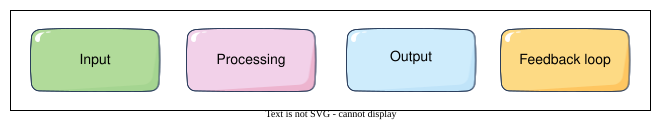

# End-to-End_Claude_AI_Architectures_with_Effective_Feedback_Loops

Source: https://www.educative.io/courses/claude-certified-architect-professional-exam/end-to-end-reference-architectures-and-feedback-loops

---

[Home](https://www.educative.io/)

[Courses](https://www.educative.io/search?tab=courses)

[Master Claude Certified Architect – Professional Exam (CCAR-P)](https://www.educative.io/courses/claude-certified-architect-professional-exam)

# End-to-End Reference Architectures and Feedback Loops

Explore how to assemble individual AI components into a coherent end-to-end Claude architecture. Learn to identify key reference architectural patterns and design effective feedback loops that allow systems to measure and improve outputs. Understand why feedback loops are essential and how to incorporate human-in-the-loop checkpoints in AI workflows for better decision quality and monitoring.

We'll cover the following...

- [The four-stage shape](https://www.educative.io/courses/claude-certified-architect-professional-exam/end-to-end-reference-architectures-and-feedback-loops#The-four-stage-shape)
- [Reference architectures you will reach for repeatedly](https://www.educative.io/courses/claude-certified-architect-professional-exam/end-to-end-reference-architectures-and-feedback-loops#Reference-architectures-you-will-reach-for-repeatedly)
- [Assembling Atlas’s end-to-end architecture](https://www.educative.io/courses/claude-certified-architect-professional-exam/end-to-end-reference-architectures-and-feedback-loops#Assembling-Atlass-end-to-end-architecture)
- [What actually belongs in a feedback loop](https://www.educative.io/courses/claude-certified-architect-professional-exam/end-to-end-reference-architectures-and-feedback-loops#What-actually-belongs-in-a-feedback-loop)
- [Anti-patterns](https://www.educative.io/courses/claude-certified-architect-professional-exam/end-to-end-reference-architectures-and-feedback-loops#Anti-patterns)
- [Exercise: Assemble the architecture](https://www.educative.io/courses/claude-certified-architect-professional-exam/end-to-end-reference-architectures-and-feedback-loops#Exercise-Assemble-the-architecture)
- [What’s next?](https://www.educative.io/courses/claude-certified-architect-professional-exam/end-to-end-reference-architectures-and-feedback-loops#Whats-next)

Over the last three lessons, we made every individual pattern decision Atlas Financial needed. Document intake became an augmented LLM. Policy checking became a workflow. The borderline-application investigator became a genuine agent, and we worked out when that investigator should grow into a coordinator with specialists. Each of those decisions was correct in isolation. None of them, on its own, is an architecture.

An architecture is what you get when those components are wired together into one system with a defined input, a defined output, and, critically, a way for the system to learn from what it gets wrong, the full input, processing, output, feedback loop shape. This lesson closes out solution design by teaching that assembly, and by giving the feedback loop the attention it usually does not get. In this lesson, we will cover:

- The four-stage shape every Claude architecture shares, and why stopping short of the fourth stage is the most common design gap
- A small set of reference architectures you will reach for repeatedly, and the signal that tells you which one fits
- How to assemble Atlas’s separately chosen components into one coherent, end-to-end system
- What actually belongs in a feedback loop, and why “we log everything” is not the same as designing one

## The four-stage shape[#](https://www.educative.io/courses/claude-certified-architect-professional-exam/end-to-end-reference-architectures-and-feedback-loops#The-four-stage-shape)

Every Claude architecture, no matter how simple or how elaborate, can be described in four stages:

- **Input:** What enters the system and in what form.
- **Processing:** What happens to it, using whichever patterns the earlier lessons in this chapter taught you to choose per task.
- **Output:** What the system produces and who or what consumes it.
- **Feedback loop**: How the system’s outputs get checked against reality so the system can be measured and improved.

The first three stages get drawn on almost every whiteboard. The fourth is the one that gets skipped, and skipping it is the single most common gap in an otherwise sound design. An architecture diagram that ends at “output” is not incomplete because it is missing a nice-to-have. It is incomplete because a system with no feedback loop cannot be evaluated, cannot be shown to be improving or degrading, and cannot support the evaluation and monitoring work the rest of this course builds on. The evaluation chapter ahead assumes a feedback loop already exists to supply evaluation data; the integration chapter’s observability lesson assumes it already exists to supply the signal that gets monitored. If this stage is missing, neither of those later lessons has anything to work with.

**The principle:** An architecture is not done when it produces the right output. It is done when it also produces a record of whether that output was right, and a path for that record to reach the people and systems that improve the design.

## Reference architectures you will reach for repeatedly[#](https://www.educative.io/courses/claude-certified-architect-professional-exam/end-to-end-reference-architectures-and-feedback-loops#Reference-architectures-you-will-reach-for-repeatedly)

Most Claude systems, however varied they look on the surface, are built from a small number of recurring shapes. Recognizing which shape a task calls for is faster than designing from first principles every time, and the exam rewards matching a scenario to the right shape quickly.

Reference architectures you will reach for repeatedly

- **The augmented LLM:** One bounded call, enhanced with retrieval, tools, or memory as needed. Fits a single, well-defined transformation. This is Atlas’s document intake.
- **Retrieval-augmented generation, or RAG, assistant:** A question or request comes in, relevant material is retrieved from a knowledge source, and a single call generates an answer grounded in what was retrieved. This is a specific, very common instance of the augmented LLM shape, distinguished by the fact that the retrieval step is doing most of the work of keeping the answer accurate. It fits questions answered against a large body of reference material, a policy manual, a knowledge base, a set of prior filings.
- **Fixed workflow pipeline:** A predefined sequence of steps, each one a model call or a deterministic operation, where the path never changes based on results. This is Atlas’s policy check, and it is the right shape whenever every run of the task should look structurally identical.
- **Agentic investigator:** A single agent that decides its own next step because the path cannot be enumerated in advance. This is Atlas’s borderline-application investigator.
- **Coordinator and specialists:** A multi-agent system reserved for tasks with independent, parallelizable subtasks, tool-count overload, or exploration that would otherwise pollute a single agent’s context. Covered in depth in the previous lesson.
- **Human-in-the-loop review gate:** Not a processing pattern at all, but a checkpoint placed after processing and before an action takes effect, where a person reviews, edits, or approves the system’s output before it becomes real. This is how Atlas keeps the final lending decision human even though intake, policy-check, and drafting are all automated or assisted.

**Exam lens:** A scenario that describes answering questions against a large reference document is almost always pointing at RAG, even if the word “RAG” never appears in the stem. A scenario that describes a checkpoint before an action takes effect is pointing at a human-in-the-loop gate. Treating it as a new processing pattern misses what the checkpoint actually is.

## Assembling Atlas’s end-to-end architecture[#](https://www.educative.io/courses/claude-certified-architect-professional-exam/end-to-end-reference-architectures-and-feedback-loops#Assembling-Atlass-end-to-end-architecture)

With every component’s pattern already chosen, assembly means defining exactly how data moves between them, and where the human checkpoint sits.

- **Input:** A loan officer uploads the application’s supporting documents, financial statements, tax returns, business plans, and existing debt schedules.
- **Processing:** The documents flow into intake, an augmented LLM that extracts structured fields. Unlike a fresh reading of the original documents, intake’s output becomes the input to policy check, a fixed workflow that compares those figures against the lending rules for this loan type and produces a structured list of pass, fail, and flag results. Policy check’s output feeds drafting, which assembles a first-draft recommendation memo. If policy check flags the application as borderline, and only then, its output also triggers the investigator, an agent that pulls whatever records and ratios are relevant to that specific anomaly and returns a structured finding.
- **Output:** The loan officer receives a populated review form, the draft memo, and, when relevant, the investigator’s finding, clearly labeled as an unverified lead rather than a confirmed conclusion. This is the human-in-the-loop gate. The officer edits the memo and makes the actual recommendation; nothing in this pipeline approves or declines a loan on its own.
- **Feedback loop:** Every correction the officer makes, a fixed extracted number, an overridden policy flag, an edited sentence in the memo, is captured and stored against the original inputs and the system’s original output.

Notice what makes this a coherent architecture rather than four separate tools bolted together: each component’s output is explicitly named as the next component’s input, and the human checkpoint sits before the decision, exactly the one place the mandate from the earlier lesson said it must sit.

## What actually belongs in a feedback loop[#](https://www.educative.io/courses/claude-certified-architect-professional-exam/end-to-end-reference-architectures-and-feedback-loops#What-actually-belongs-in-a-feedback-loop)

“We log everything” is not a feedback loop. A **log** is a pile of records nobody has decided how to use. A feedback loop is a specific, structured capture of the gap between what the system produced and what turned out to be correct, built so that the gap can be measured later.

At minimum, a useful feedback loop captures three things for each case:

1. The system’s original output, exactly what it produced, before any human touched it.
2. The corrected or final value, what a human changed it to, if anything.
3. Enough context to know which field, which step, and which component produced the discrepancy.

Capturing only the corrected value throws away the information that made the correction meaningful, since without the original you cannot tell whether the system was wrong by a small margin or a large one, or whether it made the same category of mistake repeatedly. Capturing only the original throws away the ground truth entirely.

This is not work done only for completeness. The evaluation datasets built later in the course are built from paired original-and-corrected records like these. The observability work covered in the integration chapter depends on the same recorded data to detect drift. A rising correction rate on one field is often the first sign that a document format changed or a policy was updated without a corresponding system update. A feedback loop designed at this stage of the architecture supports both of those later workflows; adding one afterward means reconstructing data that was never captured.

**Exam lens:** When a scenario describes a system that “logs its outputs” but a reviewer cannot later tell what was wrong or by how much, the gap is almost always that only one side of the comparison, the output or the correction, was captured when the situation called for both. The fix is always to capture the pair; logging more of the same single side does not solve anything.

## Anti-patterns[#](https://www.educative.io/courses/claude-certified-architect-professional-exam/end-to-end-reference-architectures-and-feedback-loops#Anti-patterns)

These are the wrong-but-tempting moves the exam uses as distractors.

- **Stopping the diagram at output:** Presenting an architecture that produces a correct-looking result with no mechanism to learn whether it was actually correct. This is the single most common gap in an otherwise sound design.
- **Treating logging as a feedback loop:** Recording every event without capturing the specific original-versus-corrected pair needed to measure and improve quality.
- **Reaching for a custom shape before checking the reference architectures:** Designing a bespoke pipeline for a task that is plainly a RAG assistant, or plainly a fixed workflow, wastes design effort and produces something less well understood than the standard shape would have been.
- **Placing the human checkpoint at the wrong stage:** Putting review before the draft is assembled, rather than before the decision takes effect, does not actually keep the highest-risk step human.
- **Letting a downstream component re-derive what an upstream component already produced:** Having a policy check re-extract figures from the original documents instead of consuming intake’s structured output duplicates work and risks the two components disagreeing with each other.

## Exercise: Assemble the architecture[#](https://www.educative.io/courses/claude-certified-architect-professional-exam/end-to-end-reference-architectures-and-feedback-loops#Exercise-Assemble-the-architecture)

Each scenario tests whether you can complete an end-to-end design, choose the right reference architecture, or design a feedback loop that is actually useful. Choose the best answer.

Technical Quiz

1.

A team presents an architecture for Atlas’s intake and policy-check components. The diagram shows the officer uploading documents, the system extracting fields and checking policy, and a populated review form appearing on the officer’s screen. What is missing, and why does it matter?

A.

A multi-agent coordinator, since intake and policy check should always be dispatched as parallel specialists rather than run one after another.

B.

A feedback loop that captures officer corrections to the extracted fields, since without it the system can never be measured or improved.

C.

A caching layer placed between intake and policy check, since recomputing the same policy rules repeatedly wastes tokens and adds latency.

D.

A retry mechanism for failed extractions, since a single malformed PDF could otherwise halt the pipeline for every officer using it.

---

1 / 4

## What’s next?[#](https://www.educative.io/courses/claude-certified-architect-professional-exam/end-to-end-reference-architectures-and-feedback-loops#Whats-next)

Solution design is complete. We have taken Atlas from a one-line mandate to a fully assembled, end-to-end architecture: tasks decomposed and aligned to business value, a pattern chosen for each one, a coordinator-and-specialists design justified where it earns its cost, and a feedback loop that closes the system rather than leaving it open-ended. The chapter quiz that follows draws on all four lessons together, in the same scenario-based, mixed multiple-choice and multiple-response format the real exam uses.

Multi-Agent Systems and Orchestration Strategy

Solution Design and Architecture Assessment Quiz

Ask

[The four-stage shape](https://www.educative.io/courses/claude-certified-architect-professional-exam/end-to-end-reference-architectures-and-feedback-loops#The-four-stage-shape)

[Reference architectures you will reach for repeatedly](https://www.educative.io/courses/claude-certified-architect-professional-exam/end-to-end-reference-architectures-and-feedback-loops#Reference-architectures-you-will-reach-for-repeatedly)

[Assembling Atlas’s end-to-end architecture](https://www.educative.io/courses/claude-certified-architect-professional-exam/end-to-end-reference-architectures-and-feedback-loops#Assembling-Atlass-end-to-end-architecture)

[What actually belongs in a feedback loop](https://www.educative.io/courses/claude-certified-architect-professional-exam/end-to-end-reference-architectures-and-feedback-loops#What-actually-belongs-in-a-feedback-loop)

[Anti-patterns](https://www.educative.io/courses/claude-certified-architect-professional-exam/end-to-end-reference-architectures-and-feedback-loops#Anti-patterns)

[Exercise: Assemble the architecture](https://www.educative.io/courses/claude-certified-architect-professional-exam/end-to-end-reference-architectures-and-feedback-loops#Exercise-Assemble-the-architecture)

[What’s next?](https://www.educative.io/courses/claude-certified-architect-professional-exam/end-to-end-reference-architectures-and-feedback-loops#Whats-next)