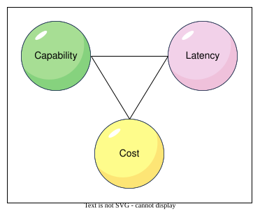

# Selecting_Appropriate_Claude_Models_for_Effective_AI_Architecture

Source: https://www.educative.io/courses/claude-certified-architect-professional-exam/selecting-the-right-claude-model

---

[Home](https://www.educative.io/)

[Courses](https://www.educative.io/search?tab=courses)

[Master Claude Certified Architect – Professional Exam (CCAR-P)](https://www.educative.io/courses/claude-certified-architect-professional-exam)

# Selecting the Right Claude Model

Explore how to choose the right Claude model for different tasks by assessing capability, latency, and cost. Understand why model selection varies per task within an architecture and avoid common anti-patterns. Gain the skills to match model tiers to specific requirements to optimize performance, cost, and quality in AI systems.

We'll cover the following...

- [The three axes of model selection](https://www.educative.io/courses/claude-certified-architect-professional-exam/selecting-the-right-claude-model#The-three-axes-of-model-selection)
- [Two symmetric anti-patterns](https://www.educative.io/courses/claude-certified-architect-professional-exam/selecting-the-right-claude-model#Two-symmetric-anti-patterns)
- [A decision framework for matching tier to task](https://www.educative.io/courses/claude-certified-architect-professional-exam/selecting-the-right-claude-model#A-decision-framework-for-matching-tier-to-task)
- [Model selection is per task, not per system](https://www.educative.io/courses/claude-certified-architect-professional-exam/selecting-the-right-claude-model#Model-selection-is-per-task-not-per-system)
- [Latency as an architectural constraint](https://www.educative.io/courses/claude-certified-architect-professional-exam/selecting-the-right-claude-model#Latency-as-an-architectural-constraint)
- [Anti-patterns](https://www.educative.io/courses/claude-certified-architect-professional-exam/selecting-the-right-claude-model#Anti-patterns)
- [Exercise: Match the model to the task](https://www.educative.io/courses/claude-certified-architect-professional-exam/selecting-the-right-claude-model#Exercise-Match-the-model-to-the-task)
- [What’s next?](https://www.educative.io/courses/claude-certified-architect-professional-exam/selecting-the-right-claude-model#Whats-next)

Every task in Atlas’s architecture now has a pattern. Document intake is an augmented LLM. Policy checking is a fixed workflow. The borderline-application investigator is an agent. None of that says which Claude model actually powers any of these calls, and that is a separate decision with its own trade-offs, made per task rather than once for the whole system.

This is where solution design hands off to model, prompting, and context decisions. The pattern determines the shape of the call. The model determines what that call can reliably do, how fast it returns, and what it costs at Atlas’s volume. Getting this wrong in either direction, always reaching for the most capable model or always reaching for the cheapest one, is one of the most common and most expensive mistakes an architect makes. In this lesson, we will cover:

- The three axes model selection actually trades off, and why treating any one of them as the only one that matters leads to a bad decision
- Why “use the biggest model everywhere” and “use the cheapest model everywhere” are both anti-patterns, not opposite but equally safe defaults
- A decision framework for matching a model tier to a task’s actual demands
- Why model selection is a per-task decision inside one architecture, not a single choice for the whole system

## The three axes of model selection[#](https://www.educative.io/courses/claude-certified-architect-professional-exam/selecting-the-right-claude-model#The-three-axes-of-model-selection)

Every Claude model sits somewhere on three axes, and a selection decision that only looks at one of them is incomplete.

- **Capability:** How well the model handles ambiguity, multi-step reasoning, nuanced judgment, and instructions that require weighing competing considerations. This is not a single number; a model that excels at extracting structured fields from a clean document is not automatically the model you want for reasoning through a genuinely ambiguous escalation.
- **Latency:** How quickly the model returns a result, both time to first token and total generation time. This matters enormously for an interactive component a person is waiting on, and far less for a component that runs unattended overnight.
- **Cost:** Price per token, multiplied by call volume. A model that is twice as expensive per call is not a problem at ten calls a day and is a very real budget line at ten thousand.

Anthropic’s model lineup spans a range across these axes, from compact, fast models built for high-volume, well-defined tasks, through balanced mid-tier models that handle most production workloads well, to the most capable models built for the hardest reasoning and judgment problems. None of these tiers is categorically “better.” Each is a different point on the trade-off, and the task in front of you determines which point is correct.

**The principle:** Model selection is not a search for the best model. It is a search for the cheapest, fastest model that reliably clears the quality bar the task actually needs, verified rather than assumed.

## Two symmetric anti-patterns[#](https://www.educative.io/courses/claude-certified-architect-professional-exam/selecting-the-right-claude-model#Two-symmetric-anti-patterns)

Most architects do not make an unprincipled model choice. They make a principled choice based on only one axis, and both directions fail the same way.

- **Always the most capable model:** This feels safe. It rarely produces an obviously wrong answer, and it is easy to justify in a design review; no one gets criticized for choosing the most capable option. But for a bounded, well-defined task, running a compact model would clear the same quality bar at a fraction of the cost and a fraction of the latency, and running the most capable model there is not a safety margin; it is waste with no offsetting benefit. At production volume, that waste compounds directly into the running cost that a business-value calculation depends on.
- **Always the cheapest model:** This feels disciplined and cost-conscious, and for high-volume, well-defined tasks it usually is the right call. The failure shows up quietly, on the subset of cases that need real judgment: an edge case that a compact model handles by pattern-matching to something superficially similar instead of reasoning through what is actually different about it. The output still looks plausible, which is what makes this anti-pattern dangerous. It does not fail loudly. It fails by being wrong in a way nobody notices until a downstream consequence surfaces.

**Exam lens:** A scenario that describes a system using one model tier for every component, and then asks why quality is inconsistent or why cost is higher than expected, is testing whether you recognize that a single, uniform model choice is itself the design error. The fix is rarely “switch to a different single model everywhere.” It is matching tier to task per component.

## A decision framework for matching tier to task[#](https://www.educative.io/courses/claude-certified-architect-professional-exam/selecting-the-right-claude-model#A-decision-framework-for-matching-tier-to-task)

For any single task, ask the following, in order.

1. **What does the task actually demand?** A bounded transformation: extract these fields, classify this input into a known set, and needs reliable instruction-following more than deep reasoning. A task that requires weighing ambiguous or conflicting evidence, drafting a nuanced recommendation, or handling a case that does not fit a known pattern needs real judgment capability.
2. **What is the cost of a wrong output here, and how often does this task run?** A high-volume, low-consequence task justifies a compact model even if it occasionally needs a retry. A low-volume, high-consequence task justifies the most capable model even though it costs more per call, because the volume is low enough that the absolute cost stays small while the quality margin matters a great deal.
3. **What is the latency budget?** A component a person is actively waiting on has a real latency ceiling the business will feel immediately. A component that runs as part of a batch job overnight can tolerate a slower, more capable model without anyone noticing the difference.
4. **Verify the choice, do not assume it:** Whichever tier looks right on paper should be checked against real examples of the task, including the hard cases, before it is treated as settled. A tier that clears the quality bar on easy cases can still fail silently on the ones that matter most. This verification is exactly the evaluation discipline built out later in the course, and it starts here, at the point the model is chosen, not after a problem is reported.

## Model selection is per task, not per system[#](https://www.educative.io/courses/claude-certified-architect-professional-exam/selecting-the-right-claude-model#Model-selection-is-per-task-not-per-system)

Applying this framework to Atlas produces a different model for nearly every component, which is the expected outcome, not an inconsistency to resolve.

- Document intake is a bounded, well-defined extraction task, running at the volume of every incoming application. A compact, fast model, verified against a sample of real statements including messy scans and unusual formats, is very likely sufficient, and the savings at volume are substantial.
- Policy checking compares extracted figures against defined rules. The rule-matching itself is close to mechanical and fits a compact model well, but the step that produces a human-readable summary of which rules flagged and why benefits from a somewhat more capable model, since a flagged-issue summary an officer cannot quickly understand defeats the purpose of automating the check at all. This is a single workflow with two different model tiers inside it, which is entirely normal.
- The borderline-application investigator runs only on the subset of applications that were already flagged as ambiguous, a low-volume, high-consequence case by construction. This is exactly where the most capable model earns its cost: the investigation requires weighing evidence that does not fit a clean rule, the volume is low enough that the higher per-call cost stays a small absolute number, and a wrong or shallow investigation here has real downstream consequences for a lending decision.

Notice the shape of this reasoning. It is the same risk-and-reversibility ranking from the very first lesson in this chapter, applied again at a new decision point. The task that was ranked low-risk and high-volume gets the cheapest model that clears its bar. The task that was ranked high-risk and low-volume gets the model with the deepest judgment, because that is where the judgment is actually needed.

**Exam lens:** When a scenario describes a single architecture and asks which model to use, and only one component is described, resist the urge to assume the answer generalizes to the rest of the system. A correct answer for one component is rarely the correct answer for all of them, and the exam frequently tests whether you will apply the same tier uniformly out of habit.

## Latency as an architectural constraint[#](https://www.educative.io/courses/claude-certified-architect-professional-exam/selecting-the-right-claude-model#Latency-as-an-architectural-constraint)

Latency deserves its own line in this framework because it is easy to treat as something to optimize after the fact rather than a real constraint that shapes the choice up front. An officer waiting on intake results while a document processes has a latency ceiling set by how long a person will tolerate staring at a loading indicator, and that ceiling is a business requirement as real as any accuracy threshold. A batch job that re-scores a portfolio of existing loans overnight has effectively no latency ceiling at all, and a design that chose a faster, less capable model there purely to save time nobody was waiting for is trading away quality for a benefit that does not exist.

The lesson is not that latency always favors a smaller model. It is that latency is a constraint to check explicitly for each component, the same way cost and capability are, rather than a concern that only comes up if someone complains after launch.

## Anti-patterns[#](https://www.educative.io/courses/claude-certified-architect-professional-exam/selecting-the-right-claude-model#Anti-patterns)

These are the wrong-but-tempting moves the exam uses as distractors.

- **Choosing one model for the whole system:** Applying a single tier uniformly across every component, whether that tier is the most capable or the cheapest, ignores that different tasks in the same architecture have different capability, volume, and consequence profiles.
- **Treating the most capable model as a safety margin:** Using it on a bounded, well-defined task does not add reliability; it adds cost and latency with no corresponding benefit, since a compact model already clears the bar.
- **Treating cost as the only axis:** Optimizing purely for the cheapest model per call without checking whether it holds up on the hardest real cases the task will encounter, not just the typical ones.
- **Assuming a tier choice instead of verifying it:** Picking a model tier based on reasoning alone and never checking it against real examples, particularly the edge cases where a compact model is most likely to fail quietly.
- **Ignoring latency until it becomes a complaint:** Treating latency as something to fix after launch rather than a constraint that should shape the model choice from the start.

## Exercise: Match the model to the task[#](https://www.educative.io/courses/claude-certified-architect-professional-exam/selecting-the-right-claude-model#Exercise-Match-the-model-to-the-task)

Each scenario tests whether you can match a model tier to what a task actually demands. Choose the best answer.

Technical Quiz

1.

A team building a claims-intake system uses the most capable available model for every step, including extracting a policyholder’s name and claim number from a standard form, a task with a fixed, simple format. When asked why, the team says it wants to guarantee the highest possible accuracy. What is the issue with this reasoning?

A.

The most capable model is never appropriate for any extraction task, regardless of document complexity or format at all.

B.

Extraction accuracy is determined entirely by prompt quality, so the choice of model tier does not affect the outcome either way.

C.

The team should instead use the cheapest available model for every step in the system, regardless of what each step actually requires.

D.

For a bounded extraction task a compact model handles reliably, the most capable model adds cost and latency without a real accuracy benefit.

---

1 / 4

## What’s next?[#](https://www.educative.io/courses/claude-certified-architect-professional-exam/selecting-the-right-claude-model#Whats-next)

With the model tier decided per component, the next question is where each of those calls actually runs. The next lesson turns to deployment platforms and data residency, the architectural decision of choosing between the Anthropic API, Amazon Bedrock, and Google Vertex AI, and why that choice is made early, alongside model selection, rather than treated as a late implementation detail.

Solution Design and Architecture Assessment Quiz

Deployment Platforms and Data Residency

Ask

[The three axes of model selection](https://www.educative.io/courses/claude-certified-architect-professional-exam/selecting-the-right-claude-model#The-three-axes-of-model-selection)

[Two symmetric anti-patterns](https://www.educative.io/courses/claude-certified-architect-professional-exam/selecting-the-right-claude-model#Two-symmetric-anti-patterns)

[A decision framework for matching tier to task](https://www.educative.io/courses/claude-certified-architect-professional-exam/selecting-the-right-claude-model#A-decision-framework-for-matching-tier-to-task)

[Model selection is per task, not per system](https://www.educative.io/courses/claude-certified-architect-professional-exam/selecting-the-right-claude-model#Model-selection-is-per-task-not-per-system)

[Latency as an architectural constraint](https://www.educative.io/courses/claude-certified-architect-professional-exam/selecting-the-right-claude-model#Latency-as-an-architectural-constraint)

[Anti-patterns](https://www.educative.io/courses/claude-certified-architect-professional-exam/selecting-the-right-claude-model#Anti-patterns)

[Exercise: Match the model to the task](https://www.educative.io/courses/claude-certified-architect-professional-exam/selecting-the-right-claude-model#Exercise-Match-the-model-to-the-task)

[What’s next?](https://www.educative.io/courses/claude-certified-architect-professional-exam/selecting-the-right-claude-model#Whats-next)