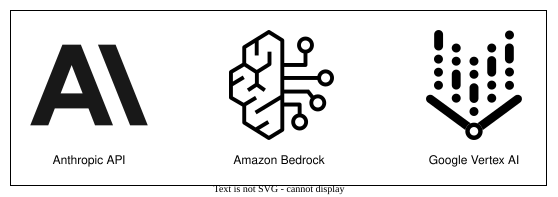

# Understanding_Deployment_Platforms_and_Data_Residency_for_AI_Systems

Source: https://www.educative.io/courses/claude-certified-architect-professional-exam/deployment-platforms-and-data-residency

---

[Home](https://www.educative.io/)

[Courses](https://www.educative.io/search?tab=courses)

[Master Claude Certified Architect – Professional Exam (CCAR-P)](https://www.educative.io/courses/claude-certified-architect-professional-exam)

# Deployment Platforms and Data Residency

Explore the key factors in selecting deployment platforms for Claude-powered systems. Understand how data residency, compliance certifications, existing cloud commitments, latency, and billing influence platform choice and model availability. This lesson helps you make early, informed architectural decisions that align platform and model selection to meet regulatory and operational constraints.

We'll cover the following...

- [Three surfaces, one set of models](https://www.educative.io/courses/claude-certified-architect-professional-exam/deployment-platforms-and-data-residency#Three-surfaces-one-set-of-models)
- [Data residency and regional availability](https://www.educative.io/courses/claude-certified-architect-professional-exam/deployment-platforms-and-data-residency#Data-residency-and-regional-availability)
- [Existing cloud commitments and procurement](https://www.educative.io/courses/claude-certified-architect-professional-exam/deployment-platforms-and-data-residency#Existing-cloud-commitments-and-procurement)
- [Compliance posture as a platform decision](https://www.educative.io/courses/claude-certified-architect-professional-exam/deployment-platforms-and-data-residency#Compliance-posture-as-a-platform-decision)
- [Why platform and model selection constrain each other](https://www.educative.io/courses/claude-certified-architect-professional-exam/deployment-platforms-and-data-residency#Why-platform-and-model-selection-constrain-each-other)
- [Latency and billing as secondary but real factors](https://www.educative.io/courses/claude-certified-architect-professional-exam/deployment-platforms-and-data-residency#Latency-and-billing-as-secondary-but-real-factors)
- [Anti-patterns](https://www.educative.io/courses/claude-certified-architect-professional-exam/deployment-platforms-and-data-residency#Anti-patterns)
- [Exercise: Choose the platform](https://www.educative.io/courses/claude-certified-architect-professional-exam/deployment-platforms-and-data-residency#Exercise-Choose-the-platform)
- [What’s next?](https://www.educative.io/courses/claude-certified-architect-professional-exam/deployment-platforms-and-data-residency#Whats-next)

Model tier is chosen per component. The next decision sits underneath it and is easy to treat as an afterthought: which platform actually serves those model calls. The three options, direct access through the Anthropic API, Amazon Bedrock, or Google Vertex AI, all reach the same underlying models, so it is tempting to treat the choice as interchangeable plumbing an engineer picks based on whatever console they already know. It is not interchangeable. The platform decision determines where data physically resides, which compliance certifications the system inherits automatically versus needs to establish from scratch, and in some cases which model versions are even available to select from at all.

This lesson gives you the drivers that should actually decide this choice, and makes the case for why it belongs at the same stage as model selection, not after the architecture is otherwise finished. In this lesson, we will cover:

- What actually differs between the three deployment surfaces, since the underlying models are the same
- The real drivers behind this decision: data residency, existing cloud commitments, compliance posture, latency, and billing
- Why platform and model selection constrain each other and must be decided together
- The cost of treating platform choice as a late detail instead of an early architectural commitment

## Three surfaces, one set of models[#](https://www.educative.io/courses/claude-certified-architect-professional-exam/deployment-platforms-and-data-residency#Three-surfaces-one-set-of-models)

Claude models can be reached through the Anthropic API directly, through Amazon Bedrock, or through Google Vertex AI. The model’s underlying capability does not change based on which surface you reach it through. What changes is the operational envelope around it.

- **Anthropic API:** It is the most direct path, and new models and features typically appear there first, sometimes with a lag before the same capability reaches the cloud marketplaces. Billing is direct, usage-based, and separate from any existing cloud bill.
- **Amazon Bedrock:** It places Claude inside an organization’s existing AWS environment. Requests can use AWS Identity and Access Management, stay inside an existing AWS network boundary, and roll into the same AWS bill and cost-allocation structure the organization already uses for everything else it runs on AWS.
- **Google Vertex AI:** It offers the equivalent inside Google Cloud, for organizations whose existing infrastructure, identity management, and compliance posture already live there.

None of these three is categorically the right choice. Each is correct for a different starting condition, and the condition that matters is not which console an engineer prefers, it is where the organization’s existing compliance certifications, data commitments, and infrastructure already sit.

**The principle:** The deployment platform is not a technical preference. It is an inheritance decision, what existing certifications, network boundaries, and billing relationships the new system picks up automatically by landing inside an environment that already has them.

## Data residency and regional availability[#](https://www.educative.io/courses/claude-certified-architect-professional-exam/deployment-platforms-and-data-residency#Data-residency-and-regional-availability)

For a regulated organization, this is usually the driver that decides everything else. Many industries operate under a legal or contractual requirement that certain categories of data stay within a specific geographic region, or stay within an environment that has already been certified to a specific compliance standard, a signed business associate agreement for health data, a FedRAMP authorization for government work, a data processing agreement for data subject to GDPR.

If an organization already runs its core systems inside an AWS environment that carries one of these certifications, routing a new Claude-powered component through Amazon Bedrock, inside that same certified environment, means the new component inherits the certification rather than requiring its own separate compliance review. Routing the same component through the direct Anthropic API instead means starting that compliance conversation from scratch, even though the underlying model is identical.

This is exactly Atlas’s situation. Atlas’s core banking systems already run inside an AWS environment that has been through the compliance review a bank’s data handling requires, data residency commitments, existing audit trails, an established security posture regulators have already reviewed. Deploying the new lending-assistance system through Amazon Bedrock, inside that same AWS environment, keeps loan applicant data inside the boundary that has already been certified, and avoids opening a new residency and compliance review for a system that is, from a data-handling perspective, just another workload inside infrastructure Atlas already operates under scrutiny.

**Exam lens:** A scenario that describes an organization with an existing, certified cloud environment, and then asks which deployment platform to choose for a new Claude-based system handling the same category of regulated data, is almost always pointing at the cloud marketplace offering for that same provider. The direct API is not wrong in the abstract, but it forfeits an inherited certification the organization already has.

## Existing cloud commitments and procurement[#](https://www.educative.io/courses/claude-certified-architect-professional-exam/deployment-platforms-and-data-residency#Existing-cloud-commitments-and-procurement)

Not every organization is choosing a platform for compliance reasons. Many enterprises have negotiated committed-spend agreements with a cloud provider, a contractual commitment to a certain level of annual spend in exchange for volume discounts across everything they run on that platform. For these organizations, routing new AI spend through that same provider’s marketplace offering can mean a materially better price than paying for the same usage directly, purely because of how the existing contract is structured.

This is a procurement reality, not a technical one, and it is worth taking seriously on its own terms. An architecture that is functionally identical whether it runs through the direct API or through a cloud marketplace, but costs the organization less because of an existing spend commitment, has a real reason to prefer the marketplace option even with no data-residency or compliance driver at all.

## Compliance posture as a platform decision[#](https://www.educative.io/courses/claude-certified-architect-professional-exam/deployment-platforms-and-data-residency#Compliance-posture-as-a-platform-decision)

It is worth being precise about what “compliance posture” actually means here, because it is easy to treat it as something you attest to on a form rather than something the platform choice actually determines. HIPAA, FedRAMP, and GDPR each have their own requirements around where data can be processed, what agreements need to be in place, and what audit and access controls must exist. A cloud marketplace offering inside an environment an organization has already brought into compliance with one of these frameworks extends that same compliance boundary to the new system. Choosing a different platform means the compliance boundary has to be established again, specifically for this system, which is real work with a real timeline, not a formality.

Government work is often the clearest version of this. A requirement that only a FedRAMP-authorized environment may process certain data is not a preference, it is a hard constraint, and it applies to the platform choice before it applies to anything else about the architecture.

## Why platform and model selection constrain each other[#](https://www.educative.io/courses/claude-certified-architect-professional-exam/deployment-platforms-and-data-residency#Why-platform-and-model-selection-constrain-each-other)

The previous lesson treated model tier as a decision made per task, based on capability, latency, and cost. That decision is not actually independent of the platform choice, because not every model, and not every version of every model, reaches every platform on the same timeline. A model that has been available through the direct API for months may reach a cloud marketplace later, and an architecture that assumed a specific model would be available on a specific platform can find that assumption wrong at implementation time.

This is one of the concrete reasons platform selection has to happen early, alongside model selection, rather than after the rest of the architecture is designed. If Atlas’s compliance posture points firmly at Amazon Bedrock, but the model tier chosen for the borderline-application investigator is not yet available there, that is a real conflict the architecture has to resolve deliberately, not discover during implementation. The resolution might be waiting for availability, selecting a different model tier that is available now, or, in a case with a strong enough justification, carving out a documented exception for that one component to use the direct API while the rest of the system stays on Bedrock. What is not acceptable is finding this conflict late and improvising a fix under deployment pressure.

## Latency and billing as secondary but real factors[#](https://www.educative.io/courses/claude-certified-architect-professional-exam/deployment-platforms-and-data-residency#Latency-and-billing-as-secondary-but-real-factors)

Once residency, compliance, and procurement have narrowed the choice, latency and billing are worth checking explicitly rather than assumed. If the rest of an architecture already runs inside a specific cloud region, keeping model calls inside that same network boundary avoids an extra network hop on every call, which adds up across a high-volume component even when each individual hop is small. Billing model differences matter organizationally even when the technical outcome is identical: usage that rolls into an existing cloud bill is easier for some organizations to track and allocate internally than a separate, direct vendor relationship, while other organizations prefer the reverse for exactly the same reason, a clean, separate line item is easier to audit than usage blended into a much larger cloud bill.

Neither of these factors should override a genuine residency or compliance requirement. They matter most as tie-breakers once the harder constraints have already narrowed the field.

## Anti-patterns[#](https://www.educative.io/courses/claude-certified-architect-professional-exam/deployment-platforms-and-data-residency#Anti-patterns)

These are the wrong-but-tempting moves the exam uses as distractors.

- **Choosing a platform based on developer familiarity alone:** Picking whichever console an engineer already knows, without checking whether the organization has a residency requirement, an existing certification, or a spend commitment that should have decided the question instead.
- **Treating platform choice as a late deployment detail:** Deciding it after the architecture, prompts, and integrations are already built, rather than at the same stage as model selection, risks discovering a compliance or availability conflict only once it is expensive to unwind.
- **Assuming the most restrictive-sounding option is always required:** Reaching for a cloud marketplace offering out of an abundance of caution, without confirming the actual regulatory requirement, when a direct relationship with an appropriate agreement in place would have satisfied it just as well.
- **Ignoring model availability differences across platforms:** Assuming a specific model tier chosen for a component will be available on whichever platform is chosen for compliance reasons, without checking and discovering the gap during implementation.
- **Fragmenting one system across multiple platforms without a stated reason:** Splitting components across different platforms because different engineers built them on different consoles, rather than because a specific, documented residency or compliance need actually required the split.

## Exercise: Choose the platform[#](https://www.educative.io/courses/claude-certified-architect-professional-exam/deployment-platforms-and-data-residency#Exercise-Choose-the-platform)

Each scenario tests whether you can identify the actual driver behind a deployment platform decision. Choose the best answer.

Technical Quiz

1.

A hospital system already operates its patient-records infrastructure inside an AWS environment covered by an existing signed business associate agreement. The architect is choosing a deployment platform for a new Claude-powered clinical documentation assistant that will process protected health information. Which factor should most influence the choice, and what does it point to?

A.

The choice should be based on whichever platform’s setup documentation the development team finds easiest to follow, since the underlying model is identical either way.

B.

The existing business associate agreement already covers the AWS environment the hospital operates in, so deploying through Amazon Bedrock keeps the new system inside that same boundary.

C.

Google Vertex AI should be preferred by default for any system handling protected health information, regardless of where the hospital’s existing infrastructure and agreements already sit.

D.

The choice should be delayed until after the clinical documentation assistant is fully built, since compliance requirements only need to be addressed once a system is ready to launch.

---

1 / 4

## What’s next?[#](https://www.educative.io/courses/claude-certified-architect-professional-exam/deployment-platforms-and-data-residency#Whats-next)

With model and platform both chosen, the next lesson turns to what actually goes inside each call: system prompts, guardrails, and the prompting techniques that shape how reliably a chosen model performs the task it was selected for.

Selecting the Right Claude Model

System Prompts, Guardrails, and Prompting Technique

Ask

[Three surfaces, one set of models](https://www.educative.io/courses/claude-certified-architect-professional-exam/deployment-platforms-and-data-residency#Three-surfaces-one-set-of-models)

[Data residency and regional availability](https://www.educative.io/courses/claude-certified-architect-professional-exam/deployment-platforms-and-data-residency#Data-residency-and-regional-availability)

[Existing cloud commitments and procurement](https://www.educative.io/courses/claude-certified-architect-professional-exam/deployment-platforms-and-data-residency#Existing-cloud-commitments-and-procurement)

[Compliance posture as a platform decision](https://www.educative.io/courses/claude-certified-architect-professional-exam/deployment-platforms-and-data-residency#Compliance-posture-as-a-platform-decision)

[Why platform and model selection constrain each other](https://www.educative.io/courses/claude-certified-architect-professional-exam/deployment-platforms-and-data-residency#Why-platform-and-model-selection-constrain-each-other)

[Latency and billing as secondary but real factors](https://www.educative.io/courses/claude-certified-architect-professional-exam/deployment-platforms-and-data-residency#Latency-and-billing-as-secondary-but-real-factors)

[Anti-patterns](https://www.educative.io/courses/claude-certified-architect-professional-exam/deployment-platforms-and-data-residency#Anti-patterns)

[Exercise: Choose the platform](https://www.educative.io/courses/claude-certified-architect-professional-exam/deployment-platforms-and-data-residency#Exercise-Choose-the-platform)

[What’s next?](https://www.educative.io/courses/claude-certified-architect-professional-exam/deployment-platforms-and-data-residency#Whats-next)