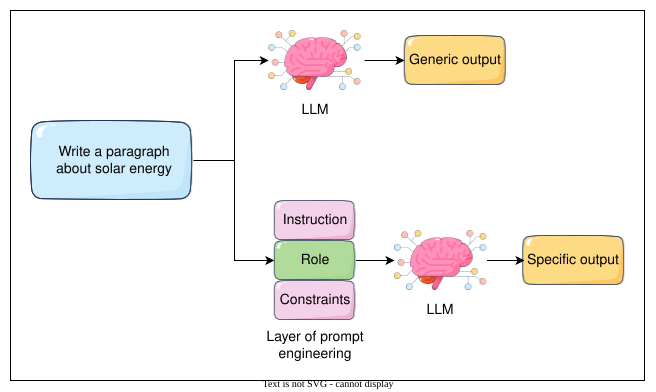

# System_Prompts_and_Prompting_Techniques_for_Claude_AI

Source: https://www.educative.io/courses/claude-certified-architect-professional-exam/system-prompts-guardrails-and-prompting-technique

---

[Home](https://www.educative.io/)

[Courses](https://www.educative.io/search?tab=courses)

[Master Claude Certified Architect – Professional Exam (CCAR-P)](https://www.educative.io/courses/claude-certified-architect-professional-exam)

# System Prompts, Guardrails, and Prompting Technique

Learn how to design clear system prompts that define scope and constraints, choose appropriate prompting techniques like zero-shot, few-shot, or chain-of-thought, and distinguish between prompt guidance and programmatic enforcement to build reliable Claude AI components.

We'll cover the following...

- [What a system prompt is actually for](https://www.educative.io/courses/claude-certified-architect-professional-exam/system-prompts-guardrails-and-prompting-technique#What-a-system-prompt-is-actually-for)
- [Instruction hierarchy across system prompt, user message, and tools](https://www.educative.io/courses/claude-certified-architect-professional-exam/system-prompts-guardrails-and-prompting-technique#Instruction-hierarchy-across-system-prompt-user-message-and-tools)
- [Choosing a prompting technique to task](https://www.educative.io/courses/claude-certified-architect-professional-exam/system-prompts-guardrails-and-prompting-technique#Choosing-a-prompting-technique-to-task)
- [Why a system prompt is guidance, not enforcement](https://www.educative.io/courses/claude-certified-architect-professional-exam/system-prompts-guardrails-and-prompting-technique#Why-a-system-prompt-is-guidance-not-enforcement)
- [Anti-patterns](https://www.educative.io/courses/claude-certified-architect-professional-exam/system-prompts-guardrails-and-prompting-technique#Anti-patterns)
- [Exercise: Choose the prompt approach](https://www.educative.io/courses/claude-certified-architect-professional-exam/system-prompts-guardrails-and-prompting-technique#Exercise-Choose-the-prompt-approach)
- [What’s next?](https://www.educative.io/courses/claude-certified-architect-professional-exam/system-prompts-guardrails-and-prompting-technique#Whats-next)

Model and platform are both chosen for every component in Atlas’s architecture. What goes inside each call is the next decision, and it is where a lot of the actual behavior of the system gets determined. A system prompt that is vague about scope, mismatched to the task in technique, or asked to enforce a rule it cannot actually guarantee produces a system that behaves inconsistently in exactly the ways that are hardest to catch in testing and most costly to discover in production.

This lesson covers three things that are easy to treat as one undifferentiated “write a good prompt” skill, but are actually three separate decisions: how to structure a system prompt for production, which prompting technique fits which task, and where a prompt’s authority to enforce a rule actually ends. In this lesson, we will cover:

- What a system prompt is for, and how instructions should be divided between the system prompt, the user message, and the tool layer
- Choosing prompting technique to task, zero-shot, few-shot, and chain-of-thought, rather than defaulting to one technique everywhere
- Why a system prompt is guidance, not enforcement, and what that means for any rule the business cannot afford to have followed only most of the time

## What a system prompt is actually for[#](https://www.educative.io/courses/claude-certified-architect-professional-exam/system-prompts-guardrails-and-prompting-technique#What-a-system-prompt-is-actually-for)

A system prompt sets the instructions, role, and constraints that apply across an entire call or session, distinct from the user message, which carries the specific, per-request content. For a production component, this distinction matters more than it looks like it should. A system prompt that says “you are a helpful assistant that processes loan applications” states a role without stating scope, constraints, or what to do when the input does not fit the expected shape, and a model given only that will fill in the gaps with its own assumptions, inconsistently, call to call.

A system prompt built for production instead states, explicitly, what the component’s task is, what its boundaries are, what output format is required, and what to do with an input that falls outside the normal case. For Atlas’s document intake, that means naming the exact fields to extract, what to return when a field is illegible or missing, and the exact structure the output must take, not a general instruction to “extract the relevant information.”

**The principle:** A system prompt for production names the edge cases, not just the common case. The gap between a demo prompt and a production prompt is almost entirely in how much of the unusual, awkward, ambiguous input has been accounted for in advance.

## Instruction hierarchy across system prompt, user message, and tools[#](https://www.educative.io/courses/claude-certified-architect-professional-exam/system-prompts-guardrails-and-prompting-technique#Instruction-hierarchy-across-system-prompt-user-message-and-tools)

Three places can hold instructions or content for a single call, and confusing their roles is a common source of inconsistent behavior.

- **System prompt:** The system prompt holds what is stable across every call to this component: the role, the task boundaries, the output format, and general policy that does not change request to request. Because this content is stable, it is also what gets reused, and, as the next lesson covers, what benefits from caching.
- **User message:** The user message holds what varies per request: the specific document, the specific question, the specific application under review. Content that is genuinely per-request does not belong baked into the system prompt, even when it would be technically valid to put it there.
- **Tool layer:** The tool layer, the schema a tool call must satisfy, holds structural constraints on what can be requested and in what shape. A field that must always be one of a fixed set of values is a schema constraint, not a sentence in the system prompt asking the model to please pick from that set.

Templates make this division practical at scale. Atlas does not write one system prompt for every individual document intake call; it writes one template, with the stable role, boundaries, and format fixed, and lets the user message carry each specific document. The same template, reused across every application, is what makes the system maintainable as volume grows, and it is only possible once variable content has actually been kept out of the system prompt.

**Exam lens:** A scenario describing a system prompt that is rewritten or reconstructed for every single request, containing details specific to that one request, describes a template that has not actually been separated from its variable content. The fix is always to move the per-request detail into the user message, not to write a more elaborate system prompt.

## Choosing a prompting technique to task[#](https://www.educative.io/courses/claude-certified-architect-professional-exam/system-prompts-guardrails-and-prompting-technique#Choosing-a-prompting-technique-to-task)

Three techniques cover most of what a production system prompt needs to do, and picking the wrong one for a task either wastes tokens and latency or leaves quality on the table.

- **Zero-shot:** It gives the model instructions with no worked examples. It fits tasks that are simple, well-specified, and close to patterns the model already handles reliably from its general training, classifying a well-defined input into a small, well-established set of categories, for instance. Reaching for a more elaborate technique here adds cost without adding quality.

|  |
| --- |
| **Prompt:** A bat and a ball cost $1.10 in total. The bat costs $1.00 more than the ball. How much does the ball cost?  Let's think step by step. |
| **Output:**  1. Let B be the cost of the bat and C be the cost of the ball.  2. The problem gives us two pieces of information that we can turn into equations:  a) The total cost is $1.10, so: B + C = 1.10  b) The bat costs $1.00 more than the ball, so: B = C + 1.00  3. Now I can solve this system of equations. I will substitute the second equation into the first one.  4. This gives me: (C + 1.00) + C = 1.10  5. Combining the terms with C, I get: 2C + 1.00 = 1.10  6. Subtracting 1.00 from both sides gives: 2C = 0.10  7. Finally, dividing by 2 gives: C = 0.05    Therefore, the ball costs $0.05. |

- **Few-shot:** It includes a small number of worked examples inside the prompt. It earns its cost when the desired output is idiosyncratic in a way that is easier to demonstrate than to describe in words, a specific memo format a credit committee expects, or a classification boundary that is genuinely easier to show with contrasting examples than to state as a rule. The examples chosen matter more than the count; a set of easy examples teaches the model to expect easy cases, while a set that includes the actual hard boundary cases teaches it what the boundary really is.

|  |
| --- |
| **Prompt:** Q: John has 5 apples. He gives 2 apples to his friend and then buys 3 more. How many apples does he have now?  A: Let's think step by step.   1. John starts with 5 apples. 2. He gives away 2, so he has 5 - 2 = 3 apples. 3. He then buys 3 more, so he has 3 + 3 = 6 apples. 4. The final answer is 6.     Q: A bat and a ball cost $1.10 in total. The bat costs $1.00 more than the ball. How much does the ball cost? |
| **Output:**  Let's think step by step.   1. Let B be the cost of the bat and C be the cost of the ball. 2. We know that B + C = 1.10. 3. We also know that B = C + 1.00. 4. Substitute the second equation into the first: (C + 1.00) + C = 1.10. 5. This simplifies to 2C + 1.00 = 1.10. 6. Subtract 1.00 from both sides: 2C = 0.10. 7. Divide by 2: C = 0.05. 8. The final answer is $0.05. |

- **Chain-of-thought:** It prompts the model to reason through the problem step by step before producing a final answer. It earns its cost on tasks that require genuine multi-step reasoning, and on tasks where the reasoning itself is part of the deliverable, not just the final answer. Atlas’s policy-check output is a strong example of the second case: a loan officer reading a flagged application does not just need to know that a rule was triggered, they need to see why, in a form specific enough that a regulator reviewing the file later can follow the same reasoning. A bare classification label cannot supply that; an explicit reasoning trace can.

## Why a system prompt is guidance, not enforcement[#](https://www.educative.io/courses/claude-certified-architect-professional-exam/system-prompts-guardrails-and-prompting-technique#Why-a-system-prompt-is-guidance-not-enforcement)

A system prompt can state a business rule in plain language, and the model will follow it in the overwhelming majority of calls. That is not the same as the rule holding without exception, and the distinction matters enormously for any rule where an occasional miss is a real business or regulatory problem rather than a minor inconvenience.

Consider a system prompt instruction telling a component “never approve a loan disbursement over $500,000 without a second reviewer’s sign-off.” Most of the time, the model follows this exactly. Under a sufficiently persistent or well-framed sequence of requests, a probabilistic instruction can be worked around in ways a hard rule cannot, and for a threshold this consequential, “most of the time” is not an acceptable enforcement standard.

Ace Editor

1

2

3

4

5

6

7

8

9

# Guidance: shapes ordinary behavior, not a guarantee

SYSTEM\_PROMPT = """Never approve a disbursement over $500,000

without a second reviewer's sign-off."""

# Enforcement: holds regardless of what the model decided

def approve\_disbursement(amount, second\_reviewer\_id):

if amount > 500\_000 and not second\_reviewer\_id:

return {"error\_type": "permission\_denied", "retryable": False}

return execute\_disbursement(amount)

הההההההההההההההההההההההההההההההההההההההההההההההההההההההההההההההההההההההההההההההההההההההההההההההההההההההההההההההההההההההההההההההההההההההההההההההההההההההההההההההההההההההההההההההההההההההההההההההההההההההההההההההההההההההההההההההההההההההההההההההההההההההההההההההההההההההההההההההההההההההההההההההההההההההההההההההההההההההההההההההההההההההההההההההההההההההההההההההההההההההההההההההההההההההההההההההההההההההההההההההההההההההההההההההההההההההההההההההההההההההההההההההההההההההההההההההההההההההההההההההההההההההההההההההההההההההההההההההה

XXXXXXXXXXXXXXXXXXXXXXXXXXXXXXXXXXXXXXXXXXXXXXXXXXXXXXXXXXXXXXXXXXXXXXXXXXXXXXXXXXXXXXXXXXXXXXXXXXXXXXXXXXXXXXXXXXXXXXXXXXXXXXXXXXXXXXXXXXXXXXXXXXXXXXXXXXXXXXXXXXXXXXXXXXXXXXXXXXXXXXXXXXXXXXXXXXXXXXXXXXXXXXXXXXXXXXXXXXXXXXXXXXXXXXXXXXXXXXXXXXXXXXXXXXXXXXXXXXXXXXXXXXXXXXXXXXXXXXXXXXXXXXXXXXXXXXXXXXXXXXXXXXXXXXXXXXXXXXXXXXXXXXXXXXXXXXXXXXXXXXXXXXXXXXXXXXXXXXXXXXXXXXXXXXXXXXXXXXXXXXXXXXXXXXXXXXXXXXXXXXXXXXXXXXXXXXXXXXXXXXXXXXXXXXXXXXXXXXXXXXXXXXXXXXXXXXXXXXXXXXXXXXXXXXXXXXXXXXXXXXXXXXXXXXXXXXXXXXXXXXXXXXXXXXXX

Guidance shapes ordinary behavior; the check holds regardless of what the model decided.

The rule needs to be checked programmatically, at the point the disbursement action actually executes, independent of what the model decided to do. A later lesson in this course builds out exactly what that programmatic enforcement layer looks like; the point to internalize here is that the system prompt instruction and the programmatic check are not alternatives to each other. The prompt instruction remains useful; it shapes the model’s behavior in the normal case and reduces how often the programmatic check is even triggered, but it is not sufficient on its own for anything the business genuinely cannot afford to have violated.

A useful test for any rule you are about to write into a system prompt: if the model failed to follow this instruction on some small fraction of calls, is that an acceptable, low-consequence outcome, a slightly off tone, an inconsistent phrasing, or is it an unacceptable exposure, an unauthorized disbursement, a data boundary crossed, an irreversible action taken without approval? Low-consequence belongs in the prompt and can stay there. Unacceptable exposure needs the prompt instruction and a programmatic backstop that does not depend on the model’s compliance at all.

**Exam lens:** Any scenario where a system prompt states a financial threshold, an access boundary, or a rule around an irreversible action, and then describes that rule being violated under some adversarial or unusual input, is testing this exact distinction. The correct fix is always programmatic enforcement at the point of execution, never a better-worded prompt.

## Anti-patterns[#](https://www.educative.io/courses/claude-certified-architect-professional-exam/system-prompts-guardrails-and-prompting-technique#Anti-patterns)

These are the wrong-but-tempting moves the exam uses as distractors.

- **Treating the system prompt as the only enforcement mechanism for a critical rule:** Writing a financial threshold, access boundary, or irreversible-action rule into the prompt and stopping there, with no programmatic check backing it up.
- **Baking per-request content into the system prompt:** Embedding a specific applicant’s name, amount, or document details directly into the system prompt text instead of the user message, which defeats template reuse and undermines the caching benefit the next lesson covers.
- **Choosing few-shot examples that only show the easy cases:** Demonstrating the common, unambiguous inputs while leaving out the boundary cases the technique was supposed to clarify in the first place.
- **Reaching for chain-of-thought by default:** Adding step-by-step reasoning to a simple, well-specified task that a zero-shot prompt already handles reliably, paying the extra tokens and latency for no quality gain.
- **Writing a role description with no stated boundaries:** Leaving edge cases, unusual inputs, and failure handling entirely unaddressed, so the model fills the gap with its own assumptions instead of the architect’s.

## Exercise: Choose the prompt approach[#](https://www.educative.io/courses/claude-certified-architect-professional-exam/system-prompts-guardrails-and-prompting-technique#Exercise-Choose-the-prompt-approach)

Each scenario tests whether you can pick the right technique or correctly diagnose an instruction-hierarchy or enforcement problem. Choose the best answer.

Technical Quiz

1.

A component classifies incoming applications into one of three well-established risk tiers, using criteria that are simple, well-documented, and already close to patterns the model handles reliably. Which prompting technique is the right starting point?

A.

Chain-of-thought, since any classification task benefits from the model reasoning step by step before producing an answer.

B.

Zero-shot, since the task is simple and well-specified enough that clear instructions alone should reliably produce the correct tier.

C.

Few-shot with as many examples as the context window allows, since more examples always improve classification accuracy regardless of task difficulty.

D.

The technique does not matter here, since output quality is determined entirely by which model tier is selected rather than by how the prompt is written.

---

1 / 4

## What’s next?[#](https://www.educative.io/courses/claude-certified-architect-professional-exam/system-prompts-guardrails-and-prompting-technique#Whats-next)

With the system prompt structured and its technique chosen, the next lesson turns to what happens as these components run at real volume and over longer sessions, context-window budgeting, prompt caching, and the reuse strategies that keep a growing system fast and affordable.

Deployment Platforms and Data Residency

Context Windows, Prompt Caching, and Reuse

Ask

[What a system prompt is actually for](https://www.educative.io/courses/claude-certified-architect-professional-exam/system-prompts-guardrails-and-prompting-technique#What-a-system-prompt-is-actually-for)

[Instruction hierarchy across system prompt, user message, and tools](https://www.educative.io/courses/claude-certified-architect-professional-exam/system-prompts-guardrails-and-prompting-technique#Instruction-hierarchy-across-system-prompt-user-message-and-tools)

[Choosing a prompting technique to task](https://www.educative.io/courses/claude-certified-architect-professional-exam/system-prompts-guardrails-and-prompting-technique#Choosing-a-prompting-technique-to-task)

[Why a system prompt is guidance, not enforcement](https://www.educative.io/courses/claude-certified-architect-professional-exam/system-prompts-guardrails-and-prompting-technique#Why-a-system-prompt-is-guidance-not-enforcement)

[Anti-patterns](https://www.educative.io/courses/claude-certified-architect-professional-exam/system-prompts-guardrails-and-prompting-technique#Anti-patterns)

[Exercise: Choose the prompt approach](https://www.educative.io/courses/claude-certified-architect-professional-exam/system-prompts-guardrails-and-prompting-technique#Exercise-Choose-the-prompt-approach)

[What’s next?](https://www.educative.io/courses/claude-certified-architect-professional-exam/system-prompts-guardrails-and-prompting-technique#Whats-next)