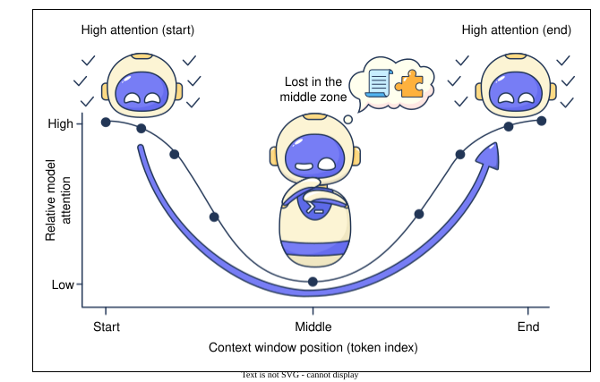

# Managing_Context_Windows_and_Prompt_Caching_in_Claude_AI

Source: https://www.educative.io/courses/claude-certified-architect-professional-exam/context-windows-prompt-caching-and-reuse

---

[Home](https://www.educative.io/)

[Courses](https://www.educative.io/search?tab=courses)

[Master Claude Certified Architect – Professional Exam (CCAR-P)](https://www.educative.io/courses/claude-certified-architect-professional-exam)

# Context Windows, Prompt Caching, and Reuse

Explore how to manage context windows as a cost budget rather than a limit, implement prompt caching to save time and costs, and design modular reusable prompts. Learn progressive disclosure techniques to load only necessary context and verify caching effectiveness to improve AI system performance and efficiency.

We'll cover the following...

- [The context window as a budget, not a wall](https://www.educative.io/courses/claude-certified-architect-professional-exam/context-windows-prompt-caching-and-reuse#The-context-window-as-a-budget-not-a-wall)
- [Prompt caching turns a stable prefix into a discount](https://www.educative.io/courses/claude-certified-architect-professional-exam/context-windows-prompt-caching-and-reuse#Prompt-caching-turns-a-stable-prefix-into-a-discount)
- [Modular prompts and Skills as reusable capability](https://www.educative.io/courses/claude-certified-architect-professional-exam/context-windows-prompt-caching-and-reuse#Modular-prompts-and-Skills-as-reusable-capability)
- [Progressive disclosure loads only what the task needs right now](https://www.educative.io/courses/claude-certified-architect-professional-exam/context-windows-prompt-caching-and-reuse#Progressive-disclosure-loads-only-what-the-task-needs-right-now)
- [Verify the budget the way you verify anything else](https://www.educative.io/courses/claude-certified-architect-professional-exam/context-windows-prompt-caching-and-reuse#Verify-the-budget-the-way-you-verify-anything-else)
- [Anti-patterns](https://www.educative.io/courses/claude-certified-architect-professional-exam/context-windows-prompt-caching-and-reuse#Anti-patterns)
- [Exercise: Budget the context](https://www.educative.io/courses/claude-certified-architect-professional-exam/context-windows-prompt-caching-and-reuse#Exercise-Budget-the-context)
- [What’s next?](https://www.educative.io/courses/claude-certified-architect-professional-exam/context-windows-prompt-caching-and-reuse#Whats-next)

Each Atlas component now has a structured system prompt and a defined prompting strategy. At Atlas’s production volume, with thousands of applications each month and officers reviewing several documents per session, what goes into the context on each call affects cost, latency, and reliability, not just prompt formatting. A context window is not just a limit to stay within. It is a resource that must be managed carefully, which is the focus of this final lesson. This lesson covers:

- Why a context window is a budget to manage deliberately, not a limit to avoid hitting
- How prompt caching turns a stable prefix into a real cost and latency advantage, and exactly what breaks it
- Modular prompts and Skills as reusable capability, instead of the same instructions hand-duplicated across every component
- Progressive disclosure, loading only what a task needs right now instead of everything it might conceivably need

## The context window as a budget, not a wall[#](https://www.educative.io/courses/claude-certified-architect-professional-exam/context-windows-prompt-caching-and-reuse#The-context-window-as-a-budget-not-a-wall)

Every token placed into context costs money on that call and competes for the model’s attention alongside everything else in the window. A larger context window does not change this; it only raises the ceiling before you hit a hard failure. Content that does not need to be there still costs the same whether the window is large or small, and at Atlas’s volume, that cost is multiplied by every single call the component makes.

The discipline that follows directly from the previous lesson’s instruction hierarchy is to separate what is stable, content that is the same on every call to this component, from what is variable, content specific to this one request, and to keep asking, for every piece of content under consideration, whether it actually needs to be in context for this call at all. A reference document included in full because a small fraction of its content might eventually be relevant is exactly the kind of cost that compounds at volume without ever showing up as an obvious single mistake.

**The principle:** Treat every token in context as something you chose to pay for, on every call, at whatever volume this component runs. The question is never just “does this fit.” It is “does this need to be here.”

## Prompt caching turns a stable prefix into a discount[#](https://www.educative.io/courses/claude-certified-architect-professional-exam/context-windows-prompt-caching-and-reuse#Prompt-caching-turns-a-stable-prefix-into-a-discount)

When the same block of content appears at the start of consecutive calls, in the same order, the platform can reuse the processing already done for that block instead of reprocessing it from nothing, which meaningfully cuts both cost and time to first token on the cached portion. The mechanism only works under one condition: the stable content has to come first, in a consistent order, with variable content appended after it, not interleaved with it.

This is exactly why the instruction hierarchy from the previous lesson is a prerequisite here, not a separate concern. A system prompt that keeps stable role and policy content cleanly separated from per-request content is already shaped correctly for caching. A system prompt that has applicant details, a timestamp, or any other per-request value inserted before or within the stable material breaks the cached prefix on every single call, because the platform sees a different prefix each time and has nothing to reuse.

Ace Editor

1

2

3

4

5

# Breaks caching: the prefix is different on every call

prompt = f"[session: {timestamp}]\n{STABLE\_SYSTEM\_PROMPT}\n{applicant\_data}"

# Caches correctly: the prefix is identical every time

prompt = f"{STABLE\_SYSTEM\_PROMPT}\n{applicant\_data}\n[session: {timestamp}]"

הההההההההההההההההההההההההההההההההההההההההההההההההההההההההההההההההההההההההההההההההההההההההההההההההההההההההההההההההההההההההההההההההההההההההההההההההההההההההההההההההההההההההההההההההההההההההההההההההההההההההההההההההההההההההההההההההההההההההההההההההההההההההההההההההההההההההההההההההההההההההההההההההההההההההההההההההההההההההההההההההההההההההההההההההההההההההההההההההההההההההההההההההההההההההההההההההההההההההההההההההההההההההההההההההההההההההההההההההההההההההההההההההההההההההההההההההההההההההההההההההההההההההההההההההההההההההההההההה

XXXXXXXXXXXXXXXXXXXXXXXXXXXXXXXXXXXXXXXXXXXXXXXXXXXXXXXXXXXXXXXXXXXXXXXXXXXXXXXXXXXXXXXXXXXXXXXXXXXXXXXXXXXXXXXXXXXXXXXXXXXXXXXXXXXXXXXXXXXXXXXXXXXXXXXXXXXXXXXXXXXXXXXXXXXXXXXXXXXXXXXXXXXXXXXXXXXXXXXXXXXXXXXXXXXXXXXXXXXXXXXXXXXXXXXXXXXXXXXXXXXXXXXXXXXXXXXXXXXXXXXXXXXXXXXXXXXXXXXXXXXXXXXXXXXXXXXXXXXXXXXXXXXXXXXXXXXXXXXXXXXXXXXXXXXXXXXXXXXXXXXXXXXXXXXXXXXXXXXXXXXXXXXXXXXXXXXXXXXXXXXXXXXXXXXXXXXXXXXXXXXXXXXXXXXXXXXXXXXXXXXXXXXXXXXXXXXXXXXXXXXXXXXXXXXXXXXXXXXXXXXXXXXXXXXXXXXXXXXXXXXXXXXXXXXXXXXXXXXXXXXXXXXXXXXX

Moving the timestamp after the stable content is what makes the prefix reusable

The two disciplines, clean instruction hierarchy and effective caching, are the same discipline applied at two different points.

For Atlas, the policy manual excerpts that policy check references for a given loan type are stable across every application of that type in a given month. Structured so that the manual excerpt and the stable role instructions come first, with the specific application’s extracted figures appended after, every call for that loan type reuses the same cached prefix. Structured the other way, with application-specific figures placed early or mixed into the reference material, the cache never engages, and Atlas pays full price and full latency on every single call regardless of how stable the underlying policy content actually is.

**Exam lens:** A scenario describing a system with a large, unchanging reference document in its prompt, but no cost or latency benefit despite heavy repeated use, is almost always describing a broken cache prefix, usually because some small piece of variable content has been placed before or inside the stable block. The fix is reordering content, stable first, variable after, not reducing the reference material itself.

## Modular prompts and Skills as reusable capability[#](https://www.educative.io/courses/claude-certified-architect-professional-exam/context-windows-prompt-caching-and-reuse#Modular-prompts-and-Skills-as-reusable-capability)

As a system grows past a handful of components, hand-writing a complete, self-contained prompt for each one starts to create its own maintenance cost. A formatting rule that applies to every extraction-style component, an output-schema requirement that applies to every structured-response component, duplicated by hand across a dozen separate prompts, means a single formatting fix has to be found and applied a dozen times, and it is easy to miss one.

The alternative is to build shared, reusable pieces once and reference them everywhere they apply, rather than duplicating their content inline in every prompt that needs them. A shared instruction module for output formatting, fixed once, updates every component that references it. A packaged, named capability, a Skill, that bundles a specific piece of reusable behavior, extracting a specific document type, applying a specific validation routine, can be invoked wherever that behavior is needed instead of being rebuilt from scratch inside every component that happens to need it.

This is not merely a convenience for the person writing the prompts. It is what keeps a growing system consistent. When formatting or policy is expressed once and referenced everywhere, every component that references it changes together when the underlying rule changes. When it is duplicated by hand, consistency depends entirely on someone remembering to update every copy, which is exactly the kind of dependency that fails quietly as a system grows past what one person can track in their head.

## Progressive disclosure loads only what the task needs right now[#](https://www.educative.io/courses/claude-certified-architect-professional-exam/context-windows-prompt-caching-and-reuse#Progressive-disclosure-loads-only-what-the-task-needs-right-now)

The instinct to include everything a component might conceivably need, an entire reference manual, every record type an investigation could possibly touch, in case it comes up, works against both the budget discussed earlier and the model’s ability to focus on what this specific call actually requires. Progressive disclosure means loading the minimal context the current step actually needs, and expanding it only when the task in front of the model actually calls for more, rather than front-loading everything that might ever be relevant.

For Atlas’s borderline-application investigator, this means the agent starts with the specific anomaly that triggered the flag and the narrow slice of records directly relevant to it, not the applicant’s entire file and every record type Atlas could possibly retrieve. If the investigation’s first findings point toward a specific concern, a debt schedule that does not match a stated figure, for instance, the agent expands its context specifically toward records relevant to that concern, rather than having pre-loaded every possible record type at the start on the chance that one of them might eventually matter. The context grows as the actual investigation warrants it, not in anticipation of every path the investigation might have taken.

## Verify the budget the way you verify anything else[#](https://www.educative.io/courses/claude-certified-architect-professional-exam/context-windows-prompt-caching-and-reuse#Verify-the-budget-the-way-you-verify-anything-else)

The same discipline from earlier in this chapter, verify a choice rather than assume it, applies directly here. Caching behavior, token counts, and how much of a reference document a call actually draws on are all things an architect should check directly, not infer from how the prompt was designed to work. A prompt built with a clean, stable-first structure should engage caching, but a small, easy-to-miss change, a debug header added ahead of the system prompt, a reordering introduced during a later edit, can silently break it, and the only way to know is to check the actual behavior rather than trust the design intent.

## Anti-patterns[#](https://www.educative.io/courses/claude-certified-architect-professional-exam/context-windows-prompt-caching-and-reuse#Anti-patterns)

These are the wrong-but-tempting moves the exam uses as distractors.

- **Loading an entire reference document because a fraction of it might be relevant:** Including a full policy manual, product catalog, or knowledge base in every call when the task at hand only ever needs a narrow slice of it.
- **Placing variable content before or inside the stable prefix:** Inserting a timestamp, a request identifier, or any other per-call value ahead of or within the stable system prompt content, which breaks the cached prefix on every single call without any obvious symptom pointing to why.
- **Duplicating shared instructions across many components by hand:** Repeating the same formatting or policy language in a dozen separate prompts instead of a single reusable module, so a routine fix has to be tracked down and applied everywhere it was copied.
- **Treating a large context window as permission to stop budgeting:** Assuming that because content fits, it is free of cost and free of any effect on the model’s attention.
- **Assuming caching is working instead of checking:** Designing a prompt with a stable-first structure and never verifying that the expected cost and latency benefit is actually showing up in practice.

## Exercise: Budget the context[#](https://www.educative.io/courses/claude-certified-architect-professional-exam/context-windows-prompt-caching-and-reuse#Exercise-Budget-the-context)

Each scenario tests whether you can identify the right context-engineering move. Choose the best answer.

Technical Quiz

1.

A support system includes an entire two-hundred-page product manual in every call, even though the team’s own data shows that ninety-five percent of customer questions are answered by content in a single section of that manual. What should change?

A.

Increase the context window allocation for this component so the full manual fits more comfortably alongside future growth in manual length.

B.

Retrieve and include only the section relevant to the current question, expanding to additional sections only if that specific question actually requires them.

C.

Leave the manual as is, since a larger context window means the unused content carries no real cost as long as it fits within the limit.

D.

Add an instruction telling the model to ignore any part of the manual that is not relevant to the current question.

---

1 / 4

## What’s next?[#](https://www.educative.io/courses/claude-certified-architect-professional-exam/context-windows-prompt-caching-and-reuse#Whats-next)

Model, platform, prompt, and context are all decided for every component in Atlas’s architecture. The chapter quiz that follows draws on all four lessons together, in the same mixed multiple-choice and multiple-response format used earlier, before the course turns to integration, wiring these components into the rest of Atlas’s systems.

System Prompts, Guardrails, and Prompting Technique

Claude Models, Prompting, and Context Engineering Assessment Quiz

Ask

[The context window as a budget, not a wall](https://www.educative.io/courses/claude-certified-architect-professional-exam/context-windows-prompt-caching-and-reuse#The-context-window-as-a-budget-not-a-wall)

[Prompt caching turns a stable prefix into a discount](https://www.educative.io/courses/claude-certified-architect-professional-exam/context-windows-prompt-caching-and-reuse#Prompt-caching-turns-a-stable-prefix-into-a-discount)

[Modular prompts and Skills as reusable capability](https://www.educative.io/courses/claude-certified-architect-professional-exam/context-windows-prompt-caching-and-reuse#Modular-prompts-and-Skills-as-reusable-capability)

[Progressive disclosure loads only what the task needs right now](https://www.educative.io/courses/claude-certified-architect-professional-exam/context-windows-prompt-caching-and-reuse#Progressive-disclosure-loads-only-what-the-task-needs-right-now)

[Verify the budget the way you verify anything else](https://www.educative.io/courses/claude-certified-architect-professional-exam/context-windows-prompt-caching-and-reuse#Verify-the-budget-the-way-you-verify-anything-else)

[Anti-patterns](https://www.educative.io/courses/claude-certified-architect-professional-exam/context-windows-prompt-caching-and-reuse#Anti-patterns)

[Exercise: Budget the context](https://www.educative.io/courses/claude-certified-architect-professional-exam/context-windows-prompt-caching-and-reuse#Exercise-Budget-the-context)

[What’s next?](https://www.educative.io/courses/claude-certified-architect-professional-exam/context-windows-prompt-caching-and-reuse#Whats-next)