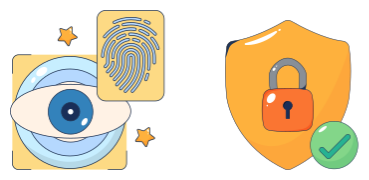

# Authentication_Authorization_and_Security_Gaps_in_System_Integration

Source: https://www.educative.io/courses/claude-certified-architect-professional-exam/authentication-authorization-and-security-gaps

---

[Home](https://www.educative.io/)

[Courses](https://www.educative.io/search?tab=courses)

[Master Claude Certified Architect – Professional Exam (CCAR-P)](https://www.educative.io/courses/claude-certified-architect-professional-exam)

# Authentication, Authorization, and Security Gaps

Understand the critical differences between authentication and authorization and learn how to identify and fix security gaps in AI system integrations. Explore when and where authorization must be enforced, how to scope credentials properly, and why a server-side check at execution is essential to secure AI-powered architectures. This lesson equips you to evaluate security controls beyond authentication to create robust, compliant solution designs.

We'll cover the following...

- [Authentication and authorization are two different questions](https://www.educative.io/courses/claude-certified-architect-professional-exam/authentication-authorization-and-security-gaps#Authentication-and-authorization-are-two-different-questions)
- [Where authorization actually has to be enforced](https://www.educative.io/courses/claude-certified-architect-professional-exam/authentication-authorization-and-security-gaps#Where-authorization-actually-has-to-be-enforced)
- [Scoping credentials by role and by session](https://www.educative.io/courses/claude-certified-architect-professional-exam/authentication-authorization-and-security-gaps#Scoping-credentials-by-role-and-by-session)
- [A framework for finding authentication and authorization gaps](https://www.educative.io/courses/claude-certified-architect-professional-exam/authentication-authorization-and-security-gaps#A-framework-for-finding-authentication-and-authorization-gaps)
- [Anti-patterns](https://www.educative.io/courses/claude-certified-architect-professional-exam/authentication-authorization-and-security-gaps#Anti-patterns)
- [Exercise: Find the gap](https://www.educative.io/courses/claude-certified-architect-professional-exam/authentication-authorization-and-security-gaps#Exercise-Find-the-gap)
- [What’s next?](https://www.educative.io/courses/claude-certified-architect-professional-exam/authentication-authorization-and-security-gaps#Whats-next)

The previous lesson addressed what capability each of Atlas’s components holds. This lesson addresses two questions layered on top of that one: when a component calls into a credit bureau service, a core banking API, or a document store, how does the receiving system know it is really talking to that component, and once it knows, what is that component actually allowed to do. These are two different questions, and a system that answers the first one perfectly can still fail the second one badly. Earlier, we noted that a critical rule needs a programmatic backstop at the point of execution rather than a prompt instruction alone; this lesson builds out exactly what that backstop looks like for authorization specifically. In this lesson, we will cover:

- Why authentication and authorization are separate questions, and why confirming one says nothing about the other
- Where authorization actually has to be enforced, and why a prompt instruction, a UI restriction, or a caller’s own claim never counts
- How to scope credentials by role and by session instead of issuing one broad credential everywhere
- A framework for finding authentication and authorization gaps in an integration that looks secure on paper

## Authentication and authorization are two different questions[#](https://www.educative.io/courses/claude-certified-architect-professional-exam/authentication-authorization-and-security-gaps#Authentication-and-authorization-are-two-different-questions)

Authentication answers who or what is making this request. Authorization answers what that verified identity is actually allowed to do. A system can get the first one completely right and still have a serious gap in the second, and this is one of the most common blind spots in an integration review, because a strong authentication story feels like it should mean the system is secure.

Consider a team that confirms every request reaching Atlas’s loan-servicing API is cryptographically signed and verified as coming from a legitimate internal service. That is real, solid authentication. It says nothing about whether the specific service making a given request should be allowed to perform the specific action it is requesting. If the document-intake service’s verified credential happens to carry permission to modify a loan’s disbursement status, a permission intake never needs and never uses under normal operation, the strength of the authentication check does not touch that gap at all. The request is genuinely from intake. That was never the question that mattered.

**The principle:** Authentication tells you the request is genuinely from who it claims to be. It never tells you that identity should be allowed to do what it is asking to do. Those are two separate checks, and a system needs both.

## Where authorization actually has to be enforced[#](https://www.educative.io/courses/claude-certified-architect-professional-exam/authentication-authorization-and-security-gaps#Where-authorization-actually-has-to-be-enforced)

The same discipline covered for business rules generally applies here with even sharper stakes. A system prompt instruction telling an agent “only access records related to the applicant under review” is guidance the model is expected to follow, and it is not a security boundary, because nothing about a prompt instruction prevents the underlying tool call from executing if the credential behind it technically has broader access. A manipulated or sufficiently unusual session can get a model to request something it was told not to request, and if the only thing standing between that request and the data is the model’s own compliance, the authorization has not actually been enforced anywhere.

The only place authorization enforcement actually holds is the dispatch or tool-call gate, the point in code where a specific action is about to execute, checked against the specific identity and scope of the caller, independent of what the prompt said, what the model decided, or what a user interface happened to restrict. A UI that prevents a user from typing an unrelated applicant’s name is a reasonable usability feature, but it is not an authorization boundary, since it does nothing to stop the underlying tool call if that call is reachable by any other path, including a model that was manipulated into requesting it directly. The check that actually matters runs at execution time, verifies the request against what this specific caller’s role and session are actually scoped to, and blocks the call if it falls outside that scope, regardless of how the request was generated.

Ace Editor

1

2

3

4

5

6

# The prompt instruction is guidance; this check is the enforcement

def dispatch\_tool(call, session):

if call.name == "get\_applicant\_records":

if call.args.applicant\_id != session.assigned\_case\_id:

return {"error\_type": "permission\_denied", "retryable": False}

return execute(call)

הההההההההההההההההההההההההההההההההההההההההההההההההההההההההההההההההההההההההההההההההההההההההההההההההההההההההההההההההההההההההההההההההההההההההההההההההההההההההההההההההההההההההההההההההההההההההההההההההההההההההההההההההההההההההההההההההההההההההההההההההההההההההההההההההההההההההההההההההההההההההההההההההההההההההההההההההההההההההההההההההההההההההההההההההההההההההההההההההההההההההההההההההההההההההההההההההההההההההההההההההההההההההההההההההההההההההההההההההההההההההההההההההההההההההההההההההההההההההההההההההההההההההההההההההההההההההההההההה

XXXXXXXXXXXXXXXXXXXXXXXXXXXXXXXXXXXXXXXXXXXXXXXXXXXXXXXXXXXXXXXXXXXXXXXXXXXXXXXXXXXXXXXXXXXXXXXXXXXXXXXXXXXXXXXXXXXXXXXXXXXXXXXXXXXXXXXXXXXXXXXXXXXXXXXXXXXXXXXXXXXXXXXXXXXXXXXXXXXXXXXXXXXXXXXXXXXXXXXXXXXXXXXXXXXXXXXXXXXXXXXXXXXXXXXXXXXXXXXXXXXXXXXXXXXXXXXXXXXXXXXXXXXXXXXXXXXXXXXXXXXXXXXXXXXXXXXXXXXXXXXXXXXXXXXXXXXXXXXXXXXXXXXXXXXXXXXXXXXXXXXXXXXXXXXXXXXXXXXXXXXXXXXXXXXXXXXXXXXXXXXXXXXXXXXXXXXXXXXXXXXXXXXXXXXXXXXXXXXXXXXXXXXXXXXXXXXXXXXXXXXXXXXXXXXXXXXXXXXXXXXXXXXXXXXXXXXXXXXXXXXXXXXXXXXXXXXXXXXXXXXXXXXXXXXX

The scope check lives at the gate, not in the prompt that requested the call.

This check runs the same way whether the model requested the record because the prompt asked it to, because it reasoned its way there, or because a manipulated session talked it into asking. That is what “independent of what the model decided” actually means in practice.

**Exam lens:** A scenario describing a security rule stated in a system prompt, a UI restriction, or a caller’s self-reported role, where the rule is later bypassed, is testing whether you will locate the fix at the dispatch or tool-call gate. Strengthening the wording, adding a UI warning, or trusting the caller’s claim are all distractors; the correct fix always adds or corrects a server-side check at the point of execution.

## Scoping credentials by role and by session[#](https://www.educative.io/courses/claude-certified-architect-professional-exam/authentication-authorization-and-security-gaps#Scoping-credentials-by-role-and-by-session)

A single, broad credential shared across many components is convenient to manage and is exactly the kind of design that turns a narrow task-level need into a system-wide exposure. If every backend component in Atlas’s architecture authenticates using the same service credential with access to the full customer data lake, then every component effectively holds that same maximal access regardless of what its actual task requires, which is authorization granted by default rather than authorization scoped to task. The fix mirrors the capability-bloat discipline from the previous lesson, applied at the credential level: each component should authenticate with its own credential, scoped to only the data and actions its specific task actually needs, so that a compromised or manipulated component is limited by what its own credential can reach, not by what the entire shared credential happens to permit.

Session-level scoping deserves its own attention, because it is easy to get backwards in exactly the direction that causes the most damage. A loan officer’s own access is ordinarily restricted to their assigned regional portfolio. If the AI assistant acting on that officer’s behalf during a session authenticates with a broader, system-wide credential, reasoning that the assistant needs wide access to be useful, the assistant now has more effective permission than the human it is supposedly acting for. The session should inherit and enforce the officer’s own actual scope, not a broader credential that quietly bypasses the restriction the officer operates under everywhere else. An AI intermediary that can see more than the person it serves is a gap, not a convenience.

## A framework for finding authentication and authorization gaps[#](https://www.educative.io/courses/claude-certified-architect-professional-exam/authentication-authorization-and-security-gaps#A-framework-for-finding-authentication-and-authorization-gaps)

For each integration point, an API, a tool, or a service connection, ask the following in order.

1. **Is there a real authentication check, or an assumption that requests only ever come from trusted internal systems?** An integration point that trusts network location or internal traffic alone, without verifying identity on each request, has no real authentication regardless of how secure the surrounding network feels.
2. **Given a verified identity, is there a separate check for what that identity is specifically allowed to do?** Authentication succeeding is not evidence that authorization has been checked at all; the two have to be verified independently, and a system that stops at the first one has not actually finished.
3. **Is that authorization check enforced at the point the action executes, or only implied by a prompt, a UI, or the caller’s own claim?** Anything short of a server-side check at execution time is guidance, not enforcement, and guidance is not sufficient wherever the consequence of a wrong outcome is real.
4. **Does a session’s effective permission match the underlying human’s actual role, or does it silently inherit a broader system credential?** A session acting on a person’s behalf should never be able to reach further than that person could reach directly, unless a specific, deliberate reason says otherwise.

## Anti-patterns[#](https://www.educative.io/courses/claude-certified-architect-professional-exam/authentication-authorization-and-security-gaps#Anti-patterns)

These are the wrong-but-tempting moves the exam uses as distractors.

- **Treating authentication as if it were authorization:** Concluding an integration is secure because every request is verified as coming from a legitimate caller, without a separate check for what that caller is actually allowed to do.
- **Enforcing authorization through a prompt instruction, a UI restriction, or a caller’s self-reported role:** Relying on anything short of a server-side check at the point of execution, none of which actually prevents the underlying action if it is reachable another way.
- **Issuing one broad, shared credential across many components:** Treating a single credential as simpler to manage while giving every component the same maximal access regardless of what its specific task requires.
- **Letting a session carry more effective permission than the person it acts on behalf of:** Granting an AI-driven session broader access than the underlying human’s own role, in the name of making the assistant more useful.
- **Trusting network location or internal traffic as a substitute for authentication:** Assuming a request is safe because it originates from inside a trusted network boundary, without verifying the identity making the request at all.

## Exercise: Find the gap[#](https://www.educative.io/courses/claude-certified-architect-professional-exam/authentication-authorization-and-security-gaps#Exercise-Find-the-gap)

Each scenario tests whether you can correctly separate authentication from authorization and locate where enforcement actually needs to happen. Choose the best answer.

Technical Quiz

1.

A team confirms that every request reaching a loan-servicing API is cryptographically signed and verified as coming from a legitimate internal service. They conclude the integration is secure. What is missing from this conclusion?

A.

A separate authorization check tied to the caller’s actual scope is still needed, since verifying identity does not establish what it may do.

B.

Nothing is missing, since a cryptographically verified caller can reasonably be trusted with any action the credential technically permits.

C.

The team should switch to a different authentication mechanism entirely, since digital signatures alone are an inherently weak method of verifying identity.

D.

The team should add more detailed logging of authenticated requests, since additional logging closes any authorization gap that might exist.

---

1 / 4

## What’s next?[#](https://www.educative.io/courses/claude-certified-architect-professional-exam/authentication-authorization-and-security-gaps#Whats-next)

With capability and authorization both addressed, the next lesson turns to a different kind of integration entirely, designing the retrieval pipeline that lets Atlas’s components answer questions and check policy against a large body of reference material, rather than holding that material directly in every prompt.

Capability Bloat and Least Privilege in Tool Configuration

Chunking, Indexing, and Retrieval Strategy for a RAG Pipeline

Ask

[Authentication and authorization are two different questions](https://www.educative.io/courses/claude-certified-architect-professional-exam/authentication-authorization-and-security-gaps#Authentication-and-authorization-are-two-different-questions)

[Where authorization actually has to be enforced](https://www.educative.io/courses/claude-certified-architect-professional-exam/authentication-authorization-and-security-gaps#Where-authorization-actually-has-to-be-enforced)

[Scoping credentials by role and by session](https://www.educative.io/courses/claude-certified-architect-professional-exam/authentication-authorization-and-security-gaps#Scoping-credentials-by-role-and-by-session)

[A framework for finding authentication and authorization gaps](https://www.educative.io/courses/claude-certified-architect-professional-exam/authentication-authorization-and-security-gaps#A-framework-for-finding-authentication-and-authorization-gaps)

[Anti-patterns](https://www.educative.io/courses/claude-certified-architect-professional-exam/authentication-authorization-and-security-gaps#Anti-patterns)

[Exercise: Find the gap](https://www.educative.io/courses/claude-certified-architect-professional-exam/authentication-authorization-and-security-gaps#Exercise-Find-the-gap)

[What’s next?](https://www.educative.io/courses/claude-certified-architect-professional-exam/authentication-authorization-and-security-gaps#Whats-next)