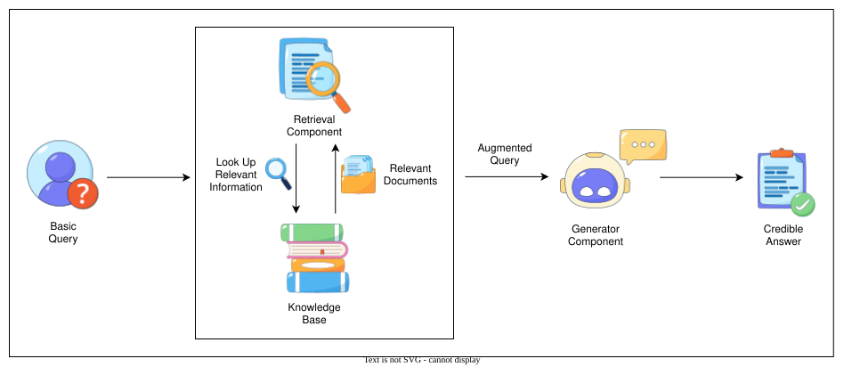

# Chunking_and_Retrieval_Strategies_in_RAG_Pipelines_for_AI_Integration

Source: https://www.educative.io/courses/claude-certified-architect-professional-exam/chunking-indexing-and-retrieval-strategy-for-a-rag-pipeline

---

[Home](https://www.educative.io/)

[Courses](https://www.educative.io/search?tab=courses)

[Master Claude Certified Architect – Professional Exam (CCAR-P)](https://www.educative.io/courses/claude-certified-architect-professional-exam)

# Chunking, Indexing, and Retrieval Strategy for a RAG Pipeline

Explore how to design each stage of a retrieval-augmented generation pipeline, including chunking source documents, embedding chunks, and indexing for fast retrieval. Understand matching retrieval strategies to data structures and query types to ensure accurate, grounded AI-generated answers. Learn to diagnose common failure modes like stale indexes and mismatched embeddings to build reliable RAG systems.

We'll cover the following...

- [What a RAG pipeline actually does, end to end](https://www.educative.io/courses/claude-certified-architect-professional-exam/chunking-indexing-and-retrieval-strategy-for-a-rag-pipeline#What-a-RAG-pipeline-actually-does-end-to-end)
  - [Chunking follows the structure of the source, not an arbitrary size](https://www.educative.io/courses/claude-certified-architect-professional-exam/chunking-indexing-and-retrieval-strategy-for-a-rag-pipeline#Chunking-follows-the-structure-of-the-source-not-an-arbitrary-size)
  - [Indexing and embedding choices shape what similarity search can find](https://www.educative.io/courses/claude-certified-architect-professional-exam/chunking-indexing-and-retrieval-strategy-for-a-rag-pipeline#Indexing-and-embedding-choices-shape-what-similarity-search-can-find)
  - [Matching retrieval strategy to data shape and query pattern](https://www.educative.io/courses/claude-certified-architect-professional-exam/chunking-indexing-and-retrieval-strategy-for-a-rag-pipeline#Matching-retrieval-strategy-to-data-shape-and-query-pattern)
- [Two failure modes that produce a confident, wrong answer](https://www.educative.io/courses/claude-certified-architect-professional-exam/chunking-indexing-and-retrieval-strategy-for-a-rag-pipeline#Two-failure-modes-that-produce-a-confident-wrong-answer)
- [Anti-patterns](https://www.educative.io/courses/claude-certified-architect-professional-exam/chunking-indexing-and-retrieval-strategy-for-a-rag-pipeline#Anti-patterns)
- [Exercise: Diagnose the pipeline](https://www.educative.io/courses/claude-certified-architect-professional-exam/chunking-indexing-and-retrieval-strategy-for-a-rag-pipeline#Exercise-Diagnose-the-pipeline)
- [What’s next?](https://www.educative.io/courses/claude-certified-architect-professional-exam/chunking-indexing-and-retrieval-strategy-for-a-rag-pipeline#Whats-next)

Policy check has been treated, so far, as if the relevant policy sections simply arrive when needed. They do not arrive on their own. Something has to chunk the lending manual into retrievable pieces, index those pieces so a query can find the right ones quickly, and retrieve the specific pieces a given question actually needs, all before the model ever sees a grounded answer to write. This lesson designs that pipeline properly, because each of those stages is an independent decision, and a mistake in any one of them produces a system that runs without error while quietly returning the wrong material. In this lesson, we will cover:

- What actually happens, stage by stage, between a source document and a grounded answer
- Choosing a chunking strategy that follows the structure of the source material instead of an arbitrary size
- Matching retrieval strategy to data shape and query pattern, rather than defaulting to one universal approach
- The two RAG failure modes that produce a confident, well-formed, and wrong answer with no error thrown anywhere

## What a RAG pipeline actually does, end to end[#](https://www.educative.io/courses/claude-certified-architect-professional-exam/chunking-indexing-and-retrieval-strategy-for-a-rag-pipeline#What-a-RAG-pipeline-actually-does-end-to-end)

A retrieval-augmented generation pipeline is not a single feature. It is a sequence of independent decisions, each with its own way of going wrong. Source documents are split into chunks, the retrievable units the rest of the pipeline works with. Each chunk is embedded, converted into a vector representation that captures something about its meaning. The chunks and their embeddings are indexed, organized so that a search at query time can find the relevant ones quickly rather than scanning everything. At query time, the incoming question is itself embedded, and the index is searched to retrieve the chunks judged most relevant. Those retrieved chunks, along with the original question, go to the model, which generates an answer grounded in what was actually retrieved, not in whatever the manual happens to say elsewhere.

How RAG works

Treating this as one design decision, “add retrieval,” hides exactly where things go wrong. Chunking can be right while the retrieval strategy is wrong. Retrieval strategy can be right while the index is stale. Each stage deserves its own scrutiny, and the rest of this lesson works through each one.

### Chunking follows the structure of the source, not an arbitrary size[#](https://www.educative.io/courses/claude-certified-architect-professional-exam/chunking-indexing-and-retrieval-strategy-for-a-rag-pipeline#Chunking-follows-the-structure-of-the-source-not-an-arbitrary-size)

Chunking determines what can ever be retrieved together, which makes it the earliest point where a pipeline can quietly fail. A chunk that is too large retrieves a lot of irrelevant material alongside whatever was actually relevant, spending context budget on content the query never needed, exactly the cost this course’s context-engineering discussion warned against. A chunk that is too small can split a single, self-contained idea across two separate pieces, so retrieval returns half of it without the surrounding context that gives it its actual meaning.

Splitting data into small chunks

Atlas’s lending manual is organized into numbered, self-contained rules, each covering one requirement in a few paragraphs. Chunking that respects this structure, one chunk per rule, or per clearly bounded subsection, keeps each retrievable unit semantically whole. Chunking by a fixed token count instead, without regard for where a rule begins or ends, can cut a single rule in half at an arbitrary boundary, so a query that should retrieve the complete rule instead retrieves only its first half, missing the exception or condition that was stated in the second half and that changes what the rule actually means.

**The principle:** Let the chunk boundary follow the natural structure of the source material. A fixed size is a starting assumption to check against that structure, not a substitute for looking at it.

### Indexing and embedding choices shape what similarity search can find[#](https://www.educative.io/courses/claude-certified-architect-professional-exam/chunking-indexing-and-retrieval-strategy-for-a-rag-pipeline#Indexing-and-embedding-choices-shape-what-similarity-search-can-find)

Embeddings capture something about a chunk’s meaning, which is what makes similarity search possible at all: a query embedded the same way can be compared against every chunk’s embedding to find the ones that mean something similar. The index is what makes that comparison fast at real volume, rather than requiring every chunk to be compared individually on every query.

Generating data embeddings and storing to a vector database

The architectural decision worth making deliberately is whether similarity alone is the right tool for this data. Atlas’s lending manual carries strong metadata on every rule: which loan type it applies to, which jurisdiction, which effective date.

Ace Editor

1

2

3

4

5

6

7

{

"text": "Debt-to-income ratio may not exceed 43% for conforming loans...",

"loan\_type": "conforming",

"jurisdiction": "CA",

"effective\_date": "2026-03-01"

}

הההההההההההההההההההההההההההההההההההההההההההההההההההההההההההההההההההההההההההההההההההההההההההההההההההההההההההההההההההההההההההההההההההההההההההההההההההההההההההההההההההההההההההההההההההההההההההההההההההההההההההההההההההההההההההההההההההההההההההההההההההההההההההההההההההההההההההההההההההההההההההההההההההההההההההההההההההההההההההההההההההההההההההההההההההההההההההההההההההההההההההההההההההההההההההההההההההההההההההההההההההההההההההההההההההההההההההההההההההההההההההההההההההההההההההההההההההההההההההההההההההההההההההההההההההההההההההההההה

XXXXXXXXXXXXXXXXXXXXXXXXXXXXXXXXXXXXXXXXXXXXXXXXXXXXXXXXXXXXXXXXXXXXXXXXXXXXXXXXXXXXXXXXXXXXXXXXXXXXXXXXXXXXXXXXXXXXXXXXXXXXXXXXXXXXXXXXXXXXXXXXXXXXXXXXXXXXXXXXXXXXXXXXXXXXXXXXXXXXXXXXXXXXXXXXXXXXXXXXXXXXXXXXXXXXXXXXXXXXXXXXXXXXXXXXXXXXXXXXXXXXXXXXXXXXXXXXXXXXXXXXXXXXXXXXXXXXXXXXXXXXXXXXXXXXXXXXXXXXXXXXXXXXXXXXXXXXXXXXXXXXXXXXXXXXXXXXXXXXXXXXXXXXXXXXXXXXXXXXXXXXXXXXXXXXXXXXXXXXXXXXXXXXXXXXXXXXXXXXXXXXXXXXXXXXXXXXXXXXXXXXXXXXXXXXXXXXXXXXXXXXXXXXXXXXXXXXXXXXXXXXXXXXXXXXXXXXXXXXXXXXXXXXXXXXXXXXXXXXXXXXXXXXXXXX

Metadata like this is what lets retrieval filter before it ranks by meaning

A query asking for the debt-to-income threshold for a specific loan type in a specific state can be answered by pure semantic similarity, but semantic similarity has no concept of “the right loan type” or “the current version.” It can just as easily retrieve a superficially similar rule from a different loan type, or an earlier version of a rule that has since been superseded, because both can sound close enough in meaning to score well. Where strong, exact metadata like this exists, filtering by it first, then ranking semantically within the filtered set, matches the data’s actual shape far better than semantic similarity working alone.

### Matching retrieval strategy to data shape and query pattern[#](https://www.educative.io/courses/claude-certified-architect-professional-exam/chunking-indexing-and-retrieval-strategy-for-a-rag-pipeline#Matching-retrieval-strategy-to-data-shape-and-query-pattern)

The right retrieval approach depends on what the data actually looks like and what kind of question is being asked, not on a single default applied everywhere.

- Strongly structured data with exact metadata (loan type, jurisdiction, effective date, and similar categorical fields) calls for filtering on that metadata before or alongside semantic ranking. This is precisely Atlas’s policy manual, and skipping the filter is what lets a wrong-jurisdiction or outdated rule slip in ahead of the correct one.
- Unstructured, narrative material, where a question could be phrased many different ways and the right passage is identified by meaning rather than by an exact field, is where semantic similarity search earns its keep on its own.
- Exact terms and defined thresholds are a case worth calling out on its own: when a query needs a specific, verbatim value, a defined term, a numeric limit, semantic similarity can retrieve something close in meaning that is nonetheless the wrong value, since “close” is exactly the property that fails here. An exact or keyword-anchored lookup, rather than similarity alone, is what actually gets the correct figure.

Retrieval, done this way, is the mechanism that makes the progressive-disclosure discipline covered earlier in this course actually work in practice for a large reference document: instead of holding the entire manual in every call, the pipeline retrieves only the specific rule or section a given query needs, expanding further only if the question actually requires more.

**Exam lens:** A scenario describing a retrieval system that occasionally surfaces a plausible but wrong rule, from the wrong category or an outdated version, when the source data clearly carries exact metadata that could have filtered it out, is testing whether you will add filtering rather than simply asking for more retrieved passages or a better-worded query.

## Two failure modes that produce a confident, wrong answer[#](https://www.educative.io/courses/claude-certified-architect-professional-exam/chunking-indexing-and-retrieval-strategy-for-a-rag-pipeline#Two-failure-modes-that-produce-a-confident-wrong-answer)

Both of the following run without throwing any error. The pipeline completes successfully every time. The content it retrieves is simply wrong, and the model, having no way to know that, writes a fluent, well-grounded-sounding answer based on it.

- **A stale index:** Atlas’s compliance team updates the lending manual with a new debt-to-income threshold. If the index that retrieval searches against was built from the old version of the manual and is never rebuilt after the update, retrieval keeps confidently returning the old threshold as if it were current, because as far as the index is concerned, it still is. No code changed. No prompt changed. The only thing that changed was the source document, and the index did not follow it. The fix is refreshing the index whenever the underlying source material changes, not treating indexing as a one-time setup step.
- **Mismatched embeddings:** If a team upgrades the embedding model used to embed incoming queries, but the existing index still holds embeddings produced by the previous model, and the index is never reprocessed with the new model, the two sets of embeddings are not meaningfully comparable. Similarity search still runs, still returns results, and still produces no error, but the scores it is comparing no longer mean what they are supposed to mean, so the chunks it retrieves can be oddly irrelevant even though nothing in the pipeline appears broken. The fix is reindexing the existing content with whichever embedding model is actually being used at query time, so both sides of every comparison come from the same model.

## Anti-patterns[#](https://www.educative.io/courses/claude-certified-architect-professional-exam/chunking-indexing-and-retrieval-strategy-for-a-rag-pipeline#Anti-patterns)

These are the wrong-but-tempting moves the exam uses as distractors.

- **Chunking by a fixed token count regardless of document structure:** Splitting a self-contained rule or clause across a chunk boundary because the boundary was set by size alone, not by where the actual idea begins and ends.
- **Relying on semantic similarity alone where strong, exact metadata exists:** Skipping a filter on loan type, jurisdiction, or effective date that the data already provides, and trusting similarity scoring to sort out a distinction it has no way to make.
- **Never refreshing the index after the source material changes:** Treating indexing as a one-time setup task instead of a step that has to rerun whenever the underlying documents are updated.
- **Changing the embedding model without reindexing existing content:** Upgrading the model used at query time while leaving previously indexed embeddings from an older model in place, producing comparisons that look normal but are not meaningful.
- **Treating “add retrieval” as one decision instead of a pipeline of several:** Assuming a RAG system either works or does not, rather than checking chunking, embedding, indexing, and retrieval strategy as separate places a design can fail independently.

## Exercise: Diagnose the pipeline[#](https://www.educative.io/courses/claude-certified-architect-professional-exam/chunking-indexing-and-retrieval-strategy-for-a-rag-pipeline#Exercise-Diagnose-the-pipeline)

Each scenario tests whether you can identify the right chunking, indexing, or retrieval decision, or correctly diagnose a RAG failure mode. Choose the best answer.

Technical Quiz

1.

Atlas’s lending manual is organized into numbered, self-contained rules, each a few paragraphs long. A team chunks the manual into fixed two-hundred-token windows without regard for where a rule begins or ends. What problem does this create?

A.

Fixed-size chunking is always the safest default for any source document, regardless of how that document happens to be structured internally.

B.

The fixed-size scheme can split a single rule across chunks, so retrieval may return only part of it, missing context that changes its meaning.

C.

Chunk size has no real effect on retrieval quality, since the embedding step compensates for how the source material was originally divided.

D.

The fix is to make the chunks even smaller than two hundred tokens, since smaller chunks always produce more accurate retrieval results.

---

1 / 4

## What’s next?[#](https://www.educative.io/courses/claude-certified-architect-professional-exam/chunking-indexing-and-retrieval-strategy-for-a-rag-pipeline#Whats-next)

With the retrieval pipeline designed, the next lesson turns to how Atlas’s components actually connect to each other and to the systems around them, comparing MCP, direct API and CLI access, and agent-to-agent communication as integration protocols, and the signals that point to each.

Authentication, Authorization, and Security Gaps

Integration Protocols, MCP, API/CLI, and Agent-to-Agent

Ask

[What a RAG pipeline actually does, end to end](https://www.educative.io/courses/claude-certified-architect-professional-exam/chunking-indexing-and-retrieval-strategy-for-a-rag-pipeline#What-a-RAG-pipeline-actually-does-end-to-end)

[Chunking follows the structure of the source, not an arbitrary size](https://www.educative.io/courses/claude-certified-architect-professional-exam/chunking-indexing-and-retrieval-strategy-for-a-rag-pipeline#Chunking-follows-the-structure-of-the-source-not-an-arbitrary-size)

[Indexing and embedding choices shape what similarity search can find](https://www.educative.io/courses/claude-certified-architect-professional-exam/chunking-indexing-and-retrieval-strategy-for-a-rag-pipeline#Indexing-and-embedding-choices-shape-what-similarity-search-can-find)

[Matching retrieval strategy to data shape and query pattern](https://www.educative.io/courses/claude-certified-architect-professional-exam/chunking-indexing-and-retrieval-strategy-for-a-rag-pipeline#Matching-retrieval-strategy-to-data-shape-and-query-pattern)

[Two failure modes that produce a confident, wrong answer](https://www.educative.io/courses/claude-certified-architect-professional-exam/chunking-indexing-and-retrieval-strategy-for-a-rag-pipeline#Two-failure-modes-that-produce-a-confident-wrong-answer)

[Anti-patterns](https://www.educative.io/courses/claude-certified-architect-professional-exam/chunking-indexing-and-retrieval-strategy-for-a-rag-pipeline#Anti-patterns)

[Exercise: Diagnose the pipeline](https://www.educative.io/courses/claude-certified-architect-professional-exam/chunking-indexing-and-retrieval-strategy-for-a-rag-pipeline#Exercise-Diagnose-the-pipeline)

[What’s next?](https://www.educative.io/courses/claude-certified-architect-professional-exam/chunking-indexing-and-retrieval-strategy-for-a-rag-pipeline#Whats-next)