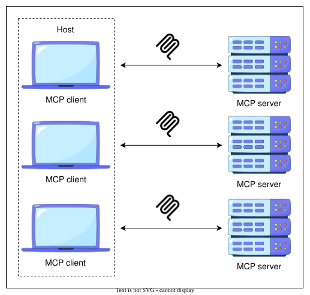

# Integration_Protocols_and_Communication_Mechanisms_in_AI_Architecture

Source: https://www.educative.io/courses/claude-certified-architect-professional-exam/integration-protocols-mcp-api-cli-and-agent-to-agent

---

[Home](https://www.educative.io/)

[Courses](https://www.educative.io/search?tab=courses)

[Master Claude Certified Architect – Professional Exam (CCAR-P)](https://www.educative.io/courses/claude-certified-architect-professional-exam)

# Integration Protocols, MCP, API/CLI, and Agent-to-Agent

Understand the three main integration mechanisms for AI systems—including MCP, direct API or CLI access, and agent-to-agent communication—and learn how to choose the appropriate protocol based on reuse, stability, and autonomy. This lesson covers progressive discovery approaches, the importance of proper authorization, and common integration anti-patterns to ensure scalable, maintainable AI architecture.

We'll cover the following...

- [Three integration mechanisms, and what each is actually for](https://www.educative.io/courses/claude-certified-architect-professional-exam/integration-protocols-mcp-api-cli-and-agent-to-agent#Three-integration-mechanisms-and-what-each-is-actually-for)
- [A decision framework for choosing the mechanism](https://www.educative.io/courses/claude-certified-architect-professional-exam/integration-protocols-mcp-api-cli-and-agent-to-agent#A-decision-framework-for-choosing-the-mechanism)
- [Progressive discovery versus monolithic context for capability](https://www.educative.io/courses/claude-certified-architect-professional-exam/integration-protocols-mcp-api-cli-and-agent-to-agent#Progressive-discovery-versus-monolithic-context-for-capability)
- [Protocol choice does not replace least privilege or authorization](https://www.educative.io/courses/claude-certified-architect-professional-exam/integration-protocols-mcp-api-cli-and-agent-to-agent#Protocol-choice-does-not-replace-least-privilege-or-authorization)
- [Anti-patterns](https://www.educative.io/courses/claude-certified-architect-professional-exam/integration-protocols-mcp-api-cli-and-agent-to-agent#Anti-patterns)
- [Exercise: Choose the mechanism](https://www.educative.io/courses/claude-certified-architect-professional-exam/integration-protocols-mcp-api-cli-and-agent-to-agent#Exercise-Choose-the-mechanism)
- [What’s next?](https://www.educative.io/courses/claude-certified-architect-professional-exam/integration-protocols-mcp-api-cli-and-agent-to-agent#Whats-next)

Three integration questions are settled for each of Atlas’s components: what capability it holds, how it authenticates and what it is authorized to do, and how it retrieves reference material it does not hold directly. One question remains, and it sits underneath all three: what mechanism actually carries a request from one component to whatever it is connecting to, a tool, an external service, another autonomous system. That choice is not interchangeable plumbing. It shapes how much integration code has to be maintained, how new capability gets added later, and how much context a session has to spend just discovering what it can do before it does any of it. In this lesson, we will cover:

- Three integration mechanisms and what each is actually built for: MCP, direct API or CLI access, and agent-to-agent communication
- A decision framework for choosing the right mechanism for a given connection
- Progressive discovery versus monolithic context for capability, and why loading every available tool definition up front repeats a mistake this course has already named
- Where protocol choice intersects with the least-privilege and authorization work already covered, rather than replacing it

## Three integration mechanisms, and what each is actually for[#](https://www.educative.io/courses/claude-certified-architect-professional-exam/integration-protocols-mcp-api-cli-and-agent-to-agent#Three-integration-mechanisms-and-what-each-is-actually-for)

Each of the three exists for a different shape of connection, and the differences matter more than they look like they should once a system has more than one integration to maintain.

- **MCP:** The Model Context Protocol standardizes how an agent discovers and calls tools and resources exposed by a server, rather than having every tool hand-wired into the agent’s own code. A server can expose many capabilities, and a client discovers what is currently available rather than each integration being written and maintained one at a time. This earns its overhead when a capability needs to be reused across multiple different agents or clients, or when the set of connected capabilities is expected to grow or change over time without the integration code being rewritten each time something is added.

- **Direct API or CLI access:** It is a specific, known integration point called directly, with no discovery layer between the caller and the capability. This is the right fit for a single, stable, well-understood connection that is not meant to be reused generically by other agents or discovered dynamically, where the overhead of standardized discovery buys nothing a hand-built call does not already provide more simply.
- **Agent-to-agent communication:** This means one autonomous system communicates with another as a peer, typically across an organizational or system boundary, rather than one side simply executing a fixed call the other side defined. This differs from the coordinator-and-specialist orchestration covered earlier in this course, where one architect controls every agent inside a single system. Here, the other side is genuinely autonomous, outside Atlas’s control, and a request often has to convey a goal or context for that other system to interpret, rather than a single, precisely defined function call.

**The principle:** The mechanism should match how the capability is actually used, not how impressive it sounds. A single, stable connection does not need discovery. A capability meant to be reused and to evolve does. A genuinely autonomous counterpart needs a different kind of message than a function call.

## A decision framework for choosing the mechanism[#](https://www.educative.io/courses/claude-certified-architect-professional-exam/integration-protocols-mcp-api-cli-and-agent-to-agent#A-decision-framework-for-choosing-the-mechanism)

For a given connection, ask the following, in order.

1. Does this capability need to be reused across multiple different agents or clients, or is the set of available capabilities expected to grow or change over time? If so, MCP’s discovery layer is worth its overhead, since it lets new capability be added without rewriting every agent that might use it.
2. Is this a single, stable, well-understood integration with no reuse or discovery need? If so, a direct API or CLI call is simpler and carries less overhead than standardizing a connection that will never be discovered by anything else.
3. Is the other side a genuinely autonomous system, outside this architecture’s control, that needs to interpret a goal rather than execute a fixed call? If so, agent-to-agent communication is the right shape, and it should be treated as crossing a real boundary, not as an extension of internal orchestration.

Applied to Atlas, document intake’s connection to one specific, internal document-processing service that has stayed the same for years and is never reused elsewhere is a direct API call; standardizing it through a discovery layer would add overhead with nothing to discover. The borderline-application investigator’s connections to an evolving set of external data sources, credit bureaus, and public-records services that are added or updated periodically, are a strong fit for MCP, since new sources can be exposed without rewriting the investigator’s own integration code each time. A future connection to a partner bank’s own AI system, coordinating directly on a syndicated loan, is agent-to-agent, because the partner’s system is genuinely outside Atlas’s control and has to be treated that way.

**Exam lens:** A scenario describing a single, unchanging, internal integration that a team proposes exposing through a discovery protocol “for consistency” is testing whether you will recognize unnecessary overhead. A scenario describing a growing or reusable set of external capabilities hand-wired one at a time is testing the opposite recognition, that discovery would have saved real rework.

## Progressive discovery versus monolithic context for capability[#](https://www.educative.io/courses/claude-certified-architect-professional-exam/integration-protocols-mcp-api-cli-and-agent-to-agent#Progressive-discovery-versus-monolithic-context-for-capability)

This is the same progressive-disclosure principle covered earlier in this course, applied here to capability rather than content. When several MCP servers are connected, together exposing many tools, an architect has to decide whether every tool’s full definition is loaded into a session’s context up front, whether or not that session’s task needs most of them, or whether the agent discovers and loads only the definitions relevant to its current task, expanding as the task actually requires more.

Loading everything up front, a monolithic approach, repeats two problems this course has already named at a larger scale than a single hand-built agent would ever reach on its own. It spends context budget on tool definitions the current task will never touch, the same unnecessary cost covered earlier. It also risks the same tool-count degradation covered even earlier than that, since an ecosystem of connected MCP servers can easily expose far more tools than the five or so a single agent can reliably select among. Progressive discovery, loading only what the current task’s investigation actually calls for, avoids both costs at once, and it is the default an architect should reach for whenever the total available capability across connected servers is large relative to what any single task actually needs.

Monolithic loading is not automatically wrong. When the total tool count across every connected server is genuinely small, and every tool is relevant to most sessions, loading it all up front trades a small, fixed cost for avoiding repeated discovery round trips. The judgment is the same one this course has applied elsewhere: match the approach to the actual shape of what is available, not to whichever one feels more thorough.

## Protocol choice does not replace least privilege or authorization[#](https://www.educative.io/courses/claude-certified-architect-professional-exam/integration-protocols-mcp-api-cli-and-agent-to-agent#Protocol-choice-does-not-replace-least-privilege-or-authorization)

Choosing a mechanism answers how a connection works. It does not answer what that connection should be allowed to reach, and it is easy to treat a well-chosen protocol as if it had already handled that separate question. An MCP server that exposes its full catalog of tools to every client that connects to it, rather than scoping what each specific client can discover and call, has simply moved the capability-bloat problem covered earlier onto a new mechanism instead of solving it. The server should still expose to a given client only the tools that client’s task actually requires, the same discipline that applied to a single agent’s own tool configuration.

Agent-to-agent connections raise the stakes on this point rather than lowering them. A connection to a partner organization’s system is a connection Atlas does not fully control, and treating it with the same casual trust as an internal coordinator dispatching its own specialists skips the authentication and authorization rigor a real organizational boundary actually requires. The mechanism being well-suited to the task, agent-to-agent communication being the right shape for a genuinely autonomous counterpart, says nothing about whether that counterpart has been properly authenticated or scoped to only what the connection is meant to allow.

## Anti-patterns[#](https://www.educative.io/courses/claude-certified-architect-professional-exam/integration-protocols-mcp-api-cli-and-agent-to-agent#Anti-patterns)

These are the wrong-but-tempting moves the exam uses as distractors.

- **Hand-wiring a direct integration for a capability that needs to be reused or is expected to evolve.** Writing a one-off connection for something that will be added to, changed, or reused by other agents, and paying that cost again every time something changes.
- **Reaching for MCP or a discovery layer for a single, stable, one-off connection.** Standardizing a connection nothing else will ever discover or reuse, adding overhead with no corresponding benefit.
- **Loading every available tool definition into every session regardless of task.** Repeating the unnecessary-context-cost and tool-count problems covered earlier, at the larger scale an ecosystem of connected servers makes possible.
- **Treating agent-to-agent communication as an extension of internal orchestration.** Skipping the authentication and authorization rigor a genuine organizational boundary requires, because the connection superficially resembles a coordinator dispatching its own specialists.
- **Assuming the protocol choice has already handled scope.** Believing that choosing the right mechanism for how a connection works has also answered what that connection should be allowed to reach, when the two are separate decisions.

## Exercise: Choose the mechanism[#](https://www.educative.io/courses/claude-certified-architect-professional-exam/integration-protocols-mcp-api-cli-and-agent-to-agent#Exercise-Choose-the-mechanism)

Each scenario tests whether you can match the integration mechanism to the connection’s actual shape. Choose the best answer.

Technical Quiz

1.

Atlas’s investigator agent needs to pull records from an evolving set of external data sources, credit bureaus and public-records services that are added or changed periodically, without requiring a rewrite of the investigator’s own integration code each time a source changes. Which mechanism fits, and why?

A.

A fixed workflow that hard-codes every current data source, updated by hand whenever a source is added or changed.

B.

Direct API access, since every external data source should always be integrated through its own dedicated, hand-built connection.

C.

MCP, since it lets the agent discover and call whatever sources a server currently exposes without hand-wiring each one into its own code.

D.

Agent-to-agent communication, since any external data source should always be treated as a fully autonomous peer regardless of what it actually turns out to be.

---

1 / 4

## What’s next?[#](https://www.educative.io/courses/claude-certified-architect-professional-exam/integration-protocols-mcp-api-cli-and-agent-to-agent#Whats-next)

With connection mechanisms chosen and scoped, the next lesson turns to the trade-offs that show up once these integrations run at real volume, evaluating and justifying the accuracy-latency trade-offs a production system has to make explicitly rather than leaving to chance.

Chunking, Indexing, and Retrieval Strategy for a RAG Pipeline

Accuracy-Latency Trade-Offs and Where They Are Won or Lost

Ask

[Three integration mechanisms, and what each is actually for](https://www.educative.io/courses/claude-certified-architect-professional-exam/integration-protocols-mcp-api-cli-and-agent-to-agent#Three-integration-mechanisms-and-what-each-is-actually-for)

[A decision framework for choosing the mechanism](https://www.educative.io/courses/claude-certified-architect-professional-exam/integration-protocols-mcp-api-cli-and-agent-to-agent#A-decision-framework-for-choosing-the-mechanism)

[Progressive discovery versus monolithic context for capability](https://www.educative.io/courses/claude-certified-architect-professional-exam/integration-protocols-mcp-api-cli-and-agent-to-agent#Progressive-discovery-versus-monolithic-context-for-capability)

[Protocol choice does not replace least privilege or authorization](https://www.educative.io/courses/claude-certified-architect-professional-exam/integration-protocols-mcp-api-cli-and-agent-to-agent#Protocol-choice-does-not-replace-least-privilege-or-authorization)

[Anti-patterns](https://www.educative.io/courses/claude-certified-architect-professional-exam/integration-protocols-mcp-api-cli-and-agent-to-agent#Anti-patterns)

[Exercise: Choose the mechanism](https://www.educative.io/courses/claude-certified-architect-professional-exam/integration-protocols-mcp-api-cli-and-agent-to-agent#Exercise-Choose-the-mechanism)

[What’s next?](https://www.educative.io/courses/claude-certified-architect-professional-exam/integration-protocols-mcp-api-cli-and-agent-to-agent#Whats-next)