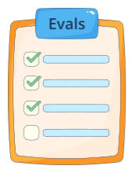

# Defining_Evaluation_Metrics_and_Test_Frameworks_for_AI_Systems

Source: https://www.educative.io/courses/claude-certified-architect-professional-exam/defining-evaluation-metrics-and-test-frameworks

---

[Home](https://www.educative.io/)

[Courses](https://www.educative.io/search?tab=courses)

[Master Claude Certified Architect – Professional Exam (CCAR-P)](https://www.educative.io/courses/claude-certified-architect-professional-exam)

# Defining Evaluation Metrics and Test Frameworks

Explore how to systematically measure AI system performance by defining key evaluation metrics along five crucial axes: accuracy, latency, cost, safety, and security. Learn to build test frameworks using mixed methodologies like exact-match checks, LLM-as-judge, and human review. Understand the importance of stratifying datasets to reveal hidden weaknesses and avoid relying on incomplete or anecdotal evaluation.

We'll cover the following...

- [Evaluation is a deliberate measurement](https://www.educative.io/courses/claude-certified-architect-professional-exam/defining-evaluation-metrics-and-test-frameworks#Evaluation-is-a-deliberate-measurement)
- [Five axes worth defining metrics for](https://www.educative.io/courses/claude-certified-architect-professional-exam/defining-evaluation-metrics-and-test-frameworks#Five-axes-worth-defining-metrics-for)
- [Mixed methodologies for scoring](https://www.educative.io/courses/claude-certified-architect-professional-exam/defining-evaluation-metrics-and-test-frameworks#Mixed-methodologies-for-scoring)
- [Stratify the dataset, or the aggregate lies](https://www.educative.io/courses/claude-certified-architect-professional-exam/defining-evaluation-metrics-and-test-frameworks#Stratify-the-dataset-or-the-aggregate-lies)
- [Anti-patterns](https://www.educative.io/courses/claude-certified-architect-professional-exam/defining-evaluation-metrics-and-test-frameworks#Anti-patterns)
- [Exercise: Design the evaluation](https://www.educative.io/courses/claude-certified-architect-professional-exam/defining-evaluation-metrics-and-test-frameworks#Exercise-Design-the-evaluation)
- [What’s next?](https://www.educative.io/courses/claude-certified-architect-professional-exam/defining-evaluation-metrics-and-test-frameworks#Whats-next)

Atlas’s architecture is integrated, and it now has the observability to catch a regression once it is running in production. This chapter asks an earlier question: before something ships, or before a change goes out, how do you actually know it is good enough? Observability watches a live system for drift after the fact. Evaluation is the deliberate, systematic measurement that answers whether a system, or a specific change to one, clears its bar in the first place, against a built dataset and defined metrics, not against a general impression that it seems to be working. In this lesson, we will cover:

- Defining evaluation metrics across the axes that actually matter: accuracy, latency, cost, safety, and security
- Building an evaluation dataset and test framework using mixed methodologies, exact-match checks, LLM-as-judge, and human review
- Why “it seemed to work” is not evaluation, and what a real test framework requires instead
- Stratifying an evaluation dataset so an aggregate score cannot hide a real weakness in one category

## Evaluation is a deliberate measurement[#](https://www.educative.io/courses/claude-certified-architect-professional-exam/defining-evaluation-metrics-and-test-frameworks#Evaluation-is-a-deliberate-measurement)

A team that tries a new prompt, reads a handful of outputs, and concludes it looks better has not evaluated anything. There is no way to know whether the next hundred cases would agree, no way to point to a specific number that changed, and no way to defend a “ready to ship” decision to anyone who asks how it was tested. Evaluation requires a built dataset with known-correct answers or well-specified quality criteria, a defined metric for each thing that matters, and a process repeatable enough that running it again on a changed system produces a comparable result.

This is not a formality. It is the only way to tell whether a change actually helped, actually hurt, or did nothing at all, and it is the foundation the next three lessons in this chapter all build on.

**The principle:** If you cannot rerun the same measurement against a changed system and get a comparable number back, you do not have an evaluation. You have an opinion about a demo.

## Five axes worth defining metrics for[#](https://www.educative.io/courses/claude-certified-architect-professional-exam/defining-evaluation-metrics-and-test-frameworks#Five-axes-worth-defining-metrics-for)

A system can fail on any one of these independently of the others, which is exactly why each needs its own metric rather than being folded into a single, undifferentiated judgment of “does it work.”

- **Accuracy:** It asks whether the output matches what is actually correct, for a task with a definable answer, or meets specified quality criteria, for a more open-ended one. This is the axis most teams measure, and it is also the one most likely to be treated as if it were the only one that mattered.
- **Latency:** It is a distribution, not a single average. A component whose average response time looks fine can still violate a stated requirement on its slow tail, the requests that take far longer than typical, and an evaluation that reports only an average hides exactly that.
- **Cost:** It is the token and dollar cost per call or per completed task, measured directly rather than assumed from the architecture on paper. A component that was designed to be cheap can drift in practice, and evaluation is where that drift gets caught before it reaches a bill.
- **Safety:** It asks whether the system avoids harmful, biased, or otherwise unacceptable output, a concern this course returns to in more depth later, but one that belongs in an evaluation framework from the start rather than bolted on afterward.
- **Security:** Itasks whether the capability and authorization boundaries built earlier in this course actually hold under test, whether an evaluation case that attempts to cross a scope boundary is correctly blocked rather than quietly succeeding.

**Exam lens:** A scenario describing a system that scores well on accuracy and is shipped on that basis alone, with no mention of latency, cost, safety, or security having been measured, is testing whether you will recognize that a single axis passing says nothing about the other four.

## Mixed methodologies for scoring[#](https://www.educative.io/courses/claude-certified-architect-professional-exam/defining-evaluation-metrics-and-test-frameworks#Mixed-methodologies-for-scoring)

No single scoring method fits every task, and choosing the wrong one either wastes effort or produces a number nobody should trust.

- **Exact-match, or programmatic checking:** This method compares an output directly against a known-correct value. This fits tasks with a single, well-defined answer, whether a specific field matches a ground-truth value, or whether an output parses as valid structured data against its schema. It is fast, cheap, and unambiguous exactly because the task has a checkable right answer to compare against.
- **LLM-as-judge:** It uses a model call to assess an output against defined criteria when no single correct string exists. A drafted memo, a summary, an explanation written for a specific audience, none of these have one right answer, but each can be scored against criteria a judge prompt can be built to check. The judge prompt itself needs the same care any prompt does, clear, specific, observable criteria, not a vague instruction to rate the output’s quality.
- **Human review:** It is reserved for the hardest, most ambiguous, or highest-stakes cases, and for calibrating the other two methods periodically rather than replacing them. It is too slow and too expensive to run on every case, but it is exactly what confirms whether an LLM judge’s criteria are actually producing the right verdicts.

These are not mutually exclusive. A well-built framework often layers them: exact-match catches structural failures instantly and cheaply, LLM-as-judge scores quality at a scale human review could never sustain, and human review spot-checks and calibrates both on a periodic basis.

Atlas’s evaluation framework uses all three layers, one per component, matched to what each one actually produces. Document intake’s extracted fields have known ground-truth values, so exact-match handles it directly. Policy check’s flagged-issue summaries have no single correct wording but do have clear criteria, whether every triggered rule is named and whether the explanation is specific enough for an officer to act on, so an LLM judge scores them at volume. The borderline investigator’s write-ups are rare, high-stakes, and genuinely ambiguous, exactly the case human review exists for, and those reviews double as the periodic check on whether the policy-check judge’s criteria are still calibrated correctly.

## Stratify the dataset, or the aggregate lies[#](https://www.educative.io/courses/claude-certified-architect-professional-exam/defining-evaluation-metrics-and-test-frameworks#Stratify-the-dataset-or-the-aggregate-lies)

A dataset that accumulates organically tends to overrepresent the easy, common cases and underrepresent the rare, hard ones, and an aggregate score computed from it inherits the same bias. An evaluation set for document intake with five hundred examples of the most common format and eight examples of a second format the system also has to handle will report an aggregate accuracy dominated by the common format, and a real, severe weakness specific to the rarer one can sit underneath that number for as long as nobody looks past it.

The fix is deliberate dataset construction, not an afterthought applied to whatever examples happened to accumulate. Each category that matters, each document format, each loan type, each known edge case, needs enough representation in the dataset that a stratified score for that category actually means something, and the stratified breakdown should be the primary result reported, with the aggregate serving only as a summary on top of it.

Ace Editor

1

2

3

4

5

6

7

{

"overall\_accuracy": 0.94,

"by\_document\_format": {

"standard\_statement": 0.97,

"scanned\_handwritten": 0.61

}

}

הההההההההההההההההההההההההההההההההההההההההההההההההההההההההההההההההההההההההההההההההההההההההההההההההההההההההההההההההההההההההההההההההההההההההההההההההההההההההההההההההההההההההההההההההההההההההההההההההההההההההההההההההההההההההההההההההההההההההההההההההההההההההההההההההההההההההההההההההההההההההההההההההההההההההההההההההההההההההההההההההההההההההההההההההההההההההההההההההההההההההההההההההההההההההההההההההההההההההההההההההההההההההההההההההההההההההההההההההההההההההההההההההההההההההההההההההההההההההההההההההההההההההההההההההההההההההההההההה

XXXXXXXXXXXXXXXXXXXXXXXXXXXXXXXXXXXXXXXXXXXXXXXXXXXXXXXXXXXXXXXXXXXXXXXXXXXXXXXXXXXXXXXXXXXXXXXXXXXXXXXXXXXXXXXXXXXXXXXXXXXXXXXXXXXXXXXXXXXXXXXXXXXXXXXXXXXXXXXXXXXXXXXXXXXXXXXXXXXXXXXXXXXXXXXXXXXXXXXXXXXXXXXXXXXXXXXXXXXXXXXXXXXXXXXXXXXXXXXXXXXXXXXXXXXXXXXXXXXXXXXXXXXXXXXXXXXXXXXXXXXXXXXXXXXXXXXXXXXXXXXXXXXXXXXXXXXXXXXXXXXXXXXXXXXXXXXXXXXXXXXXXXXXXXXXXXXXXXXXXXXXXXXXXXXXXXXXXXXXXXXXXXXXXXXXXXXXXXXXXXXXXXXXXXXXXXXXXXXXXXXXXXXXXXXXXXXXXXXXXXXXXXXXXXXXXXXXXXXXXXXXXXXXXXXXXXXXXXXXXXXXXXXXXXXXXXXXXXXXXXXXXXXXXXXX

The aggregate looks healthy. The category breakdown is where the real problem actually lives

## Anti-patterns[#](https://www.educative.io/courses/claude-certified-architect-professional-exam/defining-evaluation-metrics-and-test-frameworks#Anti-patterns)

These are the wrong-but-tempting moves the exam uses as distractors.

- **Treating “it seemed to work” as evaluation:** Shipping a change based on a handful of spot-checked outputs, with no dataset, no defined metric, and no process that could be rerun to confirm the impression.
- **Measuring accuracy alone and calling it done:** Ignoring latency, cost, safety, and security as separate axes a system can fail on even while its accuracy score looks strong.
- **Using LLM-as-judge for a task with a single, checkable answer:** Reaching for a model-based judge when exact match would be faster, cheaper, and less ambiguous for a task that already has a ground-truth value to compare against.
- **Building a dataset that accumulates rather than represents:** Letting an evaluation set overrepresent the common, easy cases simply because they were easiest to collect, leaving rare but important categories too thin to measure meaningfully.
- **Reporting only an aggregate score:** Treating a stratified breakdown as optional detail rather than the primary result, when the aggregate is exactly what a real, localized weakness hides inside.

## Exercise: Design the evaluation[#](https://www.educative.io/courses/claude-certified-architect-professional-exam/defining-evaluation-metrics-and-test-frameworks#Exercise-Design-the-evaluation)

Each scenario tests whether you can choose the right metric axis, methodology, or dataset design. Choose the best answer.

Technical Quiz

1.

A team evaluates a new customer-support agent by measuring only response accuracy against a set of test questions, and ships it once accuracy crosses ninety percent. What is missing from this evaluation?

A.

Nothing is missing, since accuracy is the only metric that actually determines whether a system is ready to ship to production.

B.

The team should have used a higher accuracy threshold than ninety percent instead of measuring any additional axes.

C.

The team should have used human review exclusively, instead of relying on a numeric accuracy threshold at all.

D.

Latency, cost, safety, and security are each separate axes the system can fail on independently of accuracy, none of them measured before shipping.

---

1 / 4

## What’s next?[#](https://www.educative.io/courses/claude-certified-architect-professional-exam/defining-evaluation-metrics-and-test-frameworks#Whats-next)

With metrics defined and a test framework in place, the next lesson turns to using that framework actively, running A/B tests, and iterating on a system’s design with feedback specific enough to actually change what it produces.

Integration Assessment Quiz

A/B Testing and Iterative Improvement

Ask

[Evaluation is a deliberate measurement](https://www.educative.io/courses/claude-certified-architect-professional-exam/defining-evaluation-metrics-and-test-frameworks#Evaluation-is-a-deliberate-measurement)

[Five axes worth defining metrics for](https://www.educative.io/courses/claude-certified-architect-professional-exam/defining-evaluation-metrics-and-test-frameworks#Five-axes-worth-defining-metrics-for)

[Mixed methodologies for scoring](https://www.educative.io/courses/claude-certified-architect-professional-exam/defining-evaluation-metrics-and-test-frameworks#Mixed-methodologies-for-scoring)

[Stratify the dataset, or the aggregate lies](https://www.educative.io/courses/claude-certified-architect-professional-exam/defining-evaluation-metrics-and-test-frameworks#Stratify-the-dataset-or-the-aggregate-lies)

[Anti-patterns](https://www.educative.io/courses/claude-certified-architect-professional-exam/defining-evaluation-metrics-and-test-frameworks#Anti-patterns)

[Exercise: Design the evaluation](https://www.educative.io/courses/claude-certified-architect-professional-exam/defining-evaluation-metrics-and-test-frameworks#Exercise-Design-the-evaluation)

[What’s next?](https://www.educative.io/courses/claude-certified-architect-professional-exam/defining-evaluation-metrics-and-test-frameworks#Whats-next)