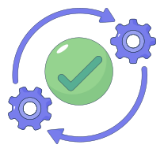

# Optimizing_Cost_Latency_and_Performance_in_AI_Systems

Source: https://www.educative.io/courses/claude-certified-architect-professional-exam/optimizing-cost-latency-and-performance

---

[Home](https://www.educative.io/)

[Courses](https://www.educative.io/search?tab=courses)

[Master Claude Certified Architect – Professional Exam (CCAR-P)](https://www.educative.io/courses/claude-certified-architect-professional-exam)

# Optimizing Cost, Latency, and Performance

Explore how to maintain and improve the efficiency of AI systems once correctness is established. Learn to analyze observability data to identify and eliminate waste at token, call, and architecture levels, weigh batch processing versus synchronous execution, and apply optimizations without sacrificing accuracy. Understand common anti-patterns and best practices for cost-effective AI system operation.

We'll cover the following...

- [Optimization follows correctness, it does not replace it](https://www.educative.io/courses/claude-certified-architect-professional-exam/optimizing-cost-latency-and-performance#Optimization-follows-correctness-it-does-not-replace-it)
- [Reading observability data for waste, not just regressions](https://www.educative.io/courses/claude-certified-architect-professional-exam/optimizing-cost-latency-and-performance#Reading-observability-data-for-waste-not-just-regressions)
- [Where cost and latency actually accumulate](https://www.educative.io/courses/claude-certified-architect-professional-exam/optimizing-cost-latency-and-performance#Where-cost-and-latency-actually-accumulate)
- [Weighing a batch discount against a real deadline](https://www.educative.io/courses/claude-certified-architect-professional-exam/optimizing-cost-latency-and-performance#Weighing-a-batch-discount-against-a-real-deadline)
- [Anti-patterns](https://www.educative.io/courses/claude-certified-architect-professional-exam/optimizing-cost-latency-and-performance#Anti-patterns)
- [Exercise: Find the waste](https://www.educative.io/courses/claude-certified-architect-professional-exam/optimizing-cost-latency-and-performance#Exercise-Find-the-waste)
- [What’s next?](https://www.educative.io/courses/claude-certified-architect-professional-exam/optimizing-cost-latency-and-performance#Whats-next)

The earlier lessons in this chapter built the ability to measure whether a system works, compare and iterate on it, and diagnose exactly why something went wrong. This lesson turns to a related but distinct question. Once a system is correct, how do you make it efficient, and keep it efficient, as it runs at real volume over time. Optimization draws on the same observability infrastructure built earlier in this course, but it asks that data a different question, not whether something broke, but where cost, latency, and token usage are being spent without earning their keep. In this lesson, we will cover:

- Why optimization is a distinct discipline that follows correctness, not a substitute for establishing it
- Reading the same logging and tracing data built earlier for tuning opportunities, not only regression detection
- The token-level, call-level, and architecture-level places cost, and latency actually accumulate
- Weighing a batch discount against a real deadline with actual numbers, rather than a habit of processing everything the same way

## Optimization follows correctness, it does not replace it[#](https://www.educative.io/courses/claude-certified-architect-professional-exam/optimizing-cost-latency-and-performance#Optimization-follows-correctness-it-does-not-replace-it)

A component that produces a wrong answer faster and more cheaply has not improved. It has made the same problem harder to notice. Cutting reasoning effort or retrieval depth before a component’s accuracy has actually been evaluated risks locking in a real quality problem underneath a lower cost, and any optimization made this way needs to be re-verified against the same evaluation dataset that established the baseline, the identical discipline covered earlier for any other change to a system, not a special exception for changes made in the name of efficiency.

This ordering matters because optimization and the accuracy-latency trade-off covered earlier in this course are not the same decision applied twice. That earlier lesson was about choosing where a component sits on the trade-off at design time, given its stated requirement. This lesson assumes that placement is already correct and asks a narrower question: within that placement, is every token, every call, and every architectural choice actually earning the cost it carries, or is some of it waste that could be removed without moving the component off the point on the curve it was deliberately placed at.

## Reading observability data for waste, not just regressions[#](https://www.educative.io/courses/claude-certified-architect-professional-exam/optimizing-cost-latency-and-performance#Reading-observability-data-for-waste-not-just-regressions)

The same trace fields built for catching a silent quality regression, cache status, retrieved chunk identifiers, tool calls, token counts, latency, answer exactly this different question when read with optimization in mind rather than regression detection.

A component expected to have a stable, cacheable prefix that shows a high proportion of cache misses is not failing in a way that produces a wrong answer, but it is paying full price and full latency on every call for a saving that should have been available. A retrieval step that consistently pulls eight chunks per query while the model’s final answer only ever cites content from one or two of them is carrying token cost and latency for material that is not actually being used, and reducing retrieval depth is worth testing, provided the reduction is re-verified against the evaluation dataset before it ships. A component running at a reasoning effort or model tier that stratified evaluation data shows is not actually needed for a specific category of case is paying for accuracy that category never required, even if the aggregate accuracy figure never reveals it.

**The principle:** The same trace that tells you nothing is broken can still tell you something is being paid for and never used. Regression detection asks whether the numbers moved in the wrong direction. Optimization asks whether the numbers, even where they look fine, reflect a cost the task actually needed to pay.

## Where cost and latency actually accumulate[#](https://www.educative.io/courses/claude-certified-architect-professional-exam/optimizing-cost-latency-and-performance#Where-cost-and-latency-actually-accumulate)

Waste tends to collect at three different levels, and each one is worth checking on its own.

- At the **token level**, unnecessary content in context, a reference document included in full where only a section was ever needed, an instruction duplicated across components instead of drawn from a shared, reusable one, all cost the same whether or not any of it changes the output.
- At the **call level**, reasoning effort or a verification pass applied to a task that does not need it costs tokens and latency for a quality gain the task was never asked to produce, the same anti-pattern covered when prompting technique was first introduced, now showing up again as an optimization opportunity rather than a design mistake.
- At the **architecture level**, a whole component running synchronously when nothing is actually waiting on it, or an expensive step running for every case when only a flagged subset genuinely needs it, carries a cost multiplied across every case that never required that level of treatment. Atlas’s borderline-application investigator already reflects the correct version of this: it runs only for flagged, ambiguous applications, not for every application that arrives, which is exactly what keeps its higher cost and latency justified rather than wasted at volume.

## Weighing a batch discount against a real deadline[#](https://www.educative.io/courses/claude-certified-architect-professional-exam/optimizing-cost-latency-and-performance#Weighing-a-batch-discount-against-a-real-deadline)

A component with genuinely no one waiting on its result in real time can usually capture a substantial cost discount by processing through a batch mechanism instead of synchronously, since nothing about the task requires the immediate turnaround synchronous processing exists to provide. The straightforward case, a nightly job nobody is watching, was covered earlier in this course. The more interesting case is a component that runs overnight but is often defaulted to synchronous processing out of habit, without checking whether it actually needs to be.

Consider a nightly batch of newly submitted applications that need preliminary screening results ready before officers start their shift the next morning, roughly ten hours later. Processing each application synchronously as it arrives overnight meets that deadline, but so does submitting the entire batch through an asynchronous mechanism at a meaningfully lower cost per application, since nothing about a ten-hour deadline requires the sub-second turnaround synchronous processing is built for. The distinction that matters is not whether processing happens overnight. It is whether anything is actually waiting in real time, a genuine synchronous requirement, or whether the work only needs to be done by some point, a deadline that batch processing can meet just as reliably while capturing real savings across every application processed that way.

## Anti-patterns[#](https://www.educative.io/courses/claude-certified-architect-professional-exam/optimizing-cost-latency-and-performance#Anti-patterns)

These are the wrong-but-tempting moves the exam uses as distractors.

- **Optimizing before correctness has been established:** Reducing reasoning effort, retrieval depth, or model tier to cut cost before the component’s accuracy has actually been evaluated against a real dataset.
- **Treating observability data as useful only for catching regressions:** Reviewing traces and dashboards exclusively to confirm nothing broke, never to find cost or latency being spent on content or effort the output never used.
- **Defaulting to synchronous processing out of habit:** Running a component synchronously because that is how it has always run, without checking whether its actual requirement is a deadline rather than a live, real-time wait.
- **Applying uniform reasoning effort or retrieval depth across every category:** Ignoring stratified evaluation data that shows some categories of a task never needed the effort or depth being applied to all of them equally.
- **Shipping an optimization without re-verifying it:** Treating a cost or latency improvement as complete without confirming, against the same evaluation dataset used for the baseline, that accuracy held.

## Exercise: Find the waste[#](https://www.educative.io/courses/claude-certified-architect-professional-exam/optimizing-cost-latency-and-performance#Exercise-Find-the-waste)

Each scenario tests whether you can identify a real optimization opportunity or correctly sequence optimization against correctness. Choose the best answer.

Technical Quiz

1.

A team notices a component’s cost per call is higher than expected and immediately reduces its reasoning effort and retrieval depth to cut cost, without having evaluated whether the component’s current accuracy is even acceptable. What is the issue with this approach?

A.

There is no issue, since reducing cost is always the correct first response whenever a component’s cost per call looks higher than expected.

B.

The fix is to increase reasoning effort and retrieval depth instead, since more thoroughness is always the safer direction to move in.

C.

The fix is to switch this component to a more capable, more expensive model tier as the default response to any cost concern at all.

D.

Optimizing before establishing correctness risks making an already-inadequate output cheaper to produce, rather than fixing the underlying problem first.

---

1 / 4

## What’s next?[#](https://www.educative.io/courses/claude-certified-architect-professional-exam/optimizing-cost-latency-and-performance#Whats-next)

The chapter quiz that follows draws on all four lessons together, evaluation metrics, comparison and iteration, diagnosis, and optimization, before the course turns to governance, safety, and risk management.

Diagnosing System Failures

Evaluation, Testing, and Optimization Assessment Quiz

Ask

[Optimization follows correctness, it does not replace it](https://www.educative.io/courses/claude-certified-architect-professional-exam/optimizing-cost-latency-and-performance#Optimization-follows-correctness-it-does-not-replace-it)

[Reading observability data for waste, not just regressions](https://www.educative.io/courses/claude-certified-architect-professional-exam/optimizing-cost-latency-and-performance#Reading-observability-data-for-waste-not-just-regressions)

[Where cost and latency actually accumulate](https://www.educative.io/courses/claude-certified-architect-professional-exam/optimizing-cost-latency-and-performance#Where-cost-and-latency-actually-accumulate)

[Weighing a batch discount against a real deadline](https://www.educative.io/courses/claude-certified-architect-professional-exam/optimizing-cost-latency-and-performance#Weighing-a-batch-discount-against-a-real-deadline)

[Anti-patterns](https://www.educative.io/courses/claude-certified-architect-professional-exam/optimizing-cost-latency-and-performance#Anti-patterns)

[Exercise: Find the waste](https://www.educative.io/courses/claude-certified-architect-professional-exam/optimizing-cost-latency-and-performance#Exercise-Find-the-waste)

[What’s next?](https://www.educative.io/courses/claude-certified-architect-professional-exam/optimizing-cost-latency-and-performance#Whats-next)