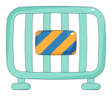

# Guardrails_and_Safety_Controls_in_AI_Risk_Management

Source: https://www.educative.io/courses/claude-certified-architect-professional-exam/guardrails-safety-controls-and-failure-modes

---

[Home](https://www.educative.io/)

[Courses](https://www.educative.io/search?tab=courses)

[Master Claude Certified Architect – Professional Exam (CCAR-P)](https://www.educative.io/courses/claude-certified-architect-professional-exam)

# Guardrails, Safety Controls, and Failure Modes

Explore the principles of guardrails as layered defenses in AI systems, including input screening, output screening, and tool-call authorization. Understand the importance of fail-secure designs and identify risks distinctive to large language models, such as prompt injection and data leakage. Learn how to defend AI systems against these risks to maintain safe and compliant operations.

We'll cover the following...

- [Guardrails as layered defense](https://www.educative.io/courses/claude-certified-architect-professional-exam/guardrails-safety-controls-and-failure-modes#Guardrails-as-layered-defense)
- [Failing securely instead of openly](https://www.educative.io/courses/claude-certified-architect-professional-exam/guardrails-safety-controls-and-failure-modes#Failing-securely-instead-of-openly)
- [Risks and failure modes distinctive to LLM systems](https://www.educative.io/courses/claude-certified-architect-professional-exam/guardrails-safety-controls-and-failure-modes#Risks-and-failure-modes-distinctive-to-LLM-systems)
- [Prompt injection, direct and indirect](https://www.educative.io/courses/claude-certified-architect-professional-exam/guardrails-safety-controls-and-failure-modes#Prompt-injection-direct-and-indirect)
- [Defending against prompt injection](https://www.educative.io/courses/claude-certified-architect-professional-exam/guardrails-safety-controls-and-failure-modes#Defending-against-prompt-injection)
- [Anti-patterns](https://www.educative.io/courses/claude-certified-architect-professional-exam/guardrails-safety-controls-and-failure-modes#Anti-patterns)
- [Exercise: Find the guardrail gap](https://www.educative.io/courses/claude-certified-architect-professional-exam/guardrails-safety-controls-and-failure-modes#Exercise-Find-the-guardrail-gap)
- [What’s next?](https://www.educative.io/courses/claude-certified-architect-professional-exam/guardrails-safety-controls-and-failure-modes#Whats-next)

The previous chapter assumed a system already works and asked how to prove it, compare it, and keep it efficient. This chapter asks a different question: Is the system safe to run at all, and what happens the moment something goes wrong? A system can pass every accuracy and cost metric built in the last chapter and still be unsafe if a malicious input can redirect it, if a tool call can execute with more authority than the situation warrants, or if a screening component’s own failure quietly becomes a pass rather than a block. Guardrails are what stand between a capable system and the specific ways that capability can be misused, and this lesson builds the vocabulary and design habits for placing them correctly.

In this lesson, we will cover:

- Guardrails as layered defense: input screening, output screening, and tool-call authorization working together, since no single layer can stand in for all three.
- Failing securely rather than openly, and why a guardrail’s own failure mode matters as much as what it is built to catch.
- The risks and failure modes distinctive to LLM systems: hallucination, prompt injection, jailbreak, unbounded delegation, and data leakage.
- Defending against prompt injection, direct and indirect, by treating retrieved and tool-sourced content as untrusted data rather than instructions.

## Guardrails as layered defense[#](https://www.educative.io/courses/claude-certified-architect-professional-exam/guardrails-safety-controls-and-failure-modes#Guardrails-as-layered-defense)

A guardrail is a control placed at a specific point in a system to catch a specific class of problem, and no single guardrail covers every risk a Claude-powered system faces. Production systems place guardrails at three distinct points, each catching something the others cannot.

- **Input screening** examines what arrives before it ever reaches the model, checking for disallowed content, attempted prompt injection, or sensitive data that should never enter context in the first place.
- **Output screening** examines what the model produces before it is shown to a user or acted on, checking for policy violations, leaked sensitive content, or a response that fails a required format or safety check.
- **Tool-call authorization**, the dispatch-gate enforcement introduced earlier in this course, checks whether a specific action the model wants to take is actually within scope for this session and this caller, independent of what the model itself believes is appropriate.

These three catch different things at different points, and a system that only implements one has a real gap the others exist to close. A permissive input screen paired with strict tool-call authorization still lets disallowed content into context, even if the resulting action gets blocked downstream. Strong input and output screening paired with no independent tool-call check still lets a model that has been successfully manipulated take a real, authorized-looking action because nothing checked the action itself against what this caller should actually be allowed to do.

**The principle:** A system prompt telling the model to behave safely is guidance rather than a guardrail. A guardrail is a control enforced independently of what the model decides, at input, at output, or at the moment of action, and a system needs all three points covered. Covering only the one that was easiest to add is not enough.

## Failing securely instead of openly[#](https://www.educative.io/courses/claude-certified-architect-professional-exam/guardrails-safety-controls-and-failure-modes#Failing-securely-instead-of-openly)

Every guardrail can fail through an outage, a timeout, or an ambiguous result it cannot classify with confidence, and how it behaves in that moment is as important as what it catches when it is working. A guardrail that fails securely defaults to blocking, denying, or escalating when it cannot make a confident determination. A guardrail that fails openly defaults to passing the request through as if it had been checked and cleared, purely to avoid interrupting availability.

Failing open is the more tempting default because it keeps the system running smoothly during an outage, and nobody notices anything changed until the one request that needed to be blocked sails through during exactly the window when the check was unavailable. Failing securely accepts a real cost, such as a blocked request, a delayed action, or an escalation to a human, in exchange for never silently operating with a safety control missing. For Atlas, if the service that authorizes a tool call for the borderline-application investigator becomes unavailable, the correct behavior is to deny the call or hold it for manual review. Letting the investigator proceed as though authorization had been confirmed is exactly the failure this guards against. An outage in the authorization path is not evidence the action is safe. It is evidence that the one thing that would have confirmed either way did not happen.

**Exam lens:** A scenario describing a safety or authorization check that is unavailable, followed by the system proceeding anyway “to avoid disrupting the user experience,” is testing whether you will recognize a fail-open design. The interruption is the correct behavior. It is not a defect to be engineered away.

## Risks and failure modes distinctive to LLM systems[#](https://www.educative.io/courses/claude-certified-architect-professional-exam/guardrails-safety-controls-and-failure-modes#Risks-and-failure-modes-distinctive-to-LLM-systems)

Several of the risks a Claude-powered system faces have no close equivalent in traditional software, which is exactly why they need their own guardrails rather than being caught by conventional input validation.

- **Hallucination**, covered in depth in the previous chapter, is the model asserting something plausible that is not actually supported by its context.
- **Prompt injection** is an attempt, embedded in a request or in content the system processes, to redirect the model away from its actual instructions.
- **Jailbreak** is a related but distinct attempt to get the model to bypass a safety behavior it was specifically instructed to maintain, often through elaborate framing rather than a direct request.
- **Unbounded delegation** is an agent or tool configuration granted more authority than the task in front of it actually requires, reframing the capability-bloat risk from earlier in this course as a safety failure mode rather than only a design inefficiency.
- **Data leakage** is the system revealing content it should not, such as system-prompt contents, another session’s data, or a retrieved document a caller was never authorized to see.

Each of these needs a specific, targeted defense; one broad instruction cannot cover all five. A guardrail built to catch hallucination, grounding enforcement, and citation requirements does nothing to stop a jailbreak attempt, and a guardrail scoped to block jailbreak framing does nothing to prevent an over-privileged tool configuration from acting on a request that should never have reached it in the first place. The table below lines up each risk against what it looks like in practice and the defense actually built for it.

|  |  |  |
| --- | --- | --- |
| **Risk** | **What it Looks Like** | **Primary Defense** |
| Hallucination | A confident claim not supported by the provided context | Grounding enforcement and citation requirements |
| Prompt injection | Embedded text redirecting the model away from its actual instructions | Treating external content as untrusted data, backed by independent authorization |
| Jailbreak | Elaborate framing meant to bypass an instructed safety behavior | Output screening and instruction hierarchy that resists reframing |
| Unbounded delegation | A component holding authority beyond what its task requires | Least privilege, scoping access to the current task instead of a hypothetical future one |
| Data leakage | The system revealing content a caller was never authorized to see | Per-caller scoping enforced at the point content is returned rather than only at the prompt |

## Prompt injection, direct and indirect[#](https://www.educative.io/courses/claude-certified-architect-professional-exam/guardrails-safety-controls-and-failure-modes#Prompt-injection-direct-and-indirect)

Prompt injection comes in two forms that call for different defenses, and conflating them is a common exam trap.

Direct injection is an attempt embedded in the request itself: a user submitting input specifically crafted to override the system’s actual instructions. Indirect injection is more subtle and, for an agentic or retrieval-based system, considerably more dangerous. It is an attempt embedded in content the system processes as data, such as a retrieved document, a tool’s returned result, or a web page fetched on the model’s behalf. In this case, the attacker is not the person interacting with the system at all, but whoever authored or controls that external content. A resume-screening tool that retrieves a candidate’s submitted document and treats embedded text inside it as an instruction rather than data to evaluate has been compromised by indirect injection, with no malicious user ever having sent a single message to the system directly.

Indirect injection deserves particular attention on the exam because it breaks an assumption many designs make by default: Anything that requires defense against manipulation must come from the user-facing side of the system. Any content a Claude-powered system retrieves, receives from a tool, or otherwise pulls in from outside its own instructions is a potential injection vector, regardless of how that content arrived. The distinction is worth keeping straight since the two forms put the attacker in a different place entirely.

|  |  |  |
| --- | --- | --- |
|  | **Direct Injection** | **Indirect Injection** |
| Where the attack originates | The user's own request | Content the system retrieves or receives from a tool |
| Who the attacker is | The person interacting with the system | Whoever authored the external content |
| Typical vector | Adversarial wording submitted directly | A document, web page, or tool result the model treats as data |
| Where the defense has to sit | Input screening on the request itself | Treating retrieved and tool content as untrusted data, backed by independent authorization |

## Defending against prompt injection[#](https://www.educative.io/courses/claude-certified-architect-professional-exam/guardrails-safety-controls-and-failure-modes#Defending-against-prompt-injection)

The core defense is architectural rather than persuasive: content retrieved from documents, tools, or external sources must be treated as untrusted data to be evaluated, never as instructions to be followed. This distinction has to be enforced by more than a polite request in the system prompt.

A system prompt can and should tell the model that retrieved content is data rather than instructions. It should also structure that content clearly: delimited, labeled, and kept distinct from the instructions the model is meant to follow. But a system prompt is guidance, the same limitation covered earlier in this course, and an attacker who successfully manipulates the model into treating embedded text as an instruction still needs to be caught by something enforced independently of the model’s behavior. That is exactly what tool-call authorization is for: a dispatch gate that checks a requested action against what this caller is actually authorized to do, regardless of what convinced the model to request it. This catches an injected instruction that tries to trigger an unauthorized action, even if the injection succeeded in influencing the model. Privilege separation reinforces the same idea further upstream, keeping a component that processes untrusted external content from also holding tool-calling authority in that same context. That way, a successful injection in one place has no privileged action available to reach for.

**Exam lens:** A scenario describing a defense against prompt injection that consists entirely of a more strongly worded instruction not to follow embedded commands is testing whether you will recognize that wording alone is not a control. The control is the independent authorization check that the model’s behavior cannot bypass, no matter how it was influenced.

## Anti-patterns[#](https://www.educative.io/courses/claude-certified-architect-professional-exam/guardrails-safety-controls-and-failure-modes#Anti-patterns)

These are the wrong-but-tempting moves the exam uses as distractors.

- **Treating a system-prompt instruction as a guardrail on its own:** Relying on a request like “never reveal internal data” with no independent, programmatic check enforcing it if the instruction is ever bypassed.
- **Failing open when a guardrail is unavailable:** Letting a request proceed as if it had been screened or authorized because the component that would have checked it was down or timed out.
- **Trusting retrieved or tool-returned content as if it were an instruction:** Allowing text embedded in a document, a tool result, or a fetched page to redirect the model’s behavior, the indirect-injection failure mode this lesson covers directly.
- **Granting broader tool access than a task requires, reasoned as future-proofing:** Treating “it might need this later” as sufficient justification for authority that a component’s actual task does not call for today.
- **Screening only one side of the interaction:** Implementing input screening or output screening, but not both, leaving a real gap on whichever side went unchecked.

## Exercise: Find the guardrail gap[#](https://www.educative.io/courses/claude-certified-architect-professional-exam/guardrails-safety-controls-and-failure-modes#Exercise-Find-the-guardrail-gap)

Each scenario tests whether you can identify a missing layer, a fail-open design, or an injection vector. Choose the best answer.

Technical Quiz

1.

The service that authorizes tool calls for a loan-application investigator agent becomes temporarily unavailable. The team configures the agent to proceed with its planned tool calls anyway, reasoning that the outage is brief and officers are waiting on results. What is the concern with this design?

A.

An outage in the authorization path is not evidence that the action is safe, and proceeding treats an unchecked request as already cleared.

B.

There is no concern, since a brief authorization outage is unlikely to coincide with an actual unauthorized action being attempted.

C.

The fix is to remove the authorization step from this agent entirely, since it is evidently unreliable enough to cause delays.

D.

The fix is to authorize every tool call permanently in advance, so a future outage in the authorization service never causes a delay again.

---

1 / 4

## What’s next?[#](https://www.educative.io/courses/claude-certified-architect-professional-exam/guardrails-safety-controls-and-failure-modes#Whats-next)

With guardrails, fail-secure design, and the injection defenses that back them in place, the next lesson turns to what happens when a system cannot, or should not, decide alone: human-in-the-loop escalation design that routes the highest-stakes cases to a person instead of letting the system act unsupervised.

Evaluation, Testing, and Optimization Assessment Quiz

Human-in-the-Loop and Escalation Design

Ask

[Guardrails as layered defense](https://www.educative.io/courses/claude-certified-architect-professional-exam/guardrails-safety-controls-and-failure-modes#Guardrails-as-layered-defense)

[Failing securely instead of openly](https://www.educative.io/courses/claude-certified-architect-professional-exam/guardrails-safety-controls-and-failure-modes#Failing-securely-instead-of-openly)

[Risks and failure modes distinctive to LLM systems](https://www.educative.io/courses/claude-certified-architect-professional-exam/guardrails-safety-controls-and-failure-modes#Risks-and-failure-modes-distinctive-to-LLM-systems)

[Prompt injection, direct and indirect](https://www.educative.io/courses/claude-certified-architect-professional-exam/guardrails-safety-controls-and-failure-modes#Prompt-injection-direct-and-indirect)

[Defending against prompt injection](https://www.educative.io/courses/claude-certified-architect-professional-exam/guardrails-safety-controls-and-failure-modes#Defending-against-prompt-injection)

[Anti-patterns](https://www.educative.io/courses/claude-certified-architect-professional-exam/guardrails-safety-controls-and-failure-modes#Anti-patterns)

[Exercise: Find the guardrail gap](https://www.educative.io/courses/claude-certified-architect-professional-exam/guardrails-safety-controls-and-failure-modes#Exercise-Find-the-guardrail-gap)

[What’s next?](https://www.educative.io/courses/claude-certified-architect-professional-exam/guardrails-safety-controls-and-failure-modes#Whats-next)