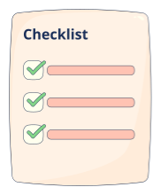

# Compliance_and_Ethical_AI_Principles_in_Governance_and_Risk_Management

Source: https://www.educative.io/courses/claude-certified-architect-professional-exam/compliance-and-ethical-ai-in-practice

---

[Home](https://www.educative.io/)

[Courses](https://www.educative.io/search?tab=courses)

[Master Claude Certified Architect – Professional Exam (CCAR-P)](https://www.educative.io/courses/claude-certified-architect-professional-exam)

# Compliance and Ethical AI in Practice

Explore how compliance frameworks and ethical AI principles impact system design and governance. Understand key regulations such as GDPR, HIPAA, and FedRAMP, and their influence on data handling, deployment platforms, and audit trails. Learn to distinguish compliance from fairness and transparency to design AI systems that are both legally compliant and ethically sound.

We'll cover the following...

- [Compliance is a constraint on the architecture from the start](https://www.educative.io/courses/claude-certified-architect-professional-exam/compliance-and-ethical-ai-in-practice#Compliance-is-a-constraint-on-the-architecture-from-the-start)
- [Three regulatory regimes and what they actually require](https://www.educative.io/courses/claude-certified-architect-professional-exam/compliance-and-ethical-ai-in-practice#Three-regulatory-regimes-and-what-they-actually-require)
- [Where these regulations actually bite](https://www.educative.io/courses/claude-certified-architect-professional-exam/compliance-and-ethical-ai-in-practice#Where-these-regulations-actually-bite)
- [Bias, fairness, and transparency are a separate obligation](https://www.educative.io/courses/claude-certified-architect-professional-exam/compliance-and-ethical-ai-in-practice#Bias-fairness-and-transparency-are-a-separate-obligation)
- [Anti-patterns](https://www.educative.io/courses/claude-certified-architect-professional-exam/compliance-and-ethical-ai-in-practice#Anti-patterns)
- [Exercise: Name the constraint](https://www.educative.io/courses/claude-certified-architect-professional-exam/compliance-and-ethical-ai-in-practice#Exercise-Name-the-constraint)
- [What’s next?](https://www.educative.io/courses/claude-certified-architect-professional-exam/compliance-and-ethical-ai-in-practice#Whats-next)

The previous two lessons covered guardrails and escalation, controls that shape how a system behaves once it is already built. This lesson covers something that has to be settled earlier: what a system is even allowed to be built as, given the regulatory environment it operates in, and what it owes the people it makes decisions about beyond whatever the law happens to require. Discovering a compliance requirement after an architecture is already built is expensive in a way discovering it during design is not, since a deployment platform, a data flow, or a logging gap can force a rebuild instead of a patch. In this lesson, we will cover:

- GDPR, HIPAA, and FedRAMP as architectural constraints that shape deployment platform, data flow, and logging from the first design decision, well before any review step at the end.
- The specific places these regulations bite: data residency, PII and PHI handling, audit trails, and deployment surface.
- Bias, fairness, and transparency as a separate, non-regulatory obligation; a fully compliant system can still fail.
- Where compliance and ethical AI considerations actually belong in the design process.

## Compliance is a constraint on the architecture from the start[#](https://www.educative.io/courses/claude-certified-architect-professional-exam/compliance-and-ethical-ai-in-practice#Compliance-is-a-constraint-on-the-architecture-from-the-start)

A regulatory requirement is not a checklist a legal team runs before launch. It determines which deployment platform is even available, which data is allowed to cross a boundary, and what has to be logged, and it determines these things from the very first architectural decision. Waiting until the system is otherwise finished comes too late. This is the same idea covered earlier in this course when deployment platform and data residency were chosen alongside model selection rather than after it, now extended to the full regulatory picture a system actually has to satisfy.

A team that designs a system first and checks compliance last risks discovering that the platform it built on cannot legally hold the data it is already holding, that no audit trail exists for access it already granted, or that a required human-review step was never built in anywhere. Each of these amounts to a redesign. A simple patch will not fix it, and each one was avoidable if the constraint had been treated as a design input from the beginning.

## Three regulatory regimes and what they actually require[#](https://www.educative.io/courses/claude-certified-architect-professional-exam/compliance-and-ethical-ai-in-practice#Three-regulatory-regimes-and-what-they-actually-require)

GDPR, HIPAA, and FedRAMP are not interchangeable compliance boxes to check. Each constrains a different part of the architecture, and knowing which one applies changes what the system is actually allowed to do.

- **GDPR:** It governs personal data belonging to individuals in the European Union, and it constrains more than storage location. It grants data subjects rights, access, correction, erasure, and it places real limits on automated decision-making that has a legal or otherwise significant effect on a person, often requiring meaningful human involvement in exactly that category of decision, the same category the human-in-the-loop lesson identifies as high-impact.
- **HIPAA:** It governs protected health information in the United States, and it requires a signed agreement with any vendor or platform that processes it, an audit trail of who accessed what and when, and access scoped to the minimum necessary for the task at hand, the same least-privilege principle covered earlier in this course, now applied specifically to health data.
- **FedRAMP:** It governs cloud services used by United States federal agencies, and it constrains deployment surface directly: a platform without FedRAMP authorization is not a legally usable option for that customer, full stop, regardless of how well it otherwise fits the architecture’s needs.

|  |  |  |
| --- | --- | --- |
| **Regime** | **Who It Applies to** | **What It Actually Constrains** |
| GDPR | Personal data of individuals in the European Union | Data subject rights, and limits on automated decisions with significant effects |
| HIPAA | Protected health information in the United States | Vendor agreements, audit trails, and minimum necessary access |
| FedRAMP | Cloud services used by United States federal agencies | Which deployment platforms are legally usable at all |

**Exam lens:** A scenario naming a specific regulation and describing a design choice that ignores what that regulation actually constrains is testing whether you know which regime governs which part of the architecture. Knowing only that “compliance matters” in the abstract is not enough.

## Where these regulations actually bite[#](https://www.educative.io/courses/claude-certified-architect-professional-exam/compliance-and-ethical-ai-in-practice#Where-these-regulations-actually-bite)

Across all three regimes, the practical impact lands in four places, and an architecture needs an answer for each one before it is built.

- **Data residency:** It determines where data is allowed to live and be processed, the same constraint covered when deployment platforms were first selected.
- **PII and PHI handling:** It determines what personal or health information the system collects, stores, and can act on, and how tightly that collection is scoped to what the task actually requires.
- **Audit trails:** It determines whether the system can answer, after the fact, exactly who accessed what and when, a requirement several regimes treat as non-negotiable rather than a nice-to-have.
- **Deployment surface:** It determines which platforms and regions are legally available at all, independent of which one would otherwise be the best technical fit.

## Bias, fairness, and transparency are a separate obligation[#](https://www.educative.io/courses/claude-certified-architect-professional-exam/compliance-and-ethical-ai-in-practice#Bias-fairness-and-transparency-are-a-separate-obligation)

A system that satisfies every regulatory requirement in this lesson can still be unfair, and passing a compliance review is not evidence otherwise. Bias, fairness, and transparency sit alongside compliance as a distinct concern. Treating them as a byproduct of compliance misses that.

- **Bias:** It is a systematic difference in outcomes across groups that is not justified by a legitimate factor, a loan-approval rate that differs by a protected characteristic in a way underlying risk does not actually explain. Catching it requires the same stratification discipline covered in the evaluation chapter, applied to demographic categories specifically as well as document formats or loan types, since an aggregate approval rate can look perfectly healthy while hiding a real disparity the same way an aggregate accuracy score can hide a weak document format.
- **Fairness:** It is the consistent application of the same criteria across cases, and it can quietly fail when a correlated proxy for a protected characteristic, a zip code standing in for something else, ends up carrying weight the system never intended to give it.
- **Transparency:** It is the ability to actually explain why a decision was made, to the person it affects and to the reviewer checking it, and it connects directly to the grounding and citation requirements covered earlier in this course: a system that cannot point to what its decision was actually based on cannot be transparent about it, regardless of how accurate that decision happens to be.

**Exam lens:** A scenario describing a system that has passed every applicable compliance review, followed by a question about whether it is now ethically sound, is testing whether you will recognize that compliance and fairness are separate questions, and a clean answer to one says nothing about the other.

## Anti-patterns[#](https://www.educative.io/courses/claude-certified-architect-professional-exam/compliance-and-ethical-ai-in-practice#Anti-patterns)

These are the wrong-but-tempting moves the exam uses as distractors.

- **Treating compliance as a legal review step run at the end:** Designing the architecture first and checking whether it satisfies GDPR, HIPAA, or FedRAMP only once it is otherwise finished.
- **Assuming a platform’s own authorization covers the whole system:** Treating a FedRAMP-authorized or HIPAA-eligible platform as sufficient on its own, without also building the application-level logging, access scoping, and data flow the regulation actually requires.
- **Evaluating fairness only through an aggregate outcome metric:** Missing a real disparity across a protected category the same way an unstratified accuracy score can miss a weak document format.
- **Treating an unexplainable decision as an acceptable cost of capability:** Excusing a lack of transparency because the system that produced the decision is otherwise accurate or sophisticated.
- **Assuming full compliance is equivalent to being ethical:** Treating a clean regulatory review as proof that bias and fairness have also been addressed, when the two are genuinely separate obligations.

## Exercise: Name the constraint[#](https://www.educative.io/courses/claude-certified-architect-professional-exam/compliance-and-ethical-ai-in-practice#Exercise-Name-the-constraint)

Each scenario tests whether you can identify the regulatory or ethical obligation actually in play. Choose the best answer.

Technical Quiz

1.

A system based in the European Union makes a fully automated decision that has a significant legal effect on an applicant, with no human reviewing it at any point. What is the concern?

A.

There is no concern, since a system that is technically accurate does not require any additional review regardless of the decision’s effect.

B.

The fix is to make the system’s decision faster, since speed is the primary factor GDPR evaluates in an automated decision.

C.

The fix is to switch this component to a more capable model tier, since model capability is what GDPR’s automated-decision provision actually addresses.

D.

GDPR places real limits on automated decisions with significant effects on a person, often requiring meaningful human involvement in exactly this category.

---

1 / 4

## What’s next?[#](https://www.educative.io/courses/claude-certified-architect-professional-exam/compliance-and-ethical-ai-in-practice#Whats-next)

With guardrails, escalation, and compliance in place, the chapter quiz that follows draws on all three lessons together, before the course turns to stakeholder communication and the life cycle discipline that carries a system from discovery through the handoff that lets a team run it without the architect.

Human-in-the-Loop and Escalation Design

Governance, Safety, and Risk Management Quiz

Ask

[Compliance is a constraint on the architecture from the start](https://www.educative.io/courses/claude-certified-architect-professional-exam/compliance-and-ethical-ai-in-practice#Compliance-is-a-constraint-on-the-architecture-from-the-start)

[Three regulatory regimes and what they actually require](https://www.educative.io/courses/claude-certified-architect-professional-exam/compliance-and-ethical-ai-in-practice#Three-regulatory-regimes-and-what-they-actually-require)

[Where these regulations actually bite](https://www.educative.io/courses/claude-certified-architect-professional-exam/compliance-and-ethical-ai-in-practice#Where-these-regulations-actually-bite)

[Bias, fairness, and transparency are a separate obligation](https://www.educative.io/courses/claude-certified-architect-professional-exam/compliance-and-ethical-ai-in-practice#Bias-fairness-and-transparency-are-a-separate-obligation)

[Anti-patterns](https://www.educative.io/courses/claude-certified-architect-professional-exam/compliance-and-ethical-ai-in-practice#Anti-patterns)

[Exercise: Name the constraint](https://www.educative.io/courses/claude-certified-architect-professional-exam/compliance-and-ethical-ai-in-practice#Exercise-Name-the-constraint)

[What’s next?](https://www.educative.io/courses/claude-certified-architect-professional-exam/compliance-and-ethical-ai-in-practice#Whats-next)