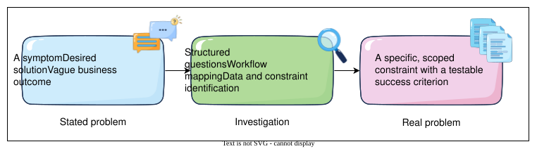

# Structured_Discovery_and_Requirement_Gathering_for_AI_Architecture

Source: https://www.educative.io/courses/claude-certified-architect-professional-exam/structured-discovery-and-requirement-gathering

---

[Home](https://www.educative.io/)

[Courses](https://www.educative.io/search?tab=courses)

[Master Claude Certified Architect – Professional Exam (CCAR-P)](https://www.educative.io/courses/claude-certified-architect-professional-exam)

# Structured Discovery and Requirement Gathering

Explore how to conduct structured discovery to uncover true stakeholder needs beyond initial requests. Learn to differentiate requirements from constraints, test constraint rigidity, and transform conversations into validated requirements documents that guide AI architecture decisions. This lesson prepares you to avoid costly rework by setting a solid foundation for design and communication.

We'll cover the following...

- [Discovery separates what is wanted from what is needed](https://www.educative.io/courses/claude-certified-architect-professional-exam/structured-discovery-and-requirement-gathering#Discovery-separates-what-is-wanted-from-what-is-needed)
- [A requirement is not a constraint](https://www.educative.io/courses/claude-certified-architect-professional-exam/structured-discovery-and-requirement-gathering#A-requirement-is-not-a-constraint)
- [Testing which constraints are actually binding](https://www.educative.io/courses/claude-certified-architect-professional-exam/structured-discovery-and-requirement-gathering#Testing-which-constraints-are-actually-binding)
- [Turning the conversation into an artifact](https://www.educative.io/courses/claude-certified-architect-professional-exam/structured-discovery-and-requirement-gathering#Turning-the-conversation-into-an-artifact)
- [Anti-patterns](https://www.educative.io/courses/claude-certified-architect-professional-exam/structured-discovery-and-requirement-gathering#Anti-patterns)
- [Exercise: Separate the signal](https://www.educative.io/courses/claude-certified-architect-professional-exam/structured-discovery-and-requirement-gathering#Exercise-Separate-the-signal)
- [What’s next?](https://www.educative.io/courses/claude-certified-architect-professional-exam/structured-discovery-and-requirement-gathering#Whats-next)

Every decision this course has covered so far assumed that a requirement was already known and correctly captured. That requirement has to come from somewhere, and it usually comes from a conversation with a stakeholder. Stakeholders often describe what they want in the language of a solution they have already half-designed in their own head, rather than in the language an architecture needs to build against. This chapter turns to that earlier step: running discovery that produces a real requirement in the first place, communicating the resulting decisions clearly, and carrying a system through its full life cycle once discovery is done. In this lesson, we will cover:

- Running a discovery conversation that surfaces what a stakeholder actually needs, beyond what they first describe wanting.
- Separating a requirement, what the system must accomplish, from a constraint, what limits how it can accomplish it.
- Testing which stated constraints are truly binding before they are discovered mid-build, the way a missed platform or compliance requirement was in earlier chapters.
- Turning a discovery conversation into a requirements artifact that the rest of the design process can actually build against.

## Discovery separates what is wanted from what is needed[#](https://www.educative.io/courses/claude-certified-architect-professional-exam/structured-discovery-and-requirement-gathering#Discovery-separates-what-is-wanted-from-what-is-needed)

A stakeholder tends to describe a want in terms of a solution they have already pictured, “we need an AI that reads loan documents,” rather than the underlying business need that solution is meant to address. Designing directly to that stated want risks building exactly what was asked for while missing what would have actually helped. This is the same gap covered earlier in this course, when a team built the demo a sentence suggested while the business needed something else entirely.

Structured discovery asks past the stated want to the need underneath it, using a small set of direct questions: What happens today without this? What does success actually look like in six months? Who is hurt by the current state, and in what specific way? At Atlas, a stakeholder request framed as “an AI that reads loan documents” turns out, once asked these questions, to be about something narrower and more useful: Officers are spending most of their time on routine, standard-case paperwork, leaving too little time for the complex, borderline applications that actually need their judgment. The real target is not document reading in general. It is reducing officer time spent on standard-case review, a materially different and far more specific design target than the one first mentioned.

A single round of questions rarely finishes the job. Discovery works best as a short series of conversations: an initial pass that surfaces the stated want, a follow-up that tests the need underneath it against specific examples, and a final pass that checks the reframed target against the stakeholder’s own words. Skipping straight to a single meeting and calling discovery complete is how a team ends up designing to the first, least-examined version of the problem.

**Exam lens:** A scenario describing a design that satisfies a stakeholder’s literal request while missing the underlying business problem is testing whether you will recognize that the request itself was never verified against the need. It is not testing whether the resulting design was implemented well.

## A requirement is not a constraint[#](https://www.educative.io/courses/claude-certified-architect-professional-exam/structured-discovery-and-requirement-gathering#A-requirement-is-not-a-constraint)

A requirement states what the system must accomplish: an outcome, a capability, or a quality bar it has to clear. A constraint states what limits how the system can accomplish it: a budget, a deadline, an existing platform, a regulatory boundary, or a team’s available skill set. Conflating the two is a common and costly mistake during discovery.

A stakeholder statement like “it needs to use our existing case-management platform” sounds like a requirement, but it functions as a constraint. It limits the solution space rather than describing an outcome the system has to produce. The distinction matters because requirements can usually be weighed against each other and traded off as a design takes shape, while a genuine constraint typically cannot be negotiated away by clever architecture. Treating a constraint as though it were a requirement invites debate over how well the system satisfies it. Treating a requirement as though it were a fixed constraint gives away flexibility that was actually available to negotiate.

|  |  |  |
| --- | --- | --- |
|  | **Requirement** | **Constraint** |
| Describes | An outcome or capability the system must deliver | A limit on how the system can be built |
| Example | Officers must receive a flagged-issue summary within one business day | The system must run on the bank's existing case-management platform |
| Typically | Negotiable against other requirements as design trade-offs are made | Fixed, and rarely resolved by better architecture |

## Testing which constraints are actually binding[#](https://www.educative.io/courses/claude-certified-architect-professional-exam/structured-discovery-and-requirement-gathering#Testing-which-constraints-are-actually-binding)

Not every stated limit is equally fixed. Some are genuine, non-negotiable boundaries: a real regulatory requirement, a hard budget ceiling, or a go-live date tied to an external event. Others are strong preferences dressed up as constraints, like “it needs to be built in Python,” that feel absolute in the moment but turn out to have flexibility once tested.

The test is a direct question asked during discovery itself: What happens if this particular limit cannot be met? An answer along the lines of “we would need to revisit the whole approach” marks a binding constraint. An answer along the lines of “we would prefer it, but we could work around it” marks a preference rather than a true limit on the solution space. Done well, this step catches a platform or compliance requirement before an architecture is built around the wrong assumption. It avoids the same expensive rework covered in the governance chapter, when a compliance requirement surfaced only after significant build-out. Discovery is where that information should have originated in the first place.

For Atlas, a stakeholder’s early statement that “the system must integrate with our current loan-origination platform” turns out, once tested this way, to be genuinely binding: Replacing that platform would require a separate, multi-year initiative the bank has no appetite to fund alongside this project. A separate statement that “results should appear in a particular internal dashboard” turns out, once tested the same way, to be a preference. Officers would be equally well served by a different, equivalent view, and the stakeholder confirms as much once asked directly. The two statements sounded similarly firm when first spoken. Only the direct test told them apart.

**Exam lens:** A scenario describing a stated limit that a team accepts at face value without asking what happens if it is not met is testing whether you will recognize that an unexamined constraint might be a preference rather than an actual boundary on the solution space.

## Turning the conversation into an artifact[#](https://www.educative.io/courses/claude-certified-architect-professional-exam/structured-discovery-and-requirement-gathering#Turning-the-conversation-into-an-artifact)

A discovery conversation, however well run, is not useful to the rest of the design process until it becomes something written down: a requirements-and-constraints artifact that keeps the two categories separate, states each requirement in a way that can actually be checked once built, and marks each constraint as binding or a preference, along with the reasoning behind that call.

This artifact gets validated with the stakeholder before architecture work begins. This closes the loop on whether discovery captured what was meant rather than what was merely said. Validation works best as a real conversation rather than a formality. Walking through each captured requirement and constraint out loud, one at a time, catches a misread far more reliably than sending a document and waiting for silence to count as agreement. It also supports the documentation and handoff work covered later in this chapter, since a team taking over a system needs to know not just what was built, but what it was required to do and what genuinely limited how it could be done.

## Anti-patterns[#](https://www.educative.io/courses/claude-certified-architect-professional-exam/structured-discovery-and-requirement-gathering#Anti-patterns)

These are the wrong-but-tempting moves the exam uses as distractors.

- **Designing directly to a stakeholder’s stated solution:** Building exactly what was described without asking the questions that would surface the actual underlying need.
- **Treating every stated limit as equally binding:** Accepting a preference at face value as though it were a true constraint, without testing what happens if it is not met.
- **Skipping the written artifact:** Moving straight from conversation to architecture without a requirements-and-constraints document validated with the stakeholder first.
- **Confusing a requirement with a constraint:** Treating a platform or infrastructure limit as if it were a capability the system itself needs to deliver.
- **Letting a binding constraint surface after design has already started:** Missing a real limit during discovery that later forces costly, avoidable rework once the architecture is already underway.

## Exercise: Separate the signal[#](https://www.educative.io/courses/claude-certified-architect-professional-exam/structured-discovery-and-requirement-gathering#Exercise-Separate-the-signal)

Each scenario tests whether you can identify the real need, the right category, or a binding constraint. Choose the best answer.

Technical Quiz

1.

A stakeholder opens a discovery conversation by asking for “a chatbot that answers customer questions.” Follow-up questions reveal that customers are actually abandoning support tickets because response time is too slow, and a chatbot was never the actual concern. What should this discovery process do next?

A.

Reframe the design target around reducing response time, the underlying need the follow-up questions actually surfaced during the conversation.

B.

Design the requested chatbot exactly as described, since a stakeholder’s initial request is the clearest available signal of what is needed.

C.

Ask the stakeholder to submit a formal, written feature request before any further discovery conversation is allowed to continue.

D.

Recommend against building anything at all, since the original request no longer matches what this discovery process has actually found.

---

1 / 4

## What’s next?[#](https://www.educative.io/courses/claude-certified-architect-professional-exam/structured-discovery-and-requirement-gathering#Whats-next)

With a discovery process that surfaces real needs and separates requirements from constraints in place, the next lesson turns to communicating the decisions that follow from it: presenting an architecture and its trade-offs to technical and executive stakeholders, and managing the feedback and expectations that shape a system as it moves toward implementation.

Governance, Safety, and Risk Management Quiz

Communicating Architectural Decisions and Trade-Offs

Ask

[Discovery separates what is wanted from what is needed](https://www.educative.io/courses/claude-certified-architect-professional-exam/structured-discovery-and-requirement-gathering#Discovery-separates-what-is-wanted-from-what-is-needed)

[A requirement is not a constraint](https://www.educative.io/courses/claude-certified-architect-professional-exam/structured-discovery-and-requirement-gathering#A-requirement-is-not-a-constraint)

[Testing which constraints are actually binding](https://www.educative.io/courses/claude-certified-architect-professional-exam/structured-discovery-and-requirement-gathering#Testing-which-constraints-are-actually-binding)

[Turning the conversation into an artifact](https://www.educative.io/courses/claude-certified-architect-professional-exam/structured-discovery-and-requirement-gathering#Turning-the-conversation-into-an-artifact)

[Anti-patterns](https://www.educative.io/courses/claude-certified-architect-professional-exam/structured-discovery-and-requirement-gathering#Anti-patterns)

[Exercise: Separate the signal](https://www.educative.io/courses/claude-certified-architect-professional-exam/structured-discovery-and-requirement-gathering#Exercise-Separate-the-signal)

[What’s next?](https://www.educative.io/courses/claude-certified-architect-professional-exam/structured-discovery-and-requirement-gathering#Whats-next)