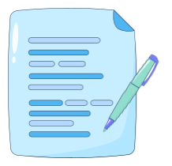

# Documentation_and_Solution_Life_Cycle_in_AI_System_Architecture

Source: https://www.educative.io/courses/claude-certified-architect-professional-exam/documentation-handoff-and-the-solution-life-cycle

---

[Home](https://www.educative.io/)

[Courses](https://www.educative.io/search?tab=courses)

[Master Claude Certified Architect – Professional Exam (CCAR-P)](https://www.educative.io/courses/claude-certified-architect-professional-exam)

# Documentation, Handoff, and the Solution Life Cycle

Explore how to document architectural decisions throughout a system's life cycle, ensuring teams can operate AI systems effectively even without the architect. Understand the five life cycle phases and create operational guidance to keep documentation current and actionable.

We'll cover the following...

- [Five phases, one throughline](https://www.educative.io/courses/claude-certified-architect-professional-exam/documentation-handoff-and-the-solution-life-cycle#Five-phases-one-throughline)
- [Capturing the why behind a decision](https://www.educative.io/courses/claude-certified-architect-professional-exam/documentation-handoff-and-the-solution-life-cycle#Capturing-the-why-behind-a-decision)
- [Operational guidance for a team without the architect](https://www.educative.io/courses/claude-certified-architect-professional-exam/documentation-handoff-and-the-solution-life-cycle#Operational-guidance-for-a-team-without-the-architect)
- [Keeping documentation current through iteration](https://www.educative.io/courses/claude-certified-architect-professional-exam/documentation-handoff-and-the-solution-life-cycle#Keeping-documentation-current-through-iteration)
- [Anti-patterns](https://www.educative.io/courses/claude-certified-architect-professional-exam/documentation-handoff-and-the-solution-life-cycle#Anti-patterns)
- [Exercise: Close the loop](https://www.educative.io/courses/claude-certified-architect-professional-exam/documentation-handoff-and-the-solution-life-cycle#Exercise-Close-the-loop)
- [What’s next?](https://www.educative.io/courses/claude-certified-architect-professional-exam/documentation-handoff-and-the-solution-life-cycle#Whats-next)

Discovery produced the real requirements and constraints. Communication turned decisions and trade-offs into an agreement that both sides actually understood. This lesson closes the loop by carrying all of that through the rest of a system’s life, packaged so a team that was never in the room for any of it can run the system correctly. A system does not stop needing an architect’s judgment once it ships. It needs that judgment captured well enough that other people can act on it without the architect present.

In this lesson, we will cover:

- The five phases of a system’s life cycle: discovery, design, handoff, monitoring, and iteration, and where documentation actually earns its keep across all five.
- What a handoff document needs to capture beyond the architecture itself: why each decision was made, in addition to what was decided.
- Writing operational guidance a team can act on directly when a guardrail or an alert fires, without the architect available to explain it.
- Keeping documentation current as a system moves through monitoring and iteration, instead of letting it drift into something actively misleading.

## Five phases, one throughline[#](https://www.educative.io/courses/claude-certified-architect-professional-exam/documentation-handoff-and-the-solution-life-cycle#Five-phases-one-throughline)

A system’s life cycle runs through five phases: Discovery surfaces the real requirements and constraints, design turns those into an architecture, handoff transfers the system to the team that will run it, monitoring watches it in production, and iteration improves it based on what monitoring finds. Documentation is not a deliverable that appears in one of these phases. It is a thread that should exist from the first phase onward, gets consolidated at handoff, and then stays alive through the two phases that follow.

|  |  |
| --- | --- |
| **Phase** | **What It Contributes to Documentation** |
| Discovery | The requirements-and-constraints artifact, including which limits are genuinely binding |
| Design | The decisions made and, critically, the reasoning behind each one |
| Handoff | A consolidated package a team can actually run the system from, without the architect present |
| Monitoring | The operational signals and thresholds a team watches once the system is live |
| Iteration | Updates to every earlier artifact whenever a change actually alters what was documented |

A team that starts writing documentation only once handoff begins is trying to reconstruct, from memory, reasoning that was clear in the moment and has already started to fade. At Atlas, the requirements-and-constraints artifact from discovery and the negotiated service-level agreement from the communication lesson are not separate deliverables that the handoff package references from a distance. They are folded directly into it, so the team receiving the system inherits the same understanding of what was needed and what was promised that shaped every decision along the way.

## Capturing the why behind a decision[#](https://www.educative.io/courses/claude-certified-architect-professional-exam/documentation-handoff-and-the-solution-life-cycle#Capturing-the-why-behind-a-decision)

The test for whether documentation actually works is simple to state and easy to fail: Could someone who was never in the room run this system correctly using only what is written down? An architecture diagram, a list of components, and a description of what each one does answer what was built. They do not answer why, and the why is exactly what a team needs to avoid quietly undoing a deliberate decision later.

Consider a component documented as running on a specific model tier, with no explanation of why that tier was chosen over a cheaper one. Months later, a cost-review pass finds this component and, with nothing on record explaining the choice, downgrades it to save money. It is exactly the kind of optimization decision covered earlier in this course, but made here without the correctness context that decision actually needed. The accuracy problem that the original tier was chosen to prevent reappears, and the team making the change has no way to know they are undoing something deliberate rather than fixing something wasteful.

**Exam lens:** A scenario describing a later change that undoes an earlier, deliberate trade-off is testing whether you will recognize the actual gap as missing documentation of the original reasoning rather than a mistake made by the team that changed it.

## Operational guidance for a team without the architect[#](https://www.educative.io/courses/claude-certified-architect-professional-exam/documentation-handoff-and-the-solution-life-cycle#Operational-guidance-for-a-team-without-the-architect)

An architecture diagram tells a team what exists. It does not tell an on-call engineer what to do at two in the morning when a guardrail’s fail-secure behavior activates or when an escalation trigger fires and a case needs to move to a specific reviewer. That translation from architecture to action is its own piece of documentation, and skipping it leaves a team that inherited a well-designed system with no way to operate it correctly.

Useful operational guidance states, for each signal a team is likely to see, what it means and what the correct response is: which alert corresponds to which failure mode covered earlier in this course, who gets paged when a guardrail denies a request during an authorization outage, and what a reviewer is supposed to do with an escalated case once it reaches them. This is where the guardrail and escalation design covered in the governance chapter becomes usable to someone who was not part of designing it.

For Atlas, that translation means the handoff package names, for each of the four escalation triggers, exactly which queue a flagged case lands in and which role is responsible for picking it up. It also states plainly that a tool-call authorization failure during an outage should be treated as a denial to investigate rather than a bug to route around. A new on-call engineer reading this does not need to reconstruct the reasoning behind fail-secure design from first principles at two in the morning. The document already tells them what to do.

## Keeping documentation current through iteration[#](https://www.educative.io/courses/claude-certified-architect-professional-exam/documentation-handoff-and-the-solution-life-cycle#Keeping-documentation-current-through-iteration)

A system does not stop changing once it ships. Monitoring surfaces regressions and opportunities, and iteration acts on them: a prompt revision, a retrieval-depth change, a retuned escalation threshold. Every one of these changes the thing the original documentation described, and if the documentation is never updated to match, it does not simply become incomplete. It becomes actively misleading, since a team reading it has no way to know it no longer reflects reality.

Stale documentation is often worse than no documentation at all because a team trusts a written artifact in a way they would never trust their own uncertain memory. Keeping it current needs an explicit owner and a clear trigger tied to the same event that changes the system, rather than hoping someone remembers to update a document that nobody was assigned to maintain.

**Exam lens:** A scenario describing a team that trusts outdated documentation and makes a change that reintroduces a problem that iteration had already fixed is testing whether you will recognize the failure as a documentation-maintenance gap rather than a flaw in the iteration process itself.

## Anti-patterns[#](https://www.educative.io/courses/claude-certified-architect-professional-exam/documentation-handoff-and-the-solution-life-cycle#Anti-patterns)

These are the wrong-but-tempting moves the exam uses as distractors.

- **Treating documentation as a deliverable produced only at handoff:** Waiting until the system is ready to transfer before writing anything down, rather than letting documentation accumulate from discovery onward.
- **Documenting what was built without documenting why:** Leaving future readers with no way to tell a deliberate trade-off apart from an accident worth fixing.
- **Leaving operational response implicit:** Providing an architecture diagram with no translation of what a team should do when a specific alert or guardrail behavior appears.
- **Letting documentation go stale without an owner:** Assuming someone will remember to update a document after each change, rather than assigning that responsibility explicitly.
- **Trusting a written artifact more than it deserves:** Acting on outdated documentation without checking the current state of the system it claims to describe.

## Exercise: Close the loop[#](https://www.educative.io/courses/claude-certified-architect-professional-exam/documentation-handoff-and-the-solution-life-cycle#Exercise-Close-the-loop)

Each scenario tests whether you can identify a documentation, handoff, or life cycle gap. Choose the best answer.

Technical Quiz

1.

A team decides to wait until a system is ready for handoff before writing any documentation, planning to describe the full architecture from scratch in one dedicated effort at that point. What is the better approach?

A.

Wait until the handoff phase formally begins, then write the full architecture documentation entirely from scratch in one single dedicated effort.

B.

Documentation should start forming during discovery itself, and get consolidated at handoff rather than written there for the first time.

C.

Rely on the original design team’s memory of decisions instead of maintaining any written documentation across the system’s life cycle.

D.

Wait until the system has gone through several rounds of iteration, then document only its current, final configuration.

---

1 / 4

## What’s next?[#](https://www.educative.io/courses/claude-certified-architect-professional-exam/documentation-handoff-and-the-solution-life-cycle#Whats-next)

With discovery, communication, and documentation carrying a system through its full life cycle, the chapter quiz that follows draws on all three lessons together before the course turns to developer productivity and the operational enablement that supports the team now running what this chapter has handed off.

Communicating Architectural Decisions and Trade-Offs

Stakeholder Communication and Life Cycle Quiz

Ask

[Five phases, one throughline](https://www.educative.io/courses/claude-certified-architect-professional-exam/documentation-handoff-and-the-solution-life-cycle#Five-phases-one-throughline)

[Capturing the why behind a decision](https://www.educative.io/courses/claude-certified-architect-professional-exam/documentation-handoff-and-the-solution-life-cycle#Capturing-the-why-behind-a-decision)

[Operational guidance for a team without the architect](https://www.educative.io/courses/claude-certified-architect-professional-exam/documentation-handoff-and-the-solution-life-cycle#Operational-guidance-for-a-team-without-the-architect)

[Keeping documentation current through iteration](https://www.educative.io/courses/claude-certified-architect-professional-exam/documentation-handoff-and-the-solution-life-cycle#Keeping-documentation-current-through-iteration)

[Anti-patterns](https://www.educative.io/courses/claude-certified-architect-professional-exam/documentation-handoff-and-the-solution-life-cycle#Anti-patterns)

[Exercise: Close the loop](https://www.educative.io/courses/claude-certified-architect-professional-exam/documentation-handoff-and-the-solution-life-cycle#Exercise-Close-the-loop)

[What’s next?](https://www.educative.io/courses/claude-certified-architect-professional-exam/documentation-handoff-and-the-solution-life-cycle#Whats-next)